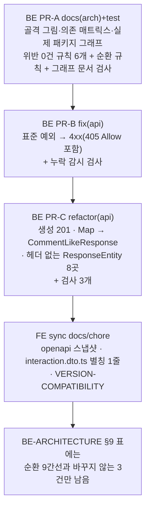

# BE 아키텍처 골격: 레이어 관계 문서화 · 표준 대비 점검 · 도구로 고정

> 요약: Controller·Service·DTO·Repository·엔티티가 서로 무엇을 참조하고 어떤 타입을 주고받는지를 `docs/BE-ARCHITECTURE.md`에
> 그림과 표로 정본화한다. 지금 위반 0건인 방향 규칙과 "문서화된 9개 말고는 패키지 순환 금지" 규칙은 PR-A에서 바로 켠다.
> 문서·표준과 어긋난 응답(표준 예외 500, 201 불일치, Map 응답, 헤더 없는 ResponseEntity)은 고치면서 검사를 함께 켠다.
> 도구는 이미 쓰는 ArchUnit 1.5.0과 JUnit 리플렉션만 쓰고, 새 의존성은 없다. PR 4개: BE PR-A → PR-B → PR-C → FE sync.

## 0. 현재 상황 (Context)

### 계기

사용자 요청(2026-10-26): _"백엔드 파이프라인 디자인패턴이 업계 표준인지, 놓치는 부분은 뭔지 전체 검토. 아키텍처 골격을
다잡는다는 생각으로 Controller·Service·DTO 등의 연관관계를 보여주고, 패턴이 지켜지도록 문서화한 뒤 문서에 맞지 않는 곳을
보고, 도구로 통제할 수 있는지 계획"_.

같은 턴의 정정: _"추론하지 말고 소스코드라는 명확한 근거로 문제·근거·계획을 세운다"_. 그래서 아래 사실은 세 가지로만 확인했다.

- 소스(`db2bd8a`)
- 설치본 또는 업스트림 태그 라이브러리 소스
- 운영 로그·요청

확인하지 못한 것은 "남은 것"에 따로 둔다.

### 기준 커밋

- BE `origin/main` = `db2bd8a`(#112), `git ls-remote`로 확인했다. 로컬 메인 체크아웃은 `9a901ce`로 뒤처져 있다.
- 숫자는 import·FQN을 grep·스크립트로 센 값이다. 착수할 때 ArchUnit(바이트코드)으로 다시 센다. inline 함수 때문에
  간선이 더 보이면 문서에 반영하고 보고한다.

### 사실 — 골격 (위반 0건, 같은 패키지 안 참조 포함)

| 규칙                                                                                 | 결과      | 확인 방법                                                                                                            |
| ------------------------------------------------------------------------------------ | --------- | -------------------------------------------------------------------------------------------------------------------- |
| Controller → `Table*` 엔티티                                                         | 0         | `*Controller.kt`에서 `Table[A-Z]` 토큰                                                                               |
| domain·infra의 Service·Repository·엔티티·DTO → 서블릿·`ResponseEntity`·`ApiResponse` | 0         | 컨트롤러 밖에서 쓰는 곳은 진입점·필터·설정·핸들러뿐이다. `SupabaseStorageService`는 사설 클래스 이름이 걸린 오탐이다 |
| Repository·엔티티 → Service·Controller·DTO                                           | 0         | 걸린 것은 주석뿐이다                                                                                                 |
| DTO → Service·Repository                                                             | 0         | 걸린 것은 주석뿐이다                                                                                                 |
| domain의 `*Request`·`*Response`가 `*DTO.kt` 밖에 정의                                | 0         | `data class` 전수 확인                                                                                               |
| 엔티티를 돌려주는 Service 메서드의 호출자                                            | Service만 | `MemberService` 6개, `CategoryService.getCategoriesByIds`. 호출자는 `AuthService`·`PostService`뿐이다                |

엔티티 → 응답 DTO 변환 위치(생성자 호출 전수):

- Service: `AuthService`, `CommentService`, `BookmarkFolderService`, `InteractionService`, `PostService`, `UploadService`
- Assembler: `PostResponseAssembler`
- DTO의 `companion from()`: `CategoryDTO`, `CommentDTO`, `PostDTO`
- Controller: Service가 돌려준 스칼라만 감싼다 — `AuthController`의 `TokenResponse` ×3, `InteractionController`의 `BatchResultResponse` ×3

### 사실 — 문서·표준과 어긋난 곳

| #   | 문제                                                    | 근거                                                                                                                                                                    |
| --- | ------------------------------------------------------- | ----------------------------------------------------------------------------------------------------------------------------------------------------------------------- |
| A   | Spring MVC 표준 예외 19종 중 14종이 500으로 떨어진다    | 아래 상세                                                                                                                                                               |
| B   | 생성 5곳이 HTTP 200인데 본문은 201                      | 아래 상세                                                                                                                                                               |
| C   | 응답 데이터가 이름 없는 `Map<String, Boolean>`인 곳 2곳 | `InteractionController.kt:62,77`. FE `interaction.dto.ts:14`가 생성 스키마 이름 `ApiResponseMapStringBoolean`에 의존한다                                                |
| D   | 헤더가 없는데 `ResponseEntity.ok(...)`를 쓰는 곳 8곳    | 아래 상세                                                                                                                                                               |
| E   | 패키지 순환                                             | 아래 상세                                                                                                                                                               |
| F   | 문서 오기                                               | §1 `feed-item` 행. 실제 진입점은 `LambdaHandler.kt:315` → `FeedCrawlService.processFeedItemJob`이고, 항목마다 `FeedItemProcessor`를 부른다(`FeedCrawlService.kt:97-99`) |

**A. 표준 예외가 500으로 떨어진다**

- 우리 핸들러가 처리하는 것은 `ResponseEntityExceptionHandler.java:118-138`의 목록 중 일부뿐이다.
- 운영에서 재현했다.
  - `DELETE /api/common/category-option`: 500. 로그에는 `HttpRequestMethodNotSupportedException at RequestMappingInfoHandlerMapping.handleNoMatch(:267)`이 ERROR "Unhandled exception"으로 찍히고, 스택이 이벤트 약 110개로 쪼개진다(2026-10-26 07:20:57Z).
  - `email` 파라미터가 빠진 요청: 500.
- 30일 Logs Insights 결과, 이 예외는 위 2건(재현)뿐이다. 실사용 피해는 아직 없다.
- 경로(spring-webmvc 6.2.14): `RequestMappingInfoHandlerMapping:253-281` → `AbstractHandlerExceptionResolver.shouldApplyTo:186-216`
  → 우리 `@ExceptionHandler(Exception::class)`(`GlobalExceptionHandler.kt:378`). Spring 기본 리졸버는 그 뒤 순서라 돌지 않는다
  (`WebMvcConfigurationSupport:1069-1091`).
- 415는 같은 경로(`:268-270`)다. 소스로만 확인했고 운영 재현은 하지 않았다.

**B. 생성 5곳이 HTTP 200**

- 대상: `PostController.kt:55`, `CommentController.kt:57,73`, `BookmarkFolderController.kt:38`, `UploadController.kt:42`.
- `CommentControllerTest`가 `status().isOk`와 본문 201을 함께 단정하고 통과한다.
- FE는 `response.ok`만 본다(`client.ts:362`).
- `LambdaHandler.kt:252`는 MockMvc 응답 상태를 그대로 넘긴다.

**D. 헤더 없는 `ResponseEntity`**

- 대상: `AuthController.kt:150,164,227,239,254,266,282,295`.
- 문서 §4는 "응답 헤더를 붙여야 하는 곳만 `ResponseEntity`"라고 적었다.
- 그런데 `ControllerSignatureRulesTest`의 `returnsApiResponse`는 어디서나 허용한다. 주석은 "auth만"이라고 적어 코드와 다르다.

**E. 패키지 순환**

- 범위: 패키지 18개(루트·tools·exception 포함), 간선 58개.
- 다음 9개 간선을 빼면 순환이 0개가 된다(스크립트 계산).
- 문서에 이미 허용 예외로 적힌 것 5개
  - `global.common→domain.auth`(`RateLimitService.kt:3`)
  - `infra.aws→domain.post·comment·feed`(디스패처 이벤트 DTO 3개)
  - `global.exception→global.common`(`GlobalExceptionHandler.kt:3` `ErrorResponse`). 이것은 반대 방향 `RateLimitService.kt:4`와 순환을 이룬다
- 문서에 없는 것 4개
  - `domain.member→domain.auth`(`MemberService.kt:3-4`, `SignupRequest`·`UpdateAccountRequest`)
  - `domain.post→domain.comment`(`PostService.kt:4`, `PostResponseAssembler.kt:4`)
  - `domain.post→domain.interaction`(`PostService.kt:5-7`, `PostResponseAssembler.kt:5-7`, `PostRepositoryImpl.kt:4-5`)
  - `domain.interaction→domain.comment`(`InteractionService.kt:3`)
- 지금 검사는 `*Service`끼리만 묶는다(`ArchitectureRulesTest.kt:39-41`). 그래서 Assembler·Repository를 거친 순환은 보지 못한다.

**규칙을 고칠 곳(사용자 결정)**

- 문서 §3은 "Service: DTO 변환"이라고 적었다.
- 컨트롤러가 Service의 스칼라를 감싸는 6곳은 엔티티를 만지지 않는다.
- 중요한 경계(컨트롤러는 엔티티를 모른다)는 위 0건 규칙으로 막는다.

### 사실 — 근거를 보고 문제 목록에서 뺀 것

- **"`deploy.yml`이 `integrationTest`를 돌리지 않는다"(지금 문서의 "검증하지 않은 위험 후보")**
  - main 룰셋 "Main Branch Protect"가 `check` 잡을 필수로 요구한다. 이 잡은 `ci.yml:58`에서 `integrationTest`까지 돈다(`gh api .../rulesets` 확인).
  - 다만 `strict_required_status_checks_policy: false`라서, 뒤처진 브랜치의 통과 결과로도 병합된다. 이 사실만 남긴다.
- **비공개 글 게이트 6곳·이메일 인증 게이트 4곳이 인라인**
  - 대상: `CommentService.kt:63,199,262`, `PostService.kt:199`, `BookmarkFolderService.kt:158`, `InteractionService.kt:153`, 그리고 `emailVerified` 4곳.
  - 문서 §7-10이 정석으로 둔 형태라 위반이 아니다. 공용화 후보로만 남긴다.
- **`CommentResponse` 변환 2벌**(`CommentService.kt:84-128`, `:460-474`): 규칙 위반이 아니라 중복이다. "남은 것"에 둔다.

### 사용자 결정 (2026-10-26)

| 항목          | 결정                                                                                 | 진 선택지와 이유                                                                                                                                                                                                                                                                                                                                                                |
| ------------- | ------------------------------------------------------------------------------------ | ------------------------------------------------------------------------------------------------------------------------------------------------------------------------------------------------------------------------------------------------------------------------------------------------------------------------------------------------------------------------------- |
| A 에러 형식   | 지금 봉투(`ErrorResponse`) 유지 + 표준 예외를 핸들러 하나로 처리                     | **RFC 9457 ProblemDetail 전환**: 모든 에러 응답 모양이 바뀌어 FE·문서·테스트 범위가 크다. **`ResponseEntityExceptionHandler` 상속**: 기존 핸들러 4개와 겹쳐 기동이 실패한다(`ExceptionHandlerMethodResolver.java:142-145`). **개별 핸들러**: Spring 업그레이드로 느는 예외를 매번 따라가야 한다                                                                                 |
| B 201         | 실제 HTTP 201(`@ResponseStatus`)                                                     | 본문을 200으로 바꾸면 [RFC 9110 §9.3.3](https://www.rfc-editor.org/rfc/rfc9110#section-9.3.3)의 SHOULD에서 멀어진다. 그대로 두면 불일치가 남는다                                                                                                                                                                                                                                |
| C·D 응답 모양 | Map 2곳 → 이름 있는 DTO, `ResponseEntity` 8곳 정리, 스칼라 감싸기는 규칙을 고쳐 허용 | —                                                                                                                                                                                                                                                                                                                                                                               |
| 도구          | ArchUnit 확장 + 그래프 문서 검사                                                     | **Spring Modulith**: 기본 모듈이 메인 패키지 직계 하위(`domain`·`global`·`infra`·`tools`)라 도메인을 구분하지 못한다([Fundamentals](https://docs.spring.io/spring-modulith/reference/fundamentals.html)). **Detekt 1.23.8**: Kotlin 2.0.21 기준이다([호환 표](https://detekt.dev/docs/introduction/compatibility/)). **Konsist**: 이번 규칙은 모두 바이트코드·리플렉션으로 된다 |

## 1. 전체 계획

순서의 이유:

- 세 BE PR 모두 BE-ARCHITECTURE §2·§4·§9를 고친다. 그래서 **차례로 병합**한다.
- PR-B와 PR-C는 둘 다 `GlobalExceptionHandler`·컨트롤러 테스트를 건드리지 않게 나눴다. 그래도 문서가 겹친다.
- FE sync는 PR-C가 배포된 운영 스펙을 받아야 하므로 마지막이다.

## 2. 세부 계획

### BE PR-A `docs(arch)` — 골격 정본과 위반 0건 규칙

**1) `docs/BE-ARCHITECTURE.md`**

§3 맨 앞에 "레이어 골격" 소절을 새로 둔다.

- **그림 1: 역할 간 허용 의존(Mermaid)**
  - Controller → Service·Assembler → Repository → `Table*`
  - `*DTO`는 Controller(요청 수신·응답 감싸기)와 Service·Assembler(엔티티 → 응답 변환)가 쓴다
  - 실패는 `GlobalExceptionHandler` → `ErrorResponse`
  - 화살표마다 그 방향을 막는 검사 이름을 단다
- **그림 2: 요청 하나의 타입 흐름(sequenceDiagram)**
  - JSON → `*Request` → Controller(`Authentication` → `UUID`)
  - → Service(`UUID`, `*Request`) → Repository(`Table*`)
  - → Service·Assembler(`*Response`) → Controller(`ApiResponse<*Response>`) → JSON
- **의존 매트릭스 표**
  - 행: Controller·Service류·Repository·엔티티·DTO
  - 열: 위 5개 + 웹 타입·다른 도메인
  - 칸: 허용/금지와 검사명
  - 예외 칸에는 근거를 단다: 다른 도메인 Repository 허용(§3 기존), `tools/`는 Repository 직접 사용 허용(1회성 CLI)

§3의 기존 내용을 고친다.

- `*Service.kt` 행: "DTO 변환" → "엔티티 → 응답 DTO 변환(Service·Assembler·DTO `from()`)".
- `*Controller.kt` 행: "Service가 돌려준 스칼라를 응답 DTO로 감싸는 것은 허용(`TokenResponse`, `BatchResultResponse`). 엔티티는 모른다"를 넣는다.

§1 "패키지 역할" 아래에 "실제 패키지 의존 그래프"를 둔다.

- `<!-- package-graph:start -->`·`<!-- package-graph:end -->` 사이에 생성된 Mermaid를 넣는다.
- 허용된 순환 간선 9개는 점선으로 그린다.
- `global.exception`(모든 패키지가 의존), 루트, `tools/`는 그림에서 빼고 본문에 한 줄로 적는다. 순환 검사에는 넣는다.

그 밖의 갱신:

- §1 `feed-item` 행 정정(F).
- §2 표에 새 검사를 넣는다.
- §9: "패키지 순환 허용 간선 9개"(각 간선의 대표 `파일:줄`과 이유) 행을 넣는다. PR-B·PR-C로 고칠 A·B·C·D는 "PR-B/PR-C에서 정리"로 표기한다.
- 새 §11 "업계 표준 대비"
  - 표: 항목 | 표준과 출처(번역 인용 + 링크) | 이 레포 | 결정
  - 항목: 에러 응답(RFC 9457·Spring `ResponseEntityExceptionHandler`), 201·Location(RFC 9110 §9.3.3), 405 Allow(RFC 9110 §10.2.1), 경계 검증(`@Valid` 10/23), 모듈 순환, 관측성, 지원 버전
  - 도구 선택에서 진 선택지 3개와 이유
- "남은 것" 갱신: 아래 `## 남은 것`. `deploy.yml` 항목은 룰셋 근거와 함께 뺀다.
- "마지막 검토" 날짜를 갱신한다.

**2) `.claude/CLAUDE.md`(BE)**

- 패턴 표에 "레이어 골격 | §3 | …" 1행을 넣는다.
- Critical Rules의 해당 줄에 새 검사 이름을 덧붙인다(PR1 방식).

**3) 새 검사**

`architecture/LayerSkeletonRulesTest.kt`를 새로 만든다.

- 선례는 `AppWideArchitectureRulesTest`다: 앱 전체 분석, `ImportOption.DoNotIncludeTests`, 왜 그렇게 하는지 주석.
- ArchUnit 규칙은 대상 0개면 실패한다(`failOnEmptyShould`, §2 기존 서술).

| 검사                                         | 막는 것                                                                                                                                           | 구현                                                                                                  |
| -------------------------------------------- | ------------------------------------------------------------------------------------------------------------------------------------------------- | ----------------------------------------------------------------------------------------------------- |
| `controllersMustNotDependOnEntities`         | `@RestController` → `@Entity`                                                                                                                     | ArchUnit                                                                                              |
| `domainCodeMustNotDependOnWebTypes`          | domain·infra의 비컨트롤러(서블릿 `Filter` 구현 제외) → `jakarta.servlet..`·`ResponseEntity`·`ApiResponse`·`ErrorResponse`·`web.bind.annotation..` | ArchUnit                                                                                              |
| `persistenceMustNotDependOnUpperLayers`      | Repository·`*RepositoryImpl`·`@Entity` → Service·`@Component`·Controller·`*DTO.kt` 클래스                                                         | ArchUnit. DTO는 `Source.getFileName()`으로 판정                                                       |
| `dtosMustNotDependOnBeans`                   | `*DTO.kt` 클래스 → `@Service`·`@Component`·Repository·Controller                                                                                  | ArchUnit                                                                                              |
| `apiDtosLiveInDtoFiles`                      | domain의 `*Request`·`*Response`가 `*DTO.kt` 밖에 있음                                                                                             | ArchUnit `Source.getFileName()`                                                                       |
| `packagesMustBeFreeOfCyclesExceptDocumented` | 새 패키지 순환                                                                                                                                    | `slices().matching("com.example.linksphere.(*).(*)..")` + 간선 9개 `ignoreDependency`, 각각 근거 주석 |

`architecture/PackageGraphDocTest.kt`도 새로 만든다.

- ArchUnit `ClassFileImporter`로 main 클래스의 패키지 간선을 계산하고, 정렬된 Mermaid를 만든다.
- BE-ARCHITECTURE.md의 마커 사이 블록과 비교한다. 다르면 새 블록 전문과 추가·삭제된 간선을 메시지로 내고 실패한다.
- 테스트가 파일을 고쳐 쓰지는 않는다.
- 파일 읽기 선례는 `HttpStatusLiteralTest`(소스 텍스트 스캔)다.
- 하한선을 둔다: 패키지 15개 이상.

**4) 계획 스냅샷**: 이 파일을 `docs/plans/2026-10-26-be-architecture-skeleton.md`로 커밋한다(FE sync PR에도).

### BE PR-B `fix(api)` — Spring MVC 표준 예외를 4xx로 (결정 A)

`GlobalExceptionHandler`에 핸들러 하나를 추가한다.

- `@ExceptionHandler(ServletException::class, ErrorResponseException::class)`
- 예외가 `org.springframework.web.ErrorResponse`면 그 `statusCode`·`headers`(405의 `Allow`, `HttpRequestMethodNotSupportedException.java:124-131`)를 그대로 쓴다.
- 아니면 기존 `handleException`(500)으로 넘긴다.
- code는 400이면 `INVALID_INPUT`(기존 입력 오류 code), 그 밖은 `HttpStatus` 이름(`METHOD_NOT_ALLOWED`, `UNSUPPORTED_MEDIA_TYPE` …).
- 로그는 4xx면 warn(스택 없이), 5xx면 error.
- 기존 전용 핸들러는 그대로 둔다.
  - 해당 예외: `MissingRequestCookieException`·`NoResourceFoundException`·`HttpMediaTypeNotAcceptableException` 등
  - 더 구체적인 타입이 이긴다(`ExceptionHandlerMethodResolver.java:234-243`, `ExceptionDepthComparator`).
  - 그래서 응답이 바뀌는 것은 지금 500인 예외뿐이다.

새 검사 `global/exception/SpringMvcExceptionCoverageTest.kt`:

- 대상 목록은 설치본의 `ResponseEntityExceptionHandler.handleException`에 붙은 `@ExceptionHandler.value`에서 읽는다(6.2.14 기준 20종). Spring을 올리면 대상이 저절로 따라온다.
- 각 타입을 `ExceptionHandlerMethodResolver(GlobalExceptionHandler::class.java).resolveMethodByExceptionType`(`:211`)에 넣어, 안전망 `handleException`으로 가는지 본다.
- 허용 목록은 스펙상 5xx인 것과 발생 경로가 없는 것뿐이고, 각각 이유를 단다.
  - 스펙상 5xx: `HttpMessageNotWritable`·`ConversionNotSupported`·`MethodValidation`·`AsyncRequestNotUsable`
  - 발생 경로 없음: `@ModelAttribute`를 쓰지 않는 `TypeMismatchException` 상위형, async·multipart 미사용

함께 고칠 것:

- `@WebMvcTest` 3건: `DELETE /common/category-option` → 405와 `Allow: GET`, `email` 누락 → 400 `INVALID_INPUT`, `POST /auth/login` `text/plain` → 415
- BE-ARCHITECTURE §4 code 표와 §9
- CHANGELOG `Fixed`(`api`)

### BE PR-C `refactor(api)` — 응답 모양을 문서에 맞춤 (결정 B·C·D)

| 대상                              | 변경                                                                                                                                                                                           | 동작 변화                       |
| --------------------------------- | ---------------------------------------------------------------------------------------------------------------------------------------------------------------------------------------------- | ------------------------------- |
| 생성 5곳 + `signup`               | `@ResponseStatus(HttpStatus.CREATED)`(reason 없이. reason이 있으면 `sendError`가 된다, `ServletInvocableHandlerMethod.java:150-163`). `signup`은 헤더가 없으므로 `ApiResponse` 반환으로 바꾼다 | HTTP 200 → 201. 본문은 그대로   |
| `InteractionController.kt:62,77`  | `CommentLikeResponse(val isLiked: Boolean)`를 `comment/CommentDTO.kt`에 둔다(선례: `PostLikeResponse`가 `PostDTO.kt`에 있음). 컨트롤러가 스칼라를 감싼다(새 규칙상 허용)                       | JSON 같음. 스키마 이름만 바뀐다 |
| `AuthController.kt` 헤더 없는 8곳 | `ResponseEntity.ok(ApiResponse(...))` → `ApiResponse(...)`                                                                                                                                     | 없음                            |

Swagger 설명 중 "HTTP 상태는 200 이고 본문 status 필드만 201"(`BookmarkFolderController.kt:28`) 같은 문구도 고친다.

새 검사:

| 검사                                     | 막는 것                                                                                                                                       | 구현                                                                        |
| ---------------------------------------- | --------------------------------------------------------------------------------------------------------------------------------------------- | --------------------------------------------------------------------------- |
| `생성 응답은 HTTP 상태도 201이다`        | 본문에 `HttpStatus.CREATED`를 쓰는데 `@ResponseStatus(CREATED)`가 없는 엔드포인트(반대 방향도)                                                | ArchUnit `JavaMethod.getFieldAccesses()`로 `HttpStatus.CREATED` 읽기를 본다 |
| `ResponseEntity는 헤더를 붙일 때만 쓴다` | `ResponseEntity`를 반환하는데, 그 메서드나 같은 클래스에서 부르는 private 메서드가 `HeadersBuilder.header/headers/cacheControl`을 부르지 않음 | ArchUnit `getMethodCallsFromSelf()`, 한 단계                                |
| `응답 데이터에 Map을 쓰지 않는다`        | `ApiResponse<Map<…>>`                                                                                                                         | `ControllerSignatureRulesTest.returnsApiResponse` 확장 + 낡은 주석 정정     |

테스트 갱신:

- `CommentControllerTest`·생성 엔드포인트 컨트롤러 테스트의 `isOk` → `isCreated`. 수정 전에는 이 단정이 실패한다.
- `AuthControllerTest`의 signup 단정.

CHANGELOG는 `Changed`(`api`)에 생성 201과 댓글 좋아요 응답 스키마 이름을 쓴다.

### FE sync `chore(api)` — 스펙 동기화 (BE PR-C 배포 뒤)

- `pnpm codegen:fetch && pnpm codegen` → `openapi.json`·`openapi.gen.ts`.
- `src/entities/interaction/model/interaction.dto.ts:14`: `Unwrap<'ApiResponseMapStringBoolean'>` → `components['schemas']['CommentLikeResponse']`.
  - 선례는 같은 파일과 `post.dto.ts`의 named schema 사용이다.
  - FE는 응답 코드 키를 쓰지 않으므로 201 변경으로 타입이 깨지지 않는다(`api.type.ts`는 `components['schemas']`만 쓴다).
- `docs/VERSION-COMPATIBILITY.md`에 1행을 넣는다(FE #413 선례).
- 계획 스냅샷을 커밋한다.

## 영향 범위 (BE CLAUDE.md §5)

| PR      | CRUD 실패 지점                                                                             | 기존 기능 회귀 점검                                                                                                                                                                                                |
| ------- | ------------------------------------------------------------------------------------------ | ------------------------------------------------------------------------------------------------------------------------------------------------------------------------------------------------------------------ |
| PR-A    | main 동작 변화 없음(문서·테스트만)                                                         | 새 검사가 현재 코드에서 0건인지 바이트코드로 다시 센다. 기존 `ArchitectureRulesTest`는 건드리지 않는다                                                                                                             |
| PR-B    | 정상 요청은 변화 없음. 잘못된 메서드·미디어 타입·파라미터 누락만 500 → 4xx                 | 기존 전용 핸들러(쿠키 누락 401, 404 리소스, 406 빈 본문)가 그대로 이기는지 `@WebMvcTest`로 확인. `ExceptionHandlerCoverageTest`                                                                                    |
| PR-C    | C: 글·댓글·답글·폴더·업로드 서명·가입의 HTTP 상태 200 → 201. R: 댓글 좋아요 응답 JSON 동일 | FE `client.ts:362`는 `response.ok`. `LambdaHandler.kt:252`는 상태를 그대로 넘긴다. 운영 스펙의 응답 키가 "200" → "201"로 바뀌어, FE sync 전까지 매일 도는 openapi 차이 검사가 이슈를 연다(1차 점검 때와 같은 흐름) |
| FE sync | 없음                                                                                       | `pnpm type-check`·`pnpm test`·`pnpm check:docs`                                                                                                                                                                    |

배포 순서: PR-B·PR-C는 FE와 선후 제약이 없다. JSON 모양이 같고, FE는 바뀐 code·상태로 분기하지 않는다. FE sync만 PR-C 배포 뒤에 한다.

## 실행 전략

1차 점검과 같다(`docs/plans/2026-10-25-be-architecture-audit.md` "실행 전략").

**BE 워크트리**: FE 세션에서는 `EnterWorktree`를 BE에 쓸 수 없다.

1. `git -C <BE> fetch` → `git -C <BE> log origin/main..main`을 확인한다.
2. `git -C <BE> worktree add -b <브랜치> <BE>/.claude/worktrees/<이름> origin/main`
3. `application-secret.yml`·`firebase-service-account.json`을 복사한다.
4. `cd`로 워크트리에 들어간다.

**PR마다 반복**

1. `.gitmessage`를 읽는다.
2. 경로를 지정해 커밋한다(`git add`는 새 파일에만).
3. PR을 만들고 CI 녹색을 확인한다.
4. fresh general-purpose 서브에이전트에게 계획 대비 구현을 대조시켜 PR 본문 `## 계획 대비 구현`에 남긴다.
5. squash 병합한다.
6. 배포 워크플로 성공을 확인한다.
7. 워크트리와 로컬 브랜치를 정리한다.

**FE**: `EnterWorktree` → `cp ../../../.env .` → `pnpm install`.

## 검증 방법

- **모든 BE PR**: `./gradlew ktlintCheck test integrationTest`를 로컬과 CI에서 돌린다(1차 완료 시점 단위 510·통합 33).
- **새 검사**: 위반을 하나 일부러 넣어 실패하는지 한 번 확인하고 되돌린다(디스크 파일에서 `./gradlew test --tests <검사>`).
  - `controllersMustNotDependOnEntities`: 컨트롤러에 `TablePost` 파라미터 추가
  - 순환 규칙: `post`에서 `feed` 참조
  - 그래프 문서 검사: 문서에서 간선 1줄 삭제
  - 표준 예외 검사: 새 핸들러 주석 처리
- **PR-B 배포 뒤 운영 확인**: `curl`로 `DELETE /api/common/category-option`(OAC용 `x-amz-content-sha256` 헤더)가 405와 `Allow: GET`인지, `email` 누락이 400 `INVALID_INPUT`인지 본다. CloudWatch에서 해당 요청이 ERROR가 아니라 WARN 1줄인지 본다.
- **PR-C 배포 뒤**:
  - `pnpm codegen:fetch`로 받은 운영 스펙에서 생성 6개 operation의 응답 키가 "201"인지 본다.
  - 인증이 필요한 실제 생성 요청은 사용자에게 확인을 부탁한다.
- **FE sync**: `pnpm type-check`·`pnpm test`·`pnpm check:docs`.
- **배포 확인**: `gh run list --branch main --workflow "Deploy to AWS Lambda (SnapStart)"`로 그 SHA의 성공을 본 뒤에만 보고한다.

## 남은 것 (이번 범위 밖 — BE-ARCHITECTURE "남은 것"에 근거와 함께 기록)

- **관측성**
  - Lambda `LogFormat: Text`(`GetFunctionConfiguration`)라서 앱 로그 줄에 RequestId가 없다(플랫폼 `START` 줄에만 있다).
  - 예외 1건이 이벤트 약 110개로 쪼개진다.
  - 요청 처리 스레드가 모두 `main`이라 `context.awsRequestId`를 MDC에 넣는 방식이 가능하다. 구조화 로그 전환과 함께 별도 계획으로 한다.
- **Spring Boot 3.5.x OSS 지원이 2026-06-30에 끝났다**([api.spring.io](https://api.spring.io/projects/spring-boot/generations)).
  - 설치본은 3.5.8, 최신은 3.5.16·4.0.9·4.1.2다.
  - Dependabot은 github-actions만 본다(`.github/dependabot.yml:6`). 별도 계획.
- **201 Location 헤더**: `LambdaHandler`가 `/api`를 떼고 넘겨 `fromCurrentRequest()`가 틀린 경로를 만든다. FE는 쓰지 않는다.
- **경계 검증**
  - `@RequestBody` 23곳 중 `@Valid`는 10곳이다.
  - `PostCreateRequest`는 봇 경로(`FeedItemProcessor.kt:3-4`)도 써서 Service 검증이 필요하다.
  - `CommentService` 같은 검증 3벌(`:169-189`, `:238-253`, `:380-386`)과 `CommentResponse` 변환 2벌은 정리 후보다.
- **게이트 공용화 후보**: 비공개 글 6곳, 이메일 인증 4곳.
- **순환 해소 후보**: post·comment·interaction 역방향 간선 3개. 목록 조립(`PostResponseAssembler`·`PostRepositoryImpl` 필터 조인)을 별도 조회 패키지로 빼는 안이 있다. `member→auth`는 DTO 2개를 옮기면 끊긴다.
- **룰셋 `strict: false`**: 뒤처진 브랜치의 `check` 결과로도 병합된다.
- **기존 "남은 것" 중 유지할 항목**: 방식 혼재, 검증하지 않은 위험 후보(`deploy.yml` 항목만 뺌), 정리 후보.
