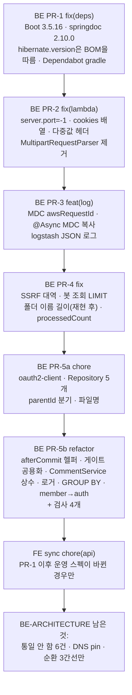

# BE 남은 것 정리: 보안 업데이트 · 위험 수정 · 죽은 코드·중복 정리 · 관측성

> 요약: 골격 점검(2026-10-26, BE #113~#115)의 "남은 것"을 소스·운영 근거로 다시 확인하고 정리한다.
> 순서는 다음과 같다.
>
> 1. 보안 권고 3건이 걸린 의존성을 올린다(Boot 3.5.16, springdoc 2.10.0).
> 2. Lambda 진입점의 실제 문제를 고친다: Tomcat 8080 바인딩, 쿠키·다중 헤더 전달, 죽은 multipart 경로.
> 3. 요청 ID가 붙은 JSON 로그를 켠다.
> 4. 도메인 위험을 고친다: SSRF 대역, 봇 조회, 폴더 이름 길이.
> 5. 죽은 코드와 중복을 정리하고 검사로 잠근다.
>
> 계약·FE에 닿는 통일 6건은 하지 않고, 지금 0건인 형태만 검사로 고정한다(사용자 결정).
> PR 7개: BE PR-1 → PR-2 → PR-3 → PR-4 → PR-5a → PR-5b → FE sync(스펙이 바뀌었을 때만).

## 0. 현재 상황 (Context)

### 계기

사용자 요청(2026-10-26): _"남은것들도 정리하고 싶은데"_. 대상은 BE `docs/BE-ARCHITECTURE.md`의 "남은 것" 전부다.
지난 정정(_"추론하지 말고 소스코드라는 명확한 근거로"_)에 따라, 모든 항목을 아래 근거로 다시 확인했다.

- 소스(`8af8fca` = BE origin/main = #115, 원격 트리와 같음을 확인)
- 설치본·업스트림 태그 라이브러리 소스
- 운영 로그·응답, 공식 문서·권고

### 사실 — 새로 확인된 보안 권고 (GitHub advisory로 직접 조회)

| 권고                                                                                                 | 등급     | 영향 범위 → 현재                                                                               |
| ---------------------------------------------------------------------------------------------------- | -------- | ---------------------------------------------------------------------------------------------- |
| Spring Security "HTTP 헤더가 일부 조건에서 안 써짐" CVE-2026-22732(GHSA-mf92-479x-3373)              | critical | `>= 6.5.0, < 6.5.9` → 설치 6.5.7(Gradle 캐시)                                                  |
| springdoc "Accept-Language별 OpenAPI 캐시 무한 증가로 메모리 고갈"(GHSA-rhhx-6j8h-8cvw, 저장소 권고) | high     | `starter-common >= 2.0.0, < 2.9.1` → 2.7.0. 운영에 `/v3/api-docs` 공개(`SecurityConfig.kt:55`) |
| Spring Boot 임시 디렉터리 예측 가능 CVE-2026-40973(GHSA-wwpq-f5c3-7hvx)                              | high     | `>= 3.5.0, < 3.5.14` → 3.5.8                                                                   |

- Boot 3.5.16은 OSS 마지막 패치이고 Maven Central에 있다. 3.5.17은 enterprise 전용이다(api.spring.io generations).
- 3.5.16 BOM의 Hibernate는 6.6.53이다. 그런데 `build.gradle.kts:95-97`이 `hibernate-vector:6.6.36.Final`을 고정하고 있어, Boot만 올리면 core와 vector 버전이 어긋난다.
- springdoc은 2.10.0이 "Spring Boot 3.5.16 기준 빌드"다(릴리스 노트).
  - 2.8.17·2.9.0에서 Kotlin nullable 처리가 바뀌었다. 우리 `NullableAwareModelConverter.kt`와 하는 일이 겹쳐 스펙이 달라질 수 있다(미확인 → FE sync에서 확인).
- Boot 3.5.12에는 설정 덮어쓰기 회귀(#49724)가 있었다. 3.5.13에서 고쳐졌으므로 3.5.16으로 건너뛰면 해당 없다.
- Dependabot은 BE·FE 모두 `github-actions`만 본다(`.github/dependabot.yml:4-15`). 지금까지 Dependabot PR은 0건이다.

### 사실 — Lambda 진입점 (운영으로 확인)

- **Tomcat이 Lambda 안에서 8080에 바인딩한다.**
  - 운영 로그 `Tomcat started on port 8080 (http) with context path '/api'`가 14일간 1,703회 찍혔다(Logs Insights).
  - 코드 경로: `LambdaHandler.kt:74-78`(서블릿 웹서버 컨텍스트 강제), `application.yml:2` `server.port: 8080`.
  - 문서 4곳이 "Tomcat 없음"이라고 틀리게 적었다: `docs/DEPLOY.md:48,72`, `README.md:420`, `docs/TRAFFIC-MANAGEMENT.md:143`, `LambdaHandler.kt:36` 주석.
- **응답 헤더는 이름당 첫 값만 간다**(`LambdaHandler.kt:247` `getHeader`).
  - 운영 로그아웃 응답은 `set-cookie` 1개가 정상이고, `vary: Origin`만 남았다. CORS가 `Vary`에 3값을 붙인다: SF 6.2.14 `DefaultCorsProcessor.java:75-84`.
  - AWS 문서: _"함수에서 쿠키를 돌려주려면 set-cookie 헤더를 직접 넣지 말고 응답 페이로드 객체의 cookies에 넣는다"_ (번역, [Function URL 호출](https://docs.aws.amazon.com/lambda/latest/dg/urls-invocation.html)).
- **`MultipartRequestParser`는 죽은 기능이다.**
  - 호출자는 `LambdaHandler.kt:194-205` 하나뿐이고, multipart를 받는 컨트롤러는 0개다(`MultipartFile`·`@RequestPart`·`consumes` 0건). presigned URL 전환(721a526) 이후 남았다.
  - 잘못된 multipart 본문이 오면 인증 전에 파서가 던지고, `handleRequest`에는 catch가 없다.
- **로그에 요청 ID가 없다.**
  - Lambda `LogFormat: Text`이고, 앱 로그 줄은 Boot 기본 패턴이다(`application.yml:88-94`, 커스텀 logback 설정 없음).
  - 요청 처리는 `main` 스레드다. 예외는 `@Async` 두 곳으로, `ai-async-*` 풀에서 돈다(`AsyncConfig.kt:12-24`, `GeminiService.kt:131-132`, `PostCategoryClassifier.kt:46-47`).
  - Boot 3.5의 `logging.structured.format.console`(ecs·gelf·logstash)은 MDC를 JSON에 넣고 스택의 `\n`을 이스케이프해 한 줄로 만든다(spring-boot v3.5.8 `logging.adoc:441-455,510`, `JsonValueWriter.java:261-277`).
  - 문서의 로그 쿼리는 Lambda LogFormat을 Text로 두면 깨지지 않는다(`PERFORMANCE.md:289-345`의 REPORT 쿼리는 플랫폼 줄).

### 사실 — 도메인 위험 (소스로 확인)

- **SSRF 차단 대역 누락:** `SafeUrlValidator.kt:43-50`에 IPv6 ULA `fc00::/7`이 없다(JDK `Inet6Address.isSiteLocalAddress`는 `fec0::/10`만 본다). `100.64.0.0/10`(CGNAT)도 없다.
  - DNS 재해석 틈(`UrlMetadataExtractor.kt:287-289` 검증 뒤 문자열로 `Jsoup.connect`)은 남는다. 다만 JVM DNS 캐시 기본 30초(JDK `InetAddressCachePolicy.java:49,113-122`)와 PR-2의 포트 제거로 위험이 낮다 → 기록만.
- **봇 회원 조회:** `MemberRepository.kt:25-26` `@Query`에 LIMIT이 없다. 메서드 이름의 `First`는 `@Query`에서 무시된다(SDJ 3.5.6 `AbstractJpaQuery.java:176-188`). 봇이 2행이 되면 `IncorrectResultSizeDataAccessException`이 나고 `FeedCrawlService.kt:39`에서 피드 크롤링 전체가 실패한다. 지금은 봇 1행이다(SQL로만 넣음).
- **폴더 이름 길이:** DB는 `varchar(100)`(`schema.sql:94`)인데 앱은 길이를 검사하지 않는다. 101자 이상일 때 어떤 응답이 나가는지는 미검증이다.
- **`processedCount` 주석:** `BookmarkFolderService.kt:165`는 요청 개수를 돌려준다. DTO 주석(`BookmarkFolderDTO.kt:38` "실제로 처리된 row 수")과는 다르다. Swagger 설명(`InteractionController`의 일괄 추가)은 "중복을 걸러내지 않는다"라고 적었다 → 착수할 때 어느 쪽이 의도인지 확인한다.

### 사실 — 죽은 코드·중복 (소스로 확인)

**죽은 코드**

- `spring-boot-starter-oauth2-client`(`build.gradle.kts:84`): import 0건.
- 호출 0건인 Repository 메서드 5개: `PostRepository.findByCategoriesSlug`·`findAllByOrderByCreatedAtDesc`·`findByCategoriesSlugOrderByCreatedAtDesc`, `BookmarkFolderRepository.existsByIdAndUserId`, `FcmTokenRepository.findByToken`.
- `CommentService.createComment`의 `parentId` 분기(`:166,178-193`): HTTP로 도달할 수 없다.
- 파일명 `PostAiService.kt`: 클래스 `PostAIService`가 Kotlin 관례(_"두 글자 약어는 둘 다 대문자(IOStream)"_, 번역, [coding conventions](https://kotlinlang.org/docs/coding-conventions.html))에 맞다.
- Lambda 환경변수 `JWT_SECRET`: 이름만 조회했다. 코드·tracked 설정에 키가 없다.

**중복**

- `afterCommit` 직접 등록 5곳: `CommentService.kt:321,346,421`, `AuthService.kt:124`, `PasswordResetService.kt:70`.
- 비공개 글 404 게이트 6곳: `CommentService.kt:63,199,262`, `BookmarkFolderService.kt:158`, `InteractionService.kt:151-154`(private `assertPostVisible`), `PostService.kt:199`.
- 이메일 인증 확인 4곳: `PostService.kt:46-49,328-331`, `CommentService.kt:200-207,264-269`.
- `CommentService`
  - 입력 검증 3벌: `:168-176`, `:237-245`, `:379-387`.
  - 응답 변환 2벌: 목록 `:84-127`, 단건 `:460-474`. 단건은 좋아요 0/false를 기본값으로 둔다.
- 90초 마감 상수 3곳: `AccountPurgeService.kt:28`, `FeedCrawlService.kt:32`, `OrphanImageGcService.kt:42`.
- 이메일 정규화 4곳: `AuthService.kt:82,139`, `PasswordResetService.kt:48`, `MemberService.kt:79`.
- 로거 변형 2곳: `SecurityUtils.kt:7`(문자열 이름), `SupabaseStorageService.kt:24`(`log`).
- 메모리 집계(`eachCount`) 3곳: `PostResponseAssembler.kt:53-54,70-71`, `CommentService.kt:68-72`. §7-8 정석은 GROUP BY다.
- 순환 `member → auth`: `MemberService.kt:3-4,18,84`가 `SignupRequest`·`UpdateAccountRequest`를 받는다.
  - 두 DTO를 `member/MemberDTO.kt`로 옮기면 끊긴다. springdoc 스키마 이름은 단순 클래스명이라 FE 영향이 없다.
- 순환 허용 목록 `DOCUMENTED_CYCLE_EDGES`에 실제로 없는 간선이 남아도 실패하는 테스트가 없다(`PackageGraphDocTest.kt:15-32`).

### 사용자 결정 (2026-10-26)

| 항목                                                                                      | 결정                                                                                                              | 진 선택지와 이유                                                                                                |
| ----------------------------------------------------------------------------------------- | ----------------------------------------------------------------------------------------------------------------- | --------------------------------------------------------------------------------------------------------------- |
| 범위                                                                                      | A 보안 + B 위험 + C 죽은 코드 + D 중복 + 관측성                                                                   | A·B만: 정리가 또 미뤄진다. 관측성 제외: 생각보다 작은 작업이다(MDC + 기동 인자 1개)                             |
| Set-Cookie                                                                                | 응답 `cookies` 배열로 전환하고, 다른 다중값 헤더는 `, `로 합친다                                                  | headers 유지: 지금 동작하지만 AWS 문서 방식이 아니고, 두 번째 쿠키가 생기면 조용히 사라진다                     |
| 계약에 닿는 통일 6건(message 언어·Request 어순·Page DTO·시간 타입·`@Valid` 확대·Location) | 통일하지 않는다. 지금 0건인 형태만 검사로 잠근다: 제약 있는 DTO의 `@Valid` 필수, 새 엔티티 `@GeneratedValue` 금지 | 전부 통일: 스키마 이름·응답 형식·DB가 바뀌는데 사용자가 얻는 것이 없다. 시간 타입은 DB 마이그레이션 위험도 있다 |
| 패키지 순환                                                                               | `member → auth`만 끊는다                                                                                          | 댓글 좋아요 이동(약 13파일), post 쪽 의존 역전(포트 4~6개)은 범위가 커서 기록만 한다                            |
| 룰셋 strict                                                                               | 정리 대상에서 뺀다 — 2026-10-13 사용자 결정(BE `docs/plans/2026-10-13-required-checks.md:34,87-88`)               | —                                                                                                               |

## 1. 전체 계획

- 차례로 병합한다. 모든 PR이 BE-ARCHITECTURE "남은 것"을 고치기 때문이다.
- 파일이 겹치는 곳도 있다.
  - PR-1·PR-5a: `build.gradle.kts`
  - PR-2·PR-3: `LambdaHandler.kt`
  - PR-5a·PR-5b: `CommentService.kt`
- FE sync는 PR-1 배포 뒤 `pnpm codegen:fetch`에서 diff가 생길 때만 연다. 다른 PR은 스키마 이름을 바꾸지 않는다.

## 2. 세부 계획

### BE PR-1 `fix(deps)` — 보안 업데이트

- `build.gradle.kts`
  - `org.springframework.boot` 3.5.8 → 3.5.16
  - springdoc 2.7.0 → 2.10.0(`:114,119`)
  - `hibernate-vector`는 BOM의 `hibernate.version`을 따르게 한다. dependency-management 1.1.7의 `importedProperties`를 쓰고(`docs` 링크와 함께 주석), 고정 이유 주석(`:95-96`)도 고친다.
- Jackson 2.21.2(3.5.13의 "Attention Required")와 firebase·google-http-client 호환은 전체 테스트와 운영 스모크로 확인한다.
- `.github/dependabot.yml`에 `gradle` 생태계를 추가한다(월간, minor·patch 그룹).
  - `org.springframework.boot`·`org.springdoc`는 `version-update:semver-major` ignore다(Boot 4·springdoc 3).
  - 주석에 "병합하면 곧 운영 배포·prod 승격"(`deploy.yml:4-13` paths)을 적는다.
- CHANGELOG `Security`(권고 3건, 링크 포함). BE-ARCHITECTURE "남은 것"의 지원 버전 항목은 지운다.

### BE PR-2 `fix(lambda)` — Lambda 진입점

**Tomcat 포트**

- `LambdaHandler.kt:78` `app.run()`에 `--server.port=-1`을 넘긴다(커맨드라인 인자가 yml보다 우선한다).
- 로컬 `bootRun`은 `LinkSphereBeApplication.kt`를 거치므로 영향이 없다.
- 착수할 때 spring-boot 3.5.16 `TomcatServletWebServerFactory`·`TomcatWebServer` 소스로 -1의 동작을 파일:줄로 확인한다. 기대하는 동작은 "커넥터 없이 컨텍스트만 뜬다"이다.

**응답 직렬화**

- `LambdaHandler.kt:246-256`을 순수 함수 `internal fun toFunctionUrlResponse(response: MockHttpServletResponse): Map<String, Any>`로 뺀다.
  - `Set-Cookie`는 `cookies` 배열로 보낸다. 콤마로 합치면 안 된다(`Expires`에 콤마가 있다).
  - 나머지 헤더는 `getHeaders(name).joinToString(", ")`로 합친다.
- 단위 테스트: Set-Cookie 2개 + Vary 3값 + 단일 헤더. 선례는 `LambdaHandlerMultipartParsingTest`(파서만 검사)다.

**multipart 제거**

- `LambdaHandler.kt:189-208,241`의 분기와 import를 지운다.
- `MultipartRequestParser.kt`와 그 테스트를 `git rm`한다.

**문서**

- "Tomcat 없음" 4곳을 정정한다(Tomcat 컨텍스트는 뜨지만 포트에 바인딩하지 않는다).
- BE-ARCHITECTURE "남은 것"의 위험 후보 2개와 정리 후보 1개를 지운다.

**운영 확인**: 아래 "검증 방법"을 따른다. 쿠키 경로가 바뀌므로 깨지면 즉시 롤백한다(`docs/DEPLOY.md`의 alias 롤백 절차).

### BE PR-3 `feat(log)` — 요청 ID와 JSON 로그

- `LambdaHandler.handleRequest`: 첫 줄에서 `MDC.put("awsRequestId", context.awsRequestId)`를 하고, 본문 전체를 `try/finally { MDC.remove }`로 감싼다.
  - 내부 잡 6종과 403 분기도 이 진입점을 지나므로 함께 덮인다.
  - `main` 스레드를 다음 호출이 다시 쓰므로 remove를 빠뜨리지 않는다.
- `AsyncConfig.kt`: `setTaskDecorator`로 MDC를 복사한다(ai-analysis 잡의 `@Async` 2곳).
- 형식은 Lambda 기동 인자에 `--logging.structured.format.console=logstash`를 넣는다(PR-2와 같은 자리, 코드로 버전 관리).
  - logstash를 고른 이유: 키가 평평해(`level`·`logger_name`·`stack_trace`·MDC 키) Logs Insights 필터가 쉽다(spring-boot v3.5.8 `LogstashStructuredLogFormatter.java:62-77`).
  - 로컬 로그는 지금 모양 그대로다.
- Lambda LogFormat(Text)은 바꾸지 않는다. 플랫폼 REPORT 쿼리(`PERFORMANCE.md:289-345`)를 지키기 위해서다.
- 문서
  - `docs/DEPLOY.md`에 `awsRequestId`로 요청 하나의 로그를 모으는 Logs Insights 예시를 넣는다.
  - `AI-ASYNC-PROCESSING.md`의 로그 발췌 예시가 달라졌다는 주석을 단다.
  - BE-ARCHITECTURE의 관측성 항목을 지운다.
- CHANGELOG `Changed`(`log`).

### BE PR-4 `fix` — 도메인 위험

- **SSRF**: `SafeUrlValidator.kt`에 `fc00::/7`·`100.64.0.0/10` 차단을 추가하고, 단위 테스트에 두 대역을 넣는다.
- **봇 조회**: `MemberRepository.kt:25-26`을 `ORDER BY m.createdAt LIMIT 1`로 바꾼다(HB 6.6 HQL LIMIT 지원). `@PostgresIntegrationTest`로 봇 2행에서도 첫 행을 돌려주는지 확인한다.
- **폴더 이름 길이**: 재현 테스트로 101자 응답을 먼저 확인한다(선례 1차 PR5).
  - 400이 아니면 `BookmarkFolderService` 생성·변경에 길이 검사(`InvalidInputException`, 상한은 companion 상수 + 근거 주석)를 넣는다.
  - FE 입력 제한과도 맞춰 본다(FE 폴더 이름 스키마 확인).
- **processedCount**: Swagger·DTO 주석·구현 중 어느 쪽이 의도인지 확인한다. 응답 값은 바꾸지 않고 틀린 주석만 고친다. 값을 바꿔야 한다고 판단되면 사용자에게 묻는다.
- CHANGELOG `Fixed`. BE-ARCHITECTURE "남은 것"의 위험 후보를 정리한다(DNS pin만 남긴다).

### BE PR-5a `chore` — 죽은 코드

- `build.gradle.kts:84` oauth2-client를 지운다.
- 호출 0건인 Repository 메서드 5개와 그로 인해 쓰이지 않게 된 import를 지운다.
- `CommentService.createComment`의 `parentId` 파라미터·분기를 지운다(`:166,178-193`, `:215,224` 단순화). 시그니처가 바뀐다 — 사용자가 요청한 "정리 후보"에 해당한다.
- `git mv PostAiService.kt PostAIService.kt`(대소문자 rename이라 2단계로) 하고, 테스트 파일·클래스명도 `PostAIServiceTest`로 맞춘다.
  - 이 파일을 `파일:줄`로 가리키는 문서(`README.md:70`, `docs/AI-ASYNC-PROCESSING.md:352`)도 고친다. `docs/plans/*`는 append-only라 고치지 않는다.
- **Lambda `JWT_SECRET`**: 환경변수를 갱신하려면 다른 비밀값까지 다시 넘겨야 해서 대화에 노출된다. 그래서 내가 바꾸지 않고, 콘솔에서 지우는 절차를 사용자에게 안내한다(키 규칙).

### BE PR-5b `refactor` — 중복 정리와 검사

| 정리                                | 방법                                                                                                                                            | 선례                               |
| ----------------------------------- | ----------------------------------------------------------------------------------------------------------------------------------------------- | ---------------------------------- |
| `afterCommit` 5곳                   | `global/common`에 `TransactionCallbacks.afterCommit { }`(트랜잭션 밖이면 즉시 실행 — 지금 각 복사본의 분기와 같게, 착수할 때 5곳의 분기를 대조) | `CommentService.kt:418-424`        |
| 비공개 글 게이트 6곳                | `domain/post`에 `PostVisibility.assertVisible(post, viewerId)`(`InteractionService.assertPostVisible`을 승격)                                   | §7-10                              |
| 이메일 인증 4곳                     | `domain/member`에 `EmailVerificationGate.require(member, action)`(메시지는 인자)                                                                | —                                  |
| `CommentService` 검증 3벌, 변환 2벌 | private `validateContent(...)`, `toResponse(comment, author, isLiked, likeCount)` 하나 — 단건 경로는 지금처럼 0/false를 넘긴다(값 불변)         | —                                  |
| 90초 상수 3곳                       | `global/common`의 `BatchJobLimits.DEADLINE_MILLIS` + "Lambda 120초 타임아웃" 근거 주석                                                          | §7-12                              |
| 이메일 정규화 4곳                   | `MemberService.normalizeEmail`을 `domain/member`의 `EmailNormalizer`로 승격                                                                     | `MemberService.kt:76-79` 주석      |
| 로거 2곳                            | `private val logger = LoggerFactory.getLogger(X::class.java)`                                                                                   | 25/28곳의 형태                     |
| `eachCount` 3곳                     | 기존 GROUP BY 메서드 추가·재사용. 쓰이지 않게 된 `findAllByPostIdIn` 등은 지운다                                                                | `CommentRepository.kt:39-40`, §7-8 |
| `member → auth`                     | `SignupRequest`·`UpdateAccountRequest`를 `member/MemberDTO.kt`로 옮긴다. `DOCUMENTED_CYCLE_EDGES` 9 → 8, 그래프 블록·"9개" 문구 4곳 갱신        | `apiDtosLiveInDtoFiles`            |

새 검사(지금 0건이 되는 형태):

- `registerSynchronization` 호출은 `TransactionCallbacks` 안에서만 한다(ArchUnit).
- `EmailNotVerifiedException` 생성은 `EmailVerificationGate` 안에서만 한다(ArchUnit).
- 제약 어노테이션이 있는 DTO를 받는 `@RequestBody`에는 `@Valid`가 붙는다. `ControllerSignatureRulesTest` 리플렉션으로 보고, 지금 0건이다.
- 새 엔티티에 `@GeneratedValue`를 쓰지 않는다. 허용 목록은 `TableMember`·`TablePost`·`TableCategory`이고, §7-13 "바꾸지 않음"과 같다(ArchUnit).
- `DOCUMENTED_CYCLE_EDGES`의 모든 간선은 실제 그래프에 있다(`PackageGraphDocTest`).

문서:

- BE-ARCHITECTURE §2(검사 표), §7-6·§7-10·§7-12(정석 위치를 헬퍼로 갱신), §9(간선 8개)
- "남은 것"의 공용화·중복 후보와 방식 혼재(통일 안 함 6건은 사용자 결정과 이유로 다시 쓴다)
- CHANGELOG `Changed`(GROUP BY는 `Performance`가 없으면 `Changed`에 성능으로 적는다)

### FE sync `chore(api)` — 조건부

PR-1 배포 뒤 `VITE_API_BASE_URL=https://linksphere.click/api pnpm codegen:fetch && pnpm codegen`을 돌려 diff가 있으면 PR을 연다.

- 변경 파일: `openapi.json`·`openapi.gen.ts`
- 바뀐 nullable 때문에 `pnpm type-check`가 깨지면 그 dto만 고친다
- 호환 표 1행, 계획 스냅샷
- 선례: FE #413·#415

## 영향 범위 (BE CLAUDE.md §5)

| PR    | CRUD 실패 지점                                                                                                         | 기존 기능 회귀 점검                                                                                                                           |
| ----- | ---------------------------------------------------------------------------------------------------------------------- | --------------------------------------------------------------------------------------------------------------------------------------------- |
| PR-1  | 전 경로(프레임워크 패치 업그레이드). Hibernate 6.6.36 → 6.6.53, Jackson 2.21                                           | 단위·통합 테스트 전체. 운영 스모크(아래). openapi 스펙 변화 → FE drift 검사                                                                   |
| PR-2  | 로그인·갱신·로그아웃·비밀번호 변경·탈퇴의 쿠키 전달 경로가 바뀐다. multipart 요청은 400/415로 끝난다(지금은 호출 오류) | `deploy.yml:165-188` 검증은 `GET /post`만 본다 → 배포 직후 logout curl로 `set-cookie`를 따로 확인한다. SnapStart 복원(포트 재바인딩이 없어짐) |
| PR-3  | 동작 변화 없음. 로그 형식만 JSON                                                                                       | 문서의 로그 쿼리(부분 문자열 매칭이라 동작), REPORT 쿼리(플랫폼 줄이라 그대로)                                                                |
| PR-4  | 링크 미리보기·글 등록의 URL 거부 대역 2개 추가. 피드 크롤링 봇 조회. 폴더 생성·이름 변경의 길이 오류 code              | SSRF 단위 테스트, `FeedCrawlServiceTest`, 폴더 테스트, FE 폴더 이름 입력 제한                                                                 |
| PR-5a | 동작 변화 없음                                                                                                         | 컴파일·테스트. rename 뒤 빈 조회는 타입 기준이라 그대로(`LambdaHandler.kt:280`)                                                               |
| PR-5b | 동작 변화 없음(값 불변). 목록 개수 쿼리 형태만 GROUP BY로                                                              | `PostResponseAssemblerTest`, `CommentServiceTest`, 메일·스토리지 `afterCommit` 테스트, 아키텍처 테스트                                        |

데이터 계약 변화는 없다. 예외는 PR-4의 폴더 이름 길이 code(재현 결과에 따라)와 PR-1의 springdoc 스펙 변화(있다면 FE sync)다.
FE에는 배포 순서 제약이 없다.

## 실행 전략

1차·2차 점검과 같다(BE `docs/plans/2026-10-26-be-architecture-skeleton.md` "실행 전략").

**BE 워크트리**

- `git -C <BE> worktree add -b <브랜치> <BE>/.claude/worktrees/<이름> origin/main`
- 비밀 파일 2개를 복사한다.
- 다음 PR은 앞 PR 브랜치 위에서 시작하고, 병합 뒤 `git rebase --onto origin/main <앞 PR 원래 HEAD>`로 옮긴다(이번 세션에서 쓴 방식).

**PR마다 반복**

1. `.gitmessage`
2. 경로 지정 커밋
3. CI 녹색
4. fresh general-purpose 서브에이전트로 계획 대비 구현 대조 → PR 본문
5. squash 병합
6. 배포 성공 확인
7. 워크트리 정리

PR 수정은 amend + force-with-lease로 한다.

**zsh 주의**: 파일 목록은 `while IFS= read -r` 루프로 처리한다. 따옴표 없는 변수는 단어로 나뉘지 않는다(이번 세션 PR-C 사례).

## 검증 방법

**모든 BE PR**

- `./gradlew ktlintCheck test integrationTest`를 로컬(Docker 필요)과 CI에서 돌린다.
- 새 검사는 위반을 일부러 넣어 실패하는지 한 번 확인하고 되돌린다.

**PR-1**

- `./gradlew dependencyInsight --dependency hibernate`로 core·vector가 같은 버전인지 본다.
- 배포 뒤 운영에서 확인한다.
  - `GET /api/post` 200
  - logout `set-cookie`
  - `/api/v3/api-docs` 200
- 배포 직후 CloudWatch에 ERROR가 늘지 않았는지 본다.

**PR-2**

- `toFunctionUrlResponse` 단위 테스트
- 배포 뒤 운영에서 확인한다.
  - `curl -i -X POST /api/auth/logout`(+ `x-amz-content-sha256`)의 `set-cookie`가 그대로인가
  - `vary`에 3값이 모두 오는가
  - 로그에 `Tomcat started on port 8080`이 더 나오지 않는가(Logs Insights, 배포 뒤 구간)
- 깨지면 alias 롤백.

**PR-3**

- 배포 뒤 `FilterLogEvents`로 확인한다.
  - 앱 로그가 JSON이고 `awsRequestId`가 플랫폼 `START RequestId`와 같은가
  - 예외 1건이 이벤트 1개인가(의도적 405 `curl`로 WARN 한 줄 확인)

**PR-4**

- 재현 테스트가 수정 전에 실패하고, 수정 뒤 통과한다.

**PR-5a·5b**

- 동작 불변이라 기존 테스트가 그대로 통과해야 한다.
- GROUP BY 교체는 같은 픽스처로 전후 값이 같은지 단정한다.

**FE sync**: `pnpm type-check`·`pnpm test`·`pnpm check:docs`

**배포 확인**: `gh run list --branch main --workflow "Deploy to AWS Lambda (SnapStart)"`(FE는 `deploy.yml`)로 그 SHA의 성공을 본 뒤에만 보고한다.

## 남은 것 (이번 뒤 BE-ARCHITECTURE "남은 것"에 남길 것)

- **통일하지 않기로 한 6건**(사용자 결정 2026-10-26, 각 이유와 함께): message 언어, Request 이름 어순, Page 응답 DTO 2벌, 시간 타입(LocalDateTime/Instant, timestamptz와 어긋난 4컬럼 포함), `@Valid` 확대, 201 `Location`.
- **SSRF DNS 재해석 pin**: JDK 17에는 리졸버 SPI가 없다(JEP 418은 18). https 소켓 래핑안만 있다.
- **순환 3간선**: `post → comment·interaction`(의존 역전 필요), `interaction → comment`(댓글 좋아요 이동안).
- **FE Dependabot npm**: BE와 같은 공백이 있다. 이번 범위(BE 남은 것) 밖이다.
- **룰셋 strict 끔**: 사용자 결정으로 유지한다.
