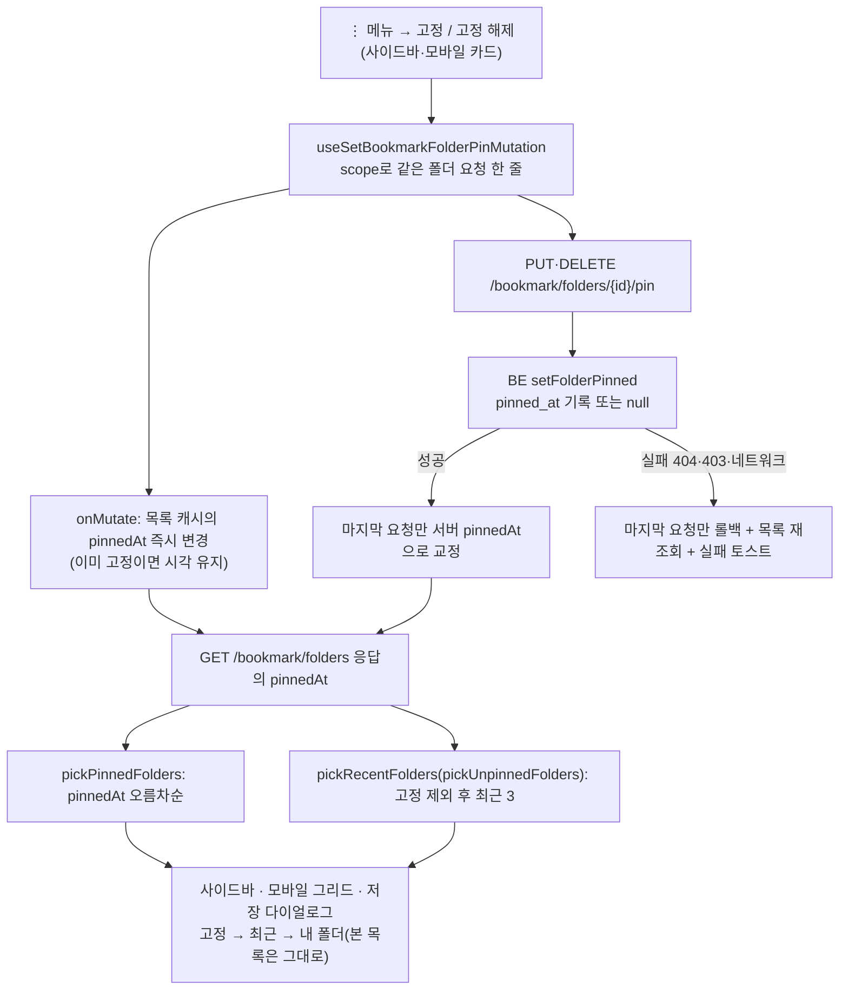
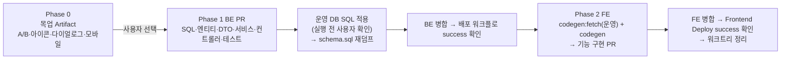

# 북마크 폴더 고정(pin)

> 자주 보는 폴더를 직접 골라 "고정한 폴더" 구획에 모아 둔다. 고정 상태는 서버에 저장해 모바일·PC가 같은 목록을 본다.

## Context

**요청(2026-10-26)**: "최근 저장한 폴더"는 3개로 제한돼 있어서, 이전에 쓰던 특정 폴더를 바로 보고 싶을 때는 찾기 어렵다. 그래서 고정한 폴더만 즐겨찾기처럼 모아 두고 싶다.

**지금 상태** (줄 번호는 `origin/main` 기준. 로컬 main은 FE 38커밋, BE 16커밋 뒤처져 있고 미푸시 커밋은 0개다)

- "최근 저장한 폴더"는 서버가 계산한 `lastUsedAt`으로 정한다. FE의 `BookmarkFolderUtil.pickRecentFolders`(`entities/bookmark/folder/utils/bookmark-folder.util.ts`)가 정확히 3개를 고른다. 조건이 맞지 않으면 0개다.
- 이 구획이 보이는 곳은 세 군데다.
  - 데스크톱 사이드바 `FolderTree`
  - 모바일 그리드 `MobileFolderList`
  - 저장 다이얼로그 `BookmarkFolderSelectDialog`
- BE 폴더(`TableBookmarkFolder.kt`)에는 하위 폴더가 없고 고정 필드도 없다. 순서 변경 API는 쓰는 곳이 없어 지웠다. Flyway도 없어서, `src/main/resources/sql/`에 SQL을 두고 사람이 직접 실행한다.
- 데스크톱 사이드바 위쪽 블록은 스크롤되지 않는다(`FolderTree.tsx`의 `shrink-0 overflow-hidden`). 그 아래 "내 폴더"만 스크롤한다.

**사전 조사**: §8에 따라 연구와 제품 선례를 찾았다. 원문을 직접 확인한 것과 못 한 것을 나눠 적었다.

- [Findlater & McGrenere(CHI 2004)](https://www.cs.ubc.ca/labs/edapt/papers/findlater2004.pdf)는 위쪽 구획을 사용자가 고르는 메뉴(adaptable)와 자동으로 바뀌는 메뉴(adaptive)를 비교했다.
  - 원문 PDF에서 확인한 결과: _"사용자가 고르는 메뉴가 과반(55%)의 선호를 받았고, 자동 적응 메뉴도 30%의 지지가 있었다"_ (번역).
  - 실험에서 위쪽 구획은 처음에 비어 있었고, 사용자가 최대 4개까지 넣었다. 아래 목록 순서는 바뀌지 않았다.
- Jensen Harris는 Office 2000 자동 적응 메뉴를 두고 _"자동 맞춤은 완벽하지 않으면 대개 아무 맞춤도 없는 것보다 못하다"_ (번역)고 썼다. Office 2007에서는 이 기능을 기본으로 껐다([Why the UI, Part 3](https://learn.microsoft.com/en-us/archive/blogs/jensenh/combating-the-perception-of-bloat-why-the-ui-part-3)).
- Windows 탐색기 "빠른 액세스"([Windows 블로그 2015](https://blogs.windows.com/windowsexperience/2015/06/08/get-your-work-done-faster-with-quick-access/))
  - _"핀이 붙은 폴더는 저절로 사라지지 않는다"_ (번역)
  - 자주 쓰는 폴더는 _"최대 4개, 항상 고정 폴더 아래에"_ (번역) 보여준다.
  - 고정과 해제는 우클릭 메뉴로 한다.
  - 고정한 폴더가 "자주 쓰는 폴더"에 중복으로도 뜨는지는 원문에 없다.
- Notion 즐겨찾기([도움말](https://www.notion.com/help/navigate-with-the-sidebar)): 첫 즐겨찾기를 하면 사이드바에 구획이 생기고, ••• 메뉴에서 해제한다.

**흐름 한눈에**

## 판단이 필요했던 항목

| 항목                   | 결정                                                                                       | 근거·기각한 대안                                                                                                                                                                                                          |
| ---------------------- | ------------------------------------------------------------------------------------------ | ------------------------------------------------------------------------------------------------------------------------------------------------------------------------------------------------------------------------- |
| 저장 위치              | **서버(BE)** (사용자 선택 10-26)                                                           | localStorage는 기각했다. 기기마다 목록이 다르고, 키에 계정 구분이 없으며(로그아웃해도 안 지워짐), 지워진 폴더 id를 따로 걸러야 한다                                                                                       |
| 표시 위치              | **북마크 페이지(사이드바·모바일) + 저장 다이얼로그** (사용자 선택)                         | 처음엔 북마크 페이지만 추천했다. 사용자가 다이얼로그까지 넣는 쪽을 골랐다                                                                                                                                                 |
| 최근 구획과 중복       | **최근 구획에서 고정 폴더를 뺀다.** 본 목록에서는 빼지 않는다 (사용자 선택)                | [NN/g 중복 링크](https://www.nngroup.com/articles/duplicate-links/): _"사용자는 두 항목이 중복이라는 걸 몰라 둘 다 훑게 된다"_ (번역). 본 목록을 그대로 두는 건 기존 split menu 원칙(`docs/BOOKMARK.md` §5)을 따른 것이다 |
| 구획 순서              | 고정 → 최근 → 내 폴더                                                                      | Windows 빠른 액세스와 같은 순서다. 사용자가 고른 안정된 항목을 자동으로 바뀌는 항목보다 위에 둔다                                                                                                                         |
| 고정 구획 안 순서      | `pinnedAt` 오름차순. 새로 고정한 폴더는 아래에 붙는다                                      | 기존 고정 폴더 위치가 흔들리지 않는다(공간 기억). 순서 변경 API는 다시 만들지 않는다                                                                                                                                      |
| 고정·해제 조작 위치    | 기존 ⋮ 메뉴 맨 앞에 "고정"/"고정 해제" 추가. 다이얼로그에서는 표시만 한다                  | Windows(우클릭)·Notion(•••) 선례. 다이얼로그 행에는 메뉴가 없다                                                                                                                                                           |
| API 형태               | 상태 지정형 `PUT`/`DELETE …/pin`(멱등). 응답은 `FolderPinResponse{id, pinnedAt}`           | `docs/DECISIONS.md` 2026-10-13 좋아요·북마크 결정을 따른다. 단건 `FolderResponse`는 `lastUsedAt`이 null이라 캐시를 덮으면 최근 순서가 깨진다                                                                              |
| 다이얼로그의 고정 구획 | 열려 있는 동안 고정하지 않고 매번 계산한다. 최근 구획 스냅샷은 비고정 목록 기준으로 찍는다 | 다이얼로그 안에서는 `pinnedAt`을 바꾸는 경로가 없다. 다른 기기에서 바뀌는 드문 경우만 남는다. 스냅샷 훅을 새로 만드는 비용에 비해 위험이 작다                                                                             |
| 전부 고정한 경우       | 고정 구획을 숨기지 않는다                                                                  | 사용자가 직접 고른 것이다. 최근 구획은 아래 일반화 규칙에 따라 자동으로 숨는다                                                                                                                                            |
| 실패 피드백            | 실패하면 토스트(이름 변경·삭제와 같게) + 롤백                                              | 고정 구획에서 해제하면 그 행이 즉시 사라진다. 그래서 `mutate` 콜백이 아니라 `useMutation` 옵션에서 처리한다(CLAUDE.md "React Query 라이프사이클")                                                                         |

### 뒤집힌 전제

| 발견                                                                                                                                                 | 그래서 바뀐 것                                                                                                                                                                                                                      |
| ---------------------------------------------------------------------------------------------------------------------------------------------------- | ----------------------------------------------------------------------------------------------------------------------------------------------------------------------------------------------------------------------------------- |
| 고정 폴더를 뺀 목록을 `pickRecentFolders`에 넘기면, 기존 "폴더가 정확히 3개면 숨김" 규칙이 "고정 + 최근이 내 폴더 전체를 덮으면 숨김"으로 일반화된다 | `pickRecentFolders`의 시그니처와 내부는 바꾸지 않는다. 호출부에서 `pickUnpinnedFolders`로 걸러 넘긴다. 부작용: 폴더 4개를 모두 저장해 둔 상태에서 1개를 고정하면 최근 구획 전체가 사라진다(0개 아니면 3개 규칙). 목업에서 보여 준다 |
| 설계 에이전트 지적: Hibernate 기본 UPDATE는 모든 컬럼을 쓴다. 그래서 같은 폴더의 이름 변경과 고정이 동시에 오면 한쪽 값이 유실될 수 있다             | **추론이고 아직 확인하지 않았다.** BE Phase 1에서 Postgres 통합 테스트로 먼저 재현한다. 재현되면 `TableBookmarkFolder`에 `@DynamicUpdate`를 붙인다(선례 `TableMember.kt`). 재현되지 않으면 붙이지 않는다                            |
| 같은 폴더가 고정 구획과 본 목록 두 곳에 그려져 훅 인스턴스가 둘이 된다                                                                               | mutationKey와 `scope`를 폴더 id로 같게 둔다. 그러면 두 인스턴스의 요청이 한 줄로 서고 "마지막 요청" 판정도 같이 센다                                                                                                                |
| e2e 스펙 7개가 `getByRole('button', {name: '개발'})`을 쓴다                                                                                          | MSW·e2e 픽스처는 고정하지 않은 상태로 둔다. 고정 상태가 필요한 테스트는 따로 만든다                                                                                                                                                 |

### 시안 후보 (§9 — 반영 전에 목업으로 승인받는다)

데스크톱 사이드바 배치를 정해야 한다. 스크롤 영역에 남는 높이는 "vh − 116 − 상단 블록 높이"로 계산했다(실제 클래스 기준 추정, 실측 아님).

| 뷰포트 높이 | 지금  | (A) 고정 3 상단 고정 | (B) 구획 전부 스크롤 안 |
| ----------- | ----- | -------------------- | ----------------------- |
| 650px       | ≈5행  | **≈1행**             | 스크롤 창 392px 공유    |
| 850px       | ≈10행 | ≈6행                 | 592px 공유              |

- **(A) 상단 고정 블록 + 상한 N**
  - 고정·최근이 항상 보인다.
  - 작은 화면에서 본 목록이 거의 사라진다.
  - BE에 상한 상수, 409 `PINNED_FOLDER_LIMIT_EXCEEDED`, 동시 요청 락이 필요하다.
  - FE에서 상한에 걸렸을 때 안내가 필요하다.
- **(B) 고정·최근·"내 폴더"를 모두 스크롤 영역으로 옮기고 라벨을 `sticky`로** — 설계 추천
  - 상단 고정 블록에는 전체·미분류·새 폴더 만들기만 남긴다.
  - 상한이 없고 BE도 단순하다.
  - 저장 다이얼로그가 이미 이 구조라 사이드바와 다이얼로그 구조가 같아진다.
  - 2026-09-21 결정("최근 구획 상단 고정")을 바꾸므로 사용자 승인이 필요하다.

목업에서 함께 확인할 것:

1. 650px·850px 화면에서 A(N=3)와 B를 나란히 비교
2. 본 목록 행에 고정 아이콘을 보여줄지 — 보여주면 성공 토스트가 필요 없다(texts-conventions 판단축 1)
3. 저장 다이얼로그(`max-h-96`)에서 고정 3개와 최근 3개가 있을 때 본 목록이 얼마나 밀리는지
4. 모바일 그리드의 고정 구획
5. 폴더 하나를 고정하면 최근 구획이 사라지는 부작용

### 위험 관리

- 운영 DB SQL은 되돌릴 수 있는 변경이다(nullable 컬럼 추가). 다만 외부에 영향을 주는 작업이므로, **실행 직전에 사용자에게 확인받는다**. SQL은 BE 코드보다 먼저 적용해야 한다. 빠뜨리면 폴더 API 전체가 500이 된다.
- 아직 병합되지 않은 BE 브랜치 `fix/domain-risks`(`BookmarkFolderService` companion·DTO)와 `chore/dead-code`(`BookmarkFolderRepository`)가 같은 파일을 고친다. 먼저 병합되는 쪽에 맞춰 리베이스한다.

## 세부 계획

배포 사이에 깨지는 것은 없다.

- SQL만 적용된 상태: 옛 엔티티는 새 컬럼을 매핑하지 않는다.
- BE만 배포된 상태: 옛 FE는 모르는 필드를 무시한다. 응답을 Zod로 파싱하지 않기 때문이다.
- 순서가 거꾸로 FE가 먼저 나간 상태: `/pin`이 404 → 롤백 + 토스트. 기능만 동작하지 않는다.

### Phase 0 — 목업 (§9)

| 위치                       | 변경 내용                                                                                                    |
| -------------------------- | ------------------------------------------------------------------------------------------------------------ |
| scratchpad HTML → Artifact | 실제 Tailwind 클래스와 `globals.css` 토큰으로 만든 정적 목업. 위 "시안 후보"의 1~5를 한 페이지에 나란히 둔다 |

### Phase 1 — 백엔드 (`link-sphere_BE_NEW`, 워크트리)

| 위치                                                                                                                 | 변경 내용                                                                                                                                                                                                                              |
| -------------------------------------------------------------------------------------------------------------------- | -------------------------------------------------------------------------------------------------------------------------------------------------------------------------------------------------------------------------------------- |
| `src/main/resources/sql/add_bookmark_folders_pinned_at.sql` (신규)                                                   | `ALTER TABLE bookmark_folders ADD COLUMN IF NOT EXISTS pinned_at TIMESTAMP NULL;` 머리 주석에 "수동 실행, 코드 배포 전". 이름은 `add_member_deletion_requested_at.sql` 형식을 따른다                                                   |
| `domain/interaction/TableBookmarkFolder.kt`                                                                          | `var pinnedAt: LocalDateTime? = null`. `@DynamicUpdate`는 위 "뒤집힌 전제"의 통합 테스트로 재현됐을 때만 붙인다                                                                                                                        |
| `BookmarkFolderDTO.kt`                                                                                               | `FolderResponse`에 `pinnedAt: LocalDateTime?` 추가. `FolderPinResponse(id, pinnedAt)` 신규                                                                                                                                             |
| `BookmarkFolderService.kt`                                                                                           | `getFolders`·생성·이름 변경 응답에 실제 `pinnedAt`을 넣는다. `setFolderPinned(userId, folderId, pinned)` 신규(`InteractionService.setPostLike` 형태) — 404·403 처리, 이미 고정이면 시각 유지, 해제는 null, `updatedAt`은 건드리지 않음 |
| `BookmarkFolderController.kt`                                                                                        | `PUT`·`DELETE /bookmark/folders/{folderId}/pin`(`InteractionController.kt:81-109` 형태), `@Operation`에 멱등·실패 코드 설명                                                                                                            |
| (A안일 때만) `PinnedFolderLimitExceededException`(신규) + `GlobalExceptionHandler` + `MAX_PINNED_FOLDERS`            | 409 `PINNED_FOLDER_LIMIT_EXCEEDED`, 이미 고정이면 상한을 따지지 않음, 행 잠금 후 개수 세기                                                                                                                                             |
| `BookmarkFolderServiceTest`·`BookmarkFolderControllerTest`·`BookmarkFolderRepositoryIntegrationTest`                 | 아래 "검증 방법"의 BE 케이스                                                                                                                                                                                                           |
| `src/test/resources/db/schema.sql`                                                                                   | 운영에 SQL을 적용한 뒤 머리 주석의 `pg_dump`로 다시 덤프                                                                                                                                                                               |
| `README.md` API 표, `CHANGELOG.md` `[Unreleased]`(Added + Migration), `docs/plans/2026-10-26-bookmark-folder-pin.md` | 문서. 계획 파일은 이 계획을 스냅샷한 것                                                                                                                                                                                                |

### Phase 2 — 프론트엔드 (`link-sphere_FE_NEW`, 워크트리)

| 위치                                                                                                                           | 변경 내용                                                                                                                                                                                                                            |
| ------------------------------------------------------------------------------------------------------------------------------ | ------------------------------------------------------------------------------------------------------------------------------------------------------------------------------------------------------------------------------------ |
| `src/shared/api/generated/openapi.{json,gen.ts}`                                                                               | BE 배포 뒤 `pnpm codegen:fetch && pnpm codegen`(운영에서 받아옴)                                                                                                                                                                     |
| `entities/bookmark/folder/model/bookmark-folder.dto.ts`                                                                        | `BookmarkFolderPinResponse` alias를 파일 끝에 추가. `BookmarkFolder`에는 `pinnedAt`이 자동으로 따라온다                                                                                                                              |
| `shared/config/api.ts` (`API_ENDPOINTS.bookmark`)                                                                              | `folderPin(folderId)`                                                                                                                                                                                                                |
| `entities/bookmark/folder/api/bookmark-folder.api.ts`                                                                          | `pinBookmarkFolder`(PUT)·`unpinBookmarkFolder`(DELETE). 본뜬 곳: `interaction.api.ts` likePost/unlikePost                                                                                                                            |
| `…/bookmark-folder.keys.ts`                                                                                                    | `bookmarkFolderMutationKeys.pin(folderId)`, `handleBookmarkFolderPinFailure`(목록 무효화). 본뜬 곳: `interaction.keys.ts` `handleLikePostFailure`                                                                                    |
| `…/bookmark-folder.queries.ts`                                                                                                 | `useSetBookmarkFolderPinMutation(folderId)`. 본뜬 곳: `useLikePostMutation` + `FE-ARCHITECTURE.md` §11 "연타" — scope, `assertMutationAuthEpochUnchanged`, 낙관적 갱신, 마지막 요청만 교정·롤백, `manualErrorHandling` + 실패 토스트 |
| `…/utils/bookmark-folder.util.ts`                                                                                              | `isPinned`·`pickPinnedFolders`(`pinnedAt` 오름차순, 같으면 `sortOrder`)·`pickUnpinnedFolders` 정적 메서드 추가. `pickRecentFolders`는 그대로                                                                                         |
| (A안일 때만) `…/config/bookmark-folder.const.ts`, `shared/config/error-code.ts`                                                | 상한 상수, 에러 코드                                                                                                                                                                                                                 |
| `widgets/bookmark/folder-tree/hooks/useFolderSections.ts`                                                                      | `pinnedFolderList` 반환, `recentFolderList = pickRecentFolders(pickUnpinnedFolders(list))`                                                                                                                                           |
| `…/hooks/useFolderTree.ts`·`useMobileFolderList.ts`                                                                            | `pinnedFolderList`를 그대로 넘긴다                                                                                                                                                                                                   |
| `…/hooks/useFolderActions.ts`                                                                                                  | pin mutation 호출, `isPinned`·`togglePin` 반환(위젯 전용 CRUD, `FE-ARCHITECTURE.md` §8 예외)                                                                                                                                         |
| `…/ui/FolderTree.tsx`                                                                                                          | Phase 0에서 고른 배치로 고정 구획 추가(`FolderItem`을 `pinned-` key로 재사용), ⋮ 메뉴 맨 앞에 고정/해제 항목, (승인 시) 고정 아이콘                                                                                                  |
| `…/ui/MobileFolderList.tsx`                                                                                                    | 최근 구획 위에 "고정한 폴더" 그리드, `FolderCard` 메뉴 항목 추가                                                                                                                                                                     |
| `features/bookmark/select/hooks/useBookmarkFolderSelect.ts`                                                                    | `pinnedFolderList`는 매번 계산. `useRecentBookmarkFolders(pickUnpinnedFolders(folderList), isFetching, open)` — 엔티티 훅 시그니처는 그대로                                                                                          |
| `features/bookmark/select/ui/BookmarkFolderSelectDialog.tsx`                                                                   | 스크롤 영역 순서: 미분류 → 고정 → 최근 → 내 폴더. 행은 `FolderRow`                                                                                                                                                                   |
| `shared/config/texts.ts`                                                                                                       | `bookmark.folder.pinnedSection`('고정한 폴더')·`pin`('고정')·`unpin`('고정 해제'), `messages.error.folderPinFailed`·`folderUnpinFailed`, (아이콘 시) `ariaLabels`                                                                    |
| `src/mocks/handlers/bookmark-folder.handlers.ts`                                                                               | PUT·DELETE `/pin` 핸들러. 픽스처는 고정하지 않은 상태로 유지                                                                                                                                                                         |
| 테스트(아래 "검증 방법")                                                                                                       | util·queries·`useFolderSections`·`useFolderActions`·다이얼로그 테스트. `useRecentBookmarkFolders.test`는 고치지 않는다(시그니처 불변 보증)                                                                                           |
| `docs/BOOKMARK.md`                                                                                                             | §5 API 표·"고정한 폴더 구획" 소절·사이드바 배치, §6 `pinnedAt`, §7 순서·(상한), §8 코드 지도, §9, §12 용어, 마지막 검토일                                                                                                            |
| `docs/DECISIONS.md`                                                                                                            | 한 항목: 서버 저장 vs localStorage, 사이드바 A/B, 최근 구획 중복 제외                                                                                                                                                                |
| `FE-ARCHITECTURE.md`·`AUTH.md`의 "scope mutation N곳" 개수, keys 줄 번호를 가리키는 `docs/POST.md`·`e2e/bookmark.spec.ts` 주석 | 줄 번호·개수 갱신(`pnpm check:docs`로 확인)                                                                                                                                                                                          |
| `CHANGELOG.md` `[Unreleased]`, `docs/plans/2026-10-26-bookmark-folder-pin.md`                                                  | Added 항목, 계획 스냅샷                                                                                                                                                                                                              |

## 영향 범위 (§5)

**CRUD 실패 지점**

- **생성**: SQL을 먼저 적용하지 않으면 INSERT가 500이 된다. 응답의 `pinnedAt`은 null이다.
- **조회**: 목록 순서는 `sortOrder` 그대로이고, 개수·페이지네이션에는 영향이 없다.
- **고정·해제**
  - 남의 폴더는 403, 없는 폴더는 404 → 롤백 + 재조회로 그 폴더가 사라지고 토스트가 뜬다.
  - 고정과 삭제가 동시에 오면 404이거나 전역 409가 난다.
  - 동시에 PUT이 두 번 오면 나중 시각이 남지만, 결과는 둘 다 "고정"이라 상관없다.
- **이름 변경**
  - 낙관적 갱신은 이름만 바꾸므로 `pinnedAt`은 보존된다.
  - 이름 변경이 실패해 전체 스냅샷으로 롤백하면, 그 사이 성공한 고정이 다음 재조회 전까지 화면에서 지워진다. 알려진 한계로 기록한다.
  - 동시 갱신 유실은 위 "뒤집힌 전제"에서 확인한다.
- **삭제**: 폴더 행과 함께 고정도 사라진다. 기존 삭제 후 처리(목록 무효화)가 고정 구획도 갱신한다.

**기존 기능 회귀 (소유 파일)**

- 최근 구획 노출: `bookmark-folder.util.ts`(그대로), `useFolderSections.ts`, `useBookmarkFolderSelect.ts`. 고정 폴더를 빼면서 최근 구획이 3개에서 0개로 바뀔 수 있다.
- 사이드바 구조: `FolderTree.tsx`. B안이면 2026-09-21·09-22 결정의 상단 고정 블록과 `scrollbar-gutter` 짝 주석이 바뀐다.
- 다이얼로그 테스트: `PostCardBookmarkFolderDialog.test.tsx`·`PostCreateBookmarkFolderField.test.tsx`의 "최근폴더" 단정. 픽스처에 `pinnedAt`이 없어 그대로 통과할 것으로 예상한다.
- e2e 셀렉터: 픽스처를 고정하지 않은 상태로 유지해 영향이 없다.
- `openapi-drift-check.yml`: BE 배포부터 FE 스냅샷 갱신까지 이슈가 열린다. 예상된 동작이다.
- 여러 곳에서 import하는 파일
  - `bookmark-folder.queries`(11곳)·`.keys`(7곳)·`.util`(3곳)은 export를 추가만 한다.
  - `useFolderSections`·`useFolderActions`는 반환 필드를 추가만 한다.
  - 구현할 때 `pnpm graph:focus "<경로>" --text`로 실제 사용처를 다시 뽑아 이 목록과 대조한다.

## 검증 방법

**BE**: `./gradlew test`, `./gradlew integrationTest`, `./gradlew ktlintCheck`

- 서비스 테스트
  - 고정 시 시각을 기록한다
  - 이미 고정이면 시각을 유지한다
  - 해제하면 null이 되고, 이미 해제된 폴더도 그대로 된다
  - 없는 폴더는 404, 남의 폴더는 403
  - `getFolders`와 이름 변경 응답이 `pinnedAt`을 매핑한다
- 컨트롤러 테스트: PUT·DELETE 응답의 `$.data.pinnedAt`
- 통합 테스트
  - `pinned_at`을 저장하고 다시 읽는다. `schema.sql` 재덤프를 빠뜨리면 실패한다.
  - 이름 변경이 읽은 뒤 고정이 커밋되는 경우의 갱신 유실을 재현한다(`@DynamicUpdate`가 필요한지 판정).
- 운영 확인: `psql "service=linksphere-ro"`로 컬럼 존재와 값을 확인한다.

**FE**: `pnpm type-check` → `pnpm test` → `pnpm lint`·`pnpm check:deps` → `pnpm check:docs`

- util
  - `pickPinnedFolders`: 오름차순, 같으면 `sortOrder`, null/undefined 제외
  - `pickUnpinnedFolders`, `isPinned`
- queries
  - PUT/DELETE 메서드
  - 즉시 반영 후 서버 값으로 교정
  - 이미 고정이면 시각 유지
  - 실패 시 롤백 + 재조회 + 토스트 1회
  - 세 번 연타(고정 → 해제 → 고정)의 최종 상태(`interaction.queries.test.ts` 연타 describe 형태)
- `useFolderSections`: 아래 경우를 표로 고정한다.

| 고정 | 비고정(저장 이력 있음) | 최근 구획 |
| ---- | ---------------------- | --------- |
| 0    | 3(3)                   | 숨김      |
| 0    | 4(3)                   | 3개       |
| 2    | 3(3)                   | 숨김      |
| 1    | 4(4)                   | 3개       |
| 1    | 4(2)                   | 숨김      |
| 전부 | 0                      | 숨김      |

- `useFolderActions`: 고정 안 된 폴더는 PUT, 고정된 폴더는 DELETE
- 다이얼로그
  - 고정 구획이 보이고, 최근 구획에는 고정 폴더가 없다
  - 열린 동안 최근 구획은 그대로이고 고정 구획은 매번 계산된다

**브라우저**(`browser-verification` skill로 녹화, 로컬 FE를 운영 API에 붙여 확인)

1. ⋮ → 고정: 고정 구획에 나타나고, 메뉴가 "고정 해제"로 바뀌고, 최근 구획이 다음 폴더로 채워지고, 본 목록 순서는 그대로다.
2. 두 번째 폴더를 고정하면 첫 번째 아래에 붙는다. 고정 구획 행과 본 목록 행 양쪽에서 해제된다.
3. 새로고침 후에도, 모바일 너비에서도 유지된다. 카드 저장 다이얼로그와 글 등록 다이얼로그에 고정 구획이 보인다.
4. 고정한 폴더의 이름을 바꾸거나 삭제한다. 오프라인에서 고정하면 롤백 + 토스트가 뜬다.
5. 창 높이 약 650px에서 고른 배치를 확인한다. B안이면 Tab으로 이동한 행이 sticky 라벨에 가려지지 않는지 본다. 다크 모드도 확인한다.

**계획 대비 구현 대조**(§11): 각 PR을 열기 전에 general-purpose 서브에이전트에게 커밋한 계획 파일과 diff를 함께 주고 대조를 맡긴다. 결과는 PR 본문 `## 계획 대비 구현`에 적는다.

## 남은 것

- **Phase 0 목업에서 정할 것**: 사이드바 A/B, A안이면 상한 N, 고정 아이콘 표시 여부(성공 토스트 여부가 여기에 달려 있다), 다이얼로그에서 밀리는 정도, 최근 구획이 사라지는 부작용을 받아들일지.
- `@DynamicUpdate`가 필요한지는 BE 통합 테스트 결과로 정한다.
- 이번 범위 밖: 고정 구획 순서 바꾸기(드래그), 구획 접기(Notion식), 다이얼로그에서 고정 조작.

## Phase 0 결정 (2026-10-26, 목업을 보고 사용자가 고름)

목업: 실제 Tailwind 클래스·`globals.css` 토큰으로 만든 비공개 Artifact 한 페이지에 A/B·아이콘·다이얼로그·모바일을 나란히 뒀다.

| 항목                                                   | 결정                                                                                                                     | 그래서 바뀐 것                                                                                                                                               |
| ------------------------------------------------------ | ------------------------------------------------------------------------------------------------------------------------ | ------------------------------------------------------------------------------------------------------------------------------------------------------------ |
| 데스크톱 사이드바 배치                                 | **(B)** 고정·최근·"내 폴더"를 모두 스크롤 영역에 두고 라벨을 `sticky`로. 위쪽 고정 블록에는 전체·미분류·새 폴더 만들기만 | 위 표의 "(A안일 때만)" 행(상한 상수·`PinnedFolderLimitExceededException`·409·FE 상한 안내)은 만들지 않는다. 고정 개수 상한 없음                              |
| 본 목록 행의 고정 아이콘                               | **표시** (이름과 개수 사이, lucide `Pin`)                                                                                | 고정 성공 토스트는 두지 않는다. 실패 토스트만 둔다                                                                                                           |
| 저장 다이얼로그                                        | **그대로 진행** — 미분류 → 고정 → 최근 → 내 폴더                                                                         | 없음                                                                                                                                                         |
| 폴더 하나를 고정하면 최근 구획이 사라질 수 있는 부작용 | **받아들인다(숨기기)** — 0개 아니면 3개 규칙을 고정하지 않은 폴더에만 적용                                               | 없음. 고정 폴더가 있다는 것만으로는 숨지 않는다. 고정하지 않은 폴더 중 저장 이력이 있는 폴더가 3개 미만이거나, 고정 + 최근이 내 폴더 전체를 덮을 때만 숨는다 |
