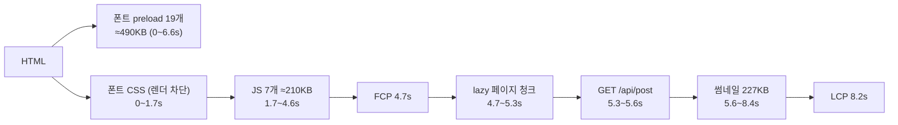
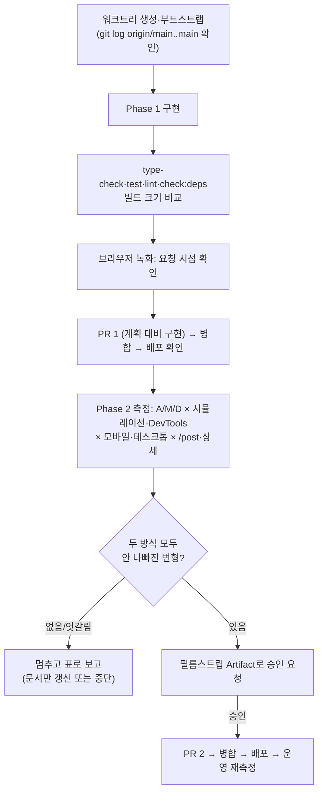

# LCP 줄이기 — 데이터 요청 앞당기기 + 폰트 preload 정리

> 피드·상세의 LCP 데이터 요청을 lazy 페이지 청크 밖에서 시작한다(Phase 1, PR 1개). 폰트 preload는
> 두 측정 방식과 필름스트립 승인을 모두 통과할 때만 줄인다(Phase 2, PR 1개).

## Context

### 왜

- 실사용자 RUM(CloudWatch `link-sphere-post`, 2026-09-28~10-26, `GetMetricData`로 직접 조회): LCP
  p75 **2.49s**, p90 4.56s(표본 238건). 주별 p75는 2.17 → 3.30 → 2.48 → 2.60s다. web.dev가
  "좋음"으로 보는 p75 2.5s([LCP](https://web.dev/articles/lcp))를 오르내린다. FCP p75는 1.51s라,
  첫 화면 뒤 LCP까지 약 1초가 더 걸린다.
- RUM은 기기별로 나눠 볼 수 없다. 앱 단위 지표만 있고 CW Logs가 꺼져 있다(`CwLogEnabled=false`).
- 범위는 사용자가 2026-10-26에 골랐다(데이터 요청 앞당기기, 폰트 preload 줄이기). og 썸네일 축소와 첫 로딩 JS 줄이기는 제외됐다.

### 직접 측정한 첫 로딩 흐름 (운영, Playwright Chromium, 2026-10-26)

측정 방법: 캐시를 끈 새 페이지로 `PerformanceObserver('largest-contentful-paint')`와 Resource Timing을 수집했다. 모바일 조건은
CDP `Network.emulateNetworkConditions`(150ms, 1.6Mbps×0.9)와 CPU 4배 감속, 412×823이다. RUM 전송은 차단했다.
LCP 요소는 두 페이지 모두 외부 og 썸네일(IMG)이었다.

| 관찰                                     | 모바일 `/post`            | 데스크톱 `/post` | 근거                                                   |
| ---------------------------------------- | ------------------------- | ---------------- | ------------------------------------------------------ |
| 카테고리 요청 시작 (라우트에서 프리페치) | 4,734ms                   | 241ms            | `PostFeedRoute` (`src/app/routes/index.tsx` ~L116-120) |
| 게시글 요청 시작 (청크 렌더 뒤)          | 5,273ms                   | 338ms            | `usePostList.ts` ~L186-192                             |
| 상세: 청크 → `GET /post/:id`             | 청크 4727~5329 → API 5343 | 177~312 → 315    | `PostDetailPage.tsx` ~L88-95, `usePostDetail.ts` ~L88  |

상세 썸네일은 `<PostCard post={post} isDetail />`(`PostDetailPage.tsx` ~L43)라 `loading="lazy"`·`fetchPriority="auto"`다.
web.dev는 _"LCP 이미지는 절대 lazy-load하지 마라"_ (번역, [optimize-lcp](https://web.dev/articles/optimize-lcp))고 쓴다.

### HTML만 바꿔 끼운 A/B (운영, 파일 무변경, 같은 측정 방법)

| 변형                            | 모바일 `/post` FCP → LCP (3회) | 모바일 상세 LCP (2회) | 데스크톱 LCP (2회) | CLS |
| ------------------------------- | ------------------------------ | --------------------- | ------------------ | --- |
| A 지금(preload 19개)            | 4.7s → 8.2s                    | 6.3~6.6s              | 0.48~0.70s         | 0   |
| 테마 스크립트를 폰트 CSS 앞으로 | 4.7s → 8.1s (차이 없음)        | —                     | —                  | —   |
| D preload 전부 제거             | **2.0s → 6.7s**                | **4.2~5.1s**          | 0.45~0.74s         | 0   |

- preload가 없으면 실제로 요청된 조각 수(공개 4페이지 × 데스크톱·모바일)는 `/post` 12~15개, 상세 7~9개, 로그인·회원가입 7개였다.
- 8개 조합 모두에서 쓰인 조각은 **87~91번 5개**다. 42·73·75·77·78·79·80번은 어느 페이지에서도 요청되지 않았다.
- 테마 스크립트 순서는 preload를 뺀 상태(D)에서도 차이가 없어(LCP 6.70~6.78s) 후보에서 뺐다.

### 라이브러리 동작 확인 (설치본 `@tanstack/react-query`·`query-core` 5.90.16)

- `usePrefetchInfiniteQuery`/`usePrefetchQuery`는 렌더 중에 그 키의 상태가 없을 때만 요청을 시작한다(`react-query/build/modern/usePrefetchInfiniteQuery.js:4-7`).
- `Query.fetch`는 진행 중인 요청이 있으면 그 promise를 그대로 돌려준다(`query-core/build/modern/query.js:166-175`). 그래서 청크 안의 Suspense 쿼리는 요청을 중복으로 보내지 않는다.
- `fetchQuery`는 전역 기본값을 먼저 합친다. 그 뒤 `retry`가 비어 있을 때만 false로 둔다(`queryClient.js:182-185`).
  전역 `retry: shouldRetryQuery`(`queryClient.ts:75`)가 있으므로, 프리페치에 상세 쿼리의 `retry: false`(`post.queries.ts` ~L198)를 같이 싣지 않으면 404가 한 번 재시도돼 안내가 늦어진다.
- 전역 `staleTime`은 3분이다(`queryClient.ts:73`). 청크가 마운트될 때 다시 요청하지 않는다.

## 판단이 필요했던 항목

| 항목                          | 결정                                                                                                                             | 근거·기각한 대안                                                                                                                                                                                                                                                                                              |
| ----------------------------- | -------------------------------------------------------------------------------------------------------------------------------- | ------------------------------------------------------------------------------------------------------------------------------------------------------------------------------------------------------------------------------------------------------------------------------------------------------------- |
| 요청을 어디서 앞당기나        | 라우트 래퍼(`PostFeedRoute`, 신규 `PostDetailRoute`)에서 렌더 중 프리페치                                                        | 선례: #405(카테고리), #375(댓글). react-router `loader`는 `AppShellLayout`의 인증 게이트(~L19-21)보다 먼저 돌아 로그인 사용자의 비공개 글이 빠지므로 기각                                                                                                                                                     |
| 키·요청 옵션을 어떻게 맞추나  | `post.queries.ts`에 옵션 묶음(`infiniteQueryOptions`/`queryOptions`)을 두고 기존 훅과 프리페치가 공유                            | 카테고리 선례(`category.queries.ts` ~L24-29)처럼 키·함수만 복사하면 `initialPageParam`·`getNextPageParam`·`retry`가 어긋날 수 있다. 기존 훅 시그니처는 그대로                                                                                                                                                 |
| 피드 키 계산 위치             | `buildCombinedFilter`·`HIDE_BOTS_FILTER`를 새 `post-list-payload.ts`로 옮기고 리스트·프리페치가 공유                             | `usePostList.ts`를 라우트에서 import하면 가상화 코드까지 첫 로딩 청크로 끌려온다                                                                                                                                                                                                                              |
| 검색·필터 변경 때 프리페치    | 현재 URL을 따라간다(첫 진입만으로 한정하지 않음)                                                                                 | 프리페치는 suspend하지 않고 키가 있으면 아무것도 안 한다. 그래서 `v7_startTransition`·`usePostListApplying`·지연된 hideBots는 지금처럼 동작한다. 첫 렌더에서 `useDeferredValue`는 _"받은 값과 같은 값"_ (번역, [useDeferredValue](https://react.dev/reference/react/useDeferredValue))을 돌려줘 키가 일치한다 |
| 상세 댓글 프리페치            | `usePostDetailPrefetch`를 페이지에서 라우트로 옮긴다(복제하지 않음)                                                              | #405가 카테고리 프리페치를 페이지에서 라우트로 옮긴 형태와 같다                                                                                                                                                                                                                                               |
| 폰트 preload 판정             | A(19개)·M(87~91번 5개)·D(0개)를 시뮬레이션·DevTools 두 방식으로 재고, 둘 다 나빠지지 않는 변형만 후보로 둔다. 최종 선택은 사용자 | 9/26 PSI(시뮬레이션) 결과와 10/26 요청 단위 측정이 반대라 한 방식만 믿을 수 없다(Context 인용)                                                                                                                                                                                                                |
| 폰트 예산(`lighthouserc.cjs`) | 바꾸지 않는다                                                                                                                    | 2026-10-05 성능 예산 "변경 없음" 결정                                                                                                                                                                                                                                                                         |
| 기록 위치                     | `docs/PERFORMANCE.md`에 남긴다(DECISIONS.md 새 항목 없음)                                                                        | preload 개수는 되돌리기 쉬워 DECISIONS 기준(대안 비교 + 되돌리기 어려움)에 맞지 않는다                                                                                                                                                                                                                        |

### 뒤집힌 전제

| 발견                                                                                               | 그래서 바뀐 것                                                               |
| -------------------------------------------------------------------------------------------------- | ---------------------------------------------------------------------------- |
| 9/26 "preload 없으면 모바일 LCP 악화"(PSI)와 반대로, 요청 단위 측정에선 제거가 FCP −2.7s·LCP −1.5s | Phase 2를 두 측정 방식 + 필름스트립 게이트로 둔다                            |
| `post.queries`·`comment.queries`는 지금 첫 로딩 청크에 없다(lazy 페이지만 import)                  | 라우트에서 import하면 첫 로딩 청크가 커진다 → 빌드 크기 비교를 검증에 넣는다 |

### 위험 관리

- **첫 로딩 청크 증가**: 추정 gzip 약 4~5KB다. `/auth/login`·`/auth/sign-up`도 그만큼 받는다. 6KB gzip을 넘으면 프리페치용 가벼운 파일로 분리할지 멈추고 묻는다.
- **Phase 1 효과는 제한적이다**(추정): `/post`는 API 시작이 모바일 약 0.5s, 데스크톱 약 0.1s 당겨지고, 상세는 0.2~0.35s다. 모바일 LCP는 여전히 이미지 다운로드가 지배한다.
- **로컬 측정과 운영의 차이**: `vite preview`는 HTTP/1.1이고 운영은 HTTP/2다. 그래서 Phase 2의 로컬 결과는 참고용이고, 배포 뒤 운영에서 다시 확인한다.

## 세부 계획

### 작업 순서

### Phase 1 — PR 1: LCP 데이터 요청을 lazy 청크 밖에서 시작

| 위치                                                                                             | 변경 내용                                                                                                                                                                                                                                                                                                                                                                                                                                                                                    |
| ------------------------------------------------------------------------------------------------ | -------------------------------------------------------------------------------------------------------------------------------------------------------------------------------------------------------------------------------------------------------------------------------------------------------------------------------------------------------------------------------------------------------------------------------------------------------------------------------------------- |
| `src/entities/post/api/post.queries.ts` ~L131-152, ~L194-201                                     | 모듈 지역 `postListInfiniteOptions(payload)`·`postDetailQueryOptions(id)`를 둔다(키·queryFn·`initialPageParam`·`getNextPageParam`, 상세는 `retry: false` 포함). `useSuspenseFetchPostListQuery`(+`select`)·`useSuspenseFetchPostDetailQuery`가 이를 쓴다. 신규 `usePrefetchPostList(payload)`(`usePrefetchInfiniteQuery`)·`usePrefetchPostDetail(id)`(`usePrefetchQuery`)                                                                                                                    |
| `src/widgets/post/post-list/utils/post-list-payload.ts` (신규)                                   | `usePostList.ts` ~L18·~L29-42의 `HIDE_BOTS_FILTER`·`buildCombinedFilter`를 그대로 옮기고, `toPostListPayload(parsed, currentFilter, hideBots)`를 추가                                                                                                                                                                                                                                                                                                                                        |
| `src/widgets/post/post-list/hooks/usePostList.ts` ~L184-192                                      | 위 helper로 payload를 만든다(반환 형태 무변경)                                                                                                                                                                                                                                                                                                                                                                                                                                               |
| `src/widgets/post/post-list/hooks/usePostFeedPrefetch.ts` (신규)                                 | `useSearchParams`의 `q`·`filter`와 `parseSearchQuery`, `useHideBotsStore`의 hideBots로 payload를 만들어 `usePrefetchPostList`를 호출한다. `usePostList.ts`는 import하지 않는다                                                                                                                                                                                                                                                                                                               |
| `src/app/routes/index.tsx` ~L116-120, ~L143-146                                                  | `PostFeedRoute`에 `usePostFeedPrefetch()`를 추가한다. 신규 `PostDetailRoute`는 `usePrefetchPostDetail(id)`와 `usePrefetchComments(id)`(`comment.queries.ts` ~L101-106)를 부르고 `withSuspense(PostDetailPage)`를 반환한다                                                                                                                                                                                                                                                                    |
| `src/pages/post/hooks/usePostDetail.ts` ~L77-84, `src/pages/post/PostDetailPage.tsx` ~L3·~L90-91 | `usePostDetailPrefetch`를 지우고 그 호출도 지운다(라우트로 이동)                                                                                                                                                                                                                                                                                                                                                                                                                             |
| `src/pages/post/PostDetailPage.tsx` ~L43, `PostCard.tsx` ~L55-58 JSDoc                           | `<PostCard post={post} isDetail priorityThumbnail />`                                                                                                                                                                                                                                                                                                                                                                                                                                        |
| 테스트                                                                                           | 신규 `usePostFeedPrefetch.test.tsx`: URL(`/post`, `?q=@DevOps #nick react&filter=bookmarked`) × hideBots on/off에서 `GET /api/post`가 1번이고 키도 1개인지, 페이지가 suspend된 채여도 요청이 나가는지. `usePostList.test.tsx`·`PostList.test.tsx`: 프리페치를 위에 둔 채 hideBots·필터 전환 중 이전 목록이 유지되는지. `post.queries.test.ts`: 상세 프리페치 404가 1회 요청 뒤 not-found인지, 성공 시 총 1회인지. `PostDetailPage.test.tsx`: 썸네일 `loading="eager"`·`fetchpriority="high"` |
| e2e                                                                                              | 신규 `e2e/post-route-prefetch.spec.ts`: 페이지 모듈을 `page.route`로 붙잡아 둔 동안 목록·상세·댓글 요청이 나가는지, 풀어 준 뒤에도 각 1회인지. `post-detail-not-found.spec.ts`에 요청 1회 단언 추가. `post-detail-comment-prefetch.spec.ts` ~L14-17·`post-list-category-prefetch.spec.ts` ~L11-17 주석 갱신                                                                                                                                                                                  |
| 문서                                                                                             | `docs/SEARCH.md` §8·§10(새 날짜 항목)·§12, `docs/POST.md` 라우트·피드·상세 절, `docs/COMMENT.md` 댓글 프리페치 서술, `docs/PERFORMANCE.md` "LCP 후보 이미지"에 상세 행. `CHANGELOG.md` `[Unreleased]` 항목(changelog-release skill)                                                                                                                                                                                                                                                          |
| `docs/plans/2026-10-26-lcp-prefetch-font-preload.md` (신규)                                      | 이 계획 파일 복사(§11)                                                                                                                                                                                                                                                                                                                                                                                                                                                                       |

### Phase 2 — PR 2: 폰트 preload (측정 게이트 통과 시에만)

| 단계   | 내용                                                                                                                                                                                                                                                                                                                                                                                                                                                                                                                                                                           |
| ------ | ------------------------------------------------------------------------------------------------------------------------------------------------------------------------------------------------------------------------------------------------------------------------------------------------------------------------------------------------------------------------------------------------------------------------------------------------------------------------------------------------------------------------------------------------------------------------------ |
| 빌드   | Phase 1 병합 뒤의 main에서 `SKIP_CSP_INJECTION=1 pnpm build`를 1번 한다. scratchpad에 `dist-A`·`dist-M`·`dist-D`로 복사하고 각 `index.html`의 preload 블록만 고친다(A 19개, M 87~91번, D 없음). `diff -rq`로 `index.html`만 다른지 확인한다                                                                                                                                                                                                                                                                                                                                    |
| 측정   | 각 변형을 `pnpm exec vite preview --outDir <dir> --port 4173 --strictPort`로 띄운다. `lighthouserc.cjs`를 require하는 scratchpad 설정으로 `/post`와 상세 고정 글을 5회씩 잰다(결과는 scratchpad, `blockedUrlPatterns` 유지). 측정 조합: 모바일 시뮬레이션(PSI와 같은 방식), 모바일 `throttlingMethod: 'devtools'`, 데스크톱 프리셋 두 방식. 변형은 A→M→D 순으로 번갈아 돈다                                                                                                                                                                                                    |
| 유효성 | 실행마다 LCP 요소가 IMG 썸네일이고 폰트 요청 수·KB를 기록한다. 데이터가 깨진 실행(CORS 등)은 버린다                                                                                                                                                                                                                                                                                                                                                                                                                                                                            |
| 판정   | 중앙값 차이가 max(100ms, 5%) 이내면 노이즈로 본다. M·D는 두 URL·두 방식 모두에서 모바일 LCP·FCP와 데스크톱이 나빠지지 않고 CLS ≤ 0.1일 때만 후보다. 방식끼리 결론이 엇갈리거나 후보가 없으면 멈추고 표로 보고한다                                                                                                                                                                                                                                                                                                                                                              |
| 승인   | 후보가 있으면 A와 후보의 필름스트립(DevTools 감속 중앙값 실행의 `screenshot-thumbnails`, 모바일·데스크톱)과 첫 방문 Playwright 영상(폰트 교체 장면)을 Artifact 한 페이지에 나란히 둔다(§9). 사용자 승인 뒤에만 반영한다                                                                                                                                                                                                                                                                                                                                                        |
| 반영   | M 또는 D: `index.html` ~L49-56 주석과 ~L57-189 preload를 고친다. `scripts/compute-font-preload-chunks.js`는 게시글 합집합 방식이라 결과와 맞지 않으므로 지우고 참조도 고친다(`.claude/skills/design-tokens/SKILL.md:197-198`, `docs/DEPLOY.md:66`). `docs/PERFORMANCE.md`에는 측정표에 두 방식 행을 추가하고, "폰트 preload 유지보수" 절을 새 절차(공개 페이지 공통 조각을 Playwright 요청 기록으로 산출)로 다시 쓴다. D면 `src/shared/utils/version.util.ts:23` 주석도 고친다. `CHANGELOG.md` `[Unreleased]` 항목을 단다. A 유지면 `docs/PERFORMANCE.md`에 측정 결과만 남긴다 |

## 영향 범위

### CRUD 실패 지점

- **읽기만 바뀐다**(목록·상세·댓글 조회 시점). 생성·수정·삭제 경로는 그대로다.
- 다만 같은 캐시 키를 더 일찍 채우므로, mutation 뒤 무효화(`postInvalidateQueries`)가 그 키를 그대로 찾는지 기존 테스트로 확인한다. 키는 같은 옵션 묶음에서 나오므로 그대로일 것이다.
- **가시성**: 프리페치는 `AppShellLayout` 인증 게이트 뒤에서만 렌더된다. `restoreAuth`가 토큰을 넣은 뒤 `setAuthResolved(true)`를 부르므로(`useAppInitialization.ts` ~L50-59) 비공개 글·좋아요·북마크 플래그가 사용자 기준으로 온다.
- **중복 요청**: `Query.fetch`가 진행 중인 요청을 공유하므로 생기지 않는다. 테스트로 1회를 단언한다.
- **실패**: 프리페치가 실패하면 Suspense 훅이 같은 에러를 경계로 던진다(지금과 같은 화면). 토스트 중복은 전역 핸들러 1개 그대로다.

### 기존 기능 회귀 후보

| 파일                                                 | import하는 곳(Plan 에이전트가 `pnpm graph:focus` + grep으로 확인)                                                                                           | 확인할 것                                                                           |
| ---------------------------------------------------- | ----------------------------------------------------------------------------------------------------------------------------------------------------------- | ----------------------------------------------------------------------------------- |
| `post.queries.ts`                                    | `usePostDetail`, `useMyCommentCard`, `usePostCard`, `usePostList`, `useCreatePost`, `usePostDelete`, `useUpdatePost`, `useLinkPreview`, (신규) `app/routes` | 목록·상세 훅만 내부가 바뀐다. 무효화·낙관적 업데이트 테스트 통과                    |
| `usePostList.ts`                                     | `usePostListSearch.ts`, `PostList.tsx`, `usePostList.test.tsx`                                                                                              | 검색·칩·봇 숨기기 전환, 적용 중 표시, 무한 스크롤                                   |
| `routes/index.tsx`                                   | `RouterProvider.tsx`, `cloudfront-functions.test.ts`                                                                                                        | 경로 무변경. `/post/submit`·`/post/edit/:id`가 `/post/:id`보다 먼저 매칭되는지 유지 |
| `PostDetailPage.tsx`, `usePostDetail.ts`             | routes의 lazy import, `PostDetailPage.test.tsx`                                                                                                             | 404 안내, 뒤로가기(`useGoBack`), 댓글 목록                                          |
| `comment.queries.ts`                                 | 무변경, 새로 app에서 import됨                                                                                                                               | 첫 로딩 청크로 이동 → 크기 비교                                                     |
| 기존 hover 프리페치 `prefetchPostDetail` (~L203-209) | 무변경                                                                                                                                                      | `retry: false`가 없다는 사실만 PR에 언급(범위 밖)                                   |

## 검증 방법

1. **Phase 1 정적 검사**: `pnpm type-check`, `pnpm test`, `pnpm lint`, `pnpm check:deps`, `pnpm check:docs`(문서 수정), 관련 e2e(`post-route-prefetch`·`post-detail-not-found`·`post-detail-comment-prefetch`·`post-list-category-prefetch`).
2. **번들 크기**: origin/main과 브랜치에서 각각 `pnpm build`를 하고, 첫 로딩 `index-*.js`의 gzip 크기와 modulepreload 목록을 비교한다. 6KB를 넘으면 멈추고 묻는다.
3. **브라우저 녹화**(browser-verification skill): 피드·상세 첫 진입에서 목록·상세·댓글 요청이 페이지 청크와 같은 때 시작하는지, 필터·봇 숨기기 전환 때 이전 목록이 유지되는지 확인한다.
4. **Phase 1 배포 뒤**:
   - `gh run list --branch main --workflow "Frontend Deploy (S3 + CloudFront)"`로 성공을 확인한다.
   - 이번 세션의 Playwright 측정을 운영에 다시 돌린다. `GET /api/post?page=0`이 카테고리와 같은 시점(데스크톱 약 241ms)에, 상세 API가 청크 시작 시점(약 177ms)에 시작해야 한다.
   - 전후 LCP를 표로 남긴다.
5. **Phase 2**: 위 "판정" 표와 필름스트립 승인. 병합·배포 뒤에는 운영에서 같은 Playwright 측정과 PSI 모바일로 다시 확인한다.
6. **RUM 추이**: 배포 뒤 2주간 주별 LCP·FCP p75를 비교한다. 주 표본이 40~100건이라 참고용이다.
7. **계획 대비 구현**(§11): PR마다 fresh general-purpose 서브에이전트에 이 계획 파일과 diff를 주고 대조를 맡긴다. 결과는 PR 본문 `## 계획 대비 구현`에 남긴다.

## 남은 것

- **og 썸네일 축소 파이프라인**: 이번 범위에서 빠졌다. 모바일에서 남는 가장 큰 구간은 이미지 다운로드다(227KB PNG, 2.7~3.5s). 재검토 조건은 `docs/plans/2026-09-25-lighthouse-perf.md` Phase 3을 따른다.
- **첫 로딩 JS 줄이기**: 이번 범위에서 빠졌다. `common.type.ts`의 zod 스키마 하나 때문에 zod가 첫 로딩에 실리고, LoginDialog와 form-vendor는 열지 않아도 매번 받는다(약 25KB br).
- **로그인 재방문자의 직렬 대기**: `AppShellLayout`이 `/auth/refresh`가 끝날 때까지 청크 요청조차 막는다. 측정하지 않아 이번 범위에 넣지 않았다.
- **Phase 2 노이즈 기준**: max(100ms, 5%)는 제안값이다. 측정 결과를 보고 사용자가 조정할 수 있다.
