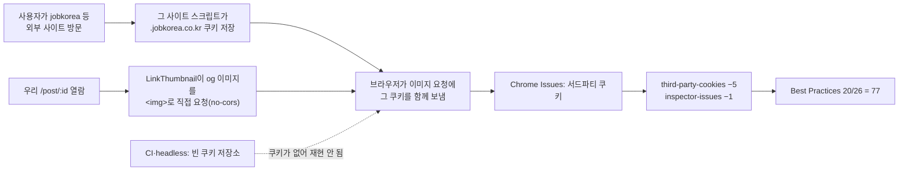
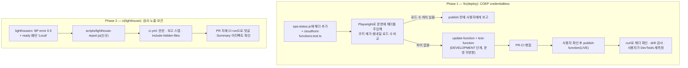

# Lighthouse Best Practices 77점 원인 제거 + Lighthouse CI가 회귀를 보이게 개선

> 외부 썸네일 요청에 사용자 쿠키가 실려 깎인 Best Practices 점수를 COEP `credentialless` 헤더로 바로잡고,
> CI가 Best Practices를 검사하고 결과를 PR에 보이도록 고친다.

## Context

### 사용자 질문

1. 운영 사이트 Lighthouse Best Practices가 77점으로 떨어졌다 — 원인과 개선 방법
2. Lighthouse CI가 이 하락을 못 잡았는가, 아니면 알려줬는데 사용자가 놓쳤는가

### 근본 원인 (질문 1) — 사용자 제공 리포트로 확정

사용자 리포트: Lighthouse 13.4.1, DevTools, 로그인 상태(평소 프로필), 데스크톱,
`https://linksphere.click/post/020db122-55dc-4fa4-b593-3c2a1269f9a4`, 2026-10-26.

| 감사                  | 가중치 | 실패 내용                                                                                                                           |
| --------------------- | ------ | ----------------------------------------------------------------------------------------------------------------------------------- |
| `third-party-cookies` | 5      | 쿠키 8개 — `file1.jobkorea.co.kr` 배너, `logo-resources.thevc.kr` 배너 이미지 요청에 `_hjSession*`(Hotjar)·`__rtbh.*` 쿠키가 실렸다 |
| `inspector-issues`    | 1      | 위 두 이미지 + `whitework.ai` 파비콘의 Cookie 이슈                                                                                  |

- 점수 계산: Lighthouse 13의 Best Practices 가중치 합(적용 대상)은 26이다(`redirects-http`는 해당 없음).
  6점이 깎여 20/26 = 0.769 → **77점**이다.
- 메커니즘: 피드·상세의 og 썸네일은 `src/shared/ui/atoms/link-thumbnail.tsx`가 외부 URL을 ``로 직접
  불러온다(no-cors 요청). 그래서 브라우저가 **사용자 쿠키 저장소에 이미 있던** 그 사이트 쿠키를 함께 보낸다.
  쿠키 이름(Hotjar·RTB House)으로 보아 사용자가 그 사이트를 방문했을 때 그 사이트 스크립트가 심은 쿠키다(추론).
- 그래서 **쿠키 저장소가 빈 환경에서는 재현되지 않는다**(직접 측정, 2026-10-26, Lighthouse 12.6.1 headless,
  설치본 `node_modules/.pnpm/lighthouse@12.6.1`):
  - 운영 `/post`: 데스크톱 96점, 모바일 100점
  - 운영 `/post/:id`·`/auth/login`: 100점
  - 운영 `/post`에 `--test-third-party-cookie-phaseout`를 켜도 100점
  - CI 10-25 run(localhost 프리뷰): `/post` 96점, `/post/:id` 100점
- 점수는 "피드에 어떤 외부 이미지가 떠 있나 × 측정하는 사람의 쿠키 저장소"에 따라 달라진다.
- 기능 영향은 없다(이미지는 쿠키 없이도 뜬다). 다만 그 사이트들이 우리 사용자의 열람을 쿠키로 알 수 있다.
  Referer는 이미 `referrerPolicy="no-referrer"`로 빼고 있다(`link-thumbnail.tsx:68`).

### CI가 못 잡은 이유 (질문 2) — 사용자가 놓친 게 아니다

| #    | 사실(확인 경로)                                                                                                                                                                                                                                                           | 결과                                        |
| ---- | ------------------------------------------------------------------------------------------------------------------------------------------------------------------------------------------------------------------------------------------------------------------------- | ------------------------------------------- |
| ①    | `lighthouserc.cjs`·`lighthouserc.auth.cjs`의 assertion에 `categories:best-practices`가 없다(performance·LCP·TBT·CLS·리소스 크기만)                                                                                                                                        | 검사 대상이 아님                            |
| ②    | 전부 `warn`이다. LHCI 문서상 warn은 _"실패해도 0이 아닌 종료 코드를 내지 않는다"_(번역, [configuration.md](https://github.com/GoogleChrome/lighthouse-ci/blob/main/docs/configuration.md)). 로그에는 `GitHub token not set`이 찍힌다                                      | job은 초록, 경고는 원본 로그에만            |
| ③    | `.lighthouseci/`는 숨김 폴더인데 `actions/upload-artifact`의 `include-hidden-files` 기본값이 `'false'`다(action.yml). 10-16·10-25 run 모두 `No files were found`                                                                                                          | 리포트가 한 번도 보관되지 않음              |
| ④    | CI는 localhost 프리뷰·빈 프로필·Lighthouse 12.6.1(`@lhci/cli` 0.15.1에 고정, 0.15.1이 최신 릴리스)로 잰다. 사용자 DevTools는 13.4.1이다                                                                                                                                   | 같은 시점에도 96~100점이라 원리적으로 못 봄 |
| 부수 | `startServerReadyPattern: 'Local:'`이 CI에서 안 맞는다. vite 6.4.1이 `bold("Local")`로 출력하고(`dep-D4NMHUTW.js:7643`), picocolors는 `env.CI`면 색을 켜서 `Local`과 `:` 사이에 ANSI 코드가 끼기 때문이다. LHCI는 `new RegExp(pattern, 'i')`로 비교한다(`collect.js:162`) | 매 run `Timed out waiting` 경고             |

## 판단이 필요했던 항목

| 항목                        | 결정                                                                                 | 근거·기각한 대안                                                                                                                                                                                                                                                                                                                                                                                                                                                                                                                                                                                                                                             |
| --------------------------- | ------------------------------------------------------------------------------------ | ------------------------------------------------------------------------------------------------------------------------------------------------------------------------------------------------------------------------------------------------------------------------------------------------------------------------------------------------------------------------------------------------------------------------------------------------------------------------------------------------------------------------------------------------------------------------------------------------------------------------------------------------------------ |
| 77점 원인 개선              | HTML 응답에 `Cross-Origin-Embedder-Policy: credentialless` (사용자 선택, 2026-10-26) | MDN: _"no-cors 모드로 요청하는 교차 출처 리소스를 CORP 헤더 없이 불러올 수 있다. 이때 요청은 자격 증명 없이 보내진다: 요청에서 쿠키를 빼고, 응답의 쿠키도 무시한다"_(번역, [MDN COEP](https://developer.mozilla.org/en-US/docs/Web/HTTP/Reference/Headers/Cross-Origin-Embedder-Policy)). 지원: Chrome 96, Firefox 119, Safari 미지원([MDN BCD](https://github.com/mdn/browser-compat-data/blob/main/http/headers/Cross-Origin-Embedder-Policy.json)). 기각: ① ``는 쿠키는 빠지지만 ACAO 헤더가 없는 사이트 이미지가 전부 깨진다. ② 이미지 프록시(BE)는 확실하지만 FE·BE 큰 작업이다. ③ 문서화만 하면 쿠키 노출이 그대로 남는다 |
| 헤더를 붙이는 위치          | 기존 viewer-response 함수 `spa-status.js`에서 `/index.html`·`/404.html` 응답에만     | 이 함수는 이미 리라이트된 `request.uri`(`/404.html`)를 보고 응답을 바꾸는 선례다. 코드가 레포에 있고 drift 검사가 실제 배포 코드와 대조한다. 기각: CloudFront 응답 헤더 정책은 콘솔 설정이라 레포 밖에 남는다. iframe 제약(_"credentialless 환경에서 교차 출처 iframe은 require-corp와 같은 조건이 필요하다"_ (번역, [Chrome 블로그](https://developer.chrome.com/blog/coep-credentialless-origin-trial)))은 `src`에 `<iframe>`이 없어 해당 없다                                                                                                                                                                                                             |
| 사용자 체감 트레이드오프    | 쿠키가 있어야만 이미지를 주는 사이트의 썸네일은 대체 아이콘으로 바뀔 수 있음 — 수용  | og 이미지에서는 드물 것으로 본다(실측 전). 반영 전에 현재 피드에서 헤더 유무별로 로드 성공 수를 비교해(검증 2) 차이가 있으면 publish 전에 보고한다                                                                                                                                                                                                                                                                                                                                                                                                                                                                                                           |
| BP assertion 수준           | `error`, `minScore: 0.9` (사용자 선택)                                               | lighthouse job은 필수 체크가 아니다(rulesets 필수: `check`·`e2e`). 그래서 빨간 ✗만 뜨고 병합은 막히지 않는다. 0.9는 12.6.1 가중치(적용 대상 28) 기준으로 1점짜리 2개까지는 통과(0.93)하고, 3·5점짜리는 하나만 실패해도 막는 선이다. 2026-09-26 "전부 warn" 결정(`docs/DECISIONS.md`)은 타이밍 지표의 노이즈를 이유로 들었는데, BP는 통과/실패형 감사라 그 근거가 적용되지 않는다. 그 결정에 적힌 "error 승격은 별도 검토"를 BP에만 실행하는 것이다. 성능 assertion은 warn을 유지한다                                                                                                                                                                         |
| 결과 노출 방식              | Step Summary + PR 댓글 1개(표식 주석으로 갱신)                                       | 같은 워크플로의 mutation job(`ci.yml:297-325`)과 "PR 영향 그래프" 스텝의 형태를 그대로 따른다. 기각: LHCI GitHub App 토큰은 외부 앱 설치가 필요하고, 이 레포에 선례가 없다                                                                                                                                                                                                                                                                                                                                                                                                                                                                                   |
| 운영 매일 측정(로그인 포함) | 이번 범위에서 뺌 (사용자 결정)                                                       | 빈 쿠키 저장소로 재므로 이번 원인은 못 잡는다는 사실을 공유한 뒤 결정했다. "남은 것"에 기록한다                                                                                                                                                                                                                                                                                                                                                                                                                                                                                                                                                              |
| DECISIONS.md 새 항목        | 만들지 않음                                                                          | 헤더 한 줄·assertion 한 줄은 되돌리기 쉬워 기준(대안 비교 + 되돌리기 어려움)에 못 미친다. 근거는 `docs/PERFORMANCE.md`에 남긴다                                                                                                                                                                                                                                                                                                                                                                                                                                                                                                                              |

### 뒤집힌 전제

| 발견                                                                          | 그래서 바뀐 것                                                                      |
| ----------------------------------------------------------------------------- | ----------------------------------------------------------------------------------- |
| 처음엔 확장 프로그램·로그인 경로(`notification-on-start`)를 유력 후보로 봤다  | 리포트로 확인하니 둘 다 통과였다. 원인은 외부 썸네일 쿠키였고, 개선 대상이 바뀌었다 |
| 사용자는 "운영 매일 측정"을 처음에 골랐다                                     | 원인이 쿠키 저장소 의존이라 그 측정으로 못 잡는다는 걸 공유했고, 이번엔 빼기로 했다 |
| `lighthouserc.cjs` 주석은 `'Local:'` 패턴으로 타임아웃 경고를 없앴다고 적었다 | CI 로그에는 여전히 경고가 나온다(ANSI). 패턴을 `'Local'`로 바꾼다                   |

## 세부 계획

PR 2개. 각각 별도 워크트리(`EnterWorktree`)에서 진행한다. 이 계획 파일은 Phase 1 PR에
`docs/plans/2026-10-26-lighthouse-best-practices.md`로 함께 커밋하고, Phase 2 PR 본문에서 링크한다.

### Phase 1 — COEP `credentialless` (`fix(deploy)`)

| 위치                                                        | 변경 내용                                                                                                                                                                                                                                                                    |
| ----------------------------------------------------------- | ---------------------------------------------------------------------------------------------------------------------------------------------------------------------------------------------------------------------------------------------------------------------------- |
| `infra/cloudfront-functions/spa-status.js`                  | `request.uri`가 `/index.html` 또는 `/404.html`이면 `response.headers['cross-origin-embedder-policy'] = { value: 'credentialless' }`. 기존 404 상태 변경은 그대로 둔다. 머리 주석에 이유(외부 썸네일 쿠키, "COEP credentialless" 결정)와 MDN·AWS 이벤트 구조 문서 링크를 단다 |
| `src/app/routes/cloudfront-functions.test.ts:78-91`         | `CloudFrontHandler` 반환 타입에 `headers`를 추가한다. `/index.html`·`/404.html`에 헤더가 붙는 케이스와, `/assets/js/x.js`·`/storybook/index.html`에는 안 붙는 케이스를 추가한다. 기존 "그 외 응답" 케이스의 uri는 asset 경로로 바꾼다                                        |
| `docs/DEPLOY.md:501` (Function 표)                          | `spa-status`의 "하는 일"에 "HTML 응답에 COEP credentialless 헤더"를 추가한다                                                                                                                                                                                                 |
| `docs/SYSTEM-ARCHITECTURE.md:82,91`                         | 같은 내용을 한 줄씩 반영한다                                                                                                                                                                                                                                                 |
| `docs/PERFORMANCE.md` (신규 절 "Best Practices 77점 사례")  | 원인·재현이 안 되는 이유·COEP 조치·측정 시 주의(점수가 측정자 쿠키 저장소와 피드 내용에 따라 달라짐)를 기록한다                                                                                                                                                              |
| `CHANGELOG.md` `[Unreleased]`                               | `changelog-release` skill 형식으로 "외부 썸네일 요청에 다른 사이트 쿠키가 실리지 않게" 항목을 추가한다                                                                                                                                                                       |
| `docs/plans/2026-10-26-lighthouse-best-practices.md` (신규) | 이 계획 파일 스냅샷                                                                                                                                                                                                                                                          |
| AWS CloudFront Function `link-sphere-spa-status`            | `docs/DEPLOY.md` "CloudFront Function (수동 관리)" 절차: `update-function` → `test-function`(DEVELOPMENT) → 병합 후 **사용자 확인을 받고** `publish-function`                                                                                                                |

### Phase 2 — Lighthouse CI 개선 (`ci(lighthouse)`)

| 위치                                                | 변경 내용                                                                                                                                                                                                                                                                                                                                                                                                                                                         |
| --------------------------------------------------- | ----------------------------------------------------------------------------------------------------------------------------------------------------------------------------------------------------------------------------------------------------------------------------------------------------------------------------------------------------------------------------------------------------------------------------------------------------------------- |
| `lighthouserc.cjs`                                  | assertion에 `'categories:best-practices': ['error', { minScore: 0.9 }]`를 추가한다. `startServerReadyPattern`을 `'Local'`로 바꾸고 ANSI 이유를 주석으로 남긴다. 머리 주석의 "전부 warn인 이유"를 "BP만 error"로 고친다                                                                                                                                                                                                                                            |
| `lighthouserc.auth.cjs`                             | 같은 BP assertion과 ready 패턴을 적용한다(머리 주석상 "assertion·측정 방식은 동일" 계약 유지)                                                                                                                                                                                                                                                                                                                                                                     |
| `scripts/lighthouse-report.js` (신규)               | `scripts/mutation-report.js`를 본뜬다(Node 내장 모듈만, 함수 분리, `main()`). `.lighthouseci/`의 `lhr-*.json`·`assertion-results.json`·`links.json`(파일명은 `@lhci/utils@0.15.1/src/saved-reports.js:11-14`)을 읽는다. 마크다운을 stdout으로 낸다: URL 경로별 4개 카테고리 5회 중앙값 표, BP 실패 감사 제목, 실패한 assertion(수준·실제값·기준), 리포트 링크(며칠 뒤 삭제됨 표기). 결과 파일이 없으면 "측정 결과 없음" 한 줄                                     |
| `.github/workflows/ci.yml:195-239` (lighthouse job) | job `permissions: { contents: read, pull-requests: write }`. "결과 보고 (Step Summary·PR 댓글)" 스텝을 추가한다(`if: always()`, `continue-on-error: true`, 표식 `<!-- lighthouse-report -->`, 댓글은 `github.event_name == 'pull_request'`일 때만, 갱신 로직은 mutation 스텝과 같은 형태). upload-artifact에 `include-hidden-files: true`를 준다. job 머리 주석의 "전부 warn이라 PR은 막히지 않는다"를 "BP만 error, 필수 체크가 아니라 병합은 안 막힘"으로 고친다 |
| `docs/PERFORMANCE.md` "CI 게이트"                   | BP error 0.9의 의미, PR 댓글·Summary, 아티팩트 보관, CI가 못 보는 것(쿠키 저장소·로그인·엔진 버전 차이)을 갱신한다                                                                                                                                                                                                                                                                                                                                                |

## 영향 범위

**CRUD**: 데이터·스키마·API 계약 변경 없음. 배포 순서 제약 없음(Phase 1·2는 서로 독립).

**기존 기능 회귀 후보**

| 대상                                                                                  | 위험                                                                                     | 확인 방법                                             |
| ------------------------------------------------------------------------------------- | ---------------------------------------------------------------------------------------- | ----------------------------------------------------- |
| og 썸네일 `link-thumbnail.tsx`, 댓글 이미지 `MarkdownContent.tsx`·`ImageViewer.tsx`   | 쿠키가 필요한 이미지가 실패하면 대체 아이콘으로 바뀜                                     | 검증 2: 헤더 유무별 로드 성공 수 비교                 |
| CloudWatch RUM(`index.html:32` 스크립트 `client.rum.us-east-1`, `dataplane.rum` 전송) | no-cors 스크립트·beacon이 자격 증명 없이 나감(RUM은 쿠키 불필요로 보임)                  | 검증 2: RUM 요청 상태 코드 비교                       |
| FCM(`fcm.ts`, `firebase-messaging-sw.js`)                                             | fetch는 cors라 변화 없음. SW는 자기 스크립트 응답 헤더를 따르는데 asset 경로라 헤더 없음 | 검증 2 콘솔 에러 확인, 단위 테스트(asset 경로 무헤더) |
| `/storybook/*`                                                                        | 헤더 없음(uri 정확 비교)                                                                 | 단위 테스트                                           |
| `/api/*`                                                                              | Function 미연결이라 무관                                                                 | 검증 4 curl                                           |
| Safari                                                                                | 헤더를 무시함 — 변화 없음(쿠키 문제도 그대로)                                            | 해당 없음                                             |
| `cloudfront-drift-check.yml`(매일 01:00 UTC)                                          | 병합과 publish 사이에 돌면 코드 불일치 이슈가 열림                                       | 병합 직후 publish, 다음 실행에서 자동으로 닫힘        |
| `pnpm perf:lh`(로컬)                                                                  | BP 0.9 미만이면 종료 코드 1                                                              | PERFORMANCE.md에 명시                                 |
| PR들의 lighthouse job                                                                 | BP가 0.9 미만이면 빨간 ✗(병합은 가능), 모든 PR에 댓글 1개                                | 검증 6                                                |
| `src/app/routes/cloudfront-functions.test.ts` 기존 케이스                             | "그 외 응답" 케이스가 `/index.html`을 쓰고 있음                                          | uri를 asset 경로로 바꿔 의미 유지                     |

## 검증 방법

**Phase 1**

1. `pnpm test src/app/routes/cloudfront-functions.test.ts`, `pnpm type-check`, `pnpm lint` 통과
2. 운영 반영 전 동작 증명(Playwright MCP, 운영 `/post`·`/post/020db122-…`)
   - 현재 화면 외부 썸네일의 도메인에 더미 쿠키를 `context.addCookies`로 심는다
   - 문서 응답을 `page.route`로 받아 COEP 헤더를 붙인 경우와 안 붙인 경우를 비교한다
   - 비교 항목: 이미지 요청의 `cookie` 헤더(`request.allHeaders()`), 썸네일 로드 성공 수(`naturalWidth > 0`), 콘솔 에러, RUM 요청 상태
   - 기대: 헤더 있음 → 쿠키 없음, 로드 수·RUM 동일. 다르면 publish 전에 보고한다
3. `aws cloudfront update-function` → `test-function`(DEVELOPMENT): `/index.html` 이벤트는 헤더 있음, `/assets/js/x.js`는 없음
4. 병합 후 사용자 확인을 받고 `publish-function`
   - `curl -sI https://linksphere.click/post`에 `cross-origin-embedder-policy: credentialless`가 있다
   - `/assets/…`·`/api/…`에는 없다
   - `pnpm check:cloudfront` 통과
   - 배포 워크플로가 돌았다면 `gh run list`로 성공을 확인한다
5. 사용자가 같은 프로필·같은 URL로 DevTools Lighthouse를 다시 잰다 → `third-party-cookies` 통과(기대 BP 100 또는 96)

**Phase 2**

6. 로컬: `SKIP_CSP_INJECTION=1 VITE_API_BASE_URL=https://linksphere.click/api pnpm build && pnpm perf:lh`
   - `.lighthouseci/`에 결과 파일이 생긴다
   - `node scripts/lighthouse-report.js`가 표를 출력한다
7. error 경로: scratchpad에 `minScore: 1`로 바꾼 설정을 두고 `pnpm exec lhci assert --config=<그 파일>`을 실행한다
   - 종료 코드 1, 리포트에 실패 assertion이 표시된다
8. PR 자체 CI run
   - 댓글 1개가 생기고, amend 후 force push로 재실행하면 같은 댓글이 갱신된다
   - Step Summary에 표가 있다
   - 아티팩트 `lighthouse-report`가 업로드된다(`No files were found` 없음)
   - 로그에 `Timed out waiting`이 없다
9. `pnpm check`, `pnpm check:docs` 통과

**PR 전**: §11에 따라 fresh general-purpose 서브에이전트에 계획 파일과 diff를 대조시켜 PR 본문 `## 계획 대비 구현`에 남긴다.

## 남은 것

- **운영 매일 측정(로그인 포함)**: 이번 범위에서 뺐다. 하려면 `LH_TEST_PASSWORD` secret 등록 + `cloudfront-drift-check.yml` 형태의 매일 실행·이슈 열고 닫기다. 운영 전용 문제(로그인 경로 콘솔 에러, `notification-on-start` 등)를 잡는다
- **엔진 버전 차이**: CI는 Lighthouse 12.6.1(`@lhci/cli` 0.15.1이 최신), DevTools는 13.x다. 13은 BP에서 `viewport`·`font-size`를 뺐다(GitHub main `default-config.js`). 점수가 조금 다를 수 있다
- **`notification-on-start` 가능성**: 세션 복원 시 `useAuth.ts:82` → `fcm.ts:51`이 사용자 조작 없이 `Notification.requestPermission()`을 부른다. 사용자 리포트에서는 통과였다(이미 권한 허용 상태로 보임). 권한 미결정 사용자에게 감점되는지는 확인하지 못했다
- **이미지 프록시**: Safari에서도 쿠키를 막고, 핫링크 403·링크 부패까지 풀려면 장기적으로 검토한다
- **SEO**: CI `/post` SEO가 0.83이다(이번 범위 밖, 관찰만)
