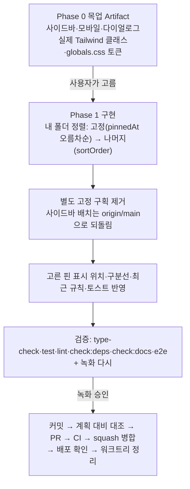

# 북마크 폴더 고정 — 별도 구획 대신 "내 폴더" 맨 위로

> 10-26 구현(별도 "고정한 폴더" 구획)을 커밋 전에 바꾼다. 고정한 폴더는 따로 모으지 않고 "내 폴더" 목록 맨 위로 올린다. 서버(BE #127, `pinnedAt`·`PUT`/`DELETE …/pin`)는 그대로 쓴다.

## Context

**요청(2026-10-27)**: "구역 따로 만들지 말고 내 폴더에서 상위에 배치하는 건 어떨까. 핀이 있을 때 폴더 이름도 있으면 겹칠 수 있을 것 같은데, 예시를 UI로 보여줘서 판단할 수 있게 아티팩트를 달라."

**지금 상태** (워크트리 `bookmark-folder-pin`, 아직 커밋하지 않음)

- 고정한 폴더가 화면 세 곳에 별도 구획으로 한 번 더 나온다. 본 목록에서도 빼지 않았다.
  - 사이드바: `FolderTree.tsx:91-108`
  - 모바일: `MobileFolderList.tsx:57-70`
  - 저장 다이얼로그: `BookmarkFolderSelectDialog.tsx:195-210`
- 사이드바는 고정 구획 때문에 B안으로 바꿨다(`FolderTree.tsx:58-60` 주석). 고정·최근·내 폴더 라벨을 스크롤 영역 안에서 sticky로 붙인다. `origin/main`은 최근 구획과 "내 폴더" 라벨을 위쪽 고정 블록에 두고, 폴더 행만 스크롤했다.
- 최근 구획은 고정하지 않은 폴더 중에서만 고른다(`useFolderSections.ts:20`, `useBookmarkFolderSelect.ts:43`). 그래서 폴더 4개를 모두 저장해 둔 상태에서 1개를 고정하면 최근 구획이 통째로 사라진다. 10-26 대화에서 사용자가 이 부분을 헷갈려 했다.
- 고정 아이콘 위치와 이름 겹침
  - 지금은 `[북마크 아이콘][이름 flex-1 truncate][📌 shrink-0][개수]`(`FolderTree.tsx:262-270`) 순서다.
  - 이름은 잘리기만 해서 실제로 겹치지는 않는다. 다만 고정한 행은 이름 칸이 약 26px(아이콘 14px + 간격 12px) 좁아진다.
  - 모바일 카드는 아이콘이 개수 줄에 있어 이름 줄과 상관없다(`MobileFolderList.tsx:183-186`).

**선례 조사(§8)** — 고정한 항목은 대부분 같은 목록 맨 위로 올린다. 같은 항목을 별도 구획에 한 번 더 보여주는 사례는 찾지 못했다.

- [WhatsApp 도움말 "채팅 고정·해제"](https://faq.whatsapp.com/645907560577342/): _"채팅을 최대 3개까지 채팅 목록 맨 위에 고정해 빨리 찾을 수 있다"_ (번역).
- [Apple 메모 "메모 정렬 및 고정"(Mac)](https://support.apple.com/guide/notes/apdb54e469b6/mac): _"고정한 메모는 항상 메모 목록 맨 위에 나타난다"_ (번역). 같은 목록 안에 "고정됨" 구획 라벨이 있다(메모를 "메모" 구획에서 "고정됨" 구획으로 끌어 고정한다).
- 위 두 문장은 검색 결과의 요약으로 확인했다. 원문 페이지는 직접 열지 못했다.
- [Google Keep 도움말](https://support.google.com/keep/answer/6191044): _"중요한 메모를 Keep 피드 맨 위에 고정해 빨리 찾을 수 있다"_ (번역). "고정됨/기타" 라벨이 있다는 말은 제3자 글에만 있어 확인하지 못했다.
- 카카오톡 채팅방 "상단 고정"도 같은 목록 위로 올린다(최대 5개, [i-boss 기사](https://www.i-boss.co.kr/ab-2877-2531), 2차 출처).

## 판단이 필요했던 항목

| 항목                    | 결정                                                                                             | 근거·기각한 대안                                                                                                                                                                                                                                      |
| ----------------------- | ------------------------------------------------------------------------------------------------ | ----------------------------------------------------------------------------------------------------------------------------------------------------------------------------------------------------------------------------------------------------- |
| 고정 폴더 위치          | **"내 폴더" 맨 위로 올린다. 별도 구획은 없앤다** (사용자 제안 10-27)                             | 위 선례가 모두 같은 목록 맨 위 방식이다. 별도 구획 안은 같은 폴더가 두 번 나와 중복이었다. 대가: 고정하면 본 목록 순서가 바뀐다(Findlater & McGrenere의 "아래 목록은 그대로" 원칙과 다르다). 다만 사용자가 직접 바꾼 순서라 자동 적응 메뉴와는 다르다 |
| 내 폴더 안 순서         | 고정 폴더를 `pinnedAt` 오름차순으로 먼저, 나머지는 `sortOrder` 그대로                            | 10-26 결정(고정 구획 안 순서)과 같다. 새로 고정한 폴더는 고정 묶음 맨 아래에 붙는다                                                                                                                                                                   |
| 사이드바 배치           | **`origin/main` 배치로 되돌린다**(최근 구획과 "내 폴더" 라벨은 위쪽 고정 블록, 폴더 행만 스크롤) | B안은 고정 구획 때문에 생긴 변경이라 이유가 사라졌다. 되돌리면 09-21·09-22 결정이 그대로 남고 diff도 준다                                                                                                                                             |
| 핀 표시 위치            | **시안에서 고른다.** 추천: 왼쪽 아이콘 자리(북마크 아이콘 대신 핀)                               | 이름 칸을 줄이지 않아 사용자가 걱정한 겹침·잘림이 생기지 않는다. 지금 왼쪽 아이콘은 모든 행이 같아 정보가 없다. 기존 방식(이름 오른쪽)도 나란히 보여 준다                                                                                             |
| 고정 묶음과 나머지 사이 | **시안에서 고른다.** 추천: 구분선 없음                                                           | 핀 아이콘이 한 열에 모여 경계가 보인다. 얇은 구분선 안도 나란히 보여 준다. "고정됨" 같은 라벨은 구획을 다시 만드는 셈이라 시안에서 뺀다                                                                                                               |
| 최근 구획과의 관계      | **추천: `origin/main` 규칙으로 되돌린다**(고정 폴더도 최근에 나올 수 있음). 시안에서 확인받는다  | 고정 폴더를 최근에서 뺀 이유는 고정 구획과 최근 구획이 나란히 중복되기 때문이었다. 구획이 없어지면 그 이유도 사라진다. 최근 구획이 본 목록과 겹치는 건 원래 split menu 설계다. 함께 "고정 1개로 최근 구획이 사라지는" 부작용도 없어진다               |
| 고정·해제 피드백        | **시안에서 고른다.** 추천: 짧은 성공 토스트를 띄운다                                             | 별도 구획이 없으면, 아래쪽 폴더를 고정할 때 그 행이 맨 위로 옮겨 가 화면 밖으로 사라질 수 있다. 그러면 texts-conventions 판단축 1(가시성)이 깨진다. 10-26의 "아이콘이 보이니 토스트 불필요" 근거가 더는 서지 않는다(§7)                               |

### 시안 후보 (§9 — 반영 전 Artifact로 승인)

한 페이지에 나란히 둔다. 라이트·다크 둘 다 보여 준다. 긴 이름("프론트엔드 성능 최적화 참고 자료" 등)과 hover로 ⋮가 열린 행을 넣어 겹치는지 보이게 한다.

| 화면                                                       | 나란히 둘 안                                                                                                 |
| ---------------------------------------------------------- | ------------------------------------------------------------------------------------------------------------ |
| A. 데스크톱 사이드바(창 높이 650px, 폴더 14개 중 2개 고정) | 0) 지금 구현(별도 구획, 비교용) · 1) 맨 위 + 핀 오른쪽 · 2) 맨 위 + 핀 왼쪽 · 3) 1 + 구분선 · 4) 2 + 구분선  |
| B. 모바일 그리드(393px)                                    | 핀이 개수 옆(지금) · 왼쪽 위 아이콘이 핀으로                                                                 |
| C. 저장 다이얼로그                                         | 핀 오른쪽 · 핀 왼쪽 (미분류 → 최근 → 내 폴더)                                                                |
| D. 최근 구획                                               | 고정 폴더도 최근에 나옴(main) · 최근에서 뺌(지금, 폴더 4개 모두 저장 + 1개 고정이면 최근 구획이 사라지는 예) |
| E. 아래쪽 폴더 고정                                        | 전·후 화면(행이 맨 위로 이동해 안 보임) · 토스트 있음/없음                                                   |

## 세부 계획

### Phase 0 — 목업

| 위치                       | 변경 내용                                                                                                                                                                         |
| -------------------------- | --------------------------------------------------------------------------------------------------------------------------------------------------------------------------------- |
| scratchpad HTML → Artifact | 위 시안 A~E. `FolderTree.tsx`·`MobileFolderList.tsx`·`BookmarkFolderSelectDialog.tsx`의 실제 클래스와 `globals.css` 토큰을 옮겨 쓴다. 사용자가 고르기 전에는 코드를 고치지 않는다 |

### Phase 1 — 구현 (워크트리 `bookmark-folder-pin`에서 이어서)

| 위치                                                                       | 변경 내용                                                                                                                                                                            |
| -------------------------------------------------------------------------- | ------------------------------------------------------------------------------------------------------------------------------------------------------------------------------------ |
| `entities/bookmark/folder/utils/bookmark-folder.util.ts` (+ test)          | `orderPinnedFirst(folders)` 추가(`pickPinnedFolders` + `pickUnpinnedFolders`를 이어 붙임). 최근을 main 규칙으로 되돌리고 `pickUnpinnedFolders`가 이 안에서만 쓰이면 private으로 둔다 |
| `widgets/bookmark/folder-tree/hooks/useFolderSections.ts` (+ test)         | `folderList`를 `orderPinnedFirst`로 반환하고 `pinnedFolderList`는 없앤다. 최근은 고른 규칙대로(추천: `pickRecentFolders(원본 목록)`)                                                 |
| `…/hooks/useFolderTree.ts`                                                 | `pinnedFolderList` 전달을 없앤다                                                                                                                                                     |
| `…/ui/FolderTree.tsx`                                                      | 레이아웃을 `origin/main` 버전으로 되돌린다. `FolderItem`에 고른 핀 표시를 넣고, 모든 자리에서 보이게 해 `showPinIcon`을 없앤다. ⋮ 메뉴의 고정/고정 해제는 유지                       |
| `…/ui/MobileFolderList.tsx`                                                | 고정 구획을 없앤다. `FolderCard`에 고른 핀 표시를 넣고 `showPinIcon`을 없앤다                                                                                                        |
| `features/bookmark/select/hooks/useBookmarkFolderSelect.ts`                | `pinnedFolderList`를 없애고 내 폴더를 `orderPinnedFirst`로 정렬한다. 최근은 고른 규칙대로(추천: main처럼 `useRecentBookmarkFolders(folderList, …)`)                                  |
| `features/bookmark/select/ui/BookmarkFolderSelectDialog.tsx`               | 고정 구획을 없앤다. `FolderRow`에 고른 핀 표시를 넣는다(왼쪽 안이면 아이콘 span 자리를 쓰므로 여백 문제가 생기지 않는다)                                                             |
| `shared/config/texts.ts`                                                   | `bookmark.folder.pinnedSection`을 지운다. 토스트를 고르면 `messages.success.folderPinned(name)`·`folderUnpinned(name)`을 추가한다                                                    |
| `entities/bookmark/folder/api/bookmark-folder.queries.ts` (+ test)         | 토스트를 고르면 성공 시 마지막 요청(`isLastPendingPin`)에서만 띄운다. 실패 토스트와 같은 자리다                                                                                      |
| `features/bookmark/toggle/ui/PostCardBookmarkFolderDialog.test.tsx`        | 고정 구획 단정을 "내 폴더 맨 위에 고정 폴더"와 "최근 규칙"으로 바꾼다                                                                                                                |
| `.claude/browser-artifacts/verify-bookmark-folder-pin.spec.ts` (gitignore) | 시나리오 1~6을 새 동작에 맞춰 다시 녹화한다                                                                                                                                          |
| `docs/BOOKMARK.md`                                                         | §5 "고정한 폴더 구획" → "고정 — 내 폴더 맨 위로"로 다시 쓰고, "사이드바 배치" 소절은 main 내용으로 되돌린다. §6~§12 갱신. §10 다이얼로그 여백 버그는 그 코드가 남을 때만 둔다        |
| `docs/DECISIONS.md` 10-26 항목(미커밋)                                     | 서버 저장 / 내 폴더 맨 위(별도 구획 기각, 사용자 10-27) / 최근 규칙 / 사이드바 배치 유지로 고쳐 쓴다                                                                                 |
| `CHANGELOG.md`                                                             | Added 문구를 "고정한 폴더를 내 폴더 맨 위로"로 바꾼다                                                                                                                                |
| `docs/plans/2026-10-27-bookmark-folder-pin-in-my-folders.md` (신규)        | 이 계획의 스냅샷이다. 10-26 파일(BE에 커밋된 것의 사본)도 함께 커밋한다                                                                                                              |

## 영향 범위 (§5)

- **데이터·API**: 바뀌지 않는다. BE는 고칠 것이 없다. BE의 10-26 계획(커밋됨, 구획 안)과 다른 점은 FE PR 본문에 적는다.
- **CRUD**
  - 생성: 새 폴더는 고정하지 않은 상태라 기존 자리에 들어간다.
  - 이름 변경·삭제: 고정 폴더 행도 같은 `FolderItem`이다. key가 `folder.id`라 정렬이 바뀌어도 이름 변경 입력 상태가 유지되는지 확인한다.
  - 고정·해제: 행 위치가 바뀐다. 같은 폴더를 빠르게 연타하는 처리(scope·마지막 요청만 교정)는 그대로다.
- **회귀**
  - 최근 구획 노출: main 규칙으로 되돌리면 `useFolderSections.test`·다이얼로그 테스트의 10-26 표 단정이 바뀐다.
  - e2e: 픽스처를 고정하지 않은 상태로 두므로 영향이 없을 것으로 본다. 전체를 돌려 확인한다.
  - 사이드바 되돌림: 10-26에 바꾼 `scroll-pt-6`·sticky 라벨 주석이 사라진다.
- **여러 곳에서 import하는 파일**: `bookmark-folder.util`·`useFolderSections`는 구현 전에 `pnpm graph:focus "<경로>" --text`로 사용처를 다시 뽑는다.

## 검증 방법

- `pnpm type-check` → `pnpm test` → `pnpm lint`·`pnpm check:deps` → `pnpm check:docs`
- e2e 전체: `CI=1 E2E_SERVER_PORT=<빈 포트> pnpm exec playwright test`. `CI=1`로 다른 워크트리 서버를 재사용하지 않게 한다.
- 단위 테스트
  - `orderPinnedFirst`: 고정 오름차순 + 나머지 원래 순서, 고정 0개, 전부 고정
  - `useFolderSections`: 고정해도 최근 구획이 그대로인지(main 규칙일 때)
  - 다이얼로그: 내 폴더 첫 행이 고정 폴더이고, 고정 구획 라벨이 없는지
- 녹화(모킹 스펙)
  1. 아래쪽 폴더 고정 → 맨 위로 이동(+ 토스트)
  2. 두 번째 고정은 그 아래에 붙고, 해제하면 원래 자리로 돌아간다
  3. 새로고침, 두 다이얼로그
  4. 이름 변경·삭제·오프라인 롤백
  5. 650px + 다크 모드
  6. 모바일
- 계획 대비 구현 대조(§11): fresh general-purpose 서브에이전트에 10-27 계획 파일과 diff를 준다.

## 남은 것

- Phase 0 시안에서 정할 것: 핀 표시 위치, 구분선 여부, 최근 구획 규칙, 고정·해제 토스트 여부.
- 범위 밖(10-26과 같음): 고정 폴더 순서 직접 바꾸기, 다이얼로그 안에서 고정·해제.
