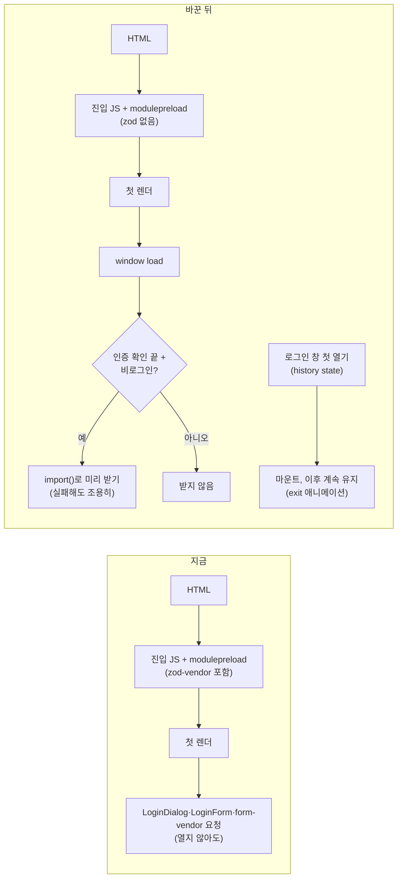
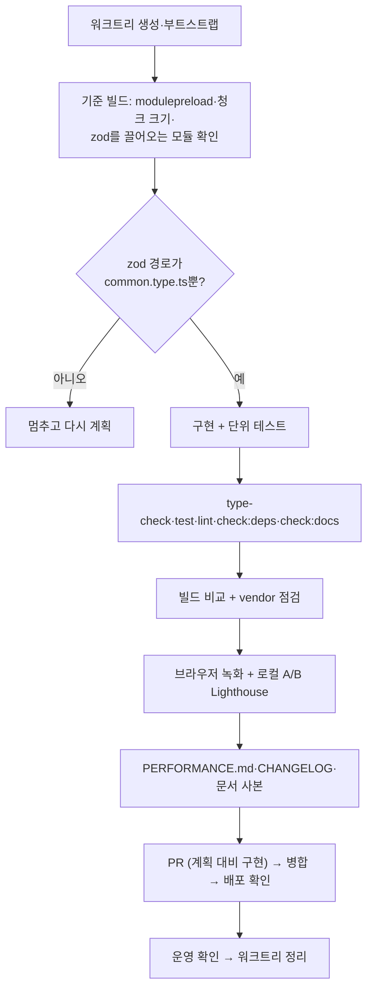

# 첫 로딩 JS 줄이기 + 폰트 preload 운영 결과 기록

> 비로그인 첫 화면이 쓰지 않는 zod와 로그인 창 코드를 첫 로딩에서 뺀다. 같은 PR에 폰트 preload(#425)의 운영 재측정
> 결과를 `docs/PERFORMANCE.md`에 표로 남긴다. FE만 바꾸고 PR은 1개다. 썸네일 축소는 보류한다(2026-10-27 사용자 결정).

## Context

### 왜

- LCP 줄이기 Phase 1(#421)과 Phase 2(#425) 뒤에 남은 항목 중에서, 사용자가 2026-10-27에 "2,3번 먼저"를 골랐다.
  - 2번(og 썸네일 축소)은 보류했다. 사용자 조건은 무료 플랜 유지, 외부 서비스 지양, 저장 용량 한계다.
  - 그래서 이번 범위는 3번(첫 로딩 JS) 하나다.
- 기대 효과는 크지 않다. 느린 모바일에서 0.1~0.3초 수준으로 추정했고, 사용자에게도 그렇게 말했다. 측정으로 확인한다.

### 코드로 확인한 사실 (origin/main `6f2cfba1`)

**zod가 첫 로딩에 실리는 경로** (정적 추적이다. 구현 첫 단계에서 빌드로 확인한다)

- `src/shared/types/common.type.ts:1,7-12`에 런타임 zod 스키마 `paginationRequestSchema`가 있다. 이 스키마는 어디서도 쓰이지 않는다.
  - 다른 파일은 `PaginationRequest` **타입**만 쓴다. 쓰는 곳은 `bookmark-folder.queries.ts:40`, `comment.api.ts:5`, `comment.queries.ts:22`, `post.queries.ts:41` 네 곳이다.
- `common.type.ts`는 `ApiError` 같은 에러 클래스 때문에 첫 로딩 그래프에 들어온다(`client.ts`).
  - `vite.config.ts`의 `treeshake.moduleSideEffects: false`는 "export를 하나도 안 쓰는 모듈"만 뺀다.
  - 그래서 쓰이는 모듈에 있는 최상위 `z.object(...)` 호출은 남는다고 본다. 이 판단은 설치본 rollup 4.55.1의 동작에 대한 추론이고, 빌드로 확인한다.
- 다른 zod 스키마 값을 쓰는 곳은 모두 폼 훅이다. `features/*/hooks`의 `zodResolver`와 `entities/post/hooks/useLinkPreview.ts:37`(글 등록·수정)뿐이고, 응답 스키마 검증은 없다(`git grep`).
- 그런데 `vite.config.ts:116-120` 주석과 `docs/PERFORMANCE.md:140`은 "entities의 응답 스키마 검증에도 쓰여"라고 적고 있다. 사실과 다르다.

**로그인 창**

- `src/app/routes/layouts/RootLayout.tsx:16-20`은 LoginDialog를 `lazy()`로 불러온다. 그러나 `:44-46`에서 항상 렌더하므로, 첫 렌더 때 import가 시작된다.
  - 그래서 modulepreload 목록에는 없지만, LoginDialog 청크와 LoginForm, form-vendor, zod-vendor를 열지 않아도 매번 받는다.
  - 이전 계획 "남은 것"에는 약 25KB(br)로 적혀 있다. 출처를 확인하지 못했으므로 빌드로 다시 잰다.
- 열림 상태는 히스토리 state `loginDialogOpen`이다(`useHistoryOverlay`, `useLoginDialog.ts:16`).
- 여는 곳은 네 곳이고, 모두 비로그인일 때만 연다.
  - `Navbar.tsx:185`, `useAuthGuard.ts:43`, `useProtectedNavigate.ts:27`, `ProtectedRoute.tsx:65`
- `useLoginDialog.ts`의 effect 세 개(:22-80)는 모두 "열려 있을 때"나 "열렸다 닫힌 뒤"에만 동작한다.
  - 그래서 처음 열릴 때 마운트해도 동작은 같다.
  - 다만 닫힐 때 바로 언마운트하면 exit 애니메이션이 사라진다(Radix Presence). 그러므로 한 번 열린 뒤에는 계속 마운트해 둔다.
- 비로그인 방문자는 `useAppInitialization.ts:45-59`의 `finally`에서 곧바로 `isAuthResolved=true`가 된다.

**선례**

- 인증 조건에 따른 동적 import와 `.catch`: `useFcmForegroundMessage.ts:17-55`
- 렌더 중 상태 맞추기: `usePostCardBookmarkFolderDialog.ts:41-48` 외 9곳. `react-hooks/set-state-in-render`는 `eslint.config.js:582`에서 error로 켜져 있다.
- 청크를 idle 때 미리 받는 선례는 없다(`requestIdleCallback` 0건). 이번이 처음이다.
- 옛 자산은 배포 뒤 7일 동안 남는다(`deploy.yml:89-90`). 그래서 새 배포 직후의 청크 404는 드물다.

### 사용자 결정 (2026-10-27)

- **로그인 창**: "열 때 + 미리 받기". 첫 화면이 다 뜬 뒤 남는 시간에 미리 받는다.
- **GitHub 기록**: `docs/PERFORMANCE.md`에 표로 남기고, 이미지는 넣지 않는다.
- **썸네일**: 보류한다.

## 판단이 필요했던 항목

| 항목                      | 결정                                                                                                                                  | 근거·기각한 대안                                                                                                                                                                            |
| ------------------------- | ------------------------------------------------------------------------------------------------------------------------------------- | ------------------------------------------------------------------------------------------------------------------------------------------------------------------------------------------- |
| zod 스키마                | 지우고 `export type PaginationRequest = { page: number; size: number }`로 바꾼다                                                      | `.default()` 때문에 `z.infer` 출력 타입도 두 필드가 모두 필수라 같은 타입이다. 쓰는 곳이 없어 다른 파일로 옮길 이유가 없다                                                                  |
| `zod-vendor` 청크         | 분리는 그대로 두고 주석만 사실대로 고친다                                                                                             | 다시 합쳤을 때의 이득은 측정되지 않았다. 범위 밖이다(§3)                                                                                                                                    |
| "첫 화면이 다 뜬 뒤" 신호 | `window` `load` 이벤트. 이미 지났으면 바로 시작한다                                                                                   | `load`는 그때까지 시작된 eager 이미지(LCP 썸네일)를 기다린다. `requestIdleCallback`은 선례가 없고 Safari 지원을 확인하지 못했다. 실제 순서는 브라우저로 확인한다                            |
| 미리 받기 대상            | `isAuthResolved && !isAuthenticated`일 때만                                                                                           | 로그인 사용자는 이 창을 열 일이 없다(여는 곳 4곳 모두 비로그인 조건). 로그아웃하면 그때 받는다                                                                                              |
| 미리 받기 방식            | `import()`로 미리 받고, 처음 열 때 마운트한 뒤 계속 유지한다(래치)                                                                    | 기각: load 뒤 닫힌 채 마운트. 지금과 같은 상태가 되지만, 청크 실패가 글을 읽는 도중 `RouteErrorBoundary` 오류 화면으로 번진다. 미리 받기 실패는 조용히 넘기고, 열 때 `lazy`가 다시 시도한다 |
| 훅 위치                   | 신규 `widgets/layout/login-dialog/hooks/useLoginDialogMount.ts`. 로더 함수도 여기서 export하고 RootLayout의 `lazy`가 같은 함수를 쓴다 | 기각: RootLayout 안 지역 훅. RootLayout은 전역 훅이 많아 단위 테스트가 어렵다                                                                                                               |
| catch-all `vendor` 청크   | 이번 PR에서는 측정해서 보고만 한다                                                                                                    | lazy 페이지에서만 쓰는 라이브러리가 gzip 10KB 이상 섞여 있으면 멈추고 묻는다                                                                                                                |
| 효과 측정                 | 게이트로 쓰지 않는다. 노이즈 범위여도 반영한다                                                                                        | 받는 바이트가 줄어드는 것은 빌드로 확인된다. 어느 지표든 나빠지면 멈추고 보고한다                                                                                                           |

## 세부 계획

### 바뀌는 로딩 흐름

### 작업 순서

### 변경 내용

| 위치                                                                  | 변경                                                                                                                                                                                                                                                                                                                                                                                                                                                                                                                                                               |
| --------------------------------------------------------------------- | ------------------------------------------------------------------------------------------------------------------------------------------------------------------------------------------------------------------------------------------------------------------------------------------------------------------------------------------------------------------------------------------------------------------------------------------------------------------------------------------------------------------------------------------------------------------ |
| `src/shared/types/common.type.ts:1-12`                                | zod import와 스키마를 지우고 plain type으로 바꾼다. 기존 JSDoc의 "page는 0부터" 설명은 남긴다                                                                                                                                                                                                                                                                                                                                                                                                                                                                      |
| `vite.config.ts:116-120`                                              | zod-vendor 주석을 사실대로 고친다. 응답 검증이 아니라 `common.type.ts`의 안 쓰는 스키마 때문이었고, 그 스키마는 지웠으며, 지금은 폼 훅만 쓴다고 적는다                                                                                                                                                                                                                                                                                                                                                                                                             |
| `src/widgets/layout/login-dialog/hooks/useLoginDialogMount.ts` (신규) | `loadLoginDialog = () => import('@/widgets/layout/login-dialog/ui/LoginDialog')`와 `useLoginDialogMount(): boolean`를 둔다. ① `useHistoryOverlay('loginDialogOpen').isOpen`이 처음 true가 되면 렌더 중 `useState` 래치를 켠다(react.dev "adjusting some state" 링크, 선례 주석 형식). ② 비로그인이고 인증 확인이 끝났으면 `load` 뒤(이미 complete면 바로) `loadLoginDialog()`를 부르고, effect cleanup에서 리스너를 지운다. 실패는 이유를 적은 주석과 함께 무시한다. 빈 본문 린트 규칙에 걸리지 않게 하고, Lighthouse BP 감사를 깎는 `console.error`는 쓰지 않는다 |
| `src/app/routes/layouts/RootLayout.tsx:11-20,37-46`                   | 주석을 고친다(지금도 매번 받고 있었다는 사실과 새 동작). `lazy`는 `loadLoginDialog`를 쓴다. `useLoginDialogMount()`는 조기 return 앞에서 부르고, `true`일 때만 `<Suspense fallback={null}><LoginDialog /></Suspense>`를 렌더한다                                                                                                                                                                                                                                                                                                                                   |
| `useLoginDialogMount.test.tsx` (신규)                                 | 열기 전에는 false인지, 열면 true인지, 닫아도 true로 남는지 확인한다. 비로그인+확인 끝이면 LoginDialog 모듈을 불러오는지, 로그인 상태나 확인 전이면 불러오지 않는지 확인한다(`vi.doMock`·`vi.resetModules` 등은 구현 때 고른다)                                                                                                                                                                                                                                                                                                                                     |
| `docs/FCM-PUSH-NOTIFICATION.md:389-425`                               | RootLayout 코드 사본과 "정정(2026-09-29)" 문단에 새 동작을 반영한다(새 "정정(2026-10-2x)" 줄 추가)                                                                                                                                                                                                                                                                                                                                                                                                                                                                 |
| `docs/FE-ARCHITECTURE.md:194`                                         | 트리의 `hooks/` 설명에 `useLoginDialogMount`를 추가한다                                                                                                                                                                                                                                                                                                                                                                                                                                                                                                            |
| `docs/PERFORMANCE.md`                                                 | ① 2026-09-26 표 아래에 zod 이유를 정정하는 줄을 단다. ② 새 절 "첫 로딩 JS (직접 측정, 2026-10-2x)": 빌드 전후 표(진입 청크, modulepreload 목록, 첫 로딩에 요청된 청크), vendor 점검 결과, 로컬 A/B 결과. ③ 새 절 "폰트 preload 운영 재측정 (직접 측정, 2026-10-27)": 아래 표 두 개                                                                                                                                                                                                                                                                                 |
| `CHANGELOG.md` `[Unreleased]` → `### Changed`                         | `shared` 첫 화면에서 쓰지 않는 zod·로그인 창 코드를 받지 않음(changelog-release skill 형식)                                                                                                                                                                                                                                                                                                                                                                                                                                                                        |
| `docs/plans/2026-10-27-first-load-js.md` (신규)                       | 이 계획 파일 사본(§11)                                                                                                                                                                                                                                                                                                                                                                                                                                                                                                                                             |

### PERFORMANCE.md에 넣을 운영 결과 (2026-10-27 측정)

**측정 조건**

- 짝 비교 A/M을 Playwright Chromium으로 쟀다.
  - A는 배포본 HTML에 빠진 preload 14개를 `page.route`로 다시 끼운 사본이고, M은 배포본이다.
- 캐시를 끄고 RUM 전송은 막았다.
- 모바일 조건은 Phase 1과 같다.
- 유효 3라운드의 중앙값이다. 4·5라운드는 운영 방화벽의 요청 빈도 제한에 걸려 버렸다.
  - 공개 레포 문서이므로 정확한 임계값은 적지 않는다.

| 페이지 · 기기      | FCP A → M       | LCP A → M                           | 폰트 A → M              |
| ------------------ | --------------- | ----------------------------------- | ----------------------- |
| `/post` · 모바일   | 4,820 → 2,756ms | 5,908 → 4,428ms                     | 21개 541KB → 13개 339KB |
| 상세 · 모바일      | 4,720 → 2,736ms | 5,620 → 3,936ms                     | 19개 480KB → 7개 179KB  |
| `/post` · 데스크톱 | 276 → 228ms     | 764 → 632ms (짝 중앙값 −64, 노이즈) | 22개 576KB → 15개 399KB |
| 상세 · 데스크톱    | 268 → 220ms     | 544 → 460ms (짝 중앙값 −52, 노이즈) | 19개 480KB → 9개 228KB  |

**운영 Lighthouse**

- 버전은 12.6.1, 모바일 simulate다. PSI API가 할당량 초과라 로컬 Node API로 대신했다.
- 2026-10-27 22:50 KST쯤, 3회 중앙값이다.
- 같은 조건의 "적용 전" 값은 없다. 그래서 절대값으로만 남긴다.

| 페이지  | 점수 | FCP     | LCP      | CLS | 폰트       |
| ------- | ---- | ------- | -------- | --- | ---------- |
| `/post` | 73   | 1,818ms | 10,130ms | 0   | 13개 345KB |
| 상세    | 83   | 1,697ms | 4,646ms  | 0   | 7개 182KB  |

## 영향 범위

### CRUD 실패 지점

- **데이터 경로는 바뀌지 않는다.** 조회, 등록, 수정, 삭제 요청과 캐시 키를 건드리지 않는다.
- **로그인 창으로 하는 로그인**도 흐름이 같다. `onSuccess`와 `pendingAction`은 창이 마운트되기 전에 store에 저장되고(`useAuthGuard.ts:38-43`), 창이 처음 열린 뒤에 소비된다.

### 기존 기능 회귀 후보

| 대상                 | 사용처                                                             | 확인할 것                                                                                                                                                   |
| -------------------- | ------------------------------------------------------------------ | ----------------------------------------------------------------------------------------------------------------------------------------------------------- |
| `common.type.ts`     | 다수(구현 때 `pnpm graph:focus`로 뽑는다)                          | `PaginationRequest`를 쓰는 4곳의 type-check                                                                                                                 |
| `RootLayout.tsx`     | `routes/index.tsx:161`                                             | 새 버전 리로드 분기, 전역 Alert·ImageViewer 그대로인지                                                                                                      |
| 로그인 창을 여는 4곳 | `Navbar`, `useAuthGuard`, `useProtectedNavigate`, `ProtectedRoute` | 단위 테스트 `LoginDialog`·`useAuthGuard`·`useProtectedNavigate`·`ProtectedRoute`, e2e `guest-guard`·`protected-nav`·`dialog-outside-click`·`reduced-motion` |
| load 전에 처음 열기  | 느린 회선에서 바로 클릭한 경우                                     | 청크가 올 때까지 창이 비어 있다가 뜬다. 지금도 첫 렌더 직후 클릭하면 같다                                                                                   |
| 청크 실패            | 열 때 실패 → `RouteErrorBoundary`(지금은 첫 렌더 때 같은 경로)     | 미리 받기 단계의 `vite:preloadError` → `reloadOnce`가 이제 읽는 도중 날 수 있다. 옛 자산이 7일 남아 드물다고 보고 감수한다                                  |
| exit 애니메이션      | 래치                                                               | 닫을 때 페이드·축소가 지금처럼 보이는지                                                                                                                     |
| 진입 청크 크기       | 신규 훅 파일                                                       | `useHistoryOverlay`·`auth.store`는 이미 진입 청크에 있어 늘어나는 양은 작을 것이다. 빌드로 확인한다                                                         |
| 문서 사본            | `docs/FCM-PUSH-NOTIFICATION.md` RootLayout 코드                    | 실제 소스와 일치하는지                                                                                                                                      |

## 검증 방법

1. **기준선**: 워크트리를 만든 직후 origin/main 그대로 `pnpm build`를 한다(`git log origin/main..main`은 비어 있음을 확인했다).
   - 진입 청크 크기와 modulepreload 목록, `dist/stats.html`에서 zod를 끌어오는 모듈을 기록한다.
   - zod를 끌어오는 모듈이 `common.type.ts` 말고도 있으면 멈추고 다시 계획한다.
2. **정적 검사**: `pnpm type-check`, `pnpm test`, `pnpm lint`, `pnpm check:deps`, `pnpm check:docs`
3. **빌드 비교**: modulepreload에서 `zod-vendor`가 빠졌는지, 진입 청크 크기가 어떻게 바뀌었는지 본다.
   - `vite preview` + Playwright로 비로그인 `/post`를 연다. `load` 전에는 LoginDialog·form-vendor·zod-vendor 요청이 없고, `load` 뒤에 나가는지 확인한다.
   - LCP 썸네일 요청이 그보다 먼저 끝나는지도 본다.
4. **vendor 점검**: `stats.html`로 `vendor-*.js` 안에서 lazy 페이지에서만 쓰는 라이브러리를 찾아 표로 보고한다.
5. **브라우저 녹화**(browser-verification skill, 데스크톱과 모바일). 창을 여는 것만으로는 운영 데이터에 쓰기가 없으므로 MCP 녹화로 한다.
   - ① Navbar 로그인 버튼으로 열고 닫기(exit 애니메이션)
   - ② 비로그인 좋아요로 열고 닫기
   - ③ `/bookmark` 직접 진입 시 창이 뜨는지
   - ④ 다시 열기
6. **로컬 A/B**: Phase 2 방식(`docs/PERFORMANCE.md` "폰트 preload 비교")을 따른다.
   - main 빌드와 브랜치 빌드를 `vite preview`로 띄워 Lighthouse 12.6.1 모바일 simulate·devtools × `/post`·상세를 잰다.
   - 번갈아 5라운드 돌리고, 같은 라운드 안 차이의 중앙값을 본다. max(100ms, 5%) 안이면 노이즈다.
   - 실행 간격은 40초다. 운영 API를 부르므로 방화벽 빈도 제한을 피해야 한다.
7. **e2e**: 위 회귀 표의 e2e 4개와 전체 `pnpm test:e2e`를 돌린다.
8. **배포 뒤**:
   - `gh run list --branch main --workflow "Frontend Deploy (S3 + CloudFront)"`로 그 SHA가 success인지 확인한다.
   - 운영 HTML의 modulepreload 목록을 확인한다(요청 1회).
   - Playwright로 비로그인 `/post`의 요청 순서를 확인한다.
   - 운영 Lighthouse를 3회(40초 간격) 재서 위 2026-10-27 값과 나란히 적는다(참고용).
9. **계획 대비 구현**(§11): fresh general-purpose 서브에이전트에게 이 계획과 diff를 주고 대조시킨다. 결과는 PR 본문 `## 계획 대비 구현`에 남긴다.
10. **정리**: 병합과 배포를 확인한 뒤 워크트리와 로컬 브랜치를 지운다.

## 남은 것

- **og 썸네일 축소: 보류**(2026-10-27 사용자 결정). 유료 기능과 외부 서비스는 피하고, 저장 용량에 한계가 있다.
  - 측정 사실: 최근 공개 글 100개 중 YouTube 39개는 6~38KB다. 나머지는 중앙값 129KB이고, 200KB를 넘는 게 20개, 500KB를 넘는 게 12개, 최대 4.8MB다.
  - 모바일에서 그리는 크기는 354×199 CSS px다.
  - 이전 보류 기록은 `docs/plans/2026-09-25-lighthouse-perf.md:164-181`에 있다.
- **확인이 필요한 위험(범위 밖)**: Supabase 문서상 이미지 변환은 Free 플랜에서 제공되지 않는데, 운영에서는 지금 동작한다.
  - 막히면 `getTransformedImageUrl`(`supabaseImage.ts:37-57`)에 기대는 아바타(`UserAvatar.tsx:68`), 마크다운 이미지(`MarkdownContent.tsx:77`), 아바타 미리 받기(`useAppInitialization.ts:19`)가 깨질 수 있다.
- **RUM 비교**: 2026-11-10 무렵 주별 LCP·FCP p75를 비교한다. 기준선은 LCP p75 2.49s(09-28~10-26)다.
- **`zod-vendor`를 form-vendor와 다시 합칠지**: 이번에는 그대로 둔다.
- **로그인 재방문자의 직렬 대기**: `AppShellLayout`이 `/auth/refresh`를 기다린다. 아직 측정하지 않았다.
