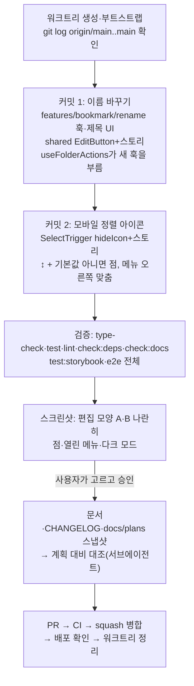

# 북마크 폴더 화면 — 제목 옆 연필로 이름 바꾸기 + 모바일 정렬을 아이콘으로

> 폴더 화면(`/bookmark?folder=<id>`) 제목 옆에 연필 버튼을 두어, 사이드바·카드와 같은 방식으로 이름을 바꾸게 한다. 모바일 정렬은 글자 칸 대신 ↕ 아이콘으로 바꾸고, 기본값이 아닐 때 점을 찍는다. PR 1(#436, 폴더 이름 2줄)에 이은 PR 2다.

## Context

**요청(2026-10-27, 사용자)**: "북마크폴더 상세 들어왔을 때 … 상세화면에서도 북마크폴더이름 수정할 수 있도록 제공하는게 어떨지"

10-28 시안을 보고 사용자가 정한 것:

- 연필은 lucide `Pencil`을 쓴다. 나중에 다시 쓸 수 있는 공용 버튼으로 만들고, 이름은 기존 규칙을 따른다.
- 정렬은 제목과 같은 줄에 둔다(아래 줄로 내리지 않음).
- 모바일 정렬은 아이콘 ↕로 바꾼다. 기본값이 아닐 때는 점을 찍는다. 누르면 지금과 같은 목록이 열리고 고른 항목에 체크가 붙는다.
- 제목은 자르지 않는다(15자라 충분히 짧다).
- "최신 등록순" 정렬은 더하지 않는다.

시안 파일: scratchpad `browser-artifacts-keep/folder-name-shots/`의 `mh-360-icon-2.png`·`dh-pencil.png`·`si-applied-dot.png`·`si-open.png`. 시안 스펙에 쓴 값은 다음과 같다(`diag-folder-name-sort-icon.spec.ts:54-92`).

- 연필: 뒤로 버튼(ghost icon `h-8 w-8`)과 같은 크기, `h-4 w-4 text-muted-foreground`.
- 정렬 트리거: 32×32px, 테두리·그림자·배경 없음.
- 점: `bg-primary`, 7px, 위·오른쪽 5px.

**지금 코드(조사로 확인한 것)**

- 제목
  - 모바일 헤더 `BookmarkPage.tsx:61-87`: `[← h-8 w-8][h1 min-w-0 flex-1][SelectTrigger w-32 h-8 text-xs]`.
  - 데스크톱 헤더 `:114-128`: `justify-between` 안에 `[h1 min-w-0][SelectTrigger w-36]`.
- 제목 글자: `useBookmarkPage().currentFolderName`은 문자열만 준다(`useBookmarkPage.ts:54`). 폴더 객체는 넘기지 않는다. 전체·미분류·로딩 중에는 `'전체'`·`'미분류'`·`'폴더'`가 나온다.
- 이름 변경 로직
  - `widgets/bookmark/folder-tree/hooks/useFolderActions.ts:24-101`에서 고정·삭제와 함께 있다. 사이드바(`FolderItem`)와 모바일 카드(`FolderCard`) 전용이다.
  - `name`은 `useState(folder.name)`으로 한 번만 정해진다. `startRename`은 다시 맞추지 않는다(`:36-38`).
  - 데스크톱에서는 사이드바와 제목이 동시에 이 로직을 쓰게 된다. 한쪽에서 바꾼 뒤 다른 쪽을 열면 옛 이름이 뜬다.
- FSD 규칙
  - pages가 widget 훅을 import하는 건 lint·`check:deps`를 통과한다(`eslint.config.js:1606-1622`는 `@/app/**`만 막는다). 다만 그렇게 쓰는 페이지 선례가 없다.
  - `docs/FE-ARCHITECTURE.md` §8은 _"여러 곳에서 쓰이는 CRUD는 여전히 `features/`로 뺀다"_ 고 한다.
- Select: `SelectTrigger`는 늘 `ChevronDown`을 붙이고(`select.tsx:67-69`), 숨기는 prop이 없다.
  - Radix Select 2.2.6은 `SelectValue` 없이도 popper 배치가 된다.
  - 쓰는 곳은 `BookmarkPage` 두 곳뿐이다.
- 공용 버튼 선례
  - `ActionButton`·`ToggleButton`(`shared/ui/elements`): PascalCase 파일, named export.
  - 아이콘 버튼의 hover 힌트는 `title` + `aria-label` 선례뿐이다(`PostCard.tsx:141-151` 잠금 버튼).
  - `TooltipWrapper`는 비활성 이유를 알리는 데만 쓴다.
- 점 선례: `Navbar.tsx:162-167`. `aria-hidden` 점이고, 상태는 `aria-label`을 바꿔 알린다(`accountMenuUnverified`).
- 테스트
  - `BookmarkPage`·`useBookmarkPage` 단위 테스트는 없다.
  - 정렬 Select를 건드리는 e2e도 없다.
  - 제목은 e2e 여러 곳이 `getByRole('heading', { level: 1, name })`으로 찾는다.

## 판단이 필요했던 항목

| 항목                          | 결정                                                                                                                                                | 근거·기각한 대안                                                                                                                                                                                                                                                                                                              |
| ----------------------------- | --------------------------------------------------------------------------------------------------------------------------------------------------- | ----------------------------------------------------------------------------------------------------------------------------------------------------------------------------------------------------------------------------------------------------------------------------------------------------------------------------- |
| 이름 변경 로직 위치           | **`features/bookmark/rename/hooks/useRenameBookmarkFolder.ts`로 옮긴다.** `useFolderActions`는 이 훅을 불러 반환 키를 그대로 둔다                   | FE-ARCHITECTURE §8 "여러 곳 CRUD는 features"를 따른다. 슬라이스 이름은 동사(`rename`)다. 기각 1: 페이지가 widget 훅을 직접 import(lint는 통과하지만 선례가 없고, 고정·삭제까지 딸려 온다). 기각 2: 제목 전용 로직을 따로 작성(15자 검사·Esc·IME 처리 중복)                                                                    |
| 편집을 열 때 이름 다시 맞추기 | **`startRename`이 입력값을 지금 `folder.name`으로 맞춘다.** 사이드바·카드도 함께 적용된다                                                           | 데스크톱에서 사이드바와 제목이 같은 폴더를 동시에 그린다. 한쪽에서 바꾼 뒤 다른 쪽을 열면 옛 이름이 뜬다. 보통 흐름에서는 이미 같은 값이라 달라지는 것이 없다                                                                                                                                                                 |
| 제목 UI 위치                  | **`features/bookmark/rename/ui/BookmarkFolderTitle.tsx`.** 모바일·데스크톱 헤더 두 곳에서 쓰고, `key={activeFolderKey}`로 폴더가 바뀌면 새로 그린다 | FSD에서 features UI는 _"폼처럼 상호작용을 수행하는 UI"_ 다(번역, CLAUDE.md "레이어별 허용 세그먼트"에서 재인용). 페이지 파일에 두 번 쓰는 것보다 한 곳이 낫다                                                                                                                                                                 |
| 지금 폴더 객체 넘기기         | **`useBookmarkPage` 반환에 `currentFolder: BookmarkFolder \| undefined`를 더한다.** 기존 필드는 그대로 둔다                                         | 반환 타입에 필드가 하나 는다(CLAUDE.md "기존 시그니처 변경 금지"의 추가 쪽). 쓰는 곳은 `BookmarkPage` 하나다. 기각: 제목 컴포넌트가 목록 쿼리를 따로 불러 찾기(전체·미분류·로딩 중 제목 계산이 중복된다)                                                                                                                      |
| 연필이 보이는 때              | 실제 폴더일 때만. 전체·미분류·로딩 중(`'폴더'`)에는 없다                                                                                            | 이름을 바꿀 대상이 없다                                                                                                                                                                                                                                                                                                       |
| 공용 버튼                     | **`shared/ui/elements/EditButton.tsx`** — ghost icon `h-8 w-8`, `Pencil h-4 w-4`, `label` prop을 `aria-label`과 `title`에 함께 쓴다                 | `ActionButton`·`ToggleButton`처럼 `<역할>Button`으로 이름 붙인다. hover 힌트는 `title` 선례(`PostCard.tsx:141-151`)를 따른다. 기각: Radix Tooltip(일반 힌트로 쓴 선례가 없고 `TooltipWrapper`는 비활성 이유 전용), 힌트 없음(마우스 사용자가 무엇인지 알 수 없다)                                                             |
| 편집 동작                     | 카드·사이드바와 같다. Enter·blur 저장, Esc 취소, 15자를 넘으면 입력 아래 이유를 보여 주고 닫지 않는다                                               | 사용자 요청("카드처럼"). 같은 훅이라 동작이 갈리지 않는다                                                                                                                                                                                                                                                                     |
| 편집 모양                     | **구현 뒤 스크린샷으로 두 안을 나란히 보여 드리고 고른다.** A: 제목 글꼴 그대로(`text-screen-title`), B: 카드와 같은 기본 입력(`h-9`)               | §9. 편집 상태는 10-28 시안에 없었다. 클래스만 다르므로 두 안을 만드는 비용이 작다                                                                                                                                                                                                                                             |
| 아이콘만 있는 Select          | **`SelectTrigger`에 `hideIcon?: boolean`(기본 false)을 더한다.** 모바일은 `[ArrowUpDown]` + 점을 children으로 넣는다                                | 기존 두 사용처는 그대로다. 기각: className으로 svg 숨기기(`[&>svg:last-child]` — 내부 구조에 기댄다), Radix `Trigger` 직접 쓰기(공통 컴포넌트 우회)                                                                                                                                                                           |
| 정렬 상태 알리기              | 점은 `aria-hidden`. **모바일 트리거 `aria-label`에 지금 정렬을 넣는다**("북마크 정렬 기준 선택, 지금 제목순")                                       | 글자가 없어 화면 읽기 프로그램이 지금 값을 알 수 없다. Navbar 점 선례처럼 상태는 라벨로 알린다. 새 TEXTS 함수형 키 `ariaLabels.bookmarkSortSelectCurrent(label)`                                                                                                                                                              |
| 점 조건·메뉴 위치             | `sort !== 'latest'`일 때 점(사용자 결정). 메뉴는 `align="end"`(시안 `si-open.png`처럼 아이콘 오른쪽 끝에 맞춤). 데스크톱 정렬은 그대로              | 트리거가 화면 오른쪽 끝이라 왼쪽 맞춤이면 화면 밖으로 밀린다                                                                                                                                                                                                                                                                  |
| 터치 크기                     | 연필·정렬 모두 32px(`h-8 w-8`), 같은 헤더의 뒤로 버튼과 같다                                                                                        | `responsive-ux` skill은 44px를 권한다. 다만 같은 줄 버튼과 크기를 맞췄고, 28px로 되돌린 FilterChip 결정(DECISIONS.md)이 선례다. WCAG 2.5.8 최소 24px는 넘는다                                                                                                                                                                 |
| 근거와 다른 결정 기록         | `docs/BOOKMARK.md`에 그대로 적는다                                                                                                                  | 시안 조사에서 근거는 결정과 반대 방향이었다. 이름 수정은 ⋯ 메뉴(Pinterest·NN/g 맥락 메뉴), 정렬은 글자 라벨(GitLab Pajamas·Apple HIG·NN/g 아이콘 사용성)을 권했다. 사용자가 이를 보고 연필·아이콘을 골랐다는 점을 남긴다. 인용은 조사 요약에서 옮긴 것이라 문서에 넣기 전에 원문을 다시 연다(시안 페이지 `template.html:172`) |
| 상세에서 폴더 삭제            | 범위 밖                                                                                                                                             | 요청은 이름 수정뿐이다. 삭제하면 목록으로 돌아가는 처리가 새로 필요하다                                                                                                                                                                                                                                                       |

## 세부 계획

### 커밋 1 — 제목 옆 연필로 이름 바꾸기

| 위치                                                                   | 변경 내용                                                                                                                                                                                                                                   |
| ---------------------------------------------------------------------- | ------------------------------------------------------------------------------------------------------------------------------------------------------------------------------------------------------------------------------------------- |
| `src/features/bookmark/rename/hooks/useRenameBookmarkFolder.ts` (신규) | `useFolderActions.ts:24-34`·`:36-38`·`:61-101`의 이름 변경 부분을 옮긴다(`renaming`, `startRename`, `name`, `setName`, `nameError`, `isUpdating`, `submitRename`, `handleRenameKeyDown`). `startRename`은 `setName(folder.name)` 뒤 연다    |
| `…/rename/hooks/useRenameBookmarkFolder.test.ts` (신규)                | 다른 곳에서 이름이 바뀐 뒤 편집을 열면 새 이름이 입력에 들어간다                                                                                                                                                                            |
| `src/widgets/bookmark/folder-tree/hooks/useFolderActions.ts`           | 이름 변경 부분을 새 훅 호출로 바꾼다. 반환 키·순서는 그대로, 주석(`:19-22`)도 고친다                                                                                                                                                        |
| `src/shared/ui/elements/EditButton.tsx` (신규)                         | `{ label, onClick, className }`. `Button variant="ghost" size="icon"` + `Pencil`                                                                                                                                                            |
| `src/shared/ui/elements/EditButton.stories.tsx` (신규)                 | `title: 'Shared/UI/Elements/EditButton'`, `fn()` 클릭                                                                                                                                                                                       |
| `src/features/bookmark/rename/ui/BookmarkFolderTitle.tsx` (신규)       | props `folder?`, `title`, `className`, `titleClassName`. 평소에는 `h1` + (folder 있으면) `EditButton label={TEXTS.bookmark.folder.rename}`. 편집 중에는 `Input`(autoFocus·enterKeyHint done·onBlur 저장·onKeyDown·aria-invalid) + 이유 문구 |
| `src/pages/bookmark/hooks/useBookmarkPage.ts`                          | 반환에 `currentFolder` 추가(`:54`의 `find` 결과를 그대로)                                                                                                                                                                                   |
| `src/pages/bookmark/BookmarkPage.tsx`                                  | 모바일 `:72`·데스크톱 `:115`의 `h1`을 `BookmarkFolderTitle`로 바꾼다. 모바일은 남은 폭을 채우고(`flex-1`), 데스크톱은 제목 바로 뒤에 연필이 붙는다                                                                                          |

### 커밋 2 — 모바일 정렬 아이콘

| 위치                                                  | 변경 내용                                                                                                                                                                                                                                                                                                                               |
| ----------------------------------------------------- | --------------------------------------------------------------------------------------------------------------------------------------------------------------------------------------------------------------------------------------------------------------------------------------------------------------------------------------- |
| `src/shared/ui/atoms/select.tsx`                      | `SelectTrigger`에 `hideIcon?: boolean`. true면 `SelectPrimitive.Icon`을 그리지 않는다                                                                                                                                                                                                                                                   |
| `src/shared/ui/atoms/select.stories.tsx`              | 아이콘만 있는 트리거 스토리 추가(`aria-label` 포함)                                                                                                                                                                                                                                                                                     |
| `src/shared/config/texts.ts`                          | `ariaLabels.bookmarkSortSelectCurrent: (label: string) => …`                                                                                                                                                                                                                                                                            |
| `src/pages/bookmark/BookmarkPage.tsx` 모바일 `:73-84` | `SelectTrigger hideIcon className="relative size-8 justify-center border-transparent bg-transparent px-0 shadow-none dark:bg-transparent"`. 안에 `ArrowUpDown h-4 w-4 text-muted-foreground` + `sort !== 'latest'`일 때 `aria-hidden` 점(`bg-primary` 시안 값). `aria-label`은 새 키, `SelectContent align="end"`. `SelectValue`는 뺀다 |

### 테스트·문서 (두 커밋에 나눠 넣음)

| 위치                                                                     | 변경 내용                                                                                                                                                                                                                                                      |
| ------------------------------------------------------------------------ | -------------------------------------------------------------------------------------------------------------------------------------------------------------------------------------------------------------------------------------------------------------- |
| `e2e/bookmark-folder-title-rename.spec.ts` (신규, 데스크톱)              | 연필 → 지금 이름이 든 입력 → 새 이름 Enter → PATCH 본문·제목·사이드바 갱신. Esc는 원래대로. 16자면 이유를 보여 주고 열린 채. 전체·미분류에는 연필이 없다                                                                                                       |
| `e2e/bookmark-folder-title-rename.mobile.spec.ts` (신규)                 | 모바일 폴더 화면에서 연필로 이름 변경 한 번                                                                                                                                                                                                                    |
| `e2e/bookmark-sort-icon.mobile.spec.ts` (신규)                           | 기본은 점 없음·라벨에 "최신 북마크순". 제목순을 고르면 URL `sort=title`, 점이 생기고 라벨이 바뀐다. 열린 목록에 체크                                                                                                                                           |
| `docs/BOOKMARK.md`                                                       | §5에 "폴더 화면에서 이름 바꾸기"·"모바일 정렬 아이콘" 소절을 더한다(결정·근거와 다른 점·인용 원문 재확인). §8 코드 지도·자주 하는 수정, §9 검증, §11(10-28에 넣은 "다음 PR" 줄 삭제), §12 용어(`useRenameBookmarkFolder`, `BookmarkFolderTitle`, `EditButton`) |
| `docs/FE-ARCHITECTURE.md`                                                | shared elements 목록이 있으면 `EditButton`을 더한다(구현 때 grep으로 확인)                                                                                                                                                                                     |
| `CHANGELOG.md` `[Unreleased]` Added                                      | `bookmark` 항목 2개(이름 바꾸기, 모바일 정렬 아이콘). PR 링크는 PR 생성 뒤 amend                                                                                                                                                                               |
| `docs/plans/2026-10-28-bookmark-folder-title-rename-sort-icon.md` (신규) | 이 계획의 스냅샷                                                                                                                                                                                                                                               |

## 영향 범위 (§5)

- **데이터·API**: 바뀌지 않는다. 기존 `PATCH /bookmark/folders/{id}`(`useUpdateBookmarkFolderMutation`)를 그대로 쓴다. BE는 고칠 것이 없다.
- **CRUD**
  - 수정
    - 제목에서 바꾸면 mutation의 낙관적 갱신으로 사이드바·카드·제목이 함께 바뀐다. 실패 시 롤백과 `folderRenameFailed` 토스트는 그대로다.
    - 사이드바 입력이 열린 채 연필을 누르면, 사이드바 입력의 blur가 먼저 저장한다.
    - 저장 중복은 인스턴스마다 있는 `submittingRef`와 `isUpdating`으로 막는다.
  - 생성·삭제·읽기는 건드리지 않는다.
  - 다른 기기에서 폴더를 지우면 기존 리다이렉트 effect(`useBookmarkPage.ts:93-115`)가 처리한다.
- **회귀**
  - `useFolderActions` → `FolderTree.tsx`·`MobileFolderList.tsx`·`useFolderTree.ts`(`useFolderItem`)
    - 기존 `useFolderActions.test.ts` 이름 변경 8건을 고치지 않고 통과시켜 리팩터 전후가 같음을 보인다.
    - e2e `bookmark-folder-hover-menu.spec.ts`·`bookmark-folder-menu-press-drag.spec.ts`가 ⋮ "이름 수정"을 쓴다.
  - `select.tsx`(shared atom): `hideIcon` 기본 false라 기존 사용처는 그대로다.
  - 제목 `h1`: 이름·level이 같아 `getByRole('heading', { level: 1, name })`을 쓰는 e2e(`bookmark-folder-name*.spec.ts`, `bookmark.mobile.spec.ts`, `bookmark-folder-delete.spec.ts` 등)가 그대로 찾는다.
  - 모바일 정렬 칸이 128px에서 32px로 줄어 제목 폭이 넓어진다. 줄 수가 줄 뿐 늘지 않는다.
  - Storybook a11y 테스트(`preview.tsx` `a11y: { test: 'error' }`)가 새 스토리 두 개의 접근성 이름을 검사한다.
- **여러 곳에서 import하는 파일**: `useFolderActions.ts`·`select.tsx`·`texts.ts`·`useBookmarkPage.ts`는 구현 전에 `pnpm graph:focus "<경로>" --text`로 사용처를 다시 뽑는다.

## 검증 방법

- `pnpm type-check` → `pnpm test` → `pnpm lint`·`pnpm check:deps` → `pnpm check:docs` → `pnpm test:storybook`.
- e2e 전체: `CI=1 E2E_SERVER_PORT=<빈 포트> pnpm exec playwright test`. 새 e2e 3개는 수정 전 코드에서 실패하는지도 본다.
- 스크린샷(gitignore된 `.claude/browser-artifacts/`의 모킹 스펙)을 짧은 이름으로 복사해 `open -a Cursor`로 연다.
  - 360px: 평소 → 편집 A·B → 16자 이유 → 정렬 기본·점·열린 목록
  - 데스크톱: 평소 → 편집 A·B, 사이드바와 동시 갱신
  - 다크 모드
- 사용자가 편집 모양을 고르고 화면을 승인한 뒤 커밋한다.
- 계획 대비 구현 대조(§11): fresh general-purpose 서브에이전트에 `docs/plans/` 스냅샷과 diff를 주고, 결과를 PR 본문 `## 계획 대비 구현`에 적는다.

## 남은 것

- 구현 뒤 정할 것: 편집 모양 A/B.
- 범위 밖: 상세 화면에서 폴더 삭제·고정, 편집을 닫은 뒤 연필 버튼으로 포커스 되돌리기(카드·사이드바도 지금 하지 않는다).
