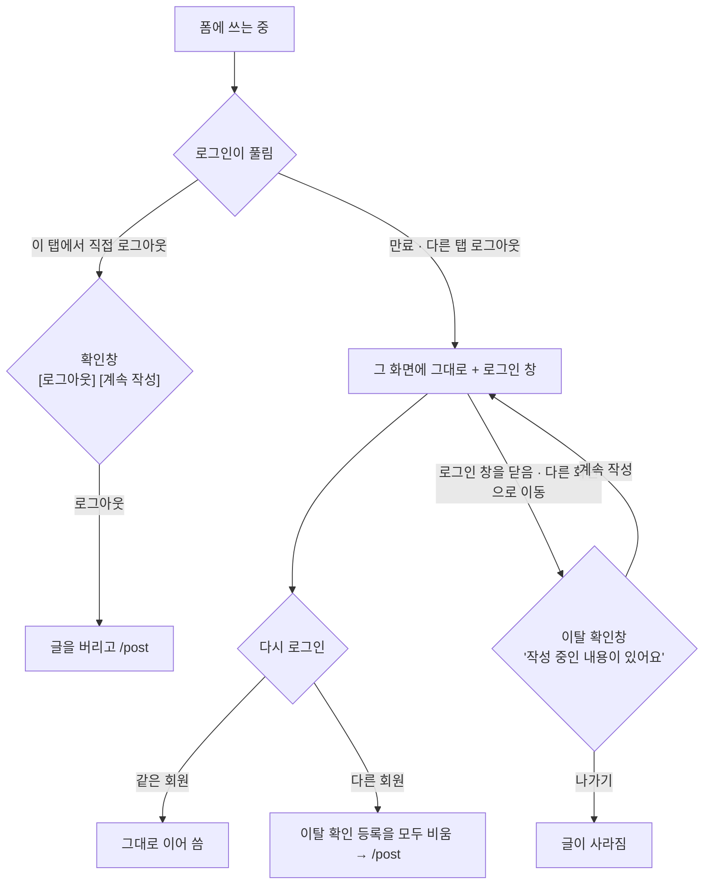

# 로그인이 풀려도 쓰던 화면에 둔다 (Phase 2 폐기 · Phase 3 확장)

> 쓰던 글을 보관했다가 되살리는 대신, 로그인이 풀려도 쓰던 화면을 떠나게 하지 않는다. 로그인 만료(Phase 3)와
> 다른 탭 로그아웃을 같은 장치로 처리한다. FE만 바꾸고 PR 하나로 낸다.

## Context

### 왜 바꾸는가

- 전체 계획은 `docs/plans/2026-10-28-session-expiry-draft-preservation.md`이고, Phase 1은 #444로 병합·배포됐다.
- Phase 2(보관·복원)를 "이어서 쓰기" 확인창까지 넓혀 설계하자 상황이 7묶음, 30행을 넘었다.
  - 사용자: "관리·보수하기 쉬워야 하지 않을까", "상황이 너무 많다".
- 원인은 구조였다. 화면에서 내보낸 뒤 글을 보관하고, 나중에 그 폼을 다시 찾아가 여는 방식이었다.
  - 답글·댓글 수정 폼은 `CommentItem.tsx:29-30`의 로컬 상태로만 열린다.
  - 그래서 밖에서 그 폼을 여는 장치, 열 수 없을 때의 처리, 다른 폼으로 옮기기가 따로 필요했다.
- 사용자 결정(2026-10-28): 세 안(① 폼 4종 보관, ② 글만 보관, ③ 내보내지 않기) 중 **③**.

### 코드로 확인한 사실

- **쓰던 화면을 떠나게 만드는 경로**
  - 보호 화면에서 다른 탭이 로그아웃하면 `/post`로 보낸다(`auth.util.ts:88-91`).
  - 만료되면 로그인 페이지로 보낸다(`client.ts` `expireSession` → `clearAll`). Phase 3에서 바뀐다.
  - 보호 화면에서 직접 로그아웃하면 `/post`로 보낸다(`auth.queries.ts:100-105`).
  - 보호 화면이 비로그인 상태가 되면 `/post`로 보낸다(`ProtectedRoute.tsx:63-72`).
- **공개 화면(글 상세)에서 다른 탭이 로그아웃하면** 이동하지 않고 데이터만 다시 불러온다(`auth.util.ts:94`). 댓글 입력칸은 그대로 남는다.
- **이탈 확인창은 로그아웃 상태에서 동작하지 않는다**(`useUnsavedChangesGuard.ts:17-19`).
  - 이유는 강제 리다이렉트에 갇히지 않기 위해서다.
  - 그래서 로그아웃된 채 다른 메뉴를 누르면 쓰던 댓글이 경고 없이 사라진다.
  - 새로고침·탭 닫기 경고는 로그인 여부와 상관없이 뜬다(`:30-36`).
- **강제 이동을 이탈 확인창에서 빼는 함수는 키 하나짜리뿐이다**(`clearUnsavedChanges`, `unsavedChanges.store.ts:41-43`).
- **커밋된 Phase 3이 정해 둔 것**
  - 만료되면 그 화면에 두고 로그인 창을 띄운다.
  - 보호 화면에서 로그인하지 않고 창을 닫으면 `/post`로 간다.
  - 다시 로그인했는데 다른 회원이면 `/post`로 간다.

### 근거

- **화면을 그대로 두고 그 자리에 로그인 창을 띄우는 제품이 있다**: WordPress(`wp-auth-check`), GitLab.
- **WCAG 2.2.5 해설**은 다시 로그인한 뒤를 이렇게 예로 든다: _"결제 과정이 같은 정보와 같은 단계로 복원된다"_ (번역, [W3C](https://www.w3.org/WAI/WCAG22/Understanding/re-authenticating.html)).
- **NN/g**는 [모달을 작업 손실 위험이 있을 때 쓰라](https://www.nngroup.com/articles/modal-nonmodal-dialog/)고 한다. 그래서 이 계획은 쓰는 중일 때만 로그인 창을 띄운다.
- **보관·복원 선례도 있다**: GitHub session-resume, 티스토리, velog 등. ①·②안의 근거였고, 관리 비용 때문에 이번엔 쓰지 않는다(결정 1).

### 바뀐 뒤 흐름

### 상황별 동작: 지금 → 바뀐 뒤

- **대상 폼**: 글 등록, 글 수정, 댓글 등록(모바일 입력창 포함), 답글, 댓글 수정. 바뀐 뒤에는 다섯 폼 모두 같은 규칙을 따른다(결정 3).
- **"지금" 칸이 폼마다 갈리는 이유**는 폼이 있는 화면의 종류다.
  - 글 등록·수정은 보호 화면이라 로그인이 풀리면 앱이 내보낸다(`auth.util.ts:88-91`, `ProtectedRoute.tsx:63-72`).
  - 댓글류는 공개 화면인 글 상세 안에 있어서 내보내지 않는다(`auth.util.ts:94`).
- "쓰는 중"은 이탈 확인창에 입력이 등록된 상태(`hasUnsavedChanges()`)를 말한다.

| 상황                                                                               | 지금                                                                                                                            | 바뀐 뒤 (모든 폼)                                                             |
| ---------------------------------------------------------------------------------- | ------------------------------------------------------------------------------------------------------------------------------- | ----------------------------------------------------------------------------- |
| ① 쓰는 중에 로그인 만료                                                            | 모든 폼: 로그인 페이지로 이동, **글이 사라짐** (`client.ts` → `clearAll()`)                                                     | **그 화면 그대로 + 로그인 창.** 로그인하면 이어 씀                            |
| ② 쓰는 중에 다른 탭에서 로그아웃                                                   | 글 등록·수정: `/post`로 이동, **글이 사라짐** 댓글류: 그 화면 그대로, 입력칸 남음, 안내 없음                                | **그 화면 그대로 + 로그인 창**(다른 탭에서 로그아웃했다는 문구)               |
| ③ 로그인이 풀린 채 로그인 창을 닫거나 다른 화면으로 이동                           | 글 등록·수정: 해당 없음(이미 화면을 떠남) 댓글류: 확인 없이 이동, **글이 사라짐** (`useUnsavedChangesGuard.ts:17-19`)       | **이탈 확인창** [나가기] [계속 작성]                                          |
| ④ 같은 계정으로 다시 로그인                                                        | 글 등록·수정: `/post`로 감, 쓰던 글 없음 댓글류: ②였으면 이어 씀, ①이었으면 글 없음                                         | **그 화면에서 그대로 이어 씀**                                                |
| ⑤ 다른 계정으로 바뀜(다른 탭에서 다른 계정 로그인, 로그인 창에서 다른 계정 로그인) | 글 등록·수정: `/post`로 이동, 글을 버림 댓글류: **이전 계정의 글이 입력칸에 남은 채** 새 계정으로 로그인됨                  | **쓰던 글을 버리고 `/post`**(확인창 없이. 다른 사람에게 보이지 않게)          |
| ⑥ 쓰는 중에 이 탭에서 직접 로그아웃                                                | 글 등록·수정: 확인 없이 `/post`로 이동, **글이 사라짐** (`auth.queries.ts:100-105`) 댓글류: 확인 없이 로그아웃, 입력칸 남음 | **확인창** [로그아웃] [계속 작성] → 로그아웃하면 글을 버리고 `/post`          |
| ⑦ 쓰는 중에 새로고침·탭 닫기                                                       | 모든 폼: 브라우저 경고 (`useUnsavedChangesGuard.ts:30-36`)                                                                      | 같음                                                                          |
| ⑧ 쓰는 중이 아닐 때                                                                | —                                                                                                                               | 다른 탭 로그아웃·직접 로그아웃은 지금과 같음. 만료만 Phase 3대로 그 화면에 둠 |

## 판단이 필요했던 항목

표기: **(사용자)** 2026-10-28 대화에서 사용자가 정함 / **(제안)** 이 계획 승인으로 함께 확정

| 항목                         | 결정                                                                                                                                                                                                    | 근거·기각한 대안                                                                                                                                                                                                                    |
| ---------------------------- | ------------------------------------------------------------------------------------------------------------------------------------------------------------------------------------------------------- | ----------------------------------------------------------------------------------------------------------------------------------------------------------------------------------------------------------------------------------- |
| 1. 범위                      | **(사용자)** ③ 내보내지 않기. 커밋된 Phase 2(보관·복원)는 진행하지 않는다                                                                                                                               | **기각 ①** 폼 4종 보관 + 이어서 쓰기: 새 파일 8개, 상황 30행 이상, 공용 Alert 수정. **기각 ②** 글 등록·수정만 보관: 새 파일 3개 안팎, 보관·로그인 뒤 확인창 장치가 남음. 대가: "나중에 이어 쓰기"(나갔다가 돌아와 이어 쓰기)는 없다 |
| 2. 다른 탭 로그아웃도 제자리 | **(제안)** 쓰는 중(`hasUnsavedChanges()`)일 때만 제자리. 아니면 지금처럼                                                                                                                                | 쓰지 않을 때도 창을 띄우면, 일부러 로그아웃할 때마다 다른 탭 모두에 로그인 창이 뜬다                                                                                                                                                |
| 3. 폼마다 다른 규칙인가      | **(사용자 질문으로 통합)** 다섯 폼 모두 같은 규칙(상황별 표의 "바뀐 뒤"). 보호 화면과 공개 화면의 차이는 사용자에게 보이지 않는 캐시 처리에만 남긴다(보호 화면은 캐시 유지, 공개 화면은 `clearQueries`) | 지금 동작이 갈리는 이유는 폼이 아니라 화면 종류였다. **기각**: 공개 화면은 창 없이 그대로 두기. 규칙이 둘로 갈려 표가 두 배가 되고, 댓글 쪽에 ⑤·⑥의 빈틈이 남는다                                                                   |
| 4. 상태 하나로 처리          | **(제안)** Phase 3의 `sessionExpired` 불리언 대신 이유를 담는 값 하나(`'expired' \| 'signedOutElsewhere' \| null`, 이름은 구현 때 정함)                                                                 | 무음 처리·화면 유지·로그인 창 문구·이탈 확인창이 모두 이 값 하나를 본다. 커밋된 Phase 3과 다른 점이라 PR 본문에 이탈로 적는다                                                                                                       |
| 5. 이탈 확인창               | **(제안)** 이 값이 있는 동안에는 로그아웃 상태여도 이탈 확인창이 동작한다. 값을 세운 화면을 떠나거나 로그인하면 내린다                                                                                  | 이 값이 있는 동안에는 강제 리다이렉트가 없으므로, 확인창을 켜도 갇히지 않는다(`useUnsavedChangesGuard.ts:16`의 주석이 막으려던 상황이 생기지 않음)                                                                                  |
| 6. 다른 회원으로 바뀜        | **(제안)** 화면 종류와 상관없이, 쓰는 중에 회원이 바뀌면 이탈 확인 등록을 모두 비우고(`clearAllUnsavedChanges` 신규) `/post`로 간다. 직전 회원 id를 기억해 비교하는 app 레이어 훅 하나가 맡는다         | 커밋된 Phase 3은 `ProtectedRoute`에서만 비교했다. 그래서 공개 화면 댓글에 이전 계정의 글이 남는 기존 문제가 그대로였다. 등록을 비우지 않으면 B에게 "계속 작성"이 보여 A의 글을 볼 수 있다                                           |
| 7. 직접 로그아웃 확인창      | **(사용자, 원래 결정 8)** 쓰는 중이면 [로그아웃] [계속 작성]. 로그아웃을 고르면 화면 종류와 상관없이 글을 버리고 `/post`로 간다                                                                         | 공개 화면에서 입력칸을 제자리에서 비우려면 마운트된 폼에 "비워라" 신호를 보내는 장치가 필요하다. 이동하면 그 장치가 필요 없다. 보관 기능이 없으므로 버튼 3개 안은 필요 없다                                                         |
| 8. 폐기한 결정               | 복원 토스트 A안, 로그아웃 확인창 버튼 3개, (a) 로그아웃 때 보관 글 전부 삭제, (b) 일반 댓글로 옮기기                                                                                                    | 모두 보관 기능을 전제로 했다                                                                                                                                                                                                        |

### 뒤집힌 전제

| 발견                                                                | 그래서 바뀐 것                           |
| ------------------------------------------------------------------- | ---------------------------------------- |
| 복잡도는 "보관한 폼을 다시 찾아가 여는" 부분에서 나왔다             | 화면을 떠나지 않게 해서 그 단계를 없앤다 |
| 폼마다 동작이 갈리는 건 폼이 아니라 화면 종류(보호·공개) 때문이었다 | 결정 3. 바뀐 뒤 규칙은 하나              |
| 로그아웃 상태에서는 이탈 확인창이 동작하지 않는다                   | 결정 5                                   |
| Phase 3의 "다른 회원이면 /post"가 이탈 확인창에 막힐 수 있다        | 결정 6                                   |

### 위험 관리

- **공용 PC**
  - 다른 탭에서 일부러 로그아웃해도, 쓰던 탭에는 로그인 창 뒤로 그 글이 보인 채 남는다.
  - 지금은 `/post`로 이동하면서 사라진다.
  - 창을 닫으면 이탈 확인창을 거쳐야 화면을 떠날 수 있다. 쓰는 중일 때만 생긴다.
- **다른 회원에게 보이는 일**: 결정 6. 공개 화면 댓글의 기존 문제도 함께 막힌다.
- **댓글 쪽에서 새로 생기는 동작**(결정 3으로 통합한 결과)
  - 댓글을 쓰는 중에 다른 탭에서 로그아웃하면 로그인 창이 뜬다. 지금은 아무것도 뜨지 않는다.
  - 댓글을 쓰는 중에 직접 로그아웃하면, 확인한 뒤 글을 버리고 `/post`로 간다. 지금은 그 자리에 입력칸이 남는다.
- **로그인 창을 닫고 "계속 작성"을 고른 경우**: 로그아웃 상태로 그 화면에 남는다.
  - 제출하면 Phase 1의 인라인 안내가 뜬다.
  - 로그인은 내비게이션 바에서 할 수 있다.
  - 로그인 창이 다시 열리는 반복이 없어야 한다. 테스트로 확인한다.

### 시안 후보 (§9, 구현 첫 단계에서 승인)

커밋된 Phase 3의 시안 후보에 아래를 더해, Artifact 한 페이지에 나란히 보여 준다.

1. 다른 탭에서 로그아웃했을 때 뜨는 로그인 창의 제목·설명
2. 직접 로그아웃 확인창 (데스크톱·모바일)

## 세부 계획

커밋된 계획의 Phase 3 표는 그대로 진행한다. 아래는 그 표에 더하거나 바꾸는 것만 적는다.

| 위치                                                                                      | 변경 내용                                                                                                                                                                                                                                                                                                                      |
| ----------------------------------------------------------------------------------------- | ------------------------------------------------------------------------------------------------------------------------------------------------------------------------------------------------------------------------------------------------------------------------------------------------------------------------------ |
| `src/shared/store/auth.store.ts`                                                          | Phase 3의 `sessionExpired` 대신 결정 4의 값과 그 값을 세우는 액션. `setAuth`·`setAccessToken`에서 내리고, 값을 세운 화면을 떠나도 내린다                                                                                                                                                                                       |
| `src/shared/utils/auth.util.ts`                                                           | 신규 메서드: `hasUnsavedChanges()`면 이 탭 인증을 지우고, 값을 `'signedOutElsewhere'`로 세우고, 로그인 창을 연다(Phase 3의 공개 경로 창 열기와 같은 방식). 이동은 하지 않는다. 캐시는 보호 경로면 유지하고 공개 경로면 `clearQueries`. 쓰는 중이 아니면 기존 `applySignOutFromElsewhere()`. 기존 메서드 시그니처는 그대로 둔다 |
| `src/shared/utils/auth.util.ts` `applySessionExpired`(Phase 3 신규)                       | 공개 경로의 로그인 창 조건을 "`isMutating() > 0`"에서 "`isMutating() > 0` 또는 쓰는 중"으로 넓힌다                                                                                                                                                                                                                             |
| `src/entities/auth/hooks/useAuthEpochSync.ts:86-88`                                       | 위 신규 메서드를 호출한다. SESSION_MISMATCH 경로(`:69-82`)는 그대로 둔다(다른 계정이므로 내보낸다)                                                                                                                                                                                                                             |
| `src/app/routes/ProtectedRoute.tsx`                                                       | Phase 3의 "만료면 화면 유지"를 결정 4의 값이 있을 때로 넓힌다. 회원 비교는 아래 훅으로 옮긴다                                                                                                                                                                                                                                  |
| `src/app/hooks/useLeaveOnMemberChange.ts` (신규), `src/app/routes/layouts/RootLayout.tsx` | 직전 회원 id를 기억한다. 다른 회원 id로 바뀌었고 쓰는 중이면 `clearAllUnsavedChanges()` 뒤 `/post`(결정 6). 위치는 구현 때 기존 app 레이어 훅 폴더를 확인해 맞춘다                                                                                                                                                             |
| `src/shared/hooks/useUnsavedChangesGuard.ts:17-19`                                        | 결정 4의 값이 있으면 로그아웃 상태여도 이탈 확인창을 띄운다                                                                                                                                                                                                                                                                    |
| `src/shared/store/unsavedChanges.store.ts`                                                | `clearAllUnsavedChanges()` 추가(선례 `clearUnsavedChanges`)                                                                                                                                                                                                                                                                    |
| `src/widgets/layout/navbar/hooks/useDelayedLogout.ts`                                     | `hasUnsavedChanges()`면 `openConfirm`([로그아웃] [계속 작성]). 확인하면 `clearAllUnsavedChanges()`, 기존 700ms 로그아웃 순으로 진행한다. 공개 경로였으면 `/post`로 이동한다(보호 경로는 기존 `clearAll(POST.ROOT)`가 이동)                                                                                                     |
| `src/widgets/layout/login-dialog/ui/LoginDialog.tsx`, `hooks/useLoginDialog.ts`           | 이유가 `'signedOutElsewhere'`일 때 쓸 문구                                                                                                                                                                                                                                                                                     |
| `src/shared/config/texts.ts`                                                              | 다른 탭 로그아웃 로그인 창, 직접 로그아웃 확인창 문구. texts-conventions skill을 먼저 읽는다                                                                                                                                                                                                                                   |
| 문서                                                                                      | 커밋된 Phase 3 문서 목록 + `docs/UNSAVED-CHANGES-GUARD.md`(로그아웃 상태 예외가 바뀜), `docs/DECISIONS.md` 새 항목(①②③ 비교와 근거, Phase 2 폐기), `CHANGELOG.md`. 이 계획은 `docs/plans/2026-10-28-keep-writing-in-place.md`로 같은 PR에 커밋                                                                                 |

Phase 4(앱 시작 때 만료 안내)는 커밋된 계획 그대로 다음 PR로 진행한다.

## 영향 범위

### CRUD 실패 지점

- **데이터 계약**: 바뀌지 않는다.
- **등록·수정**: 로그아웃 상태로 제출하면 요청은 무음 처리된다(Phase 3 결정 13을 결정 4의 값으로 넓힘). 폼에는 Phase 1의 인라인 안내가 뜬다. 서버에 아무것도 쓰지 않으므로 중복이 생기지 않는다.
- **소유권**: 쓰는 중에 다른 회원으로 바뀌면 화면 종류와 상관없이 떠난다(결정 6).

### 기존 기능 회귀

- **공용 파일**: `auth.store`, `unsavedChanges.store`, `useUnsavedChangesGuard`, `auth.util`. 구현 전에 `pnpm graph:focus`로 사용처를 뽑는다.
- **이탈 확인창**: 결정 4의 값이 없을 때는 지금과 똑같아야 한다. 기존 가드 테스트로 확인한다.
- **`auth-tab-sync.spec.ts`**
  - 쓰지 않을 때 다른 탭 로그아웃 → `/post`인 기존 케이스는 그대로 통과해야 한다.
  - 쓰는 중인 케이스는 기대값이 바뀐다.
- **`ProtectedRoute.test.tsx`**: 로그아웃 케이스(`:119-132`)는 유지한다.
- **`auth.util.test.ts`**: 기존 `applySignOutFromElsewhere` 케이스는 유지한다.

## 검증 방법

1. `pnpm type-check` → `pnpm test` → `pnpm lint`·`pnpm check:deps` → `pnpm check:docs` → `pnpm test:e2e`
2. **단위·컴포넌트 테스트**
   - `auth.util`: 신규 메서드가 쓰는 중이면 값을 세우고 이동하지 않음, 아니면 기존 동작
   - `useAuthEpochSync`: 쓰는 중 다른 탭 로그아웃 → 신규 메서드 / SESSION_MISMATCH → 기존 동작
   - `ProtectedRoute`: `'signedOutElsewhere'`면 화면 유지 / 창을 닫고 "계속 작성"을 골라도 창이 다시 열리지 않음
   - `useLeaveOnMemberChange`: 같은 회원이면 그대로 / 다른 회원 + 쓰는 중이면 확인창 없이 `/post` / 다른 회원 + 쓰는 중 아님이면 그대로. 보호·공개 경로 모두
   - 이탈 확인창: 값이 있으면 로그아웃 상태여도 막음 / 값이 없으면 지금처럼
   - `useDelayedLogout`: 쓰는 중 → 확인창 / 취소면 로그아웃하지 않음 / 확인하면 공개 경로에서도 `/post` / 쓰는 중 아님 → 바로 로그아웃(공개 경로는 이동 없음)
3. **e2e**
   - `auth-tab-sync.spec.ts`: `/post/submit`과 글 상세 댓글에서 각각 같은 시나리오를 돌린다. 쓰는 중에 다른 탭 로그아웃 → 화면 유지 + 창 → 같은 계정으로 로그인 → 내용 그대로, 등록 성공. 창 닫기 → 다른 메뉴 → 이탈 확인창 → 나가기면 이동. 다른 계정으로 로그인 → 확인창 없이 `/post`.
   - `session-expired.spec.ts`: 커밋된 Phase 3 그대로.
   - `logout.spec.ts`: 쓰는 중 로그아웃 → 확인창.
4. **브라우저 검증 녹화**(browser-verification skill): 다른 탭 로그아웃 → 로그인 창 → 이어 쓰기, 데스크톱·모바일.
5. **§11**: PR 전에 fresh general-purpose 서브에이전트에게 커밋된 Phase 3 표 + 이 계획과 diff를 대조시킨다. 결과는 PR 본문 `## 계획 대비 구현`에 적는다.

## 남은 것

- **"나중에 이어 쓰기" 없음**: 나가기로 확인했거나 탭을 닫으면 글이 사라진다. 필요해지면 `DECISIONS.md`에 남긴 ②안(글 등록·수정만 보관)부터 다시 검토한다.
- **글 수정 화면의 404 빈 폼**(`UpdatePostForm.tsx:35-37`): 기존 문제, 범위 밖이다.
- **Phase 4**: 커밋된 계획 그대로 다음 PR.
