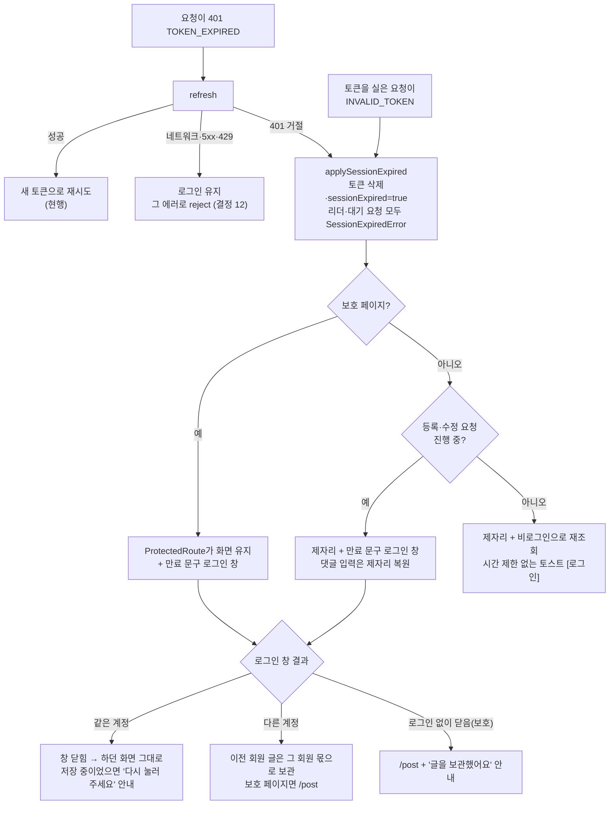
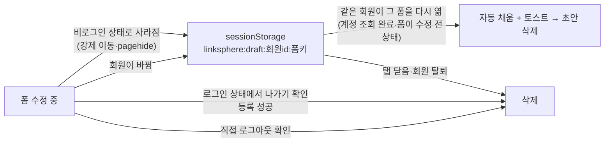

# 로그인 만료·로그아웃 때 쓰던 글 지키기

> 세션이 만료돼도 하던 화면에서 다시 로그인해 이어 쓰게 하고, 강제로 화면을 떠나야 할 때는 쓰던 글을 탭에 보관했다가
> 같은 회원이 돌아오면 되살린다. 처음부터 끝까지 FE만 바꾼다(BE·데이터 계약 변경 없음).

## Context

### 왜 하는가

2026-10-28 운영에서 실측한 결과(직접 측정, 사용자 실제 Chrome 세션)와 코드 추적으로 다음을 확인했다.

- **다른 탭에서 로그아웃(B)**: 모든 탭이 탭 상태와 상관없이 약 1.5초 안에 반영한다(700ms 지연 포함). 보호 페이지는 `/post`로 이동하는데, `/post/submit`에 쓰던 글이 확인창 없이 사라졌다.
- **서버 세션 종료(C)**
  - 아무 신호가 없다. 다음 요청이 401을 받은 뒤에야 알아챈다.
  - 공개 페이지에서는 아무 안내 없이 `/auth/login`으로 간다. 로그인한 뒤에도 원래 페이지가 아니라 HOME으로 간다(`GuestGuard`가 `from`을 받지 못함, `src/app/routes/index.tsx:95-100`).
  - 보호 페이지에서는 `/auth/login`으로 갔다가 14ms 뒤 `ProtectedRoute`가 다시 `/post`로 보낸다. 렌더 경합이다(`ProtectedRoute.tsx:57-68`).
- **글이 사라지는 지점**
  - 이탈 가드는 비로그인이면 통과시킨다(`useUnsavedChangesGuard.ts:17-18`).
  - 댓글은 제출하자마자 입력을 비운다(`useCreateComment.ts:206-210`). 그런데 refresh가 실패하면 요청이 영원히 끝나지 않아(`client.ts:284-291`) 복원 코드가 돌지 않는다. 화면에 그대로 있어도 쓴 글이 사라진다.
- **초안 보관 장치가 없다.** 회원별로 구분한 저장 키도 없다.

목표는 WCAG 2.2 성공 기준 2.2.5가 말하는 상태다:
_"인증된 세션이 만료되면, 사용자는 다시 인증한 뒤 데이터를 잃지 않고 하던 활동을 이어갈 수 있다"_ (번역,
[W3C Understanding 2.2.5](https://www.w3.org/WAI/WCAG22/Understanding/re-authenticating.html)).

### 사전 조사 — 설치본 소스로 확인한 사실

| 사실                                                                                                                                            | 근거                                                                                                           |
| ----------------------------------------------------------------------------------------------------------------------------------------------- | -------------------------------------------------------------------------------------------------------------- |
| Suspense가 콘텐츠를 숨길 때는 layout effect 정리만 돌고, `useEffect` 정리는 실제 언마운트에서만 돈다                                            | react-dom 18.3.1 `cjs/react-dom.development.js:24752-24772`                                                    |
| Suspense 쿼리는 데이터가 있으면 재조회가 실패해도 throw하지 않는다. 그래서 보호 페이지에 머물러도 화면 데이터가 유지된다                        | @tanstack/react-query 5.90.16 `build/modern/suspense.js:2`, `errorBoundaryUtils.js:26`                         |
| sonner 토스트는 4초 뒤 닫힌다. 타이머가 멈추는 건 탭이 숨겨졌을 때와 hover했을 때뿐이다. 그래서 "보이지만 다른 창에 포커스"인 상황에서는 놓친다 | sonner 2.0.7 `dist/index.mjs:605`, `TOAST_LIFETIME = 4000`                                                     |
| BE는 토큰이 있으면 Valid/Expired/Invalid로 판정한다. `NOT_LOGGED_IN`은 토큰이 아예 없을 때만 준다                                               | BE `SessionAuthenticationFilter.kt:28-41`, `CustomAuthenticationEntryPoint.kt:22-25` (설계 검토 에이전트 추적) |
| 로그인은 7일 동안 절대 수명으로 유지된다. 유휴 만료는 없다                                                                                      | BE `MemberSessionService.kt:42-43`                                                                             |

### 업계 선례 (외부 인용은 번역)

- **GitHub**: 화면을 그대로 두고, 닫기 전까지 남는 상단 배너로 알린다. 다른 탭에서 로그아웃한 경우 _"다른 탭이나 창에서 로그아웃했습니다. 새로고침해 세션을 갱신하세요."_ (번역, [github.com 페이지 HTML](https://github.com/github/session-resume)에서 확인)라고 띄운다.
  입력값은 [session-resume](https://github.com/github/session-resume)으로 지킨다. 이 라이브러리는 _"사용자가 같은 브라우저 세션에서(다른 탭 제외) 그 페이지를 다시 방문하면 필드가 자동으로 복원된다"_ (번역)고 설명하고, sessionStorage를 쓴다.
- **Atlassian(실패 사례)**: Jira에서 오래 열어 둔 수정 폼을 저장하자 세션 만료 오류와 함께 수정한 내용이 전부 사라졌다([JRASERVER-32244](https://jira.atlassian.com/browse/JRASERVER-32244)). Confluence에서는 편집 중 만료로 수정분을 잃었다([CONFSERVER-29379](https://jira.atlassian.com/browse/CONFSERVER-29379)).
- **NN/g**: _"현재 과정을 이어가는 데 꼭 필요한 정보를 입력받을 때 모달을 쓴다"_, _"현재 흐름과 관계없는 비필수 정보에는 모달을 쓰지 않는다"_ (번역, [Modal & Nonmodal Dialogs](https://www.nngroup.com/articles/modal-nonmodal-dialog/))
- **Adrian Roselli**: 저절로 사라지는 토스트는 WCAG 2.2.1(시간 조절)에 걸린다고 지적한다. _"포커스가 필요한 상호작용 요소가 있다면 그건 토스트가 아니라 alertdialog 역할이어야 하고, 아마 모달이어야 한다"_ (번역, [Defining 'Toast' Messages](https://adrianroselli.com/2020/01/defining-toast-messages.html))
- **IBM Carbon**: 버튼이 달린 토스트는 사용자가 닫을 때까지 남긴다. _"알림이 열린 채로 남아 있으므로, 토스트가 너무 일찍 닫히지 않고 사용자가 버튼을 누를 시간이 충분하다"_ (번역, [Carbon Notification](https://carbondesignsystem.com/components/notification/usage/))

### 바뀐 뒤 전체 흐름

## 판단이 필요했던 항목

표기: **(사용자)** 2026-10-28 대화에서 사용자가 정함 / **(제안)** 내가 정한 기본값이라 이 계획 승인으로 함께 확정

| 항목                                             | 결정                                                                                                                                                                                                               | 근거·기각한 대안                                                                                                                                                                                                                                                                                                                                         |
| ------------------------------------------------ | ------------------------------------------------------------------------------------------------------------------------------------------------------------------------------------------------------------------ | -------------------------------------------------------------------------------------------------------------------------------------------------------------------------------------------------------------------------------------------------------------------------------------------------------------------------------------------------------- |
| 1. 공개 페이지에서 만료                          | **(사용자)** 화면은 제자리. 등록·수정 요청이 진행 중이면 로그인 창을 바로 띄우고, 보기만 하던 중이면 시간 제한 없는 토스트(닫기·로그인 버튼)를 띄운다                                                              | NN/g 기준: 하던 행동을 이어가려면 로그인이 필요하므로 그때는 모달, 읽기만 하는 중에는 비필수라 모달을 쓰지 않는다. 판정은 `queryClient.isMutating() > 0`이다(useEffect에서 자동 실행되는 mutation 없음, grep 확인). **기각**: 항상 창(탭에 돌아오기만 해도 창이 뜸), 항상 안내(행동 중인데 창이 안 떠 한 번 더 눌러야 함), `/auth/login` 이동(맥락 상실) |
| 2. 보호 페이지에서 만료                          | **(사용자)** 제자리 + 로그인 창. 같은 계정이면 이어서 쓴다. 다른 계정이거나 로그인 없이 창을 닫으면 `/post`로 가고 초안은 보관한다                                                                                 | WCAG 2.2.5, Suspense 데이터 유지(소스). **기각**: `/post`로 보냈다가 로그인 뒤 복귀(화면이 피드로 바뀌었다 돌아오고, 결과가 초안 복원에 전부 걸림)                                                                                                                                                                                                       |
| 3. 안내 모양                                     | **(사용자)** 기존 sonner 토스트에 `duration: Infinity`, 로그인 버튼(action), 닫기(전역 `closeButton`, `sonner.tsx:17`)                                                                                             | Carbon 방식. 새 컴포넌트가 필요 없다. **기각**: GitHub식 상단 배너(Roselli 기준에는 더 맞지만 새 컴포넌트와 §9 비용이 듦)                                                                                                                                                                                                                                |
| 4. 만료로 연 로그인 창 문구                      | **(제안)** 만료 때문에 연 창은 제목·설명을 만료 문구로 바꾼다. history state에 `reason: 'expired'`를 함께 싣는다                                                                                                   | 지금 제목(_"로그인이 필요한 서비스예요"_)으로는 왜 창이 떴는지 알 수 없다. 문구는 §9 미리보기로 확정한다                                                                                                                                                                                                                                                 |
| 5. 초안 보관 위치                                | **(사용자)** sessionStorage, 키는 `linksphere:draft:<회원id>:<폼키>`. 같은 회원에게만 복원한다                                                                                                                     | GitHub session-resume 선례. **기각**: localStorage(탭을 닫아도 남아 공용 PC에 노출)                                                                                                                                                                                                                                                                      |
| 6. 복원 방식                                     | **(사용자)** 폼이 수정 전 상태일 때 자동으로 채우고 토스트를 띄운다. 이미지가 있던 초안이면 "이미지는 다시 첨부해 주세요"를 덧붙인다                                                                               | GitHub 방식. **기각**: 불러오기/버리기 배너(버튼이 늘고 §9 대상이 됨)                                                                                                                                                                                                                                                                                    |
| 7. 저장 시점                                     | **(제안)** ① 비로그인 상태로 폼이 언마운트되거나 `pagehide`될 때 ② 회원이 바뀔 때 ③ 언마운트된 뒤 도착한 댓글 실패(만료)일 때만 저장한다. 계속 자동 저장하지는 않는다                                              | §2 최소 범위. 로그인 상태에서 새로고침하면 지금처럼 경고창만 뜬다                                                                                                                                                                                                                                                                                        |
| 8. 이 탭에서 직접 로그아웃                       | **(사용자)** 쓰던 글(화면의 수정 중 폼이나 보관된 초안)이 있으면 확인창을 띄운다. 확인하면 둘 다 지우고 로그아웃한다                                                                                               | 공용 PC에서는 로그아웃이 흔적을 정리하는 행동이다. **기각**: 항상 보관(로그아웃해도 그 탭에 흔적이 남음)                                                                                                                                                                                                                                                 |
| 9. 다른 탭 로그아웃·세션 만료                    | **(사용자)** 보관한다                                                                                                                                                                                              | 이 탭의 사용자는 확인할 기회가 없었다(문제 ①)                                                                                                                                                                                                                                                                                                            |
| 10. 강제 이동으로 보관했을 때                    | **(제안)** 일반 info 토스트로 _"작성 중이던 글을 이 탭에 보관했어요. 다시 로그인하면 이어서 쓸 수 있어요."_ 를 띄운다                                                                                              | 사용자가 초안이 있다는 걸 모르면 다시 찾아가지 않는다(설계 검토 A10). 행동을 요구하지 않는 정보라 기본 지속시간으로 둔다                                                                                                                                                                                                                                 |
| 11. 끝나지 않던 요청                             | **(제안)** `SessionExpiredError`로 reject한다. refresh를 기다리던 요청도 함께 reject하고, 전역·수동 에러 처리 지점에서는 모두 조용히 넘긴다                                                                        | 제자리에 머물면 pending인 폼이 멈춘다. 예: 댓글 수정 버튼(`useUpdateComment.ts:175-176`), 폴더 대화상자. 원래 pending으로 둔 이유는 토스트가 겹치는 것이었는데(`docs/AUTH.md` §11-3), 무음 처리로 해소된다                                                                                                                                               |
| 12. refresh가 네트워크·5xx·429로 실패            | **(제안)** 만료로 보지 않는다. 로그인을 유지하고 그 에러로 reject한다                                                                                                                                              | 지금은 네트워크가 잠깐 끊겨도 로그아웃되고, 다른 탭과 공유하는 세션 플래그까지 지워진다(`client.ts:284-291`, `auth.store.ts:40-46`). 여기에 "만료됐어요"라고 안내하면 사실과 다르다                                                                                                                                                                      |
| 13. 만료로 판정하는 응답                         | **(제안)** refresh가 401로 거절된 경우, 그리고 토큰을 실은 요청이 `INVALID_TOKEN`을 받은 경우. 토큰 없이 보낸 요청의 `NOT_LOGGED_IN`은 지금처럼 `clearAll`한다. 단, 만료 후 로그인을 기다리는 중이면 조용히 끝낸다 | BE 판정 규칙(사전 조사 표). 그대로 두면 로그인한 적 없는 사용자에게 "만료" 안내가 뜬다                                                                                                                                                                                                                                                                   |
| 14. 2026-09-06 DECISIONS의 "초안 별도 보관" 기각 | 뒤집는다. 새 DECISIONS 항목을 추가한다                                                                                                                                                                             | 그때는 답글 폼이 닫힌 직후 몇백 ms 사이 실패하는 좁은 경우였다. 이번에는 강제 이동으로 폼이 통째로 사라지는 경우다                                                                                                                                                                                                                                       |
| 15. 앱 시작 때 복원 실패                         | **(제안)** Phase 4에서 has-session 플래그가 있었고 refresh가 401로 거절됐을 때만 같은 안내를 띄운다. `restoreAuth` 시그니처는 그대로 두고 새 함수를 만든다                                                         | CLAUDE.md 시그니처 변경 금지 규칙                                                                                                                                                                                                                                                                                                                        |

### 뒤집힌 전제

| 발견                                                                                              | 그래서 바뀐 것                                                                                                            |
| ------------------------------------------------------------------------------------------------- | ------------------------------------------------------------------------------------------------------------------------- |
| "보호 페이지에 머물면 401 재조회 때문에 영향이 크다"고 봤으나, Suspense가 데이터를 유지한다(소스) | 보호 페이지도 제자리 방식이 가능해져 채택                                                                                 |
| refresh 실패가 곧 만료라는 가정이었으나, 실제로는 네트워크·5xx도 같은 경로를 탄다                 | 결정 12로 구분                                                                                                            |
| `NOT_LOGGED_IN`을 세션 만료로 다뤘으나, BE에서는 "토큰 없음"이다                                  | 결정 13으로 분리. `e2e/session-expired.spec.ts`의 시나리오(토큰 있는데 `NOT_LOGGED_IN`)는 실제로 일어날 수 없어 다시 쓴다 |
| `useUpdatePost`는 `post` 참조가 바뀔 때마다 서버 값으로 reset한다(`useUpdatePost.ts:32-46`)       | 다시 로그인한 뒤 `invalidateQueries`가 수정 중이던 내용을 지운다 → 첫 로드나 수정 전 상태일 때만 reset                    |

### 위험 관리

- **다른 계정으로 로그인했을 때 이전 회원 글이 새지 않게**: 초안은 회원 id로 잠근다. 계정 조회가 끝난 뒤(`!isFetching`)에만 복원한다. 회원이 바뀌면 화면의 폼을 이전 회원 몫으로 보관한 뒤 비운다. 계정 수정 롤백이 지운 캐시를 되살리지 않게 막는다(설계 검토 A8).
- **401이 반복돼 토스트가 쌓이지 않게**: 로그인을 기다리는 동안 세션 무효 코드는 무음으로 처리한다. 만료 안내 토스트는 고정 id(`session-expired`)로 띄운다.
- **늦게 도착한 401 때문에 정리가 두 번 일어나지 않게**: `sentToken`이 있었는데 지금 토큰이 없으면 refresh 없이 `SessionExpiredError`로 끝낸다. `applySessionExpired`는 스토어 토큰이 `sentToken`과 같을 때만 실행한다(`:275`의 SESSION_MISMATCH 선례).
- **mutation scope 직렬화**: 시작할 때는 토큰이 있었는데 보내기 직전에 없으면 `SessionExpiredError`를 던진다(`mutation-auth-epoch.ts`). 줄 서 있던 좋아요·폴더 mutation이 토큰 없이 나가지 않는다.

### 시안 후보 (§9, Phase 3 착수 전에 승인)

다음을 실제 `sonner.tsx`·`LoginDialog.tsx` 클래스와 `globals.css` 토큰으로 만든 Artifact 한 페이지에 나란히 보여준다.

1. 시간 제한 없는 만료 토스트: 문구와 버튼 라벨 후보 2개
2. 만료로 연 로그인 창: 제목·설명 후보 2개
3. 저장 중 만료 안내(FormAlert) 문구
4. 보관·복원 토스트 문구

## 세부 계획

PR은 네 개다. 각 PR은 혼자 배포해도 문제가 없게 나눈다. 순서는 "글이 사라지지 않는 것"을 가장 먼저 배포하도록 Phase 1 → 2 → 3 → 4로 잡는다.

### Phase 1 (PR1) — 끝나지 않던 요청을 조용한 실패로

이 PR만 배포하면 화면 이동은 지금과 같다(`clearAll` → `/auth/login`). 내부 계약만 바뀐다.

| 위치                                                                                                              | 변경 내용                                                                                                                                                                                                                                                                                                                                                  |
| ----------------------------------------------------------------------------------------------------------------- | ---------------------------------------------------------------------------------------------------------------------------------------------------------------------------------------------------------------------------------------------------------------------------------------------------------------------------------------------------------- |
| `src/shared/types/common.type.ts` (신규 클래스)                                                                   | `SessionExpiredError` (`SessionChangedError` `:84-89`와 같은 형태)                                                                                                                                                                                                                                                                                         |
| `src/shared/utils/error.util.ts`                                                                                  | `isSessionExpired(error)` 추가 (`isSessionMismatch` `:36` 옆)                                                                                                                                                                                                                                                                                              |
| `src/shared/api/client.ts:226-231`, `:284-291`                                                                    | `new Promise(() => {})` 대신 `cancelSubscribers(new SessionExpiredError())` + throw (결정 11)                                                                                                                                                                                                                                                              |
| `src/shared/api/client.ts:217` 다음                                                                               | `sentToken && !currentToken`이면 refresh 없이 `SessionExpiredError` (위험 관리)                                                                                                                                                                                                                                                                            |
| `src/shared/lib/react-query/config/retry-policy.ts`                                                               | `SessionExpiredError`는 재시도하지 않음                                                                                                                                                                                                                                                                                                                    |
| `src/shared/lib/react-query/config/error-toast.ts:80` 앞                                                          | `SessionExpiredError`면 `{ silent: true }`                                                                                                                                                                                                                                                                                                                 |
| `src/shared/lib/react-query/config/mutation-auth-epoch.ts`                                                        | 시작 시 토큰 유무를 기록하고, "시작=로그인 / 지금=비로그인"이면 `SessionExpiredError`                                                                                                                                                                                                                                                                      |
| 수동 에러 토스트 14곳                                                                                             | 맨 앞에서 `ErrorUtil.isSessionExpired`면 조용히 return. 대상: `account.queries.ts:109-118,136-141`, `auth.queries.ts:209-215,232-234`, `bookmark-folder.queries.ts:272`, `usePostCardBookmarkFolderDialog.ts:68,116,150-152,178`, `useRenameBookmarkFolder.ts:54`, `useBookmarkFolderSelect.ts:120`, `useCreateFolderForm.ts:37`, `useFolderActions.ts:75` |
| `src/entities/account/api/account.queries.ts:110-112`                                                             | 만료일 때는 계정 캐시 롤백을 건너뜀                                                                                                                                                                                                                                                                                                                        |
| 폼 4곳 catch: `useCreatePost.ts:96`, `useUpdatePost.ts:119`, `useCreateComment.ts:154`, `useUpdateComment.ts:151` | `hasLeftPage()`·`isMountedRef` 분기보다 먼저 만료인지 확인. 마운트돼 있으면 새 TEXTS 문구("로그인이 만료돼 저장하지 못했어요…")로 인라인 안내(댓글은 입력을 제자리 복원), 아니면 조용히                                                                                                                                                                    |
| 테스트                                                                                                            | `client.test.ts` Case 1-2·2·2-1의 기대값을 reject로 변경, 늦은 401·대기 요청 reject 케이스 추가. `error-toast.test.ts`·`retry-policy.test.ts`·`mutation-auth-epoch.test.ts`에 케이스 추가. 신규 `session-expired-toast.test.ts`(선례 `session-mismatch-toast.test.ts`, 에러 토스트 0개)                                                                    |
| 문서                                                                                                              | `docs/AUTH.md` §8-B 의사코드(`:211-229`)·§11 항목 3(`:1049-1056`), `.claude/CLAUDE.md` 토스트 단일 소유 절에 "수동 처리 지점은 `SessionExpiredError`면 조용히" 추가                                                                                                                                                                                        |

### Phase 2 (PR2) — 쓰던 글 보관·복원

| 위치                                                  | 변경 내용                                                                                                                                                                                                                                                                                                                                                           |
| ----------------------------------------------------- | ------------------------------------------------------------------------------------------------------------------------------------------------------------------------------------------------------------------------------------------------------------------------------------------------------------------------------------------------------------------- |
| `src/shared/config/storage-keys.ts:34` 옆             | `formDraftKey(memberId, formKey)`, `FORM_DRAFT_PREFIX`                                                                                                                                                                                                                                                                                                              |
| `src/shared/hooks/useSignedOutFormDraft.ts` (신규)    | `{ formKey, memberId, isDirty, getSnapshot, onRestore, ready }` → `{ saveNow, clear }`. 결정 5~7의 규칙을 따른다. 로그인 여부는 cleanup 시점에 모듈 함수로 store에서 읽는다(선례 `useUnsavedChangesGuard.ts:15-19`). 회원 id는 마지막으로 본 null 아닌 값을 ref로 붙잡는다. `pagehide` 리스너. `SessionStorageUtil` 사용                                            |
| `src/shared/store/formDraft.store.ts` (신규)          | 버리기 요청 신호(`discardSeq`, `requestDiscardAll()`). 마운트된 폼은 이 신호를 받으면 비우고 저장 없이 삭제한다(결정 8)                                                                                                                                                                                                                                             |
| `useCreatePost.ts`                                    | 키 `'post-create'`, `account?.id`(`:30`), 복원은 `reset(d, { keepDefaultValues: true })`, 성공하면 `clear()`                                                                                                                                                                                                                                                        |
| `useUpdatePost.ts:32-46`, `:52-68`                    | 서버 값 reset은 첫 로드나 수정 전 상태일 때만 한다(뒤집힌 전제). 초안을 복원하면 `wasUrlChangedRef`를 맞추고, `post`가 로드된 뒤에 복원한다                                                                                                                                                                                                                         |
| `useCreateComment.ts`                                 | 키 `comment-create:${postId}:${parentId ?? 'root'}`, 저장 대상은 `content`만. catch에서 만료이고 언마운트됐으면 `saveNow({ content })`                                                                                                                                                                                                                              |
| `useUpdateComment.ts`                                 | `useAccount` 추가. `content` + `existingImageUrls` + 비교용 원본을 저장하고, 원본이 바뀌었으면 복원하지 않음                                                                                                                                                                                                                                                        |
| `src/widgets/layout/navbar/hooks/useDelayedLogout.ts` | `hasUnsavedChanges()`이거나 보관 초안이 있으면 `openConfirm`, 확인하면 `requestDiscardAll()` + 초안 삭제 → 기존 700ms 뒤 로그아웃(유일한 로그아웃 진입점, `Navbar.tsx:36,178`)                                                                                                                                                                                      |
| `src/entities/account/api/account.queries.ts:130-135` | 탈퇴하면 `linksphere:draft:*`를 모두 삭제                                                                                                                                                                                                                                                                                                                           |
| `src/shared/config/texts.ts`                          | 복원·보관·로그아웃 확인 문구(texts-conventions skill을 먼저 읽고 추가)                                                                                                                                                                                                                                                                                              |
| 테스트                                                | 훅 단위 테스트(비로그인 언마운트=저장 / 로그인 언마운트=삭제 / 다른 회원 미복원 / Suspense 숨김=저장 안 함 / 회원 전환 / pagehide / 버리기 신호). 폼 4개 각각 복원 케이스, `useUpdatePost` 복원 후 제목 유지. e2e: `auth-tab-sync.spec.ts`에 "다른 탭 로그아웃 → `/post` → 다시 로그인 → `/post/submit` 복원" 추가, `logout.spec.ts`에 수정 중 로그아웃 확인창 추가 |
| 문서                                                  | `docs/UNSAVED-CHANGES-GUARD.md`(`:33`, `:91-93`, `:201`), `docs/POST.md`(`:418-419`), `docs/COMMENT.md`(`:153`), `docs/MYPAGE.md`(`:173-187`), `docs/DECISIONS.md` 새 항목(결정 5~9·14), `CHANGELOG.md`                                                                                                                                                             |

### Phase 3 (PR3) — 만료 UX: 제자리 유지 + 로그인 창·안내

착수 전에 위 "시안 후보"를 Artifact로 보여주고 승인을 받는다.

| 위치                                                                                        | 변경 내용                                                                                                                                                                                                                                                                                                                                                                               |
| ------------------------------------------------------------------------------------------- | --------------------------------------------------------------------------------------------------------------------------------------------------------------------------------------------------------------------------------------------------------------------------------------------------------------------------------------------------------------------------------------- |
| `src/shared/store/auth.store.ts`                                                            | `sessionExpired` 필드와 `expireSession()` 액션 추가. 토큰 삭제와 같은 `set()` 한 번에서 세운다. `setAuth`·`setAccessToken`에서만 내린다                                                                                                                                                                                                                                                 |
| `src/shared/utils/auth.util.ts` (신규 메서드)                                               | `applySessionExpired()`: `expireSession` + `markClearedAt`. 공개 경로면 `clearQueries` 후 `isMutating() > 0`이면 로그인 창(reason expired, `pathname+search`, `preventScrollReset`), 아니면 시간 제한 없는 토스트(id `session-expired`). 보호 경로면 캐시를 유지하고 이동하지 않는다(ProtectedRoute가 담당)                                                                             |
| `src/shared/api/client.ts:229`, `:290`                                                      | `clearAll()` 대신 `applySessionExpired()`. 스토어 토큰이 `sentToken`일 때만. refresh 실패가 401이 아니면 만료로 보지 않음(결정 12)                                                                                                                                                                                                                                                      |
| `src/shared/api/client.ts:377-392`                                                          | 토큰을 실은 `INVALID_TOKEN`이면 `applySessionExpired` + `SessionExpiredError`. `NOT_LOGGED_IN`은 `sessionExpired`이면 조용히 throw, 아니면 지금처럼 `clearAll`(결정 13)                                                                                                                                                                                                                 |
| `src/shared/lib/react-query/config/error-toast.ts:90-96`                                    | `sessionExpired` 동안에는 세션 무효 코드를 무음 처리                                                                                                                                                                                                                                                                                                                                    |
| `src/app/routes/ProtectedRoute.tsx`                                                         | `sessionExpired`이면 children을 유지하고 만료 문구 로그인 창을 연다. 창이 열렸다가 로그인 없이 닫히면 `/post`로 replace. 다시 로그인했는데 회원이 다르면 `/post`. `:38`·`:65`의 조건 정리. state 객체는 모듈 상수로 둔다(설계 검토 A9)                                                                                                                                                  |
| `src/widgets/layout/login-dialog/ui/LoginDialog.tsx`, `hooks/useLoginDialog.ts`             | history state의 `reason: 'expired'`에 따라 제목·설명을 바꿈                                                                                                                                                                                                                                                                                                                             |
| `src/entities/auth/api/auth.queries.ts:38` onSuccess, `useAuthEpochSync.ts` 받아들이기 경로 | 로그인되면 `toast.dismiss('session-expired')`                                                                                                                                                                                                                                                                                                                                           |
| `src/shared/config/texts.ts`                                                                | 만료 토스트·만료 창 문구(시안에서 승인된 것)                                                                                                                                                                                                                                                                                                                                            |
| 테스트                                                                                      | `ProtectedRoute.test.tsx`: 만료 시 화면 유지와 창 열림, 다시 렌더돼도 창 유지, 닫으면 `/post`, 다른 회원이면 `/post`. 로그아웃 케이스 `:119-132`는 유지. `client.test.ts` Case 4와 새 분기, `auth.util.test.ts`의 `applySessionExpired`. `e2e/session-expired.spec.ts`는 "TOKEN_EXPIRED + refresh 401" 시나리오로 다시 쓰고 공개(보기·댓글 등록)·보호(`/post/submit`) 3개 케이스를 둔다 |
| 문서                                                                                        | `docs/AUTH.md` §1 흐름도(`:48`)·§5 표(`:98`)·§8-B·§8-E(`:554`, `:575`, `:595`)·§8-H·§9 표·§12, `docs/FE-ARCHITECTURE.md`(`:930`, `:997`, `:1095-1113`), `.claude/CLAUDE.md:664-668` 토스트 예외에 `applySessionExpired` 추가, `docs/DECISIONS.md` 새 항목(결정 1~4·11~13), `CHANGELOG.md`                                                                                               |

### Phase 4 (PR4) — 앱 시작 때 만료 안내

| 위치                                                    | 변경 내용                                                                                           |
| ------------------------------------------------------- | --------------------------------------------------------------------------------------------------- |
| `src/entities/auth/hooks/useAuth.ts` (신규 함수)        | 복원 결과를 `'restored' \| 'expired' \| 'failed'`로 돌려주는 함수. 기존 `restoreAuth`는 그대로 둔다 |
| `src/entities/auth/hooks/useAppInitialization.ts:50-57` | 세션 플래그가 있었고 결과가 `'expired'`이면 Phase 3의 시간 제한 없는 토스트                         |
| 테스트·문서                                             | `useAppInitialization.test.tsx` 케이스, `docs/AUTH.md` §5                                           |

## 영향 범위

### CRUD 실패 지점

- **등록**(글·댓글·답글): 만료 요청은 BE가 처리하기 전에 401로 끝난다. 다시 눌러도 하나만 생긴다. 댓글의 낙관적 항목은 기존 onError가 롤백한다.
- **수정**(글·댓글·계정): `useUpdatePost`가 서버 값으로 덮어쓰지 않게 한다. 계정 수정 롤백 가드(Phase 1).
- **삭제**(댓글·폴더 등): reject 뒤 기존 롤백이 돈다. 수동 토스트 14곳은 무음 처리.
- **조회**: 보호 페이지에서 로그인을 기다리는 동안 캐시를 유지한다. 재조회 401은 조용히 처리하고, 재시도는 기존 정책대로 1회 한다.
- **동시 요청**: refresh를 기다리던 요청도 모두 reject한다. 직렬화된 mutation은 보내기 직전에 막는다.

### 기존 기능 회귀

- **동작을 고정하는 테스트**
  - `client.test.ts` Case 1-2(`:162-199`)·2(`:298-319`)·2-1(`:325-357`)·4(`:383-400`)
  - `auth.util.test.ts:40-128`(탈퇴용 `clearAll`이므로 유지)
  - `ProtectedRoute.test.tsx:119-132`
  - `useCreateComment.test.tsx:321`
  - `e2e/session-expired.spec.ts:43`
  - `e2e/logout.spec.ts`(수정 중 상태가 없으니 영향 없음, 확인 필요)
  - `e2e/auth-tab-sync.spec.ts:37-62`(유지)
- **유지되는 동작**: 직접 로그아웃과 다른 탭 로그아웃은 지금처럼 보호 페이지에서 `/post`로 간다(`auth.util.ts:85-95`, `auth.queries.ts:98-103`). 탈퇴는 계속 `clearAll()`로 `/auth/login`.
- **공용 파일**: `client.ts`·`auth.util.ts`·`auth.store.ts`·`error-toast.ts`·`ProtectedRoute.tsx`를 고치기 전에 `pnpm graph:focus "<경로>" --text`로 사용처를 뽑아 이 목록에 보탠다(CLAUDE.md §5).
- **사용자에게 보이는 기존 문구**
  - 로그인 창 제목(`TEXTS.auth.guard.title`)은 만료일 때만 바뀐다.
  - `TEXTS.messages.error.loginRequired` 토스트는 만료 경로에서 더 이상 뜨지 않는다(지금도 유예 창 때문에 안 뜸, `e2e/session-expired.spec.ts:55-56`).
- **데이터 계약**: 바뀌지 않는다. BE 배포 순서를 신경 쓸 필요가 없다.

## 검증 방법

1. **PR마다 실행**: `pnpm type-check` → `pnpm test` → `pnpm lint`·`pnpm check:deps` → `pnpm check:docs` → `pnpm test:e2e`(바뀐 스펙)
2. **브라우저 검증 녹화**(browser-verification skill, Phase 2·3)
   - ① `/post/submit`에서 글을 쓰다 만료(`page.route`로 TOKEN_EXPIRED + refresh 401) → 화면 유지 + 만료 창 → 같은 계정으로 로그인 → 그대로 이어서 저장
   - ② 같은 상황에서 창을 닫음 → `/post` + 보관 안내 → 다시 로그인 → `/post/submit`에서 복원 토스트
   - ③ 공개 글을 보다가 만료 → 시간 제한 없는 토스트, 다른 창에 포커스해도 남아 있음
   - ④ 댓글을 등록하다 만료 → 로그인 창 + 입력 제자리 복원
   - ⑤ 다른 탭 로그아웃 → `/post` + 보관 안내 → 다시 로그인 → 복원
   - ⑥ 수정 중 직접 로그아웃 → 확인창 → 확인하면 초안 없음
3. **운영 확인**: 배포 성공을 `gh run list`로 확인한 뒤, 10-28 실측과 같은 방식(사용자 실제 세션, 세션 종료는 사용자가 직접)으로 B·C 매트릭스를 다시 잰다.
4. **§11**
   - 이 계획을 `docs/plans/2026-10-28-session-expiry-draft-preservation.md`로 PR1에 커밋한다.
   - 각 PR 전에 fresh general-purpose 서브에이전트에게 해당 Phase와 diff를 대조시킨다.
   - 결과는 PR 본문의 `## 계획 대비 구현`에 적는다.

## 남은 것

- **늦은 감지·탭 간 전파 없음**(우선순위 낮음): 한 탭에서 만료돼도 다른 탭은 자기 요청이 401을 받기 전까지 모른다. 이번 범위에서 뺀다.
- **유휴 만료 없음(7일 절대 수명)**: 자리를 비운 공용 PC 위험의 근본 원인이다. 보안 정책이라 BE와 따로 논의한다.
- **탭 전환 때 토큰 회전으로 첫 요청 약 0.5초 지연**(1회 측정): BE 정책 사안이다.
- **앱 시작 때 네트워크 실패도 로그아웃**(`useAuth.ts:85-89`): Phase 4는 안내만 다룬다.
- **보관하지 않는 것**: 댓글·계정 이미지(File)는 보관하지 않는다(IndexedDB가 필요). 다른 탭에서는 초안이 복원되지 않는다(sessionStorage 범위).
- **`useUnsavedChanges`의 Suspense 해제**: `useLayoutEffect` 기반이라, Suspense로 숨겨지는 동안 가드 등록이 잠깐 풀린다(소스로 확인). 기존 문제라 이번 범위에서 뺀다.
