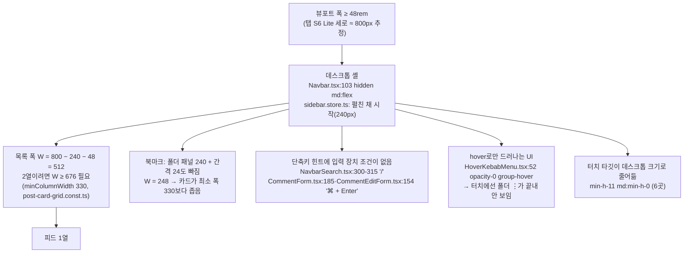
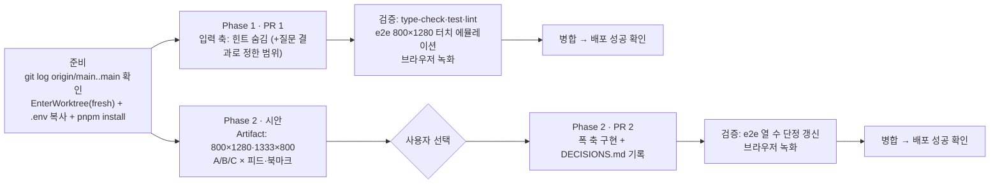

# 태블릿 대응 — 폭 축과 입력 축 나누기

> 갤럭시 탭 S6 Lite 세로에서 피드가 1열이 되고 검색창에 "/" 힌트가 뜨는 문제를 고친다. "태블릿 모드"를 따로 두지 않는다.
> 대신 **폭 축**(48rem 이상 64rem 미만 구간의 레이아웃)과 **입력 축**(터치냐 마우스·키보드냐)을 나눠서 다룬다.

## Context

### 무엇이 보고됐나

- 탭 S6 Lite를 세로로 들면 게시글 그리드가 1열이 되고, 검색창 오른쪽에 키보드 단축키 힌트 `/`가 그대로 보인다.
- 사용자는 모바일·데스크톱 둘로만 나누지 말고 태블릿 가로·세로에 맞게 UI를 다듬기를 원한다.

### 근본 원인 (origin/main `ddbc8505` 기준으로 추적함. 메인 체크아웃은 64커밋 뒤처져 있음)

지금 코드는 **"폭이 48rem 이상이면 마우스와 키보드가 있다"**고 가정한다. 태블릿은 화면이 넓어도 입력은 터치라서 이 가정이 깨진다.

- `/`가 보였다는 것 자체가 폭이 48rem 이상이라는 증거다. 힌트가 데스크톱 검색 영역(`Navbar.tsx:103`, `hidden md:flex`) 안에 있기 때문이다.
- 1열이 나왔다는 것은 목록 폭 W가 676 미만이라는 뜻이다. 그래서 실제 폭은 768~963px 사이다. 2000×1200 화면을 기기 픽셀 비율 1.5로 나누면 800이 나온다. 다만 실기기 `innerWidth`는 재지 않았다.
- 탭 S6 Lite는 RAM이 4GB라서 Chrome의 "데스크톱 모드 기본값" 대상이 아니다. 대상은 _"10인치 이상, RAM 8GB 이상인 태블릿"_ 이다 (번역, [Chrome 블로그](https://developer.chrome.com/blog/desktop-mode)).

### 지금 폭별로 몇 열이 나오나 (탐색 에이전트가 코드 공식 `useWindowGridVirtualizer.ts:77-85`로 계산)

| 뷰포트                       | 피드 W → 열 | 북마크 W → 열                           |
| ---------------------------- | ----------- | --------------------------------------- |
| 800 (탭 S6 Lite 세로, 추정)  | 512 → 1     | 248 → 1 (최소 폭 330보다 좁아 찌그러짐) |
| 1024 (iPad 가로 등)          | 720 → 2     | 456 → 1                                 |
| 1333 (탭 S6 Lite 가로, 추정) | 1029 → 3    | 765 → 2                                 |

### 외부 근거

- 창 크기 클래스: Compact는 600dp 미만, Medium은 600–840dp, Expanded는 840–1200dp다
  ([Android Developers](https://developer.android.com/develop/ui/compose/layouts/adaptive/use-window-size-classes)).
  각 구간에 대한 설명은 _"세로 태블릿의 93.73%"_ 가 Medium이고 _"가로 태블릿의 97.22%"_ 가 Expanded라는 것이다.
  같은 문서는 _"창 크기 클래스는 isTablet 같은 판단용으로 만든 것이 아니다"_ 라고 쓴다 (번역).
- 내비게이션: Compact에는 하단 바, Medium과 Expanded에는 내비게이션 레일을 쓴다
  ([Android Developers](https://developer.android.com/develop/ui/compose/layouts/adaptive/build-adaptive-navigation)).
- 입력 판정: _"화면 크기로 입력 방식을 짐작하지 말고 CSS 미디어 기능을 써라"_ (번역, [web.dev](https://web.dev/learn/design/interaction)).
  키보드가 있는지 알려 주는 미디어 기능은 없다.
- 업계 사례:
  - Pagefind는 _"터치 전용 기기에서 키보드 힌트를 자동으로 숨긴다"_ (번역, [Pagefind](https://pagefind.app/docs/components/keyboard-hints/)).
  - DocSearch 3.9.0은 `@media (max-width:768px)`처럼 폭 기준으로만 숨긴다. 그래서 폭 800인 태블릿에선 힌트가 그대로 보인다. 이번 버그와 같은 반례다.
- 반대 근거: Apple HIG는 _"Mac 사용자는 늘 물리 키보드를 쓰고, iPad 사용자도 자주 쓴다"_ 고 쓴다 (번역, [HIG Keyboards](https://developer.apple.com/design/human-interface-guidelines/keyboards)).
- 설치본 확인:
  - tailwindcss 4.1.18에는 `pointer-coarse`·`pointer-fine`·`any-pointer-*` 변형이 들어 있다(`node_modules/tailwindcss/dist/lib.js`).
  - `hover:` 변형은 `@media (hover: hover)`로 감싸져 있다.
  - 기본 브레이크포인트는 md 48rem, lg 64rem이고 오버라이드한 곳은 없다.
- 레포 선례: `src/shared/hooks/usePullToRefresh.ts:6`이 입력 장치 기준 분기를 `(pointer: coarse)`로 따로 판정한다. responsive-ux skill의 "브레이크포인트" 절에도 같은 규칙이 있다.

## 판단이 필요했던 항목

| 항목                         | 결정                                                                                                                                                       | 근거·기각한 대안                                                                                                                                                                                                                                                                                                                                                                                                                                     |
| ---------------------------- | ---------------------------------------------------------------------------------------------------------------------------------------------------------- | ---------------------------------------------------------------------------------------------------------------------------------------------------------------------------------------------------------------------------------------------------------------------------------------------------------------------------------------------------------------------------------------------------------------------------------------------------- |
| "태블릿 모드"를 따로 두나    | 두지 않는다. **폭 축**과 **입력 축**으로 나눈다                                                                                                            | 근거: Android 문서가 isTablet 판단을 명시적으로 부정한다. 같은 이유로 #432는 UA 판정을 뺐다. **기각**: UA로 태블릿 판정하기. 태블릿 가로·분할 화면·폴더블에서 CSS 배치와 어긋난다                                                                                                                                                                                                                                                                    |
| PR 1 범위                    | 단축키 힌트 2곳(`/`, `⌘ + Enter`)만 넣는다(2026-10-28 사용자 선택)                                                                                         | 폴더 ⋮ 메뉴 노출과 터치 크기 44px 유지는 이번에 넣지 않는다. "남은 것"에 기록한다                                                                                                                                                                                                                                                                                                                                                                    |
| 단축키 힌트 표시 조건        | 주 입력이 coarse(터치)면 숨긴다. Tailwind `pointer-coarse:hidden`을 쓴다. 키보드를 붙인 태블릿에서 힌트가 사라지는 것도 받아들인다(2026-10-28 사용자 확인) | 근거: web.dev, Pagefind, 레포 선례 `usePullToRefresh`. 이렇게 하면 `pointer: none`(키보드만 쓰는 기기)에서는 힌트가 남는다. **기각**: ① 폭 기준(DocSearch 방식). 이번 버그 그 자체다 ② `any-pointer: fine`. 보조 포인터(S Pen 등) 때문에 참이 될 수 있다(미확인) ③ 물리 키 입력을 감지한 뒤에 표시. 상태를 따로 둬야 하고 표준 방식도 아니다. **단점**: 키보드를 붙인 태블릿에서는 힌트가 안 보인다. 단축키 자체는 그대로 동작한다. 사용자 확인 필요 |
| 세로 레이아웃(48~64rem) 방식 | 시안 3개를 나란히 보여 준 뒤 사용자가 고른다(§9). 추천은 A                                                                                                 | 아래 "시안 후보" 참고                                                                                                                                                                                                                                                                                                                                                                                                                                |
| 가로(64rem 이상)             | 레이아웃은 바꾸지 않는다. 입력 축 수정만 적용한다                                                                                                          | 1333 기준으로 피드 3열, 북마크 2열이 나와 정상 범위다                                                                                                                                                                                                                                                                                                                                                                                                |

### 시안 후보 (Phase 2. 반영 전에 Artifact로 나란히 보여 주고 승인받음)

| 안                | 48~64rem 구간 동작                                                                                     | 800에서 피드·북마크                                                        | 장단점                                                                                                                         |
| ----------------- | ------------------------------------------------------------------------------------------------------ | -------------------------------------------------------------------------- | ------------------------------------------------------------------------------------------------------------------------------ |
| **A 레일 (추천)** | 사이드바를 접힌 상태(`w-20`, 80px, 이미 있음)로 시작한다. 이 구간만 좌우 여백을 24px에서 16px로 줄인다 | W 688 → 2열(열당 336). 북마크는 폴더 패널을 어떻게 할지 시안에서 함께 결정 | Android의 "Medium에는 레일" 권고와 맞는다. 이미 있는 접힘 상태를 그대로 쓴다. 여백을 안 줄이면 W가 672라 4px 차이로 1열이 된다 |
| B 하단 탭바       | 모바일 셸(하단 탭바, 햄버거)을 64rem 미만까지 넓힌다                                                   | W 752 → 2열(열당 368). 북마크도 모바일 배치로 2열                          | 휴대폰과 익숙함이 같다. 대신 셸 컴포넌트 전체의 `md:` 경계를 옮겨야 해서 영향이 가장 크다                                      |
| C 덮는 사이드바   | 사이드바를 숨긴 채 시작하고 햄버거를 누르면 위에 덮어 연다                                             | W 752 → 2열. 북마크는 488 → 1열                                            | 내용 폭이 가장 넓다. 대신 늘 보이는 내비게이션이 없어 찾기 어려워진다                                                          |

A를 고르면 함께 정할 것: 화면을 돌려 64rem 경계를 넘을 때 사이드바를 그 구간의 기본값으로 되돌릴지, 사용자가 ⌘B로 정한 상태를 유지할지.

## 세부 계획

### Phase 1 — 입력 축 (PR 1)

| 위치                                                     | 변경 내용                                                                                                                                                    |
| -------------------------------------------------------- | ------------------------------------------------------------------------------------------------------------------------------------------------------------ |
| `src/widgets/layout/navbar/ui/NavbarSearch.tsx:312`      | `/` `Kbd`의 className에 `pointer-coarse:hidden`을 추가한다(결정 "단축키 힌트 표시 조건")                                                                     |
| `src/features/comment/create/ui/CommentForm.tsx:186`     | `⌘ + Enter` `Kbd`에 `pointer-coarse:hidden`을 추가한다. `!isMobile` 조건은 그대로 둔다                                                                       |
| `src/features/comment/update/ui/CommentEditForm.tsx:155` | 위와 같다                                                                                                                                                    |
| `e2e/tablet-input.mobile.spec.ts` (신규)                 | 800×1280, `hasTouch`·`isMobile`. 선례 `e2e/post-detail-landscape.mobile.spec.ts:15`. 검색창 `/` 힌트가 안 보이는지, `/` 키를 누르면 포커스가 가는지 단정한다 |
| `.claude/skills/responsive-ux/SKILL.md` "브레이크포인트" | 키보드 단축키 힌트는 폭이 아니라 `pointer-coarse:hidden`으로 숨긴다는 입력 축 규칙을 추가한다                                                                |
| `CHANGELOG.md` `[Unreleased]`                            | fix 항목을 추가한다                                                                                                                                          |

### Phase 2 — 폭 축 (PR 2, 시안 승인 뒤 확정)

시안 선택 결과에 따라 아래 표를 확정한다. 지금 표는 A를 골랐을 때의 초안이다. B나 C를 고르면 이 절을 다시 세운다.

| 위치                                                               | 변경 내용(A 기준 초안)                                                                                        |
| ------------------------------------------------------------------ | ------------------------------------------------------------------------------------------------------------- |
| `src/shared/config/const.ts:44-46`                                 | 64rem 경계 상수를 추가한다(예: `WIDE_MEDIA_QUERY = '(width >= 64rem)'`). px로 적지 않는다(responsive-ux 규칙) |
| `src/shared/store/sidebar.store.ts`                                | 첫 `isOpen` 값을 64rem 이상일 때만 `true`로 한다. 회전할 때의 처리는 시안에서 정한 대로 한다                  |
| `src/app/layouts/app-layout/AppLayout.tsx:70`                      | 48~64rem 구간의 좌우 여백을 16px로 한다(`md:px-4 lg:px-8`)                                                    |
| `src/pages/bookmark/BookmarkPage.tsx` · `hooks/useBookmarkPage.ts` | 48~64rem에서 폴더 패널을 어떻게 할지 시안 결정대로 반영한다                                                   |
| `e2e/post-card-footer-layout.spec.ts:103-104`                      | "800px → 1열"이라는 단정을 새 계약에 맞게 고친다                                                              |
| `docs/DECISIONS.md`                                                | 실제 대안 비교(A/B/C)이고 레이아웃 셸 결정이라 되돌리기 어렵다. 그래서 기록 대상이다                          |
| `.claude/skills/responsive-ux/SKILL.md`                            | 모바일·데스크톱 이분법 설명을 "Compact <48rem / Medium 48–64rem / Wide ≥64rem"으로 고친다                     |

## 영향 범위 (§5)

- **CRUD**: 데이터나 API 계약은 바뀌지 않는다. 배포 순서 제약도 없다.
- **Phase 1에서 깨질 수 있는 것**:
  - `/` 단축키 자체. `useKeydown`(`src/shared/hooks/useKeydown.ts:65-110`)은 건드리지 않으니 동작은 그대로이고, e2e로 확인한다.
  - 기존 테스트 `NavbarSearch.test.tsx:105-109`("비어 있으면 '/'가 보인다"). jsdom은 CSS 미디어쿼리를 평가하지 않아서 이 테스트는 그대로 통과한다. 대신 실제로 숨는지는 e2e가 맡는다.
  - 마우스를 쓰는 터치 노트북은 주 포인터가 fine이라 힌트가 계속 보인다.
  - 키보드를 붙인 태블릿은 힌트가 사라진다(의도한 단점).
- **Phase 2에서 깨질 수 있는 것(A 기준)**:
  - 48~64rem의 모든 페이지 여백이 달라진다.
  - `sidebar.store` 사용처(Sidebar, ⌘B 토글)에 영향이 간다. 구현할 때 `pnpm graph:focus`로 확인한다.
  - 북마크 sticky 폴더 패널의 높이 계산(`docs/BOOKMARK.md` §10)
  - e2e의 열 수 단정(`post-card-footer-layout.spec.ts`)

## 검증 방법

1. `pnpm type-check` → `pnpm test` → `pnpm lint`·`pnpm check:deps` → `pnpm check:docs`(skill 수정분)를 차례로 돌린다.
2. e2e 터치 에뮬레이션 전제를 확인한다. 먼저 `matchMedia('(pointer: coarse)').matches`가 `true`인지 단정해서 Chromium 에뮬레이션이 coarse를 보고하는지 본다. 보고하지 않으면 다른 방법을 찾고 그 사실을 보고한다.
3. 데스크톱 `chromium` 프로젝트(1280×720)에서는 `/` 힌트가 그대로 보이는지 회귀를 확인한다.
4. `browser-verification` skill로 800×1280 터치 화면과 1333×800 화면을 녹화한다.
5. 배포한 뒤 사용자에게 실기기(탭 S6 Lite) 세로·가로를 확인받는다. 실제 `innerWidth`(800 추정)도 이때 함께 확인한다.
6. push·병합 뒤에는 `gh run list --workflow "Frontend Deploy (S3 + CloudFront)"`로 그 SHA가 success인지 확인한다.

## 남은 것

- 이번 범위에서 뺀 입력 축 문제(2026-10-28 사용자 선택):
  - 북마크 폴더 ⋮ 메뉴는 hover로만 드러나서(`HoverKebabMenu.tsx:52`, 사용처 `FolderTree.tsx:262`) 48rem 이상 터치 기기에서는 보이지 않는다.
  - `min-h-11 md:min-h-0` 6곳(`CommentItem.tsx:133,143,149`, `LikeCommentButton.tsx:33`, `BookmarkFolderSelectDialog.tsx:405`, `PostCreateBookmarkFolderField.tsx:63`)은 태블릿에서 터치 크기가 44px 아래로 줄어든다.
- 댓글 등록 단축키는 `e.metaKey`만 본다(`CommentForm.tsx:124`, `CommentEditForm.tsx:87`). 그래서 Windows·안드로이드 키보드에서 Ctrl+Enter가 안 되고, 힌트의 "⌘" 표기도 맞지 않는다. 이번 범위가 아니라 언급만 한다.
- `SearchInput.tsx:36`의 `shortcut` 힌트는 지금 쓰는 곳이 없어 건드리지 않는다.
- 탭 S6 Lite의 실제 CSS 폭과, S Pen이 `any-pointer`에 어떤 영향을 주는지는 실기기에서 확인하지 못했다.
