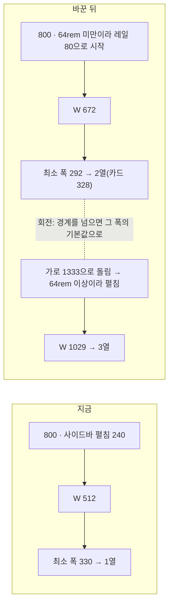

# 태블릿 대응 Phase 2 — 세로 구간을 레일로, 카드 최소 폭을 292로

> Phase 1(입력 축, #438)에 이어 **폭 축**을 고친다. 갤럭시 탭 S6 Lite 세로(800 추정)에서 피드를 2열로 만든다.
> 시안([Artifact](https://claude.ai/artifact/AcB8EegpZB5CyDHSfzDkJ1))을 본 뒤 2026-10-28 사용자가 고른 것을 그대로 구현한다.

## Context

### 지금 상황

- Phase 1은 끝났다. PR #438은 squash `3d300415`로 병합됐고, 배포 run 40640464735도 성공했다(deploy success).
  같은 계획의 Phase 2 초안은 `docs/plans/2026-10-28-tablet-width-and-input-axes.md`에 커밋돼 있다.
  이번 계획은 그 초안을 시안 결과로 확정한 것이다. 초안과 달라진 점은 "판단이 필요했던 항목"에 적었다.
- 800 폭에서 1열이 되는 원인은 두 가지다.
  - 사이드바가 펼친 채(240px) 시작한다(`src/shared/store/sidebar.store.ts:10-14`, 48rem 이상이면 펼침).
  - 카드 최소 폭이 330이다(`src/widgets/post/post-card/config/post-card-grid.const.ts:26`).
  - 그래서 목록 폭 W = 800 − 240 − 48 = 512이고, 2열 조건(2·330 + 16 = 676)에 못 미친다.

### 카드 최소 폭 292의 근거 (직접 측정)

- 방법: Playwright로 피드를 띄운다(모킹, `.claude/browser-artifacts/preview-min-width.spec.ts`, gitignore됨).
  첫 카드 행의 `gridTemplateColumns`를 400px부터 1px씩 줄이며, 아래 넷 중 하나가 처음 생기기 직전 폭을 잰다.
  - 푸터 줄바꿈(자식들의 세로 중심 차이 > 1px)
  - 머리줄 날짜가 메타 줄 밖으로 나감
  - 닉네임(`span.truncate`)이 18px 미만
  - 카드나 헤더가 넘침
- 최악값: 좋아요·댓글 9,990,000(축약하면 "999만"), 날짜 "2024년 12월 28일", 닉네임 9자, 내 글(⋮ 메뉴 있음). 조회수는 숨김.
- 결과: md 이상 밀도 291px, 모바일 밀도 269px(먼저 깨지는 곳: 푸터 줄바꿈). 291에 1px 여유를 둬 292로 한다.
  기존 330도 측정값 329를 올린 값이었다.
- 측정 범위 밖: 축약 결과가 5자인 숫자(1000만 이상)는 재지 않았다.

### 열 수가 바뀔 때 스크롤 튐의 원인 (설치본 소스로 추적)

- 직접 측정: 맨 위(scrollY 0)에서 ⌘B로 1열 → 2열이 되면 scrollY가 318로 튄다.
- 순서:
  1. `useWindowGridVirtualizer.ts:319-326`이 열 수가 바뀌면 `getVirtualItemForOffset(scrollOffset)`로 맨 위 행을 앵커로 잡는다.
  2. 그 뒤 `:341-349`가 `scrollToIndex(행, { align: 'start' })`를 부른다.
  3. virtual-core 3.17.11의 `getVirtualItemForOffset`(`dist/esm/index.js:982-995`)은 `findNearestBinarySearch`(`:1271-1288`)를 쓴다.
     offset이 첫 행의 start보다 작으면 0을 돌려준다.
  4. 첫 행의 start는 `paddingStart + scrollMargin`이다(`:689`·`:732`·`:752`).
  5. 그래서 목록 위(필터 영역)를 보고 있어도 첫 행이 앵커가 되고, 화면 꼭대기로 끌어올려진다.

## 판단이 필요했던 항목

| 항목                | 결정                                                                                                                                                    | 근거·기각한 대안                                                                                                                                                                                                                                                                            |
| ------------------- | ------------------------------------------------------------------------------------------------------------------------------------------------------- | ------------------------------------------------------------------------------------------------------------------------------------------------------------------------------------------------------------------------------------------------------------------------------------------- |
| 48~64rem 셸         | **A 레일**. 64rem 미만이면 사이드바를 접힌 상태(`w-20`, 아이콘과 작은 이름)로 시작한다(10-28 사용자 선택)                                               | Android는 Medium 창에 내비게이션 레일을 권한다([Android Developers](https://developer.android.com/develop/ui/compose/layouts/adaptive/build-adaptive-navigation)). **기각**: B 하단 탭바(셸 전체의 `md:` 경계를 옮겨야 해서 영향이 가장 큼), C 덮는 사이드바(늘 보이는 내비게이션이 사라짐) |
| 회전할 때 사이드바  | **폭에 맞춰 바꾼다**. 64rem 경계를 넘을 때마다 펼침/레일을 그 폭의 기본값으로 맞춘다. ⌘B로 바꾼 상태는 경계를 넘기 전까지만 유지된다(10-28 사용자 선택) | Android 문서는 _"실행 중에 창 크기가 바뀔 때 UI를 동적으로 바꾸는 것도 포함된다"_ 고 쓴다(번역, 위 링크). **기각**: 처음 한 번만 정하기. 가로로 열고 세로로 돌리면 펼친 채 남아 1열이 된다. **대가**: 데스크톱 창을 1024 아래로 줄였다 늘리면 접어 둔 사이드바가 다시 펼쳐진다              |
| 카드 최소 폭        | **292**(v1, 버튼 구성은 그대로)(10-28 사용자 선택)                                                                                                      | 위 측정. **기각**: 250(목록 카드에서 공유 버튼을 빼야 하는데, S6 Lite 세로·가로, iPad 1024, 1280 모두 열 수가 292와 같다), 330 유지(800 레일에서도 W 672 < 676이라 1열)                                                                                                                     |
| 조회수              | **목록 카드에서 숨기고 상세에서만 보인다**(10-28 사용자 선택)                                                                                           | 조회수를 빼야 최소 폭이 330에서 291로 준다(축약만 하면 349로 오히려 넓어짐). **기각**: 작성자 줄로 옮기기(처음 시안의 추천 A2)                                                                                                                                                              |
| 숫자 축약 범위      | **모든 곳**(목록과 상세의 좋아요·댓글·조회수). `Intl.NumberFormat('ko-KR', { notation: 'compact', maximumFractionDigits: 1 })`(10-28 사용자 선택)       | `LikePostButton`이 받는 값을 바꾸지 않아도 된다. 같은 글은 어디서나 같은 숫자로 보인다. **기각**: 목록만(`LikePostButton`에 prop을 더해야 하고, 목록과 상세의 숫자가 달라진다)                                                                                                              |
| 48~64rem 좌우 여백  | **24px 그대로**                                                                                                                                         | 292면 800 레일에서 W 672 ≥ 600이라 이미 2열이다. 초안의 "16px로 줄이기"는 330 기준이라 필요 없어졌다                                                                                                                                                                                        |
| 북마크 폴더 패널    | **그대로**                                                                                                                                              | 800 레일에서 W 408 → 1열이지만 292 이상이라 깨지지 않는다(시안 b3 근사)                                                                                                                                                                                                                     |
| 데스크톱 열 수 변화 | **받아들인다**                                                                                                                                          | 펼침 기준 3열 경계가 1326에서 1212로 내려간다. 1280은 2열(480)에서 3열(315)이 된다. 처음 시안에서 대가로 밝혔다                                                                                                                                                                             |
| 스크롤 튐 수정      | **화면 꼭대기가 목록 시작보다 위에 있으면 앵커를 잡지 않는다**(`scrollOffset < topRow.start`)(10-28 "함께 고침" 선택)                                   | 목록 위 영역의 높이는 열 수와 상관없어서, 브라우저 scrollY를 그대로 두면 보던 화면이 유지된다. 목록 안을 보고 있을 때의 앵커는 그대로 둔다(기존 e2e 1200 테스트가 지킴)                                                                                                                     |

## 세부 계획

| 위치                                                                    | 변경 내용                                                                                                                                                                                                                                                                                                                                   |
| ----------------------------------------------------------------------- | ------------------------------------------------------------------------------------------------------------------------------------------------------------------------------------------------------------------------------------------------------------------------------------------------------------------------------------------- |
| `src/shared/config/const.ts:41-46`                                      | `WIDE_MEDIA_QUERY = '(width >= 64rem)'`를 추가한다(Tailwind lg와 같은 조건, 사이드바를 펼친 채 두는 폭). 기존 두 상수처럼 rem으로 쓴다                                                                                                                                                                                                      |
| `src/shared/store/sidebar.store.ts`                                     | 첫 값을 `WIDE_MEDIA_QUERY` 기준으로 정한다. `close`와 짝인 `open` 액션을 추가한다                                                                                                                                                                                                                                                           |
| `src/widgets/layout/sidebar/ui/Sidebar.tsx`                             | `matchMedia(WIDE_MEDIA_QUERY)`의 `change`를 구독하는 effect를 추가한다. 넓어지면 `open()`, 좁아지면 `close()`. 선례는 `AppLayout.tsx:46-57`(`desktop.addEventListener('change', syncInert)`)                                                                                                                                                |
| `src/widgets/layout/sidebar/ui/Sidebar.test.tsx`                        | `change` 이벤트로 펼침/접힘이 바뀌는 테스트 2개를 추가한다(`matchMedia`를 리스너를 잡는 가짜로 바꿔 끼움)                                                                                                                                                                                                                                   |
| `src/shared/utils/number.util.ts` (신규) + `number.util.test.ts` (신규) | `export class NumberUtil { static formatCompact(value: number): string }`(§23 Util Class 형태, 선례 `date.util.ts`). 테스트: 0, 999, 1000→1천, 1234→1.2천, 56789→5.7만, 9,990,000→999만                                                                                                                                                     |
| `src/features/post/like/ui/LikePostButton.tsx:41`                       | `{likeCount}` → `{NumberUtil.formatCompact(likeCount)}`                                                                                                                                                                                                                                                                                     |
| `src/widgets/post/post-card/ui/PostCard.tsx`                            | 댓글 수(`:367`)를 축약한다. 조회수 묶음(`:397-400`)은 `isDetail`일 때만 렌더하고 축약한다                                                                                                                                                                                                                                                   |
| `src/widgets/post/post-card/config/post-card-grid.const.ts:26`          | `minColumnWidth` 330 → 292. 주석의 측정 근거를 위 측정으로 바꾸고, 이 계획 파일을 가리킨다                                                                                                                                                                                                                                                  |
| `src/shared/hooks/useWindowGridVirtualizer.ts:319-326`                  | 앵커 조건에 `scrollOffset >= topRow.start`를 추가하고, 이유를 주석으로 적는다                                                                                                                                                                                                                                                               |
| `e2e/post-card-footer-layout.spec.ts`                                   | ① 최악값 통계를 좋아요·댓글 9,990,000으로 바꾼다(`:26-31`) ② "800px(1열)" 테스트를 "800px(2열, 레일)"로 고치고 열 수 2를 단정한다(`:103-109`) ③ 1200 테스트 주석의 330 기준 수치를 고친다(`:116-117`) ④ 신규: 800 맨 위에서 ⌘B로 펼쳐 열 수가 바뀌어도 scrollY가 0이다 ⑤ 신규: 1280에서 800으로 줄이면 사이드바가 레일(80px)이 되고 2열이다 |
| `e2e/bookmark-card-footer-layout.spec.ts:29`                            | 최악값 통계를 같은 값으로 바꾼다                                                                                                                                                                                                                                                                                                            |
| `docs/POST.md:173`, `:482`                                              | 최소 카드 폭 330 → 292                                                                                                                                                                                                                                                                                                                      |
| `.claude/skills/responsive-ux/SKILL.md` "브레이크포인트"                | 폭 구간을 모바일 <48rem / 레일 48–64rem / 펼침 ≥64rem으로 설명하고, 64rem 경계는 `WIDE_MEDIA_QUERY`로 판정한다는 규칙을 추가한다                                                                                                                                                                                                            |
| `docs/DECISIONS.md`                                                     | 신규 항목. 세로 셸 A/B/C 비교, 최소 폭 292/250 비교, 회전 동작. 근거 링크와 시안 Artifact를 함께 남긴다                                                                                                                                                                                                                                     |
| `CHANGELOG.md` `[Unreleased]`                                           | 태블릿 세로 2열, 조회수 숨김, 숫자 축약, 스크롤 튐 수정 항목을 추가한다(`changelog-release` skill 형식)                                                                                                                                                                                                                                     |
| `docs/plans/2026-10-28-tablet-width-rail.md` (신규)                     | 이 계획의 스냅샷(§11)                                                                                                                                                                                                                                                                                                                       |

## 영향 범위 (§5)

- **CRUD**: 데이터나 API 계약은 바뀌지 않는다. 배포 순서 제약도 없다.
- **기존 동작 회귀**:
  - `useSidebarStore` 사용처는 `Sidebar.tsx` 하나다(grep 확인, 구현 때 `pnpm graph:focus`로 다시 확인).
    48~64rem의 모든 페이지가 레일로 시작한다.
  - 데스크톱 1212~1325 폭(사이드바 펼침)은 2열에서 3열이 된다.
    휴대폰 배치 중 644~719 폭(sm, 가로로 돌린 휴대폰 등)은 1열에서 2열이 된다.
    북마크 3열 경계는 1590에서 1476으로 내려간다.
  - 목록 카드 푸터에서 조회수 묶음이 빠진다.
    e2e `expectNoFooterWrap`은 `footer.children`을 세므로 조건부 렌더(숨김 클래스가 아님)여야 거짓 실패가 없다.
  - 축약은 1000 이상에서만 표시가 바뀐다. 기존 테스트·e2e의 통계 값은 0~999라 영향이 없다(grep 확인).
  - 스크롤 앵커: 목록 안을 보고 있을 때의 동작은 그대로다. 기존 e2e `1200px에서 ⌘B…`가 회귀를 잡는다.
  - 가상 목록 스냅샷 복원(`saveVirtualSnapshot`)은 열 수를 함께 저장한다. 배포 직후 저장된 열 수와 새 계산이 달라도 사이드바 토글 때와 같은 경로를 탄다(새 위험 아님).
  - 회전 리스너 때문에, 데스크톱에서 ⌘B로 접어 둔 상태가 창을 1024 아래로 줄였다 늘리면 풀린다(의도한 대가).

## 검증 방법

1. `pnpm type-check` → `pnpm test` → `pnpm lint`·`pnpm check:deps` → `pnpm check:docs`를 차례로 돌린다.
2. e2e: `post-card-footer-layout`, `bookmark-card-footer-layout`, `tablet-input.mobile`, `virtualizer-scroll-adjust`, `scroll-reset-on-navigation`, `bookmark-sidebar-sticky`. 그 다음 전체 e2e를 CI에서 돌린다.
3. `browser-verification` skill로 모킹 녹화를 한다(800×1280 터치, 1333×800). 항목은 사용자에게 제시한 순서대로 챕터를 나눈다.
   1. 세로 800은 레일로 시작하고 2열이다
   2. 맨 위에서 ⌘B로 펼쳐도 스크롤이 튀지 않는다
   3. 가로 1333으로 돌리면 펼침이 되고 3열이다. 다시 세로로 돌리면 레일과 2열이다
   4. 목록 카드에는 조회수가 없고 숫자가 축약된다. 상세에는 조회수가 보인다
   - 마지막 프레임은 ffmpeg로 뽑아 확인한다.
4. 사용자 승인 뒤에 커밋한다. PR 본문에는 `## 계획 대비 구현`을 넣는다(fresh general-purpose subagent가 대조, §11).
5. 병합한 뒤 `gh run list --workflow "Frontend Deploy (S3 + CloudFront)"`로 그 SHA가 success인지 확인한다. 그 다음 워크트리를 정리한다.
6. 사용자에게 S6 Lite 실기기로 세로·가로를 확인받는다. `innerWidth`도 이때 함께 본다.

## 남은 것

- Phase 1 "남은 것"은 이번에도 범위 밖이다.
  - hover로만 드러나는 폴더 ⋮ 메뉴
  - `min-h-11 md:min-h-0` 6곳의 터치 크기
  - 댓글 단축키가 `metaKey`만 보는 문제
- 축약 결과가 5자인 숫자(1000만 이상)는 최소 폭 측정 범위 밖이다.
- S6 Lite의 실제 CSS 폭(800 추정)은 아직 실기기로 확인하지 않았다. 레일 기준 2열 조건은 뷰포트 728 이상이다.
