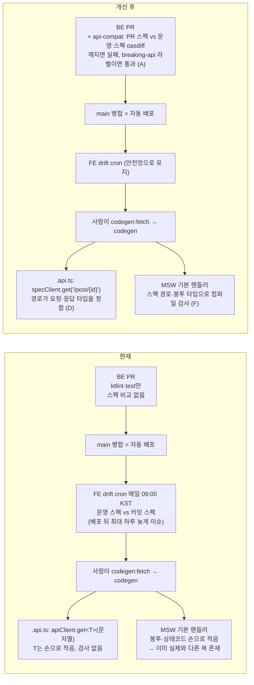
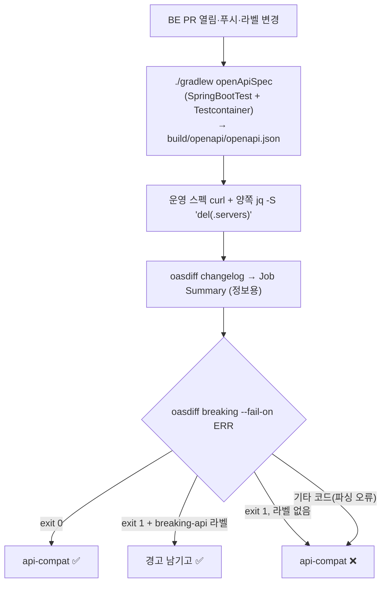
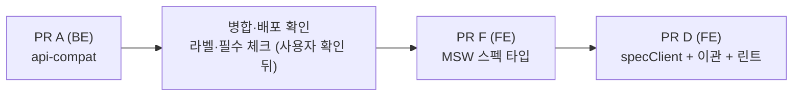

# FE↔BE API 계약 자동 검사 — BE PR 스펙 비교 · MSW 스펙 타입 · 경로 타입 클라이언트

> 요약: API 요청·응답 모양이 BE와 계속 맞는지를 사람이 아니라 세 겹의 자동 검사로 확인한다.
> (A) BE PR에서 깨지는 스펙 변경을 막고, (F) FE 테스트 목을 스펙 타입으로 검사하고,
> (D) `.api.ts`의 URL과 응답 타입을 스펙 경로로 묶는다. PR 순서는 A → F → D.

## Context

### 왜 하는가

"API 요청하고 돌아오는 패턴이 잘 유지되는지" 확인하는 방법을 조사했다. 다른 팀들은 BE 스펙 하나를
기준으로 데이터가 지나는 여러 지점에 자동 검사를 건다(조사 근거는 아래 "사전 조사"). 이 레포는 스펙→타입
생성(`docs/OPENAPI-CODEGEN.md`)과 레이어 린트는 이미 있지만 네 군데가 비어 있다.

### 현재 vs 개선 후



### 확인한 사실 (현재 상황)

| 지점                 | 사실                                                                                                          | 근거                                                                                                 |
| -------------------- | ------------------------------------------------------------------------------------------------------------- | ---------------------------------------------------------------------------------------------------- |
| BE CI                | 스펙을 만들거나 비교하는 단계 0건. 앱이 `secret` 프로필(gitignore)과 `gemini.*`·`supabase.*` 값 없이는 안 뜸  | BE `ci.yml:57-58`, `application.yml:10-11`, `GeminiService.kt:18`, `SupabaseStorageService.kt:20-22` |
| FE drift 검사        | 운영 스펙과 커밋 스펙을 매일 비교 → 이슈. PR 게이트 아님(배포 뒤 사후 감지)                                   | `openapi-drift-check.yml:11-12`, `scripts/check-openapi-drift.js`                                    |
| `apiClient`          | `get<T>(endpoint: string)` — URL과 T가 따로, `(json as ApiResponse<T>).data`로 단언                           | `client.ts:505`, `client.ts:480`                                                                     |
| `.api.ts`            | 9개 파일 47개 호출. 손으로 쓴 T 3곳, T 없는 호출 7곳                                                          | `account.api.ts:34`, `auth.api.ts:58`, `upload.api.ts:9-13`                                          |
| 스펙 형태            | 2xx 응답은 전부 봉투(`ApiResponseX`), `ApiResponseUnit`엔 `data` 없음, 응답 미디어 타입 전부 `*/*`            | `openapi.gen.ts:932`, `:946`                                                                         |
| MSW 기본 핸들러      | 40개(스펙 39 + 외부 스토리지 1). 실제와 다른 목: 204 반환 5개, `data: null` 5개, `deletionCancelled` 누락 1개 | `post.handlers.ts:82` vs BE `PostController.kt:149`(200+봉투, BE에 `NO_CONTENT` 0건)                 |
| 기존 결정            | 타입만 생성, 런타임 검증 없음, `apiClient`(토큰 갱신·NFC·WAF 판별)를 대체하는 도구(orval) 기각                | `docs/OPENAPI-CODEGEN.md:132-141`                                                                    |
| `API_ENDPOINTS` 규칙 | ESLint 강제 없음, 문서 규칙만                                                                                 | `.claude/CLAUDE.md` "Never 인라인 API 경로", `docs/FE-ARCHITECTURE.md:39`                            |

### 사전 조사 (다른 팀들의 방식)

- 스펙 비교 게이트: [oasdiff](https://github.com/oasdiff/oasdiff)는 _"OpenAPI 스펙을 비교해 깨지는 변경을 찾는
  명령줄 도구"_ (번역)다. 최신 v1.35.0(2026-10-28).
- 경로 타입 클라이언트: [openapi-fetch](https://openapi-ts.dev/openapi-fetch/) 문서는 _"URL·파라미터에 오타가
  없다"_, _"버그를 숨기는 `as` 타입 덮어쓰기를 없앤다"_ (번역)고 쓴다. 우리는 `apiClient` 런타임을 유지해야 해서
  (기존 결정) 같은 타입 아이디어만 얇은 래퍼로 가져온다.
- 목 검사: Martin Fowler는 _"대역으로 테스트하면 그 대역이 실제 외부 서비스를 정확히 나타내는지, 외부 서비스가
  계약을 바꾸면 어떻게 되는지 늘 의문이 남는다"_ (번역, [ContractTest](https://martinfowler.com/bliki/ContractTest.html))고
  쓴다. [openapi-msw](https://www.npmjs.com/package/openapi-msw)는 MSW 핸들러를 스펙 타입에 묶는다.
- 런타임 검증·Pact는 이번 범위 밖(아래 판단 표).

## 판단이 필요했던 항목

| 항목                        | 결정                                                                                                                                                              | 근거·기각한 대안                                                                                                                                                                          |
| --------------------------- | ----------------------------------------------------------------------------------------------------------------------------------------------------------------- | ----------------------------------------------------------------------------------------------------------------------------------------------------------------------------------------- |
| 범위                        | A + F + D 모두, PR을 나눠 A → F → D                                                                                                                               | 사용자 결정(2026-10-29). A·F만이면 "엉뚱한 URL에 엉뚱한 타입"은 못 막음                                                                                                                   |
| (A) 깨지는 변경 시 CI       | 실패, PR에 `breaking-api` 라벨이면 통과(경고 표시)                                                                                                                | 사용자 결정. 무조건 실패는 의도한 동시 배포 PR을 못 병합, 경고만은 지금 drift 이슈처럼 지나침                                                                                             |
| (A) 비교 기준               | 운영 스펙(`https://linksphere.click/api/v3/api-docs`)                                                                                                             | main 병합 = 자동 배포라 운영 ≈ main. 베이스 브랜치 스펙을 따로 생성하는 안은 부팅 2회라 CI 시간 2배 — 지연 오탐이 잦으면 재검토                                                           |
| (A) PR 스펙 생성            | `@SpringBootTest` + 기존 pgvector Testcontainer + 더미 설정 + `@ActiveProfiles("openapi-spec")`로 `secret` 대체, MockMvc로 `/v3/api-docs`를 파일로 씀             | 부팅 가능성은 미검증 → A-0 스파이크. 실패 시 DB 없이 부팅(대체안 A-0)                                                                                                                     |
| (A) oasdiff 실행            | 새 워크플로 `api-compat.yml`에서 digest 고정 `docker run tufin/oasdiff:v1.35.0@sha256:…`                                                                          | 공식 Action도 가능(`review: false`로 업로드 끔)하나 docker는 digest로 불변 고정 + 로컬에서 같은 명령 재현 + 라벨 분기를 셸로 직접 제어. 대가: Dependabot 자동 갱신 불가(수동 갱신 문서화) |
| (A) 별도 워크플로           | `ci.yml`의 `check`에 넣지 않고 `api-compat` 워크플로·잡 신설                                                                                                      | 라벨 이벤트(`labeled`/`unlabeled`)를 `ci.yml`에 넣으면 라벨마다 전체 검사 재실행. 필수 잡에 `if:`로 건너뛰면 GitHub이 skipped를 성공으로 처리                                             |
| 경로 문자열 규칙            | 새 클라이언트·스펙 타입 MSW에선 스펙 경로(`'/post/{id}'`)를 직접 쓰고, CLAUDE.md 규칙 문구를 고침                                                                 | 사용자 결정. 규칙의 목적(오타·흩어짐 방지)을 생성 스펙이 컴파일 단계에서 대신함. `API_ENDPOINTS`에 템플릿 추가 안은 함수형과 두 벌 유지                                                   |
| (F) 범위                    | 기본 핸들러 40개만. 테스트 인라인 280개는 그대로, 새 테스트부터 타입 `http`                                                                                       | 사용자 결정                                                                                                                                                                               |
| (F) 도구                    | openapi-msw 2.1.1 먼저 스파이크, 마찰 있으면 자체 헬퍼(약 40줄)                                                                                                   | 표준 도구 우선. 단 `*/*` 때문에 `response().json()` 헬퍼는 못 쓰고, 패키지가 `.ts` 소스를 실어 우리 strict 설정으로 검사됨(`skipLibCheck`는 `.d.ts`만 건너뜀)                             |
| (D) `apiClient`             | 그대로 두고 새 `specClient`(타입 래퍼)를 추가                                                                                                                     | CLAUDE.md "기존 함수 시그니처 변경 금지, 새 기능은 새 코드로" + 기존 결정(런타임 대체 기각)                                                                                               |
| (D) FE가 스펙보다 좁힌 타입 | `Account`만 해당(`role: 'USER'\|'ADMIN'`). 3개 호출에서 `specClient.get<'/auth/account', Account>`처럼 하위 타입으로만 좁히고 주석으로 `account.dto.ts` 근거 링크 | 다른 override(`Comment`·`BookmarkFolder`)는 스펙 타입 그대로 대입 가능                                                                                                                    |
| 런타임 응답 검증·Pact       | 하지 않음                                                                                                                                                         | 런타임 검증은 기존 결정(OPENAPI-CODEGEN §5-2)과 충돌 + 실패 시 전역 토스트 UX 판단 필요. Pact는 BE 검증 테스트 유지비                                                                     |

### 위험 관리

| 위험                                                          | 대응                                                              |
| ------------------------------------------------------------- | ----------------------------------------------------------------- |
| BE 컨텍스트가 CI에서 안 뜸                                    | A-0 스파이크 먼저. DB 없이 부팅하는 대체안                        |
| openapi-msw가 TS 5.7 strict와 충돌                            | F-0 스파이크, 자체 헬퍼로 대체                                    |
| 라벨 병합 직후 배포 지연 동안 다른 BE PR이 같은 변경으로 오탐 | 배포 끝난 뒤 재실행. 잦으면 베이스 스펙 생성 방식 재검토(남은 것) |
| 운영 스펙 fetch 실패(WAF·네트워크)                            | curl 재시도 3회, 실패 시 닫힌 쪽(실패)으로                        |

## 세부 계획

### Phase A — BE PR 스펙 비교 게이트 (BE 레포, PR 1개)



| 위치                                                                | 변경 내용                                                                                                                                                                                                                                                                                                                    |
| ------------------------------------------------------------------- | ---------------------------------------------------------------------------------------------------------------------------------------------------------------------------------------------------------------------------------------------------------------------------------------------------------------------------- |
| A-0 스파이크(로컬)                                                  | `openApiSpec` 실행 → 로그에 활성 프로필 `openapi-spec`만 뜨는지, main에서 생성 스펙과 운영 스펙 정규화 diff가 비는지, 동일 스펙 exit 0·필드 개명 시 exit 1인지 확인. 부팅 실패 시 대체안: `spring.datasource.url=jdbc:postgresql://127.0.0.1:1/none` + `hibernate.boot.allow_jdbc_metadata_access=false`, Testcontainer 제거 |
| `src/test/kotlin/.../global/config/OpenApiSpecExportTest.kt` (신규) | `@SpringBootTest(properties=[gemini·supabase 더미, firebase 경로 비움])` + `@AutoConfigureMockMvc` + `@ActiveProfiles("openapi-spec")` + `@Import(PostgresTestContainers)`(`support/PostgresIntegrationTest.kt:30-37` 재사용) + `@Tag("openapi")`. `/v3/api-docs`를 `openapi.outputFile`에 쓰고 `paths` 30개 이상 확인       |
| `build.gradle.kts:177-188`                                          | `test`에서 `openapi` 태그 제외, `openApiSpec` Test 태스크 등록(`includeTags("openapi")`, 출력 경로 시스템 프로퍼티, 항상 실행)                                                                                                                                                                                               |
| `.github/workflows/api-compat.yml` (신규)                           | `pull_request` types `[opened, synchronize, reopened, labeled, unlabeled]` + `workflow_dispatch`, concurrency `api-compat-${{ github.ref }}`, 위 흐름도대로. checkout·JDK·Gradle 캐시는 `ci.yml:23-50`과 같은 SHA. PR 스펙을 artifact로 7일 보관                                                                             |
| 병합 후 1회(사용자 확인 뒤 실행)                                    | `gh label create breaking-api`, ruleset 25000908 필수 체크에 `api-compat` 추가                                                                                                                                                                                                                                               |
| 문서                                                                | `docs/CI-CHECK-GATE.md`(새 게이트·라벨·필수 체크), `docs/BE-ARCHITECTURE.md:312-318`·`:650-652`(깨지는 변경 절차), `docs/DEPLOY.md:846`·액션 버전 관리(oasdiff digest 수동 갱신), BE `.claude/CLAUDE.md`(명령·필수 체크)                                                                                                     |

### Phase F — MSW 기본 핸들러 스펙 타입화 (FE 레포, PR 1개)

| 위치                                     | 변경 내용                                                                                                                                                                                                                                                                                                                                       |
| ---------------------------------------- | ----------------------------------------------------------------------------------------------------------------------------------------------------------------------------------------------------------------------------------------------------------------------------------------------------------------------------------------------- |
| F-0 스파이크                             | `pnpm add -D openapi-msw@2.1.1`(정확히 고정) → `pnpm type-check && pnpm build`. `src/mocks/http.test.ts`에 `@ts-expect-error -- <이유>` 케이스(없는 경로, `{postId}`↔`{id}` 혼동, 잘못된 메서드, 필수 필드 누락, Unit 경로에 204 null 본문) + `'/api'` 접두 런타임 매칭 1건. 마찰 있으면 자체 헬퍼로 전환(D의 `spec-types.ts`를 이 PR로 당겨옴) |
| `src/mocks/http.ts` (신규)               | `createOpenApiHttp<paths>({ baseUrl: API_BASE_URL })`                                                                                                                                                                                                                                                                                           |
| `src/mocks/mock-envelope.util.ts` (신규) | `MockEnvelopeUtil.json(data, status)`(봉투), `MockEnvelopeUtil.unit()`(`data` 없는 봉투). 운영 Unit 응답에 `data: {}`가 오는지 스파이크에서 확인해 맞춤                                                                                                                                                                                         |
| `src/mocks/handlers/*.ts` (6개)          | 로컬 `url()`·`API_ENDPOINTS` 제거, 스펙 경로 템플릿, 봉투 헬퍼. 실제와 다른 목 수정: 204 5개 → `unit()`/`json({ isLiked })`, `data: null` 5개 → `unit()`, 비밀번호 변경 → `TokenResponse` 전체. `upload.handlers.ts`의 외부 스토리지 PUT만 `msw`의 `http` 유지(eslint-disable 사유 주석)                                                        |
| `eslint.config.js`                       | `src/mocks/handlers/**`에서 `msw`의 `http` import 금지(`no-restricted-imports`, FSD 블록과 겹치지 않음 — `:1193` 주의 주석 옆에 이유 기록)                                                                                                                                                                                                      |
| 문서                                     | `docs/TESTING.md:419-534`(템플릿·오버라이드 안내), `:1079-1083`, `docs/OPENAPI-CODEGEN.md`(§5-3 사용처, §5-5 신규, §7 버전, §11 인라인 280개 남음), `.claude/CLAUDE.md` 경로 규칙 1차 문구, `docs/FE-ARCHITECTURE.md` 린트 표, `src/mocks/server.ts:6-10` 주석                                                                                  |

### Phase D — 경로 타입 클라이언트 `specClient` (FE 레포, PR 1개, 파일별 커밋)

```mermaid
flowchart LR
  call["specClient.get('/post/{id}', { path: { id } })"] --> types["spec-types.ts<br/>경로·메서드 → path/query/body 타입<br/>200·201 응답(미디어 타입 무관) → 봉투의 data<br/>ApiResponseUnit → void"]
  call --> rt["spec-client.ts<br/>{id} 치환(encodeURIComponent)<br/>query → searchParams"]
  rt --> api["기존 apiClient (변경 없음)<br/>토큰 갱신·NFC·OAC·WAF 판별"]
```

| 위치                                          | 변경 내용                                                                                                                                                                                                                                                                                     |
| --------------------------------------------- | --------------------------------------------------------------------------------------------------------------------------------------------------------------------------------------------------------------------------------------------------------------------------------------------- |
| `src/shared/api/spec-types.ts` (신규, 타입만) | `PathsWithMethod`, `PathParamsOf`, `QueryOf`, `RequestBodyOf`, `SuccessBodyOf`(미디어 타입 무관), `UnwrapEnvelope`(Unit → `void`), `SpecArgs`(필수 인자 유무 계산). header·cookie 파라미터는 무시                                                                                             |
| `src/shared/api/spec-client.ts` (신규)        | `specClient.{get,post,put,patch,delete}` — 경로 치환 후 `apiClient` 해당 메서드 호출, `options`(keepalive 등) 그대로 전달. 두 번째 제네릭 `R`은 스펙 응답의 하위 타입만 허용                                                                                                                  |
| `src/shared/api/spec-client.test.ts` (신규)   | 런타임(경로 치환·인코딩, query, 본문 없는 PUT, 본문 있는 DELETE, 봉투 해제·Unit, keepalive 전달) + 타입 테스트(`@ts-expect-error`: 없는 경로, 잘못된 메서드, path 누락, 본문 금지 엔드포인트에 본문, 잘못된 본문, `Account`에 스펙 타입 대입)                                                 |
| `*.api.ts` 9개                                | 순서: fcm·category(시범) → post → interaction → bookmark-folder → comment → auth → account → upload. 반환 타입 표기 없는 함수(comment·interaction)에 `Promise<도메인 타입>` 명시, 손으로 쓴 T 3곳은 스펙 타입으로, `Account` 3곳은 `R` 좁히기 + 근거 주석                                     |
| `eslint.config.js`                            | 이관 뒤 `custom-api-rules/no-raw-api-client-import` 추가 — `apiClient` 값 import를 `client.ts`·`spec-client.ts`·테스트 외 금지(`no-query-client-singleton-import`의 허용목록 방식, 타입 import는 허용)                                                                                        |
| 문서·스킬                                     | `.claude/CLAUDE.md` 경로 규칙 최종 문구 + 패턴 표, `docs/FE-ARCHITECTURE.md` §5 Layer 1 예시(:398-416)·트리·린트 표·체크리스트, `.claude/commands/add-entity-api.md`·`new-domain.md`·`code-review.md`·`add-schema.md`·`fix-bug.md`의 `apiClient` 예시, `docs/OPENAPI-CODEGEN.md` §5-2·§5-4·§8 |

## 실행 전략



- 워크트리: FE는 `EnterWorktree`, BE는 FE 세션에서 `git -C <BE> worktree add` 후 이동하고 비밀 파일을 복사한다. 시작 전 `git log origin/main..main`으로 미푸시 커밋을 확인한다.
- 계획 스냅샷(§11): PR A에 BE `docs/plans/2026-10-29-api-contract-checks.md`, PR F에 FE 같은 경로로 커밋한다. PR D는 FE 파일을 링크한다. 각 PR 본문 `## 계획 대비 구현`은 fresh general-purpose 서브에이전트로 대조한다.
- CHANGELOG: 셋 다 사용자 동작 변화 없음(CI·테스트·동작 동일 리팩터)이라 대상 아님. 구현 시 `changelog-release` skill로 재확인한다.
- 배포: A(BE `src/test/**` 포함)·F·D 모두 경로 필터에 걸려 배포가 돈다. 병합마다 `gh run list`로 해당 SHA 성공을 확인한 뒤 보고한다.
- PR 병합은 squash. 병합·배포 확인 뒤 워크트리를 정리한다.

## 영향 범위 (§5)

데이터 CRUD 변경은 없다(DB·API 계약 불변, BE 런타임 산출물 불변).

| 단계 | 깨질 수 있는 기존 동작                                  | 소유 파일                              | 확인                                                             |
| ---- | ------------------------------------------------------- | -------------------------------------- | ---------------------------------------------------------------- |
| A    | 기존 `test`·`integrationTest` 개수가 바뀜(새 태그 섞임) | BE `build.gradle.kts`                  | 태그 제외 후 테스트 수 비교                                      |
| A    | 라벨 이벤트로 `CI`(check)까지 재실행                    | BE `ci.yml`                            | 별도 워크플로라 영향 없음 — 드래프트 PR로 확인                   |
| A    | 병합 뒤 다른 PR이 배포 지연 중 오탐                     | —                                      | 위험 관리 표                                                     |
| F    | 204·`data: null`에 기대는 테스트                        | `src/mocks/handlers/*`                 | `toEqual({})` 단정 없음(설계 조사), 전체 `pnpm test`             |
| F    | 인라인 오버라이드 3개 파일의 204는 그대로               | `useFolderActions.test.ts` 등          | 범위 밖, 남은 것에 기록                                          |
| D    | 반환 타입 추론이 스펙 타입으로 바뀜                     | `comment.api.ts`, `interaction.api.ts` | 명시 표기, `pnpm type-check`                                     |
| D    | URL 조립 결과 변화(인코딩·쿼리)                         | `*.api.ts`                             | 단위 테스트 + `pnpm test:e2e`(`route-match.ts`가 경로 정확 일치) |
| D    | `.api.ts` 사용처                                        | `*.keys.ts`·`*.queries.ts`             | 시그니처 불변. `pnpm graph:focus "<경로>" --text`로 사용처 확인  |
| 문서 | `apiClient` 예시를 가르치는 문서·스킬                   | 위 문서 표                             | `pnpm check:docs`                                                |

## 검증 방법

- **A**: `./gradlew ktlintCheck test integrationTest --no-daemon`(테스트 수 불변), `./gradlew openApiSpec` 후 main 기준 운영 스펙과 정규화 diff 없음, 로컬 `docker run … breaking … --fail-on ERR` → 0, 필드 개명 → 1. 드래프트 BE PR로 끝까지: 개명 → `api-compat` ❌, `breaking-api` 라벨 → `api-compat`만 재실행되어 ✅(경고), 라벨 제거 → ❌, 병합 없이 닫음.
- **F**: 스파이크(`pnpm type-check && pnpm build`, `pnpm test src/mocks`) → `pnpm check`, `pnpm test`, `pnpm check:docs`. 프로브(되돌림): 핸들러에 틀린 경로·필드 누락 → type-check 실패, 핸들러에서 `msw`의 `http` import → lint 실패.
- **D**: `pnpm type-check`(타입 테스트 포함), `pnpm test`, `pnpm lint`, `pnpm build`, `pnpm test:e2e`, `pnpm check:docs`. `.api.ts`에 `apiClient` 0건 grep, 새 린트 규칙 프로브.

## 남은 것

- 테스트 인라인 `http.*` 280개(49개 파일)와 e2e `page.route()` 90곳은 스펙과 연결되지 않은 채 남는다. e2e는 `api.ts`를 못 읽어(`import.meta.env`) 별도 설계가 필요하다.
- `onUnhandledRequest: 'warn'`(`src/test/setup.ts`)이라 인라인 오버라이드의 경로가 틀려도 조용히 지나간다 — `'error'` 전환 여부.
- A의 비교 기준을 운영 대신 베이스 브랜치 생성 스펙으로 바꿀지(배포 지연 오탐이 잦을 때).
- 오류 응답(`ErrorResponse`)은 스펙에 없어 비교 대상이 아니다.
- oasdiff 이미지 digest는 수동 갱신.
