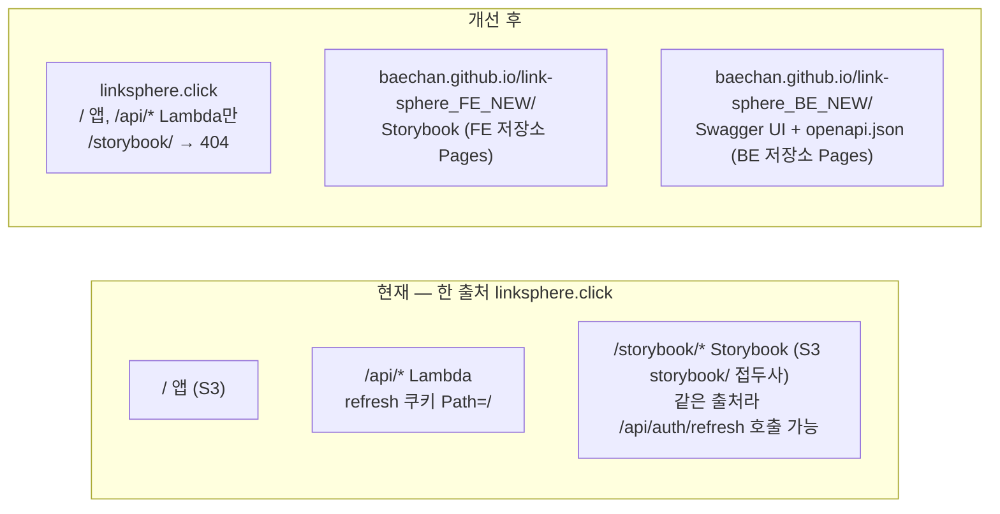
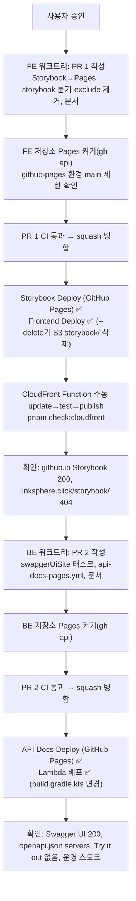

# Storybook·Swagger UI를 GitHub Pages로 — 운영 출처에서 문서 사이트 떼어내기

> 요약: 운영 도메인(`linksphere.click`)과 같은 출처에서 도는 Storybook을 FE 저장소의 GitHub Pages로 옮기고
> 옛 `/storybook/`은 없앤다(404). 새로 만드는 Swagger UI는 처음부터 BE 저장소의 GitHub Pages에 올린다.
> PR은 FE → BE 순서로 하나씩 연다.

## Context

### 왜 하는가

같은 출처(`https://linksphere.click`)에서 실행되는 스크립트는 `POST /api/auth/refresh`를 호출할 수 있다. 이때
브라우저가 refresh 쿠키(`__Host-refreshToken`, `Path=/`, `SameSite=Lax`)를 자동으로 붙이고, 응답 본문으로 access
token을 읽을 수 있다(BE `AuthController.kt:87-99`, `:298-312`, CSRF 보호는 꺼져 있다: `SecurityConfig.kt:38`).
그래서 그 출처에 앱 말고 다른 코드를 두면, 그 코드나 의존성이 오염됐을 때 세션을 빼앗길 수 있다.

지금 Storybook 정적 빌드(npm 의존성 수백 개)가 `/storybook/`으로 이 출처에서 돈다
([`deploy-storybook.yml`](../../.github/workflows/deploy-storybook.yml),
[`spa-fallback.js:66-75`](../../infra/cloudfront-functions/spa-fallback.js)). Swagger UI도 같은 방식으로 올리려다
이 위험을 다시 확인했다. 이 위험이 GitHub Pages로 옮기는 이유다.

`github.io`는 Public Suffix List에 있다(publicsuffix.org 목록 13833행). 그래서 `baechan.github.io`는 linksphere.click과
**다른 사이트**가 되고, Lax 쿠키는 그쪽에서 보낸 요청에 붙지 않는다. BE CORS 허용 목록(`application.yml:77-82`)에도
github.io가 없다.

### 현재 vs 개선 후

### 확인한 사실

| 지점                | 사실                                                                                                                                                                                              | 근거                                                                                                                                                                                                                                                                                                                |
| ------------------- | ------------------------------------------------------------------------------------------------------------------------------------------------------------------------------------------------- | ------------------------------------------------------------------------------------------------------------------------------------------------------------------------------------------------------------------------------------------------------------------------------------------------------------------- |
| Pages 정책          | 공개 저장소면 무료, 저장소당 프로젝트 사이트 1개, 사이트 1GB·월 100GB(소프트), 상업적 SaaS·민감한 거래 금지. 초과 시 과금 없음(제공 중단·연락)                                                    | [Pages 한도](https://docs.github.com/en/pages/getting-started-with-github-pages/github-pages-limits), [요금제](https://docs.github.com/en/get-started/learning-about-github/githubs-plans), [추가 제품 약관](https://docs.github.com/en/site-policy/github-terms/github-terms-for-additional-products-and-features) |
| 저장소              | FE·BE 모두 PUBLIC, Pages 꺼짐(`GET /pages` 404)                                                                                                                                                   | gh API 2026-10-30                                                                                                                                                                                                                                                                                                   |
| Storybook 크기      | 253개 파일, 13.2MB                                                                                                                                                                                | `aws s3 ls … storybook/ --summarize` 직접 측정                                                                                                                                                                                                                                                                      |
| Storybook 하위 경로 | builder-vite가 `base: "./"`를 강제해 경로 이름과 무관하게 동작                                                                                                                                    | 설치본 `@storybook/builder-vite` 10.6.5 `dist/index.js:1618`, `docs/DEPLOY.md` 자산 경로 절                                                                                                                                                                                                                         |
| 분기만 지우면 부족  | 확장자 있는 요청은 S3로 통과(`spa-fallback.js:77-82`) → 객체가 남으면 `/storybook/index.html`이 계속 열림                                                                                         | 코드                                                                                                                                                                                                                                                                                                                |
| S3 정리 경로        | `deploy.yml`의 루트 `sync --delete`가 `--exclude "storybook"`·`"storybook/*"`로 접두사를 보호 중                                                                                                  | `.github/workflows/deploy.yml` 99-112행                                                                                                                                                                                                                                                                             |
| 옛 주소 노출        | 사용자에게 보이는 링크는 `README.md:13-20`뿐(앱 코드엔 없음)                                                                                                                                      | 조사 grep                                                                                                                                                                                                                                                                                                           |
| Swagger UI 출처     | `springdoc-openapi:2.10.0` pom이 `org.webjars:swagger-ui` 5.34.0을 관리, BE가 `developmentOnly`로 이미 받음(`runtimeClasspath`가 이를 확장). webjar `index.html`은 인라인 스크립트 없음·상대 경로 | `build.gradle.kts:115-120`, `:26-30` 주석, springdoc pom `:60`                                                                                                                                                                                                                                                      |
| 운영 스펙 `servers` | Lambda Function URL 호스트(`<id>.lambda-url.ap-northeast-1.on.aws`)                                                                                                                               | 운영 `/api/v3/api-docs` 직접 확인(값은 기록하지 않음)                                                                                                                                                                                                                                                               |
| 스펙 생성           | `./gradlew openApiSpec` → `build/openapi/openapi.json`(Testcontainer, Docker 필요)                                                                                                                | `api-compat.yml:55-57`, `OpenApiSpecExportTest.kt`                                                                                                                                                                                                                                                                  |
| 배포 감시           | 워크플로 이름을 하드코딩                                                                                                                                                                          | `.claude/scripts/verify-deploy.mjs:30-33`, `.claude/hooks/deploy-verify.test.mjs`                                                                                                                                                                                                                                   |
| 기존 결정           | 2026-09-20 "Storybook 공개 호스팅: S3+CloudFront 재사용"이 GitHub Pages를 "AWS 단일 배포 서사가 깨진다"로 기각                                                                                    | `docs/DECISIONS.md:1972-2012`                                                                                                                                                                                                                                                                                       |

## 판단이 필요했던 항목

| 항목                                                 | 결정                                                                                                                                                                                 | 근거·기각한 대안                                                                                                                                                                                                                                                                                                                                                               |
| ---------------------------------------------------- | ------------------------------------------------------------------------------------------------------------------------------------------------------------------------------------ | ------------------------------------------------------------------------------------------------------------------------------------------------------------------------------------------------------------------------------------------------------------------------------------------------------------------------------------------------------------------------------ |
| 옛 `/storybook/` 주소                                | **없앤다** — `/storybook/`은 앱 404 페이지(상태 404), 남은 정적 경로는 S3 403                                                                                                        | 사용자 결정(2026-10-30). 302 리다이렉트는 딥링크를 지키지만 Function에 영구 코드가 남음. 안내 HTML은 딥링크가 사라지고 같은 출처에 파일이 남음                                                                                                                                                                                                                                 |
| 주소                                                 | `github.io` 기본 주소, 커스텀 도메인 없음                                                                                                                                            | 사용자 결정. `storybook.linksphere.click`은 같은 사이트(same-site)라 Lax 쿠키 격리가 한 단계 약하고 DNS·인증서 작업이 늘어남                                                                                                                                                                                                                                                   |
| Swagger UI 파일                                      | Gradle이 해석한 swagger-ui webjar에서 꺼냄                                                                                                                                           | 사용자 결정. springdoc 업데이트(Dependabot gradle)에 따라 올라감. npm `swagger-ui-dist`는 BE에 npm Dependabot이 없어 수동 관리, CDN은 런타임 외부 의존                                                                                                                                                                                                                         |
| 스펙 출처                                            | Pages 워크플로에서 `./gradlew openApiSpec`으로 생성, `servers`를 `https://linksphere.click/api`로 덮어씀                                                                             | 사용자 결정. `api-compat.yml`과 같은 방식. 운영 curl은 운영·WAF에 기댐                                                                                                                                                                                                                                                                                                         |
| S3 정리 방법                                         | `deploy.yml`의 storybook exclude 2줄을 지워 병합 뒤 FE 배포의 `--delete`가 지우게 함                                                                                                 | 수동 `aws s3 rm` 단계가 없어지고 PR 병합 한 번으로 실행됨. 반대로 exclude를 남기면 코드는 "보호"하는데 객체는 없는 상태가 됨                                                                                                                                                                                                                                                   |
| Swagger UI 설정                                      | `supportedSubmitMethods: []`, `validatorUrl: null`, `queryConfigEnabled: false`, `persistAuthorization: false`, 상단 URL 입력창 없는 `BaseLayout`, 스펙은 같은 출처 `./openapi.json` | [Swagger UI 설정 문서](https://swagger.io/docs/open-source-tools/swagger-ui/usage/configuration/): 빈 배열이면 _"모든 operation에서 'Try it out'이 꺼진다"_ (번역), validator는 기본으로 _"swagger.io 온라인 검증기로 스펙을 검증하려 한다"_ (번역). 운영 API로 요청을 보내지 않고 외부 요청도 없앰. github.io 출처를 다른 Pages 저장소 4개와 공유해 인가 정보를 저장하지 않음 |
| CSP                                                  | 넣지 않음                                                                                                                                                                            | Pages는 응답 헤더를 못 바꾸고, Storybook은 인라인 스크립트가 여럿이라 `'unsafe-inline'`이 필요해 실익이 작음. 위협(같은 출처 쿠키)은 사이트 분리로 제거됨                                                                                                                                                                                                                      |
| `SwaggerConfig.kt` 설명 문구("로컬 개발용 API 문서") | 바꾸지 않음                                                                                                                                                                          | 바꾸면 운영 스펙의 `info.description`이 달라져 FE 스냅샷 동기화 PR이 하나 더 필요함. 문구 자체("운영 Lambda에는 Swagger UI가 없다")는 여전히 사실                                                                                                                                                                                                                              |
| FE 워크플로                                          | 기존 `deploy-storybook.yml`을 고치고 이름을 `Storybook Deploy (GitHub Pages)`로 바꿈                                                                                                 | 경로 필터·빌드 스텝 재사용. 이름이 바뀌므로 `verify-deploy.mjs`도 고침                                                                                                                                                                                                                                                                                                         |
| BE 워크플로                                          | 새 `api-docs-pages.yml`(`API Docs Deploy (GitHub Pages)`)                                                                                                                            | `api-compat.yml`의 체크아웃·JDK·Gradle 캐시 스텝(같은 SHA) 재사용                                                                                                                                                                                                                                                                                                              |
| `initializer` 위치                                   | 저장소 루트 `api-docs-site/swagger-initializer.js`                                                                                                                                   | `src/**`·`build.gradle.kts`는 BE `deploy.yml` 경로 필터에 걸려 Lambda 재배포가 돎. 설정만 바꿀 때는 Pages만 다시 돌게 함                                                                                                                                                                                                                                                       |
| Pages 활성화                                         | `gh api -X POST repos/BAECHAN/<repo>/pages -f build_type=workflow`로 제가 켬. `github-pages` 환경은 main만 배포하도록 확인·설정                                                      | configure-pages의 `enablement`는 _"`GITHUB_TOKEN`이 아닌 토큰이 필요하다"_ (번역, action.yml)라 워크플로에서 켤 수 없음. [publishing source 문서](https://docs.github.com/en/pages/getting-started-with-github-pages/configuring-a-publishing-source-for-your-github-pages-site)는 기본 브랜치만 배포하도록 보호 규칙을 권함                                                   |
| 액션                                                 | `actions/upload-pages-artifact@fc324d3…`(v5.0.0), `actions/deploy-pages@368f825…`(v5.0.1), SHA 고정 + 태그 주석. configure-pages는 쓰지 않음                                         | `docs/DEPLOY.md` "액션 버전 관리" 관례. 구현 때 태그→커밋 SHA를 `gh api`로 다시 확인                                                                                                                                                                                                                                                                                           |
| `public/` 복사본(fonts·`firebase-messaging-sw.js`)   | 그대로 둠                                                                                                                                                                            | 13.2MB로 한도의 1.3%. 이미 공개 저장소에 있는 파일                                                                                                                                                                                                                                                                                                                             |
| 계획 스냅샷                                          | FE·BE 두 저장소 `docs/plans/2026-10-30-docs-to-github-pages.md`에 같은 내용                                                                                                          | 2026-10-29 API 계약 계획 선례(각 저장소 PR이 자기 사본을 커밋)                                                                                                                                                                                                                                                                                                                 |
| CHANGELOG                                            | 구현 때 `changelog-release` skill로 판단                                                                                                                                             | 앱 사용자 동작은 바뀌지 않음. 다만 첫 공개 배포가 기록돼 있음(`CHANGELOG.md:1460-1464`)                                                                                                                                                                                                                                                                                        |

### 위험 관리

| 위험                                                                         | 대응                                                                                                                 |
| ---------------------------------------------------------------------------- | -------------------------------------------------------------------------------------------------------------------- |
| FE 병합 뒤 Function 게시 전까지 `/storybook/`이 S3 403(XML)                  | 병합·배포 확인 직후 바로 게시. 방문이 거의 없는 개발 도구 경로                                                       |
| Function 게시 전 매일 drift 검사(09:00 KST)가 돌면 이슈가 열림               | 같은 날 게시하고 `pnpm check:cloudfront`로 확인                                                                      |
| `deploy-pages`가 환경 보호 규칙에 막힘                                       | 병합 전 Pages·환경 설정을 `gh api`로 확인                                                                            |
| webjar 경로가 버전마다 다름(`META-INF/resources/webjars/swagger-ui/<버전>/`) | 버전 디렉터리를 와일드카드로 받고 첫 세그먼트들을 떼는 Gradle `Sync` 태스크, 결과에 `swagger-ui-bundle.js` 존재 확인 |

## 세부 계획

### 프론트엔드 (PR 1)

| 위치                                                   | 변경 내용                                                                                                                                                                                                                                                                                                                                                                                                |
| ------------------------------------------------------ | -------------------------------------------------------------------------------------------------------------------------------------------------------------------------------------------------------------------------------------------------------------------------------------------------------------------------------------------------------------------------------------------------------- |
| `.github/workflows/deploy-storybook.yml`               | `name: Storybook Deploy (GitHub Pages)`. 권한 `contents: read`·`pages: write`·`id-token: write`, `concurrency: group pages, cancel-in-progress: false`, 잡에 `environment: github-pages`(url = `steps.deployment.outputs.page_url`). 빌드 스텝까지 유지, AWS 자격 증명·S3 업로드·무효화 스텝을 `upload-pages-artifact`(path `storybook-static`) + `deploy-pages`로 교체. 머리 주석을 Pages 기준으로 고침 |
| `.github/workflows/deploy.yml:99-112`                  | `--exclude "storybook"`·`--exclude "storybook/*"`와 그 이유 주석(4줄) 삭제                                                                                                                                                                                                                                                                                                                               |
| `infra/cloudfront-functions/spa-fallback.js:66-75`     | `/storybook` 분기 삭제                                                                                                                                                                                                                                                                                                                                                                                   |
| `src/app/routes/cloudfront-functions.test.ts:71-79`    | storybook 케이스를 `/storybook/`·`/storybook` → `/404.html`로 바꾸고 테스트 제목을 고침. spa-status 쪽 `/storybook/index.html` 케이스(`:106`)는 그대로                                                                                                                                                                                                                                                   |
| `infra/cloudfront/snapshot.json:241`                   | spa-fallback `Comment`에서 `+ /storybook 통과` 삭제(게시 때 같은 문구 사용)                                                                                                                                                                                                                                                                                                                              |
| `.claude/scripts/verify-deploy.mjs:30-33`              | FE 이름을 `Storybook Deploy (GitHub Pages)`로, BE에 `API Docs Deploy (GitHub Pages)` 추가                                                                                                                                                                                                                                                                                                                |
| `.claude/hooks/deploy-verify.test.mjs`                 | 위 이름을 쓰는 케이스 갱신                                                                                                                                                                                                                                                                                                                                                                               |
| `docs/DEPLOY.md`                                       | "Storybook 공개 배포" 절(189-226)을 Pages 기준으로 다시 씀(주소·권한·캐시는 Pages가 관리·롤백). 77-79(exclude 설명), 281(IAM 역할 사용 워크플로), 504·521-524·536-538(Function 표·문단·test-function 케이스), 809-811(수동 배포 주의)에서 storybook 서술 정리                                                                                                                                            |
| `docs/DECISIONS.md` (끝에 추가)                        | 2026-10-30 "Storybook·Swagger UI 공개 호스팅을 GitHub Pages로" — 2026-09-20 결정을 뒤집는 이유(같은 출처 refresh 쿠키 위험), 비교한 대안(S3 같은 출처 유지·서브도메인·302/404/안내 페이지), 근거 링크                                                                                                                                                                                                    |
| `README.md:13-20,102`                                  | Storybook 주소를 `https://baechan.github.io/link-sphere_FE_NEW/`로, 배지 제목, API 문서(Swagger UI) 링크 추가                                                                                                                                                                                                                                                                                            |
| `docs/SYSTEM-ARCHITECTURE.md`                          | BE 규칙 22번에 따라 확인. Storybook·Swagger 서술이 없으면 그대로 둔다                                                                                                                                                                                                                                                                                                                                    |
| `docs/plans/2026-10-30-docs-to-github-pages.md` (신규) | 이 계획 스냅샷                                                                                                                                                                                                                                                                                                                                                                                           |
| 저장소 설정(코드 아님)                                 | Pages `build_type=workflow`, `github-pages` 환경 main 제한                                                                                                                                                                                                                                                                                                                                               |
| 운영(코드 아님)                                        | `docs/DEPLOY.md` "CloudFront Function (수동 관리)" 절차로 spa-fallback update → test-function(앱 라우트·404·정적 파일·`/storybook/` 케이스) → publish → `pnpm check:cloudfront`                                                                                                                                                                                                                          |

### 백엔드 (PR 2)

| 위치                                                   | 변경 내용                                                                                                                                                                                                                                                                                                                                                                                                                                                                                                 |
| ------------------------------------------------------ | --------------------------------------------------------------------------------------------------------------------------------------------------------------------------------------------------------------------------------------------------------------------------------------------------------------------------------------------------------------------------------------------------------------------------------------------------------------------------------------------------------- |
| `build.gradle.kts` (끝에 추가)                         | `swaggerUiSite`(`Sync`) 태스크: `runtimeClasspath`에서 `swagger-ui-*.jar`를 골라 `META-INF/resources/webjars/swagger-ui/*/**`만 `build/api-docs-site/`로 복사(경로 앞부분 제거). `*.map`·`oauth2-redirect.*`·기본 `swagger-initializer.js` 제외, `api-docs-site/` 파일을 덮어 넣음. 이유 주석                                                                                                                                                                                                             |
| `api-docs-site/swagger-initializer.js` (신규)          | `SwaggerUIBundle({ url: './openapi.json', dom_id: '#swagger-ui', deepLinking: true, layout: 'BaseLayout', supportedSubmitMethods: [], validatorUrl: null, queryConfigEnabled: false, persistAuthorization: false })`                                                                                                                                                                                                                                                                                      |
| `.github/workflows/api-docs-pages.yml` (신규)          | `name: API Docs Deploy (GitHub Pages)`. `push: main` 경로 필터(`src/main/**`, `build.gradle.kts`, `settings.gradle.kts`, `gradle/**`, `api-docs-site/**`, 자기 파일) + `workflow_dispatch`. 권한·concurrency·environment는 FE와 같음. checkout·JDK 17 corretto·Gradle 캐시(`api-compat.yml`과 같은 SHA) → `./gradlew openApiSpec swaggerUiSite --no-daemon` → `jq '.servers = [{"url":"https://linksphere.click/api"}]'`로 `build/api-docs-site/openapi.json` 생성 → upload-pages-artifact → deploy-pages |
| `README.md:288-311`                                    | "Swagger UI" 절에 공개 주소 `https://baechan.github.io/link-sphere_BE_NEW/`와 동작(읽기 전용, main 병합마다 갱신) 추가                                                                                                                                                                                                                                                                                                                                                                                    |
| `docs/DEPLOY.md`                                       | 워크플로 목록에 `api-docs-pages.yml`, Pages 켜기·환경 설정·롤백(Pages 끄기) 절 추가. springdoc 업데이트 절차(`:844-856`)에 "Swagger UI도 함께 올라감" 한 줄                                                                                                                                                                                                                                                                                                                                               |
| `.claude/CLAUDE.md` (BE)                               | 명령 목록에 `./gradlew swaggerUiSite`가 필요하면 한 줄(`openApiSpec` 옆)                                                                                                                                                                                                                                                                                                                                                                                                                                  |
| `docs/plans/2026-10-30-docs-to-github-pages.md` (신규) | 같은 계획 스냅샷                                                                                                                                                                                                                                                                                                                                                                                                                                                                                          |
| 저장소 설정(코드 아님)                                 | Pages `build_type=workflow`, `github-pages` 환경 main 제한                                                                                                                                                                                                                                                                                                                                                                                                                                                |

## 실행 전략

- 시작 전: FE `git log origin/main..main`, `git worktree list` 확인 → FE는 `EnterWorktree`, BE는 FE 워크트리를 나온 뒤
  `git -C <BE> worktree add`(비밀 파일 복사는 BE 규칙대로).
- PR 1(FE)을 병합·배포·Function 게시까지 끝낸 뒤 PR 2(BE)를 연다. 같은 출처 위험 제거가 먼저다.
- 각 PR 본문 `## 계획 대비 구현`은 fresh general-purpose 서브에이전트가 커밋한 계획 파일과 diff를 대조해 채운다(§11).
- 병합은 squash. 병합마다 해당 SHA의 워크플로(FE: Frontend Deploy·Storybook Deploy, BE: Lambda 배포·API Docs Deploy)
  성공을 확인한 뒤 보고하고, 워크트리를 정리한다.
- 저장소 설정 변경(Pages 켜기)과 CloudFront Function 게시는 이 계획 승인으로 실행한다.

## 영향 범위 (§5)

데이터 CRUD 변경은 없다(DB·API 계약 불변).

| 깨질 수 있는 기존 동작                    | 소유 파일                                         | 확인                                                                             |
| ----------------------------------------- | ------------------------------------------------- | -------------------------------------------------------------------------------- |
| 앱 라우팅·404 상태(spa-fallback 수정)     | `spa-fallback.js`, `cloudfront-functions.test.ts` | 단위 테스트 + `test-function` + 운영 `/post` 200·`/oops` 404                     |
| FE 배포 sync가 앱 객체를 지움             | `deploy.yml`                                      | exclude는 storybook 2줄만 제거, 나머지 exclude 그대로. 배포 검증 스텝 통과       |
| 배포 감시 훅이 새 이름을 못 찾음          | `verify-deploy.mjs`                               | 훅 테스트                                                                        |
| Storybook a11y 테스트·빌드 게이트         | `ci.yml` 132-137·163-184                          | 바뀌지 않음(S3와 무관)                                                           |
| `build.gradle.kts` 변경으로 Lambda 재배포 | BE `deploy.yml` 경로 필터                         | 런타임 산출물 불변(`productionRuntimeClasspath` 그대로), 배포 성공 + 운영 스모크 |
| 문서가 옛 `/storybook/`·S3 접두사를 단정  | 위 문서 표                                        | `pnpm check:docs`, grep `storybook/`                                             |

## 검증 방법

- **FE 로컬**: `pnpm type-check`, `pnpm test`(Function 테스트 포함), `pnpm check`, `pnpm check:docs`, 훅 테스트,
  `pnpm build-storybook` 뒤 scratchpad에 `link-sphere_FE_NEW/` 하위로 복사해 정적 서버로 띄우고 `index.html`·`iframe.html`·
  `assets/` 응답 200 확인.
- **FE 운영(병합 뒤)**: Storybook Pages run·Frontend Deploy run 성공, `curl -I https://baechan.github.io/link-sphere_FE_NEW/`
  200(끝 슬래시 없는 주소의 리다이렉트도 확인), `aws s3 ls s3://<버킷>/storybook/` 비어 있음, Function 게시 뒤
  `https://linksphere.click/storybook/` 404·`/post` 200·`/oops` 404, `pnpm check:cloudfront` 차이 없음. 운영 요청은 몇 번으로
  제한하고 사이에 간격을 둔다(WAF rate limit).
- **BE 로컬**: `./gradlew ktlintCheck`(스크립트 검사 포함), `./gradlew openApiSpec swaggerUiSite`, 결과 폴더에
  `index.html`·`swagger-ui-bundle.js`·우리 `swagger-initializer.js` 확인, 같은 jq로 `openapi.json` 만들어 정적 서버로
  띄우고 응답 확인.
- **BE 운영(병합 뒤)**: API Docs Pages run·Lambda 배포 run 성공, `https://baechan.github.io/link-sphere_BE_NEW/` 200,
  `openapi.json`의 `servers`가 `https://linksphere.click/api`, 화면에 "Try it out" 버튼 없음(브라우저 MCP가 안 되면
  `swagger-initializer.js` 응답 내용으로 확인), BE 운영 스모크 3종(`docs/DEPLOY.md:855-856`).

## 남은 것

- 운영 `/api/v3/api-docs`가 `servers`에 Lambda Function URL 호스트를 노출한다(지금도 그렇다, OAC로 직접 호출은 403).
  고치려면 springdoc `servers`를 설정해야 하고 FE 스펙 스냅샷 동기화가 따라온다.
- `SwaggerConfig.kt`의 "로컬 개발용" 문구, BE `README.md:27`의 springdoc 2.7.0 표기(실제 2.10.0)는 그대로 둔다.
- `ImageViewer.stories.tsx:87`이 `http://localhost:6006/…` 이미지를 하드코딩해 배포본에서 깨진다(기존 결함).
- `baechan.github.io` 출처를 다른 Pages 저장소 4개(`lego_front`, `my-car-viewer`, `plancard_FE`, `Trello_FE`)와 공유한다.
  우리 두 사이트는 저장하는 값이 없다.
- `link-sphere-fe-deploy` IAM 역할 권한은 그대로 둔다(`deploy.yml`이 계속 씀).
