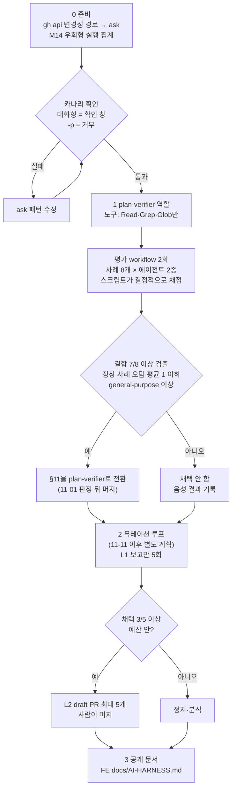

# AI 루프·멀티에이전트 도입 준비: 0·1단계 구현과 2·3단계 로드맵

> 제품을 정상 동작시키는 데는 필요 없다. 그래서 학습·포트폴리오용으로 결과를 잴 수 있는 실험만 한다.
> 순서는 이렇다. 0단계에서 승인 경계의 구멍부터 막는다. 1단계에서 읽기 전용 역할 에이전트를 만들고 그 품질을 잰다.
> 2단계 루프와 3단계 공개 문서는 별도 계획으로 진행한다.

## Context

### 왜 하나

- 2026-10-31 사용자가 4단계(루프: AI가 실행→검증→수정)와 5단계(그래프: 여러 AI가 역할을 나눠 협업) 도입 준비를 요청했다.
  이 프로젝트는 학습용이자 포트폴리오이고, 운영은 계속 정상 동작해야 한다.
- 같은 날 진단한 현재 상태: 1~3단계(프롬프트·컨텍스트·하네스)는 깊게 쓰고 있다. 4단계는 절반, 5단계는 임시로만 쓴다.

### 업계 동향 요약

원문 링크와 인용은 구현 때 claude-base `docs/RESEARCH.md` §9로 옮기고, 그때 원문을 다시 대조한다.

- **두 이름 모두 2026년 여름에 생긴 라벨이다. 가리키는 기법은 2024~25년부터 있었다.**
  - "loop engineering"은 2026-06 무렵 Steinberger·[Osmani](https://addyosmani.com/blog/loop-engineering/)·Cherny가 퍼뜨렸다.
    유일한 학술 분석([arXiv 2608.21884](https://arxiv.org/abs/2608.21884))은 루프를 쓰는 레포를 0.59%로 집계했다.
    그리고 _"주장된 이점에 대한 체계적 증거가 없다"_ (번역)고 썼다.
  - "graph engineering"은 2026-07 X에서 밈으로 시작했다.
    [Turing Post](https://www.turingpost.com/p/is-graph-engineering-real-why-everyone-is-talking-about-it)는 _"루프는 이미 그래프다"_ (번역)라고 반박했다.
- **멀티에이전트에 대한 업계 결론은 "쓰기는 하나, 나머지는 읽기·검증"으로 모였다.**
  [Cognition 2026](https://cognition.com/blog/multi-agents-working)은 이렇게 쓴다.
  _"쓰기는 한 줄기로 유지하고, 추가 에이전트는 행동이 아니라 지능을 보탤 때 가장 잘 동작한다"_ (번역).
- **루프 쪽 공식 권장은 상한과 사람 승인이다.** 출처는 [Claude Code best-practices](https://code.claude.com/docs/en/best-practices)다.
  > 무인 실행 전에, 완료가 무엇인지 알고, 자기 결과를 확인할 수 있고, 건드려야 할 것만 건드리게 하라.
  > 턴이나 비용에 상한을 주고, 마지막엔 사람이 결과를 승인하게 하라. (번역)
  >
  > — Anthropic, Claude Code Best practices

### 판정: 제품에는 필요 없고, 학습에는 가치가 있다

- **필요 없는 이유**
  - 지금 구조가 이미 업계가 모인 형태와 같다. 작성자는 메인 세션 하나이고, CI가 결정적으로 검증하고,
    §11은 맥락 없는 대조를 하고, 머지는 사람이 한다.
  - 코딩처럼 순서가 중요한 작업에서는 멀티에이전트가 손해다.
    [Google/MIT](https://arxiv.org/abs/2512.08296)는 순차 작업에서 −39~−70%로 쟀고,
    [CooperBench](https://arxiv.org/abs/2601.13295)는 협업 시 −30%로 쟀다.
  - 토큰 비용이 4~220배로 커진다([UIUC](https://arxiv.org/abs/2505.18286)).
  - 1인 개발에서는 사람의 리뷰가 병목이다. 루프가 PR을 늘리면 승인이 형식적인 도장 찍기로 바뀔 위험이 있다.
- **가치가 있는 이유**
  - 업계에 가장 부족한 것이 측정인데, 이 레포에는 측정 장치가 이미 있다.
    `token-metrics.mjs`, `rule-metrics.mjs`, claude-base `METRICS.md` 기준선이다.
  - 운영 위험을 거의 0으로 만들 수 있는 대상이 있다. 테스트만 추가하는 루프다.

### 이미 있는 루프 3개, 그리고 직접 확인한 구멍

지금 있는 루프는 세 개다.

- **사람이 있는 루프**: deploy-verify가 실패를 감지하면 세션을 깨운다.
- **L1 루프(보고만)**: 드리프트 cron이 이슈를 연다.
- **경로 한정 L3 루프**: `history.yml`이 `HISTORY.md` 한 파일만 main에 push한다.

| 구멍                                                | 확인 근거                                                                                                                                                                                                                             | 다루는 단계                |
| --------------------------------------------------- | ------------------------------------------------------------------------------------------------------------------------------------------------------------------------------------------------------------------------------------- | -------------------------- |
| `gh api …/merge`·`…/rulesets`가 확인 창 없이 실행됨 | FE `settings.local.json`이 `Bash(gh api *)`를 허용한다. ask 규칙은 `Bash(gh pr merge *)`뿐이다. bash-guard는 `if: Bash(git *)`·`Bash(rm *)`일 때만 돈다(`~/.claude/settings.json`). BE `settings.local.json:144`에도 같은 허용이 있다 | 0                          |
| 약속만 하고 구현하지 않은 측정                      | claude-base `METRICS.md:256-257`은 "확인 창을 피한 머지 실행 수를 센다"고 약속했다. 그런데 어느 스크립트에도 구현돼 있지 않다                                                                                                         | 0                          |
| 훅은 명령 문자열만 본다                             | 에이전트가 쓴 스크립트·테스트 안의 명령은 보지 못한다([#88462](https://github.com/anthropics/claude-code/issues/88462) 사례)                                                                                                          | 2(별도 클론·샌드박스)      |
| 원격 러너에서는 가드 훅이 0개다                     | 훅이 사용자 설정에 로컬 절대경로로 등록돼 있다                                                                                                                                                                                        | claude-base 5·6라운드 이후 |
| 훅마다 서브에이전트 적용 여부가 다르다              | test-guard에는 `agent_id` 검사가 없어 서브에이전트에도 적용된다. lang-guard·session-tips·turn-status는 서브에이전트를 건너뛴다                                                                                                        | 참고                       |

### 전체 흐름

## 판단이 필요했던 항목

| 항목               | 결정                                                                                                       | 근거·기각한 대안                                                                                                                                                                                                                                                                                          |
| ------------------ | ---------------------------------------------------------------------------------------------------------- | --------------------------------------------------------------------------------------------------------------------------------------------------------------------------------------------------------------------------------------------------------------------------------------------------------- |
| 이번 구현 범위     | 로드맵 + 0·1단계 구현                                                                                      | 사용자 선택(10-31). "0단계만", "조사 문서만"은 기각                                                                                                                                                                                                                                                       |
| 구멍을 막는 수단   | 사용자 설정 `permissions.ask`                                                                              | bash-guard는 git·rm일 때만 돌아서 gh를 보지 못한다. 등록 조건을 넓히면 모든 Bash 호출마다 node가 뜬다. deny는 사용자 선택에서 기각                                                                                                                                                                        |
| ask 범위           | 변경성 경로만(merge·rulesets·protection·graphql·`gh repo edit`)                                            | 사용자 선택. `gh api` 전체에 걸면 배포 감시 같은 조회에도 창이 떠 번거롭다                                                                                                                                                                                                                                |
| 그래프 첫 실험     | plan-verifier 역할 + 평가 workflow                                                                         | 이미 매 PR마다 쓰는 절차(§11)를 옮기는 것이라 범위가 가장 작다. 문서 감사 workflow를 먼저 하는 안은 비용(에이전트 9개)이 크고, #427과 비교하면 그 사이 문서가 바뀌어 공정하지 않다. 그래서 다음 감사 때로 미룬다. 4라운드 리뷰어를 앞당기는 안은 로드맵 순서(5→6→4)와 6라운드 전후 측정을 흐트러뜨려 기각 |
| plan-verifier 도구 | `Read, Grep, Glob`만 주고 Bash는 주지 않는다                                                               | 읽기 전용을 가드가 아니라 구조로 보장한다. diff는 메인 세션이 스크래치패드 파일로 떨궈 경로를 넘긴다                                                                                                                                                                                                      |
| plan-verifier 모델 | `inherit`                                                                                                  | claude-base DECISIONS가 "서브에이전트를 모두 sonnet으로"를 기각했다                                                                                                                                                                                                                                       |
| 평가 규모          | 사례 8개(정상 4 + 결함 4, 결함 사례마다 결함 2개 = 결함 8개) × 2종. 에이전트 8개짜리 workflow를 2회 돌린다 | 이 세션의 workflow 크기 가이드가 에이전트 10개 미만이다                                                                                                                                                                                                                                                   |
| 2단계 루프 대상    | 뮤테이션 생존자 → 테스트 추가                                                                              | 사용자 선택. OpenAPI 드리프트는 이슈 5건이 0~7일 만에 닫혔고(#163·#255·#306·#331·#423), 기계적인 부분은 스크립트로 충분하다. CI 자동 수정은 새 키가 필요하고 원격이라 가드가 없으며, deploy-verify의 세션 깨우기와 겹친다                                                                                 |
| 2단계 러너         | 로컬 headless 래퍼(별도 클론)                                                                              | `/loop`는 세션에 묶이고 7일이면 만료되며 측정을 오염시킨다. 클라우드 예약 작업·GitHub Actions에는 가드가 없고 키가 필요하다                                                                                                                                                                               |
| L3(무인 머지)      | 계획하지 않음                                                                                              | 공식 문서·Stripe·Osmani 모두 사람 머지를 남기라고 한다                                                                                                                                                                                                                                                    |
| 결과 문서 위치     | 원자료는 claude-base, 결과는 FE 공개 문서(3단계)                                                           | claude-base는 로컬 전용이라 포트폴리오로 보이지 않는다                                                                                                                                                                                                                                                    |

### 위험 관리

| 위험                                             | 대응                                                                                    |
| ------------------------------------------------ | --------------------------------------------------------------------------------------- |
| ask 패턴이 정당한 조회까지 막음                  | 주 3회를 넘게 잘못 걸리면 패턴을 좁힌다                                                 |
| 문자열 매칭이 새는 형태(따옴표·변수로 경로 조립) | M14 집계로 사후에 감시한다. 한계는 DECISIONS에 적어 둔다                                |
| 평가 사례가 쉬워 변별력이 없음                   | 결함 2종(hunk 제거·무관한 hunk 삽입)을 고정 시드로 주입하고, general-purpose와 비교한다 |
| 평가 실행이 6라운드 토큰 측정을 오염             | plan-verifier는 서브에이전트 유형 행으로 따로 잡히고, 실행일을 METRICS에 기록한다       |
| CLAUDE.md §11 변경이 11-01 토큰 판정 구간과 겹침 | 판정 뒤에 머지한다. 판정이 연장되면 11-07 이후에 머지한다                               |

## 세부 계획

### Phase 0: 승인 경계 막기와 측정

| 위치                                                     | 변경 내용                                                                                                                                                                                                                       |
| -------------------------------------------------------- | ------------------------------------------------------------------------------------------------------------------------------------------------------------------------------------------------------------------------------- |
| `~/.claude/settings.json` `permissions.ask`              | `Bash(gh api *pulls/*/merge*)`, `Bash(gh api *rulesets*)`, `Bash(gh api *protection*)`, `Bash(gh api graphql*)`, `Bash(gh repo edit *)`를 추가한다. 사용자 설정이라 PR이 없다. 하네스가 막으면 JSON을 보여 주고 사용자가 붙인다 |
| FE `.claude/scripts/rule-metrics.mjs`                    | M14 "승인 우회형 실행"을 추가한다. `resolveSegments`(`.claude/lib/shell-parse.mjs:380`)로 위 형태의 `gh api`, `gh repo edit`, `git -C … push … main`의 실행 수와 거부 수를 센다. `recordGitAndRm`(`:339`) 형태를 따른다         |
| FE `.claude/hooks/rule-metrics.test.mjs` (신규)          | M14 분류 함수를 테스트한다. scripts의 테스트를 hooks 폴더에 두는 선례(`deploy-verify.test.mjs`)를 따른다. CI glob(`ci.yml:84`)이 자동으로 포함한다                                                                              |
| claude-base `docs/DECISIONS.md`                          | 머지 승인 경계를 gh api 변경성 경로까지 넓힌 결정과 문자열 매칭의 한계를 적는다                                                                                                                                                 |
| claude-base `docs/METRICS.md`                            | `:256-257`의 약속이 M14로 구현됐다고 표시하고 기준값을 적는다                                                                                                                                                                   |
| claude-base `docs/RESEARCH.md` §9 (신규 절)              | 루프·멀티에이전트 동향을 정리한다. WebFetch 요약을 거친 인용은 원문과 다시 대조한 뒤 번역 인용으로 싣는다                                                                                                                       |
| FE `docs/plans/<날짜>-ai-loop-graph-readiness.md` (신규) | 이 계획의 스냅샷. PR-A에 커밋한다                                                                                                                                                                                               |

### Phase 1: plan-verifier 역할과 평가

| 위치                                                | 변경 내용                                                                                                                                                                                                                                                                                                                                                |
| --------------------------------------------------- | -------------------------------------------------------------------------------------------------------------------------------------------------------------------------------------------------------------------------------------------------------------------------------------------------------------------------------------------------------- |
| FE `.claude/agents/plan-verifier.md` (신규)         | frontmatter는 `name`, `description`, `tools: Read, Grep, Glob`, `model: inherit`. 본문에는 §11 대조 규칙과 출력 표 형식을 둔다. 대조 규칙은 계획 항목마다 구현됨(파일:줄)·이탈(이유)·미구현으로 판정하고, 계획에 없던 변경을 표시하며, 포맷·린트 조정은 이탈로 치지 않는 것이다. 선례는 공식 best-practices의 `reviewer.md` 예시와 §11의 현행 프롬프트다 |
| FE `.claude/scripts/plan-eval-cases.mjs` (신규)     | PR 번호 목록을 받아 `gh pr diff`로 원본 diff를 가져온다. 그리고 결함을 주입한 diff(hunk 제거·다른 PR의 hunk 삽입)와 정답 키 JSON을 스크래치패드에 만든다. 시드를 고정해 재현할 수 있게 한다                                                                                                                                                              |
| FE `.claude/hooks/plan-eval-cases.test.mjs` (신규)  | 주입 함수를 테스트한다                                                                                                                                                                                                                                                                                                                                   |
| FE `.claude/workflows/plan-verifier-eval.js` (신규) | 입력 `args`는 사례 목록과 `agentType`이다. `pipeline`으로 사례마다 에이전트 1개를 띄워 `schema`로 구조화 출력을 받는다. 스크립트 안에서 정답 키와 결정적으로 채점해 검출 수와 오탐 수를 돌려준다                                                                                                                                                         |
| 실행(커밋 없음)                                     | 같은 사례 8개를 `plan-verifier`와 `general-purpose`로 각각 1회씩 돌린다. 실행하기 전에 사용자에게 "워크플로 실행" 동의를 받는다                                                                                                                                                                                                                          |
| claude-base `docs/METRICS.md`                       | 결과를 기록한다. 검출 수, 오탐 수, `token-metrics.mjs`로 잰 비용, 실행일이다                                                                                                                                                                                                                                                                             |
| FE `.claude/CLAUDE.md` §11 (조건부)                 | 성공 기준을 충족하면 "fresh subagent(general-purpose …)"를 "`plan-verifier` 에이전트(실패하면 general-purpose)"로 바꾼다. 충족하지 못하면 에이전트 파일은 PR에서 빼고 음성 결과만 기록한다                                                                                                                                                               |

**PR 나누기**

- **PR-A (FE)**: Phase 0의 M14와 테스트, 이 계획 파일.
- **PR-B (FE)**: Phase 1의 에이전트, 평가 스크립트와 테스트, workflow, 그리고 조건부 §11 변경. §11을 바꾸는 경우 11-01 판정 뒤에 머지한다.
- **claude-base**: 로컬 커밋. 단계마다 한 번씩.

### Phase 2: 뮤테이션 루프 (로드맵, 11-11 이후 별도 계획)

- **래퍼**: FE `.claude/scripts/mutation-loop.mjs`를 별도 클론(`~/project/loop-lab/fe`)에서 수동으로 실행한다.
  - 경로가 달라서 `token-metrics`·`rule-metrics`의 기본 집계에서 자연히 빠진다.
- **에이전트 실행 조건**
  - `claude -p`로 실행하고 턴·예산 상한을 둔다.
  - 루프 전용 설정을 쓴다. 허용 도구 목록을 두고, git과 gh는 빼고, 샌드박스로 네트워크를 차단한다.
- **래퍼가 하는 검증**
  - 바뀐 경로가 테스트 파일뿐인지 확인한다.
  - 단언 감소가 0인지 확인한다. claude-base `lib/test-patterns.mjs`를 재사용한다.
  - 대상 파일 하나에만 Stryker를 최대 3회 돌린다.
  - 테스트를 10회 반복 실행해 모두 통과하는지 본다.
- **멈추고 보고하는 경우**: 출력이 `suspected-bug`(현재 동작이 틀려 보임)나 `equivalent`(살아남아도 의미가 같은 뮤턴트)로 분류되면 멈추고 보고한다.
- **승격 기준(우리가 정한 값)**
  - L1(보고만) 5회: 3회 이상이 "그대로 또는 20% 이하 수정으로 머지 가능"이면 L2로 간다.
  - L2(draft PR) 최대 5개, 동시에 열어 두는 것은 2개 이하: 3개 이상 머지되고 7일 안에 되돌리기가 0건이면 유지한다.
  - 정지 조건: "구현 고정·버그 고정"으로 닫힌 PR이 2개 연속 나오거나 예산을 2배 넘기면 멈춘다.
- **DECISIONS에 남길 결정**: 테스트만 바뀌는 diff에 한해, 루프 명세(프롬프트·설정·대상 범위)를 한 번 승인하는 것으로 작업별 계획 승인을 대신한다.
  이것은 claude-base 1라운드 "계획·머지 두 곳 승인" 결정과 맞추기 위한 것이다.
- **알아둘 점**: 테스트만 바꾼 PR을 머지해도 `deploy.yml`의 `src/**` 경로 필터 때문에 재배포가 돈다. 같은 번들이 다시 올라가므로 위험은 낮다.

### Phase 3: 공개 문서 (로드맵)

- FE에 `docs/AI-HARNESS.md`를 독립 기능 문서 형식으로 새로 쓰고, `README.md` 문서 목록에 등록한다.
- 다이어그램 3장을 넣는다: 업계가 모인 형태, 지금 구조, 개선한 구조.
- 수치는 claude-base METRICS 원자료에서 최종값만 옮긴다.

## 영향 범위 (§5)

- **데이터 CRUD**: 앱 데이터·API·스키마는 바뀌지 않는다. 바뀌는 곳이 `.claude/`와 `docs/`뿐이라 운영 배포가 트리거되지 않는 것으로 본다. `deploy.yml` 경로 필터는 구현할 때 다시 확인한다.
- **기존 기능 회귀**
  - 사용자 설정의 ask 규칙은 모든 프로젝트 세션에 적용된다. 해당 형태의 `gh api` 조회에도 확인 창이 뜬다.
    훅 내부의 `gh api`(`verify-deploy.mjs:100`)는 Claude 권한 규칙의 대상이 아니다.
  - BE `settings.local.json:144`의 `Bash(gh api *)` 허용보다 사용자 ask가 우선하는지는 카나리로 확인한다.
  - `rule-metrics` 출력 표에 M14 행이 하나 늘어난다. 기존 행은 그대로다.
  - §11을 바꾸면 BE §8과 문구가 하나 더 어긋난다. 이 어긋남은 claude-base 5라운드 정리 대상에 등록한다.
  - CLAUDE.md·docs를 고치므로 `pnpm check:docs`를 돌린다. docs/plans 불변성 CI도 지나야 한다.
- **여러 곳에서 import하는 파일**: 수정하지 않는다. `rule-metrics.mjs`는 CLI 단독 스크립트다.

## 검증 방법

**Phase 0**

1. 대화형 세션에서 카나리를 실행해 확인 창이 뜨는지 본다. 거부해도 무해하다.
   - `gh api repos/BAECHAN/link-sphere_FE_NEW/rulesets` (GET)
   - `gh api repos/BAECHAN/link-sphere_FE_NEW/pulls/1/merge` (GET, 머지 여부 조회)
2. `claude -p`로 같은 명령을 실행해 거부되는지 본다.
3. 오탐이 없는지 본다. `gh api …/actions/runs`, `gh pr view` 같은 명령은 확인 창 없이 실행돼야 한다.
4. `node --test .claude/hooks/*.test.mjs`가 통과하는지 본다.
   `node .claude/scripts/rule-metrics.mjs --since 2026-10-14` 출력에 M14 행이 있는지 본다.
5. 14일 동안 M14 실행 수가 0인지 본다. 판정일은 claude-base METRICS에 기록한다.

**Phase 1**

1. `plan-eval-cases` 테스트가 통과하는지 본다.
2. 평가 workflow를 2회 실행해 채점표를 만든다.
3. 성공 기준(우리가 정한 값): 결함 8개 중 7개 이상을 검출하고, 정상 사례의 오탐이 평균 1개 이하이며, general-purpose보다 검출 수가 적지 않아야 한다.
4. 실행일의 서브에이전트 비용을 `token-metrics.mjs`로 잰다.
5. 이 PR들의 §11 대조는 기존 방식인 general-purpose로 한다. 새 에이전트가 자기 도입 PR을 채점하지 않게 하기 위해서다.

**공통**

- 작업은 워크트리에서 한다. 워크트리를 만들기 전에 `git log origin/main..main`을 확인한다.
- PR CI가 green이어야 한다. 머지 뒤 배포 워크플로가 돌지 않았는지(또는 성공했는지) 확인한다.

## 남은 것

- **구현하면서 확인할 미확인 항목**
  - Bash 권한 패턴의 `*`가 `/`를 넘어서 매칭되는지
  - 로컬 allow보다 사용자 ask가 우선하는지
  - `-p` 모드에서 ask가 거부로 바뀌는지
  - custom agent가 CLAUDE.md를 로드하는지(비용에 영향을 준다)
  - Workflow 에이전트의 기록이 어디에 남는지
- **따로 진행할 것**
  - 2단계 별도 계획(11-11 이후)
  - 문서 감사 workflow(다음 감사 때)
  - 3단계 공개 문서
- **미루는 것**
  - 원격 러너(GitHub Actions·클라우드 예약 작업): claude-base 5·6라운드 뒤
  - BE §8을 FE와 맞추기: claude-base 5라운드
