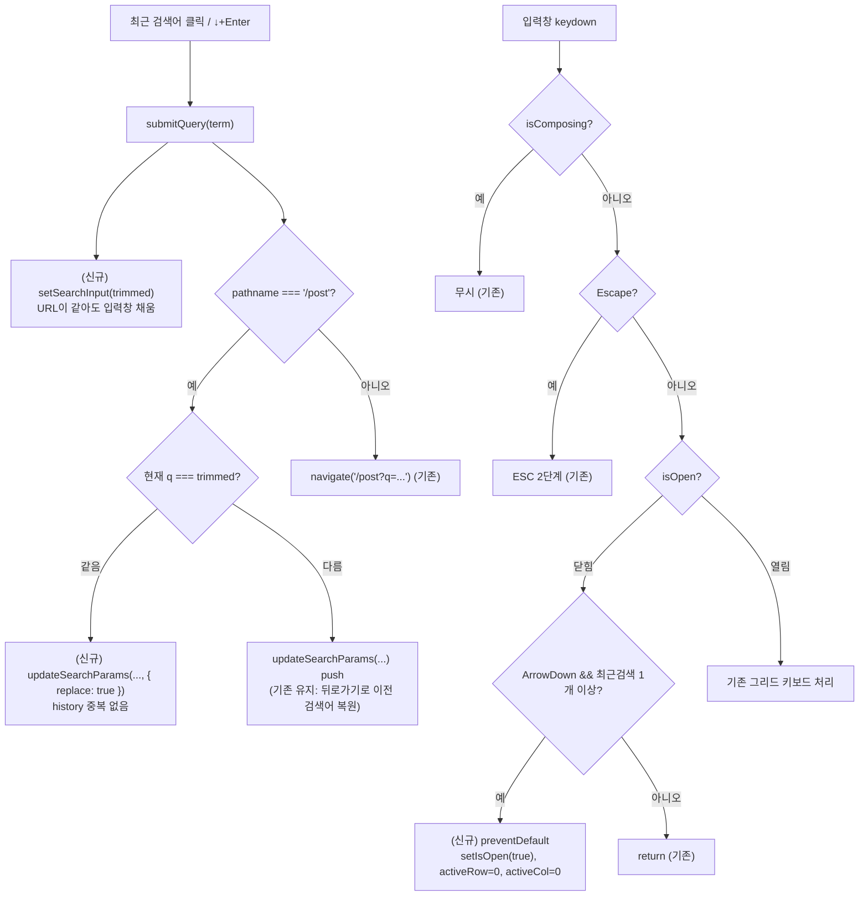

# 헤더 검색: 같은 최근 검색어 재선택 시 입력창 채우기 + 닫힌 목록을 ↓로 열기

> 데스크톱 헤더 검색(`NavbarSearch`)에서 ① 지운 뒤 같은 최근 검색어를 다시 골라도 무반응이던 문제를
> 고치고(입력창 채움 + 같은 주소면 replace), ② 목록이 닫혀 있어도 ↓로 열고 첫 검색어를 활성화한다.

## Context

사용자 제보 두 가지(2026-11-01):

1. 최근 검색어로 검색 → 검색창을 백스페이스로 지움 → 다시 열린 최근 검색어 목록에서 **같은 검색어**를
   누르면 아무 반응이 없다. 검색창을 다시 채워야 하지 않나?
2. 최근 검색어 목록이 안 보이는 상태에서도 ↓를 누르면 열리게 하고 싶다(업계 표준 확인 요청).

### 근본 원인 (1번, 코드 추적)

- 행 클릭·↓+Enter 모두 `submitQuery(term)`(`src/widgets/layout/navbar/ui/NavbarSearch.tsx:53-80`)로 간다.
  이 함수는 URL `q`만 갱신하고 **`setSearchInput`을 호출하지 않는다.**
- 입력창은 URL `q`가 **바뀔 때만** 따라 채워진다(`src/widgets/layout/navbar/hooks/useNavbarSearch.ts:27-30`).
- 타이핑·백스페이스는 URL을 바꾸지 않는 설계라(`docs/SEARCH.md` §1 "거울"), 지운 뒤에는 입력 `''` / URL
  `q=리액트`로 어긋난다. 이 상태에서 같은 `리액트`를 고르면 URL이 그대로 → 미러 미발동 → 입력창은 빈 채,
  드롭다운만 닫힌다.
- 부수 문제: `@remix-run/router` 1.23.2(`dist/router.js:1839-1849`)는 `replace`가 없으면 같은 URL이어도
  Push한다 → 같은 주소의 history 항목이 하나 더 쌓여 뒤로가기를 두 번 눌러야 한다.

### 재현 절차

1. `/post`에서 최근 검색어 `리액트` 클릭 → `/post?q=리액트`
2. 입력창을 백스페이스로 비움 → 드롭다운 다시 열림
3. `리액트` 다시 클릭 → 입력창 빈 채 유지, 드롭다운 닫힘, 뒤로가기 시 같은 `/post?q=리액트`에 한 번 더 머묾

### 2번 현재 동작

닫힌 상태의 ↓는 `NavbarSearch.tsx:168-170`(`if (!isOpen) { return; }`)에서 바로 끝난다. 이미 포커스된
입력창은 클릭해도 `onFocus`가 다시 안 불려, 다시 열 방법이 "다 지우기"나 "blur 후 재포커스"뿐이다.

## 판단이 필요했던 항목

| 항목                         | 결정                                               | 근거·기각한 대안                                                                                                                                                                                                                                                                                                                                                                                                                                                                                                                              |
| ---------------------------- | -------------------------------------------------- | --------------------------------------------------------------------------------------------------------------------------------------------------------------------------------------------------------------------------------------------------------------------------------------------------------------------------------------------------------------------------------------------------------------------------------------------------------------------------------------------------------------------------------------------- |
| 같은 검색어 재선택 시 입력창 | `submitQuery`에서 직접 `setSearchInput(trimmed)`   | [WAI-ARIA APG Combobox](https://www.w3.org/WAI/ARIA/apg/patterns/combobox/)는 Enter를 _"팝업을 닫고, 확정한 값을 콤보박스에 넣어 포커스된 옵션을 확정한다"_ (번역)로 정의. [Baymard(2024-08-27)](https://baymard.com/blog/copy-search-suggestion-to-search-field)는 제안을 검색창에 복사해야 한다고 함(화살표 이동 중 복사를 다룬 글이라 이 케이스와 정확히 같지는 않음). 사용자 승인(2026-11-01)                                                                                                                                             |
| 같은 주소 재제출 시 history  | `/post` 분기에서 현재 `q`와 같으면 `replace: true` | react-router-dom 6.30.3 `<Link>`가 같은 URL이면 자동 replace — 소스 주석 _"URL이 바뀌지 않았으면 일반 `<a>`는 push 대신 replace를 하므로, 여기서도 똑같이 한다"_ (번역, `dist/index.js:1010-1012`). 다른 검색어는 push 유지 — `docs/SEARCH.md` §11의 "뒤로가기로 이전 검색어 복원" 결정은 같은 주소 중복 칸에선 이점이 없어 충돌 없음. 기각: 입력창만 채우기(중복 기록 잔존). 사용자 승인(2026-11-01)                                                                                                                                         |
| 닫힌 상태 ↓                  | 열면서 첫 검색어 활성화(`activeRow=0`)             | APG 패턴: ↓ _"팝업이 있으면 포커스를 팝업 안으로 옮긴다"_ (번역). [APG 목록 자동완성 예제](https://www.w3.org/WAI/ARIA/apg/patterns/combobox/examples/combobox-autocomplete-list/): _"입력이 비어 있고 목록이 안 보이면, 목록을 열고 첫 옵션으로 시각적 포커스를 옮긴다"_ (번역). React Aria `useComboBox`(main, `packages/react-aria/src/combobox/useComboBox.ts`) ArrowDown → `state.open('first', 'manual')`. 열린 상태의 첫 ↓도 이미 첫 검색어로 가므로 "↓ 한 번 = 첫 검색어"로 일관. 기각: 열기만(↓ 두 번 필요). 사용자 승인(2026-11-01) |
| ↓ 열림 조건                  | 입력값 무관, 최근 검색어 1개 이상                  | `handleFocus`(`NavbarSearch.tsx:107-113`)와 같은 조건 — 포커스 시 입력값 무관하게 여는 기존 결정(`docs/DECISIONS.md` 2026-09-21, Algolia `openOnFocus`)                                                                                                                                                                                                                                                                                                                                                                                       |
| 닫힌 상태 ↑                  | 넣지 않음                                          | React Aria는 `open('last')`지만 우리 구조에서 ↑ 방향 끝은 "모두 지우기"라 Enter 한 번에 전체 삭제 위험. 요청 범위 밖                                                                                                                                                                                                                                                                                                                                                                                                                          |
| DECISIONS.md 항목            | 만들지 않음                                        | 되돌리기 쉬운 변경 — 근거는 기능 문서 `docs/SEARCH.md`에 남긴다(CLAUDE.md §8)                                                                                                                                                                                                                                                                                                                                                                                                                                                                 |

## 세부 계획

| 위치                                                                              | 변경 내용                                                                                                                                                                                                                                                                                                                                                                                                                                                                                               |
| --------------------------------------------------------------------------------- | ------------------------------------------------------------------------------------------------------------------------------------------------------------------------------------------------------------------------------------------------------------------------------------------------------------------------------------------------------------------------------------------------------------------------------------------------------------------------------------------------------- |
| `src/widgets/layout/navbar/ui/NavbarSearch.tsx:36`                                | `useSearchParamsDraft()`에서 `searchParams`도 꺼낸다(훅 시그니처 변경 없음 — 이미 반환 중)                                                                                                                                                                                                                                                                                                                                                                                                              |
| `NavbarSearch.tsx:53-80` `submitQuery`                                            | `setSearchInput(trimmed)` 추가(주석: URL이 같으면 미러가 안 움직여 직접 채운다). `/post` 분기에서 `const isSameQuery = (searchParams.get('q') ?? '') === trimmed;` → `updateSearchParams(updater, { replace: isSameQuery })`, 주석에 react-router `<Link>` 선례                                                                                                                                                                                                                                         |
| `NavbarSearch.tsx:168-170` `handleKeyDown`                                        | `if (!isOpen)` 블록 안에서 `ArrowDown` && `recentSearches.length > 0`이면 `preventDefault` + `setIsOpen(true)` + `setActiveRow(0)` + `setActiveCol(0)` 후 return. 빈 줄·중괄호 컨벤션 준수                                                                                                                                                                                                                                                                                                              |
| `src/widgets/layout/navbar/ui/NavbarSearch.test.tsx` "최근검색 드롭다운" describe | 신규 케이스 4개: ① `['/post', '/post?q=리액트']`에서 지우고 같은 검색어 클릭 → 입력값 `리액트`·grid 닫힘 ② 같은 셋업에서 클릭 후 `test-back` → `location-search`가 빈 값(중복 기록 없음) ③ 클릭→ESC로 닫은 뒤 ↓ → grid 표시, `aria-expanded=true`, `aria-activedescendant=navbar-recent-search-cell-0-0`, 이어서 Enter로 검색 ④ 최근검색 0개에서 ↓ → grid 없음                                                                                                                                          |
| `docs/SEARCH.md`                                                                  | 마지막 검토 날짜 갱신. §1 거울 설명에 "행 선택은 입력창도 직접 채운다" 한 줄 + mermaid에 "닫힌 상태 ↓ → 첫 검색어 활성" 경로. 드롭다운 키보드 설계 절에 ↓ 열기 근거(APG·React Aria 인용, 번역). §8 코드 지도 줄 번호 갱신. §10 시행착오에 "같은 검색어 재선택 무반응 + 중복 기록" 원인·수정. §11의 push 항목에 "같은 주소는 replace" 반영 + 발견만 하고 안 고친 것 3건(마지막 항목 마우스 삭제 시 `aria-expanded=true` 잔존, `RecentSearchDropdown.tsx:51-52` 주석 불일치, `aria-haspopup="grid"` 누락) |
| `CHANGELOG.md` `[Unreleased]`                                                     | Fixed 1건(같은 최근 검색어 재선택 시 검색창이 비던 문제·기록 중복) + Changed 1건(닫힌 목록도 ↓로 열기). `changelog-release` skill 먼저 읽기                                                                                                                                                                                                                                                                                                                                                             |
| `docs/plans/2026-11-01-navbar-recent-search-reselect-arrowdown.md` (신규)         | 이 계획 스냅샷(CLAUDE.md §11)                                                                                                                                                                                                                                                                                                                                                                                                                                                                           |

작업 환경: `git log origin/main..main` 확인 → `EnterWorktree` → `cp ../../../.env .` + `pnpm install`, `node -v`가 v24인지 확인.

## 영향 범위

**CRUD**

- 최근 검색어(localStorage) 등록: `onAddRecentSearch(trimmed)` 호출은 그대로(중복 제거 후 맨 앞 이동) — 변화 없음. 읽기·삭제 경로 미변경.
- URL `q`: 다른 값은 기존처럼 push, 같은 값만 replace로 바뀜. 정지 구간(`useSearchParamsDraft` pending) 중 다른 파라미터가 pending이면서 `q`가 같은 극단적 경우 그 pending 변경이 replace로 합쳐질 수 있음 — 실사용에서 거의 불가능, 감수.

**기존 기능 회귀**

- `NavbarSearch.test.tsx`의 기존 케이스(행 클릭 274, ↓+Enter 313, ESC 1·2단계 244/258, ↑ "모두 지우기" 328) — 모두 열린 상태에서 시작하거나 다른 검색어라 동작 불변 예상. 전부 재실행으로 확인.
- 다른 검색어 제출 후 뒤로가기로 이전 검색어 복원(`docs/SEARCH.md` §11) — push 유지라 불변.
- `/` 단축키(포커스+전체선택) → `onFocus`로 열림 — 불변.
- 모바일(`MobileNavbarSearch`·`useMobileSearchPanel`)·`useNavbarSearch`·`useSearchParamsDraft`(공용 훅)는 수정하지 않음. `NavbarSearch`의 사용처는 `Navbar.tsx` 하나 — 구현 전 `pnpm graph:focus "src/widgets/layout/navbar/ui/NavbarSearch.tsx" --text`로 확인.
- 스크롤: push·replace 모두 새 `location.key`를 받아 같은 검색어 재선택 시 스크롤 동작은 지금과 같을 것으로 추정 — 브라우저로 확인.
- 데이터 계약(API·DTO) 변경 없음.

## 검증 방법

1. `pnpm type-check` → `pnpm test`(NavbarSearch 신규 4개 + 기존 전부) → `pnpm lint` → `pnpm check:docs`
2. 신규 테스트가 수정 전 코드에서 실패하는지 먼저 확인(①②③ 실패, ④ 통과)한 뒤 구현
3. `browser-verification` skill 절차로 `pnpm dev` 녹화: 재현 절차 1~3 후 입력창 채워짐·뒤로가기 한 번에 이전 페이지, 클릭→ESC로 닫은 뒤 ↓ → 첫 검색어 활성 → Enter 검색, 같은 검색어 재선택 시 스크롤 위치 확인. 이 세션은 Playwright MCP 연결이 실패한 상태라, 재연결이 안 되면 Claude in Chrome(gif_creator)으로 대신 녹화
4. PR 전 fresh general-purpose subagent에 이 계획 파일과 diff를 주고 대조 → PR 본문 `## 계획 대비 구현`
5. squash 병합 후 `gh run list --branch main --workflow "Frontend Deploy (S3 + CloudFront)"`로 해당 SHA success 확인 → 워크트리 정리

## 남은 것

- 위 "발견만 하고 안 고친 것" 3건은 `docs/SEARCH.md` §11에 기록만 하고 별도 작업으로 둔다.
