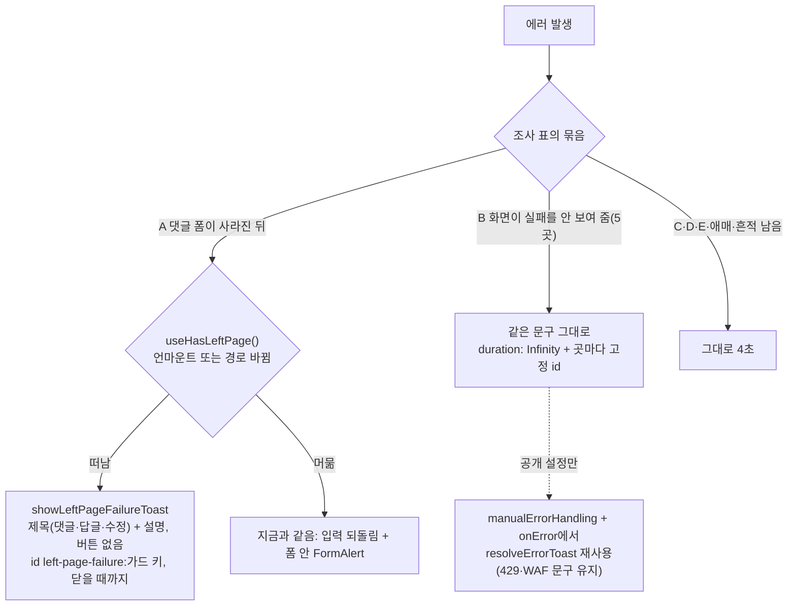

# #488 에러 토스트: 화면에 흔적이 남는가 조사 후 유지 시간 결정

## Context

#487은 요청 중 "나가기"로 떠난 뒤 실패한 경우(가입·게시글 등록·수정)만 닫을 때까지 남는 토스트로 바꿨다. 나머지 에러
토스트는 sonner 2.0.7 기본값 4초(`node_modules/sonner/dist/index.mjs:417`) 뒤 사라진다. #488은 곳마다 "토스트가
사라진 뒤 화면에 실패 흔적이 남는가"를 조사해, 흔적이 없는 곳만 유지 시간·버튼을 정한다. 판단 기준은 #487과 같다 —
WCAG 2.2.1 이해 문서는 다른 방법으로 그 정보를 얻을 수 있으면 사라지는 알림이 괜찮다고 본다(`docs/UNSAVED-CHANGES-GUARD.md`
§5에서 재인용).

이 단계(할 일 1)는 조사 표를 만들고, 사용자가 바꿀 곳과 방식을 고른다. 고른 뒤 이 파일에 구현 계획을 이어 쓴다.

## 조사 표 (2026-11-02, main 4d99d07c)

조사: Explore 3개(인증·계정 / 북마크·댓글·카드 / 전역 핸들러 mutation·query) + 주요 주장 직접 확인
(재설정 재발송 화면, 인증 메일 재발송, 첨부 검증, 댓글 폼 사라진 분기, mutation 27개 중 전역 3개, 다음 페이지 effect,
북마크 빈 목록, hover 미리 받기).

### 1. 흔적 없음 — 토스트가 유일 (바꿀 후보)

| 묶음             | 호출 위치                                                  | 어떤 실패                                               | 토스트가 사라진 뒤 화면                                        |
| ---------------- | ---------------------------------------------------------- | ------------------------------------------------------- | -------------------------------------------------------------- |
| A 폼이 사라진 뒤 | `useCreateComment.ts:166`                                  | 댓글·답글 등록 중 답글 취소·모바일 바 접기·이동 후 실패 | 제출 때 폼을 비워 입력이 사라짐. 낙관적 댓글도 롤백으로 사라짐 |
| A                | `useUpdateComment.ts:167`                                  | 수정 저장 중 취소·이동 후 실패                          | 댓글은 옛 내용, 고친 내용은 사라짐                             |
| B 서버 요청      | `auth.queries.ts:152`(재설정 [다시 보내기])                | 429·500·네트워크                                        | "메일함을 확인해주세요" 성공 화면 그대로                       |
| B                | `auth.queries.ts:237`(인증 메일 다시 보내기)               | 429·500·네트워크                                        | 배너·버튼이 누르기 전과 같음                                   |
| B                | `usePostCardBookmarkFolderDialog.ts:74`(북마크 [되돌리기]) | 복원 실패                                               | 되돌리기 전과 같은 화면, 다시 누를 버튼 없음                   |
| B                | `bookmark-folder.queries.ts:281`(폴더 고정·해제)           | 서버 실패                                               | 행이 옮겨 갔다 롤백(화면 밖일 수 있음)                         |
| B                | `post.queries.ts:436` 전역(공개 설정)                      | 서버 실패                                               | 🔒 그대로(요청 전과 같음)                                      |
| C 클립보드       | `usePostCard.ts:119`·`:130`                                | 링크 복사·공유 실패                                     | 바뀌는 것 없음, 붙여 넣을 때 앎                                |
| D 동기 검증      | `useUpdateAccount.ts:69`·`:78`                             | 아바타 형식·용량                                        | 파일 선택 취소와 구분 안 됨                                    |
| D                | `useImageAttachments.ts:128`                               | 첨부 형식·용량                                          | 걸린 파일이 안 들어감. 기존 FormAlert도 지움                   |
| D                | `useCreateComment.ts:206`(b)·`useUpdateComment.ts:140`(b)  | 전송량 7,500B 초과                                      | 입력 그대로, 칸 아래 안내 없음(6,000B만 봄)                    |
| E 조회           | 전역 query — 다음 페이지·재조회                            | 서버 실패                                               | 이전 목록 그대로                                               |
| E                | 전역 query — hover·라우트 미리 받기                        | 서버 실패                                               | 아직 그 화면이 아님                                            |
| E                | 전역 query — 북마크 폴더별 글·폴더 목록·카테고리           | 서버 실패                                               | 빈 목록("북마크가 없어요")으로 보임                            |

### 2. 애매 — 원상태로 돌아가거나 변화가 없음

| 호출 위치                                                     | 실패                           | 화면                                                              |
| ------------------------------------------------------------- | ------------------------------ | ----------------------------------------------------------------- |
| `usePostCardBookmarkFolderDialog.ts:126`·`:164`·`:166`·`:196` | 폴더 선택 창 서버 실패         | 창은 열린 채 체크가 롤백. 기다리는 중 창을 닫았으면 토스트가 유일 |
| `useRenameBookmarkFolder.ts:59`                               | 이름 바꾸기 실패               | 입력창은 열렸지만 값이 원래 이름으로 덮임                         |
| `useFolderActions.ts:80`                                      | 폴더 삭제 실패                 | 확인창 먼저 닫힘, 낙관적 삭제 없음 → 누르기 전과 같음             |
| `post.queries.ts:321` 전역                                    | 게시글 삭제 실패               | 카드가 사라졌다 돌아옴. 상세는 이동 안 함                         |
| `comment.queries.ts:250` 전역                                 | 댓글 삭제 실패                 | 댓글 그대로                                                       |
| `useCreateComment.ts:197`                                     | 이메일 미인증                  | 입력 남음, 이유는 토스트에만                                      |
| `auth.queries.ts:171`                                         | 재설정 링크 만료               | 폼이 남아 재시도를 권하지만 계속 실패                             |
| `auth.queries.ts:212`·`account.queries.ts:163`                | 데모 계정 권한 없음            | 입력 남음, 재시도해도 실패                                        |
| `account.queries.ts:135`                                      | 프로필 이미지만 바꾼 저장 실패 | 폼은 새 사진, 네비바만 옛 사진                                    |
| `useSignUp.ts:167`                                            | 중복으로 실패(머문 채)         | 칸 아래 "사용 가능"(초록)이 남음                                  |
| `useImageAttachments.ts:132`·`:155`                           | 첨부 개수 초과                 | 5/5·비활성 버튼은 남음, 버려진 수는 없음                          |
| 전역 query — 사용자 정보·수정 화면 게시글                     | 서버 실패                      | 간접 증상(기본 아바타, 빈 수정 폼)                                |

### 3. 흔적 남음

| 호출 위치                                                                                                                            | 남는 것                                    |
| ------------------------------------------------------------------------------------------------------------------------------------ | ------------------------------------------ |
| `auth.queries.ts:78`·`:80`·`:86`(로그인)                                                                                             | 입력·버튼·비로그인 상태(원인은 토스트에만) |
| `auth.queries.ts:152`(첫 제출)·`:173`·`:176`·`:208`·`:214`, `account.queries.ts:135`(닉네임)·`:160`·`:165`, `useSignUp.ts:167`(일반) | 입력이 남고 버튼이 다시 눌림               |
| `useBookmarkFolderSelect.ts:125`, `useCreateFolderForm.ts:42`                                                                        | 이름 든 입력창이 열린 채                   |
| `useCreateComment.ts:225`·`:206`(a), `useUpdateComment.ts:189`·`:140`(a)                                                             | 칸 아래 빨간 안내 / 비활성 버튼            |
| 전역 query — Suspense 첫 로드(피드·상세·댓글·내 댓글)                                                                                | ErrorBoundary 에러 화면                    |
| `LeftPageFailureToast.tsx:37`                                                                                                        | 이미 닫을 때까지 남음(#487)                |

### 공통 — 요청 중 화면을 떠나면

`useMutation({ onError })`나 `mutateAsync`를 기다리는 토스트는 떠난 뒤에도 뜬다. 떠나는 걸 묻는 가드는 가입·게시글
등록·수정뿐이다. 떠난 뒤엔 모두 토스트가 유일하지만, 입력을 잃는 건 댓글(A)과 프로필 저장이다.

### 조사 중 본 다른 문제 (토스트 유지 시간으로 못 고침 — 범위 밖)

1. 다음 페이지 실패 시 재요청 반복 가능 — `usePostList.ts:196-207`(코드 추론, 실측 안 함)
2. 북마크 글 조회 실패가 "북마크가 없어요"로 보임 — `BookmarkPostList.tsx:54-65`
3. 카드 hover 미리 받기 실패마다 토스트 — `usePostCard.ts:139-148`
4. 재설정 링크 만료(`auth.queries.ts:171`)인데 만료 화면으로 안 바뀜 — `useConfirmPasswordReset.ts:33`
5. 가입 중복 실패 뒤 칸 아래 "사용 가능" 유지 — `useSignUp.ts:133-150`
6. 첨부 검증 실패가 기존 제출 실패 안내(FormAlert)를 지움 — `useCreateComment.ts:240-242`

## 판단이 필요했던 항목

| 항목                   | 결정                                                                                                                                                                                          | 근거·기각한 대안                                                                                                                                                                          |
| ---------------------- | --------------------------------------------------------------------------------------------------------------------------------------------------------------------------------------------- | ----------------------------------------------------------------------------------------------------------------------------------------------------------------------------------------- |
| 바꿀 곳                | A 2곳 + B 5곳. C·D·E·애매·흔적 남음은 그대로                                                                                                                                                  | 사용자 선택(2026-11-02), 위 조사 표                                                                                                                                                       |
| 유지 시간·버튼         | 닫을 때까지(`duration: Infinity`), 버튼 없음                                                                                                                                                  | 사용자 선택. WCAG 2.2.1 이해 문서·Primer(`UNSAVED-CHANGES-GUARD.md` §5에서 재인용). 기각: 8초(결국 사라져 놓치면 모름), [다시 시도](화면에 원래 버튼이 남아 겹침)                         |
| A 모양                 | `showLeftPageFailureToast` 재사용 — 제목 "댓글을/답글을 등록하지 못했어요", "댓글을 수정하지 못했어요" + 설명                                                                                 | #487에서 승인된 모양. 기각: 한 줄 토스트(무엇이 실패했는지 안 보임)                                                                                                                       |
| A 설명                 | 원인을 못 가린 실패(`createFailed`·`updateFailed`)만 `leftPageFailure.retryLater`, 나머지는 `CommentUtil.resolveSubmitError` 문구 그대로. 결과 모름(504·연결 끊김)도 그대로                   | #487 게시글 선례(제목과 겹침 방지, `timeout` 문구 그대로)                                                                                                                                 |
| A "떠났는가" 판정      | `isMountedRef` → `useHasLeftPage`(사용자 선택 2026-11-02)                                                                                                                                     | `UNSAVED-CHANGES-GUARD.md` §11: 이동 중 다음 화면 로딩 동안 실패하면 곧 사라질 폼에 안내가 묻힘. 기각: 그대로(A의 "다른 화면으로 이동"을 놓침)                                            |
| B 재설정 메일          | 첫 제출 실패도 닫을 때까지(사용자 선택 2026-11-02)                                                                                                                                            | 첫 제출과 [다시 보내기]가 같은 mutation `onError`(`auth.queries.ts:149-153`). 기각: 훅 catch로 옮겨 나누기(#487 가입 선례지만 파일·테스트 이동이 커짐)                                    |
| B 쌓임                 | 곳마다 고정 id — 같은 실패가 반복되면 한 장이 새 내용으로 바뀜                                                                                                                                | sonner `VISIBLE_TOASTS_AMOUNT = 3`(`index.mjs:411`)                                                                                                                                       |
| B 공개 설정(전역 경유) | `manualErrorHandling: true` + `onError`에서 `resolveErrorToast(error, { errorMessage }, MUTATION_ERROR_POLICY)` 결과를 그대로 띄우되 `duration: Infinity`, id는 판정 id(429·WAF) 또는 고정 id | 문구 판정(429·WAF·세션 바뀜·만료 무음)이 지금과 같다. 기각: meta에 새 옵션(전역 핸들러를 한 곳 때문에 일반화), 다른 manual mutation처럼 고정 문구(429·WAF 문구가 일반 문구로 바뀌는 회귀) |
| 조사 표 위치           | #488 댓글(스냅샷), 기준만 `FE-ARCHITECTURE.md` §14                                                                                                                                            | 줄 번호가 든 표를 문서에 두면 낡는다                                                                                                                                                      |
| 다른 문제 6건          | 새 이슈 하나로 열고 #488에서 링크                                                                                                                                                             | 사용자 선택                                                                                                                                                                               |

## 세부 계획

| 위치                                                                            | 변경 내용                                                                                                                                                                                                                                                                                                                                                      |
| ------------------------------------------------------------------------------- | -------------------------------------------------------------------------------------------------------------------------------------------------------------------------------------------------------------------------------------------------------------------------------------------------------------------------------------------------------------- |
| `src/shared/config/texts.ts:570` `leftPageFailure`                              | `commentCreateTitle`·`replyCreateTitle`·`commentUpdateTitle` 추가, 위 주석에 댓글 폼 포함                                                                                                                                                                                                                                                                      |
| `src/entities/comment/utils/comment.util.ts`                                    | 신규 static: 떠난 뒤 토스트 설명 — 그 모드의 fallback 문구면 `retryLater`, 아니면 그대로                                                                                                                                                                                                                                                                       |
| `src/features/comment/create/hooks/useCreateComment.ts:81-88`·`:130`·`:164-170` | `isMountedRef` 효과 제거 → `useHasLeftPage()`. 가드 키를 지역 상수로 뽑아 `useUnsavedChanges`와 토스트 id에 같이 씀. 떠났으면 `showLeftPageFailureToast({ key, title, description })`                                                                                                                                                                          |
| `src/features/comment/update/hooks/useUpdateComment.ts:72-79`·`:131`·`:163-168` | 위와 같음(제목 `commentUpdateTitle`)                                                                                                                                                                                                                                                                                                                           |
| `src/shared/lib/toast/LeftPageFailureToast.tsx:27-29`                           | JSDoc을 "폼을 떠난 뒤(나가기·폼 닫기)"로                                                                                                                                                                                                                                                                                                                       |
| `src/entities/auth/api/auth.queries.ts:152`·`:237`                              | `{ id: <고정 id>, duration: Infinity }`                                                                                                                                                                                                                                                                                                                        |
| `src/features/bookmark/toggle/hooks/usePostCardBookmarkFolderDialog.ts:74`      | 같음                                                                                                                                                                                                                                                                                                                                                           |
| `src/entities/bookmark/folder/api/bookmark-folder.queries.ts:281`               | 같음(고정·해제 같은 id)                                                                                                                                                                                                                                                                                                                                        |
| `src/entities/post/api/post.queries.ts:441-443`                                 | 공개 설정: 위 "B 공개 설정" 결정대로                                                                                                                                                                                                                                                                                                                           |
| 테스트                                                                          | `useCreateComment.test.tsx:384-403` 단정 갱신 + 데이터 라우터로 "이동 중 로딩 동안 실패" 케이스(선례 `useCreatePost.guard.test.tsx:460`), `useUpdateComment.test.tsx`에 떠난 뒤 실패 케이스, `comment.util.test.ts`, `bookmark-folder.queries.test.ts:471`·`:488` 단정 갱신, `post.queries.test.ts`에 공개 설정 실패(500·429·만료), 재설정·인증 메일 `onError` |
| `docs/FE-ARCHITECTURE.md` §14                                                   | "에러 토스트 유지 시간" 기준: 기본 4초, 토스트가 유일하면 닫을 때까지 + 고정 id, 근거 재인용, #488 표 링크                                                                                                                                                                                                                                                     |
| `docs/UNSAVED-CHANGES-GUARD.md` §5(:248 표)·§11(:688-689, :711)·마지막 검토     | 댓글 행 추가, 해결된 남은 것 정리                                                                                                                                                                                                                                                                                                                              |
| `docs/COMMENT.md:287-291`                                                       | "폼이 닫힌 뒤 실패" 설명을 새 판정·토스트로                                                                                                                                                                                                                                                                                                                    |
| `docs/BOOKMARK.md:337` 등                                                       | 실패 피드백이 닫을 때까지 남음(되돌리기 실패 서술이 있으면 함께). `AUTH.md`·`MYPAGE.md`의 재발송 서술 확인                                                                                                                                                                                                                                                     |
| `CHANGELOG.md` `[Unreleased]`                                                   | `### Changed` 항목                                                                                                                                                                                                                                                                                                                                             |
| `docs/plans/2026-11-02-error-toast-persistence.md` (신규)                       | 이 계획 스냅샷                                                                                                                                                                                                                                                                                                                                                 |
| GitHub                                                                          | #488 댓글(조사 표 + 곳마다 판정 + PR 링크), 다른 문제 6건 새 이슈, PR 본문 `Closes #488`                                                                                                                                                                                                                                                                       |

## 영향 범위 (§5)

- **데이터 계약**: 없음. FE 단독, API 요청·응답 그대로.
- **댓글 등록·수정**: 머문 채 실패(입력 되돌림 + FormAlert)는 그대로. 바뀌는 건 떠난 뒤 실패의 토스트 모양·유지 시간, 그리고 이동 직후 로딩 동안의 실패가 FormAlert 대신 토스트로 가는 것. 같은 경로 위 오버레이(새 key push)는 `useHasLeftPage`가 떠난 것으로 보지 않는다.
- **공개 설정**: 전역 핸들러에서 빠지므로 `manualErrorHandling`을 빠뜨리면 토스트가 두 번 뜬다 → 테스트로 1회를 단정.
- **기존 테스트**: `toHaveBeenCalledWith(message)` 정확 비교 3곳이 옵션 인자 때문에 깨진다(위 표).
- **공용 파일**: `LeftPageFailureToast.tsx`(쓰는 곳 3 → 5, JSDoc만), `texts.ts`(키 추가만). 구현 전에 `pnpm graph:focus "<경로>" --text`로 사용처를 다시 뽑는다.
- **쌓임**: 닫을 때까지 남는 토스트가 늘지만 같은 종류는 고정 id로 한 장. 서로 다른 실패가 4개 이상 겹치면 4번째부터 가려진다(드묾).
- **문서**: 위 표의 다섯 문서와 CHANGELOG.

## 검증 방법

1. `pnpm type-check`·`pnpm test`·`pnpm lint`·`pnpm check:deps`·`pnpm check:docs`·`pnpm format:check`
2. 새·바뀐 유닛 테스트(위 표)를 10회 반복 실행
3. e2e 관련 스펙(`post-visibility`, 댓글·북마크 스펙) 통과 확인
4. 브라우저 녹화(`browser-verification` skill): 댓글 등록 중 다른 글로 이동 → 실패 → 토스트가 5초 넘게 남음 / 공개 설정 실패 / 재설정 [다시 보내기] 실패. 이 세션에서 Playwright MCP 연결이 실패해 있어 다시 연결하거나 Claude in Chrome으로 녹화한다
5. `plan-verifier`로 계획 대비 구현 대조 → PR 본문 `## 계획 대비 구현`, `pnpm check:pr-body`
6. 병합 뒤 배포 워크플로 성공 확인, 워크트리 정리

## 남은 것

- 다른 문제 6건(새 이슈)
- C·D·E·애매 묶음은 그대로 4초(사용자 선택) — D는 칸 아래 안내가 근본 해결
