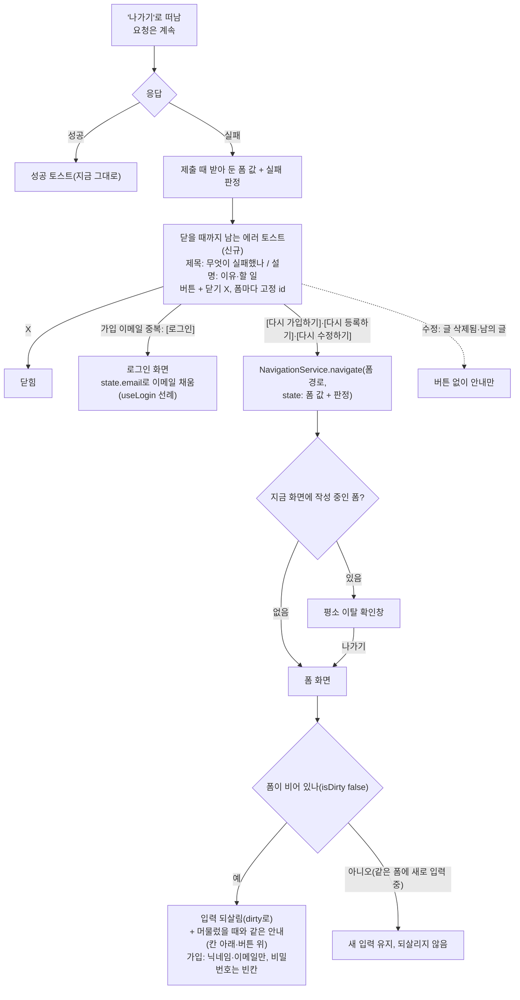

# 떠난 뒤 실패 토스트 — 닫을 때까지 남기고, 무엇이 실패했는지와 돌아갈 버튼을 단다(회원가입·게시글 등록·수정)

> 저장 요청 중 "나가기"로 떠난 뒤 요청이 실패하면, 지금은 이유만 적힌 에러 토스트가 4초 뒤 사라진다. 이 토스트를
> 닫을 때까지 남기고, 제목(무엇이 실패했나)·설명(이유·할 일)·버튼([다시 가입하기]·[다시 등록하기]·[다시 수정하기]
> 또는 [로그인])을 단다. 버튼을 누르면 그 폼으로 돌아가 입력을 되살린다(회원가입은 닉네임·이메일만).

## Context

**문제**: #481(2026-11-02 병합)로 가입·게시글 저장 요청 중에도 떠날 수 있고, 떠난 뒤 결과를 토스트로 알린다. 그런데
실패 토스트에 세 가지 문제가 있다(2026-11-02 사용자 질문 "떠난 뒤 실패했을 때 토스트, 업계 표준에선 어떻게 할까").

- **4초 뒤 사라진다** — 앱의 에러 토스트 47곳 모두 `duration`을 지정하지 않아 sonner 2.0.7 기본값
  `TOAST_LIFETIME = 4000`(`node_modules/sonner/dist/index.mjs:417`)을 따르고, `Toaster`에도 설정이 없다
  (`src/shared/ui/atoms/sonner.tsx`). 떠난 경우에는 이 토스트가 실패를 알 수 있는 유일한 곳이다.
- **무엇이 실패했는지 말하지 않는다** — 게시글은 `toast.error(resolution.message)`(`useCreatePost.ts:118-121`,
  `useUpdatePost.ts:149-152`)라 다른 화면에서 "선택한 폴더를 찾을 수 없어요. 폴더를 다시 골라주세요."만 보인다.
- **돌아갈 방법이 없다** — 입력은 떠날 때 사라졌으니 처음부터 다시 쳐야 한다.

**업계 근거(2026-11-02 조사, 사용자에게 공유함)**

- WCAG 2.2.1 이해 문서는 사라지는 알림이 괜찮은 경우를 _"받은편지함을 보는 등 다른 방법으로"_ (번역) 그 정보를
  얻을 수 있을 때로 든다([Understanding 2.2.1](https://www.w3.org/WAI/WCAG22/Understanding/timing-adjustable.html)).
  떠난 뒤 실패는 다른 방법이 없다.
- Primer는 _"사용자가 직접 닫을 때까지 토스트를 계속 남겨 두는 장치가 있어야 한다"_ (번역)고 쓴다
  ([Primer toasts](https://primer.style/accessibility/toasts/)).
- Material 3는 버튼이 있는 스낵바를 자동으로 닫지 않는다 — Flutter 변경 공지에서 재인용
  ([Flutter](https://docs.flutter.dev/release/breaking-changes/snackbar-with-action-behavior-update)), M3 원문은 확인하지 못했다.
- NN/g는 _"문제를 말하는 것만으로는 부족하다. 해결책을 제시하라"_, _"처음부터 다시 하게 하지 말고 원래 입력을 고쳐서
  바로잡게 하라"_ (번역)고 쓴다([Error-Message Guidelines](https://www.nngroup.com/articles/error-message-guidelines/)).
- Atlassian Flag는 _"문제를 설명하고 다음 단계나 대안을 제시하라"_ (번역)며 "Try again" 버튼을 예로 든다
  ([Flag usage](https://atlassian.design/components/flag/usage)).
- 한계: "폼을 떠난 뒤의 실패"를 직접 다룬 자료는 찾지 못했다. 가장 가까운 기준은 WCAG의 "다른 곳에서 알 수 있는가"다.

**지금 코드(추적으로 확인)**

- 가입 실패 토스트는 `useCreateAccountMutation`의 `onError`(`src/entities/auth/api/auth.queries.ts:135-150`)에 있어
  머물든 떠나든 같다. 떠난 경우만 다르게 하려면 판정을 `useSignUp`의 `catch`로 옮겨야 한다(게시글은 이미 훅
  `catch`에서 `hasLeftPage()`로 나눈다). `mutateAsync`의 promise는 언마운트 뒤에도 settle된다(#481에서 확인 —
  `@tanstack/query-core` 5.90.16 `build/modern/mutationObserver.js:38-62`).
- 버튼은 폼이 언마운트된 뒤 눌린다. 컴포넌트 밖 이동은 `NavigationService`(`src/shared/lib/router/navigation.ts`,
  `RouterProvider.tsx:15`에서 `router.navigate` 주입)가 선례다(`auth.util.ts:86` 등).
- 화면 사이 입력 전달 선례: 가입 화면 → 로그인 화면 이메일을 `location.state`로 넘긴다(`useLogin.ts:36-49`).
- sonner 2.0.7은 버튼(action)을 누르면 토스트를 닫는다(`index.mjs:818-821`) — 실패 이유가 같이 사라진다.
- 버튼 + 닫을 때까지 남는 토스트 선례: 로그인 만료 `showSessionExpiredToast`(`src/shared/utils/auth.util.ts:223-229`,
  `duration: Infinity` + action, 닫기 X 유지, 고정 id).
- 게시글 `categoryIds`는 zod가 숫자로 바꾼다(`post.schema.ts:21`·`:33` `z.coerce.number()`) — `handleSubmit`이 주는
  `formData`는 폼 값과 모양이 달라, 되살릴 값은 `form.getValues()`로 받아야 한다.
- 이탈 가드는 같은 경로 이동을 막지 않는다(`useUnsavedChangesGuard.ts:33-35`).

## 판단이 필요했던 항목

| 항목                        | 결정                                                                                                                                                                                                                | 근거·기각한 대안                                                                                                                                                                                                    |
| --------------------------- | ------------------------------------------------------------------------------------------------------------------------------------------------------------------------------------------------------------------- | ------------------------------------------------------------------------------------------------------------------------------------------------------------------------------------------------------------------- |
| 범위                        | 떠난 뒤 실패(회원가입·게시글 등록·수정)만 바꾼다. 나머지 에러 토스트 47곳은 이슈로 남겨 "화면에 흔적이 남는가"를 조사한 뒤 다음 PR에서 정한다 (2026-11-02 사용자 선택 B)                                            | 기각 A(이번 범위만, 이슈 없음): 토스트가 유일한 기록인 곳이 더 있을 수 있다. 기각 C(47곳 전부): 토스트가 쌓이고(sonner `VISIBLE_TOASTS_AMOUNT = 3`, `index.mjs:411`) 곳마다 흔적이 남는지 확인하지 않았다           |
| 유지 시간                   | 닫을 때까지(`duration: Infinity`)                                                                                                                                                                                   | 위 WCAG·Primer·Material 근거. 로그인 만료 토스트 선례                                                                                                                                                               |
| 문구 구성                   | B안 제목 + 설명 (사용자 선택). 제목: `가입하지 못했어요` / `포스트를 등록하지 못했어요` / `포스트를 수정하지 못했어요`. 설명: 게시글은 기존 `resolution.message`(`texts.ts:543-559`) 그대로, 가입은 원인별 신규 3개 | 기각 A안(한 문장): 원인별 문구를 새로 써야 한다(게시글 이유 14개)                                                                                                                                                   |
| 가입 설명 문구              | 닉네임 중복 `닉네임이 이미 쓰이고 있어요. 다른 닉네임으로 다시 가입해주세요.` / 이메일 중복 `이미 가입된 이메일이에요. 그 이메일로 로그인해주세요.` / 그 밖 `잠시 후 다시 시도해주세요.`                            | 2026-11-02 대화에서 제안한 초안을 B안 구성에 맞게 나눴다(우리 문구, 외부 표준 아님). 미리보기에서 함께 확인받는다                                                                                                   |
| 버튼                        | 가입: 이메일 중복 `[로그인]`, 그 밖 `[다시 가입하기]`. 등록: `[다시 등록하기]`. 수정: `[다시 수정하기]`, 단 글 삭제됨·남의 글이면 버튼 없음                                                                         | 이미 계정이 있으면 로그인이 해결책이다. 삭제된 글·남의 글은 다시 수정해도 실패한다. 응답 지연(504)도 `[다시 등록하기]` — 되살린 폼에 기존 "피드에서 확인하기" 안내(`CreatePostForm.tsx:150`)가 그대로 뜬다          |
| 닫기 X                      | 버튼이 있어도 남긴다                                                                                                                                                                                                | 닫을 때까지 남는 토스트에서 X를 끄면 버튼 말고는 닫을 방법이 없다. 로그인 만료 토스트 선례. 북마크 토스트가 버튼이 있으면 X를 끄는 것(`usePostCardBookmarkFolderDialog.ts:53-58`)은 저절로 사라지는 토스트라 다르다 |
| 입력 전달 방법              | `location.state`로 넘기고 폼 훅이 읽는다                                                                                                                                                                            | 선례 `useLogin.ts:43`. 기각: 모듈 변수·스토어 — 새로고침하면 사라지고 새 상태 저장소가 생긴다                                                                                                                       |
| 비밀번호                    | 되살리지 않는다 (사용자 선택)                                                                                                                                                                                       | `location.state`는 브라우저 방문 기록(`history.state`)에 저장돼 새로고침·뒤로가기 뒤에도 남는다                                                                                                                     |
| 되살린 폼의 안내            | 머물렀을 때와 같은 안내를 다시 띄운다(칸 아래 에러·버튼 위 FormAlert). 가입은 지금도 머물면 토스트만 띄우므로 따로 띄우지 않는다(닉네임·이메일 중복은 중복 확인이 다시 돌아 칸 아래에 뜬다)                         | 버튼을 누르면 토스트가 닫혀 이유가 사라진다(sonner `index.mjs:818-821`). NN/g "원래 입력을 고쳐 바로잡게"                                                                                                           |
| 되살린 입력의 이탈 가드     | dirty로 되살린다(`reset(values, { keepDefaultValues: true })`)                                                                                                                                                      | 기본값으로 넣으면 isDirty가 false라 되살린 입력을 확인 없이 잃는다                                                                                                                                                  |
| 같은 폼에 새로 입력 중일 때 | 되살리지 않고 새 입력을 둔다                                                                                                                                                                                        | 같은 경로 이동은 이탈 가드가 막지 않아(`useUnsavedChangesGuard.ts:33-35`) 덮으면 새 입력이 확인 없이 사라진다                                                                                                       |
| 같은 폼에서 또 떠나 또 실패 | 폼마다 고정 id로 이전 토스트를 바꾼다                                                                                                                                                                               | 쌓이지 않게. `SESSION_EXPIRED_TOAST_ID` 선례                                                                                                                                                                        |
| 가입 실패 판정 위치         | `useCreateAccountMutation.onError`를 없애고 판정을 `SignUpUtil.resolveSubmitError`(entities)로 옮겨 `useSignUp`의 `catch`가 쓴다. 머문 경우 토스트는 문구·4초 그대로                                                | 게시글 `PostUtil.resolveSubmitError` + 훅 `catch` 선례. 기각: onError를 두고 같은 id로 덮기 — 두 번 띄우는 걸 id 충돌에 기댄다                                                                                      |

### 시안 후보

B안(제목 + 설명)으로 정했다. 구현 전에 실제 sonner 렌더(라이트·다크, 모바일 폭)를 캡처해 보여주고 승인받는다 — 가입
3종·등록·수정(버튼 있음/없음). 등록 일반 실패는 제목과 설명이 겹친다(`포스트를 등록하지 못했어요` /
`일시적인 문제로 등록하지 못했어요. 잠시 후 다시 시도해주세요.`) — 미리보기에서 같이 확인받는다.

## 세부 계획

| 위치                                                                                                     | 변경 내용                                                                                                                                                                                                                                                                                                                                |
| -------------------------------------------------------------------------------------------------------- | ---------------------------------------------------------------------------------------------------------------------------------------------------------------------------------------------------------------------------------------------------------------------------------------------------------------------------------------- |
| `src/entities/auth/utils/auth.util.ts`                                                                   | `SignUpUtil.resolveSubmitError(error)` 신규 — `{ reason: 'duplicateNickname' \| 'duplicateEmail' \| 'failed'; message }`. 판정·`message`는 지금 onError(`auth.queries.ts:139-149`)와 같다                                                                                                                                                |
| `src/entities/auth/api/auth.queries.ts`                                                                  | `useCreateAccountMutation`의 `onError` 제거(`meta.manualErrorHandling` 유지), 위 주석을 새 위치에 맞게                                                                                                                                                                                                                                   |
| `src/entities/auth/api/auth.queries.test.ts` `useCreateAccountMutation` 묶음                             | 토스트 단정 3개 → `auth.util.test.ts`의 `SignUpUtil` 판정 테스트로 옮김                                                                                                                                                                                                                                                                  |
| `src/entities/post/utils/post.util.ts`                                                                   | `PostSubmitErrorResolution` form 갈래에 선택 필드(예: `retryable: false`) — 수정의 글 삭제됨·남의 글에만. 기존 호출부는 그대로                                                                                                                                                                                                           |
| `src/features/auth/signup/hooks/useSignUp.ts`                                                            | `catch (error)`: 판정 → 떠났으면 닫을 때까지 남는 토스트(버튼 `[로그인]`→`LOGIN` state `{ email }` / `[다시 가입하기]`→`SIGNUP` state `{ 닉네임, 이메일 }`), 아니면 `toast.error(message)`. 되살리기: `location.key`가 바뀌고 state가 있고 폼이 비어 있으면 `reset({ ...DEFAULT_VALUES, nickname, email }, { keepDefaultValues: true })` |
| `src/features/post/create/hooks/useCreatePost.ts`                                                        | 제출 때 `form.getValues()`를 받아 둔다. 떠난 뒤 실패: 닫을 때까지 남는 토스트 + `[다시 등록하기]`→`POST.SUBMIT` state `{ 폼 값, 판정 }`. 되살리기: 같은 조건에서 reset + 판정 적용(field → `setError` `type: 'server'`, form → `setSubmitError`)                                                                                         |
| `src/features/post/update/hooks/useUpdatePost.ts`                                                        | 같은 흐름 + `[다시 수정하기]`→`/post/edit/:id`. 되살리기는 `resetFormWithFetchedPost`에서 그 글을 처음 채운 직후에 하고, `wasUrlChangedRef`를 되살린 URL 기준으로 맞춘다(`clearDerivedFieldsOnUrlChange`가 제목·관심 분야를 비우지 않게). `retryable: false`면 버튼 없음                                                                 |
| `src/shared/config/texts.ts`                                                                             | 제목 3개·가입 설명 3개·버튼 3개(`다시 가입하기`·`다시 등록하기`·`다시 수정하기`). 키 이름은 `texts-conventions` skill을 따른다                                                                                                                                                                                                           |
| `src/shared/ui/atoms/sonner.stories.tsx`                                                                 | 미리보기용 스토리 1개("닫을 때까지 남는 에러 + 버튼") — 이 토스트 모양의 참고본으로 커밋한다                                                                                                                                                                                                                                             |
| `useSignUp.guard.test.tsx`·`useCreatePost.guard.test.tsx`(`:288`)·`useUpdatePost.guard.test.tsx`(`:245`) | 떠난 뒤 실패: 제목·설명·버튼·`duration: Infinity`·고정 id 단정. 버튼 → 이동 경로·state 단정(`NavigationService.navigate` spy). 되살리기: 입력·dirty·안내, 비밀번호 빈칸, 같은 폼에 새로 입력 중이면 그대로, 수정의 URL 바뀐 값 유지, 삭제됨·남의 글 버튼 없음. 머문 경우 가입 토스트 문구 그대로                                         |
| `e2e/signup-unsaved-changes.spec.ts`(`:234`·`:292`)                                                      | 떠난 뒤 실패 토스트 단정을 새 문구로, 추가: 떠난 뒤 실패 → `[다시 가입하기]` → 닉네임·이메일 되살림·비밀번호 빈칸                                                                                                                                                                                                                        |
| `e2e/post-create.spec.ts`                                                                                | 추가: 떠난 뒤 실패 → `[다시 등록하기]` → 입력 되살림 + 안내                                                                                                                                                                                                                                                                              |
| `docs/UNSAVED-CHANGES-GUARD.md`                                                                          | §1 순서도, §5 "저장 요청 중 이탈" 떠난 뒤 실패 행·근거 인용, §8 코드 지도, §9 검증, §11, §12 용어, 마지막 검토 날짜                                                                                                                                                                                                                      |
| `CHANGELOG.md` `[Unreleased]`                                                                            | `### Changed` 항목(`changelog-release` skill 형식)                                                                                                                                                                                                                                                                                       |
| `docs/plans/2026-11-02-left-page-failure-toast.md` (신규)                                                | 이 계획 스냅샷                                                                                                                                                                                                                                                                                                                           |
| GitHub 이슈(이 레포)                                                                                     | "에러 토스트 47곳: 화면에 흔적이 남는가 조사 후 유지 시간 결정" — 확인한 사실(sonner 기본 4초·3개 제한·타이머 멈춤 조건, 47곳 목록)과 이번 PR 링크                                                                                                                                                                                       |

## 영향 범위

**CRUD**

- Create(가입 `POST /auth/signup`, 게시글 등록)·Update(게시글 수정): 요청은 그대로다. 버튼은 폼으로 데려가기만 하고
  다시 보내지 않는다 — 중복 제출 없음. 응답 지연(504)은 되살린 폼의 기존 "피드에서 확인하기" 안내가 중복 등록을 막는다.
- Read·Delete: 해당 없음.

**기존 기능 회귀**

- 머문 채 실패한 경우: 가입은 토스트 문구·4초 그대로(판정 위치만 이동), 게시글은 칸 아래·버튼 위 안내 그대로.
- `useCreateAccountMutation`은 `useSignUp`만 쓴다(grep: `useSignUp.ts:38`, `auth.queries.test.ts`). onError를 없애면 이
  mutation을 다른 곳에서 쓸 때 토스트가 안 뜨므로 주석으로 남긴다.
- `PostUtil.resolveSubmitError`에 선택 필드 추가 — 기존 호출부(`useCreatePost`·`useUpdatePost`·테스트)는 그대로 컴파일된다.
  구현 전 `pnpm graph:focus src/entities/post/utils/post.util.ts --text`, `src/entities/auth/utils/auth.util.ts`도 같이 확인.
- `location.state`를 읽는 폼 훅: 다른 화면이 이 경로로 state를 실어 보내는 곳이 없는지 확인(가입 화면은 지금 state를 받지 않는다).
- 이전 동작을 단정하는 테스트·문서: 위 표의 테스트 행, `auth.queries.test.ts` 3개, `docs/UNSAVED-CHANGES-GUARD.md` §5.
- 데이터 계약 변경 없음(FE 단독).

## 검증 방법

1. 미리보기: 스토리를 Storybook에 띄워 Playwright로 캡처(라이트·다크, 375px·데스크톱) → Artifact로 보여주고 승인받은 뒤
   훅에 반영한다
2. 재현 먼저: 바꾼 가드 테스트(떠난 뒤 실패 토스트 모양·버튼·되살리기)를 먼저 써서 지금 코드에서 실패하는지 본다 → 구현 → 통과
3. `pnpm type-check` → `pnpm test` → `pnpm lint` → `pnpm check:deps` → `pnpm check:docs` → `pnpm format:check`
4. `pnpm test:e2e e2e/signup-unsaved-changes.spec.ts e2e/post-create.spec.ts e2e/signup.spec.ts e2e/unsaved-changes.spec.ts`,
   새·바뀐 테스트는 `--repeat-each=10`
5. 브라우저 녹화(`browser-verification` skill): 가입 떠난 뒤 실패 3종(버튼·되살리기·비밀번호 빈칸), 등록 떠난 뒤 실패 →
   되살리기 + 안내, 수정 떠난 뒤 실패(URL 바꾼 값 유지) / 글 삭제됨(버튼 없음), 머문 채 실패(그대로). 승인받은 뒤에만 커밋
6. 커밋 → `plan-verifier` 대조 → PR 본문 `## 계획 대비 구현` → `pnpm check:pr-body` → PR CI 확인 → GitHub 이슈 등록

## 남은 것

- 같은 폼에 새로 입력 중이면 버튼을 눌러도 되살리지 않는다(토스트만 닫힌다).
- 떠난 사이 다른 계정으로 로그인했다면 `[다시 가입하기]`는 GuestGuard가 피드로 돌려보낸다.
- 나머지 에러 토스트 47곳은 위 이슈에서 다룬다.
