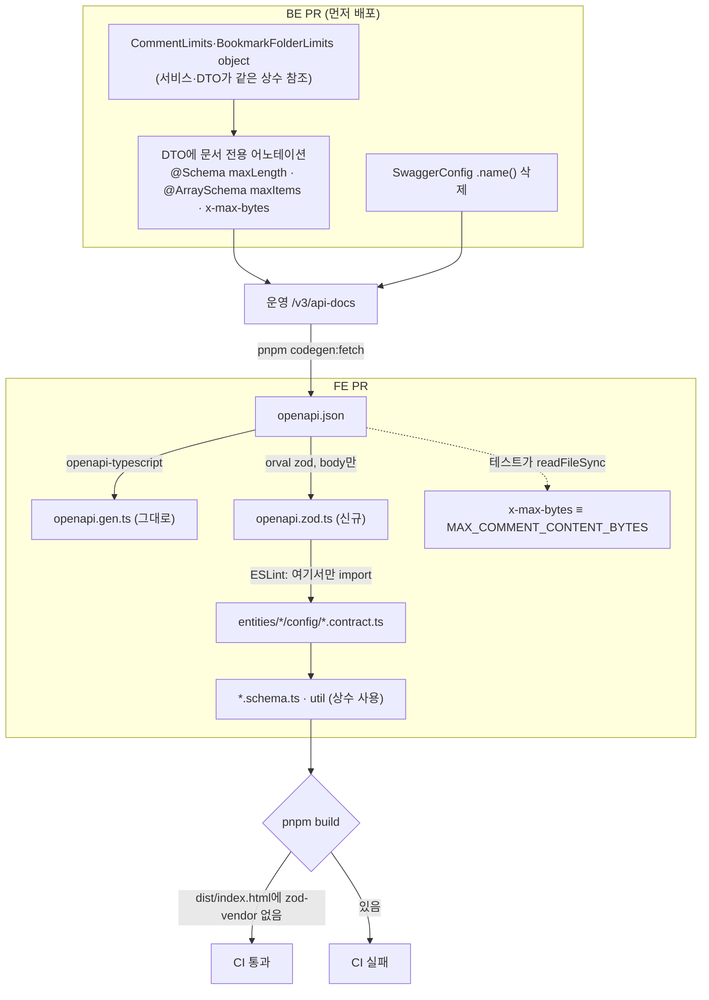

# orval zod로 BE 입력 제약 값 공유

<!-- plan-result:start — 이 블록만 병합 뒤에도 고칠 수 있다(CLAUDE.md §11). 아래는 승인된 계획 원문 -->

## 구현 결과

> 구현 결과 블록 규칙(2026-11-03) 전에 병합된 계획이라 대조 요약은 없다 — 대조 결과는 PR #480 본문 "계획 대비 구현". 2026-11-07 orval 제거 때 이 블록을 새로 만들었다.

- 이탈: 생성 상수를 폼 스키마에서 쓰지 않고 계약 테스트 대조에만 썼다. 런타임 import가 목록 페이지 청크로 zod를 끌어와 계획을 바꿨다(`docs/OPENAPI-CODEGEN.md` §10)
- 대체됨(일부): `docs/plans/2026-11-07-remove-orval.md`(#584) — orval과 생성 파일, ESLint 규칙을 지우고 계약 테스트가 `openapi.json`을 직접 읽는다. BE가 스펙에 제약을 싣는 부분은 그대로다

<!-- plan-result:end -->

> BE OpenAPI 스펙을 FE가 손으로 복제하던 입력 제약 값(닉네임·비밀번호 길이, 폴더 이름 15자, 댓글 이미지 5장)의
> 단일 출처로 만든다. FE는 orval(zod 모드, 요청 본문만)로 제약 상수를 생성해 폼 스키마에서 쓴다.

## Context

**왜**: FE가 BE 검증 값을 손으로 복제하고 "BE와 같은 값" 주석으로만 맞추고 있다(`comment.const.ts:13`,
`bookmark-folder.const.ts:5`, BE `CommentService.kt:55`). 2026-11-02 대화에서 현재 방식, A(orval zod만), B(zod +
react-query + MSW 생성)를 실제 생성물로 비교했고, 사용자가 **A**를 골랐다(비교 페이지:
https://claude.ai/artifact/JcF7qGufAx9aKUr4QA2Wuv, 비공개).

**지금 상황(조사로 확인한 사실)**

- 스펙에 제약이 실린 곳은 회원·인증 요청뿐이다(SignupRequest·UpdateAccountRequest·ChangePasswordRequest·
  PasswordResetConfirmRequest). 댓글 이미지 5장(`CommentService.kt:48,367`), 댓글 6,000바이트(`:56,371`), 폴더 이름
  15자(`BookmarkFolderService.kt:321,338`, trim 뒤 코드포인트)는 서비스 코드에만 있다.
- orval 8.46.0은 스펙 검증(@scalar/openapi-parser, OAS 3.1 스키마)에서 생성을 거부한다. BE `SwaggerConfig.kt:41`의
  `.name()`이 HTTP 보안 스킴에 `name`을 넣기 때문이다(`name`은 apiKey 스킴 전용).
- orval zod 출력은 상수와 `zod.object(...)`를 한 파일에 담는다. `vite.config.ts`의 `treeshake.moduleSideEffects: false`는
  쓰이는 모듈 안의 최상위 호출을 남긴다(`docs/PERFORMANCE.md:317-320`, 2026-10-28 직접 측정). 진입 청크 경로
  `src/app/routes/index.tsx:10` → `comment.queries.ts:19` → `comment.const.ts`가 생성 파일을 import하면 `zod-vendor`가
  다시 첫 로딩에 들어온다(#442에서 뺀 것).
- 비밀번호 패턴이 스펙에 없는 원인: 같은 필드의 `@field:Pattern` 두 개가 `@Pattern.List` 하나로 컴파일되는데,
  swagger-core 2.2.55 `ModelResolver`는 단일 `jakarta.validation.constraints.Pattern` 키만 찾는다(`:1917`). 검사 자체는
  Hibernate Validator가 컨테이너를 풀어 정상 동작한다.

## 판단이 필요했던 항목

| 항목                                        | 결정                                                                                                                                                  | 근거·기각한 대안                                                                                                                                                                                                                                                                                                                                                             |
| ------------------------------------------- | ----------------------------------------------------------------------------------------------------------------------------------------------------- | ---------------------------------------------------------------------------------------------------------------------------------------------------------------------------------------------------------------------------------------------------------------------------------------------------------------------------------------------------------------------------- |
| 생성 범위                                   | orval zod 모드, 요청 본문만(`override.zod.generate: { body: true, 나머지 false }`) — 사용자 결정(11-02, A 선택)                                       | B(react-query·MSW 생성): 생성 쿼리 키가 URL 문자열이라 `['post']` 묶음 무효화가 깨지고, 반환 타입이 봉투째(`res.data.data`)이고, 이미지 선업로드 2단계 mutation에 못 쓰고, MSW 목이 faker 무작위 값이다(2026-11-02 직접 생성 확인). typed-openapi: 주력이 클라이언트라 `openapi-typescript`와 겹침, 월 32만 다운로드(orval 1,004만). openapi-zod-client: README에 deprecated |
| 생성 스키마를 그대로 쓰나                   | 쓰지 않는다. 상수(`…Min/Max/RegExp`)만 쓰고 폼 스키마는 손으로 유지                                                                                   | 생성 스키마는 에러 문구가 영어 기본값이고, 부분 수정 API라 `nickname`이 `nullish`인데 폼은 필수다                                                                                                                                                                                                                                                                            |
| 생성기 대신 상수만 뽑는 자체 스크립트       | 기각(orval 유지) — 사용자 결정(11-02, 계획 승인 뒤 다시 물어 확정)                                                                                    | 스크립트(약 50줄)는 zod가 섞이지 않아 아래 번들 가드가 필요 없지만, 직접 만든 코드를 유지해야 하고 나중에 orval의 다른 생성(MSW 등)으로 넘어갈 길이 없다. 사용자가 표준 도구를 골랐고, 번들 문제는 import 위치 제한으로 막을 수 있다                                                                                                                                         |
| BE 서비스 전용 규칙을 스펙에 싣는 방법      | DTO에 **문서 전용** `@field:Schema`/`@field:ArraySchema`, 검사는 서비스 그대로                                                                        | `@Size`로 옮기면: Hibernate Validator 8.0.3 `SizeValidatorForCharSequence:53`이 UTF-16으로 세서 이모지 폴더 이름 판정이 바뀌고(지금은 코드포인트), trim 전 값을 세고, `ControllerSignatureRulesTest`가 `@Valid`를 강제해 폴더 이름 변경의 에러 순서가 403/404 → 400으로 바뀐다(BE-ARCHITECTURE.md:739-741의 2026-10-26 결정과 충돌)                                          |
| 상수 위치(BE)                               | `CommentLimits`·`BookmarkFolderLimits` object                                                                                                         | DTO가 Service 상수를 참조하면 DTO→Service 의존 금지(BE-ARCHITECTURE.md:252)에 걸린다. 여러 클래스가 공유하는 제약은 이름 붙은 object에 둔다(§7-12, 선례 `BatchJobLimits`)                                                                                                                                                                                                    |
| 댓글 바이트 상한                            | 스펙에 `x-max-bytes` 확장으로 값만 싣고, FE는 기존 상수를 유지하되 테스트로 스펙 값과 대조                                                            | JSON Schema에는 바이트 키워드가 없고(`maxLength`는 문자 수), orval은 `x-` 확장을 읽지 않는다(@orval/zod 8.46.0 소스 확인). OpenAPI 3.1에서는 swagger-core가 `x-`를 자동으로 붙이지 않아 이름 전체를 쓴다                                                                                                                                                                     |
| 생성 파일 import 위치(FE)                   | 엔티티별 `config/<entity>.contract.ts`에서만. ESLint로 강제                                                                                           | `.dto.ts` 표지판 규칙(OPENAPI-CODEGEN §5-3)과 같은 형태. 진입 청크 경로의 `comment.const.ts`가 생성 파일을 import하지 않게 한다                                                                                                                                                                                                                                              |
| 진입 청크 가드                              | CI 빌드 뒤 `dist/index.html`에 `zod-vendor`가 없는지 grep                                                                                             | 한 번 확인하는 것만으로는 다음 변경에서 다시 들어와도 모른다                                                                                                                                                                                                                                                                                                                 |
| CI 최신성 검사                              | 기존 "생성 타입 최신성 확인" 스텝을 `git status --porcelain src/shared/api/generated/`로 바꾼다                                                       | `git diff`는 미추적 새 파일을 못 본다. prettier를 뒤에 거는 기존 방식(`codegen` 스크립트)을 따르므로 orval `--outdated`는 쓸 수 없다                                                                                                                                                                                                                                         |
| 비밀번호 패턴 스펙 누락                     | BE의 `@Pattern` 두 개를 정규식 하나로 합친다 — 사용자 결정(11-02). FE는 문구를 나누려고 정규식 두 개를 유지하고, 생성 패턴과는 차등 테스트로 대조한다 | 기각: 범위 밖(스펙이 불완전하게 남음), `@Schema(pattern)` 추가(같은 정규식이 BE에 두 번 적힘). 합치면 BE 에러 메시지가 두 개에서 하나로 준다. FE는 서버 메시지를 화면에 보여 주지 않아 화면 영향은 없다                                                                                                                                                                      |
| 응답 media type `*/*`                       | 이번 범위 밖                                                                                                                                          | 응답 스키마를 생성하지 않아 영향이 없다                                                                                                                                                                                                                                                                                                                                      |
| TEXTS에 박힌 숫자("2~20자", "64자 이하" 등) | 문구는 그대로 두고 테스트로 상수와 대조                                                                                                               | 함수형 키로 바꾸는 건 범위를 넘는다. BE 값이 바뀌면 FE codegen PR에서 테스트가 실패해 문구 갱신을 알린다                                                                                                                                                                                                                                                                     |

### 뒤집힌 전제

| 발견                                                                                              | 그래서 바뀐 것                                      |
| ------------------------------------------------------------------------------------------------- | --------------------------------------------------- |
| 비밀번호 패턴 누락 원인을 몰랐다 → `@Pattern.List` 때문으로 확인                                  | 사용자가 BE 정규식 합치기를 고름                    |
| `@Size`로 옮기면 될 거라 봤다 → 셈법·에러 순서가 바뀜                                             | 문서 전용 어노테이션                                |
| `@Schema(maxItems)`를 쓰려 했다 → swagger-annotations 2.2.55 `@Schema`에 `maxItems`가 없음        | 배열은 `@ArraySchema(maxItems)`                     |
| 번들 영향은 측정해 보면 된다고 봤다 → 이미 측정된 사실(PERFORMANCE.md:317-320)                    | contract 파일 분리 + ESLint + CI grep을 계획에 넣음 |
| OPENAPI-CODEGEN §5-2가 댓글 바이트를 "FE 전용 검증"이라 씀 → BE도 검사함(`CommentService.kt:371`) | 문서 정정                                           |

### 위험 관리

- **oasdiff ERR**: BE `api-compat`의 `breaking --fail-on ERR`가 요청 필드의 maxLength·maxItems·pattern 추가를 ERR로 볼
  가능성이 높다. 보고서에서 ERR이 이 줄들(폴더 `name` maxLength, 댓글 `images` maxItems, 비밀번호 pattern)뿐인지 먼저
  확인한 뒤 Claude가 `breaking-api` 라벨을 단다 — 사용자 결정(11-02). 검사는 이미 서버가 같은 규칙으로 하고 있어 실제로는
  깨지는 변경이 아니다. nullable 손실 같은 다른 ERR이 섞이면 라벨을 달지 않고 고친다.
- **nullable 손실**: `NullableAwareModelConverter.kt:129-139`가 스펙 생성 뒤 nullable을 붙인다. 어노테이션이
  `content: String?`·`images: List<String>?`의 `"null"`을 지우면 `openapi.gen.ts`가 바뀐다. 스펙 diff로 확인한다.
- **배포 사이 창**: BE 배포 뒤 FE 병합 전까지 매일 도는 드리프트 검사가 이슈를 연다. FE 병합 뒤 자동으로 닫힌다.
  FE 런타임은 값이 같아 영향이 없다.
- **orval 업데이트**: 마이너 릴리스가 며칠 간격이라 정확한 버전으로 고정한다(`.npmrc` `save-exact=true`).

## 세부 계획

### Phase 0 — 스파이크 (스크래치 폴더, 레포 변경 없음)

| 위치                                | 변경 내용                                                                                                                                        |
| ----------------------------------- | ------------------------------------------------------------------------------------------------------------------------------------------------ |
| 스크래치 폴더의 `openapi.json` 사본 | jq로 보안 스킴 `name` 삭제, 폴더 `name`에 maxLength 15, 댓글 `images`에 maxItems 5, `content`에 `x-max-bytes` 추가                               |
| 스크래치 `orval.config.ts`          | 아래 FE 설정과 같은 내용으로 `orval@8.46.0` 실행 → 실제 상수 이름 확인(`createFolderBodyNameMax` 등), 프로젝트 tsconfig 옵션으로 `tsc` 통과 확인 |

### Phase 1 — BE PR (BE 워크트리)

| 위치                                                                                                                                            | 변경 내용                                                                                                                                                                                                                                                                                                 |
| ----------------------------------------------------------------------------------------------------------------------------------------------- | --------------------------------------------------------------------------------------------------------------------------------------------------------------------------------------------------------------------------------------------------------------------------------------------------------- |
| `global/config/SwaggerConfig.kt:41`                                                                                                             | `.name(securitySchemeName)` 삭제                                                                                                                                                                                                                                                                          |
| `domain/comment/CommentLimits.kt` (신규)                                                                                                        | `object CommentLimits { const val MAX_IMAGES = 5; const val MAX_CONTENT_BYTES = 6_000 }`, `CommentService.kt:48-56`의 근거 주석을 옮김                                                                                                                                                                    |
| `domain/comment/CommentService.kt:48,56,367-372`                                                                                                | companion 상수 삭제, `CommentLimits` 참조                                                                                                                                                                                                                                                                 |
| `domain/comment/CommentDTO.kt:34-37`                                                                                                            | `images`에 `@field:ArraySchema(maxItems = CommentLimits.MAX_IMAGES)`, `content`에 `@field:Schema(extensions = [Extension(properties = [ExtensionProperty(name = "x-max-bytes", value = "…", parseValue = true)])])`. value는 상수 문자열 템플릿을 먼저 시도하고, 컴파일이 안 되면 리터럴 + 상수 위치 주석 |
| `domain/interaction/BookmarkFolderLimits.kt` (신규)                                                                                             | `object BookmarkFolderLimits { const val MAX_NAME_LENGTH = 15 }`, 셈법(trim 뒤 코드포인트) 주석                                                                                                                                                                                                           |
| `domain/interaction/BookmarkFolderService.kt:321,338`                                                                                           | 상수 참조 교체                                                                                                                                                                                                                                                                                            |
| `domain/interaction/BookmarkFolderDTO.kt:6,8`                                                                                                   | `name`에 `@field:Schema(maxLength = BookmarkFolderLimits.MAX_NAME_LENGTH)`                                                                                                                                                                                                                                |
| `domain/member/MemberDTO.kt`(SignupRequest.password), `domain/auth/AuthDTO.kt`(ChangePasswordRequest·PasswordResetConfirmRequest의 newPassword) | `@field:Pattern` 두 개를 하나로 합침: `^(?=.*[a-zA-Z])(?=.*[0-9])(?=.*[^a-zA-Z0-9])[\x20-\x7E]*$`, 메시지 하나. 세 곳이 같은 상수를 쓰게 정규식·메시지를 한 곳에 둔다                                                                                                                                     |
| 비밀번호 메시지를 단정하는 BE 테스트                                                                                                            | 새 메시지에 맞춰 갱신                                                                                                                                                                                                                                                                                     |
| `docs/BE-ARCHITECTURE.md` §7-12(:577-584)                                                                                                       | 예시 상수 경로 갱신. 규칙 추가: "서비스에서 검사하는 입력 제약은 DTO에 문서 전용 `@field:Schema`/`@ArraySchema`로 스펙에 싣고 같은 Limits 상수를 참조한다"                                                                                                                                                |
| BE `.claude/CLAUDE.md:236`, 그 밖에 `CommentService.MAX_COMMENT_CONTENT_BYTES`를 가리키는 BE 문서                                               | 새 상수 경로로 갱신                                                                                                                                                                                                                                                                                       |
| `docs/plans/2026-11-02-orval-zod-constraints.md` (신규)                                                                                         | 이 계획 사본(BE CLAUDE.md §8)                                                                                                                                                                                                                                                                             |

### Phase 2 — FE PR (BE 배포 확인 뒤, FE 워크트리)

| 위치                                                                                                                                                                                                                                                                                                            | 변경 내용                                                                                                                                                                                                                                                                                                                                                                                                                                                                                                                                            |
| --------------------------------------------------------------------------------------------------------------------------------------------------------------------------------------------------------------------------------------------------------------------------------------------------------------- | ---------------------------------------------------------------------------------------------------------------------------------------------------------------------------------------------------------------------------------------------------------------------------------------------------------------------------------------------------------------------------------------------------------------------------------------------------------------------------------------------------------------------------------------------------- |
| `package.json`                                                                                                                                                                                                                                                                                                  | devDependency `orval` 8.46.0. `codegen` 스크립트: `openapi-typescript … && orval --config orval.config.ts && prettier --write openapi.gen.ts openapi.zod.ts`                                                                                                                                                                                                                                                                                                                                                                                         |
| `orval.config.ts` (신규)                                                                                                                                                                                                                                                                                        | input `src/shared/api/generated/openapi.json`, output `src/shared/api/generated/openapi.zod.ts`, `client: 'zod'`, `mode: 'single'`, `override.zod: { version: 3, generate: { param: false, query: false, header: false, body: true, response: false } }`                                                                                                                                                                                                                                                                                             |
| `tsconfig.node.json` include                                                                                                                                                                                                                                                                                    | `orval.config.ts` 추가(`vite.config.ts`와 같은 방식)                                                                                                                                                                                                                                                                                                                                                                                                                                                                                                 |
| `src/shared/api/generated/openapi.json`·`openapi.gen.ts`·`openapi.zod.ts`                                                                                                                                                                                                                                       | `pnpm codegen:fetch`(운영) + `pnpm codegen` 결과                                                                                                                                                                                                                                                                                                                                                                                                                                                                                                     |
| `.github/workflows/ci.yml:64-71`                                                                                                                                                                                                                                                                                | 최신성 검사를 `git status --porcelain src/shared/api/generated/`가 비어 있는지로 변경                                                                                                                                                                                                                                                                                                                                                                                                                                                                |
| `.github/workflows/ci.yml:130` 뒤                                                                                                                                                                                                                                                                               | 스텝 추가: `dist/index.html`에 `zod-vendor`가 있으면 실패                                                                                                                                                                                                                                                                                                                                                                                                                                                                                            |
| `eslint.config.js`                                                                                                                                                                                                                                                                                              | `@/shared/api/generated/openapi.zod` import를 `src/entities/*/config/*.contract.ts` 밖에서 금지                                                                                                                                                                                                                                                                                                                                                                                                                                                      |
| `entities/account/config/account.contract.ts` (신규)                                                                                                                                                                                                                                                            | `NICKNAME_MIN_LENGTH`·`NICKNAME_MAX_LENGTH`·`NICKNAME_PATTERN` ← `updateAccountBodyNickname*`                                                                                                                                                                                                                                                                                                                                                                                                                                                        |
| `entities/account/model/account.schema.ts:6-10`                                                                                                                                                                                                                                                                 | 숫자·정규식 대신 위 상수                                                                                                                                                                                                                                                                                                                                                                                                                                                                                                                             |
| `entities/auth/config/auth.contract.ts` (신규)                                                                                                                                                                                                                                                                  | `PASSWORD_MIN_LENGTH`·`PASSWORD_MAX_LENGTH`·`PASSWORD_PATTERN` ← `signupBodyPassword*`                                                                                                                                                                                                                                                                                                                                                                                                                                                               |
| `entities/auth/config/auth.const.ts:7-8`                                                                                                                                                                                                                                                                        | 두 상수 삭제(`PASSWORD_REQUIREMENTS`는 유지)                                                                                                                                                                                                                                                                                                                                                                                                                                                                                                         |
| `entities/auth/utils/auth.util.ts:2-3`, `auth.schema.ts:11`                                                                                                                                                                                                                                                     | import 교체, `.max(PASSWORD_MAX_LENGTH, …)`                                                                                                                                                                                                                                                                                                                                                                                                                                                                                                          |
| `entities/bookmark/folder/config/bookmark-folder.contract.ts` (신규)                                                                                                                                                                                                                                            | `BOOKMARK_FOLDER_NAME_MAX_LENGTH` ← `createFolderBodyNameMax`                                                                                                                                                                                                                                                                                                                                                                                                                                                                                        |
| `bookmark-folder.const.ts:5-8`, `bookmark-folder.util.ts:4`, `e2e/bookmark-folder-name.spec.ts:11`, `e2e/bookmark-folder-title-rename.spec.ts:7`                                                                                                                                                                | 상수 이동, import 교체                                                                                                                                                                                                                                                                                                                                                                                                                                                                                                                               |
| `entities/comment/config/comment.contract.ts` (신규)                                                                                                                                                                                                                                                            | `MAX_COMMENT_IMAGES` ← `createCommentBodyImagesMax`                                                                                                                                                                                                                                                                                                                                                                                                                                                                                                  |
| `comment.const.ts:1`과 importer 4곳(`CommentForm.tsx`·`CommentEditForm.tsx`·`useCreateComment.ts`·`useUpdateComment.ts`)                                                                                                                                                                                        | 상수 이동, import 교체. `MAX_COMMENT_CONTENT_BYTES`는 `comment.const.ts`에 유지                                                                                                                                                                                                                                                                                                                                                                                                                                                                      |
| `entities/*/config/*.contract.test.ts` (신규)                                                                                                                                                                                                                                                                   | ① 같은 필드의 operation 간 값 일치(nickname: signup·updateAccount, password: signup·changePassword·confirmPasswordReset, 폴더: createFolder·updateFolder) ② `readFileSync`로 읽은 `openapi.json`의 `x-max-bytes` = `MAX_COMMENT_CONTENT_BYTES` ③ 비밀번호 차등 테스트: 표본 문자열에서 FE `passwordValidationSchema` 통과 여부 = 스펙 길이 범위 + `PASSWORD_PATTERN` ④ TEXTS 숫자 대조(`nicknameLength`·`nicknameHint` 2곳·`placeholders.nickname`, `passwordMaxLength`·`passwordRegex`·`requirements.minLength`, `commentContentTooLong`의 "2,000") |
| `docs/OPENAPI-CODEGEN.md`                                                                                                                                                                                                                                                                                       | §3 도구, §5-2 끝에 "2026-11-02 추가 — orval zod로 제약 상수" 절(비교표, B 보류와 재검토 조건, "FE 전용 검증" 정정), §5-3 트리·import 규칙(contract 파일), §8 코드 지도·레시피, §11 남은 것, 마지막 검토 날짜                                                                                                                                                                                                                                                                                                                                         |
| `docs/FE-ARCHITECTURE.md`                                                                                                                                                                                                                                                                                       | §3 트리(:293), §9 Zod 패턴(:693-723)에 contract 상수 규칙, 네이밍 표(:1273)에 `.contract.ts`, 상수 위치를 말하는 줄(:247·:258·:274)                                                                                                                                                                                                                                                                                                                                                                                                                  |
| `docs/COMMENT.md`(:188·:370·:553-557·:571·:576), `docs/BOOKMARK.md`(:427·:714·:857·:901), `docs/AUTH.md`(:783·:797), `docs/CI-CHECK-GATE.md:133`, `docs/DEPLOY.md:631`, `docs/VERSION-COMPATIBILITY.md`, `README.md:203`, `.claude/commands/add-schema.md`, `.claude/CLAUDE.md:461`, `comment.const.ts:13` 주석 | 옮긴 상수·새 파일·BE 상수 경로 반영                                                                                                                                                                                                                                                                                                                                                                                                                                                                                                                  |
| `docs/plans/2026-11-02-orval-zod-constraints.md` (신규)                                                                                                                                                                                                                                                         | 이 계획 사본                                                                                                                                                                                                                                                                                                                                                                                                                                                                                                                                         |

CHANGELOG는 쓰지 않는다. 동작이 바뀌지 않는 build·docs 변경이다(changelog-release skill 기준).

## 영향 범위 (§5)

**CRUD**: 데이터·DB 변경 없음. 검증 값, 셈법(폴더 코드포인트·댓글 바이트), 에러 응답 순서와 코드가 모두 그대로다. 바뀌는 것은 비밀번호 규칙 위반 시 BE
에러 메시지 문구 하나뿐이다(두 개 → 하나, FE는 서버 메시지를 화면에 쓰지 않음). BE
어노테이션은 문서 전용이고, FE 상수 값은 지금과 같다.

**회귀 후보와 소유 파일**

- BE: DTO→Service 의존 규칙(ArchUnit, `dtosMustNotDependOnBeans`), `ControllerSignatureRulesTest`(`@Schema`·`@ArraySchema`는
  Constraint가 아니라 `@Valid`를 강제하지 않음), `api-compat` oasdiff, nullable 표기(`NullableAwareModelConverter.kt`).
- FE 첫 로딩: `routes/index.tsx:10` → `comment.queries.ts` → `comment.const.ts` 경로에 생성 파일이 들어가면 `zod-vendor`
  재유입 → ESLint와 CI grep으로 막음.
- FE 공유 파일 import 사용처: `pnpm graph:focus`로 `account.schema.ts`·`auth.const.ts`·`bookmark-folder.const.ts`·
  `comment.const.ts` 사용처를 뽑아 확인한다.
- 기존 테스트: `account.schema.test.ts`, `auth.schema.test.ts`, `auth.util.test.ts`(PasswordUtil ≡ 스키마 차등 테스트),
  `bookmark-folder.util.test.ts`(15자 문구 리터럴), `useCreateComment`·`useUpdateComment` 테스트, e2e 폴더 이름 스펙 2개.
- `pnpm check:docs`: `COMMENT.md:370`(`comment.const.ts:41`)·`BOOKMARK.md:714`(`bookmark-folder.const.ts:8`)가 줄 이동으로
  실패한다 → 같은 PR에서 고친다.
- `format:check`: 생성 파일도 검사 대상이라 `codegen`의 prettier 단계가 필요하다.
- 영향 없음: depcruise(생성 파일은 shared, `zod`만 import), vitest·coverage·stryker 제외 목록, `deploy.yml` 경로 필터.

**배포 순서**: BE PR(라벨) → 병합 → 배포 → 운영 스펙 확인 → FE PR(`codegen:fetch`는 운영에서) → 병합 → 드리프트 이슈
자동 닫힘. FE 작업은 `--from=local` 스펙으로 먼저 시작할 수 있지만 커밋하는 스펙은 운영에서 받은 것만 쓴다.

## 검증 방법

1. **Phase 0**: 스크래치 생성물의 상수 이름 목록, `tsc --noEmit` 통과.
2. **BE**: `./gradlew test ktlintCheck`, `./gradlew openApiSpec` → `build/openapi/openapi.json`과 운영 스펙을
   `jq -S 'del(.servers)'`로 diff해서 정확히 여덟 군데(스킴 `name` 삭제, 폴더 `name` maxLength 2곳, `images` maxItems,
   `content` x-max-bytes, 비밀번호 pattern 3곳)만 바뀌고 `"null"`이 사라지지 않았는지 확인. `api-compat`의 ERR 줄 확인 뒤 라벨. 배포 뒤 운영
   `curl https://linksphere.click/api/v3/api-docs`에 새 키 확인.
3. **FE**: `pnpm codegen` 두 번 연속 실행해 diff 없음, `openapi.gen.ts` 내용 변화 없음(타입 영향 없음 확인).
   `pnpm type-check`, `pnpm test`, `pnpm lint`, `pnpm check:deps`, `pnpm check:docs`, `pnpm format:check`.
4. **번들**: `pnpm build` 뒤 `dist/index.html`에 `zod-vendor`가 없고 modulepreload 개수가 main과 같은지 확인.
   ESLint 규칙은 contract 파일 밖에서 생성 파일을 import하는 임시 코드로 걸리는지 확인한다(디스크 파일로 확인 — stdin은
   AST 규칙이 헛통과한다).
5. **e2e**: `pnpm test:e2e`로 폴더 이름 스펙 2개 통과. UI 동작은 바뀌지 않아 브라우저 녹화는 하지 않는다.
6. **plan-verifier**: BE·FE 각 PR 전에 커밋한 계획 파일과 `git diff origin/main...HEAD`를 대조한다.

## 남은 것

- 응답 media type `*/*` — 응답 스키마를 생성할 때 정리.
- react-query·MSW 생성 — 재검토 조건(design-first 전환, 쿼리 키 방식 변경)을 OPENAPI-CODEGEN §11에 기록.
- BE `@Operation` 설명에 숫자(15자·5장)가 없음 — 이번엔 스펙 필드로만 싣는다.
- e2e 주석의 비밀번호 "20자" 오기(`e2e/signup.spec.ts:8` 등, 실제 64자) — 기존 문제라 언급만 한다.
- 생성 본문 스키마로 MSW 핸들러에서 요청 본문을 검사하는 계약 테스트 — 나중에 고를 수 있는 다음 단계.
