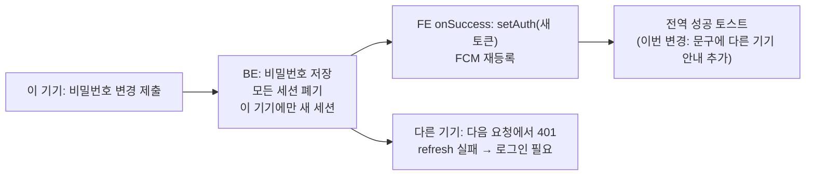

# 비밀번호 변경 성공 토스트에 "다른 기기 재로그인" 안내 추가

> 비밀번호를 바꾸면 BE가 이미 다른 기기를 전부 로그아웃시키는데, 화면은 그걸 알려주지 않는다. 이 기기는 로그인을 유지한 채 성공 토스트 문구만 보강한다.

## Context

사용자 제안은 "비밀번호 변경에 성공하면 로그아웃 처리"였다. 조사해 보니 보안상 핵심인 "다른 기기 로그아웃"은 이미 BE가 하고 있었다.

- BE `AuthService.changePassword`(`link-sphere_BE_NEW/.../domain/auth/AuthService.kt:195-209`)는 `revokeAllForMember`로 이 기기를 포함한 모든 세션을 폐기한 뒤 `createSession`으로 이 기기에만 새 세션을 발급한다. 주석은 이를 _"비밀번호가 유출됐을 가능성에 대비한 의도된 동작"_ 이라고 설명한다.
- FE `useChangePasswordMutation`(`src/entities/auth/api/auth.queries.ts:199-226`)은 새 토큰으로 `setAuth`하고 FCM을 재등록한다. 성공 토스트는 전역 `mutationSuccessHandler`(`src/shared/lib/react-query/config/queryClient.ts:53-54`)가 `meta.successMessage`로 띄운다.
- 그런데 토스트 문구는 `'비밀번호를 변경했어요.'`(`src/shared/config/texts.ts:494`)뿐이다. 다른 기기가 로그아웃됐다는 사실은 화면 어디에도 나오지 않는다.

## 판단이 필요했던 항목

| 항목                   | 결정                                                             | 근거·기각한 대안                                                                                                                                                                                                                                                                                                                                                                                                                                                                                                                                                                                                                                                                                                                    |
| ---------------------- | ---------------------------------------------------------------- | ----------------------------------------------------------------------------------------------------------------------------------------------------------------------------------------------------------------------------------------------------------------------------------------------------------------------------------------------------------------------------------------------------------------------------------------------------------------------------------------------------------------------------------------------------------------------------------------------------------------------------------------------------------------------------------------------------------------------------------- |
| 이 기기도 로그아웃할지 | **유지**(2026-11-02 사용자 선택)                                 | 보안상 얻을 것(다른 기기의 공격자 차단)은 BE가 이미 하고 있다. 이 기기 사용자는 방금 현재 비밀번호로 본인임을 확인했다. [OWASP 인증 치트시트](https://cheatsheetseries.owasp.org/cheatsheets/Authentication_Cheat_Sheet.html)는 _"재인증이 사용자 경험을 불필요하게 방해하지 않게 한다"_, _"재인증 뒤 세션을 무효화하고 토큰을 회전한다"_ (번역)고 쓰는데, 지금 구현이 이 모양이다. 반대 근거도 있다: [OWASP 세션 관리 치트시트](https://cheatsheetseries.owasp.org/cheatsheets/Session_Management_Cheat_Sheet.html)는 재인증이 필요한 사건에 _"시도했거나 완료한 비밀번호 변경"_ (번역)을 넣는다. 기각안 ① FE만 고쳐 이 기기도 로그아웃 → `/auth/login`. ② FE+BE(BE가 새 세션 발급을 멈춤, 응답 형태가 바뀌어 PR 2개·FE 먼저 배포) |
| 안내 방식              | 기존 성공 토스트 문구에 한 문장 추가                             | 새 키나 새 UI를 만들지 않는다. 같은 길이의 2문장 성공 토스트 선례: `accountDeleted`(`texts.ts:495`, 기본 표시 시간). 비밀번호 섹션에 사전 안내 문구를 다는 안은 이번 선택에 들어 있지 않아 넣지 않는다                                                                                                                                                                                                                                                                                                                                                                                                                                                                                                                              |
| 문구                   | `'비밀번호를 변경했어요. 다른 기기에서는 다시 로그인해야 해요.'` | 해요체·마침표(texts-conventions 톤 규칙). "로그아웃됐어요"보다 사용자가 겪을 일을 바로 말해 준다. "모두"는 넣지 않는다 — BE에 일괄 폐기와 같은 순간에 끝난 refresh가 살아남는 알려진 경쟁이 있다(BE `docs/plans/2026-10-12-refresh-reuse-leeway.md:159-160`). 같은 브라우저의 다른 탭은 "다른 기기"가 아니라서 이 문구와 어긋나지 않는다(새 쿠키로 조용히 따라온다, FE `docs/AUTH.md:377`)                                                                                                                                                                                                                                                                                                                                          |

## 세부 계획

| 위치                                                                   | 변경 전                    | 변경 후                                                                                                                                    |
| ---------------------------------------------------------------------- | -------------------------- | ------------------------------------------------------------------------------------------------------------------------------------------ |
| `src/shared/config/texts.ts:494` `messages.success.passwordChanged`    | `'비밀번호를 변경했어요.'` | `'비밀번호를 변경했어요. 다른 기기에서는 다시 로그인해야 해요.'`                                                                           |
| `CHANGELOG.md` `[Unreleased]` → `### Changed`                          | —                          | `` `auth` 비밀번호 변경 성공 안내에 다른 기기 재로그인 안내 추가 `` + 배경·구현 블록(BE가 다른 세션을 폐기한다는 근거, 파일 목록, PR 링크) |
| `docs/plans/2026-11-02-password-change-other-devices-notice.md` (신규) | —                          | 이 계획 파일 스냅샷(§11)                                                                                                                   |

`auth.queries.ts`는 고치지 않는다. 키 이름이 그대로라 `meta.successMessage` 연결도 그대로다.

작업 순서:

1. `git log origin/main..main`으로 미푸시 커밋 확인 → `EnterWorktree` → `cp ../../../.env .` + `pnpm install`
2. `texts.ts`, `CHANGELOG.md`를 고치고 계획 스냅샷을 추가한다
3. 검증(아래) → 커밋 `feat(auth): 비밀번호 변경 성공 안내에 다른 기기 재로그인 안내 추가` → PR(`## 계획 대비 구현`, `plan-verifier` 대조) → CI 확인 → squash 병합 → 배포 run 성공 확인 → 워크트리 정리

## 영향 범위

- **CRUD**: 데이터, API 계약, 캐시는 바뀌지 않는다. 사용자에게 보이는 문구 1개만 바뀐다.
- **회귀 후보**:
  - `passwordChanged`는 `auth.queries.ts:204` 한 곳에서만 쓴다. 테스트·e2e·docs 중 이 문구를 단정하는 곳은 없다(grep 확인).
  - 톤 가드 `src/shared/config/texts.test.ts`가 새 문구를 검사한다.
  - `docs/plans/2026-11-02-safety-net-top3.md`의 PR-E는 같은 훅의 `onError`를 고친다. 이번 변경은 `texts.ts`만 건드려 충돌하지 않는다.
- **문서**: `docs/AUTH.md:151`은 세션 회전을 설명할 뿐 토스트 문구는 적지 않아 고칠 필요가 없다. BE 문서도 이 문구를 다루지 않는다.

## 검증 방법

1. `pnpm type-check`
2. `pnpm test` — 특히 `texts.test.ts`(톤 가드), `auth.queries.test.ts`, `useChangePassword.test.tsx`
3. `pnpm lint`
4. `pnpm check:docs` — CHANGELOG `
` 짝 확인
5. 브라우저 녹화는 생략한다. 화면 동작은 그대로이고 문구만 바뀌는데, 로컬 dev는 운영 API로 프록시된다(브라우저 MSW 모드 없음). 운영 계정 비밀번호를 바꿔 확인하는 건 사용자가 원할 때만 한다.

## 남은 것

- 없음. (이 기기 로그아웃은 사용자가 고르지 않았다. 다시 검토하면 위 "판단" 표의 기각안 ①②가 출발점이다.)
