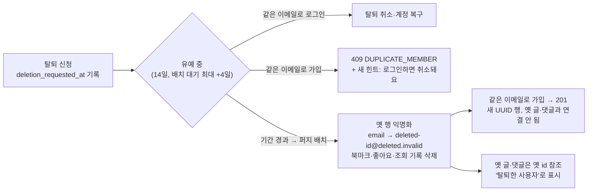
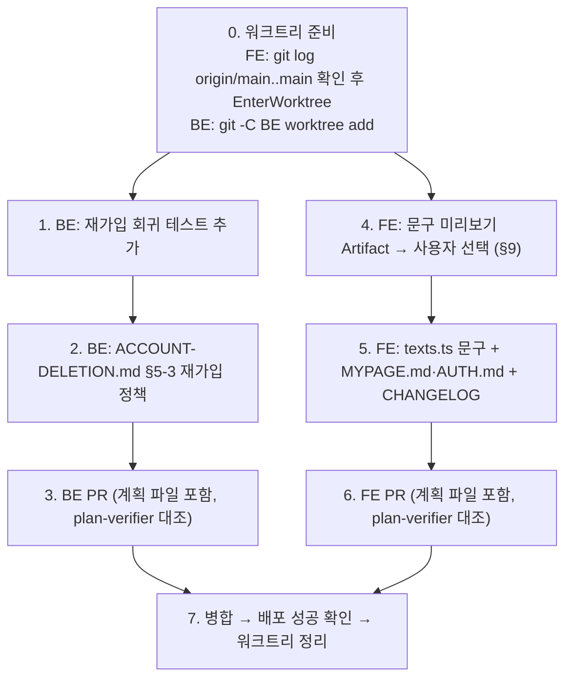

# 탈퇴 후 재가입 이메일 정책 명시 (2026-11-02)

## Context

"탈퇴한 이메일로 다시 가입할 수 있는가"가 어디에도 정책으로 적혀 있지 않다(FE·BE 문서에서 "재가입" 0건).
코드를 따라가 보면 동작은 이미 정해져 있다.

- 유예 14일(배치 대기 포함 최대 18일) 동안 같은 이메일로 가입하면 409 `DUPLICATE_MEMBER`가 나고, 로그인하면 복구된다.
- 퍼지 뒤에는 바로 가입할 수 있고, 새 UUID 행이 생겨 옛 글·댓글과 연결되지 않는다.
  - 새 행 생성: `MemberService.kt:38-42`
  - 이메일 익명화: `AccountDeletionService.kt:90`
  - 이메일로 회원을 찾는 곳은 로그인·재설정·인증 메일·가입 확인뿐이다: `MemberService.kt:72,126`, `PasswordResetService.kt:54`

이번 작업은 업계 조사와 법규 검토를 거쳐 이 동작을 **정책으로 확정**하는 것이다. 사용자가 2026-11-02 AskUserQuestion으로 고른 결정은 다음 세 가지다.

1. 재가입 시점은 현행 유지: 유예가 곧 재가입 대기 기간이고, 퍼지 뒤에는 바로 허용한다.
2. 유예 중 가입 시도에는 일반 힌트를 추가한다. 그 이메일이 탈퇴 중인지는 드러내지 않는다.
3. 탈퇴 안내 문구에 재가입 정책을 넣는다.

코드 동작은 바꾸지 않는다. 바꾸는 것은 문구, 문서, 회귀 테스트다.

### 채택 근거 요약

자세한 내용은 BE 문서 §5-3에 남긴다.

- **업계는 세 갈래다.** 아래는 공식 페이지에서 확인한 것이다.
  - 영구·장기 금지: Microsoft·Apple·Google(Gmail). 이메일 자체가 그 회사가 발급한 ID라서 성립한다.
  - 기간 제한: Spotify 14일, 29CM 7일, 더쿠 3개월.
  - 바로 허용: GitHub, 브런치.
- **업계가 대기 기간을 두는 이유는 혜택 악용과 제재 회피**인데, 둘 다 우리에게 해당하지 않는다. 우리에게는 포인트·쿠폰이 없고, 역할은 `USER`·`DEMO`뿐이다(`MemberRole.kt`).
- **퍼지 뒤에도 막으려면 이메일 해시를 보관해야 한다.** 그러면 개인정보 보호법 제21조(지체 없는 파기)와 제30조(처리방침 기재)가 걸리는데, 이 앱에는 처리방침 페이지가 없다.

## 정책 흐름

## 작업 순서

### BE (`link-sphere_BE_NEW`)

**1. 회귀 테스트**

선례는 `src/test/kotlin/.../domain/member/MemberServiceIntegrationTest.kt:37-44`(DB 유니크 인덱스까지 타는 통합 테스트)다. 같은 형태로 두 케이스를 추가한다.

- 유예 중(`deletion_requested_at` 있음, `deleted_at` 없음)인 회원과 같은 이메일로 `signup`하면 `DuplicateMemberException`이 난다.
- `AccountDeletionService.purge` 뒤 같은 이메일로 `signup`하면 성공한다.
  - 새 id ≠ 옛 id
  - 옛 행의 email은 `deleted-<옛id>@deleted.invalid`
  - `isEmailAvailable(원래 이메일)`이 퍼지 전에는 false, 후에는 true
  - 테스트 픽스처가 허락하면 옛 회원의 글이 여전히 옛 id를 참조하는지도 단정한다

기존 `AccountDeletionServiceTest.kt`·`AccountPurgeServiceTest.kt`가 쓰는 픽스처(회원 생성·purge 호출)를 먼저 읽고 재사용한다.

**2. 문서**: `docs/ACCOUNT-DELETION.md`

- `### 5-3. 재가입 정책`(§5 구조 아래)을 새로 둔다.
  - 시점별 표: 유예 중 / 배치 대기 / 퍼지 뒤 × 가입·로그인 결과
  - 새 계정과 옛 계정이 연결되지 않는 근거(`파일:줄`)
  - 같은 이메일로 이어지는 것: 레이트리밋 카운터(15분·1시간 창)
  - 업계 조사 표(공식 확인 / 스니펫 / 2차 등급 표시)
  - 법규: 개인정보 보호법 제21·30조, 서울고법 2017나2074963은 재인용으로 표시
  - 채택하지 않은 대안 2개(퍼지 뒤 추가 대기, 영구 금지)와 진 이유
  - CLAUDE.md §10 형식을 따른다: 번역 인용은 이탤릭, (번역) 표기, 링크.
- §9 검증 결과에 새 테스트를 적는다.
- §11 남은 것에 재검토 조건을 적는다. 포인트·쿠폰·제재 기능이 생기면 대기 기간과 해시 보관을 다시 검토한다. 처리방침 미비 항목은 이미 있으니 연결만 한다.
- 머리말의 마지막 검토 날짜를 2026-11-02로 바꾼다.
- `DECISIONS.md`에는 넣지 않는다. 대안 비교는 했지만 되돌리기 어렵지 않다(정책을 바꾸면 앞으로의 가입에만 적용된다). 그래서 메모리의 DECISIONS 적합성 기준상 기능 문서에 둔다.

**3. 계획 파일과 PR**

- 이 계획을 `docs/plans/2026-11-02-resignup-email-policy.md`로 같은 PR에 넣는다. 선례는 같은 이름의 계획을 FE·BE 양쪽에 둔 `2026-09-29-account-deletion-grace-period.md`다.
- `git diff origin/main...HEAD`를 스크래치패드 파일로 떨궈 `plan-verifier`로 대조한다.
- 코드 동작 변경이 없으므로 CHANGELOG 대상이 아니다.

### FE (`link-sphere_FE_NEW`)

**4. 문구 미리보기 (CLAUDE.md §9)**

회원가입 이메일 필드에서 중복일 때 보이는 모습을, 실제 `FormField` 클래스와 토큰으로 Artifact 한 장에 나란히 만든다. 모바일 360px과 데스크톱 폭을 함께 보여 주고, 사용자가 고른 뒤에 반영한다.

| 안                  | 방식                                                               | 설명                                                                                                          |
| ------------------- | ------------------------------------------------------------------ | ------------------------------------------------------------------------------------------------------------- |
| A (최소 변경, 추천) | `auth.signup.emailDuplicate` 한 줄에 힌트를 이어 붙인다            | 초안: "이미 가입된 이메일이에요. 탈퇴를 신청한 계정이라면 로그인하면 취소돼요." 모바일에서 두 줄이 될 수 있다 |
| B                   | 에러 줄은 그대로 두고, 중복일 때만 그 아래 보조 줄로 힌트를 보인다 | 새 키 `auth.signup.emailDuplicateHint`                                                                        |

**5. 반영**

- `src/shared/config/texts.ts`
  - 4에서 고른 안을 반영한다.
  - `accountSettings.deleteSectionDescription` 끝에 한 문장을 더한다. 초안: "탈퇴가 끝난 뒤 같은 이메일로 다시 가입하면 새 계정이 되고, 이전 글·댓글과는 연결되지 않아요."
    - "14일 뒤"라고 쓰지 않는다. 배치 대기로 최대 18일이라 날짜를 약속하면 어긋난다.
  - 바뀐 키 옆 주석에 BE `docs/ACCOUNT-DELETION.md` §5-3을 가리키는 줄을 단다. 기존 `GRACE_PERIOD` 주석과 같은 방식이다.
  - 문구를 쓰기 전에 `texts-conventions` skill을 읽는다(해요체, `texts.test.ts`).
- B안이면 `useSignUp.ts` / `SignUpForm.tsx`에서 중복 상태일 때만 힌트를 넘긴다. 기존 `useAvailabilityMessage`의 description 경로를 재사용한다.
- 문서
  - `docs/MYPAGE.md` 탈퇴 절(:206-218): 재가입 정책 한 줄과 BE 문서 링크
  - `docs/AUTH.md`: 회원가입 중복 확인을 서술하는 절이 있으면 힌트를 반영한다
  - 두 문서의 마지막 검토 날짜를 갱신한다
- `CHANGELOG.md` `[Unreleased]`: 사용자에게 보이는 문구 변경이다. 형식은 `changelog-release` skill을 따른다.
- 409 제출 토스트 `messages.error.accountCreateFailedDuplicateAccount`는 그대로 둔다. 중복이면 제출 버튼이 잠겨(`useSignUp.ts:139-144`) 거의 보이지 않는다.

**6. 계획 파일과 PR**: BE와 같은 계획 파일을 `docs/plans/`에 넣고 plan-verifier로 대조한다. PR 본문에 `## 계획 대비 구현` 섹션을 둔다.

## 영향 범위 (CLAUDE.md §5)

- **CRUD**: 데이터, 스키마, API 계약 변경이 없다. 배포 순서 제약도 없다.
- **FE 회귀**
  - `TEXTS.auth.signup.emailDuplicate`
    - 쓰는 곳: `useSignUp.ts:72`, e2e `signup.spec.ts:153,181`, `signup-unsaved-changes.spec.ts:150`
    - e2e는 상수를 참조하므로 A안에서도 텍스트가 일치한다. 다만 `getByText`의 부분 일치 동작은 실행해서 확인한다.
  - `deleteSectionDescription`: `DeleteAccountSection.tsx:17`만 쓴다.
  - 프로필 수정 화면의 중복 문구(`TEXTS.mypage.*`)는 별개 키라 영향이 없다.
- **BE 회귀**: 테스트와 문서만 추가한다.
- **발견만 하고 고치지 않는 것**: BE `ACCOUNT-DELETION.md` §5-1의 `TableMember.kt:47` 줄 번호가 현재(53행)와 어긋나 있다. 범위 밖이라 보고만 한다.

## 검증

- **BE**: `./gradlew test --tests '*MemberServiceIntegrationTest*'`
  - 새 두 케이스가 통과해야 한다.
  - 새 테스트를 임시로 뒤집어(퍼지 뒤 409를 기대하게) 실패하는 것을 한 번 확인한다.
  - 마지막에 전체 `./gradlew test`를 돌린다.
- **FE**
  - `pnpm type-check` → `pnpm test`(`texts.test.ts` 톤 가드 포함) → `pnpm lint` → `pnpm check:docs`
  - `pnpm test:e2e e2e/signup.spec.ts e2e/signup-unsaved-changes.spec.ts`
- **화면**: `browser-verification` skill로 `pnpm dev`(MSW 또는 로컬 BE)에서 두 화면을 녹화해 보여 준다.
  - 가입 폼에서 이메일 중복 상태 → 힌트 노출
  - `/my/account` 탈퇴 섹션 → 새 문장
  - 이 세션은 Playwright MCP 연결이 실패했으니, 안 되면 claude-in-chrome으로 대신한다.
- **병합 뒤**: FE `Frontend Deploy (S3 + CloudFront)` 워크플로와 BE 배포 워크플로가 해당 SHA에서 success인지 `gh run list`로 확인하고 보고한다. 그다음 워크트리를 정리한다.
