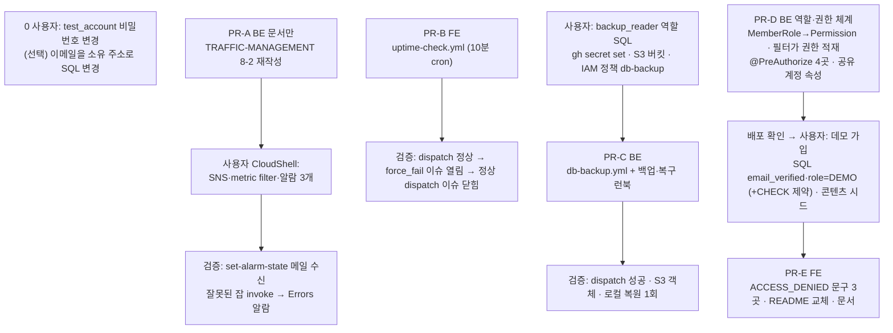
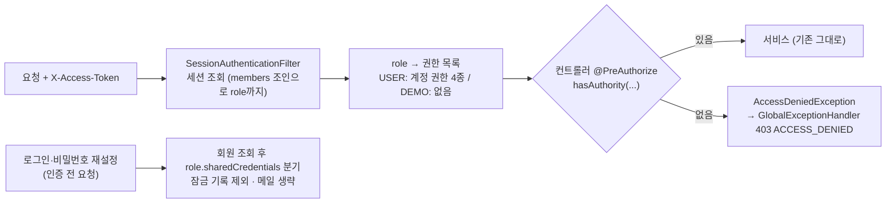

# 운영 안전망 1순위 3종 — 장애 감지 · DB/Storage 백업 · 데모 계정

> 알람 0개·백업 0개·공개 테스트 계정 상태를, 무료 범위 안에서 "고장 나면 알고, 날아가도 되살리고, 데모가 망가져도 계정은 안 뺏기는" 상태로 바꾼다.

## Context

2026-11-02 시스템 진단(대화)에서 규모와 무관하게 먼저 고칠 3가지로 꼽은 것이다. 사용자 목표는 "학습 겸 개인 도구 → 지금은 포트폴리오·학습".

- **감지**: CloudWatch 알람 0개(`aws cloudwatch describe-alarms` ap-northeast-1·us-east-1, 2026-11-02 직접 확인), 업타임 감시 없음.
  과거 장애(도메인 clientHold 4시간 — FE `docs/DEPLOY.md:452-467`)는 배포 검증이 우연히 실패해 알았다.
- **백업**: Supabase Free 플랜(사용자 확인). [Supabase 문서](https://supabase.com/docs/guides/platform/backups)상 Free는
  자동 백업이 없고, 어느 플랜이든 _"데이터베이스 백업에는 Storage API로 저장한 객체가 포함되지 않는다"_ (번역).
  레포에 DB·Storage 백업/복구 절차가 없고, `OrphanImageGcService`가 Storage 객체를 하드 삭제한다.
- **테스트 계정**: FE `README.md:29-41`에 실데이터가 쌓인 QA 계정 비밀번호가 2026-03-02(`c4405f6a`)부터 공개돼 있다.
  CI·e2e·Lighthouse 어디도 이 계정을 쓰지 않는다(바꿔도 깨지는 자동화 없음).

A·B·C는 서로 독립이다. E의 README 교체는 D 배포와 데모 계정 생성 뒤에만 한다.

## 판단이 필요했던 항목

| 항목                              | 결정                                                                                                                    | 근거·기각한 대안                                                                                                                                                                                                                                                                                                                                                                                               |
| --------------------------------- | ----------------------------------------------------------------------------------------------------------------------- | -------------------------------------------------------------------------------------------------------------------------------------------------------------------------------------------------------------------------------------------------------------------------------------------------------------------------------------------------------------------------------------------------------------- |
| 업타임 수단                       | GitHub Actions cron 10분 (사용자 선택)                                                                                  | 무료, 코드로 남음, `openapi-drift-check`가 이미 Actions에서 운영 도메인을 부른다. 한계: [GitHub 문서](https://docs.github.com/en/actions/reference/workflows-and-actions/events-that-trigger-workflows) _"최소 간격 5분"_, _"고부하 때 지연될 수 있고 … 잡이 버려질 수도 있다"_ (번역). 기각: Route 53 헬스체크(30초, [요금](https://aws.amazon.com/route53/pricing/) 월 $0.50 + 옵션 기능당 $1.00, 콘솔 수동) |
| 알람 생성 방식                    | 런북 8-2에 한 줄 CLI 명령, 사용자가 CloudShell 실행                                                                     | OIDC 역할에 cloudwatch·logs·sns 권한 없음, 로컬 IAM 사용자는 IAM 변경 불가. 기각: `scripts/setup-alarms.sh` — 여러 줄 붙여넣기가 깨진 기록(`TRAFFIC-MANAGEMENT.md:299-300`)                                                                                                                                                                                                                                    |
| Lambda `Errors` 알람              | 추가 (8-2의 "만들지 않는다"를 뒤집음)                                                                                   | 백그라운드 잡 6종 디스패치에 catch 없음(`LambdaHandler.kt:157-182`), 인증 필터 DB 예외(`SessionAuthenticationFilter.kt:30`)는 예외 처리기를 우회 → `Errors`에만 잡힌다. 원래 근거("앱 500은 안 잡힌다")는 그대로 맞고, 앱 500은 metric filter가 맡는다                                                                                                                                                         |
| 앱 500 감지                       | JSON metric filter: `GlobalExceptionHandler`의 ERROR만                                                                  | 로그는 logstash JSON 한 줄(`LambdaHandler.kt:90-93`). 모든 ERROR에 걸면 FCM·Gemini·메일의 일상 실패(`FcmService.kt:82`, `PostAIService.kt:133`, `MailService.kt:62`)로 소음                                                                                                                                                                                                                                    |
| BE 배포 실패 이슈                 | 하지 않음                                                                                                               | push로 돈 실행 실패는 GitHub가 메일로 알리고, 미승격은 `prod-alias-drift-check`가 2시간 뒤 잡는다. `deploy.yml` 수정은 재배포를 부른다                                                                                                                                                                                                                                                                         |
| 백업 계정                         | 전용 `backup_reader` 역할(읽기 전용, BYPASSRLS)                                                                         | 앱 `postgres` 비밀번호를 GitHub에 두지 않는다. `adhoc_readonly`는 열 단위 권한이라 pg_dump 불가(`schema.sql:13`). RLS 켜짐·정책 0개라 BYPASSRLS 필수                                                                                                                                                                                                                                                           |
| 덤프 보관 위치                    | 비공개 S3 `link-sphere-db-backup`, 쓰기 전용 정책                                                                       | 두 레포 PUBLIC(`gh repo view`) — artifact는 읽기 권한자 누구나 받는다. 덤프에 bcrypt 해시·이메일 포함                                                                                                                                                                                                                                                                                                          |
| 덤프 범위                         | `--schema=public`, 세션·토큰·rate limit 테이블 데이터 제외                                                              | `member_sessions`·`member_action_tokens`·`auth_rate_limits`는 계속 바뀌고 토큰 해시를 백업에 남기지 않는다. 복원 뒤 전원 재로그인                                                                                                                                                                                                                                                                              |
| 백업 검증                         | 매 실행 복원: 성공 + 테이블 수 일치 + 핵심 4테이블 행 > 0, 통과/실패만 출력                                             | 기각: "덤프 시점 행 수와 일치" — 스냅샷이 달라 무작위 실패. 행 수 출력은 공개 로그에 사용자 수를 노출                                                                                                                                                                                                                                                                                                          |
| Storage 백업                      | 복원한 DB에서 참조 URL 추출 → 새 것만 S3로                                                                              | custom 덤프는 압축이라 grep 불가. GC와 같은 정규식(`OrphanImageGcService.kt:12,72-76`). `storage/`는 만료 없음 — GC가 지운 원본도 남는다                                                                                                                                                                                                                                                                       |
| IAM 정책 이름                     | `db-backup`                                                                                                             | `deploy` 이름으로 `put-role-policy`하면 기존 배포 정책을 덮어쓴다(BE `docs/DEPLOY.md:173`)                                                                                                                                                                                                                                                                                                                     |
| 데모 범위                         | 계정 설정만 차단(사용자 선택)                                                                                           | 리뷰어가 링크 등록 흐름을 해볼 수 있어야 한다. 기각: 글·댓글까지 차단                                                                                                                                                                                                                                                                                                                                          |
| 차단 방식                         | 역할·권한 체계(RBAC): 역할 → 권한 표, 인증 필터가 권한을 싣고 컨트롤러 `@PreAuthorize`가 검사 (사용자 선택, 2026-11-02) | 지금은 권한 목록이 항상 빈 값(`SessionAuthenticationFilter.kt:32` `emptyList()`), `@PreAuthorize` 0건. 역할이 늘면 표에 한 줄로 끝난다(관리자·신고 기능 대비). 기각: `DemoAccountGate`(서비스 4곳에 `if DEMO`, 선례 `EmailVerificationGate`) — 변경은 작지만 역할마다 게이트가 늘어난다. `@PreAuthorize`·`@EnableMethodSecurity`는 설치된 spring-security 6.5.11 jar에 있음(직접 확인)                         |
| 역할 저장 위치                    | 기존 `members.role` 열을 enum으로 읽기 전용 매핑, 값 `USER`·`DEMO`                                                      | 운영에 이미 있음(`schema.sql:287`), 현재 11건 전부 `USER`(직접 확인). 기각: 새 `is_demo` 열(마이그레이션 도구 없음, 배포 순서 위험)                                                                                                                                                                                                                                                                            |
| 역할을 요청마다 읽는 방법         | 세션 조회 쿼리를 `members`와 조인해 한 번에 `role`까지                                                                  | 필터는 지금 `member_sessions`만 읽는다(`MemberSessionService.kt:211-226`). 기각: 회원 조회 1회 추가(로그인한 모든 요청에 쿼리 +1). 세션을 매 요청 DB로 확인하므로 역할 변경이 즉시 반영된다                                                                                                                                                                                                                    |
| 권한 거부 응답                    | `GlobalExceptionHandler`에 `AccessDeniedException` 처리기 추가 → 403 `ACCESS_DENIED`                                    | 메서드 보안이 던지는 `AuthorizationDeniedException`은 `AccessDeniedException` 하위(6.5.11 `javap` 확인)인데, 지금은 `Exception` 전체 처리기(:413)만 있어 500 + "Unhandled exception" 로그(→ 새 App5xx 알람)로 샐 수 있다 — 구현 때 보안 테스트로 403을 단정한다. 코드는 URL 단계 거부(`CustomAccessDeniedHandler`)와 같은 `ACCESS_DENIED`                                                                      |
| 로그인 잠금 제외·재설정 메일 무음 | 권한이 아니라 역할 속성 `sharedCredentials`(DEMO만 true)로 분기 (잠금 제외는 사용자 선택)                               | 로그인·재설정은 인증 _전_ 요청이라 권한 목록이 없다. 비밀번호가 공개라 이메일 잠금은 방해만 하고(`AuthService.kt:139`, 조회 전 검사), 수신함 없는 주소로의 반복 반송은 SES 평판을 깎는다. 인증 메일은 이미 인증된 회원에게 안 간다(`AuthService.kt:91`)                                                                                                                                                        |
| FE 에러 문구                      | 세 mutation의 `onError`에서 `ACCESS_DENIED`면 기존 `TEXTS.messages.error.accessDenied`                                  | 셋 다 `manualErrorHandling: true`(`auth.queries.ts:204`, `account.queries.ts:87,143`)라 전역 처리(`error-toast.ts:131`)가 침묵한다. 새 문구 키는 만들지 않는다                                                                                                                                                                                                                                                 |

### 역할·권한 표 (현재 → 적용 후)

운영 DB 조회(2026-11-02): 회원 11명, `role`은 전부 `USER`. 지금 이 열은 엔티티 미매핑, 응답은 `"USER"` 고정(`AuthDTO.kt:78`), FE 타입(`account.dto.ts:19`)만 있고 읽는 코드 없음.

| 계정 종류                                | 개수  | 현재 구분                                                              | 적용 후 `role` | 계정 권한 4종               | 공유 계정 속성 |
| ---------------------------------------- | ----- | ---------------------------------------------------------------------- | -------------- | --------------------------- | -------------- |
| 일반 회원(인증 완료)                     | 5     | 없음                                                                   | USER           | 전부                        | false          |
| README 테스트 계정(사용자 QA용으로 전환) | 1     | 없음 — 비밀번호 공개된 일반 회원                                       | USER           | 전부                        | false          |
| 자동화 테스트 계정 `tester_new_999`      | 1     | 없음                                                                   | USER           | 전부                        | false          |
| 미인증 회원                              | 3     | `email_verified=false` → `EmailVerificationGate`(글·댓글·미리보기 403) | USER           | 전부 (인증 게이트는 그대로) | false          |
| RSS 봇                                   | 1     | `is_bot`(검색 필터만), 맞출 수 없는 비밀번호 해시로 로그인 불가        | USER           | 해당 없음(로그인 불가)      | false          |
| 데모 계정 `demo@linksphere.click`        | 0 → 1 | —                                                                      | DEMO           | 없음                        | true           |

계정 권한 4종: `ACCOUNT_PROFILE_UPDATE`(PATCH `/auth/account`), `ACCOUNT_PASSWORD_CHANGE`(PATCH `/auth/account/password`), `ACCOUNT_DELETE`(DELETE `/auth/account`), `SESSION_LOGOUT_ALL`(POST `/auth/logout-all`). 글·댓글·북마크 등 나머지는 권한 표에 넣지 않는다(지금 막을 역할이 없음).

### 받아들인 위험

- 데모로 글·댓글 작성, 시드 글 수정·삭제, 공개 피드 스팸이 가능하다(기존 한도: 글 시간당 20). 망가지면 사용자가 다시 시드한다.
- 데모로 푸시를 켠 방문자는 데모 글 댓글 알림을 받는다.
- 데모 가입 시 인증 메일 1통이 반송된다(1회).
- 공개 레포에서 60일 동안 활동이 없으면 예약 워크플로가 꺼진다 — BE 백업도 조용히 멈출 수 있다.

## 세부 계획

### 0. 사용자 즉시 작업 (코드 없음)

| 작업                            | 내용                                                                                                       |
| ------------------------------- | ---------------------------------------------------------------------------------------------------------- |
| test_account 비밀번호 변경      | 앱 내 계정 화면. git 이력에 남은 옛 비밀번호를 무효화                                                      |
| (선택) test_account 이메일 변경 | 이메일 변경 API가 없어 SQL로. 지금 주소의 도메인은 우리 소유가 아니라 계정 복구 메일을 우리가 받을 수 없다 |

### Phase A — 장애 감지 (BE PR-A 문서, FE PR-B)

| 위치                                                    | 변경 내용                                                                                                                                                                                                                                                                                                                                                                                                                                                                                                     |
| ------------------------------------------------------- | ------------------------------------------------------------------------------------------------------------------------------------------------------------------------------------------------------------------------------------------------------------------------------------------------------------------------------------------------------------------------------------------------------------------------------------------------------------------------------------------------------------- |
| BE `docs/TRAFFIC-MANAGEMENT.md` 8-2 (:330-351)          | 콘솔 단계 → 한 줄 CLI: 로그 형식 확인(`aws logs filter-log-events … '{ $.level = "ERROR" }'`), `sns create-topic link-sphere-alerts`, `sns subscribe`(이메일은 셸 변수, 레포에 안 남김), `logs put-metric-filter`(패턴 `{ ($.level = "ERROR") && ($.logger_name = "com.example.linksphere.global.exception.GlobalExceptionHandler") }` → `LinkSphere/App5xx`), `put-metric-alarm` ×3(App5xx·Errors·Throttles, Sum 300초 1주기 ≥1, `--treat-missing-data notBreaching`). Errors 알람을 만드는 이유로 고쳐 쓴다 |
| BE `docs/TRAFFIC-MANAGEMENT.md` 7-2 (:217-221)·§11      | 적용 상태·남은 것 갱신                                                                                                                                                                                                                                                                                                                                                                                                                                                                                        |
| FE `.github/workflows/uptime-check.yml` (신규)          | cron `7-59/10 * * * *` + `workflow_dispatch`(입력 `force_fail`), `concurrency`. `https://linksphere.click/`와 `/api/actuator/health`(본문에 `"UP"`)를 20초 간격 3회 재시도. report 잡(`issues: write`만)이 라벨 `uptime`으로 중복 방지·복구 시 자동 닫기(`prod-alias-drift-check.yml:62-100` 형태), 새 이슈를 열 때만 잡 실패                                                                                                                                                                                 |
| FE `docs/DEPLOY.md`                                     | "업타임 감시" 절: 무엇을 보는지, 알림 경로, cron 한계                                                                                                                                                                                                                                                                                                                                                                                                                                                         |
| FE·BE `docs/plans/2026-11-02-safety-net-top3.md` (신규) | 이 계획 스냅샷 — 각 레포의 첫 PR(A·B)에 커밋                                                                                                                                                                                                                                                                                                                                                                                                                                                                  |

### Phase C — 백업 (사용자 준비 → BE PR-C)

| 위치                                               | 변경 내용                                                                                                                                                                                                                                                                                                                                                                                                                                                                                                                                                                                                                                                                    |
| -------------------------------------------------- | ---------------------------------------------------------------------------------------------------------------------------------------------------------------------------------------------------------------------------------------------------------------------------------------------------------------------------------------------------------------------------------------------------------------------------------------------------------------------------------------------------------------------------------------------------------------------------------------------------------------------------------------------------------------------------- |
| BE `docs/DEPLOY.md` 새 장 "DB·Storage 백업과 복구" | ① `backup_reader` 생성 SQL(LOGIN, hex 비밀번호, BYPASSRLS, `default_transaction_read_only=on`, public 테이블·시퀀스 SELECT, postgres의 기본 권한으로 향후 테이블·시퀀스 SELECT) ② `gh secret set BACKUP_DATABASE_URL`(세션 풀러 5432, `sslmode=require`) ③ 버킷 한 줄 명령(퍼블릭 차단, 버전 관리, 수명 주기 `db/` 30일·`storage/` 무기한) ④ 인라인 정책 `db-backup`(`s3:PutObject` `db/*`·`storage/*`, `s3:ListBucket` prefix `storage/`) ⑤ 복구 절차: 새 Supabase 프로젝트에 TOC에서 `SCHEMA public`을 뺀 pg*restore → §12 권한 재적용(`adhoc_readonly` 열 단위 revoke) → `SPRING_DATASOURCE*\*` 교체·LAMBDA-CONFIG-ROLLBACK 절차, RPO 최대 24시간 ⑥ 로컬 복원 리허설 명령 |
| BE `docs/DEPLOY.md` §1 정책 목록·§12               | `db-backup` 정책, `backup_reader` 언급                                                                                                                                                                                                                                                                                                                                                                                                                                                                                                                                                                                                                                       |
| BE `.github/workflows/db-backup.yml` (신규)        | cron 매일 03:23 KST + `workflow_dispatch`. backup 잡(`id-token: write`): 다이제스트 고정 `pgvector/pgvector:pg17`로 `pg_dump --format=custom --schema=public --no-owner --no-privileges --exclude-table-data=…3개` → 같은 이미지 컨테이너에 사전 준비(`schema.sql:28-31`의 `extensions`+vector, `auth.uid()` 스텁, `DROP SCHEMA public CASCADE`) 후 `pg_restore --exit-on-error --single-transaction` → 테이블 수·핵심 4테이블 행 > 0 확인(통과/실패만 출력, stderr는 파일로) → 복원 DB에서 참조 이미지 URL 추출, `storage/`에 없는 것만 받아 업로드 → 덤프를 `db/<UTC 날짜>.dump`로 업로드. report 잡: 라벨 `db-backup` 중복 방지·자동 닫기                                 |

### Phase D·E — 데모 계정 (BE PR-D → 사용자 → FE PR-E)

| 위치                                                                                                                               | 변경 내용                                                                                                                                                                                                                                                                                                                                                                                 |
| ---------------------------------------------------------------------------------------------------------------------------------- | ----------------------------------------------------------------------------------------------------------------------------------------------------------------------------------------------------------------------------------------------------------------------------------------------------------------------------------------------------------------------------------------- |
| BE `domain/member/MemberRole.kt` (신규)                                                                                            | enum `USER`·`DEMO`. 속성 `permissions: Set<Permission>`(USER = 계정 권한 4종, DEMO = 빈 집합), `sharedCredentials: Boolean`(DEMO만 true)                                                                                                                                                                                                                                                  |
| BE `domain/member/Permission.kt` (신규)                                                                                            | enum `ACCOUNT_PROFILE_UPDATE`·`ACCOUNT_PASSWORD_CHANGE`·`ACCOUNT_DELETE`·`SESSION_LOGOUT_ALL`                                                                                                                                                                                                                                                                                             |
| BE `domain/member/TableMember.kt`                                                                                                  | `role` 열을 `@Enumerated(STRING)` 읽기 전용(`insertable=false, updatable=false`)으로 매핑                                                                                                                                                                                                                                                                                                 |
| BE `domain/auth/MemberSessionRepository.kt` (:23 부근)                                                                             | 액세스 토큰 해시로 세션과 `members.role`을 한 번에 읽는 조인 쿼리 추가                                                                                                                                                                                                                                                                                                                    |
| BE `domain/auth/MemberSessionService.kt` (:24, :211-226)                                                                           | `AccessTokenCheck.Valid`에 `role` 추가, `checkAccessToken`이 새 쿼리 사용                                                                                                                                                                                                                                                                                                                 |
| BE `domain/auth/SessionAuthenticationFilter.kt` (:32)                                                                              | `emptyList()` → `role.permissions`를 `SimpleGrantedAuthority`로                                                                                                                                                                                                                                                                                                                           |
| BE `global/config/SecurityConfig.kt` (:24)                                                                                         | `@EnableMethodSecurity`                                                                                                                                                                                                                                                                                                                                                                   |
| BE `domain/auth/AuthController.kt` (:129 logout-all, :161 계정 수정, :176 비밀번호, :198 탈퇴)                                     | 메서드마다 `@PreAuthorize("hasAuthority('<권한>')")`. `@Operation` 설명(:125,157,171,190)에 `403 ACCESS_DENIED`                                                                                                                                                                                                                                                                           |
| BE `global/exception/GlobalExceptionHandler.kt`                                                                                    | `@ExceptionHandler(AccessDeniedException::class)` → 403 `ACCESS_DENIED`                                                                                                                                                                                                                                                                                                                   |
| BE `domain/auth/AuthService.kt` `login` (:136-170)                                                                                 | 비밀번호 오답일 때 `member.role.sharedCredentials`면 IP 버킷만 기록                                                                                                                                                                                                                                                                                                                       |
| BE `domain/auth/PasswordResetService.kt` `requestReset` (:54)                                                                      | `sharedCredentials`면 토큰·메일 없이 return(응답은 그대로 200)                                                                                                                                                                                                                                                                                                                            |
| BE `domain/auth/AuthService.kt` `toAccountResponse` (:223) · `AuthDTO.kt:78`                                                       | 응답 `role`을 고정값 `"USER"` 대신 실제 역할로                                                                                                                                                                                                                                                                                                                                            |
| BE 테스트                                                                                                                          | ① `PostSecurityTest` 형태의 보안 체인 테스트(신규): USER 토큰은 4개 엔드포인트 통과, DEMO 토큰은 403 `ACCESS_DENIED`(500 아님) ② 세션+역할 조인 쿼리 Testcontainers 저장소 테스트 ③ `AuthServiceTest` 잠금 제외, `PasswordResetServiceTest` 메일 생략 ④ `AccessTokenCheck.Valid` 생성 10곳 갱신 ⑤ `AuthControllerTest`(`@WithMockUser`)에 메서드 보안이 걸리면 권한 추가                  |
| BE `docs/BE-ARCHITECTURE.md`                                                                                                       | "역할·권한" 절 신규(위 역할·권한 표, 권한 추가 방법), 코드 표(:359)                                                                                                                                                                                                                                                                                                                       |
| BE `docs/ACCOUNT-DELETION.md`, `CHANGELOG.md`                                                                                      | 데모는 탈퇴 불가 한 줄, feat 항목                                                                                                                                                                                                                                                                                                                                                         |
| 사용자 (D 배포 확인 뒤)                                                                                                            | `demo@linksphere.click`으로 가입 → `update members set email_verified = true, role = 'DEMO' where email = 'demo@linksphere.click';` → (권장) `alter table members add constraint members_role_check check (role in ('USER','DEMO'));` — 오타 값이 들어가면 그 회원 로드가 enum 변환에서 실패한다 → 데모 글·북마크 시드. 데모 비밀번호 값은 사용자가 정하고, README에 넣기 전에 확인받는다 |
| FE `entities/account/model/account.dto.ts` (:19)                                                                                   | `role` 타입에 `'DEMO'` 추가                                                                                                                                                                                                                                                                                                                                                               |
| FE `entities/auth/api/auth.queries.ts` (:218-223), `entities/account/api/account.queries.ts` (:47-55, :155-159)                    | `onError`에서 `ACCESS_DENIED`면 기존 `TEXTS.messages.error.accessDenied` 토스트                                                                                                                                                                                                                                                                                                           |
| FE `auth.queries.test.ts`, `account.queries.test.ts`                                                                               | MSW 403 `ACCESS_DENIED` → 문구 확인                                                                                                                                                                                                                                                                                                                                                       |
| FE `src/shared/api/generated/openapi.*`                                                                                            | BE 스펙 재생성(설명 변경, drift 이슈 방지)                                                                                                                                                                                                                                                                                                                                                |
| FE `README.md` (:29-41)                                                                                                            | 테스트 계정 → 데모 계정(할 수 있는 것·못 하는 것 한 줄)                                                                                                                                                                                                                                                                                                                                   |
| FE `docs/TESTING.md:1535`, `docs/PERFORMANCE.md:57`, `docs/ONBOARDING.md:21,69`, `.claude/skills/browser-verification/SKILL.md:37` | "README 테스트 계정" 언급 갱신                                                                                                                                                                                                                                                                                                                                                            |
| FE `docs/AUTH.md`, `docs/SYSTEM-ARCHITECTURE.md`, `CHANGELOG.md`                                                                   | 데모 계정 절, 감시·백업 절(BE 런북 링크), feat 항목                                                                                                                                                                                                                                                                                                                                       |

## 영향 범위

**CRUD 실패 지점**

- **인증된 모든 요청(가장 큰 위험):** 세션 조회 쿼리를 바꾸므로, 조인이 틀리면 로그인한 요청이 전부 실패한다. 그래서 저장소 통합 테스트와 배포 뒤 로그인 상태 조회로 확인한다.
- 읽기(members): `role` 매핑에는 운영·테스트 스키마 둘 다에 열이 있어야 한다. 운영은 확인했고, 테스트는 `schema.sql:287`에 있다. enum에 없는 값이 DB에 있으면 그 회원 로드가 실패한다(CHECK 제약 권장).
- 수정·삭제(계정): DEMO만 403이고 USER 경로는 그대로다(보안 체인 테스트로 단정). 프로필 사진 변경이 막히면 이미 올린 이미지가 고아가 되고, GC가 24시간 뒤 지운다.
- 로그인: `sharedCredentials` 역할만 이메일 잠금에서 빠지고, 일반 회원 잠금은 그대로다.
- 권한 표에 없는 엔드포인트(글·댓글·북마크 등)는 `@PreAuthorize`가 없으니 동작이 바뀌지 않는다.
- 백업 연결: 세션 풀러 5432에 짧게 1개만 쓴다. 6543이 아니라서 세션 `SET`이 앱 풀로 새지 않는다. 역할이 `default_transaction_read_only=on`이라 쓰기를 할 수 없다.

**기존 기능 회귀**

- FE 세 mutation의 기존 `onError` 분기(현재 비밀번호 틀림 등)가 그대로인지는 기존 테스트로 확인한다. 구현 전 `pnpm graph:focus "<파일>" --text`로 사용처를 뽑는다.
- `TRAFFIC-MANAGEMENT.md` 8-2의 기존 결정 문장이 바뀐다.
- 비동기 invoke는 두 번 재시도해서, 실패 1건이 `Errors`를 최대 3번 올린다. 임계값이 1이라 알림은 똑같이 1번 간다.
- `openapi-drift-check`: E에서 스펙을 재생성하지 않으면 다음 날 이슈가 열린다.

**배포 순서**

- BE D가 먼저 나간다. FE 문구가 먼저 나가도 무해하다(모르는 코드는 기존 실패 문구로 처리). 다만 README 교체는 데모 계정이 생긴 뒤에만 한다.

## 검증 방법

| 단계 | 확인                                                                                                                                                                                                                                                                                                                                                                                                                                |
| ---- | ----------------------------------------------------------------------------------------------------------------------------------------------------------------------------------------------------------------------------------------------------------------------------------------------------------------------------------------------------------------------------------------------------------------------------------- |
| A    | `aws logs test-metric-filter`가 실제 ERROR 로그 줄과 맞는다. `aws sns list-subscriptions-by-topic`이 Confirmed다. 알람별 `aws cloudwatch set-alarm-state --state-value ALARM`으로 메일이 온다. `aws lambda invoke --function-name link-sphere-api:prod --payload '{"linksphereJob":"comment-postprocess","event":{}}'`(부작용 없이 페이로드 단계에서 실패)로 Errors 알람이 끝까지 울린다                                            |
| B    | 정상 dispatch는 green이다. `force_fail` dispatch에서 `uptime` 이슈가 1개 열린다. 다시 정상 dispatch하면 이슈가 닫힌다                                                                                                                                                                                                                                                                                                               |
| C    | `aws iam simulate-principal-policy`에서 Put은 허용, Get·Delete는 거부된다. dispatch 1회가 green이다. `aws s3 ls`에 `db/`·`storage/` 객체가 있다. 덤프를 받아 로컬 `pgvector/pgvector:pg17`에 복원하고 `linksphere-ro` 조회와 행 수를 대조한다(1회 리허설)                                                                                                                                                                           |
| D    | `./gradlew test`(보안 체인 테스트에서 DEMO는 403, 500이 아님). 배포 run이 success다. 일반 계정으로 로그인 상태 조회(`GET /api/auth/account`)가 정상이다. 데모로 curl PATCH `/api/auth/account/password`·PATCH/DELETE `/api/auth/account`·POST `/api/auth/logout-all`가 각각 403 `ACCESS_DENIED`다. 같은 시각 App5xx 알람이 울리지 않는다. 재설정 요청은 200이고 MailService 로그가 없다. 틀린 비밀번호 6회 뒤에도 데모로 로그인된다 |
| E    | `pnpm type-check`·`pnpm test`·`pnpm lint`·`pnpm check:docs`. 브라우저 검증 녹화(데모로 비밀번호 변경을 시도하면 "접근 권한이 없어요." 토스트). 배포 run이 success다                                                                                                                                                                                                                                                                 |
| 공통 | PR마다 `plan-verifier`로 이 계획과 diff를 대조하고 PR 본문 `## 계획 대비 구현`에 남긴다. BE는 `git -C <BE> worktree add`로 워크트리를 만든다                                                                                                                                                                                                                                                                                        |

## 남은 것

- AWS Budgets 알림, 도메인 등록자 연락처 상태(`route53domains get-contact-reachability-status`) 자동 점검
- BE 레포 60일 무활동 시 백업 예약이 꺼지는 위험 — 필요해지면 FE 업타임에 "마지막 백업 성공 시각" 점검 추가
- Storage 객체 복원 절차는 원본 경로로 다시 올리는 수준까지만 문서화한다(자동화 안 함)
- 데모 재시드 스크립트
- 관리자 역할(신고·모더레이션)을 만들 때 권한 표에 역할·권한 추가. FE가 응답 `role`로 계정 설정 버튼을 숨기는 것도 그때 검토
- 알람·버킷·정책의 IaC화
