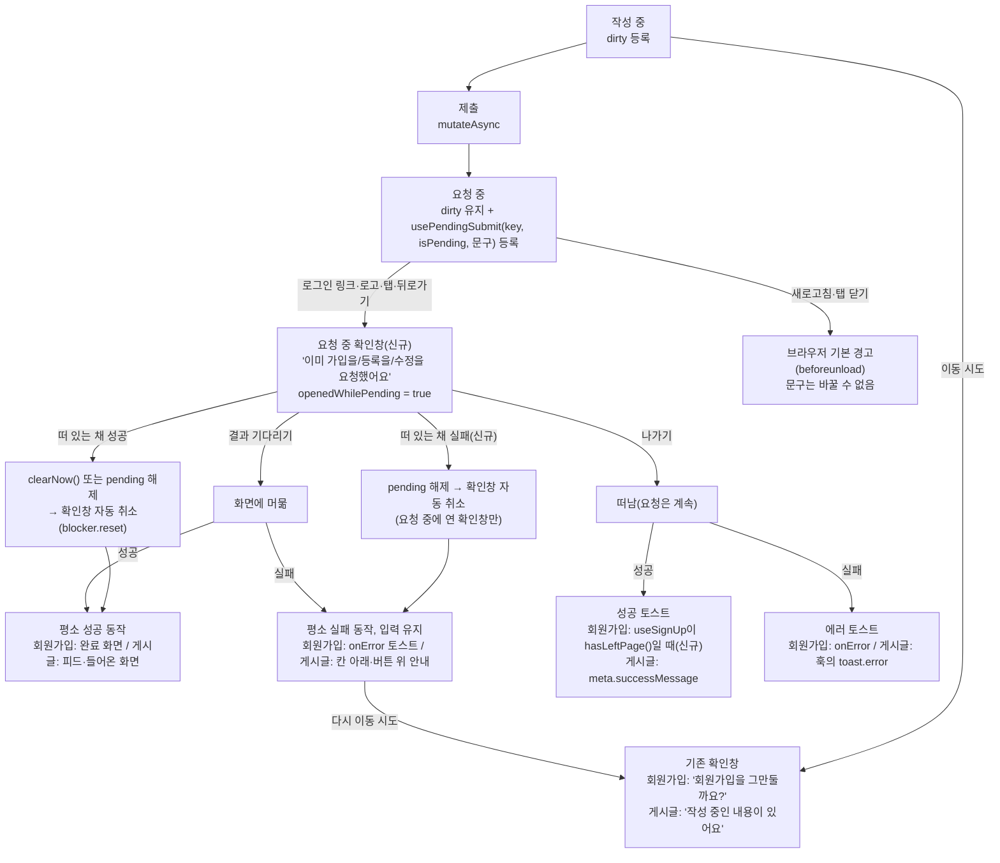

# 저장 요청 중 이탈 — 회원가입 가드 적용 + 요청 중 전용 확인창(회원가입·게시글 등록·수정)

> 가입 요청이 진행되는 동안에도 이탈 확인창을 띄우고, "나가기"로 떠난 뒤 가입이 끝나면 결과를 토스트로 알린다.
> 요청을 이미 보낸 상태의 확인창은 "그만둘까요/사라져요"가 아니라 "이미 요청했어요" 전용 문구로 띄우고, 그 확인창이
> 떠 있는 동안 요청이 끝나면(성공·실패 모두) 확인창을 닫는다. 회원가입·게시글 등록·게시글 수정 세 폼에 적용한다.

## Context

**문제 1 (처음 제보)**: 회원가입을 제출하고 응답이 오기 전에 하단 "로그인" 링크를 누르면 확인 없이 로그인 화면으로
이동하고, 가입이 성공했는지 알 수 없다.

**문제 2 (계획 1차 구현 뒤 사용자 지적, 2026-11-02)**: 1차 구현은 요청 중에도 기존 문구("회원가입을 그만둘까요? /
지금 나가면 입력한 가입 정보가 사라져요")를 그대로 썼다. 요청을 이미 보냈으니 나가도 가입은 취소되지 않는다.
그러니 요청을 보냈다는 사실을 알리는 문구가 필요하다. 게시글 등록·수정도 저장 중에 "입력한 내용이 사라져요"라고
말해 같은 문제가 있다.

**원인(코드 추적으로 확인)**

- 회원가입만 요청 중에 이탈 가드를 껐다 — `useUnsavedChanges('auth-signup', isDirty && !isPending && !isSubmitted)`
  (origin/main `useSignUp.ts:47-50`). 가입 성공은 화면 안 상태(완료 화면)로만 보여주고 토스트가 없다
  (`auth.queries.ts:123-150`).
- 가드는 요청 중인지 모른다. 문구는 경로로만 고르고(`useUnsavedChangesGuard.ts:86-88`), 스토어에는 "작성 중"
  이름표(`dirtyKeys`)만 있다(`unsavedChanges.store.ts:3-7`).
- 확인창이 저절로 닫히는 건 작성 중 이름표가 모두 빠질 때뿐이다(`useUnsavedChangesGuard.ts:120-128`). 요청이 실패하면
  입력이 남아 확인창도 남는다. 전용 문구를 넣기만 하면 실패한 뒤 "취소되지 않아요"가 틀린 채 떠 있게 된다.
- 열린 확인창의 문구를 바꾸는 API는 없다 — `openConfirm`·`cancelAlert`만 있다(`alert.store.ts:33-36`). `cancelAlert`는
  `onCancel`을 불러 막힌 이동을 `reset`한다(`:68-71`).
- 가드는 `shared`에 있어 `entities`의 mutation 키를 import할 수 없다. `queryClient.isMutating() > 0`
  (`auth.util.ts:144`)은 그 화면의 모든 요청을 센다.

**선례**: 게시글 등록·수정의 "저장 요청 중 이탈"(2026-10-21, `docs/UNSAVED-CHANGES-GUARD.md` §5,
`docs/plans/2026-10-21-post-submit-leave-guard.md`). 요청 중에도 dirty를 유지하고, 확인창이 떠 있는 동안 성공하면
확인창을 닫는다. "나가기" 뒤 응답은 `useHasLeftPage()`로 떠났는지 보고 토스트로 알린다(`useCreatePost.ts:115-138`).
새 훅 `usePendingSubmit`은 `useUnsavedChanges.ts`(레이아웃 effect로 동기 등록, 언마운트 때 해제)를 본뜬다.

**라이브러리 동작 확인**: `mutateAsync`의 promise는 언마운트 뒤에도 resolve된다(`@tanstack/query-core` 5.90.16
`build/modern/mutationObserver.js:38-62`, `@tanstack/react-query` 5.90.16 `build/modern/useMutation.js:40`).
"지금 나가도 취소되지 않아요"는 이 사실과 1차 녹화(`3-나가기-성공토스트.webm`, 나간 뒤 성공 토스트)로 확인했다.

## 판단이 필요했던 항목

| 항목                         | 결정                                                                                                                                                                                             | 근거·기각한 대안                                                                                                                                                                                                                                                                                             |
| ---------------------------- | ------------------------------------------------------------------------------------------------------------------------------------------------------------------------------------------------ | ------------------------------------------------------------------------------------------------------------------------------------------------------------------------------------------------------------------------------------------------------------------------------------------------------------ |
| 요청 중 이탈 처리 방식       | 선례대로 확인창 + 떠나면 결과 토스트 (2026-11-02 사용자 선택)                                                                                                                                    | 기각: 확인창 없이 토스트만 — 이동 자체를 막지 못하고, 새로고침·탭 닫기 땐 경고 없이 결과를 잃는다                                                                                                                                                                                                            |
| 요청 중 확인창 문구          | **전용 문구로 바꾼다** (2026-11-02 사용자 지적으로 1차 결정 "기존 문구를 받아들인다"를 뒤집음)                                                                                                   | [NN/g 확인 대화상자 글](https://www.nngroup.com/articles/confirmation-dialog/)은 _"행동의 결과를 구체적으로 알려라. '정말 이렇게 할까요?'라고 묻지 마라"_ (번역)고 하고, 버튼도 _"각 선택의 결과를 요약하라"_ (번역)고 한다. 요청 중 "사라져요"는 사실과 다른 결과를 알린다                                  |
| 회원가입 문구                | A안 (사용자 선택): 제목 `이미 가입을 요청했어요`, 본문 `지금 나가도 가입은 취소되지 않아요. 결과는 이동한 화면에서 알려드려요.`, 버튼 `나가기` / `결과 기다리기`                                 | 기각 B "가입을 처리하고 있어요": "이미 요청했다"는 핵심이 제목에 없다. 기각 C(실패 시 재입력 안내): 본문이 길어진다                                                                                                                                                                                          |
| 게시글 문구                  | P2 등록·수정 따로 (사용자 선택): `이미 등록을 요청했어요` / `이미 수정을 요청했어요`, 본문은 같은 틀(`지금 나가도 등록은/수정은 취소되지 않아요. 결과는 이동한 화면에서 알려드려요.`), 버튼 같음 | 버튼 문구("등록 중..."·"수정 중...", `CreatePostForm.tsx:172`·`UpdatePostForm.tsx:98`)와 맞춘다. 기각 P1 "저장" 하나: 구현은 작지만 버튼 문구와 어긋난다                                                                                                                                                     |
| 범위                         | 회원가입 + 게시글 등록·수정 (사용자 선택)                                                                                                                                                        | 세 폼 모두 요청 중 dirty를 유지한다. 댓글 폼은 요청 중 이탈 확인창 대상이 아니라 그대로 둔다                                                                                                                                                                                                                 |
| 확인창이 떠 있는 채 실패하면 | **자동으로 닫는다** (사용자 선택). 요청 중에 연 확인창만 해당                                                                                                                                    | 성공 때 이미 닫히는 것과 같은 규칙("확인창의 전제가 바뀌면 닫는다")이다. 화면에 머물러 실패 안내를 보고 입력도 남는다. 나가려면 한 번 더 누르면 되고, 그때는 기존 확인창이 뜬다. 기각: 그대로 두기 — 틀린 문구가 남는다. 기각: 일반 확인창으로 교체 — 확인창 스토어에 새 API가 필요하고 화면이 깜빡인다      |
| 가드가 요청 중인지 아는 방법 | 스토어에 "요청 중" 이름표(`pendingSubmits: Map<key, 문구>`)를 두고, 새 훅 `usePendingSubmit(key, isPending, texts)`로 폼이 문구와 함께 등록한다. 가드는 등록된 문구를 그대로 쓴다                | 수정 화면 경로(`/post/:id/edit`) 매칭이 가드에 필요 없고, 문구를 아는 쪽(폼)이 문구를 정한다. 기각: `queryClient.isMutating()` — 그 화면의 다른 요청도 세고, 끝났는지 보려면 mutation 캐시를 따로 구독해야 한다. 기각: `useUnsavedChanges`에 인자 추가 — 기존 시그니처 변경 금지(CLAUDE.md "변경 범위 원칙") |
| 떠난 뒤 가입 성공 알림 위치  | `useSignUp.onSubmit`에서 `hasLeftPage()`일 때만 `toast.success`                                                                                                                                  | `meta.successMessage`로 두면 머문 경우에도 완료 화면과 토스트가 겹친다. 떠났을 때만 피처 훅이 토스트를 띄우는 선례: `useCreatePost.ts:115-118`                                                                                                                                                               |

## 세부 계획

**A. 1차로 이미 구현함(워크트리, 미커밋) — 그대로 둔다**

| 위치                                                             | 내용                                                                                                                                                                                                                                                                                                                                         |
| ---------------------------------------------------------------- | -------------------------------------------------------------------------------------------------------------------------------------------------------------------------------------------------------------------------------------------------------------------------------------------------------------------------------------------- |
| `src/features/auth/signup/hooks/useSignUp.ts`                    | dirty 조건 `isDirty && !isSubmitted`. `useHasLeftPage()`를 쓰고, 응답 뒤 떠났으면 `toast.success(signUpCompleted)`. 아니면 `clearNow()` + 완료 화면. 실패 reject는 `try/catch`로 받아 다시 던지지 않는다(1차 계획에 없던 변경 — react-hook-form 7.71.0 `handleSubmit`이 다시 던져 처리되지 않은 rejection이 남았다. PR 본문에 이탈로 적는다) |
| `src/shared/config/texts.ts`                                     | `messages.success.signUpCompleted`                                                                                                                                                                                                                                                                                                           |
| `src/entities/auth/api/auth.queries.ts`                          | 떠난 경우 `useSignUp`이 성공 토스트를 맡는다는 주석                                                                                                                                                                                                                                                                                          |
| `src/features/auth/signup/hooks/useSignUp.guard.test.tsx` (신규) | 요청 중 이탈 7개 케이스 — B에서 문구·실패 케이스를 고친다                                                                                                                                                                                                                                                                                    |
| `e2e/signup-unsaved-changes.spec.ts`                             | 요청 중 이탈 2개 + 기존 주석 정정 — B에서 문구를 고친다                                                                                                                                                                                                                                                                                      |

**B. 이번에 추가**

| 위치                                                     | 변경 내용                                                                                                                                                                                                                                                                                                                                                                                                                              |
| -------------------------------------------------------- | -------------------------------------------------------------------------------------------------------------------------------------------------------------------------------------------------------------------------------------------------------------------------------------------------------------------------------------------------------------------------------------------------------------------------------------- |
| `src/shared/store/unsavedChanges.store.ts`               | `LeaveConfirmTexts`(title·message·confirm·cancel) 타입, `pendingSubmits: Map<string, LeaveConfirmTexts>`, `markPending(key, texts)`·`markSettled(key)`(바뀔 때만 set — `markDirty`·`markClean`과 같은 모양), `getPendingSubmitTexts(): LeaveConfirmTexts \| null`(첫 항목). `dirtyKeys`·기존 함수는 그대로                                                                                                                             |
| `src/shared/hooks/usePendingSubmit.ts` (신규)            | `useUnsavedChanges.ts`를 본떠 `useLayoutEffect`로 `isPending`이면 `markPending`, 아니면·언마운트 때 `markSettled`                                                                                                                                                                                                                                                                                                                      |
| `src/shared/hooks/useUnsavedChangesGuard.ts`             | `confirmBlockedNavigation`: `getPendingSubmitTexts()`가 있으면 그 문구, 없으면 기존 분기(회원가입 경로·기본). 열 때 요청 중이었는지를 ref(`openedWhilePendingRef`)에 남긴다. 구독 effect: 지금처럼 dirty가 모두 빠지면 닫고, **요청 중에 연 확인창은 요청 중 이름표가 모두 빠져도 닫는다**(`cancelAlert` → `reset`). 이름이 동작과 달라지므로 `cancelConfirmWhenNothingUnsaved` → `cancelOutdatedConfirm`으로 바꾸고 주석을 고친다     |
| `src/shared/config/texts.ts` `unsavedChanges`            | 신규 `pending.signup`·`pending.postCreate`·`pending.postUpdate` (위 표의 문구)                                                                                                                                                                                                                                                                                                                                                         |
| `useSignUp.ts` / `useCreatePost.ts` / `useUpdatePost.ts` | 각각 `usePendingSubmit('auth-signup', isPending, …signup)`, `usePendingSubmit('post-create', isCreating, …postCreate)`, ``usePendingSubmit(`post-update:${postId}`, isUpdating, …postUpdate)`` 한 줄씩. 다른 로직은 그대로                                                                                                                                                                                                             |
| `src/shared/hooks/useUnsavedChangesGuard.test.tsx`       | 추가: ① 요청 중 이름표가 있으면 그 문구로 확인창 ② 요청 중에 연 확인창은 dirty가 남아도 요청 중 이름표가 빠지면 닫히고 이동은 취소 ③ 요청 중이 아닐 때 연 확인창은 요청 중 이름표가 바뀌어도 그대로. `beforeEach`에서 `pendingSubmits`도 비운다                                                                                                                                                                                        |
| `useSignUp.guard.test.tsx`                               | 확인창 이름·버튼을 `pending.signup`으로. "확인창 떠 있는 채 실패" → 확인창 닫힘 + 에러 토스트 + 입력 유지, 다시 "로그인"을 누르면 기존 "회원가입을 그만둘까요?"                                                                                                                                                                                                                                                                        |
| `useCreatePost.guard.test.tsx`                           | 확인창 이름·버튼을 `pending.postCreate`로(`:163`·`:187`·`clickConfirmButton`). `:250` "확인창이 열린 채 실패하면 '계속 작성' 뒤에 남는다" → "확인창이 닫히고 입력과 실패 안내가 남는다"                                                                                                                                                                                                                                                |
| `useUpdatePost.guard.test.tsx`                           | 확인창 이름·버튼을 `pending.postUpdate`로(`:151`·`:204`). 추가: 확인창이 열린 채 수정이 실패하면 닫히고 입력과 실패 안내가 남는다                                                                                                                                                                                                                                                                                                      |
| `e2e/signup-unsaved-changes.spec.ts`                     | 요청 중 테스트의 확인창 이름을 `pending.signup`으로. 추가: 확인창이 열린 채 가입이 실패하면 닫히고 입력이 남는다                                                                                                                                                                                                                                                                                                                       |
| `e2e/post-create.spec.ts:76`                             | "기본 제목 확인창 없음" → "어떤 확인창도 없음"(`getByRole('alertdialog')`) — 제목만 보면 요청 중 확인창이 잘못 떠도 통과한다                                                                                                                                                                                                                                                                                                           |
| `docs/UNSAVED-CHANGES-GUARD.md`                          | §1 순서도(요청 중 확인창·실패 시 자동 닫힘), §5 "저장 요청 중 이탈" 표에 "떠 있는 채 실패" 행·문구 근거(NN/g, 2026-11-02 사용자 결정), "문구가 사실과 어긋난다" 항목은 정정 표시와 함께 새 동작으로, §6 상태 모델(`pendingSubmits`·`usePendingSubmit`), §8 코드 지도·자주 하는 수정("저장 뒤 이동하는 새 폼"에 `usePendingSubmit` 추가), §9 검증, §10 2026-11-02 항목(1차 결정을 뒤집은 경위), §11에서 문구 불일치 항목 제거, §12 용어 |
| `CHANGELOG.md` `[Unreleased]`                            | 기존 1차 항목(Fixed)에서 "문구 재사용" 서술을 고친다. 요청 중 전용 문구는 `### Changed`에 별도 항목(`changelog-release` skill 형식)                                                                                                                                                                                                                                                                                                    |
| `docs/plans/2026-11-02-signup-submit-leave-guard.md`     | 미커밋 사본을 이 최종 계획으로 바꾼다(커밋 전이라 append-only 대상 아님)                                                                                                                                                                                                                                                                                                                                                               |

## 영향 범위

**CRUD**

- Create(가입 `POST /auth/signup`, 게시글 등록): 요청 자체는 그대로. 중복 제출은 요청 중 버튼 `disabled`로 계속 막힌다.
- Update(게시글 수정): 같다. Read·Delete: 해당 없음.

**기존 기능 회귀**

- `unsavedChanges.store.ts`·`useUnsavedChangesGuard.ts`는 여러 곳이 쓴다. 구현 전에 `pnpm graph:focus` 두 파일 `--text`로
  사용처를 뽑아 확인한다. grep으로 본 사용처: `auth.util.ts:113·144·207`, `useLeaveOnMemberChange.ts:58`,
  `useDelayedLogout.ts:37`, `useUnsavedChanges.ts`, 테스트(`ProtectedRoute.test.tsx` 등). 이들은 `hasUnsavedChanges()`·
  `dirtyKeys`만 읽는데, 그 의미는 바꾸지 않는다.
- `clearAllUnsavedChanges()`(로그아웃·회원 바뀜)는 `pendingSubmits`를 비우지 않는다. 요청 중 이름표는 이동을 막지
  않고 문구만 정하므로 영향이 없다.
- 요청 중이 아닐 때의 확인창(작성 중 이탈, 로그인이 풀린 채 쓰던 화면, 로그아웃 확인 `unsavedChanges.logout`)은
  문구·동작이 그대로다 — `e2e/unsaved-changes.spec.ts`, `ProtectedRoute.test.tsx`, `auth-tab-sync`·`session-expired` e2e는
  기본 문구를 그대로 단정한다.
- 댓글 폼 4개는 `usePendingSubmit`을 쓰지 않아 영향이 없다. 댓글 수정 저장 중 확인창이 수정 성공으로 닫히는 기존
  동작(§5)도 그대로다.
- 이전 동작을 단정하는 테스트·문서: 위 B의 테스트 행과 `docs/UNSAVED-CHANGES-GUARD.md` §5·§11.
- 데이터 계약 변경 없음(FE 단독). BE 문서에서 이 동작을 서술한 곳은 append-only 계획 파일 1건뿐이다.

**발견했지만 범위 밖(언급만)**

- `e2e/mocks/auth.mock.ts:51` 주석이 지금은 없는 동작("onSuccess가 /auth/login으로 이동")을 서술한다.
- 제출을 누른 뒤 `isPending`이 렌더에 반영되기 전(한 렌더 사이)에 이동을 시도하면 기존 문구가 뜬다. 막는 동작은 같다.

## 검증 방법

1. 재현 먼저: 가드 단위 테스트 ②와 `useCreatePost.guard.test.tsx`의 바뀐 실패 케이스를 먼저 고쳐, 지금 코드에서 실패하는지 본다 → 구현 → 통과
2. `pnpm type-check` → `pnpm test` → `pnpm lint` → `pnpm check:deps` → `pnpm check:docs` → `pnpm format:check`
3. `pnpm test:e2e e2e/signup-unsaved-changes.spec.ts e2e/signup.spec.ts e2e/post-create.spec.ts e2e/unsaved-changes.spec.ts`(chromium·mobile-chrome). 새·바뀐 테스트는 `--repeat-each=10`
4. 브라우저 녹화(`browser-verification` skill, 1차와 같은 gitignore된 녹화 전용 스펙). 회원가입: 요청 중 확인창 새 문구 → 결과 기다리기 → 완료 화면 / 떠 있는 채 성공 → 자동 닫힘 / 나가기 → 성공 토스트 / 나가기 → 실패 토스트 / **떠 있는 채 실패 → 자동 닫힘 + 에러 토스트 + 입력 유지**. 게시글: 등록 요청 중 확인창 새 문구 + 떠 있는 채 실패 → 자동 닫힘, 수정 요청 중 확인창 새 문구. 녹화를 보여주고 승인받은 뒤에만 커밋한다
5. 커밋 → `plan-verifier`로 이 계획과 diff 대조 → PR 본문 `## 계획 대비 구현`(try/catch 이탈 포함) → `pnpm check:pr-body` → PR CI 확인

## 남은 것

- 새로고침·탭 닫기의 브라우저 기본 경고는 문구를 바꿀 수 없다. 가입 요청 중 그 경고를 무시하고 떠나면 결과를 알릴
  화면이 없다(인증 메일로는 알 수 있다) — docs §11에 기록돼 있다.
