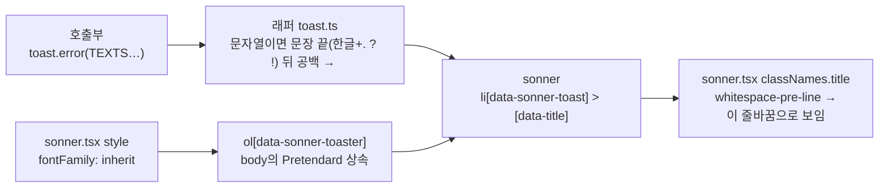

# 토스트 문구를 문장 단위로 줄바꿈하고 글꼴을 Pretendard로 맞춘다

> 두 문장짜리 토스트가 두 번째 문장 중간에서 줄이 넘어가던 것을 문장 끝에서만 바뀌게 하고,
> sonner CSS 때문에 시스템 글꼴로 나오던 토스트를 앱 글꼴(Pretendard)로 맞춘다.

## Context

사용자 지적: "토스트 메시지가 문장 안에서 줄바꿈된다."

### 재현 절차 (2026-11-02, Chrome 1920px, 운영 linksphere.click 위에 실제와 같은 마크업 주입)

sonner CSS가 로드된 운영 페이지에 `[data-sonner-toaster] > li[data-sonner-toast]` 구조와
`sonner.tsx`의 classNames를 그대로 붙여 그리고, 글자마다 `Range.getClientRects()`로 줄을 나눠 쟀다.

| 문구                               | 현재 줄 나뉨                                                        |
| ---------------------------------- | ------------------------------------------------------------------- |
| `messages.info.sessionExpired`     | "로그인이 만료됐어요. 다시 로그인하면 이어서 이용할" / "수 있어요." |
| `messages.success.signUpCompleted` | "가입을 완료했어요. 메일함에서 인증 링크를" / "확인해주세요."       |
| `messages.success.passwordChanged` | "비밀번호를 변경했어요. 다른 기기에서는 다시" / "로그인해야 해요."  |

### 근본 원인

- **어절이 쪼개지는 건 아니다.** 토스트의 계산값은 `word-break: keep-all`이고
  ([globals.css:410](../../src/app/globals.css) body 규칙이 상속됨), 줄은 공백에서만 바뀐다.
- **폭이 356px 고정이다.** sonner 2.0.7 기본값 `TOAST_WIDTH = 356`(`node_modules/sonner/dist/index.mjs`)이고,
  아이콘과 닫기 버튼을 빼면 글 영역은 약 276px, 13px 글씨로 한 줄에 30자 정도 들어간다.
  두 문장 문구는 대부분 30~45자라서 두 번째 문장 중간에서 넘어간다.
- **글꼴(곁가지 발견):** sonner CSS가 cascade layer 밖에서 `[data-sonner-toaster]{font-family:ui-sans-serif,system-ui,…}`를
  직접 지정해, body의 Pretendard 상속을 덮는다. 실측 계산값은 `ui-sans-serif, system-ui, -apple-system…`이고
  body는 `Pretendard, sans-serif`다. Tailwind 클래스(`font-sans`)는 `@layer utilities` 안이라 이 규칙을 못 이긴다.

## 판단이 필요했던 항목

| 항목         | 결정                                                                     | 근거·기각한 대안                                                                                                                                                                                                                                                                                                                                                                                    |
| ------------ | ------------------------------------------------------------------------ | --------------------------------------------------------------------------------------------------------------------------------------------------------------------------------------------------------------------------------------------------------------------------------------------------------------------------------------------------------------------------------------------------- |
| 줄바꿈 방식  | **A. 문장마다 줄바꿈** (2026-11-02 사용자 선택)                          | B `text-wrap: balance`는 줄 길이만 고르고 여전히 문장 중간에서 끊긴다("다시 / 로그인하면"). A와 섞어도 실측상 강제 줄바꿈 뒤 문장엔 균형이 적용되지 않았다. MDN은 Chromium이 _"6줄 이하"_ 블록만 균형을 맞춘다고 쓴다(번역, [MDN text-wrap](https://developer.mozilla.org/en-US/docs/Web/CSS/text-wrap)). C 데스크톱 폭 480px는 모바일(화면 폭 − 32px)에 효과가 없다.                               |
| 적용 위치    | **래퍼 `toast.ts`에서 자동** (사용자 선택)                               | TEXTS에 `\n`을 직접 넣으면 같은 문구를 쓰는 다른 화면(인라인 에러 등)엔 공백으로 보이고, 서버가 준 문구와 앞으로 생길 문구에는 적용되지 않는다.                                                                                                                                                                                                                                                     |
| 줄바꿈 표현  | `\n` + `white-space: pre-line`                                           | 문장마다 `` 블록으로 나누면 문장 사이 공백이 사라져 e2e `getByText(TEXTS…)`가 깨진다. `\n`은 Playwright(`@playwright/test` 1.64.0, `playwright-core/lib/coreBundle.js:565` `replace(/\s+/g, " ")`)와 Testing Library(`@testing-library/dom` 10.4.1, `dist/matches.js:52`) 둘 다 공백 하나로 바꿔 비교하므로 기존 단정이 그대로 통과한다.                                                      |
| 문장 끝 판정 | `/([가-힣][.?!])\s+/g` → `'$1\n'`                                        | 단순 `. `로 하면 닉네임 안내 `'_ . -'`(texts.ts:116·195·441)가 잘린다. "한글 바로 뒤 마침표"로 좁히면 `_ .`, `3.5`, URL, 영어 문장은 건드리지 않는다. 빌드 타깃에 `safari14`가 있어(vite.config.ts:77) 정규식 lookbehind 대신 캡처 그룹을 쓴다. 한글 린트 규칙은 정규식 리터럴을 검사하지 않는다(`eslint.config.js` `no-hardcoded-hangul`은 string `Literal`만 검사, 선례 `account.contract.ts:6`). |
| 글꼴         | **같이 고침** (사용자 선택), Toaster `style={{ fontFamily: 'inherit' }}` | sonner는 `style` prop을 `ol[data-sonner-toaster]`에 펼친다(`index.mjs:1102-1106`). 인라인 스타일이라 sonner의 layer 밖 규칙을 확실히 이긴다. `var(--font-sans)`는 `@theme inline`이라 런타임 변수로 나오는지 확인이 필요해 `inherit`를 쓴다.                                                                                                                                                        |
| 범위 밖      | `description` 옵션 문자열은 변환하지 않는다                              | 지금 쓰는 description은 한 문장(`bookmarkRemovedWithLastFolderDescription`)뿐이다.                                                                                                                                                                                                                                                                                                                  |

### 시안 후보 (§9, 반영 전 확인 완료)

Chrome 탭에서 운영 sonner CSS 위에 현재 / A / B / C / A(328px 폰) / A+balance / A+Pretendard를 나란히 띄워
보여줬고, 사용자가 A와 글꼴 수정을 골랐다. Pretendard로 바꿔도 줄바꿈 위치는 Mac에서 시스템 글꼴과 같았다.

**A로도 남는 것:** 한 문장이 한 줄(약 30자)보다 길면 그 문장 안에서는 여전히 끊긴다.

- 356px: "…허용되지 않는 문자가 포함됐을 수" / "있어요."
- 328px: "이미지를 짧은 시간에 너무 많이 올려 잠시" / "막혔어요."

세 문장짜리 WAF 차단 문구(`errors.wafBlocked` 계열)는 3줄에서 5줄로 늘어난다. 문구를 줄이는 건 이번 범위가 아니다.

## 세부 계획

| 위치                                                        | 변경 내용                                                                                                                                                                                                                              |
| ----------------------------------------------------------- | -------------------------------------------------------------------------------------------------------------------------------------------------------------------------------------------------------------------------------------- |
| `src/shared/lib/toast/toast.ts`                             | 문자열 메시지면 문장 끝 공백을 `\n`으로 바꾸는 지역 함수를 추가하고, `toast`·`success`·`loading`·`error`·`warning`·`info` 여섯 곳이 sonner에 넘기기 전에 거치게 한다. ReactNode·함수 메시지는 그대로 넘긴다. 시그니처는 바꾸지 않는다. |
| `src/shared/ui/atoms/sonner.tsx`                            | `toastOptions.classNames`에 `title: 'whitespace-pre-line'`을 추가하고, `<Sonner>`에 `style={{ fontFamily: 'inherit' }}`를 추가한다. 두 줄 모두 sonner CSS를 덮는 이유를 주석으로 단다.                                                 |
| `src/shared/lib/toast/toast.test.ts` (신규)                 | 두 문장 → `\n`, `?` 문장 끝, `'_ . -'`·`3.5`·URL·영어는 그대로, ReactNode는 그대로, 위치 옵션 병합이 그대로인지 확인한다(setup.ts의 `vi.mock('sonner')`에 넘어간 인자로 확인).                                                         |
| `src/shared/ui/atoms/sonner.stories.tsx`                    | 한글 두 문장·긴 문구 스토리를 추가한다(TEXTS 참조, atoms 시각 변경은 같은 커밋에 스토리를 둔다).                                                                                                                                       |
| `docs/FE-ARCHITECTURE.md` §14                               | 래퍼가 문장 단위로 줄을 바꾼다는 것과 글꼴 상속을 한두 줄로 적는다.                                                                                                                                                                    |
| `CHANGELOG.md`                                              | `[Unreleased]`에 항목을 추가한다(`changelog-release` skill 형식).                                                                                                                                                                      |
| `docs/plans/2026-11-02-toast-sentence-line-break.md` (신규) | 이 계획의 스냅샷(§11).                                                                                                                                                                                                                 |

순서: `EnterWorktree` → `.env` 복사·`pnpm install` → `pnpm graph:focus "src/shared/lib/toast/toast.ts" --text`와
`sonner.tsx`로 사용처를 확인해 영향 범위를 보정 → 구현 → 검증 → PR.

## 영향 범위 (§5)

- **데이터 CRUD**: 해당 없음. 화면 표시만 바뀌고 API·캐시·스키마는 그대로다.
- **모든 토스트 호출부(래퍼 경유 67곳)**: 두 문장 이상인 문자열 토스트는 줄이 바뀌는 위치가 달라진다. 높이는 대부분 그대로(2줄 → 2줄)이고 긴 문구만 늘어난다. sonner는 높이를 렌더 뒤에 재서 쌓으므로 겹치지 않는다(구현 때 확인).
- **`TooltipWrapper.tsx:82` `toast.info(content)`**: 모바일에서 툴팁 이유를 토스트로 띄운다. 문자열이면 같은 변환이 적용된다.
- **서버 문구**(`queryClient.ts:22` `decision.message`, `account.queries.ts:135` 등): BE가 준 한글 문장도 같은 규칙으로 줄이 바뀐다.
- **e2e**: `getByText(TEXTS…)`·`filter({ hasText })`로 토스트를 찾는 스펙(`session-expired.spec.ts:97·247`, `signup-unsaved-changes.spec.ts:234·260·278·292`, `post-visibility.spec.ts:94·137`, `post-update.spec.ts:92`, `account-update.spec.ts:97`). 공백 정규화로 통과할 것으로 보지만 실제로 돌려 확인한다.
- **단위 테스트**: 래퍼를 `vi.mock`하는 테스트(`useSignUp.test.tsx` 등 9곳)는 원래 문자열로 단정해 영향이 없다. 래퍼를 거쳐 `sonner` mock 인자를 단정하는 테스트는 지금 없다(`from 'sonner'` import 0건).
- **글꼴**: 모든 토스트 글자 모양이 바뀐다. 굵기 500(title)과 13px 크기는 그대로다.
- 곁가지(고치지 않음): `sonner.tsx:23`의 `gap-2`도 같은 이유(layer 밖 sonner CSS)로 적용되지 않는다. 계산값은 6px다.

## 검증 방법

1. `pnpm type-check` → `pnpm test`(새 `toast.test.ts` 포함) → `pnpm lint`·`pnpm check:deps` → `pnpm check:docs`
2. `pnpm test:e2e`로 위 토스트 스펙을 돌린다(chromium + mobile-chrome).
3. 로컬 `pnpm dev`에서 실제 토스트를 띄워 확인한다. `browser-verification` skill 절차를 따르고, Playwright MCP가 이 세션에서 연결되지 않았으면 Claude in Chrome `gif_creator`로 녹화한다.
   - `[data-title]`의 계산값이 `white-space: pre-line`, `font-family: Pretendard…`인지 본다.
   - 두 문장 문구가 문장 끝에서만 줄이 바뀌는지 데스크톱(1280px)과 좁은 폭(360px)에서 본다.
   - 여러 개를 연달아 띄웠을 때 쌓임과 겹침이 정상인지 본다.
4. Storybook `Shared/UI/Atoms/Sonner`의 새 스토리를 확인한다.
5. PR 전에 `plan-verifier`로 이 계획과 diff를 대조하고, PR 본문에 `## 계획 대비 구현`을 단다(§11).
6. 병합 뒤 `Frontend Deploy (S3 + CloudFront)` run이 success인지 확인한 다음 보고하고, 워크트리를 정리한다.

## 남은 것

- 한 줄보다 긴 단일 문장(WAF 차단 문구 등)은 이번 변경 뒤에도 문장 안에서 끊긴다. 문구를 줄일지는 따로 정한다.
