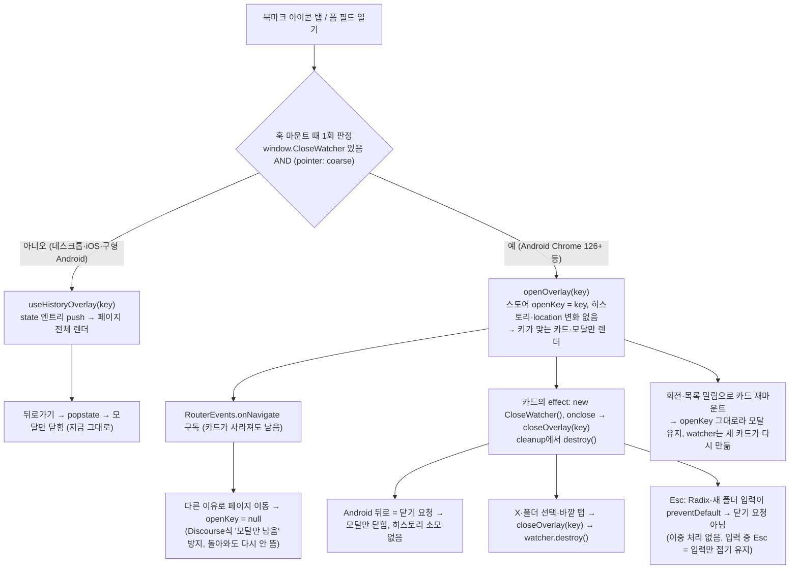

# 북마크 폴더 모달: 뒤로가기가 "닫기 요청"인 기기는 히스토리 없이 연다 (D안 + 카드 밖 스토어)

<!-- plan-result:start — 이 블록만 병합 뒤에도 고칠 수 있다(CLAUDE.md §11). 아래는 승인된 계획 원문 -->

## 구현 결과

> #504 · 2026-11-03 대조 · 이탈 1 · 미구현 0 — 판정 근거(파일:줄)는 PR 본문 "계획 대비 구현"

- 이탈(범위, 계획의 대상 목록 오류): 북마크 창 push 한정을 달 문서 가운데 `docs/AUTH.md`(로그인 뒤 재개 절)는 고치지
  않음 — 그 절은 로그인 창의 히스토리와 재개 타이밍만 다루고 북마크 창이 push한다는 서술이 없어 한정을 달 문장이 없었다
- 대조 뒤 보완함: R-B(로그인 후 재개) 전용 단위 테스트와 "카드가 떠 있을 때 이동하면 닫히고 watcher 정리" 단위
  테스트를 더함. 실행으로 확인하지 않았던 Esc 이중 처리(흐름도 W3)는 모바일 e2e로 확인함 — 취소되지 않은 Esc가
  Chromium의 닫기 요청이 되는 점을 이용해, 닫기 요청이 오면 창만 닫히는 것과 입력 중 Esc가 입력만 접는 것을 단언
- 계획에 없던 변경: 이 계획이 일부 뒤집는 `docs/plans/2026-09-30-bookmark-modal-ux-fixes.md`에 "대체됨(일부)" 구현
  결과 블록을 새로 만듦(§11 구현 결과 블록 규칙, #498)
- 계획에 없던 변경(문서 동기화): `docs/BOOKMARK.md` 용어 사전에 `useBackClosableOverlay`·`CloseWatcher`를, "남은
  것"에 Android 실기기 미확인을, §5에 Esc가 두 번 처리되지 않는 이유를 더함. Firefox Android·실기기 미확인은
  계획(PR에만 적기)과 달리 BOOKMARK·DECISIONS에도 적음
- 병합 뒤 확인(#507): 검증 4(Android 실기기)는 사용자가 뒤로가기·회전·로그인 뒤 재개·글 등록 폼을 확인함 — 문제 없음.
  BOOKMARK "남은 것"의 실기기 미확인 항목을 지우고 §9 검증 결과로 옮김. 검증 5(Firefox Android)는 여전히 확인 수단이 없다
- 대체됨(일부): `docs/plans/2026-11-10-back-navigation-standard.md`(#592) — Android도 다시 히스토리 엔트리로 연다.
  2026-11-10에 Android 폰에서 `CloseWatcher` 경로가 뒤로가기를 받지 못해 페이지가 뒤로 갔고 원인은 찾지 못했다.
  `CloseWatcher`·기기 판정·열림 스토어(`openKey`)를 지웠고, 열림은 라우터가 이미 가 있는 위치에서 읽어 창이 페이지보다
  먼저 뜬다. 창을 카드 밖 호스트 하나로 그리는 구조와 대상 스토어는 그대로다

<!-- plan-result:end -->

## Context

- **문제**: 북마크 폴더 선택 모달(카드 버튼·글 등록 폼 필드 2곳)은 `useHistoryOverlay`로 열 때 같은 경로에
  state 엔트리를 push한다. 그 PUSH가 `location`을 바꿔, 열고 닫을 때마다 페이지 전체가 다시 렌더된다.
- **실측(2026-11-03 직접 측정, 로컬 운영 빌드, 카드 12장·폴더 25개, 스크래치패드
  `__measure-bookmark-dialog.spec.ts`)**:

  |                           | 히스토리(지금) | 로컬 상태(실험) |
  | ------------------------- | -------------- | --------------- |
  | CPU 4x 열기 (n=30×2)      | 144 / 192ms    | 57 / 64ms       |
  | CPU 4x 닫기 (n=30×2)      | 50 / 56ms      | 14 / 14ms       |
  | CPU 1x 열기 (n=10)        | 38ms           | 16ms            |
  | 페이지 쪽 렌더된 컴포넌트 | 1116–1151      | 20–24           |

- **사용자 결정 1, D안(2026-11-03)**:
  - 데스크톱 브라우저 뒤로가기는 HTML 표준상 닫기 요청이 아니다
    ([WHATWG](https://html.spec.whatwg.org/multipage/interaction.html#close-requests-and-close-watchers)).
  - Baymard는 "뒤로 = 오버레이 닫기"를 모든 종류의 오버레이에 권고한다
    ([Baymard](https://baymard.com/blog/back-button-expectations)).
  - 그래서 히스토리는 **뒤로가기가 닫기 요청으로 오는 기기에서만** 뺀다. 조건은 `CloseWatcher`가 있고 터치가
    주 입력(`(pointer: coarse)`)인 기기로, 사실상 Android다.
  - 나머지 기기는 지금 그대로 `useHistoryOverlay`를 쓴다.
- **사용자 결정 2, 카드 밖 스토어(2026-11-03)**:
  - 피드 카드는 가상 목록 행 키(`` `${columnCount}:${firstItemId}` ``, `useWindowGridVirtualizer.ts:281-287`)
    때문에 화면 회전·목록 밀림에서 다시 마운트된다.
  - 업계 표준(Android `DialogFragment`는 회전에도 유지, react.dev "state를 끌어올리는 것이 가장 흔한 해법",
    react-virtuoso 메인테이너 "항목 state는 바깥에 보존")에 맞춰 열림 상태를 카드 밖 작은 스토어에 둔다.
  - 이 레포의 선례도 같다: 카드의 삭제 확인(`openConfirm`)·이미지 뷰어는 전역 스토어 + `RootLayout.tsx:48-51`.
- **목표**:
  - 어느 기기에서도 뒤로가기 동작은 지금과 같다.
  - Android 터치 기기에서는 여닫을 때 렌더가 ~1,130 → ~20으로 줄고, 반응도 그만큼 빨라진다.
- **범위 밖**:
  - 데스크톱·iOS의 렌더는 그대로다(사용자 승인).
  - 다른 T1 오버레이(이미지 뷰어·사이드바 드로어·모바일 검색·로그인 창)도 그대로다.

## 전체 흐름

## 구현

### 1. 공용 훅 `src/shared/hooks/useBackClosableOverlay.ts` (신규)

- 반환형은 `useHistoryOverlay`와 같은 `{ isOpen, open, close }`라 호출부는 훅 이름만 바꾼다.
- **경로 판정**: `useState(canCloseWithCloseWatcher)`로 마운트 때 한 번만 정해, 수명 동안 경로가 바뀌지 않게 한다.
  - 판정식: `typeof window.CloseWatcher === 'function' && window.matchMedia('(pointer: coarse)').matches`
  - `(pointer: coarse)` 선례: `src/shared/hooks/usePullToRefresh.ts:3-6`(주 입력으로 판정, MDN 근거 주석)
- 두 경로 훅을 항상 호출하고(훅 규칙) 판정값으로 고른다.
- **히스토리 경로**: 기존 `useHistoryOverlay(key)`를 그대로 재사용한다.
- **CloseWatcher 경로**: 같은 파일 안에 둔다.
  - **모듈 비공개 zustand 스토어** `{ openKey: string | null }`
    - 열린 키는 하나다. 겹쳐 쌓지 않는다는 `DECISIONS.md:4643` 전제와 같다.
    - 선례: `src/shared/store/sidebar.store.ts`(zustand `create`)
    - 이 훅만 쓰므로 `shared/store/`로 꺼내지 않는다(§2).
  - `openOverlay(key)`: 이전 구독을 정리하고 `RouterEvents.onNavigate(closeAll)`을 구독한 뒤 `openKey = key`.
    - 구독은 카드가 사라져도 남는다. 그래서 페이지가 바뀌면 카드 유무와 상관없이 닫힌다.
    - 기존 API를 쓴다: `src/shared/lib/router/router-events.ts:73`
  - `closeOverlay(key)`: `openKey === key`일 때만 구독을 정리하고 `openKey = null`.
  - 훅 `isOpen`은 `useStore((s) => s.openKey === key)`다. 불리언 셀렉터라 다른 카드는 다시 렌더되지 않는다.
  - **CloseWatcher는 카드 effect에서 만든다.**
    - 열려 있을 때 `new window.CloseWatcher()`, `onclose = () => closeOverlay(key)`, cleanup에서 `destroy()`
    - 카드가 사라지면 watcher도 정리돼, 보이지 않는 watcher가 다음 뒤로가기를 삼키지 않는다.
    - 다시 마운트되면 새 카드가 다시 만든다.
    - setter·모듈 함수가 안정적이라 최신 콜백 ref는 필요 없다.
  - 테스트 격리용 `resetBackClosableOverlay()`를 export한다. 선례는 `router-events.ts:78-85`의
    `resetRouterEvents`이고, 이 훅 테스트의 `afterEach`에서만 부른다.
- **타입**:
  - 설치본 TypeScript 5.7.3 `lib.dom.d.ts`에 `CloseWatcher`가 없다(조사로 확인, 0건).
  - 쓰는 멤버(`onclose`, `destroy`)만 담은 최소 전역 선언을 `src/types/close-watcher.d.ts`에 둔다.
    선례는 `src/types/lucide-react.d.ts`다.
  - `Window.CloseWatcher`는 optional로 선언해, 기능 감지를 타입이 강제하게 한다.

### 2. 호출부

- `src/features/bookmark/toggle/hooks/useBookmarkPostButton.ts:20`
  - `useHistoryOverlay` → `useBackClosableOverlay`
  - JSDoc `:10-12` 갱신
- `src/features/post/create/hooks/usePostCreateBookmarkFolderField.ts:36-40`
  - 같은 교체
  - 주석 `:32-35` 갱신
- `src/features/bookmark/toggle/ui/BookmarkPostButton.tsx:25-26`: 주석 갱신

### 3. 테스트

- **신규 `src/shared/hooks/useBackClosableOverlay.test.tsx`**
  - 선례: `useHistoryOverlay.test.tsx`(navigate 스파이 + MemoryRouter)
  - 경로 판정
    - 기본 스텁(`setup.ts`의 `matchMedia` → false, `CloseWatcher` 없음)은 히스토리 경로다. `open`이 state를 push한다.
    - `CloseWatcher` 있음 + `pointer: fine`도 히스토리 경로다(데스크톱 Chrome).
  - `CloseWatcher` 있음 + `pointer: coarse`일 때
    - `open` → `isOpen` true, `navigate` 호출 없음, watcher 1개 생성
    - watcher `onclose` → 닫힘, `destroy` 호출
    - `close()` → 닫힘, `destroy` 호출
    - 다른 키의 훅은 계속 닫혀 있음(카드별 격리)
    - **재마운트(unmount 후 같은 키로 다시 render) → 열림 유지, watcher 다시 생성** (R-A)
    - **가짜 `RouterEvents.setSource`로 이동을 흘리면 닫힘. 카드가 unmount된 뒤에도 닫힘**
  - 가짜 `CloseWatcher` 클래스는 `vi.stubGlobal`로 넣는다(jsdom에 없음). `matchMedia`는 `vi.spyOn`으로 바꾸고 되돌린다.
- **기존 테스트·e2e는 바꾸지 않고 통과해야 한다.** 데스크톱 chromium과 단위 테스트가 기본으로 히스토리 경로라서다.
  이게 "데스크톱 동작 불변"의 회귀 검사다.
- **모바일 e2e 추가(`e2e/bookmark-folder-dialog.mobile.spec.ts`)**
  - Pixel 5 에뮬레이션(`hasTouch`)이 실제로 `pointer: coarse` + `CloseWatcher`를 만족하는지 먼저 확인한다.
  - 만족하면 다음을 단언한다.
    - 폴더 창을 열어도 `history.length`가 늘지 않는다.
    - X로 닫은 뒤 뒤로가기 한 번이면 이전 페이지로 간다.
    - 가로로 돌려 열 수가 바뀌어도 창이 유지된다(Pixel 5 가로에서 열 수가 실제로 바뀌는 경우만).
  - 만족하지 않으면 추가하지 않고, 그 사실을 PR에 적는다.

### 4. 문서

- **`docs/DECISIONS.md` 새 항목(2026-11-03)**: 2026-08-07 T1 정책의 예외로 적는다. 담을 내용은 다음과 같다.
  - 안 A·B·C·D 비교표와, 진 안이 진 이유
  - 원문을 다시 확인한 근거: WHATWG·WICG·Baymard·NN/g·Android·Ionic
  - 앞서 Baymard를 "큰 오버레이 한정"으로 잘못 요약했던 정정
  - 실측표
  - 재마운트 대응(카드 밖 스토어)의 근거: Android `DialogFragment`·react.dev·react-virtuoso #141
- **`docs/BOOKMARK.md`**
  - `:205-219` "열림 상태는 히스토리로" 절을 기기별 동작으로 다시 쓴다(로그인 후 재개 문단 포함).
  - `:630` 표 행, `:641-645` 등록 폼 뒤로가기, `:838` 코드 지도를 갱신한다.
  - 남은 한계도 적는다. 모달이 열린 채 세션이 만료되면 로그인 창 push로 닫히고, 재로그인 뒤 다시 뜨지 않는다(R-C, Android만).
- **북마크 창을 "같은 경로에 새 key를 push하는 오버레이"의 예로 드는 문서**
  - "Android 터치 기기에서는 push하지 않는다"는 한정을 단다. 데스크톱 서술은 여전히 맞아서 다시 쓰지 않는다.
  - 대상: `UNSAVED-CHANGES-GUARD.md:212-215`, `AUTH.md:614-624`, `COMMENT.md:425-430`,
    `POST-DETAIL-BACK-NAVIGATION.md:101-114`
  - `TESTING.md`: 새 모바일 스펙 한 줄을 추가한다. `:932-938` 데스크톱 서술은 그대로 둔다.
- **`CHANGELOG.md`**: `[Unreleased]`에 perf 항목을 추가한다.
- **계획 스냅샷**: `docs/plans/2026-11-03-bookmark-dialog-close-watcher.md`(§11)

## 회귀 점검 (조사 결과 반영)

**히스토리 경로(데스크톱·iOS) — 불변 확인**

- 데스크톱 뒤로가기는 지금처럼 모달만 닫는다.
- 등록 폼에서 이탈 확인창이 뜨지 않는다. `useUnsavedChangesGuard.ts:33-35`가 같은 경로 이동을 통과시킨다.
- 바꾸지 않고 그대로 통과해야 하는 e2e:
  - `bookmark-folder-dialog.spec.ts:51`·`:76`
  - `post-create-folder-picker.spec.ts:29`
  - `guest-guard.spec.ts:41`·`:60`(로그인 후 재개)
  - `post-detail-back-label.spec.ts`
  - `comment-icon-scroll.spec.ts:152`
  - `bookmark.spec.ts:76`
- Playwright 프로젝트 구성(`playwright.config.ts:40-54`)
  - `Desktop Chrome`은 `hasTouch`가 없어 히스토리 경로다.
  - 모바일 프로젝트는 `*.mobile.spec.ts`만 돌리고, 이 모달의 기존 뒤로가기 테스트는 없다.

**CloseWatcher 경로(Android 터치)**

| #   | 상황                                                                     | 바뀐 뒤 동작                                                                                                                                  | 확인                                                     |
| --- | ------------------------------------------------------------------------ | --------------------------------------------------------------------------------------------------------------------------------------------- | -------------------------------------------------------- |
| R-A | 회전·목록 밀림으로 카드 재마운트                                         | 스토어에 열림이 남아 모달 유지(지금 히스토리와 같음). 치던 새 폴더 이름은 지금처럼 사라짐                                                     | 단위 테스트(재마운트) + 모바일 e2e(가로 전환, 가능할 때) |
| R-B | 로그인 후 재개 (`useLoginDialog.ts:72-88`)                               | 재개 = `openOverlay(key)`. 로그인 창의 `navigate(-1)`이 반영된 뒤 effect에서 돌아, 그 이동으로 닫히지 않는다. 카드가 다시 마운트됐어도 열린다 | 단위 테스트 + `guest-guard.spec.ts:60`(데스크톱 경로)    |
| R-C | 모달이 열린 채 세션 만료 → 제자리 로그인 창 push(`auth.util.ts:264-268`) | 이동 구독으로 닫힘. 재로그인 뒤 다시 뜨지 않음(지금은 다시 뜸). 로그인 창과 겹치지 않음                                                       | 문서에 한계로 기록                                       |
| R-D | 카드가 이동 없이 사라짐(목록에서 그 글이 빠짐)                           | watcher는 카드와 함께 정리. `openKey`만 남고 다음 이동·다른 창 열기 때 지워짐                                                                 | 코드 리뷰                                                |
| —   | 등록 폼 필드                                                             | 가상 목록 밖이라 R-A 없음. Android 뒤로 = 닫기 요청이라 이탈 확인창과 무관                                                                    | 단위 테스트                                              |

- 여닫을 때 더는 돌지 않는 location 부수 효과가 있다.
  - 대상: `usePostListSearch` `onPop`, `useSearchParamsDraft`, 가상 목록 스냅샷 저장
  - 열고 닫기만 하는 동작이라 원래 돌 이유가 없던 것들이다.
- 그대로 두는 가드
  - 대상: `CommentList.tsx:45-94`, `usePostDetail.ts:62-70`의 오버레이 push 대비 가드
  - 로그인 창·이미지 뷰어가 계속 쓰기 때문이다.

## 검증

1. `pnpm type-check` · `pnpm test` · `pnpm lint` · `pnpm check:deps` · `pnpm check:docs`
2. e2e `bookmark-folder-dialog.spec.ts`·`post-create-folder-picker.spec.ts`·`guest-guard.spec.ts`(데스크톱)
   통과 = 데스크톱 동작 불변. 새 모바일 스펙 통과
3. 전후 측정: 스크래치패드 측정 스펙을 `e2e/`에 잠깐 복사해 로컬 운영 빌드로 돌린다. 커밋하지 않고 끝나면 되돌린다.
   - 데스크톱 컨텍스트: 렌더 ~1,130 그대로(동작 불변 확인)
   - 터치 에뮬레이션(`hasTouch` + `CloseWatcher` 있는 Chromium): 렌더 ~20, 4x 열기 ~60ms대
4. **Android 실기기**: 뒤로가기 = 모달만 닫힘, 회전해도 유지되는지 확인한다. 못 하면 PR에 "아직 모름(사용자 실기기 확인 필요)"으로 적는다.
5. **Firefox Android(149+)**: 뒤로 버튼을 닫기 요청으로 보내는지 확인할 수단이 없다. 보내지 않으면 그 브라우저에서는
   뒤로가기에 페이지가 이동하고, 모달은 이동 구독으로 닫힌다. PR에 "아직 모름"으로 적는다.
6. **§11**: 계획 파일 커밋 → `plan-verifier`로 diff 대조 → PR `## 계획 대비 구현`
   → CI → 사용자 요청 시 병합 → 배포 확인 → 워크트리 정리
