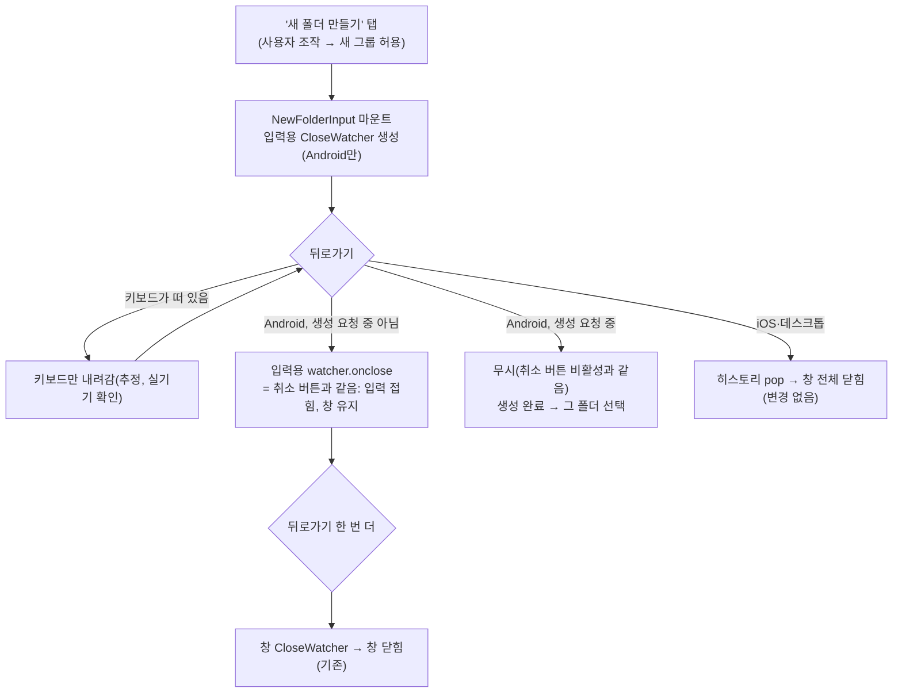

# 북마크 폴더 창: Android 뒤로가기로 새 폴더 입력만 취소

<!-- plan-result:start — 이 블록만 병합 뒤에도 고칠 수 있다(CLAUDE.md §11). 아래는 승인된 계획 원문 -->

## 구현 결과

> #517 · 2026-11-04 대조 · 이탈 2 · 미구현 0 — 판정 근거(파일:줄)는 PR 본문 "계획 대비 구현"

- 계획에 없던 변경(사용자 요청): 계획이 "범위 밖, 변경 없음"으로 둔 북마크 페이지 인라인 입력도 같은 규칙을 따른다. 승인
  뒤 사용자가 "새 폴더 + 이름 바꾸기"를 골랐다. 모바일 폴더 목록의 새 폴더 카드는 Android 뒤로가기에 접히고, 이름
  바꾸기(사이드바 행·모바일 카드·폴더 화면 제목이 같이 쓰는 훅)는 Esc처럼 원래 이름으로 돌아간다. 생성·저장 요청 중에는
  받지 않는다. 새 e2e 5건.
- 계획에 없던 변경(사용자 확인): 데스크톱 배치 사이드바(폰 가로·태블릿)의 새 폴더 입력에도 같은 규칙을 넣었고, 사이드바
  행 이름 바꾸기도 공유 훅이라 같이 바뀐다. 사용자가 둘 다 그대로 두기로 했다. 이 배치는 e2e가 없다(Pixel 5 세로만 본다).
- 이탈(범위 확장 때문): `useBackCloseRequest`에 `enabled`(기본 켜짐)를 더해 watcher effect가 deps `[]` 대신 `[enabled]`에
  묶인다. 북마크 페이지 훅은 입력이 열렸는지가 훅 안 상태라 컴포넌트 수명에 묶을 수 없어서다. 핸들러는 계획대로 ref로 읽어
  바뀌어도 watcher를 다시 만들지 않고, 창 안 입력은 기본값이라 계획과 같게 동작한다. 단위 테스트 1건 추가.
- 이탈(범위 확장 때문): e2e `sendCloseRequest`를 스펙 안 지역 함수 대신 `e2e/mocks/close-request.ts`로 뺐다. 새 스펙도 쓴다.
- 미룬 것(사용자 선택): 이름 바꾸기 입력의 취소·저장 버튼은 다음 PR.
- 대체됨: `docs/plans/2026-11-10-back-navigation-standard.md`(#592) — Android 뒤로가기로 입력만 접는 동작을
  없앴다(사용자 선택, 2026-11-10). 이 동작이 기대던 `CloseWatcher` 경로를 지웠고, 히스토리 엔트리로 다시 만들면 창의
  엔트리 위에 엔트리가 하나 더 쌓인다. 창 안에서는 창이 닫히고 북마크 페이지에서는 페이지가 뒤로 간다. Esc와 취소
  버튼은 그대로다

<!-- plan-result:end -->

> Android(뒤로가기가 닫기 요청으로 오는 기기)에서 "새 폴더 만들기" 입력이 열려 있을 때 뒤로가기를 누르면 취소 버튼처럼
> 입력만 접히고 창은 남는다. 한 번 더 누르면 지금처럼 창이 닫힌다.

## Context

**지금 동작**: 폴더 선택 창(`BookmarkFolderSelectDialog`, 카드 북마크 버튼 호스트·글 등록 폼 필드가 공유)에서 "새 폴더
만들기"를 탭하면 입력 줄이 펼쳐진다. 이때 뒤로가기를 누르면 입력만 접히지 않고 창 전체가 닫힌다.

- Android(CloseWatcher + `(pointer: coarse)`): 창이 열려 있는 동안 `CloseWatcher` 하나(`useBackClosableOverlay.ts:56`)가
  닫기 요청을 받아 창을 닫는다 → `useBookmarkFolderSelect.ts:58-64`가 `creatingMode`를 접는다.
- iOS·데스크톱: 히스토리 엔트리 pop으로 창이 닫힌다.
- ESC는 이미 입력만 접는다(`BookmarkFolderSelectDialog.tsx:93-104`, 2026-09-21 결정). WHATWG는 데스크톱 Esc와 Android
  뒤로가기를 같은 "닫기 요청"으로 정의하므로, 이번 변경은 같은 결정을 Android 뒤로가기에도 적용하는 것이다.

**확인한 브라우저 동작**([WHATWG close watcher](https://html.spec.whatwg.org/multipage/interaction.html#close-requests-and-close-watchers) 직접
확인, Chromium `close_watcher.cc`는 설계 검증 에이전트가 읽음 — 재인용)

- 닫기 요청은 manager의 `groups` 중 **마지막 그룹만** 처리한다(그룹 안 watcher는 모두 닫힘).
- watcher를 만든 뒤 사용자 조작(탭)이 있으면 "허용 그룹 수"가 늘어 다음 watcher는 새 그룹이 된다. 조작 없이 만들면 마지막
  그룹에 합쳐져 한 번에 같이 닫힌다(악용 방지).
- `destroy`는 허용 그룹 수를 줄이지 않는다 → StrictMode(dev)의 "만들기→지우기→다시 만들기"도 새 그룹을 받는다. 줄어드는 건
  닫기 요청을 처리할 때다.
- 그래서 "새 폴더 만들기" 탭 뒤에 입력용 watcher를 **입력 수명 동안 한 번만** 만들면 뒤로가기 한 번이 그 watcher만 닫는다.

## 판단이 필요했던 항목

| 항목                      | 결정                                                                      | 근거·기각한 대안                                                                                                                                                                                                                                                                                                                                                                                                                                                                                                                                                                                                                                                                                                                                                                                                                                                                                            |
| ------------------------- | ------------------------------------------------------------------------- | ----------------------------------------------------------------------------------------------------------------------------------------------------------------------------------------------------------------------------------------------------------------------------------------------------------------------------------------------------------------------------------------------------------------------------------------------------------------------------------------------------------------------------------------------------------------------------------------------------------------------------------------------------------------------------------------------------------------------------------------------------------------------------------------------------------------------------------------------------------------------------------------------------------- |
| 적용 기기                 | **Android(CloseWatcher 경로)만** (2026-11-03 사용자 선택)                 | Android 플랫폼 표준이 "가장 안쪽 상태부터 닫기"다 — [Android custom back](https://developer.android.com/guide/navigation/custom-back)은 _"여러 단계에 `BackHandler`가 켜져 있으면 가장 안쪽 것만 뒤로가기를 가로챈다"_ (번역)고 쓰고 예제가 패널 접기다. [WICG close-watcher](https://github.com/WICG/close-watcher/blob/main/README.md)도 _"가장 최근에 만든 것만 이벤트를 받는다"_ (번역). 기각: iOS·데스크톱까지 — iOS는 [Apple HIG Sheets](https://developer.apple.com/design/human-interface-guidelines/sheets)상 시트 안 뒤로 버튼이 _"시트를 닫기 위한 것이 아니다"_ (번역)라 해당 관행이 없고, 히스토리 엔트리를 더 쌓는 건 [Baymard](https://baymard.com/blog/back-button-expectations)의 _"접힌 콘텐츠는 `history.pushState()`로 새 '페이지'처럼 구현해서는 안 된다"_ (번역)와 반대이며 `useHistoryOverlay.close()`의 "내 엔트리가 맨 위" 전제(DECISIONS 2026-08-07)가 깨진다. 기각: 그대로 두기. |
| 입력한 이름               | 취소 버튼처럼 확인 없이 버린다                                            | 사용자 요청("취소 버튼을 누르는 것으로"). 기존 취소 버튼·ESC와 같다(BOOKMARK.md §5 "새 폴더 만들기 인라인 폼의 취소").                                                                                                                                                                                                                                                                                                                                                                                                                                                                                                                                                                                                                                                                                                                                                                                      |
| 생성 요청 중              | **무시** — 입력 유지, 생성이 끝나면 그 폴더 선택 (2026-11-03 사용자 선택) | 취소 버튼이 요청 중 비활성인 것과 같은 규칙(`BookmarkFolderSelectDialog.tsx:442`). 한계: 무시한 요청이 입력용 watcher를 소모해, 그 뒤 생성이 실패하면 다음 뒤로가기는 창 전체를 닫는다. 기각: 그래도 입력 접기(지금 ESC와 같음) — 요청은 계속돼 성공하면 폴더 생성·선택(카드는 저장 후 닫힘)까지 돼 "취소했는데 저장됨". 기각: 무시 + `onclose` 안에서 다시 걸기 — 드문 경우에 비해 공용 훅이 복잡해진다.                                                                                                                                                                                                                                                                                                                                                                                                                                                                                                   |
| watcher를 어디서 만드나   | 공용 훅 `useBackCloseRequest`(신규)를 `useNewFolderInput`에서 호출        | 판정 함수 `canCloseWithCloseWatcher()`가 `useBackClosableOverlay.ts` 안 비공개라 같은 파일에 둔다. 생성 중 검사는 로직이라 UI(`BookmarkFolderSelectDialog.tsx`는 "JSX만", :48)가 아니라 훅에 둔다. 입력 컴포넌트와 수명이 같아 watcher가 입력이 열린 동안만 있다.                                                                                                                                                                                                                                                                                                                                                                                                                                                                                                                                                                                                                                           |
| 최신 핸들러 보관          | deps 없는 `useLayoutEffect`로 ref 갱신, watcher effect는 deps `[]`        | 선례 `src/shared/hooks/useIntersectionObserver.ts:20-34`(같은 주석·[refs 린트](https://react.dev/reference/eslint-plugin-react-hooks/lints/refs)·[React 19.2 `useEffectEvent`](https://react.dev/blog/2025/10/01/react-19-2) 링크). 핸들러를 deps에 넣으면 렌더마다 watcher를 다시 만들어, 닫기 요청을 한 번 처리한 뒤엔 조작 없이 만든 watcher가 창 그룹에 붙을 수 있다.                                                                                                                                                                                                                                                                                                                                                                                                                                                                                                                                   |
| 이미 있던 불일치(범위 밖) | 고치지 않고 언급만                                                        | 생성 요청 중 ESC는 입력을 접는다(`BookmarkFolderSelectDialog.tsx:98-103`에 요청 중 검사 없음). 이번 요청 범위가 아니다.                                                                                                                                                                                                                                                                                                                                                                                                                                                                                                                                                                                                                                                                                                                                                                                     |

## 세부 계획

| 위치                                                                     | 변경 내용                                                                                                                                                                                                                                                                                                                                                                                                                                                                                                                                                                                                                             |
| ------------------------------------------------------------------------ | ------------------------------------------------------------------------------------------------------------------------------------------------------------------------------------------------------------------------------------------------------------------------------------------------------------------------------------------------------------------------------------------------------------------------------------------------------------------------------------------------------------------------------------------------------------------------------------------------------------------------------------- |
| (작업 시작)                                                              | `git log origin/main..main` 확인 → `EnterWorktree` → `cp ../../../.env .` + `pnpm install`                                                                                                                                                                                                                                                                                                                                                                                                                                                                                                                                            |
| `e2e/bookmark-folder-dialog.mobile.spec.ts` (먼저 작성, 실패 확인)       | 파일 안 지역 함수 `sendCloseRequest(page)`(window 캡처 `stopImmediatePropagation` once + Escape)로 뽑아 기존 "닫기 요청이 오면 창만 닫히고…" 테스트도 사용. 신규 (a) "새 폴더 입력 중 닫기 요청은 입력만 접고, 한 번 더 오면 창을 닫는다" — 첫 요청 뒤 입력 숨김·"새 폴더 만들기" 보임·창 보임·`history.length` 그대로, 두 번째 뒤 창 닫힘·URL `/post`. 신규 (b) "새 폴더를 만드는 중 온 닫기 요청은 입력을 접지 않는다" — `POST` 폴더 생성 route를 붙잡아 두고(POST 아니면 `route.fallback()`) 만들기 → 닫기 요청 → 입력·창 유지 → 500 응답(`list-fetch-failure.spec.ts:89` 형태) → 입력 다시 활성. 구현 전 두 건 모두 실패해야 한다 |
| `src/shared/hooks/useBackClosableOverlay.ts` (신규 export)               | `useBackCloseRequest(onCloseRequest: () => void)` — 최신 핸들러 ref(`useLayoutEffect`), deps `[]` effect에서 `window.CloseWatcher && canCloseWithCloseWatcher()`일 때만 watcher 1개 생성, `onclose`에서 ref 호출, cleanup `destroy()`. JSDoc: 두 번째 오버레이가 아니라 열린 창 안의 펼친 상태를 먼저 접는 용도, 탭 뒤에 만들어 자기 그룹을 받으므로 다시 만들지 않는다, 상세는 BOOKMARK.md                                                                                                                                                                                                                                           |
| `src/features/bookmark/select/hooks/useNewFolderInput.ts`                | 매개변수 객체에 `onCancel: () => void` 추가. `submittingRef` 아래에서 `useBackCloseRequest(() => { if (submittingRef.current) { return; } onCancel(); })`                                                                                                                                                                                                                                                                                                                                                                                                                                                                             |
| `src/features/bookmark/select/ui/BookmarkFolderSelectDialog.tsx:414-415` | `useNewFolderInput({ onCreated, onCancel })`. 취소 버튼 `onClick={onCancel}`은 그대로                                                                                                                                                                                                                                                                                                                                                                                                                                                                                                                                                 |
| `src/shared/hooks/useBackClosableOverlay.test.tsx`                       | `describe('useBackCloseRequest')` 신규 3건(기존 `FakeCloseWatcher` 재사용): (a) CloseWatcher가 있어도 터치 주 입력이 아니면 watcher 0개 (b) CloseWatcher+터치: 핸들러를 바꿔 rerender해도 watcher 1개, `onclose` 시 새 핸들러만 호출 (c) 언마운트 시 destroy                                                                                                                                                                                                                                                                                                                                                                          |
| `docs/BOOKMARK.md` §5 "뒤로가기로 닫히는 열림 상태"                      | "새 폴더 입력 중 Android 뒤로가기는 입력만 접는다" 추가 — Android만(사용자 선택), 09-21 Esc 결정과의 일관성, 그룹 규칙(탭 뒤 생성·StrictMode 안전), 요청 중 무시와 한계, 키보드가 먼저 뒤로가기를 가져감(미확인), §8 리서치 근거(위 판단 표의 인용)                                                                                                                                                                                                                                                                                                                                                                                   |
| `docs/BOOKMARK.md` 나머지                                                | §5 "새 폴더 만들기 인라인 폼의 취소"에 한 줄 상호 참조, §9 검증 결과 갱신, §12 용어 사전에 `useBackCloseRequest`, 문서 머리 "마지막 검토" 날짜                                                                                                                                                                                                                                                                                                                                                                                                                                                                                        |
| `docs/TESTING.md:933`                                                    | 모바일 스펙 설명에 새 두 장면 추가                                                                                                                                                                                                                                                                                                                                                                                                                                                                                                                                                                                                    |
| `CHANGELOG.md` `[Unreleased]`                                            | `changelog-release` skill 기준으로 항목 추가(fix(bookmark) 쪽 — Esc와 같은 닫기 요청인데 동작이 달랐음)                                                                                                                                                                                                                                                                                                                                                                                                                                                                                                                               |
| `docs/plans/2026-11-03-bookmark-new-folder-back-cancel.md`               | 이 계획 스냅샷 커밋(§11), plan-verifier 대조 후 구현 결과 블록                                                                                                                                                                                                                                                                                                                                                                                                                                                                                                                                                                        |

## 영향 범위

**CRUD**: 폴더 생성(create) 요청·응답·캐시 무효화 경로는 바뀌지 않는다. 읽기·수정·삭제와 무관. 바뀌는 건 "생성 전에 입력을 접는
트리거"가 하나 늘어나는 것뿐이고, 요청 중에는 무시하므로 중복 생성·생성 후 선택 흐름에 새 경로가 생기지 않는다.

**기존 기능 회귀 후보**

| 대상                                                                                                                                 | 확인                                                                                                                  |
| ------------------------------------------------------------------------------------------------------------------------------------ | --------------------------------------------------------------------------------------------------------------------- |
| `useBackClosableOverlay.ts` 기존 export(`useBackClosableOverlay`·`useBackClosableOverlayOpen`·`reset…`)                              | 손대지 않음. 사용처는 구현 시 `pnpm graph:focus "src/shared/hooks/useBackClosableOverlay.ts" --text`로 뽑아 PR에 반영 |
| 카드 북마크 창(`useGlobalPostBookmarkFolderDialog.ts`)·글 등록 폼 필드(`usePostCreateBookmarkFolderField.ts`)                        | 같은 컴포넌트라 둘 다 새 동작을 받는다(의도). 창 watcher 동작은 그대로                                                |
| 기존 e2e "새 폴더 입력 중 ESC는 입력만 접고…"                                                                                        | 고치지 않고 통과해야 한다(ESC 커밋에서 입력 watcher가 먼저 파괴돼 판별력 유지)                                        |
| 데스크톱·iOS(히스토리 경로) e2e `bookmark-folder-dialog.spec.ts`·`bookmark-folder-host*.spec.ts`·`post-create-folder-picker.spec.ts` | 고치지 않고 통과해야 한다(데스크톱 Chrome은 CloseWatcher가 있어도 포인터가 fine이라 watcher를 만들지 않음)            |
| jsdom 단위 테스트(`PostCardBookmarkFolderDialog`·`GlobalPostBookmarkFolderDialog` 등)                                                | `window.CloseWatcher`가 없어 새 훅이 아무것도 안 한다                                                                 |
| 북마크 페이지 사이드바·모바일 카드의 인라인 새 폴더 폼                                                                               | 오버레이가 아니라 범위 밖, 변경 없음                                                                                  |

## 검증 방법

1. 새 e2e 두 건을 구현 전에 돌려 실패 확인 → 구현 후 통과: `pnpm test:e2e e2e/bookmark-folder-dialog.mobile.spec.ts`
2. 회귀: `pnpm test:e2e e2e/bookmark-folder-dialog.spec.ts e2e/bookmark-folder-host.spec.ts e2e/bookmark-folder-host.mobile.spec.ts e2e/post-create-folder-picker.spec.ts`
3. `pnpm type-check` → `pnpm test` → `pnpm lint`·`pnpm check:deps` → `pnpm check:docs`
4. `browser-verification` skill로 Pixel 5 에뮬레이션 녹화(입력 열기 → 닫기 요청 → 입력만 접힘 → 한 번 더 → 창 닫힘). 이 세션은 Playwright MCP 연결이 끊겨 있어, 안 되면 사용자에게 재연결을 요청하거나 e2e 결과로 대신하고 그렇게 보고한다
5. PR: §11 plan-verifier 대조, `pnpm check:pr-body`, CI 확인 → squash 병합 → 배포 워크플로 성공 확인
6. 배포 뒤 사용자가 Android 실기기에서 확인: 키보드가 떠 있을 때·내렸을 때, 카드 창과 글 등록 폼 둘 다

## 남은 것

- Android에서 키보드가 떠 있을 때 첫 뒤로가기가 키보드만 내리는지(그러면 창을 닫기까지 세 번) — 실기기 확인 전까지 추정이다.
- Firefox Android가 뒤로가기를 닫기 요청으로 보내는지 미확인(2026-11-03 창 결정의 남은 것과 같음).
- 생성 요청 중 ESC가 입력을 접는 기존 불일치 — 이번 범위 밖.
