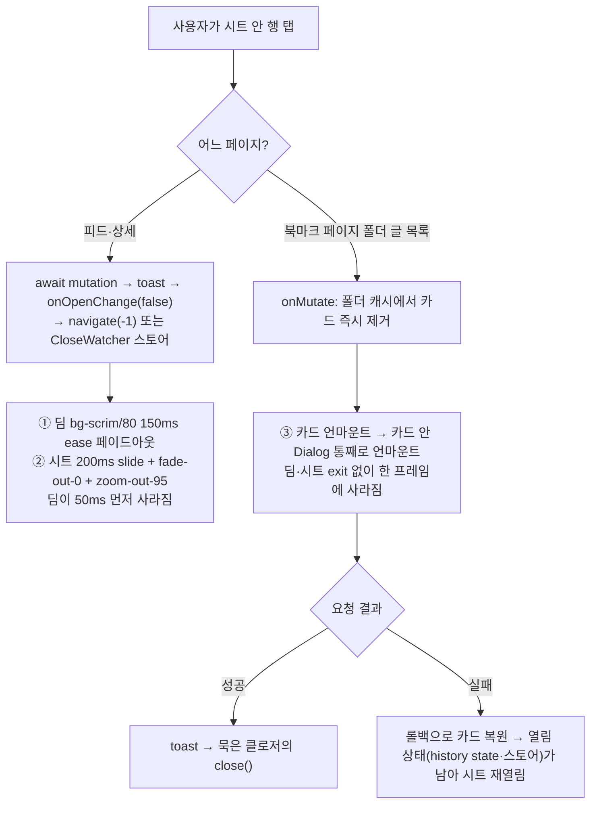
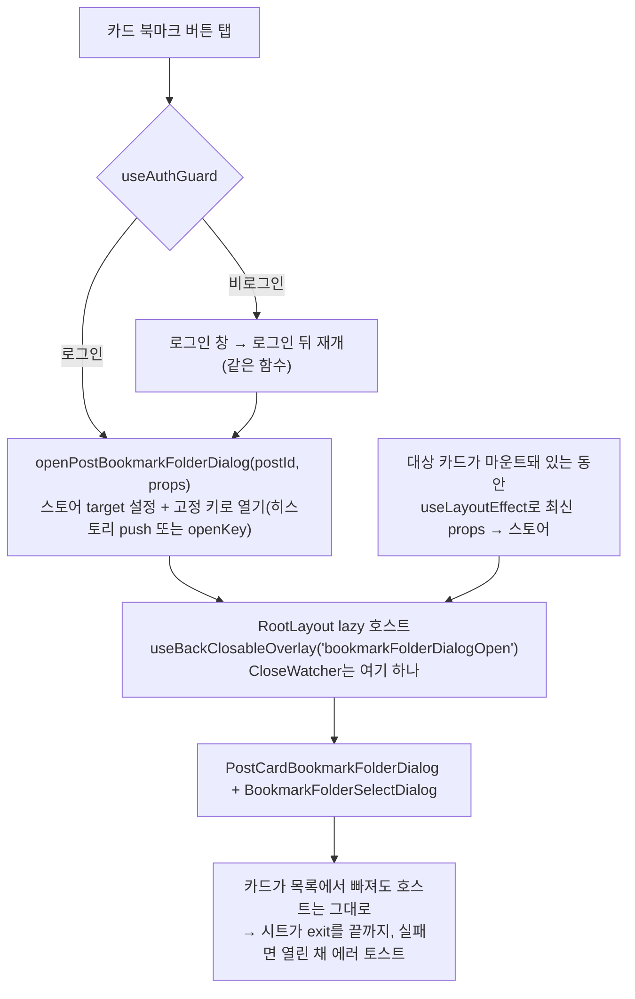

# 모바일 북마크 폴더 시트 닫힘 깜빡임: 딤·닫힘 맞추기(①②) + 시트를 카드 밖 호스트로(③)

<!-- plan-result:start — 이 블록만 병합 뒤에도 고칠 수 있다(CLAUDE.md §11). 아래는 승인된 계획 원문 -->

## 구현 결과

> #509 · 2026-11-03 대조 · PR1(Phase 1, ①②) · 이탈 0 · 미구현 0 — 판정 근거(파일:줄)는 PR 본문 "계획 대비 구현"

- 값 확정(계획대로 미리보기에서): 3안 — 모바일 시트 딤 32%, 딤·시트 모두 300ms `cubic-bezier(0.32,0.72,0,1)`. 닫힘도
  열림과 같은 시간이다(닫힘만 200ms 안은 기각)
- 다음 PR 예정: Phase 2(③ 시트를 RootLayout 호스트로)는 #509에 없다
- 계획에 없던 변경: `SheetDialogContent` 단위 테스트를 새로 둠(데스크톱 분기 클래스 집합 고정, 모바일 분기 딤·시간·밀기만
  확인)
- 계획에 없던 변경: `DIALOG_CONTENT_MOTION`도 export함(데스크톱 시트 분기가 씀)
- 계획에 없던 변경: `docs/BOOKMARK.md` "남은 것"에 ③ 미해결 항목을 적음
- 계획에 없던 변경(문서 동기화): motion-ux skill 본문의 duration 값 목록과 `ease-*`·`transition-all` 건수를 다시 잰 표에
  맞춤
- 정정: 원문의 "`animate-in`/`animate-out`을 쓰는 11곳"은 다시 세면 시트를 뺀 12곳이다. 모두 이미 페이드를 써서 결정은
  같다

<!-- plan-result:end -->

> 모바일 북마크 폴더 시트의 딤을 옅게 하고 딤과 시트가 함께 닫히게 한다(PR1). 시트를 카드 안에서
> RootLayout 호스트로 옮겨, 카드가 목록에서 빠져도 시트가 끝까지 닫히게 한다(PR2).

## Context

### 증상과 사용자 결정 (2026-11-03)

- 증상(사용자): _"모바일에서 북마크 목록 같은 UI가 닫힐 때 너무 깜빡인다. 화면이 어두웠다가 밝아지는 것도 부담된다."_
- 결정 1, 장면: 사용자가 어느 장면인지 특정하지 못해 아래 ①②③을 모두 범위에 넣는다.
- 결정 2, 딤 변경 범위: **모바일 시트만** 바꾼다.
  - 대상은 `SheetDialogContent`의 `isMobile` 분기로, 카드 북마크 버튼과 글 등록 폼 두 곳이다.
  - 데스크톱 모달·로그인·확인창·이미지 뷰어는 그대로 둔다.
- 결정 3, ③ 방식: 사용자가 "업계 표준을 공식 문서로 확인"해 달라고 했다. 확인 결과를 보고 **A(시트를 카드 밖 호스트로)**를 골랐다.

### 근본 원인 (코드로 확인, 녹화 재현은 Phase 0)

- ① 딤이 진하다.
  - [dialog.tsx:27](src/shared/ui/atoms/dialog.tsx)에서 `bg-scrim/80`을 쓰고, `--scrim`은 라이트·다크 공통 검정이다.
  - 흰 화면이 밝기 20%까지 내려갔다가 150ms 만에 100%로 돌아온다. 알파 합성으로 계산한 값이다.
- ② 딤과 시트가 따로 닫힌다.
  - 딤은 tw-animate 기본값 0.15s `ease`다(`node_modules/tw-animate-css` 1.4.0 `--animate-out`).
  - 시트는 `duration-200`이다(`dialog.tsx:124`).
  - 모바일 분기([SheetDialogContent.tsx:26](src/shared/ui/elements/dialog/SheetDialogContent.tsx))가 `slide-out-to-bottom`만 더하는데, `cn`(tailwind-merge)이 tw-animate 클래스를 몰라 `fade-out-0`·`zoom-out-95`가 남는다. 세 효과가 `exit` 키프레임 하나로 합쳐진다.
  - Radix Dialog 1.1.15는 Overlay와 Content를 각각 Presence로 감싸므로 둘이 따로 언마운트된다.
- ③ 시트가 카드 안에 있다.
  - 시트는 [PostCard.tsx:383](src/widgets/post/post-card/ui/PostCard.tsx) → `BookmarkPostButton` → `PostCardBookmarkFolderDialog` 경로로 카드 안에 렌더된다.
  - 북마크 페이지의 낙관적 갱신이 카드를 즉시 뺀다: `interaction.queries.ts:230-253`, `bookmark-folder.queries.ts` `removePostFromFolderPostsCache`.
  - 실패하면 `usePostCardBookmarkFolderDialog.ts`의 catch가 close를 부르지 않는다. 그래서 열림 상태가 남는다.

### 가설과 재현 절차 (Phase 0에서 확정)

- 가설: 위 ①②③이 각각 눈에 보이는 "깜빡임"이다. ③이 가장 강하다(0ms에 딤이 꺼진다).
- 재현 장면(모바일 뷰포트, 애니메이션 0.2배속):
  - (a) 피드에서 X로 닫기
  - (b) 피드에서 폴더 저장
  - (c) 북마크 페이지에서 "이 폴더에서 빼기" 성공
  - (d) 같은 동작 실패(route 500)
  - (e) "동작 줄이기"
  - (f) 다크 모드
- 수치 확인: 딤과 시트의 `getAnimations()[0].effect.getComputedTiming().endTime`을 잰다. 지금은 150과 200일 것이다.

## 판단이 필요했던 항목

| 항목                         | 결정                                                                                                                                                               | 근거·기각한 대안                                                                                                                                                                                                                                                                     |
| ---------------------------- | ------------------------------------------------------------------------------------------------------------------------------------------------------------------ | ------------------------------------------------------------------------------------------------------------------------------------------------------------------------------------------------------------------------------------------------------------------------------------ |
| 딤 변경 범위                 | 모바일 시트만                                                                                                                                                      | 사용자 결정 2. 전역 딤을 바꾸면 `ImageViewer.tsx:99`(본문 투명, 80% 딤을 배경으로 씀)까지 밝아진다                                                                                                                                                                                   |
| 시트만 딤을 다르게 하는 방법 | `DialogContentPanel`을 export하고, `SheetDialogContent`가 `DialogPortal + DialogOverlay + DialogContentPanel`을 직접 조립                                          | 기존 시그니처가 바뀌지 않는다(export 추가뿐). 기각: `DialogContent`에 `overlayClassName` prop 추가(시그니처 변경, DOM 속성 누수 처리 필요), `:has()` 형제 선택(Portal 배치에 기댐)                                                                                                   |
| 시트의 fade·zoom 제거        | 패널 기본 클래스에서 모션 클래스를 `DIALOG_CONTENT_MOTION` 상수로 분리하고, `DialogContent`만 그 상수를 붙인다                                                     | 충돌 자체가 사라진다. 기존 `DialogContent` 사용 5곳의 클래스 집합이 같은지는 Plan 에이전트가 tailwind-merge를 실행해 확인했다. 기각: `extendTailwindMerge` 확장(전역 `cn` 동작이 바뀜), `fade-out-100`·`zoom-out-100` 덮어쓰기(Tailwind 내부 정렬에 기대 업그레이드 때 깨질 수 있음) |
| 딤과 시트 동기화             | `SHEET_TIMING` 상수 하나를 딤과 시트 두 요소에 함께 붙인다                                                                                                         | `--tw-duration`·`--tw-ease`는 `inherits:false`이고 딤과 시트는 형제 요소라 두 곳 모두에 필요하다. 선례: vaul은 드로어와 딤에 같은 `0.5s cubic-bezier(0.32, 0.72, 0, 1)`을 쓴다([style.css](https://github.com/emilkowalski/vaul/blob/main/src/style.css))                            |
| 동작 줄이기                  | `globals.css:517-537` 전역 블록에 `--tw-enter-opacity: 0; --tw-exit-opacity: 0;` 2줄 추가                                                                          | 슬라이드만 하는 시트는 동작 줄이기 환경에서 움직이지도 흐려지지도 않다가 툭 사라진다. 지금 `animate-in`/`animate-out`을 쓰는 11곳은 모두 이미 페이드를 쓴다(Plan 에이전트 grep). 기각: 시트에 `motion-reduce:` 붙이기(motion-ux skill이 금지)                                        |
| ③ 방식                       | **A. 시트를 카드 밖 호스트로**                                                                                                                                     | 사용자 결정 3. 공식 문서 근거는 아래 "③ 근거". 기각: B(시트가 닫힐 때까지 카드를 목록에 남김, 이 레포 고유 장치), C(먼저 닫고 요청, 모든 페이지 UX가 바뀌고 공식 예제의 "액션 뒤 닫기" 순서와 반대)                                                                                  |
| 호스트 위치·로딩             | `RootLayout`에 `lazy` + `<Suspense fallback={null}>`로 둔다. `LoginDialog`(`RootLayout.tsx:17-21`)와 같은 방식                                                     | 정적 import면 시트와 폴더 목록 코드가 진입 청크에 들어간다. 2026-09-26 LoginDialog를 같은 이유로 뺐다. 기각: 페이지마다 호스트 두기(빠뜨리면 버튼이 무반응이 됨)                                                                                                                     |
| 열림 키                      | 고정 키 `bookmarkFolderDialogOpen` 하나. 호스트만 `useBackClosableOverlay`를 쓰고, 카드는 열기 함수만 쓴다                                                         | 키를 카드마다 두고 호스트도 같은 키를 쓰면, 같은 키의 CloseWatcher가 카드와 호스트에 2개 생긴다. 사용자 활성화 없이 여러 개를 만들면 그룹으로 묶여 처리된다. 고정 키를 카드마다 구독하면 모든 카드가 다시 렌더된다(#504가 줄인 것과 반대)                                            |
| 시트 데이터                  | 스토어에 `{ postId, isBookmarked, bookmarkFolderIds }` 스냅샷을 두고, 닫혀도 비우지 않는다. 대상 카드가 마운트돼 있는 동안 `useLayoutEffect`로 최신 props를 맞춘다 | 선례: `imageViewer.store.ts:24`의 "닫힘 애니메이션 도중 src가 사라져 깜빡이는 것을 방지". 로그인 후 재개는 클릭 시점 클로저를 실행하므로(`useAuthGuard.ts`) 카드 동기화가 필요하다. layout effect라 칠하기 전에 반영된다                                                             |
| PR 분리                      | PR1 ①②, PR2 ③                                                                                                                                                      | ①②는 값 선택(시각), ③은 구조 변경이라 위험과 되돌리는 비용이 다르다. CHANGELOG도 Changed와 Fixed로 갈린다                                                                                                                                                                            |

### ③ 근거 (공식 문서, 번역)

- Motion: _"`AnimatePresence`는 요소를 언마운트하는 코드의 바깥에 둬야 한다. `AnimatePresence` 자체가 언마운트되면 exit 애니메이션을 제어할 수 없다"_ (번역, [AnimatePresence](https://motion.dev/docs/react-animate-presence))
- React: _"React는 컴포넌트를 제거할 때 그 state를 파괴한다"_ (번역, [Preserving and Resetting State](https://react.dev/learn/preserving-and-resetting-state))
- Android Compose 공식 가이드: 시트는 화면 수준 state(`showBottomSheet`)로 띄운다. 닫을 때는 `sheetState.hide()`의 `invokeOnCompletion` 안에서 그 state를 false로 바꾼다. 같은 문서: _"바텀 시트를 숨길 때 `ModalBottomSheet`를 컴포지션에서 제거해야 한다"_ (번역, [Bottom sheets](https://developer.android.com/develop/ui/compose/components/bottom-sheets))
- Apple SwiftUI `sheet(item:)`: 열린 대상을 state 하나로 들고 시트 하나를 띄운다([문서](<https://developer.apple.com/documentation/swiftui/view/sheet(item:ondismiss:content:)>)). 목록 행마다 시트를 두는 경우를 직접 다루지는 않는다.
- W3C APG: _"연 요소가 더 이상 없으면 논리적 흐름을 잇는 다른 요소에 포커스를 둔다"_ (번역, [Dialog (Modal)](https://www.w3.org/WAI/ARIA/apg/patterns/dialog-modal/))

### 시안 후보 (§9, 미리보기에서 확정)

| 안          | 딤         | 시간(딤과 시트 같음)            | easing                        | 근거                                                                                                                                                                                                                      |
| ----------- | ---------- | ------------------------------- | ----------------------------- | ------------------------------------------------------------------------------------------------------------------------------------------------------------------------------------------------------------------------- |
| 현재        | 80%, 150ms | 시트 200ms, slide + fade + zoom | `ease`                        | —                                                                                                                                                                                                                         |
| 1           | 50%        | 250ms                           | `ease-out`                    | `Sidebar.tsx:154` 모바일 드로어 `bg-scrim/50`, shadcn v4 `bg-black/50`([dialog.tsx](https://github.com/shadcn-ui/ui/blob/main/apps/v4/registry/new-york-v4/ui/dialog.tsx))                                                |
| 2           | 40%        | 300ms                           | `cubic-bezier(0.32,0.72,0,1)` | vaul 곡선(감속형이라 ease-in 금지 규칙에 걸리지 않음)                                                                                                                                                                     |
| 3           | 32%        | 300ms                           | vaul 곡선                     | Material 3 `ScrimTokens.ContainerOpacity = 0.32f`([androidx](https://github.com/androidx/androidx/blob/androidx-main/compose/material3/material3/src/commonMain/kotlin/androidx/compose/material3/tokens/ScrimTokens.kt)) |
| 덧붙일 옵션 | —          | 열림 300 / 닫힘 200             | —                             | Material `MaterialFade`는 등장 150ms, 퇴장 75ms([Motion.md](https://github.com/material-components/material-components-android/blob/master/docs/theming/Motion.md))                                                       |

- 모든 안이 motion-ux skill의 "모달·드로어 200-500ms"와 "진입·퇴장 ease-out 계열" 안에 든다.
- 미리보기 형식은 Artifact 페이지 하나다. 실제 클래스를 `@tailwindcss/node`로 컴파일한 CSS를 쓰고, 현재안과 후보를 나란히 놓는다. 직접 여닫을 수 있게 하고, 0.2배속 토글과 라이트/다크·동작 줄이기 흉내를 넣는다.

### 뒤집힌 전제

| 발견                                                                            | 그래서 바뀐 것                                                                                                                                                      |
| ------------------------------------------------------------------------------- | ------------------------------------------------------------------------------------------------------------------------------------------------------------------- |
| 처음엔 ③에 B를 추천했다                                                         | 사용자가 공식 문서를 요청했고, 확인해 보니 문서들이 "화면이 소유한 시트"를 가리켜 A로 바꿨다                                                                        |
| 정정: 대화에서 "A면 APG의 '연 요소가 없어진 경우'도 자연스럽게 처리된다"고 했다 | A는 시트가 정상적으로 닫히게만 한다. 연 버튼이 사라졌을 때 다른 요소로 포커스를 옮기는 일은 따로 해야 한다. 지금도 body로 간다. 이번 범위 밖으로 두고 이슈로 남긴다 |

### 위험 관리

- #504(오늘 병합, Android 실기기 미확인) 경로를 다시 손댄다. #504 e2e 5건(`bookmark-folder-dialog.mobile.spec.ts`)을 수정 없이 통과하는 것을 기준으로 삼는다.
- A에서는 북마크 페이지에서 탭 직후 카드가 딤 뒤에서 먼저 빠지고, 목록이 당겨 올라오는 게 옅은 딤 너머로 비친다. PR2 녹화로 보여 주고 확인받는다.
- 공용 atom(`dialog.tsx`)을 바꾸므로 PR1의 diff가 기존 `DialogContent` 사용처의 클래스 집합을 바꾸지 않아야 한다. 스냅샷 단위 테스트로 고정한다.

## 세부 계획

### Phase 0: 재현 (코드 변경 없음)

| 위치     | 변경 내용                                                                                                                                                                                                   |
| -------- | ----------------------------------------------------------------------------------------------------------------------------------------------------------------------------------------------------------- |
| 워크트리 | `git log origin/main..main` 확인 → `EnterWorktree` → `cp ../../../.env . && pnpm install`                                                                                                                   |
| 녹화     | `browser-verification` skill 절차대로 Context의 재현 장면 (a)~(f)를 녹화한다. Playwright MCP 연결이 실패한 상태라 먼저 `/mcp`로 다시 연결한다. 안 되면 스크래치 e2e 스펙(`video: 'on'`, 0.2배속)으로 찍는다 |

### Phase 1: PR1 ①② 모바일 시트

| 위치                                                           | 변경 내용                                                                                                                                                                                                                                                                                   |
| -------------------------------------------------------------- | ------------------------------------------------------------------------------------------------------------------------------------------------------------------------------------------------------------------------------------------------------------------------------------------- |
| `src/shared/ui/atoms/dialog.tsx:124`                           | 패널 기본 클래스에서 모션 클래스를 `DIALOG_CONTENT_MOTION` 상수로 분리                                                                                                                                                                                                                      |
| `src/shared/ui/atoms/dialog.tsx:142-150`                       | `DialogContent`가 `cn(DIALOG_CONTENT_MOTION, className)`을 패널에 넘김                                                                                                                                                                                                                      |
| `src/shared/ui/atoms/dialog.tsx` export                        | `DialogContentPanel` export 추가. JSDoc에 "`DialogPortal` 안에서만 쓴다(열림 가드 시계)"를 적음                                                                                                                                                                                             |
| `src/shared/ui/elements/dialog/SheetDialogContent.tsx`         | 두 분기를 같은 트리 모양(`DialogPortal > DialogOverlay + DialogContentPanel`)으로 직접 조립한다(회전으로 768px를 넘어도 재마운트 없음). 모바일: 딤에 고른 농도 + `SHEET_TIMING`, 패널에 슬라이드만 + `SHEET_TIMING`. 데스크톱: 지금과 같은 클래스(`DIALOG_CONTENT_MOTION` + `max-w-sm p-0`) |
| `src/app/globals.css:521-531`                                  | 동작 줄이기 블록에 투명도 변수 2줄 추가                                                                                                                                                                                                                                                     |
| `src/shared/ui/elements/dialog/SheetDialogContent.stories.tsx` | 같은 커밋에서 갱신. 닫힘을 볼 수 있는 `DialogClose` 스토리를 추가                                                                                                                                                                                                                           |
| 테스트 (신규)                                                  | `dialog.test.tsx`: 기존 `DialogContent` 클래스 집합 고정. 새 `e2e/bookmark-sheet-motion.mobile.spec.ts`: 딤과 시트의 `animationDuration`·`animationTimingFunction`이 같은지, 시트 `--tw-exit-scale`이 1이고 `--tw-exit-opacity`가 1인지, 동작 줄이기에서 opacity가 0이고 translate가 0인지  |
| 문서                                                           | `.claude/skills/motion-ux/SKILL.md`(시트 타이밍 상수·동작 줄이기 투명도·실측 표 재측정), `docs/BOOKMARK.md` §5, `docs/DECISIONS.md`(값 선택 근거·기각안), `CHANGELOG.md` Changed                                                                                                            |
| 계획 스냅샷                                                    | `docs/plans/2026-11-03-bookmark-sheet-close-flicker.md`(이 파일)                                                                                                                                                                                                                            |

### Phase 2: PR2 ③ 시트 호스트

| 위치                                                                             | 변경 내용                                                                                                                                                                                                                                                                                                                                                                               |
| -------------------------------------------------------------------------------- | --------------------------------------------------------------------------------------------------------------------------------------------------------------------------------------------------------------------------------------------------------------------------------------------------------------------------------------------------------------------------------------- |
| `src/shared/hooks/useBackClosableOverlay.ts`                                     | 열기 전용 훅 `useBackClosableOverlayOpen(key)` export 추가. 경로 판정은 마운트 때 1회, 스토어 구독·CloseWatcher 없음. 히스토리 경로는 `useHistoryOverlay(key).open`, Android는 `openOverlay(key)`. "watcher는 카드와 수명을 같이한다" 주석을 "시트를 그리는 쪽과"로 고침                                                                                                                |
| `src/features/bookmark/toggle/hooks/postBookmarkFolderDialog.store.ts` (신규)    | `target: { postId, isBookmarked, bookmarkFolderIds } \| null`. `setTarget`, `syncTarget(postId, …)`(대상일 때만), 테스트용 reset. 닫혀도 비우지 않음                                                                                                                                                                                                                                    |
| `src/features/bookmark/toggle/hooks/useBookmarkPostButton.ts`                    | **시그니처 변경**: `(postId)` → `({ postId, isBookmarked, bookmarkFolderIds })`. 반환값에서 `isOpen`·`handleOpenChange`를 빼고 `handleClick`·`handlePrefetch`만 남김. 클릭은 `guard(() => open(target), { resumeAfterLogin: true })`. 대상이면 `useLayoutEffect`로 `syncTarget`                                                                                                         |
| `src/features/bookmark/toggle/ui/BookmarkPostButton.tsx`                         | **시그니처 변경**: `renderFolderSelect` prop 제거, `PostCardBookmarkFolderDialog` 렌더 제거                                                                                                                                                                                                                                                                                             |
| `src/features/bookmark/toggle/hooks/useGlobalPostBookmarkFolderDialog.ts` (신규) | 고정 키 `useBackClosableOverlay('bookmarkFolderDialogOpen')` + target 구독. 열림 상태인데 target이 없으면(새로고침 직후) `close()`로 엔트리를 정리                                                                                                                                                                                                                                      |
| `src/features/bookmark/toggle/ui/GlobalPostBookmarkFolderDialog.tsx` (신규)      | `renderFolderSelect`를 받아 `PostCardBookmarkFolderDialog`를 target 데이터로 렌더(이름 선례: `GlobalImageViewer`)                                                                                                                                                                                                                                                                       |
| `src/widgets/bookmark/post-folder-dialog/ui/PostFolderDialogHost.tsx` (신규)     | 위층 조립(§26): `GlobalPostBookmarkFolderDialog renderFolderSelect={BookmarkFolderSelectDialog}`. lazy 청크 경계                                                                                                                                                                                                                                                                        |
| `src/app/routes/layouts/RootLayout.tsx:17-21,46-53`                              | `LoginDialog`처럼 `lazy` + `Suspense fallback={null}`로 호스트 추가                                                                                                                                                                                                                                                                                                                     |
| `src/widgets/post/post-card/ui/PostCard.tsx:28-29,39-44,387`                     | `renderBookmarkFolderSelect`와 그 import 제거                                                                                                                                                                                                                                                                                                                                           |
| `PostCardBookmarkFolderDialog.tsx`·`usePostCardBookmarkFolderDialog.ts`          | 변경 없음(props 계약 유지 → 기존 단위 테스트 그대로)                                                                                                                                                                                                                                                                                                                                    |
| 테스트 (신규)                                                                    | 스토어·호스트 훅 단위 테스트: 열기, 동기화, 대상 아님 무시, 새로고침 정리, 카드 언마운트 뒤에도 열린 채 유지, 로그인 후 재개 시 최신 props. `useBackClosableOverlayOpen` 단위 테스트(watcher 0개, 구독 없음). 새 e2e(데스크톱·`.mobile`): 북마크 페이지 "이 폴더에서 빼기" 성공이면 dialog가 `data-state=closed`를 거친 뒤 제거, 실패(500)면 dialog 노드 재삽입 0회·열린 채 에러 토스트 |
| 문서                                                                             | `docs/BOOKMARK.md` §5(카드별 키 → 고정 키 + 호스트)·표 `:670`·코드 지도·용어 사전, `docs/DECISIONS.md`(A·B·C 비교와 공식 문서 근거), `docs/FE-ARCHITECTURE.md` §26(RootLayout 호스트 조립 예 추가 여부 확인), `CHANGELOG.md` Fixed                                                                                                                                                      |

## 영향 범위 (§5)

**CRUD**

- 북마크 저장·폴더 이동·해제는 `usePostCardBookmarkFolderDialog`와 entities mutation 그대로라 요청·롤백·무효화가 바뀌지 않는다.
- 바뀌는 것은 시트를 소유하는 곳뿐이다.
- 동시 요청은 시트가 하나라 지금과 같다(열린 오버레이 1개 전제, DECISIONS 2026-08-07).

**PR1 회귀 후보**

- `dialog.tsx`를 쓰는 곳: `SheetDialogContent`, `ImageViewer.tsx:99`, `LoginDialog.tsx`, `dialog.stories/test`
- `ImageViewer.tsx`의 `setTimeout(300)`이 `duration-200`에 기대는데, 이 값은 유지된다
- e2e: `reduced-motion.spec.ts`(로그인 모달 `--tw-enter-scale`), `touch-targets.mobile.spec.ts`(등록 폼 시트 행 높이), `bookmark-folder-dialog*.spec.ts`, `dialog-outside-click.spec.ts`

**PR2 회귀 후보**

- 피드·상세·북마크 카드의 시트 열기·닫기·뒤로가기, 로그인 후 재개(`guest-guard.spec.ts`), 회전 유지·닫기 요청(`bookmark-folder-dialog.mobile.spec.ts`), 상세 돌아가기(`post-detail-back-label`), `comment-icon-scroll`, `bookmark.spec.ts`
- `useBackClosableOverlay.test.tsx`의 기존 단정(카드 단위 수명)
- 진입 청크 크기(`pnpm build` 출력 전후 비교)
- 정확한 import 사용처는 구현 전에 `pnpm graph:focus "<경로>" --text`로 다시 뽑는다

**데이터 계약**

- 변경 없음, BE 영향 없음.

## 검증 방법

- 각 PR: `pnpm type-check` → `pnpm test` → `pnpm lint`·`pnpm check:deps` → `pnpm check:docs` → `pnpm test:storybook` → 관련 e2e(데스크톱·모바일).
- 녹화: Phase 0과 같은 장면 (a)~(f)를 전후로 녹화하고, `browser-verification` skill대로 짧은 이름으로 복사해 `open -a Cursor`로 연다.
- 수치: 딤과 시트의 애니메이션 `endTime`이 같은지. PR2는 #504 측정 방식으로 터치 경로의 열기 렌더 수가 지금(24)과 같은 범위인지 잰다.
- Mutation 확인: PR2에서 호스트를 카드 안으로 되돌리면 새 e2e(성공 시 `closed` 경유)가 실패해야 한다.
- PR 전: 계획 스냅샷을 커밋하고 `plan-verifier`로 대조한다. `pnpm check:pr-body`, push 뒤 배포 워크플로가 success인지 확인한다.

## 남은 것

- Android 실기기(뒤로가기·회전)는 #504와 마찬가지로 사용자 폰으로 병합 뒤 확인한다.
- 이슈로 남길 것 (범위 밖)
  - 연 버튼이 사라졌을 때 포커스를 다른 요소로 옮기기(APG)
  - 요청 중 뒤로가기로 닫은 뒤 성공하면 `navigate(-1)`이 한 번 더 나갈 수 있다는 의심(추측, Plan 에이전트 발견)
- 모션 지속시간 토큰 중앙화는 motion-ux skill의 기존 후속 과제다. 이번에는 시트 상수만 둔다.
