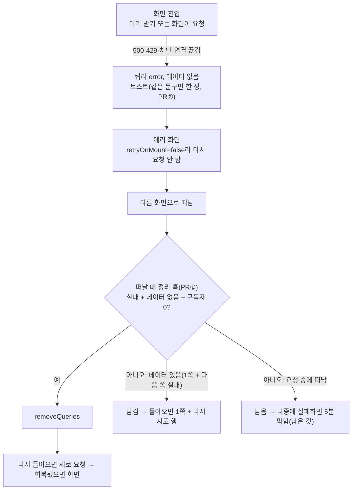

# #491 후속: 일부러 남겨 둔 6건 처리

> #491(PR #494·#495·#496, 2026-11-03 병합·배포)을 고치며 범위 밖으로 둔 6건과, 사용자 지적("3·4번은 다른 데서도")으로
> 넓힌 범위를 처리한다. 기준 커밋 `origin/main` 284cc902(#496).
> 설치본: `@tanstack/query-core`·`@tanstack/react-query` 5.90.16, sonner 2.0.7, react-error-boundary 5.0.0.

## Context

`docs/plans/2026-11-03-error-toast-followups.md` "남은 것" 5건과 #496 리뷰에서 나온 1건(onImageSet)을 항목마다 조사하고
사용자가 고칠지·그대로 둘지 정했다(2026-11-03). 핵심은 두 가지다.

- **suspense 화면이 실패 캐시에 갇힌다**: 데이터 없는 실패 쿼리가 gc(5분) 전까지 남고, 에러 경계가 리셋되기 전에는
  다시 요청하지 않아(`errorBoundaryUtils.js:8-11`, `queryObserver.js:442-443`) 같은 화면을 다시 열면 요청 없이 같은
  에러가 뜬다. 상세·댓글·피드 목록·내 댓글, 앱에 있는 suspense 쿼리 4곳 모두 해당(메모리 실행으로 확인).
- **같은 실패 토스트가 쌓인다**: 북마크 hover 미리 받기, 카테고리 미리 받기 뒤 재요청(500), 여러 조회 동시 실패.

### 재현 절차 (계획 단계, 직접 측정)

plan mode라 파일을 만들지 않고 설치본 query-core를 `node --input-type=module -e`로 메모리에서만 돌렸다(Node v24.22.1,
스크립트 저장 안 함). React 쪽은 소스대로 흉내만 냈다. React 렌더·e2e 재현은 각 PR 0단계에서 수정 전에 한다.

| #        | 측정                                                              | 결과                                                         |
| -------- | ----------------------------------------------------------------- | ------------------------------------------------------------ |
| 3        | 상세 미리 받기 500 → 화면 → 서버 회복 → 다시 들어옴               | 재진입 요청 0·같은 에러(미리 받기 없이 화면이 요청해도 같음) |
| 3        | 피드 목록·내 댓글을 같은 조건으로 다시 들어옴                     | 요청 0·같은 에러                                             |
| 4        | 폴더 목록 hover 3번(500) / 폴더 행 hover 2번(무한 쿼리)           | 토스트 3 / 토스트 2                                          |
| 5        | 오프라인에서 북마크 목록 진입                                     | paused·`isLoading` false → "저장한 글이 없어요"              |
| 6        | A(1쪽 성공·다음 쪽 500), B(첫 쪽 500) → `erroredLists`            | A·B 모두 삭제(A는 돌아오면 1쪽부터 다시)                     |
| 카테고리 | 미리 받기 500 진행 중 카드 마운트(300ms) / 실패 뒤 마운트(1300ms) | 요청 2·토스트 1 / 요청 4·토스트 2                            |

## 사용자 결정 (2026-11-03)

| #        | 결정                                                                                                                 | PR           |
| -------- | -------------------------------------------------------------------------------------------------------------------- | ------------ |
| 1        | 그대로. 이유를 `AUTH.md:783` 본문에(토스트가 유일한 스크린리더 안내라 카드와 겹쳐도 유지)                            | ②            |
| 2        | `onImageSet` 삭제(호출처 0, 2026-08-10 `9087929a`부터)                                                               | ②            |
| 3        | 고침 (a) — 화면을 떠날 때 데이터 없는 실패 쿼리를 지움. **4곳 전부** + 문서 규칙. 곁가지 `resetKeys`는 재현되면 같이 | ①            |
| 4        | 고침 — 북마크 hover 미리 받기 2곳을 `prefetchQueryQuietly`(#495)로, 무한 쿼리용 확장                                 | ②            |
| 5        | 고침 (a) — `isLoading` → `isPending`(오프라인이면 스피너)                                                            | ②            |
| 6        | 1줄 고침 — `erroredLists`가 데이터 없는 실패만 지움                                                                  | ①(아래 이탈) |
| 카테고리 | (나) 조회 실패 토스트는 문구가 같으면 한 장(문구 기반 id). mutation은 그대로                                         | ②            |
| PR       | 2개: ① 3번 / ② 나머지                                                                                                |              |

**사용자 결정과 다른 점 하나**: 6번을 PR②가 아니라 ①에 넣는다. ①에서 피드를 떠날 때 `erroredLists`를 부르는데,
지금 술어로는 1쪽이 있는 목록(A)까지 지워져 피드에 돌아올 때마다 1쪽부터 다시 받는다. 6번 1줄이 ①의 전제다.

업계 근거(카테고리·6번, 대화에서 조사): 같은 종류 토스트는 고정 id로 한 장 —
[react-hot-toast](https://react-hot-toast.com/docs/toast)·[react-toastify](https://fkhadra.github.io/react-toastify/prevent-duplicate)·
sonner 2.0.7 설치본 `index.mjs:142-176`(같은 id면 그 자리 갱신), [Maersk](https://designsystem.maersk.com/components/toast/)
_"같은 종류의 메시지 여러 개는 토스트 하나로 요약한다"_ (번역). 레포 선례: `error-toast.ts`의 429·보안 차단 고정 id.

## PR ① suspense 화면의 실패 캐시 정리 (3번 + 6번)

0. **수정 전 재현(빨간 테스트)** — 4곳마다 단위 테스트: 화면 진입 500 → 다른 화면 → 서버 회복 → 돌아옴 → 내용이
   그려지고 요청이 다시 나가야 한다. 지금은 실패한다.
   - QueryClient는 `createQueryClientWithErrorToasts`(gcTime 기본값 유지). `createTestQueryClient`의 gcTime 0은 실패
     쿼리를 바로 지워 수정 전에도 통과해 버린다.
   - 상세는 카드 클릭이 아니라 history 이동으로 돌아온다(카드 hover 미리 받기가 실패 쿼리를 대신 지워 버그를 가림).
   - e2e 1건(`e2e/list-fetch-failure.spec.ts` 선례, `page.route` 실패 토글 + `page.goBack()`). dev 서버는 StrictMode라
     effect가 한 번 더 돌아 요청 수 단정에 주의.
   - 곁가지: 상세 에러 화면에서 다른 글로 이동(헤더 검색·알림)하면 경계가 리셋되지 않는지 재현. 재현되면 3단계에 포함.
1. **술어 하나** — `shared/lib/react-query/`에 "실패 + 데이터 없음 + 구독자 0" 술어. auth의 `isErroredCacheWithoutData`
   (`auth.keys.ts:6`)는 entity 간 import가 안 돼 쓰지 않고 그대로 둔다.
2. **정리 함수**(`.keys.ts`)
   - `postRemoveQueries.erroredDetail(qc, id)`(`post.keys.ts`, 기존 `postRemoveQueries` 객체) — exact + 술어.
   - `postRemoveQueries.erroredLists` 술어에 `data === undefined` 추가(6번 1줄).
   - `commentRemoveQueries.erroredList(qc, postId)`·`.erroredMy(qc)` 신설(`comment.keys.ts`).
3. **떠날 때 부르는 훅**(`.queries.ts`, `usePrefetchPostDetail` 옆이 선례) — `useEffect` cleanup으로 동기 호출, deps는
   `[queryClient, id]`.
   - `useRemoveErroredPostDetailOnLeave(id)`·`useRemoveErroredPostListsOnLeave()`(`post.queries.ts`)
   - `useRemoveErroredCommentsOnLeave(postId)`·`useRemoveErroredMyCommentsOnLeave()`(`comment.queries.ts`)
   - 호출처: 상세·댓글은 `PostDetailRoute`(`app/routes/index.tsx:147`, 미리 받기 옆), 피드는 `PostList.tsx` 바깥
     컴포넌트, 내 댓글은 `MyCommentList.tsx` 바깥 컴포넌트(둘 다 에러 경계 밖).
   - 곁가지(재현될 때만): `PostDetailPage`의 `AsyncBoundary`에 `resetKeys={[id]}`(`useParams` 추가), `CommentList`의
     `AsyncBoundary`에 `resetKeys={[postId]}`. 정리 훅과 같이 넣어야 실패 캐시가 남은 글로 돌아갔을 때 다시 던지지 않는다.
4. **문서**
   - `FE-ARCHITECTURE.md`: "suspense 쿼리를 쓰는 화면은 떠날 때 데이터 없는 실패를 지운다" 규칙(§13 근처, 작업 때
     맞는 절 확인) + §18 이름 표에 `<entity>RemoveQueries` 행.
   - `POST.md`(프리페치 :249-267·상세 미리 받기 :282-288·조회 실패 :185-190 정정, 남은 것), `COMMENT.md:776-786`(남은 것,
     내 댓글 포함), `SEARCH.md:509-513`(`erroredLists` 경위에 6번 반영).
   - `CHANGELOG.md` `[Unreleased]` fix 항목(`changelog-release` skill).
   - 계획 스냅샷 `docs/plans/2026-11-03-error-toast-followups-review.md`를 이 PR에 커밋.

## PR ② 나머지 (1·2·4·5·카테고리)

0. **수정 전 재현** — 4번(hover 3번 → 토스트 3), 5번(`onlineManager.setOnline(false)` → 빈 화면), 카테고리(같은 문구
   두 번 실패 → 토스트 2)를 빨간 테스트로.
1. **1번 문서**: `AUTH.md:783` 본문에 유지 이유.
2. **2번**: `useImageAttachments.ts`의 `onImageSet` 옵션·JSDoc·ref·effect 호출 삭제. 그 옵션을 언급하는 주석
   (`useCreateComment.ts:110`·`useUpdateComment.ts:101`)도 함께 정리. 테스트가 `onImageSet`을 쓰면 같이 고친다.
3. **4번**
   - `prefetchBookmarkFolderList` → `prefetchQueryQuietly`.
   - `prefetch-quietly.ts`에 `prefetchInfiniteQueryQuietly` 추가 → `prefetchBookmarkFolderPosts`가 사용.
     `fetchInfiniteQuery`가 넘긴 옵션의 `behavior`를 덮어쓰므로 복사본을 넘긴다.
   - `useBookmarkPostButton.ts:34-40` 로그인 가드는 유지. 14번 줄 주석의 이유를 "비로그인 401은 `clearAll` + 로그인
     화면 이동(`client.ts:440-444`)"으로 교체.
   - 창이 진행 중인 hover 요청에 합류하면 meta가 화면 것으로 바뀌어 토스트 1장이 뜬다(`prefetch-quietly.ts` 주석,
     #495에서 확인) — 테스트로 다시 확인.
4. **5번**: `useBookmarkPostList.ts`가 `isPending`을 반환하고 `BookmarkPostList.tsx:50`이 그 값으로 스피너.
   테스트는 `onlineManager`를 끝에 되돌린다.
5. **카테고리**: `queryClient.ts` QueryCache onError에서 판정에 id가 없으면 문구로 id를 만든다(`query-error:<문구>`).
   mutation 핸들러는 그대로. `SEARCH.md` §11 429 항목과 `FE-ARCHITECTURE.md` 에러 토스트 절에 반영.
6. `CHANGELOG.md` `[Unreleased]` fix 항목. PR 본문은 ①의 계획 스냅샷을 링크.

## 영향 범위 (§5)

- **CRUD**: 서버 데이터는 건드리지 않는다(조회 캐시만). 지우는 조건이 "실패 + 데이터 없음 + 구독자 0"이라 보고 있는
  화면의 캐시나 1쪽이 있는 목록은 지우지 않는다. 동시성: 요청 중에 떠나면 status가 pending이라 지우지 않는다(남은 것).
- **회귀 후보**(작업 시작 때 `pnpm graph:focus "<경로>" --text`로 사용처를 뽑아 보강)
  - `queryClient.ts`(전역): 조회 토스트 옵션을 단정하는 테스트, 429·차단 고정 id가 계속 이기는지.
  - `post.keys.ts`·`comment.keys.ts`·`post.queries.ts`·`comment.queries.ts`: `usePostList.ts:106-116` 리셋 경로
    (`erroredLists` 술어 변경), `post.queries.test.ts`의 `prefetchPostDetail` 5건.
  - `prefetch-quietly.ts`: `prefetch-quietly.test.ts`, 상세 hover(#495).
  - `app/routes/index.tsx`: `e2e/post-route-prefetch.spec.ts` 요청 수.
  - `useImageAttachments.ts`: 댓글 등록·수정 폼.
  - 로그인 시 `resetQueries(isErroredCacheWithoutData)`(`auth.queries.ts:56-58`)는 그대로.
  - 옛 동작을 단정하는 문서: 위 PR별 문서 목록, `BOOKMARK.md:220-224`(hover 미리 받기).

## 검증 방법

1. 각 PR: `pnpm type-check` → `pnpm test` → `pnpm lint`·`pnpm check:deps` → `pnpm check:docs`.
2. 0단계 빨간 테스트가 수정 뒤 초록으로 바뀌는지, e2e(`pnpm test:e2e`) 해당 스펙 통과.
3. 브라우저 확인 녹화(`browser-verification` skill): ① 상세 실패 → 목록 → 서버 회복 → 뒤로가기 시 글이 보임,
   ② 오프라인 북마크 스피너. 이 세션은 Playwright MCP 연결이 실패해 있어, 안 되면 e2e 영상으로 대신하고 그렇게 밝힌다.
4. `plan-verifier`로 계획 대비 대조(①은 이 계획 전체 중 ① 항목, ②는 ② 항목) → PR 본문 `## 계획 대비 구현`,
   `pnpm check:pr-body`.
5. CI 통과 → squash 병합 → `Frontend Deploy` 성공 확인 → 워크트리 정리. 순서는 ① → ②(②의 문서가 ①의 문서를 고칠 수 있어).

구현은 워크트리에서(`git log origin/main..main` 확인 → `EnterWorktree` → `.env` 복사 → `pnpm install`).

## 남은 것 (이번에 고치지 않음, 해당 문서 "남은 것"에 기록)

- 요청이 끝나기 전에 떠났다가 그 뒤 실패한 경우는 지울 때 아직 pending이라 남는다(5분 또는 새로고침).
- 수정 페이지(`useFetchPostDetailQuery`, 비 suspense)에서 실패하고 상세로 돌아온 경우 — 상세 진입 전 정리 시점이 없다.
- 카테고리 미리 받기 뒤 재요청 자체(요청 2~4번)는 그대로 — 토스트만 한 장으로 줄인다.
- 조회 토스트가 떠 있는 동안(약 4초) "다시 시도"가 또 실패하면 새 토스트 없이 기존 토스트가 그 자리에 머문다(화면의
  에러 상태는 남음).
