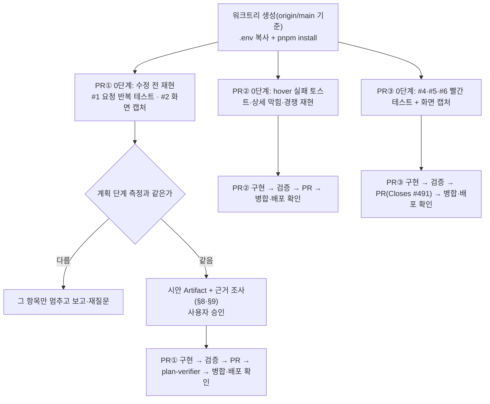
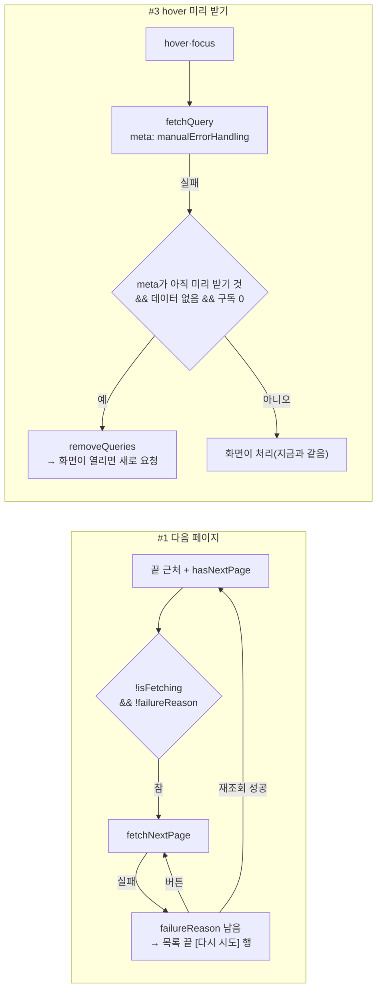

# 에러 토스트 밖 문제 6건(#491) 고치기

> #488 조사에서 찾았지만 토스트 유지 시간으로는 고칠 수 없던 6건을 PR 3개로 나눠 고친다. 기준 커밋 `origin/main` b94483f4.

## Context

#488에서 에러 토스트마다 "토스트가 사라진 뒤 화면에 실패 흔적이 남는가"를 조사하다 6건을 찾아 #491로 분리했다(판정 표는 #488 댓글,
유지 시간 기준은 `docs/FE-ARCHITECTURE.md` §14 "에러 토스트 유지 시간"). 이번 계획에서 6건 모두 지금 main에서 일어나는지 확인했고,
사용자가 고칠 곳·방식·PR 나누기를 골랐다(2026-11-03).

### 재현 절차 (계획 단계, 직접 측정)

plan mode에서는 파일을 만드는 실측을 하지 않으므로(CLAUDE.md §4) 1·3번은 설치본 `@tanstack/query-core` 5.90.16을
`node --input-type=module -e`로 메모리에서만 돌렸다(React effect는 조건만 흉내, 스크립트는 저장하지 않음). React 렌더까지 포함한 재현과
2·4·5·6번 화면 캡처는 각 PR의 0단계에서 **수정 전에** 한다.

| #   | 측정                                                                  | 결과                                                           |
| --- | --------------------------------------------------------------------- | -------------------------------------------------------------- |
| 1   | 첫 페이지 성공·다음 페이지 실패, 왕복 30ms, 6초                       | 500: 요청 12회·`onError` 5회 / 429: 요청 194회·`onError` 192회 |
| 3   | 같은 카드 제목 3번 hover / 카드 5장 / 💬 1번 (모두 500)               | `onError` 3 / 5 / 2(요청 3)                                    |
| 3   | hover 실패 → 서버 회복 → suspense 관찰자(`retryOnMount:false`) 마운트 | 추가 요청 0, 상태 `error` 그대로                               |

### 근본 원인

| #   | 원인                                                                                                                                                                                                                                       | 근거                                                                                                                                                                                                   |
| --- | ------------------------------------------------------------------------------------------------------------------------------------------------------------------------------------------------------------------------------------------ | ------------------------------------------------------------------------------------------------------------------------------------------------------------------------------------------------------ |
| 1   | 실패하면 `isFetchingNextPage`가 false로 돌아와 effect가 다시 돌고, 데이터·`hasNextPage`·마지막 행이 그대로라 조건이 또 참이다. 데이터가 있으면 에러 경계로 던지지 않는다. 429·WAF는 재시도가 없어 왕복마다 다시 보낸다                     | `usePostList.ts:196-207`, `useBookmarkPostList.ts:56-67`, `useMyCommentList.ts:12-20`(IntersectionObserver가 `enabled`가 돌아올 때 새로 생겨 바로 다시 호출), `suspense.js:2`, `retry-policy.ts:15-20` |
| 2   | 비 suspense `useInfiniteQuery`라 실패해도 `data`가 없고 `posts = []` → `EmptyState`                                                                                                                                                        | `useBookmarkPostList.ts:34`, `BookmarkPostList.tsx:53-65`                                                                                                                                              |
| 3   | `prefetchQuery`는 promise 실패만 삼키고 QueryCache `onError`는 불린다. 데이터 없는 에러 쿼리는 늘 stale이라 다시 지나가면 또 요청한다. 남은 에러 쿼리는 suspense 화면이 다시 요청하지 않는다(`docs/COMMENT.md` "남은 것"에 이미 적힌 한계) | `queryClient.js:182-194`, `query.js:113-116`·`303`, `errorBoundaryUtils.js:6-13`, `queryObserver.js:442-443`, `usePrefetchQuery.js:4-6`                                                                |
| 4   | `INVALID_ACTION_TOKEN`도 토스트만 띄우고 폼이 남는다. `onSubmit`이 reject를 받지 않아 처리되지 않은 rejection이 샌다                                                                                                                       | `auth.queries.ts:175-176`, `useConfirmPasswordReset.ts:29-31`                                                                                                                                          |
| 5   | 머문 채 중복 실패면 토스트만. 확인 상태가 `available` 그대로라 초록 문구가 남는다. BE 확인·가입 검사가 같은 조건이라 확인~제출 사이 경쟁에서만 생긴다                                                                                      | `useSignUp.ts:156-168`, BE `MemberService.kt:21`·`29`·`126`                                                                                                                                            |
| 6   | 첨부 핸들러를 부르기만 해도 안내를 지운다. 검증에 걸린 파일은 안 들어간다                                                                                                                                                                  | `useCreateComment.ts:113-118`·`244-246`, `useUpdateComment.ts:104-109`·`213-215`, `useImageAttachments.ts:128-138`                                                                                     |

## 판단이 필요했던 항목

| 항목              | 결정                                                                                                                                                   | 근거·기각한 대안                                                                                                                                                                                                                                                                                                  |
| ----------------- | ------------------------------------------------------------------------------------------------------------------------------------------------------ | ----------------------------------------------------------------------------------------------------------------------------------------------------------------------------------------------------------------------------------------------------------------------------------------------------------------- |
| #1 방식           | 실패하면 자동 재요청을 멈추고 목록 끝에 안내 + [다시 시도] 행(피드·북마크·내 댓글)                                                                     | 사용자 선택. 기각: 멈추기만(다시 받을 방법이 새로고침뿐), 그대로                                                                                                                                                                                                                                                  |
| #1 판정 신호      | 자동 요청 조건 `hasNextPage && !isFetching && !failureReason`, 행 표시 `hasNextPage && failureReason && !isFetching`                                   | `isFetchNextPageError`는 낙관적 `setQueriesData`(좋아요 등)가 상태를 `success`로 바꾸면 꺼진다. `failureReason`은 수동 갱신으로 지워지지 않는다(`query.js:347-351`)                                                                                                                                               |
| #1 재조회 중 대기 | 아무 요청도 돌지 않을 때만 다음 페이지를 받는다                                                                                                        | 사용자 선택. `!isFetchingNextPage`로 두면 실패 뒤 재조회(포커스·당겨서 새로고침)가 다음 페이지 요청에 취소된다(`cancelRefetch` 기본 true, `queryObserver.js:171`, `query.js:171`). 대가: 재조회 중 끝까지 내리면 재조회가 끝날 때까지 기다린다                                                                    |
| #2 방식           | 데이터 없이 실패하면 피드와 같은 `ErrorState` + `TEXTS.messages.error.fetchPosts`                                                                      | 사용자 선택. 선례 `PostList.tsx:47`. 버튼은 피드와 같이 두지 않는다(창 포커스·폴더 변경 때 다시 요청)                                                                                                                                                                                                             |
| #3 방식           | hover 미리 받기는 `meta.manualErrorHandling`으로 조용히 하고, 실패 뒤 쿼리를 지운다                                                                    | 사용자 선택. 기각: 조용히만(상세가 요청 없이 에러 화면으로 남음)                                                                                                                                                                                                                                                  |
| #3 지우는 조건    | 실패 시점에 `query.meta`가 아직 미리 받기의 것(`manualErrorHandling`)이고 데이터가 없고 구독자가 0일 때만                                              | 상세 화면 관찰자는 렌더 중 생성되며 쿼리 옵션을 통째로 바꾸지만(`queryObserver.js:26`·`94`) 구독 전이라 개수가 0이다(`queryObserver.js:48-50`). meta를 안 보면 hover→클릭 중 실패 때 지운 뒤 화면이 한 번 더 요청해 토스트가 2장 뜬다(Plan 리뷰 지적, 소스 확인). 화면이 넘겨받았으면 지금처럼 그 화면이 처리한다 |
| #3 헬퍼 위치      | `src/shared/lib/react-query/`에 새 함수 하나, `prefetchPostDetail`·`prefetchComments`가 쓴다                                                           | 두 엔티티가 같은 처리가 필요하다(§2 승격 기준). 라우트의 `usePrefetch*`는 화면이 곧 붙으므로 바꾸지 않는다                                                                                                                                                                                                        |
| #4 방식           | 거절된 토큰을 기억해 같은 화면의 기존 "유효하지 않은 링크예요" 카드로 전환, `onSubmit`이 reject를 받는다                                               | 사용자 선택. 선례 `ConfirmPasswordResetForm.tsx:29-46`·`83-89`. boolean 대신 토큰 문자열로 기억(주소의 토큰이 바뀌면 다시 폼). entity의 토스트(4초, 같은 뜻)는 그대로 둔다 — 최소 변경                                                                                                                            |
| #5 방식           | `useAvailabilityCheck`에 "이 값은 중복"으로 표시하는 함수를 더해 실시간 확인에서 중복이 나온 것과 같은 경로를 탄다                                     | 사용자 선택(처음 고른 `setError`만에서 바꿈). `setError`만이면 재제출 때 `handleSubmit`이 에러를 덮어쓰고, 값을 바꿨다 0.5초 안에 되돌리면 초록이 다시 뜬다. 표시는 제출한 값 기준(디바운스가 따라오기 전이면 그동안 "확인 중")                                                                                   |
| #6 방식           | `useImageAttachments`에 "사용자가 넣은 파일이 실제로 들어갔을 때" 부르는 새 옵션을 더하고, 댓글 훅은 add·paste·drop 감싸기를 뺀다(`clearImage`는 유지) | 사용자 선택. 기존 `onImageSet`(이미지가 바뀔 때마다, 롤백 포함)은 호출처가 없지만 동작을 바꾸지 않는다(새 기능은 새 코드로). 콜백은 `onImageSetRef`처럼 ref로 넘긴다(`acceptValidFiles` deps가 `[maxCount]`뿐)                                                                                                    |
| PR 나누기         | ① 목록(#1·#2) ② 미리 받기(#3) ③ 폼(#4·#5·#6)                                                                                                           | 사용자 선택. 화면 시안(§9)이 필요한 건 ①뿐이라 ②③이 기다리지 않는다                                                                                                                                                                                                                                               |

### 시안 후보 (PR①, §9)

[다시 시도] 행은 새 화면 요소다. 구현 전에 실제 Tailwind 클래스·`globals.css` 토큰으로 만든 Artifact 한 페이지에 후보를 나란히 보여주고
고른 뒤 반영한다: 행의 모양(문구만 / 문구+버튼 / 버튼만), 문구(목록별 "다음 글을…"·"다음 댓글을…" 또는 공통 "더 불러오지 못했어요"),
피드·북마크·내 댓글·모바일 폭, #2의 북마크 `ErrorState` 자리. 근거(§8): 무한 스크롤 다음 페이지 실패를 다루는 제품 선례·사용성 자료를
조사해 시안과 함께 내고 `docs/POST.md`에 남긴다.

### 위험 관리

| 위험                                                                    | 대응                                                                 |
| ----------------------------------------------------------------------- | -------------------------------------------------------------------- |
| 1단계 실측이 계획 단계 측정과 다름(예: React 경로에선 반복이 안 일어남) | 그 항목은 고치지 않고 결과를 보고해 다시 묻는다                      |
| #1 정상 경로 변화(재조회 중 다음 페이지 대기)                           | 테스트로 "재조회 중엔 다음 페이지를 안 부르고, 끝나면 부른다"를 고정 |
| #3 hover→클릭 경쟁                                                      | 요청 1회·`onError` 1회(지금과 같음)를 테스트로 고정                  |

## 세부 계획

### Phase 1 — PR① 목록 조회 실패 (#1·#2)

| 위치                                                                                                                                                                 | 변경 내용                                                                                                                                                                                                                                                                    |
| -------------------------------------------------------------------------------------------------------------------------------------------------------------------- | ---------------------------------------------------------------------------------------------------------------------------------------------------------------------------------------------------------------------------------------------------------------------------- |
| `src/widgets/post/post-list/hooks/usePostList.ts:196-207`                                                                                                            | 자동 요청 조건을 "#1 판정 신호"대로. 실패 여부·다시 시도 핸들러를 반환                                                                                                                                                                                                       |
| `src/widgets/bookmark/bookmark-post-list/hooks/useBookmarkPostList.ts:56-67`                                                                                         | 같은 조건. 데이터 없이 실패했는지(#2)도 반환                                                                                                                                                                                                                                 |
| `src/widgets/comment/my-comment-list/hooks/useMyCommentList.ts:12-20`                                                                                                | `enabled`·`onIntersect` 조건을 같은 판정으로. 실패 여부·핸들러 반환                                                                                                                                                                                                          |
| `src/widgets/post/post-list/ui/PostList.tsx`(`PostListContent` 끝), `BookmarkPostList.tsx`(끝 + `posts.length === 0` 앞에 #2 분기), `MyCommentList.tsx`(센티넬 자리) | 시안에서 고른 행. 진행 중이면 스피너가 우선                                                                                                                                                                                                                                  |
| `src/shared/ui/elements/`(신규, 이름은 시안 뒤) + `.stories.tsx`                                                                                                     | 세 목록이 같이 쓰는 행 컴포넌트(3곳 공통이라 승격)                                                                                                                                                                                                                           |
| `src/shared/config/texts.ts`                                                                                                                                         | 행 문구 키. 버튼은 기존 `TEXTS.buttons.retry`                                                                                                                                                                                                                                |
| 테스트(신규·기존 확장)                                                                                                                                               | `usePostList.test.tsx`: 첫 페이지 ≤5개·`last:false`, 다음 페이지 429 → 300ms 동안 page=1 요청 1회, 재조회 중 다음 페이지 미호출, 버튼으로 재시도. 북마크·내 댓글 훅도 같은 단정(IntersectionObserver는 `observe` 때 발화하는 목). jsdom에서 가상 행이 안 나오면 e2e로 옮긴다 |
| `e2e/`(신규 spec, `mockPostListPaged` 변형)                                                                                                                          | 다음 페이지 실패 시 3초 동안 요청 1회 + 행 표시, 북마크 폴더 글 실패 → `ErrorState`. 수정 전·후 스크린샷은 스크래치패드에                                                                                                                                                    |
| `docs/POST.md`(다음 페이지 트리거·로딩·빈 상태), `docs/BOOKMARK.md`(목록), `docs/COMMENT.md`(내 댓글 무한 스크롤), `CHANGELOG.md`                                    | 동작·근거 갱신, `[Unreleased]` fix 항목                                                                                                                                                                                                                                      |
| `docs/plans/2026-11-03-error-toast-followups.md`(신규)                                                                                                               | 이 계획 스냅샷(§11) — PR①에 커밋, ②③ PR 본문은 링크                                                                                                                                                                                                                          |

### Phase 2 — PR② hover 미리 받기 (#3)

| 위치                                                                                                                                         | 변경 내용                                                                                                                                                                                                                                                                          |
| -------------------------------------------------------------------------------------------------------------------------------------------- | ---------------------------------------------------------------------------------------------------------------------------------------------------------------------------------------------------------------------------------------------------------------------------------- |
| `src/shared/lib/react-query/`(신규 파일) + 테스트                                                                                            | "#3 지우는 조건"대로 동작하는 미리 받기 함수                                                                                                                                                                                                                                       |
| `src/entities/post/api/post.queries.ts:248-250` `prefetchPostDetail`, `src/entities/comment/api/comment.queries.ts:88-93` `prefetchComments` | 새 함수로 부른다(`usePostCard.ts`·`useMyCommentCard.ts`는 그대로)                                                                                                                                                                                                                  |
| 테스트                                                                                                                                       | 실제 QueryClient + `onError` 스파이 + `retry: shouldRetryQuery`. ① hover 500 → `onError` 0·쿼리 없음 ② 그 뒤 `useSuspenseFetchPostDetailQuery` 렌더 → 요청 정확히 1회 ③ hover 진행 중 화면 렌더(MSW 게이트) → 500 → 요청 1·`onError` 1 ④ 성공한 미리 받기는 지금처럼 캐시를 채운다 |
| `docs/COMMENT.md` "남은 것"(미리 받기 실패가 캐시에 남는다), `docs/POST.md` 프리페치 줄, `CHANGELOG.md`                                      | hover는 해결됨, 라우트 미리 받기는 그대로임을 적는다                                                                                                                                                                                                                               |

### Phase 3 — PR③ 폼 실패 뒤 상태 (#4·#5·#6)

| 위치                                                                                                                                                 | 변경 내용                                                                                                                                                                                                                                                                                                            |
| ---------------------------------------------------------------------------------------------------------------------------------------------------- | -------------------------------------------------------------------------------------------------------------------------------------------------------------------------------------------------------------------------------------------------------------------------------------------------------------------- |
| `src/features/auth/password-reset/hooks/useConfirmPasswordReset.ts:29-33`                                                                            | `onSubmit` try/catch, `INVALID_ACTION_TOKEN`이면 그 토큰을 거절된 것으로 기억, 반환에 거절 여부 추가                                                                                                                                                                                                                 |
| `src/features/auth/password-reset/ui/ConfirmPasswordResetForm.tsx`                                                                                   | `hasToken` 분기를 "토큰 있음 && 거절 안 됨"으로                                                                                                                                                                                                                                                                      |
| `src/features/auth/signup/hooks/useAvailabilityCheck.ts`                                                                                             | 제출한 값을 중복으로 표시하는 함수(결과·`checkedRef` 갱신)                                                                                                                                                                                                                                                           |
| `src/features/auth/signup/hooks/useSignUp.ts:156-168`                                                                                                | 머문 채 `duplicateEmail`·`duplicateNickname`이면 해당 확인에 그 함수를 부른다(토스트는 그대로)                                                                                                                                                                                                                       |
| `src/shared/hooks/useImageAttachments.ts`                                                                                                            | 새 콜백 옵션(ref 보관), `acceptValidFiles`에서 실제로 추가했을 때만 호출                                                                                                                                                                                                                                             |
| `src/features/comment/create/hooks/useCreateComment.ts:111-118`·`244-246`, `src/features/comment/update/hooks/useUpdateComment.ts:102-109`·`213-215` | 새 옵션으로 안내를 지우고 add·paste·drop 감싸기 제거, 주석 갱신                                                                                                                                                                                                                                                      |
| 테스트                                                                                                                                               | `useConfirmPasswordReset.test.tsx`(거절 → 카드, rejection 없음), `useSignUp.test.tsx`(확인 available → 409 → 칸 에러·제출 막힘, 닉네임도), `useImageAttachments.test.ts`(검증 실패 시 콜백 안 부름), `useCreateComment.test.tsx`·`useUpdateComment.test.tsx`(실패 뒤 bmp 첨부 → 안내 유지, png → `waitFor`로 지워짐) |
| `e2e/`(신규 spec 또는 기존 확장)                                                                                                                     | 4·5·6 수정 전·후 화면 캡처 + 바뀐 동작 단정                                                                                                                                                                                                                                                                          |
| `docs/AUTH.md`(재설정·가입 중복), `docs/COMMENT.md:250`, `CHANGELOG.md`                                                                              | 동작 갱신                                                                                                                                                                                                                                                                                                            |

## 영향 범위 (§5)

- **CRUD**: 조회(1·2·3)와 폼 제출(4·5·6) 경로만 바꾼다. 데이터 계약·BE 변경 없음, FE 단독 배포.
- **공용 파일 사용처**: 착수 때 `pnpm graph:focus "<경로>" --text`로 확인한다 — `useImageAttachments.ts`(지금 grep: 댓글 등록·수정 2곳),
  `useAvailabilityCheck.ts`(가입 1곳), `post.queries.ts`·`comment.queries.ts`의 미리 받기(카드·내 댓글 카드), 새 shared 컴포넌트·함수.
- **기존 동작 회귀 후보**: 피드 무한 스크롤 정상 경로(재조회 중 대기), 당겨서 새로고침(`usePullToRefresh`), 목록 에러 경계 리셋
  (`usePostListErrorReset`·`postRemoveQueries.erroredLists`), 북마크 첫 로딩 스피너, 상세 진입 시 미리 받은 캐시 사용, 가입 실시간 확인·
  로그인 링크 state, 댓글 실패 롤백 뒤 안내 유지(`useCreateComment.test.tsx:290-317`는 `clearImage`로 지워짐을 단정 — 유지).
- **문서**: `POST.md` 175-177·206-209, `COMMENT.md` 250·767-773, `BOOKMARK.md` 목록 절, `AUTH.md` 재설정·가입 절. #488 댓글 표의 E행은
  #491을 가리키므로 그대로 둔다.

## 검증 방법

- PR마다: `node -v` v24 확인 → `pnpm type-check` → `pnpm test` → `pnpm lint` → `pnpm check:deps` → `pnpm check:docs` → 바뀐 e2e spec
  (`pnpm test:e2e <spec>`, chromium·mobile-chrome).
- 0단계 빨간 테스트가 수정 전에 실패하고 수정 후 통과하는 것을 PR 본문에 남긴다.
- 화면: 수정 전·후 스크린샷(시안 승인 전 PR①은 수정 전만)을 짧은 이름으로 복사해 `open -a Cursor`로 연다(browser-verification skill).
  Playwright MCP가 끊겨 있으면 e2e 러너 스크린샷으로 대신한다.
- PR 본문: 요약·영향 범위·`## 계획 대비 구현`(plan-verifier에 이 계획과 `git diff origin/main...HEAD`를 넘겨 대조)·검증, `pnpm check:pr-body`.
- 병합은 squash, 그 SHA의 `Frontend Deploy (S3 + CloudFront)` 성공을 `gh run list`로 확인한 뒤 보고하고 워크트리를 지운다.

## 남은 것

- 북마크 폴더 미리 받기 2곳(`prefetchBookmarkFolderList`·`prefetchBookmarkFolderPosts`)도 #3과 같은 부류 — 이번 범위 밖, 확인만 함.
- 북마크 목록이 오프라인으로 멈추면(`isPending`이지만 `isLoading` 아님) 빈 화면으로 보인다 — #2와 다른 상태라 범위 밖.
- `postRemoveQueries.erroredLists`가 다음 페이지만 실패해 데이터가 있는 다른 조건의 목록까지 지울 수 있다(Plan 리뷰 지적, 기존 동작) — 범위 밖.
- `useImageAttachments`의 `onImageSet` 옵션은 호출처가 없다(죽은 옵션) — 지우지 않고 알리기만 한다(§3).
- #4는 카드와 같은 뜻의 토스트가 4초 함께 뜬다(entity 미변경) — 거슬리면 후속으로 뺀다.
