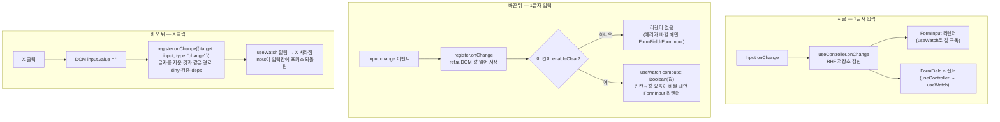

# 공용 입력칸(FormInput·FormInputPassword)을 register로 연결

> RHF 공식 FAQ 기준(ref가 닿는 네이티브 입력은 `register`)에 맞게 공용 텍스트·비밀번호 입력칸을
> `useController`에서 `register`로 바꾼다. `FormField`의 에러 구독을 `useFormState`로 좁히고,
> `FormInput`의 지우기 버튼 옵션(`enableClear`)은 `register`에서도 동작하게 다시 구현한다.

## Context

2026-11-03 대화에서 `register`와 `useController`를 RHF 공식 기준과 대조해 보니, `FormInput`·`FormInputPassword`가
기준과 달랐다. 둘 다 ref를 `<input>`까지 넘기는 컴포넌트(`input.tsx:13-30`, `PasswordInput.tsx:6-12`)인데
`useController`를 쓰고 있다. 공식 FAQ는 이렇게 쓴다.

> 네이티브 입력과, DOM `ref`를 노출하는 커스텀 컴포넌트에는 `register`를 쓰세요. 가장 단순한 방법이고 대개 리렌더가
> 가장 적습니다. 많은 컴포넌트 라이브러리의 셀렉트, 날짜 선택기, 자동완성처럼 `value`와 `onChange`로 제어되는
> 컴포넌트에는 `Controller`나 `useController`를 쓰세요. 같은 입력에 `register`와 `field`를 함께 펼치지 마세요.
> `Controller`가 이미 등록합니다. (번역)
>
> — React Hook Form FAQ "Should I use register or Controller?", https://react-hook-form.com/faqs

### 사전 조사 (설치본 react-hook-form 7.71.0, `node_modules/react-hook-form/dist/index.esm.mjs`)

- **사용처 18칸**: `FormInput` 9칸, `FormInputPassword` 9칸. 호출부가 `onChange`·`value`·`ref`를 넘기는 곳은 없다.
  호출부 `onBlur`는 비밀번호 확인 칸 3곳(`usePasswordFieldsFeedback.ts:92-98`의 `confirmInputProps`)이 넘긴다.
- **실제로 리렌더가 줄어드는 칸은 5칸뿐이다.** 나머지 13칸은 폼을 가진 훅이 render 중에 `watch`해서, 바꿔도 폼 전체가
  계속 다시 그려진다(`watch` → 감시 목록 등록 :222-224 → 전체 formState 알림 :1868 → root 구독 :2860-2863).
  - 효과 있음(모두 `mode: 'onSubmit'`): 로그인 email·password, 비밀번호 재설정 요청 email, 비밀번호 변경 currentPassword,
    탈퇴 password
  - 효과 없음: 가입 4칸, 재설정 확인 2칸, 비밀번호 변경 new·confirm, 계정 nickname, 게시글 작성·수정 url·title
- **`FormField`도 바꿔야 효과가 난다.** `FormField`가 에러를 보려고 `useController`를 부르고(`FormField.tsx:37-40`),
  `useController`는 안에서 `useWatch`로 값을 구독한다(:388-393). 같은 칸을 한 번 더 register하기도 한다(:401-405, :470).
- **`enableClear`(지우기 버튼 켜기 옵션)**
  - 운영 코드에서 켠 칸은 없고, `FormInput.stories.tsx:50-56`(WithClear)만 쓴다.
  - `Input`의 X는 `props.value`가 있어야 보인다(`input.tsx:40`). `register`는 `value`를 넘기지 않아, 그대로 두면 켜도
    X가 안 나온다.
  - X는 `absolute`인데 `FormField` 래퍼(`FormField.tsx:54`)와 스토리 데코레이터(`FormInput.stories.tsx:11`)에 `relative`가
    없다. `SearchInput.tsx:32`·`PasswordInput.tsx:11`은 `relative`로 감싼다. 그래서 2026-02-18 추가(`905f5e97`) 뒤로 X가
    입력칸 옆이 아닌 곳에 떴을 가능성이 크다(코드로 본 추론, 구현 때 Storybook 화면으로 확인).
- **`register`로 바꿨을 때 RHF 동작**
  - `reset(값)`은 `_fields`를 비운다(:2294). DOM은 컴포넌트가 다시 렌더되며 `register`의 ref가 다시 붙을 때 채워진다
    (:2117-2132 → :1535-1543). `reset`은 전체 formState를 알려 폼이 다시 렌더되고, `useMergedRef`가 매 렌더 새 콜백을
    만들어(`useMergedRef.ts:10-30`) ref가 다시 붙는다.
  - `setValue`·`resetField`는 DOM에 직접 쓰고(:1737-1738) `useWatch` 구독자에게 알린다(:1795-1807).
  - 화면에서 disabled인 입력도 값을 그대로 읽는다(:995-1009). `register` 옵션의 `disabled`만 제출 값에서 뺀다.
  - `register`의 `onBlur`는 `onChange` 핸들러 자체라 이벤트를 받아야 한다(:2100). 이 핸들러의 타입은
    `{ target: any; type?: any }`를 받는다(`types/form.d.ts:54-57`).
  - 첫 에러 칸 포커스는 `_f.ref.focus`라(:1904-1906) DOM ref면 그대로 동작한다.
  - `clearErrors`는 이름 없이 알리므로(:1966-1971) `useFormState` 구독자도 에러가 지워진 걸 받는다.
  - `useWatch`의 `compute`는 계산 결과가 바뀔 때만 상태를 바꾸고(:309-314), `disabled`면 갱신하지 않는다(:307).

## 판단이 필요했던 항목

| 항목                           | 결정                                                                                                                        | 근거·기각한 대안                                                                                                                                                                                                                                                                                                                                                                                                                        |
| ------------------------------ | --------------------------------------------------------------------------------------------------------------------------- | --------------------------------------------------------------------------------------------------------------------------------------------------------------------------------------------------------------------------------------------------------------------------------------------------------------------------------------------------------------------------------------------------------------------------------------- |
| 입력칸 연결 방식               | `register`                                                                                                                  | RHF FAQ(위 인용). 기각: `useController` 유지 — 공식 기준과 다르다                                                                                                                                                                                                                                                                                                                                                                       |
| `FormField`·입력칸의 에러 구독 | `useFormState({ name, exact: true })`로 `errors`만 받고 `get(errors, name)`                                                 | `useController`는 값까지 구독한다. `getFieldState(name, formState)`는 dirty·touched까지 읽어 그 전환 때마다 다시 그린다. RHF `useController`도 내부에서 `get(formState.errors, name)`을 쓴다(:426)                                                                                                                                                                                                                                      |
| `enableClear`                  | 유지하고 `register`에서 동작하게 다시 구현(2026-11-03 사용자 결정)                                                          | 기각: 옵션 삭제 — 쓰는 곳은 없지만 사용자가 유지를 골랐다                                                                                                                                                                                                                                                                                                                                                                               |
| X를 보일지 판단                | `useWatch({ name, compute: (v) => Boolean(v), disabled: !enableClear })` 결과를 `Input`의 새 prop `hasValue`로 넘긴다       | [useWatch 문서](https://react-hook-form.com/docs/usewatch)는 _"리렌더를 커스텀 훅 수준에 가둔다"_ (번역), `compute`(v7.61.0~)는 _"선택하고 계산한 폼 값을 구독한다"_ (번역). 기각: `value`를 넘기기 — FAQ가 _"`register`를 쓴다면 `value`를 빼라"_ (번역)고 한다. 기각: `compute` 없이 값 구독 — 매 글자 리렌더                                                                                                                         |
| X를 눌렀을 때 비우는 방법      | DOM 입력값을 `''`로 바꾸고 `register`의 `onChange({ target: input, type: 'change' })`를 부른다                              | 사용자가 글자를 지운 것과 같은 경로라 dirty, 폼 `mode`별 검증 시점, `deps`가 그대로 맞는다. 기각: `setValue` — [문서](https://react-hook-form.com/docs/useform/setvalue)상 _"기본적으로 검증하지 않고(제출한 뒤에도) dirty·touched로 표시하지 않는다"_ (번역). 옵션으로 맞추려면 폼 `mode`를 알아야 하는데, `FormInput`은 알 수 없다(`_options`는 비공개). 기각: `resetField` — 기본값으로 되돌려서, 기본값이 있는 칸은 비워지지 않는다 |
| X 위치                         | `FormInput`에서 `Input`을 `
`로 감싼다                                                             | `PasswordInput.tsx:11`·`SearchInput.tsx:32`와 같은 형태. 정답이 하나인 위치 수정이라 §9 시안 비교 대신, 구현 뒤 Storybook 화면으로 확인해 공유한다                                                                                                                                                                                                                                                                                      |
| `disabled`                     | 지금처럼 DOM 속성으로만 넘기고 `register` 옵션에는 넣지 않는다                                                              | `register` 옵션 `disabled`는 제출 값에서 그 칸을 뺀다                                                                                                                                                                                                                                                                                                                                                                                   |
| props 순서·`onBlur`            | `{...props}` 뒤에 `register` 결과를 펼친다. `onBlur`는 `register`의 `onBlur(event)`와 호출부 `onBlur(event)`를 둘 다 부른다 | 호출부가 RHF 핸들러를 덮지 않게 하려고. 이벤트를 넘기지 않으면 touched가 깨진다(`FormInputPassword.test.tsx:92-102`가 막는다)                                                                                                                                                                                                                                                                                                           |
| ref 합치기                     | `const { ref, ...registration } = register(name)` 뒤 콜백 ref에서 `ref(el)`과 자체 ref를 함께 채운다                        | X 클릭 때 DOM 입력이 필요하다. 선례는 `CommentForm.tsx:93·119-122`(`react-hooks/refs` 린트 통과)                                                                                                                                                                                                                                                                                                                                        |
| 효과 확인 방법                 | React `Profiler`로 입력 중 커밋 수를 세는 테스트를 먼저 지금 코드에 돌려 실패를 확인한 뒤 바꾼다                            | 리렌더를 센 테스트가 레포에 없다. 렌더 횟수를 세는 선례는 `alert.store.test.ts:10-32`. 근거: [Profiler](https://react.dev/reference/react/Profiler)                                                                                                                                                                                                                                                                                     |
| CHANGELOG                      | 운영 화면 동작이 바뀌지 않아 `refactor`로 두고, 구현 때 `changelog-release` skill 기준으로 다시 확인한다                    | X 위치 수정도 켠 칸이 운영에 없어 사용자가 보지 않는다                                                                                                                                                                                                                                                                                                                                                                                  |

## 세부 계획

| 위치                                                     | 변경 내용                                                                                                                                                                                                                                                                                                                                                                                                       |
| -------------------------------------------------------- | --------------------------------------------------------------------------------------------------------------------------------------------------------------------------------------------------------------------------------------------------------------------------------------------------------------------------------------------------------------------------------------------------------------- |
| `src/shared/ui/atoms/input.tsx`                          | `hasValue?: boolean` prop 추가(DOM으로 넘기지 않음). X 표시 조건을 `onClear && (hasValue ?? Boolean(props.value))`로 바꾼다. `value`로 제어하는 기존 사용처(`SearchInput`)는 그대로 동작한다                                                                                                                                                                                                                    |
| `src/shared/ui/atoms/input.stories.tsx`                  | 비제어 입력 + `hasValue`로 X를 보여주는 스토리 추가(atom 변경 시 스토리 동반 규칙)                                                                                                                                                                                                                                                                                                                              |
| `src/shared/ui/elements/form/FormInput.tsx`              | `useController` 제거 → `register(name)` + ref 합치기. 에러 테두리는 `useFormState` + `get`. `enableClear`면 `useWatch`(compute)로 `hasValue`를 계산하고, `onClear`는 위 "비우는 방법"대로 구현한다. `Input`을 `relative` div로 감싼다. 26-27줄 주석 정리                                                                                                                                                        |
| `src/shared/ui/elements/form/FormInputPassword.tsx`      | `register(name, { deps })`로 바꾸고 `onBlur`를 합친다. 에러 테두리는 `useFormState` + `get`. JSDoc(12-14)·주석(33-34, 59)을 `register` 기준으로 고친다                                                                                                                                                                                                                                                          |
| `src/shared/ui/elements/form/_base/FormField.tsx`        | `useController` → `useFormState({ name, exact: true })` + `get(errors, name)`                                                                                                                                                                                                                                                                                                                                   |
| `src/shared/ui/elements/form/FormInput.test.tsx`         | 추가: ① watch 없는 폼에서 입력해도 `FormInput` 아래가 다시 커밋되지 않는다(Profiler) ② `reset(값)`·`setValue` 값이 입력칸에 보인다 ③ 제출하면 에러 칸에 포커스가 간다 ④ `enableClear`: 입력하면 X가 보이고, 누르면 비워지고 dirty가 되며 X가 사라진다 ⑤ `enableClear`: 'abc'를 입력해도 커밋은 빈칸→값 전환 1번뿐이다(Profiler) ⑥ `enableClear`: 제출한 뒤 필수 칸을 X로 비우면, 글자를 지울 때처럼 에러가 뜬다 |
| `src/shared/ui/elements/form/FormInputPassword.test.tsx` | 추가: watch 없는 폼에서 입력해도 다시 커밋되지 않는다(Profiler)                                                                                                                                                                                                                                                                                                                                                 |
| `docs/AUTH.md:820`                                       | "`useController`(`rules.deps`)"를 "`register`의 `deps` 옵션"으로 바꾸고, `FormField.tsx` 줄 번호를 갱신한다                                                                                                                                                                                                                                                                                                     |
| `docs/FE-ARCHITECTURE.md` §16                            | 공용 폼 컴포넌트 연결 규칙 한 단락을 추가한다. ref가 닿는 입력은 `register`, 값·`onChange`로만 다루는 UI는 `useController`(FAQ 인용 + 링크). `register` 칸의 값을 화면에 써야 하면 `useWatch`의 `compute`로 그 칸만 구독한다(예: `FormInput`의 `enableClear`)                                                                                                                                                   |
| `docs/plans/2026-11-03-form-input-register.md` (신규)    | 이 계획 사본(§11)                                                                                                                                                                                                                                                                                                                                                                                               |

## 영향 범위

**데이터 계약**: 바뀌지 않는다. 제출 값은 지금처럼 RHF 저장소(`_formValues`)에서 나온다.

**값을 코드로 바꾸는 곳 — 다시 렌더될 때 DOM에 반영되는지가 위험 지점**

| 동작                                       | 위치                                                                                                                          | 지키는 테스트                                                                                                                                                |
| ------------------------------------------ | ----------------------------------------------------------------------------------------------------------------------------- | ------------------------------------------------------------------------------------------------------------------------------------------------------------ |
| `reset(복원 값)`                           | `useSignUp.ts:112`, `useCreatePost.ts:122`, `useUpdatePost.ts:85·99`, `useUpdateAccount.ts:38·179`, `useChangePassword.ts:30` | `useSignUp.guard.test.tsx:366-372·414-424`, e2e `post-update.spec.ts:68-69·154-155`, `post-create.spec.ts:157-158`, `signup-unsaved-changes.spec.ts:334-338` |
| `resetField`                               | `useLogin.ts:81`                                                                                                              | e2e `signup-unsaved-changes.spec.ts:357·369`                                                                                                                 |
| `setValue('title', '')`                    | `useUpdatePost.ts:121`                                                                                                        | 새 `FormInput.test` ②                                                                                                                                        |
| 첫 에러 칸 포커스, `setError(shouldFocus)` | RHF `handleSubmit`, `useCreatePost.ts:38-42`, `useUpdatePost.ts:46`                                                           | e2e `signup.spec.ts:132-136`, 새 `FormInput.test` ③                                                                                                          |

**기존 기능 회귀**

- **`Input` atom의 X**: 조건이 `hasValue ?? Boolean(props.value)`라 `hasValue`를 안 넘기는 기존 사용처는 지금과 같다.
  지키는 테스트는 `BookmarkSearch.test.tsx:31-39`와 `input.stories.tsx`의 WithClear다.
- **`FormField`의 다른 사용처**: `FormCheckboxGroup`(categoryIds), `PostCreateBookmarkFolderField`(folderIds 서버 에러).
  `FormField`가 더 이상 칸을 등록하지 않지만, 두 칸 모두 자기 `useController`가 등록한다. 지키는 테스트는
  `PostCreateBookmarkFolderField.test.tsx`다.
- **`FormField.stories.tsx`**: 등록하지 않은 `Input` + `setError`. `setError`는 등록 없이도 에러를 넣으므로 표시가 유지된다.
- **비밀번호 실시간 안내**: `deps`, `aria-*`, 확인 칸 `onFocus`·`onBlur`가 이 경로를 탄다. 지키는 테스트는
  `usePasswordFieldsFeedback.test.tsx`, `FormInputPassword.test.tsx`, `ChangePasswordForm.test.tsx`, e2e `signup.spec.ts:81-141`이다.
- **`autoFocus`·라벨 연결**: `id={name}`과 DOM 속성을 그대로 둔다. 지키는 테스트는 e2e `post-create.spec.ts:37`,
  `post-create.mobile.spec.ts:30`, 그리고 `getByLabel` 셀렉터 전반이다.
- **`relative` 래퍼**: `FormInput` 9칸의 DOM에 div가 하나 늘지만, `FormField`의 `gap-2` 간격과 입력칸 너비(`w-full`)는 그대로다.
  e2e·단위 테스트는 라벨·placeholder로 찾아서 구조에 기대지 않는다.
- **watch하는 13칸**: 지금처럼 폼 전체가 다시 그려진다. 동작은 같다.
- **다른 파일에서 import하는 파일**: 구현을 시작할 때 `pnpm graph:focus "<경로>" --text`로 `input.tsx`·`FormInput.tsx`·
  `FormInputPassword.tsx`·`FormField.tsx`의 사용처를 다시 확인한다(§5).

## 검증 방법

1. 워크트리를 만든다(`git log origin/main..main` 비어 있음 확인 → `EnterWorktree` → `.env` 복사, `pnpm install`).
2. Profiler 테스트(①, ⑤, 비밀번호)를 **먼저** 지금 코드에 돌려 실패(입력한 글자 수만큼 커밋)를 확인하고 수치를 적는다.
   이걸로 측정 도구가 실제로 리렌더를 잡는지도 확인된다. 전환한 뒤 ①은 0회, ⑤는 1회로 통과하는지 본다(직접 측정 —
   PR 본문에 전후 수치를 남긴다).
3. `pnpm type-check` → `pnpm test` → `pnpm lint` → `pnpm check:deps` → `pnpm check:docs`
4. e2e: `pnpm test:e2e`로 signup, signup-unsaved-changes, post-create(+mobile), post-update, account-update,
   auth-tab-sync, dialog-outside-click, session-expired를 돌린다.
5. Storybook: `FormInput` WithClear와 `Input`의 새 스토리에서 X 위치·동작을 바꾸기 전과 후로 캡처해 보여준다
   (`browser-verification` skill). Playwright MCP가 그때도 연결되지 않으면 Claude in Chrome으로 대신한다. 폼 스토리 a11y는 CI에서 확인한다.
6. §11: `docs/plans/`에 계획 사본을 커밋하고, PR 전에 `plan-verifier`로 계획과 diff를 대조해 PR 본문
   `## 계획 대비 구현`에 남긴다. 병합 뒤 배포 run 성공을 확인하고 워크트리를 정리한다.

## 남은 것 (이번 범위 밖)

- `FormCheckboxGroup`이 `field.ref`를 넘기지 않아 그 칸은 에러 포커스를 못 받는다. categoryIds는 optional이라 지금은 에러가 날 일이 없다.
- `usePostCreateBookmarkFolderField.ts:20-27`이 한 컴포넌트에서 `useController`를 두 번 부른다. useController 문서는
  컴포넌트당 한 번을 권한다.
- watch하는 13칸의 폼 전체 리렌더: 2026-10-04 `watch`→`useWatch` 보류 결정을 그대로 둔다.
