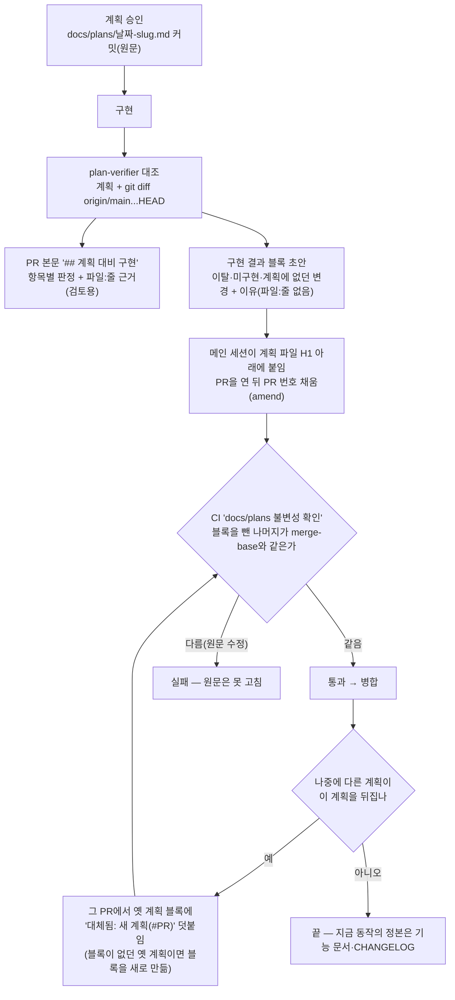

# 계획 파일에 "구현 결과" 블록 허용 — 계획 문서만 보고도 실제로 한 일을 알 수 있게(FE·BE·claude-base)

<!-- plan-result:start — 이 블록만 병합 뒤에도 고칠 수 있다(CLAUDE.md §11). 아래는 승인된 계획 원문 -->

## 구현 결과

> #498 · 2026-11-03 대조 · 이탈 1 · 미구현 0 — 판정 근거(파일:줄)는 PR 본문 "계획 대비 구현"

- 이탈(구현 중 실측): CI 불변성 비교에서 블록뿐 아니라 빈 줄도 지우고 비교한다. 계획에 적은 awk를 그대로 쓰면
  블록을 넣거나 뺄 때 앞뒤 빈 줄이 하나 남아, 계획이 통과를 기대한 "블록 추가"·"블록 삭제"가 실패했다.
  대신 원문에서 빈 줄만 넣거나 빼는 수정은 CI가 잡지 않는다.

<!-- plan-result:end -->

> 계획 원문은 지금처럼 고치지 않는다. 다만 H1 바로 아래 `구현 결과` 블록 하나는 덧붙일 수 있고 병합 뒤에도 고칠 수
> 있게 한다. 블록에는 이탈·미구현·계획에 없던 변경을 이유와 함께 적는다. CI는 블록을 뺀 나머지가 바뀌었을 때만 막는다.

## Context

### 왜

지금은 계획과 실제가 달라진 점이 GitHub PR 본문 `## 계획 대비 구현`에만 남는다. 계획 파일(`docs/plans/`)은 CI가 수정을
전부 막는다(FE `ci.yml:38`, BE `ci.yml:31`). 그래서 계획 파일만 열면 그대로 구현됐는지 알 수 없다. 나중에 다른 계획이
뒤집어도 원본에는 아무 표시가 없다(예: FE `docs/DECISIONS.md:125` — "계획 파일은 append-only라 고치지 않고, 바뀐 범위는
새 계획 파일에 적었다"). 사용자는 2026-11-03 "달라진 점 표시를 허용해야 한다. 그러면 계획 문서만 보고도 실제로 수행된
내용을 알 수 있다"고 정했다.

### 업계 조사 (2026-11-03, 원문 파일을 받아 문장 대조)

원래 계획만 남기고 차이를 어디에도 적지 않는 곳은 없었다. 확정 전이면 원본을 고치고, 확정 뒤면 원본은 두되 원본에
표시를 단다.

- [Rust RFC](https://github.com/rust-lang/rfcs/blob/master/README.md): _"아주 사소한 변경만 수정안으로 내고, 더 큰 변경은
  새 RFC로 하되 원래 RFC에 메모를 단다"_ (번역)
- [Ember RFC](https://github.com/emberjs/rfcs/blob/master/README.md): 출시 단계에서 _"원래 RFC와 중요한 차이가 있으면 RFC
  맨 위에 짧게 적는다"_ (번역)
- [Nygard ADR](https://cognitect.com/blog/2011/11/15/documenting-architecture-decisions): _"결정이 뒤집히면 옛 기록은
  남겨 두되 '대체됨(superseded)'으로 표시한다"_ (번역)
- [Python PEP 1](https://peps.python.org/pep-0001/): _"구현 경험과 사용자 피드백으로 바뀐 점은 PEP에 적어, Final로
  표시되는 시점에 PEP가 구현을 정확히 설명하게 한다"_ (번역). 확정 뒤에는 _"살아 있는 명세가 아니라 역사적 문서"_ 이고
  _"기대 동작의 공식 문서는 다른 곳에서 관리해야 한다"_ (번역)
- [Kubernetes KEP 템플릿](https://github.com/kubernetes/enhancements/blob/master/keps/NNNN-kep-template/README.md):
  _"KEP에 들어가야 할 새 세부 사항이 생기면 KEP를 고쳐라. 기능이 '구현됨'이 된 뒤의 큰 변경은 새 KEP로 한다"_ (번역)
- Malte Ubl, [Design Docs at Google](https://www.industrialempathy.com/posts/design-docs-at-google/)(개인 블로그, Google
  공식 문서 아님): _"설계한 시스템이 아직 출시되지 않았다면 반드시 문서를 갱신하라"_, _"원본 문서에서 그런 수정본으로
  가는 링크는 (...) 큰 도움이 된다"_ (번역)

이 레포의 계획 파일은 구현 코드와 같은 PR에서 처음 커밋되므로, 커밋하는 순간이 곧 "확정(출시)" 시점이다. 그 시점에
Ember처럼 맨 위에 차이를 적고, 나중에 뒤집히면 Rust·ADR처럼 원본에 "대체됨"을 단다.

2026-09-08 동결 규칙(`docs/plans/2026-09-08-plan-verification-process.md:184-194`)은 ADR과 DB 마이그레이션을 근거로
들었다. 그런데 CI는 그중 더 엄격한 마이그레이션 쪽(한 글자도 못 고침)을 따랐다. ADR은 원본에 "대체됨" 표시를 다는
것까지 전제로 한다. 이 계획은 그 표시를 할 자리 하나만 연다.

### 흐름

## 판단이 필요했던 항목

| 항목                  | 결정                                                                                                       | 근거·기각한 대안                                                                                                                    |
| --------------------- | ---------------------------------------------------------------------------------------------------------- | ----------------------------------------------------------------------------------------------------------------------------------- |
| 블록에 담을 범위      | 이탈·미구현·계획에 없던 변경을 이유와 함께, `파일:줄` 없이 (2026-11-03 사용자 선택)                        | 기각: 요약+PR 링크(결국 PR을 열어야 함), PR 표 그대로(줄 번호가 코드 변경으로 틀어짐)                                               |
| 병합 뒤 수정          | 블록만 허용. 다른 계획이 뒤집으면 그 PR에서 `대체됨` 덧붙임 (사용자 선택)                                  | 기각: 처음 커밋 때만(뒤집혀도 원본에 표시 없음 — 지금 문제 그대로)                                                                  |
| 적용 범위             | FE·BE + claude-base 공통 지침 문구 (사용자 선택)                                                           | 기각: FE만 먼저(두 레포 규칙이 갈림)                                                                                                |
| 기존 계획             | 소급하지 않음. 나중에 뒤집힐 때 그 파일에만 블록 추가 (사용자 선택)                                        | 기각: 최근 것 채움(PR 본문 형식이 제각각이라 옮기는 일이 큼)                                                                        |
| 블록 표식             | 줄 맨 앞의 HTML 주석 `<!-- plan-result:start … -->` ~ `<!-- plan-result:end -->`. 안에 `## 구현 결과` 제목 | 화면에 안 보이고 awk로 매칭하기 쉽다. 기계가 읽는 식별자라 영문(레포 규칙). 제목은 목차에 잡히게 `##`                               |
| 블록 위치             | H1 바로 아래(요약 인용구보다 위)                                                                           | Ember "맨 위". CI는 위치를 강제하지 않는다(단순함) — skill·plan-verifier가 안내                                                     |
| CI 구현               | bash+awk 인라인, FE·BE 같은 코드. merge-base 판과 HEAD 판에서 블록을 지우고 `diff`                         | 기각: Node 스크립트+vitest(FE `scripts/lib/pr-body.js` 선례) — BE에 Node가 없어 구현이 둘로 갈리고, 로직이 awk 한 줄이다            |
| 블록 삭제             | CI가 막지 않음                                                                                             | 막으려면 블록끼리 비교하는 로직이 커진다. 삭제는 PR diff에서 보인다                                                                 |
| PR 본문과 중복        | 허용. PR 표는 지금처럼(판정+`파일:줄`, 검토용), 블록은 그 요약(레포 기록)                                  | 같은 레포 안 두 문서가 아니라 레포 밖 PR 본문과의 중복이다. §11 "원문을 PR 본문에 붙여넣지 않는다"는 그대로                         |
| 블록 작성 주체        | plan-verifier가 초안, 메인 세션은 붙여 넣고 PR 번호·대조 뒤 보완 결과만 고침                               | 구현한 세션이 스스로 판정하지 않는다(§11 취지)                                                                                      |
| `workflow_dispatch`   | `base_ref`가 비면 건너뛴다고 명시                                                                          | 지금도 `git diff origin/...HEAD`가 실패해도 awk가 빈 출력으로 통과한다. 새 코드는 `merge-base`가 실패해 스텝이 깨지므로 명시가 필요 |
| BE 블록 초안          | BE에는 plan-verifier가 없다 — BE §8에 블록 형식을 짧게 적어 대조 에이전트에 넘긴다                         | BE §8의 "Explore로 대조"가 FE와 달라진 것은 이번 범위 밖(발견만)                                                                    |
| claude-base 자체 계획 | 같은 공통 규칙을 따른다 — README 문구만, 소급 없음                                                         | 공통 지침이 바뀌는데 자기 계획만 예외로 둘 이유가 없다                                                                              |

### 위험 관리

| 위험                                                                 | 대응                                                                                                  |
| -------------------------------------------------------------------- | ----------------------------------------------------------------------------------------------------- |
| 문서 예시로 쓴 표식이 줄 맨 앞에 오면 본문 일부가 블록으로 잘못 잡힘 | 표식 예시는 들여쓰거나 인라인 코드로만 쓴다(skill·이 계획에 명시). awk가 `^<!-- plan-result`만 잡는다 |
| 블록 안에 본문을 옮겨 고쳐 우회                                      | merge-base 판에는 그 줄이 블록 밖에 있어 비교가 다르게 나와 실패한다(검증 사례 4)                     |
| plan-verifier가 블록을 계획 항목으로 읽음                            | 에이전트 지시에 "plan-result 블록은 대조 항목이 아니다"를 넣는다                                      |

## 세부 계획

블록 형식(FE skill·FE §11·BE §8이 같은 형식을 가리킨다. 아래는 들여쓴 예시):

    # 계획 제목

    <!-- plan-result:start — 이 블록만 병합 뒤에도 고칠 수 있다(CLAUDE.md §11). 아래는 승인된 계획 원문 -->

    ## 구현 결과

    > #487 · 2026-11-02 대조 · 이탈 4 · 미구현 2 — 판정 근거(파일:줄)는 PR 본문 "계획 대비 구현"

    - 이탈(사용자 요청): 가입 이메일 중복 설명은 계획 문구 대신 #486의 가입 화면 문구를 같이 씀
    - 미구현 → 보완함: "남의 글이면 버튼 없음" 테스트
    - 계획에 없던 변경: 이미 로그인 화면에 있으면 [로그인]이 이메일을 안 채우던 버그 수정
    - 대체됨: (나중에 이 계획을 뒤집는 계획이 생기면 그 PR에서 덧붙인다)

    <!-- plan-result:end -->

차이가 없으면 `- 이탈·미구현·계획에 없던 변경 없음` 한 줄. 블록이 있으면 "대조했다", 없으면 "이 규칙 전 계획"이다.

CI 스텝 본문(FE·BE 같은 코드):

    if [ -z "${{ github.base_ref }}" ]; then echo "PR이 아니라 건너뜀"; exit 0; fi
    base=$(git merge-base "origin/${{ github.base_ref }}" HEAD)
    strip_result() { awk '/^<!-- plan-result:start/ { skip = 1 } !skip { print } /^<!-- plan-result:end -->/ { skip = 0 }'; }
    changed=""
    for f in $(git diff --name-status "$base" HEAD -- docs/plans/ | awk '$1 == "M" { print $2 }'); do
      if ! diff -q <(git show "$base:$f" | strip_result) <(git show "HEAD:$f" | strip_result) > /dev/null; then
        changed="$changed$f"$'\n'
      fi
    done
    (changed가 있으면 "원문은 못 고침, 고칠 수 있는 건 plan-result 블록뿐" 안내 후 exit 1)

### Phase 1 — FE PR

| 위치                                                  | 변경 내용                                                                                               |
| ----------------------------------------------------- | ------------------------------------------------------------------------------------------------------- |
| `docs/plans/2026-11-03-plan-result-block.md` (신규)   | 이 계획 스냅샷. 대조 뒤 자기 블록을 단다                                                                |
| `.github/workflows/ci.yml:38-50`                      | 위 스텝 본문과 주석으로 교체                                                                            |
| `.claude/CLAUDE.md:292-294` (§11)                     | 원문 append-only + 블록 예외, 작성 주체, `대체됨`, 근거 계획 링크                                       |
| `.claude/CLAUDE.md:1016-1021` (docs 분류 "작업 계획") | "무엇이 실제로 됐는지"를 블록(요약)과 PR 본문(근거)이 맡는다고                                          |
| `.claude/agents/plan-verifier.md`                     | 입력: 블록은 대조 항목이 아님. 출력: 표 뒤에 위 형식의 "구현 결과 블록 초안"                            |
| `.claude/skills/plan-doc-structure/SKILL.md`          | 공통 골격 맨 위에 블록 자리(구현 뒤 채움), 표식 예시는 들여쓰기 규칙, :86-87 적용 범위 문장에 블록 예외 |
| `.github/pull_request_template.md:22-26`              | plan mode 안내에 "같은 PR에서 계획 맨 위 구현 결과 블록도 채운다" 한 문장                               |
| `docs/CI-CHECK-GATE.md:131`                           | 불변성 검사 행 설명 갱신                                                                                |
| `README.md:234`                                       | `docs/plans/` 설명에 블록 예외                                                                          |
| `docs/plans/2026-09-08-plan-verification-process.md`  | 블록 추가: `대체됨(일부)` — 계획 파일 수정 금지 → 결과 블록 허용, 새 계획 링크 (실제 사용 첫 사례)      |

### Phase 2 — BE PR

| 위치                                                 | 변경 내용                                                         |
| ---------------------------------------------------- | ----------------------------------------------------------------- |
| `docs/plans/2026-11-03-plan-result-block.md` (신규)  | FE와 같은 계획 사본(선례: 2026-09-08 계획도 양쪽에 있음)          |
| `.github/workflows/ci.yml:31-43`                     | FE와 같은 스텝 본문                                               |
| `.claude/CLAUDE.md:163-165` (§8)                     | FE §11과 같은 뜻 + 블록 형식 요약(plan-verifier·skill이 없으므로) |
| `.claude/CLAUDE.md:406-410`                          | docs 분류 "작업 계획" 항목                                        |
| `docs/CI-CHECK-GATE.md:167`                          | 불변성 검사 행                                                    |
| `README.md:513`                                      | `docs/plans/` 설명                                                |
| `.github/pull_request_template.md:4-9`               | 블록 한 문장                                                      |
| `docs/plans/2026-09-08-plan-verification-process.md` | FE와 같은 `대체됨(일부)` 블록                                     |

### Phase 3 — claude-base (워크트리 → 사용자 확인 → main ff 병합)

| 위치                                              | 변경 내용                                                                                                                                |
| ------------------------------------------------- | ---------------------------------------------------------------------------------------------------------------------------------------- |
| `CLAUDE.md:72-73`                                 | "승인된 계획은 원문을 고치지 않고 보관한다 … 달라진 점은 계획 맨 위 결과 블록에 덧붙인다"                                                |
| `CLAUDE.md:136`                                   | "계획 원본과 결정 로그는 고치지 않고 덧붙인다. 계획에는 맨 위 결과 블록만 덧붙이거나 고친다. 결정이 바뀌면 …" (150줄 예산 안, +1줄 이내) |
| `docs/MAPPING.md:152`·`:155`·`:230`·`:251`·`:254` | 요지 열을 "원문 수정 금지, 결과 블록만"으로, 6라운드 처리 괄호에 표식 형식(프로젝트 층에 남김)                                           |
| `docs/DECISIONS.md` (새 항목)                     | `:46` "계획 보관" 결정을 바꾸는 항목, 이 계획 링크(append-only라 :46은 그대로)                                                           |
| `README.md:115`                                   | "라운드별 계획 원본(원문은 고치지 않음, 맨 위 결과 블록만)"                                                                              |

## 영향 범위

- **CI 스텝(FE·BE 모든 PR)**
  - 계획 파일을 안 건드리는 PR은 루프가 비어 지금처럼 통과한다.
  - `workflow_dispatch`는 명시적으로 건너뛴다. 지금도 사실상 검사 없이 통과한다.
  - 삭제(`D`)·이름 변경(`R`)은 지금처럼 검사하지 않는다. 기존 동작 그대로이고 이번 범위 밖이다.
- **배포**: 두 레포 모두 바뀌는 경로가 `deploy.yml` 경로 필터(FE `src/**` 등, BE `src/**`·gradle)에 걸리지 않는다. 병합해도 배포가 돌지 않는다.
- **훅**
  - `plan-diagram-reminder.sh`는 git이 추적하는 파일이면 건너뛴다(:40). 블록 편집에 반응하지 않는다.
  - edit-guard·bash-guard에는 plans 경로 조건이 없다(claude-base `hooks/edit-guard.mjs:37-64`). 둘 다 바꾸지 않는다.
- **plan-verifier 평가 하네스**: `.claude/workflows/plan-verifier-eval.js`가 자기 출력 스키마를 넘긴다(:52, :118). 기본 출력이 바뀌어도 영향이 없다.
- **문서 검사**: `scripts/check-docs.js`는 `docs/*.md` 최상위만 본다(:39). 계획 파일 안의 블록 내용은 검사하지 않는다.
- **Tailwind**: 자동 스캔이 `docs/plans`도 읽는다(FE `docs/DESIGN-SYSTEM.md:414` 사례). 블록에 클래스처럼 생긴 문자열을 쓰면 유령 유틸리티가 생길 수 있다. 본문과 같은 위험이다.
- **그대로 두는 것**
  - FE `.claude/CLAUDE.md:340-343`과 훅 주석 :37-38의 "append-only 보호 때문" 문구는 원문 보호가 그대로라 여전히 맞다.
  - `docs/PR-BODY-CHECK.md`의 "동결" 표현도 원문 기준이라 맞다.
  - FE PR 템플릿의 "general-purpose" 안내와 BE §8의 "Explore" 안내는 낡았지만 이번에 바꾸지 않는다(§3). 발견 사항으로 PR에 적는다.
- **메모리**: 병합 뒤 `plan-vs-implementation-verification.md` 메모리에 블록 규칙을 반영한다.

## 검증 방법

1. **CI 스크립트 사례 실측**(구현 중, 스크래치패드 임시 git 레포): 같은 스텝 본문으로 아래 7개를 돌려 기대 결과와 대조한다.
   - ① 본문 수정 → 실패
   - ② 블록이 없던 파일에 블록 추가 → 통과
   - ③ 기존 블록 수정 → 통과
   - ④ 기존 본문 줄을 새 표식으로 감싸고 고침 → 실패
   - ⑤ 새 계획 파일 → 통과
   - ⑥ 블록 삭제 → 통과
   - ⑦ `base_ref` 없음 → 건너뜀
2. **FE 로컬 검사**
   - `pnpm check:docs`, `pnpm format:check`
   - `ci.yml` YAML 파싱(`python3 -c "import yaml,sys; yaml.safe_load(open(sys.argv[1]))"`)
3. **FE PR 실제 CI**
   - 양성: `2026-09-08` 계획에 블록을 단 상태로 `check` 잡이 통과한다.
   - 음성: 옛 계획 본문 한 줄을 고친 임시 커밋으로 실패를 확인한 뒤 되돌린다(선례 #474). run 링크를 PR 본문에 남긴다.
4. **대조**: plan-verifier에 이 계획과 diff를 넘겨 PR 본문 표와 블록 초안을 받는다. 초안을 이 계획 파일 맨 위에 붙인다. 바뀐 에이전트 지시가 실제로 작동하는지 확인하는 단계다.
5. **BE PR**: 1의 결과는 같은 코드라 재사용한다. 실제 CI `check`·`api-compat` 통과, 양성·음성 확인은 FE와 같다.
6. **claude-base**
   - `wc -l CLAUDE.md`가 150 이하인지 확인한다.
   - 문서만 바꾸는 커밋이라 pre-commit 테스트는 돌지 않는다. ff 병합 전에 사용자 확인을 받는다.
7. **병합 뒤**: 두 레포 모두 배포 트리거가 없음을 `gh run list --branch main`으로 확인한다. 그다음 워크트리를 정리한다.

## 남은 것

- 블록 형식이 실제로 잘 읽히는지는 다음 몇 개 계획에서 써 봐야 안다. 문제가 있으면 새 계획으로 고친다(이 계획은 append-only).
- BE §8의 대조 에이전트 안내(Explore)와 FE PR 템플릿의 general-purpose 안내가 낡은 문제는 별도 작업으로 남긴다.
