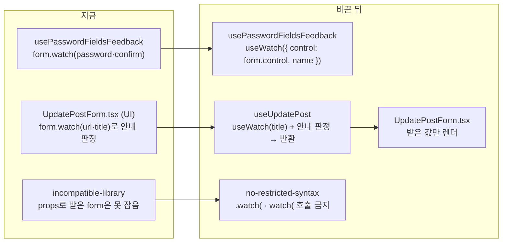

# 남은 `watch()`를 `useWatch`로 바꾸고, 다시 생기지 않게 린트로 막기

<!-- plan-result:start — 이 블록만 병합 뒤에도 고칠 수 있다(CLAUDE.md §11). 아래는 승인된 계획 원문 -->

## 구현 결과

> #502 · 2026-11-03 대조 · 이탈 0 · 미구현 0 — 판정 근거(파일:줄)는 PR 본문 "계획 대비 구현"

- 이탈·미구현·계획에 없던 변경 없음
- 참고: §2 린트 표는 126줄(`react-hooks/*` 행)에 덧붙이지 않고 `no-restricted-syntax` 새 행으로 넣었다(내용 같음)

<!-- plan-result:end -->

> 2026-11-03에 정한 기준(값 읽기는 `useWatch`, 변경 구독은 `subscribe`)을 #501이 다루지 못한 나머지 2개 파일에
> 적용한다. `incompatible-library`가 잡지 못하는 "props로 받은 `form`의 `watch()`"를 새 린트로 막고, 기준과 측정
> 결과를 문서에 남긴다.

## Context

### 2026-11-03에 정한 기준

`react-hook-form/documentation`의 `watch.mdx` 원본과 설치본 소스를 대조해 정했다.

- **값 읽기**(`const t = watch('title')`)를 대체하는 API는 `useWatch`다. 문서는 폐기하지 않았고, 성능 문제가 있을 때,
  폼이 커질 때, React Compiler를 쓸 때만 `useWatch`로 옮기라고 권한다(watch.mdx:103·104·307).
- **변경 구독**(`watch(콜백)`)을 대체하는 API는 `subscribe`다. 문서가 이 형태를 Deprecated로 표시한다(watch.mdx:78,
  2025-05-26부터). 다만 코드 타입에는 아직 `@deprecated`가 없다(7.71.0 `form.d.ts:397`, 최신 7.91.0도 같음).
- **린트 사각지대**(#501이 찾음): eslint-plugin-react-hooks 7.1.1은 `useForm()`의 `watch`를 만나면 그 함수 분석을
  throw로 끝낸다(`eslint-plugin-react-hooks.development.js:40181-40197`). 그래서 `set-state-in-effect`·`refs` 같은
  규칙이 그 훅 전체에서 돌지 않았다.
- **성능**: 바꿀 이유가 없다(직접 측정). 운영 빌드에 e2e 목을 붙이고 CPU를 4배 감속해 쟀다. `watch` 몫은 키당 약
  3ms였고, 모든 칸의 p95가 한 프레임(16.7ms) 안이었다. 그래서 값을 쓰는 부분을 자식 컴포넌트로 떼어 내는 구조
  변경은 하지 않는다.

### #501(`0d13731d`, 2026-11-03 병합) 뒤에 남은 것

#501은 6개 훅의 `watch`를 `useWatch`·`form.subscribe`로 바꾸고 `incompatible-library`를 error로 켰다. 남은 `watch()`
5곳은 모두 props로 받은 `form`에서 부른다. 컴파일러가 이 `watch`를 `useForm()`의 반환값으로 알아보지 못해서,
`incompatible-library`는 이 5곳을 잡지 못한다.

| 위치                                                         | 하는 일                                                                     |
| ------------------------------------------------------------ | --------------------------------------------------------------------------- |
| `src/entities/auth/hooks/usePasswordFieldsFeedback.ts:42-43` | 비밀번호·확인 칸 값으로 실시간 안내 계산. 가입·재설정·변경 3개 훅이 부른다  |
| `src/features/post/update/ui/UpdatePostForm.tsx:31·33·58`    | UI 파일에서 URL 변경 안내·제목 비움 안내를 판정하고, 미리보기 제목을 넘긴다 |

### 사전 조사

- **`useWatch`의 구독 시점**: layout effect에서 구독한다(react-hook-form 7.71.0 `index.esm.mjs:321-338`). 그래서
  `useEffect` 안의 `reset` 복원(`useSignUp.ts:112`, `useUpdatePost.ts:85·99`)보다 먼저 걸려 값을 놓치지 않는다.
  같은 컴포넌트 안에서 바꾸는 것이라 다시 그리는 범위도 지금과 같다.
- **안내 문구 2개를 지키는 테스트가 없다**: `urlChangedNotice`·`titleClearedNotice`를 단정하는 테스트는 src·e2e
  어디에도 없다(`UpdatePostForm.tsx`에서만 쓴다).
- **URL 비교가 세 군데에서 다르다**
  - 훅의 미리보기 판정 `isUrlChanged`(`useUpdatePost.ts:170`)는 `urlValue.trim()`과 비교한다.
  - UI의 안내 판정(`UpdatePostForm.tsx:31`)은 `trim()` 없이 비교한다.
  - 제목 비우기 effect(`useUpdatePost.ts:118`)도 `trim()` 없이 비교한다.
  - 스키마(`post.schema.ts:9-12`)는 공백을 다듬지 않는다. 이번 작업은 동작을 그대로 옮기므로 안내 판정도 `trim()`
    없이 둔다.
- **`.watch(` 호출은 RHF 말고 없다**: src 전체에서 `.watch(` 호출은 위 5곳뿐이다(테스트·스토리 포함).
  `useFcmForegroundMessage.ts`의 `subscribe()`는 이름만 같은 지역 함수다.
- **선례**: `useCreatePost`는 제목 값을 훅에서 `useWatch`로 읽어 `titleValue`로 반환하고(`useCreatePost.ts:77·246`),
  UI는 받아서 넘기기만 한다(`CreatePostForm.tsx:34·118`).

## 판단이 필요했던 항목

| 항목                     | 결정                                                                                                                | 근거·기각한 대안                                                                                                                                                                  |
| ------------------------ | ------------------------------------------------------------------------------------------------------------------- | --------------------------------------------------------------------------------------------------------------------------------------------------------------------------------- |
| 값 읽기 API              | `useWatch({ control: form.control, name })`                                                                         | 위 기준. #501과 같은 형태다. 기각: `getValues` — 구독하지 않아 입력해도 화면이 바뀌지 않는다                                                                                      |
| UpdatePostForm 판정 위치 | `useUpdatePost`가 계산해 반환(`titleValue`·`showUrlChangedNotice`·`showTitleClearedNotice`). 2026-11-03 사용자 결정 | §6("ui는 JSX만")과 `useCreatePost`의 `titleValue` 선례를 따른다. 반환값을 더하는 훅 시그니처 변경은 사용자가 승인했다. 기각: UI에서 `useWatch`로만 교체 — 판정 로직이 UI에 남는다 |
| 안내 판정의 URL 비교     | `trim()` 없이 지금 그대로 옮긴다                                                                                    | 동작을 바꾸지 않는 리팩터로 둔다. 기존 `isUrlChanged`(trim, 미리보기용)와 이름이 겹치지 않게 `showUrlChangedNotice`로 짓는다. 비교 방식을 통일하는 건 "남은 것"으로 둔다          |
| 재발 방지                | `no-restricted-syntax`로 `.watch(`·`watch(` 호출 금지. 2026-11-03 사용자 결정                                       | `incompatible-library`는 props로 받은 `form`을 못 잡는다. 지금 오탐 대상이 없다(위 조사). 기각: 문서 규칙만 — dayjs 규칙이 문서로만 5개월 지켜지지 않았던 선례(CLAUDE.md)         |
| 자식 컴포넌트 분리       | 하지 않는다                                                                                                         | 위 측정. RHF 문서도 작은 폼은 `watch`(값 읽기)로 충분하다고 한다                                                                                                                  |
| 측정 기록                | `FE-ARCHITECTURE.md` §16에 방법·수치를 남기고 스크립트는 커밋하지 않는다                                            | §10(직접 측정은 재현 방법을 남긴다). 타이밍 기반이라 CI에 넣으면 흔들린다                                                                                                         |
| CHANGELOG                | 넣지 않는다                                                                                                         | 화면 동작이 바뀌지 않는 `refactor`다(`changelog-release` skill 기준, 구현 때 다시 확인)                                                                                           |

## 세부 계획

| 위치                                                         | 변경 내용                                                                                                                                                                                                                                        |
| ------------------------------------------------------------ | ------------------------------------------------------------------------------------------------------------------------------------------------------------------------------------------------------------------------------------------------ |
| `src/entities/auth/hooks/usePasswordFieldsFeedback.ts:42-43` | `form.watch(fields.x)`를 `useWatch({ control: form.control, name: fields.x })`로 바꾼다. `String(... ?? '')` 처리는 그대로 둔다                                                                                                                  |
| `src/features/post/update/hooks/useUpdatePost.ts`            | `titleValue = useWatch({ control: form.control, name: 'title' })`를 더한다. `UpdatePostForm.tsx:31·33`의 판정을 `showUrlChangedNotice`·`showTitleClearedNotice`로 옮기고, 셋을 반환한다                                                          |
| `src/features/post/update/ui/UpdatePostForm.tsx`             | `form.watch` 3곳과 판정 2줄을 지우고 훅이 준 값을 쓴다                                                                                                                                                                                           |
| `src/features/post/update/ui/UpdatePostForm.test.tsx` (신규) | ① 열면 안내가 없다 ② URL을 바꾸면 URL 변경 안내가 보이고 제목 비움 안내는 숨는다 ③ URL은 그대로 두고 제목을 비우면 제목 비움 안내가 보인다 ④ URL 끝에 공백만 붙여도 URL 변경 안내가 보인다(지금 동작 고정)                                       |
| `eslint.config.js`의 `RESTRICTED_SYNTAX_COMMON`              | `CallExpression[callee.property.name="watch"]`·`CallExpression[callee.name="watch"]`를 금지하고, 메시지로 "값은 `useWatch`, 변경 구독은 `form.subscribe`"를 안내한다                                                                             |
| `docs/FE-ARCHITECTURE.md` §2 린트 표(126줄)                  | props로 받은 `form`의 `watch()`는 새 `no-restricted-syntax`가 막는다고 덧붙인다                                                                                                                                                                  |
| `docs/FE-ARCHITECTURE.md` §16 "입력칸을 폼에 연결하는 방식"  | "폼 전체가 다시 그려지는지는 `watch`가 정한다" 항목을 `useWatch` 기준으로 고친다. "값 읽기는 `useWatch`, 변경 구독은 `subscribe`" 항목과 RHF 문서 링크를 더한다. 2026-11-03 측정 방법·수치와, 그래서 자식 컴포넌트로 떼지 않는다는 결정을 적는다 |
| `docs/plans/2026-11-03-usewatch-remaining.md` (신규)         | 이 계획 사본(§11)                                                                                                                                                                                                                                |

## 영향 범위

**데이터 계약**: 바뀌지 않는다. 제출 값은 지금처럼 RHF 저장소에서 나온다.

**기존 기능 회귀**

| 동작                                                 | 위치                                                                                                        | 지키는 테스트                                                                                      |
| ---------------------------------------------------- | ----------------------------------------------------------------------------------------------------------- | -------------------------------------------------------------------------------------------------- |
| 비밀번호 조건 체크리스트·확인 칸 일치 안내           | `useSignUp.ts:87`, `useConfirmPasswordReset.ts:29`, `useChangePassword.ts:21` → `usePasswordFieldsFeedback` | `usePasswordFieldsFeedback.test.tsx`(실제 폼), `ChangePasswordForm.test.tsx`, e2e `signup.spec.ts` |
| 가입 입력 복원 뒤 안내                               | `useSignUp.ts:112` `reset`                                                                                  | `useSignUp.guard.test.tsx`, e2e `signup-unsaved-changes.spec.ts`                                   |
| 수정 화면 URL 변경 안내·제목 비움 안내·미리보기 제목 | `UpdatePostForm.tsx` → `useUpdatePost.ts`                                                                   | 새 `UpdatePostForm.test.tsx`(바꾸기 전 코드에서 먼저 통과시킨다), e2e `post-update.spec.ts`        |
| URL을 바꾸면 제목·관심 분야 비우기                   | `useUpdatePost.ts:111-125`                                                                                  | `useUpdatePost.test.tsx`                                                                           |
| `useUpdatePost` 반환값                               | 사용처는 `UpdatePostForm.tsx` 하나(구현 때 `pnpm graph:focus`로 다시 확인)                                  | type-check                                                                                         |
| 새 린트 규칙                                         | `RESTRICTED_SYNTAX_COMMON`은 src 전체·테스트·mocks에 적용된다                                               | `pnpm lint`가 바꾸기 전에는 정확히 5곳, 바꾼 뒤에는 0건을 보고하는지 본다                          |

## 검증 방법

1. 워크트리를 만든다(`git log origin/main..main` 확인 → `EnterWorktree` → `.env` 복사, Node 24로 `pnpm install`).
   `pnpm graph:focus`로 `useUpdatePost.ts`·`usePasswordFieldsFeedback.ts`의 사용처를 다시 확인한다(§5).
2. 새 `UpdatePostForm.test.tsx`를 **지금 코드에서 먼저** 돌려 통과를 확인한다. 이걸로 바꾸기 전 동작이 고정된다.
3. 린트 규칙을 먼저 넣고 `pnpm lint`가 정확히 위 5곳을 보고하는지 본다. 규칙이 props로 받은 `form`을 실제로 잡는지
   확인하는 단계다. 그다음 5곳을 바꾸고 0건이 되는지 본다.
4. `pnpm type-check` → `pnpm test` → `pnpm lint` → `pnpm check:deps` → `pnpm check:docs`
5. e2e: `signup`, `signup-unsaved-changes`, `post-update`, `account-update`
6. §11: `docs/plans/`에 계획 사본을 커밋하고, PR 전에 `plan-verifier`로 계획과 diff를 대조해 PR 본문
   `## 계획 대비 구현`에 남긴다. 병합은 사용자 요청 뒤에 하고, 배포 run 성공을 확인한 뒤 워크트리를 정리한다.

## 남은 것 (이번 범위 밖)

- **수정 화면의 URL 비교 불일치**: 미리보기 판정은 `trim()` 뒤에 비교하고, 안내 판정과 제목 비우기 effect는 `trim()`
  없이 비교한다. 그래서 URL 끝에 공백만 붙이면 제목이 비워지고 URL 변경 안내가 뜨지만, 미리보기는 다시 묻지 않는다.
  어느 쪽으로 맞출지는 화면 동작을 바꾸는 결정이라 따로 다룬다.
- React Compiler 도입은 2026-10-04 보류 결정을 그대로 둔다. 이번 작업으로 `watch` 쪽 준비는 끝난다.
