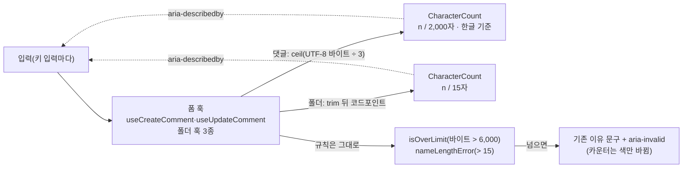
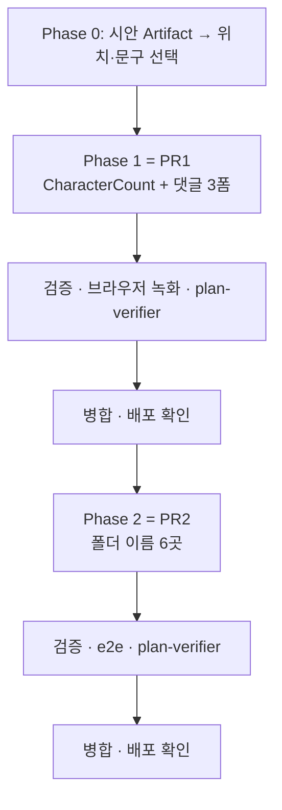

# 길이 상한이 있는 입력에 글자 수(0 / N)를 늘 보인다

<!-- plan-result:start — 이 블록만 병합 뒤에도 고칠 수 있다(CLAUDE.md §11). 아래는 승인된 계획 원문 -->

## 구현 결과

> #521 · 2026-11-04 대조 · 이탈 0 · 미구현 1(보완함) — 판정 근거(파일:줄)는 PR 본문 "계획 대비 구현"

- 범위: 이 PR은 Phase 0·1(공용 `CharacterCount` + 댓글 작성·답글·수정)이다. Phase 2(폴더 이름 6곳)는 PR2에서 결과를 덧붙인다.
- 시안 선택: 자리는 A(입력칸 바로 아래 오른쪽, 넘으면 이유 문구가 같은 줄 왼쪽), 문구·크기는 ①(`57 / 2,000자 · 한글 기준`, `text-xs`). 입력칸의 기존 `pr-20`은 그대로 뒀다.
- 미구현 → 보완함: 수정 훅(`useUpdateComment`) 테스트의 한글 2,000자 → 2,000·초과 아님 / 하나 더 → 2,001·초과 경계 검사
- 계획에 없던 변경: `docs/COMMENT.md` §11에 구현 중 찾은 기존 문제를 적음 — 모바일 시트에 최대 높이가 없어 긴 댓글이면 시트가 화면보다 커지고 글 앞부분이 잘린다(별도 PR로 고칠 예정, 이 PR은 코드를 바꾸지 않음)
- 계획에 없던 변경: `docs/COMMENT.md` 머리말 "읽고 나면"·§1 쉬운 설명·§13 관련 문서에 글자 수 설명과 결정 링크를 더함
- 문서 동기화: 이 PR로 밀렸거나 이미 어긋나 있던 줄 참조 갱신(`docs/COMMENT.md` §5 실패 안내·내 댓글, `docs/UNSAVED-CHANGES-GUARD.md`의 `texts.ts` 참조)

<!-- plan-result:end -->

> 댓글(작성·답글·수정)은 한글 기준 `n / 2,000자`, 북마크 폴더 이름 6곳은 `n / 15자`를 모바일·데스크톱 모두에 0부터
> 항상 보인다. 상한 규칙 자체는 바꾸지 않는다. PR 2개(PR1 공용 컴포넌트+댓글, PR2 폴더 이름).

## Context

**요청** — 모바일 댓글 입력("댓글을 작성하세요...")에 몇 자까지 쓸 수 있는지 `0/???`로 보여 달라. 같은 처리가 필요한
다른 입력도 찾아 달라.

**지금 상황(코드 추적)**

- 모바일 하단 바는 데스크톱과 같은 `CommentForm`을 띄운다(`MobileCommentBar.tsx:75`, 데스크톱 `CommentList.tsx:104-111`,
  답글 `CommentItem.tsx:156-163`). 상한 안내는 **넘었을 때만** 나온다(`CommentForm.tsx:136-138`,
  `CommentEditForm.tsx:97-99`). 화면 크기에 따른 차이는 없어서 데스크톱도 숫자가 없다.
- 댓글 상한은 글자가 아니라 UTF-8 **6,000바이트**다(`comment.const.ts:14`, BE `CommentLimits.MAX_CONTENT_BYTES`와 같은 값,
  WAF 8KB 벽 때문). 한글 3B(2,000자), 영어 1B(6,000자), 이모지 4B다.
- 폴더 이름은 trim 뒤 코드포인트 15자(`bookmark-folder.contract.ts:9`, `BookmarkFolderUtil.nameLengthError`
  `bookmark-folder.util.ts:44-52`). 입력 6곳 모두 넘었을 때만 "(지금 N자)"를 띄운다.
- 앱 전체에 글자 수 카운터·`maxLength`·공용 카운터 컴포넌트가 없다. 숫자 포맷은 `CommonUtil.commaizeNumber`
  (`common.util.ts:327`, 지금은 호출처 0)가 있다.
- 운영 DB(읽기 전용 조회, 2026-11-04): 댓글 144개 중 1,000자 초과 4개. 최장은 **영어 에러 로그 붙여넣기 3,389자/4,041B**,
  그 밖에 상한 테스트 2,000자/6,000B, 한글 문자 메시지 1,197자, 코드 블록 1,060자.

**업계 선례**

- [GOV.UK 글자 수 컴포넌트](https://design-system.service.gov.uk/components/character-count/)는 _"입력하는 동안 남은
  글자 수를 알려 준다"_, _"글자 수 안내는 텍스트 영역 아래에 나타난다. 그래야 위쪽의 힌트·오류 문구와 확실히 구분되고,
  화면 아래로 넘어가 있어도 답을 보내려고 스크롤할 때 다시 보게 된다"_, _"화면 읽기 프로그램 사용자는 입력을 멈추면 글자 수
  안내를 듣는다"_ 고 쓴다(번역).
- [Material 글자 수 카운터(MDC)](https://github.com/material-components/material-components-web/blob/master/packages/mdc-textfield/character-counter/README.md)는
  _"사용한 글자 수와 전체 상한의 비율"_ 을 `0 / 140` 형태로 보인다(번역).
- [X(트위터) 글자 세기](https://docs.x.com/fundamentals/counting-characters)는 한중일 글자를 2자로 세 _"한중일 글자만 쓰면 최대
  140자"_ 다(번역). 글자마다 무게를 달리 세는 선례일 뿐 계산식이 같은 것은 아니다.

## 판단이 필요했던 항목

| 항목           | 결정                                                                                 | 근거·기각한 대안                                                                                                                                                                                                                                                                                     |
| -------------- | ------------------------------------------------------------------------------------ | ---------------------------------------------------------------------------------------------------------------------------------------------------------------------------------------------------------------------------------------------------------------------------------------------------- |
| 댓글 숫자 단위 | **한글 환산**: `ceil(바이트/3)` / 2,000자 + "한글 기준" 표기(사용자 선택 2026-11-04) | ceil(b/3) > 2,000 ⟺ b > 6,000이라 경계가 규칙과 정확히 같다. 기존 문구 "한글 2,000자"와 같은 말. 기각: 바이트 /6,000(단위 낯섦, 한글을 2B로 아는 사람이 많음), 글자 2,000자로 상한 변경(영어·코드 한도가 1/3로 줄고 운영의 3,389자 로그 댓글은 등록·수정 불가)                                       |
| 보일 화면      | 모바일 + 데스크톱(사용자 선택)                                                       | 같은 컴포넌트이고 데스크톱도 숫자가 없다. 기각: 모바일만                                                                                                                                                                                                                                             |
| 보이는 시점    | 0부터 항상                                                                           | 요청이 `0/???`. 기각: GOV.UK `data-threshold`(N%부터만 보임)                                                                                                                                                                                                                                         |
| 넣을 위치      | 댓글 작성·답글·수정 + 폴더 이름 6곳(사용자 선택)                                     | 기각: 닉네임(“2~20자” 안내가 이미 상시 노출), 비밀번호(가려진 입력·체크리스트 있음), 게시글 제목·URL·검색(상한 없음, 제목은 DECISIONS 2026-08-04로 상한 없음)                                                                                                                                        |
| 폴더 숫자 단위 | trim 뒤 코드포인트 / 15자                                                            | 기존 규칙(`nameLengthError`)과 같게 센다                                                                                                                                                                                                                                                             |
| 초과 표시      | 카운터는 색만 `text-destructive`로, 이유는 기존 문구가 계속 말한다                   | 색만으로 정보를 전하지 않는다([WCAG 1.4.1 색 사용](https://www.w3.org/WAI/WCAG22/Understanding/use-of-color.html)). 기존 문구·`aria-invalid`·제출 차단 동작은 그대로                                                                                                                                 |
| 화면 읽기      | 입력의 `aria-describedby`가 카운터를 가리킴(포커스 때 읽힘), live region 없음        | 키마다 읽는 live region은 소음. GOV.UK식(입력 멈추면 알림)은 나중에 컴포넌트 안만 바꾸면 된다. id는 `useId` — react.dev: _"`useId`는 접근성 속성에 넘길 수 있는 고유 ID를 만드는 React 훅이다"_ (번역, [useId](https://react.dev/reference/react/useId)). 선례: `usePasswordFieldsFeedback.ts:32-35` |
| 숫자 포맷      | `CommonUtil.commaizeNumber` 재사용                                                   | 새 포맷터 추가 기각                                                                                                                                                                                                                                                                                  |
| PR 단위        | PR1 = `CharacterCount` + 댓글, PR2 = 폴더 이름                                       | 도메인·CHANGELOG scope·기능 문서·세는 단위가 다르다. 한 PR은 계획 대조 범위가 너무 크다                                                                                                                                                                                                              |

### 뒤집힌 전제

| 발견                                                                                                      | 그래서 바뀐 것                                                                                       |
| --------------------------------------------------------------------------------------------------------- | ---------------------------------------------------------------------------------------------------- |
| `DECISIONS.md` 2026-09-06 항목이 _"상시 글자수 카운터 대신 초과했을 때만 안내"_ 를 택했다(근거 인용 없음) | 사용자 요청으로 상시 표시로 바꾼다. 옛 항목은 고치지 않고 새 항목을 맨 위에 추가해 뒤집었음을 적는다 |
| "모바일에서만 안 보인다"                                                                                  | 데스크톱도 넘기 전엔 안 보인다 → 둘 다 적용                                                          |

### 시안 후보 (§9, 반영 전 승인)

구현 첫 단계로 실제 Tailwind 클래스와 `globals.css` 토큰을 그대로 쓴 미리보기 Artifact 하나에 후보를 나란히 놓는다
(360px 모바일·데스크톱, 라이트·다크, 0자·근접·초과 상태). 사용자가 고른 뒤에만 컴포넌트에 반영한다.

- **댓글(작성·답글·수정)**: ① 입력칸 아래 오른쪽(GOV.UK·MDC 형태, 폼이 한 줄 높아짐) ② 입력칸 안 오른쪽 아래(기존 `pr-20`
  자리 활용 여부 포함) ③ 버튼 줄 왼쪽(높이 그대로, 미리보기가 펼쳐지면 입력칸과 멀어짐). "한글 기준" 문구와 자리, 글자 크기
  `text-xs` vs `text-micro`.
- **폴더**: 사이드바 만들기(버튼 줄 왼쪽, 높이 그대로), 사이드바 이름 바꾸기(아래 vs 같은 줄), 모바일 카드 2곳(아이콘 줄
  오른쪽, 높이 그대로), 제목 이름 바꾸기(아래만 — `e2e/bookmark-folder-title-rename.mobile.spec.ts:36`이 모바일 입력 폭을
  검사), 선택 창 새 폴더(아래 vs 같은 줄). 폴더 시안은 PR2 시작 때 따로 보여도 된다.

### 사용자가 체감하는 것

- 영어·코드는 3글자에 1씩 오른다(`abc` → 1). 이모지는 2. "한글 기준" 표기가 이 차이를 설명한다.
- 전송 상한 7,500B(줄바꿈·이미지 포함, 제출 때만 검사)는 카운터에 안 나온다. 계산상 이미지 5장 + 본문 6,000B면 줄바꿈이 약
  461개를 넘을 때 카운터는 범위 안인데 제출이 `commentPayloadTooLarge`로 막힌다(계산값, 실측 아님).
- 폴더는 앞뒤 공백을 세지 않는다(규칙이 trim).
- 화면 읽기 사용자는 포커스할 때 숫자를 듣고, 입력 중에는 듣지 않는다.
- 위치에 따라 폼이 한 줄(약 24px, 클래스 값으로 추정) 높아진다 — 시안에서 확인.

## 세부 계획

### Phase 0 — 시안

| 위치                         | 변경 내용                                                                           |
| ---------------------------- | ----------------------------------------------------------------------------------- |
| 스크래치패드 HTML → Artifact | 위 "시안 후보"를 나란히 배치. 선택 결과를 이 계획의 구현 결과 블록·PR 본문에 남긴다 |

### Phase 1 — PR1: 공용 컴포넌트 + 댓글

| 위치                                                                              | 변경 내용                                                                                                                                                                                                                                                                                                                                                                   |
| --------------------------------------------------------------------------------- | --------------------------------------------------------------------------------------------------------------------------------------------------------------------------------------------------------------------------------------------------------------------------------------------------------------------------------------------------------------------------- |
| `src/shared/ui/elements/CharacterCount.tsx` (신규)                                | props `current`·`max`·`suffix?`·`id?`·`className?`. `
`에 `{commaize(current)} / {commaize(max)}{suffix}`, `text-xs tabular-nums whitespace-nowrap`, `current > max`면 `text-destructive` 아니면 `text-muted-foreground`. `role` 없음. JSDoc에 "초과는 색만 바뀌므로 이유 문구 옆에 둔다". 본뜬 것: `FormAlert.tsx`, `ImageAttachmentField.tsx`의 `{count}/{maxCount}` |
| `CharacterCount.stories.tsx` (신규)                                               | title `Shared/UI/Elements/CharacterCount`, `FormAlert.stories.tsx` 형태. Default·AtLimit·OverLimit·GroupedThousands·BesideReason·WithInput(`aria-label` + `aria-describedby`, axe 통과)                                                                                                                                                                                     |
| `CharacterCount.test.tsx` (신규)                                                  | 문구·천 단위 쉼표·15/15 vs 16/15 색·`toHaveAccessibleDescription`                                                                                                                                                                                                                                                                                                           |
| `src/entities/comment/config/comment.const.ts`                                    | `HANGUL_UTF8_BYTES = 3`, `MAX_COMMENT_CONTENT_HANGUL_CHARS = MAX_COMMENT_CONTENT_BYTES / HANGUL_UTF8_BYTES`(바이트 상한은 3의 배수여야 한다는 주석)                                                                                                                                                                                                                         |
| `src/entities/comment/utils/comment.util.ts`                                      | 클래스 끝에 `static countHangulEquivalentChars(content)` = `Math.ceil(getUtf8ByteLength(content) / HANGUL_UTF8_BYTES)`                                                                                                                                                                                                                                                      |
| `comment.util.test.ts`                                                            | `''`→0, `abc`→1, `abcd`→2, `가`→1, `😀`→2, 5,999/6,000/6,001B → 2,000/2,000/2,001, 경계 동치(카운터 초과 ⟺ 바이트 초과)                                                                                                                                                                                                                                                     |
| `src/features/comment/create/hooks/useCreateComment.ts`                           | `isOverLimit`(:120) 옆에 `contentLength`, `contentCountId = useId()` 추가 후 반환. 기존 규칙 변경 없음                                                                                                                                                                                                                                                                      |
| `src/features/comment/update/hooks/useUpdateComment.ts`                           | 같은 추가(:195 옆)                                                                                                                                                                                                                                                                                                                                                          |
| 두 훅 테스트                                                                      | 한글 2,000자 → 2,000/초과 아님, `a` 하나 더 → 2,001/초과. 수정 폼은 이미지 줄 뺀 기존 본문 길이에서 시작                                                                                                                                                                                                                                                                    |
| `src/features/comment/create/ui/CommentForm.tsx`, `update/ui/CommentEditForm.tsx` | Textarea에 `aria-describedby={contentCountId}`, 시안에서 고른 자리에 `<CharacterCount>`. 초과 이유 `
`는 별도 요소로 유지                                                                                                                                                                                                                                                 |
| `CommentForm.test.tsx`                                                            | `abc` 입력 → 설명이 `1 / 2,000`으로 시작                                                                                                                                                                                                                                                                                                                                    |
| `src/shared/config/texts.ts`                                                      | `TEXTS.comment.form.contentCountSuffix`(예: `자 · 한글 기준`, 시안에서 확정)                                                                                                                                                                                                                                                                                                |
| `docs/COMMENT.md`                                                                 | 마지막 검토 날짜, §5 길이 상한(카운터·한글 환산·경계 동치·7,500B 미반영), §5 모바일 바, §6 훅 반환값, §7 운영 파라미터(2,000 파생값, 3의 배수 조건), §8 코드 지도, §9, §11 남은 것, §12 용어. 고치는 절 안의 낡은 줄 참조(:185·:625 등)는 함께 고친다                                                                                                                       |
| `docs/DECISIONS.md`                                                               | 맨 위 새 항목 "2026-11-04 — 길이 상한이 있는 입력에 글자 수를 늘 보인다": 2026-09-06 결정을 뒤집음, 위 판단 표·선례 인용(번역)·시안 선택 결과                                                                                                                                                                                                                               |
| `CHANGELOG.md`                                                                    | `[Unreleased]` Added: `comment` 댓글·답글·수정 입력에 한글 기준 글자 수(0 / 2,000자)를 늘 보여 줌                                                                                                                                                                                                                                                                           |
| `docs/plans/2026-11-04-character-count.md` (신규)                                 | 이 계획 스냅샷                                                                                                                                                                                                                                                                                                                                                              |

### Phase 2 — PR2: 폴더 이름 6곳

| 위치                                                                                                                                                        | 변경 내용                                                                                                   |
| ----------------------------------------------------------------------------------------------------------------------------------------------------------- | ----------------------------------------------------------------------------------------------------------- |
| `src/entities/bookmark/folder/utils/bookmark-folder.util.ts`                                                                                                | `static nameLength(name)` = `[...name.trim()].length`, `nameLengthError`가 이를 쓰도록(출력 동일)           |
| `bookmark-folder.util.test.ts`                                                                                                                              | `''`→0, `'  가  '`→1, 이모지 15개→15, `React 공부`→8                                                        |
| `useCreateFolderForm.ts`, `useRenameBookmarkFolder.ts`, `useNewFolderInput.ts`                                                                              | 길이·`useId` 반환 추가                                                                                      |
| `useFolderTree.ts`, `useMobileFolderList.ts`, `useFolderActions.ts`                                                                                         | 위 값 그대로 전달                                                                                           |
| `FolderTree.tsx`(만들기 :325, 이름 바꾸기 :218), `MobileFolderList.tsx`(:172, :249), `BookmarkFolderTitle.tsx`(:51), `BookmarkFolderSelectDialog.tsx`(:421) | `aria-describedby` + 시안에서 고른 자리에 `<CharacterCount suffix={TEXTS.bookmark.folder.nameCountSuffix}>` |
| `src/shared/config/texts.ts`                                                                                                                                | `TEXTS.bookmark.folder.nameCountSuffix: '자'`                                                               |
| 훅 테스트·`e2e/bookmark-folder-name.spec.ts`                                                                                                                | 이름 바꾸기 시작 길이, 16/15 → 15/15 표시                                                                   |
| `docs/BOOKMARK.md`                                                                                                                                          | §5 폴더 이름 길이("다섯 곳" → 여섯 곳, 카운터·위치), 코드 지도·용어, 날짜                                   |
| `CHANGELOG.md`                                                                                                                                              | `bookmark` 폴더 이름 입력에 글자 수(0 / 15자)를 늘 보여 줌                                                  |
| 계획 파일                                                                                                                                                   | 구현 결과 블록에 PR2 결과 덧붙임                                                                            |

## 영향 범위 (§5)

- **CRUD**
  - 댓글 등록·답글: 제출 직후 `reset()`이면 0, 실패해 본문을 되살리면 그 길이로 돌아온다.
  - 댓글 수정: 기존 본문 길이에서 시작.
  - 폴더 만들기·이름 바꾸기: 성공하면 0이나 새 이름, 실패·Esc면 옛 이름 길이로 돌아온다.
  - 데이터 계약·BE 변경 없음 → 배포 순서 없음.
- **기존 기능 회귀**
  - 상한 규칙(`commentContentFormSchema`, `isOverLimit`, `nameLengthError`)은 그대로 두고 표시만 더한다.
  - 기존 이유 문구 테스트·e2e(`getByText(folderNameTooLong(...))`, `CommentEditForm.test.tsx:70`의 `findByRole('alert')`)가
    깨지지 않게 카운터를 별도 요소로 둔다.
  - `e2e/bookmark-folder-title-rename.mobile.spec.ts:36` 입력 폭 검사.
  - 모바일 댓글 시트 높이가 바뀌면 `MobileCommentBar.tsx`의 ResizeObserver가 토스트 위치를 다시 잡는지 확인한다.
- **여러 곳에서 import하는 파일**(`comment.const.ts`, `comment.util.ts`, `bookmark-folder.util.ts`, `texts.ts`,
  `common.util.ts`): 모두 추가만 한다. 구현 전에 `pnpm graph:focus "<경로>" --text`로 실제 사용처를 뽑아 PR 본문에 요약한다.
- **번들**: `CharacterCount`가 `CommonUtil`(dayjs import)을 끌어온다. `pnpm build` 전후로 첫 화면 청크 크기를 비교한다.

## 검증 방법

1. 워크트리(`EnterWorktree`, 전에 `git log origin/main..main` 확인) + `.env` 복사 + `pnpm install`.
2. `pnpm type-check` → `pnpm test`(새 util·컴포넌트·훅 테스트) → `pnpm test:storybook`(axe) → `pnpm lint`·`pnpm check:deps`
   → `pnpm check:docs` → `pnpm build`(청크 비교). PR2는 `pnpm test:e2e`로 폴더 관련 스펙을 함께 돈다.
3. 브라우저 녹화(`browser-verification` skill): 모바일 댓글 시트(0자 → 입력 → 2,000 근접 → 초과, 토스트 위치), 데스크톱 인라인,
   답글, 수정, 다크 모드. PR2는 폴더 6곳.
4. `plan-verifier`로 계획 대비 diff 대조 → PR 본문 `## 계획 대비 구현`, 계획 파일에 구현 결과 블록.
5. `pnpm check:pr-body` → PR → CI → squash 병합 → `gh run list`로 배포 SHA 성공 확인 → 워크트리 정리.

## 남은 것

- 시안에서 정할 것: 위치별 자리, "한글 기준" 문구·자리, `text-xs` vs `text-micro`, `pr-20` 처리.
- 전송 상한 7,500B를 카운터에 반영하지 않는다(위 "체감하는 것").
- 화면 읽기에서 한국어 VoiceOver·TalkBack이 설명을 어떻게 읽는지는 확인하지 못했다 — 수동 확인 항목.
- 범위 밖, 언급만: 사이드바 이름 바꾸기 입력(`FolderTree.tsx:218-228`)에 접근 가능한 이름이 없다(기존 문제).
