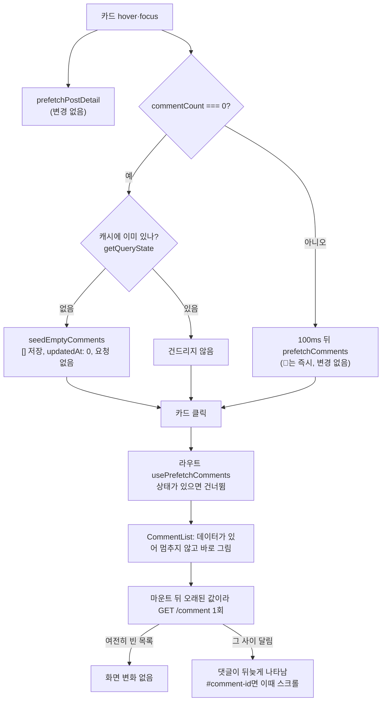

# 댓글 없는 글은 카드 hover 때 댓글을 요청하지 않는다

<!-- plan-result:start — 이 블록만 병합 뒤에도 고칠 수 있다(CLAUDE.md §11). 아래는 승인된 계획 원문 -->

## 구현 결과

> #536 · 2026-11-04 대조 · 이탈 1 · 미구현 0 — 판정 근거(파일:줄)는 PR 본문 "계획 대비 구현"

- 이탈(사용자 선택): 피드 숫자만 옛값인 글은 계획의 "빈 안내 뒤 댓글"과 "재확인 전까지 제목 0" 대신, 다시 받는 동안 제목에 상세 응답의 최신 숫자를 보이고 빈 안내 대신 뼈대로 자리를 잡는다. 뼈대는 0.5초 동안 숨겨 둔다. 첫 구현 녹화를 본 사용자가 깜빡이는 느낌이 강하다고 해 네 안을 비교해 골랐다. 상세 숫자까지 옛값이면 계획대로 빈 안내 뒤 댓글이 나타난다.
- 계획에 없던 변경: 상세 숫자까지 옛값인 글을 댓글 아이콘으로 열면 짧은 문서에서 스크롤이 제목까지 못 올라가, 댓글이 도착해 문서가 길어지면 폼 위치로 한 번 더 스크롤한다(`realignAfterSeedRefetch`). 이 경우에 응답이 늦은 사이 직접 스크롤했으면 한 번 되돌아갈 수 있고, 동작 줄이기를 켰으면 두 번 점프한다.
- 계획에 없던 변경: 위 동작을 확인하려고 `comment-icon-scroll` e2e(데스크톱·모바일)의 목록 숫자를 실제 댓글 수로 맞추고 옛값 테스트를 추가했다.
- 문서 동기화: `AUTH`·`COMMENT`·`POST`·`FE-ARCHITECTURE`·`TESTING` 문서의 줄 번호, 테스트 목록·수, 디렉터리 트리를 맞췄다.
- 병합 뒤 운영 재측정(2026-11-05): 0개 글 hover 중 댓글 요청 0회, 누른 뒤 1회, 빈 화면 중앙값 33ms(20~50, 5회)로 기대한 19ms보다 1프레임이 안 되게 길었다. 상세는 댓글 응답을 기다리지 않았다(`docs/PERFORMANCE.md` "댓글 0개 글 재측정").

<!-- plan-result:end -->

> 피드 응답의 `commentCount`가 0이면 hover 때 요청하는 대신 빈 목록을 오래된 값으로 캐시에 심는다. hover 요청은 없어지고, 상세는 댓글 응답을 기다리지 않으며, 화면이 뜬 뒤 한 번 다시 확인한다.

## Context

카드에 100ms 머물면(💬는 즉시) `GET /post/{id}/comment`가 나간다. 오늘 #525가 상세 첫 진입 빈 화면을 줄이려고 넣은 동작이다(데스크톱 133 → 19ms, `docs/PERFORMANCE.md` "상세 첫 진입 빈 화면").

그런데 받아 봐야 빈 응답인 경우가 대부분이다.

- 운영 직접 조회(2026-11-04, `linksphere-ro`): 공개 글 327개 중 댓글 0개가 288개(88.1%), 최근 100개 중 97개. 전체 댓글은 최근 30일 23개, 7일 5개.
- 빈 글도 Lambda 1회와 SQL 2회 이상을 쓴다(`CommentService.kt:48` 글 조회·댓글 조회, 로그인이면 좋아요 조회 추가).

판단 재료는 이미 있다.

- 피드 응답에 `post.stats.commentCount`가 있다.
- 개수와 목록이 같은 기준이다. 둘 다 삭제된 댓글(톰스톤)을 포함하므로 0이면 빈 목록이 맞다(`CommentRepository.kt:19`, `:40`).

## 판단이 필요했던 항목

| 항목                                        | 결정                                                     | 근거·기각한 대안                                                                                                                                                                                                                                                                                                                                                                                                                                                                                                 |
| ------------------------------------------- | -------------------------------------------------------- | ---------------------------------------------------------------------------------------------------------------------------------------------------------------------------------------------------------------------------------------------------------------------------------------------------------------------------------------------------------------------------------------------------------------------------------------------------------------------------------------------------------------- |
| 0개 글 처리                                 | 빈 목록 심기(B). 2026-11-04 사용자 결정                  | 건너뛰기만(A): 상세가 `useSuspenseQuery`로 댓글을 기다려 빈 화면이 133ms로 돌아갈 것으로 예상(#525 전과 같은 경로). 상세 응답에 댓글 포함(C): 지나가는 카드의 요청이 그대로이고 API 계약이 바뀜(구조만 보고 판단, 구현해 보지 않음).                                                                                                                                                                                                                                                                             |
| 심는 값의 시각                              | `updatedAt: 0`                                           | [TanStack Initial Query Data](https://tanstack.com/query/v5/docs/framework/react/guides/initial-query-data)는 _"원본 쿼리의 `dataUpdatedAt`을 `initialDataUpdatedAt`에 넘기길 권한다"_ (번역). 카드는 어느 목록(피드·북마크)에서 왔는지 몰라 원본 시각을 구하기 어렵다. `0`은 문서에 없어 설치본 query-core 5.90.16으로 확인: `query.js:405`(`?? Date.now()`라 0 유지), `:123`, `utils.js:12`, `queryObserver.js:51`·`:445-452`(마운트 때 다시 받음). 기본값(현재 시각)은 3분간 재확인이 없어 새 댓글을 못 본다. |
| 심는 시점                                   | hover 즉시(100ms 대기 없음)                              | 요청이 없어 지나가는 카드의 비용은 캐시 항목 하나뿐이고 5분 뒤 지워진다(`gcTime`). 100ms 전에 눌러도 기다리지 않는다.                                                                                                                                                                                                                                                                                                                                                                                            |
| 덮어쓰기 방지                               | `getQueryState`에 상태가 있으면 건드리지 않음            | 피드 숫자가 옛값이어도 실제 댓글이나 진행 중인 요청을 빈 값으로 지우면 안 된다.                                                                                                                                                                                                                                                                                                                                                                                                                                  |
| 알림 클릭 스크롤                            | `CommentList.tsx:94` 의존성에 `totalCount` 추가          | 지금은 주소가 바뀔 때만 돌아, 심은 `[]` 상태로 `#comment-<id>`에 들어오면(`useFcmForegroundMessage.ts:41`, `:48`) 댓글이 도착해도 스크롤·강조가 빠진다. `scrolledEntryKeyRef`가 이중 스크롤을 막는다.                                                                                                                                                                                                                                                                                                            |
| 내 댓글 카드                                | 바꾸지 않음(`useMyCommentCard.ts`)                       | 항상 내 댓글이 있는 글이다.                                                                                                                                                                                                                                                                                                                                                                                                                                                                                      |
| hover가 조회수·최근 열람 기록을 올리는 문제 | 이 PR 범위 밖, 병합 뒤 별도 계획. 2026-11-04 사용자 결정 | 아래 "남은 것".                                                                                                                                                                                                                                                                                                                                                                                                                                                                                                  |

**사용자가 체감하는 변화**(2026-11-04 설명 뒤 B를 고름)

- 피드를 불러온 뒤 새 댓글이 달린 글을 열면 빈 안내가 잠깐 보인 뒤 댓글이 나타난다.
- 다시 확인하는 요청이 실패하면 에러 화면 대신 빈 안내가 남고, 서버 에러면 토스트가 뜬다(`suspense.js`의 `defaultThrowOnError`, 데이터가 있으면 던지지 않음).

## 세부 계획

| 위치                                                                                            | 변경 내용                                                                                                                                                                                                                                                                  |
| ----------------------------------------------------------------------------------------------- | -------------------------------------------------------------------------------------------------------------------------------------------------------------------------------------------------------------------------------------------------------------------------- |
| `src/entities/comment/api/comment.queries.ts`                                                   | `prefetchComments` 옆에 `seedEmptyComments(queryClient, postId)` 추가. 상태가 있으면 return, 없으면 `setQueryData<Comment[]>(commentKeys.list(postId), [], { updatedAt: 0 })`.                                                                                             |
| `src/widgets/post/post-card/hooks/usePostCard.ts:153` `handlePrefetchDetailWithComments`        | `commentCount === 0`이면 `seedEmptyComments`, 아니면 기존 `prefetchComments`.                                                                                                                                                                                              |
| `src/widgets/post/post-card/hooks/usePostCard.ts:162` `handlePrefetchDetail`                    | `isDetail` 가드 뒤에 같은 분기. 0개면 타이머 없이 심고 return. 주석도 함께 고침.                                                                                                                                                                                           |
| `src/widgets/comment/comment-list/ui/CommentList.tsx:94`                                        | effect 의존성에 `totalCount` 추가, 위 주석에 이유 한 줄.                                                                                                                                                                                                                   |
| `src/entities/comment/api/comment.queries.test.ts`                                              | `seedEmptyComments`: 요청 없이 `[]`·`dataUpdatedAt` 0, 있는 데이터를 덮어쓰지 않음, 진행 중 요청을 건드리지 않음, `useSuspenseComments`가 멈추지 않고 그린 뒤 1회 다시 받아 서버 값 반영.                                                                                  |
| `src/widgets/comment/comment-list/ui/CommentList.test.tsx`(신규)                                | 심은 상태로 `#comment-<id>`에 렌더: 응답 전 스크롤 없음, 응답 뒤 1회.                                                                                                                                                                                                      |
| `e2e/post-detail-comment-prefetch.spec.ts`                                                      | 기존 hover 테스트 3개는 목록 목을 `commentCount: 1`로 바꿈(픽스처가 0이라 그대로면 깨짐). 추가: 0개 글은 제목에 머물러도·💬 hover에도 댓글 요청 0회. 0개 글 hover 후 클릭은 댓글 응답을 붙잡아 둔 채 상세와 빈 안내가 보이고, 응답을 풀면 서버 댓글이 나타나며 요청은 1회. |
| `docs/COMMENT.md:425-429`, `docs/POST.md:250-255`, `docs/PERFORMANCE.md` "상세 첫 진입 빈 화면" | 0개 글 동작, 고른 것과 버린 것(A·C), 재측정 결과. 각 문서의 `마지막 검토` 갱신.                                                                                                                                                                                            |
| `CHANGELOG.md` `[Unreleased]`                                                                   | `comment` 항목 추가(`changelog-release` skill 형식).                                                                                                                                                                                                                       |
| `docs/plans/2026-11-04-comment-hover-seed-empty.md`(신규)                                       | 이 계획 스냅샷, 대조 뒤 구현 결과 블록(§11).                                                                                                                                                                                                                               |

작업 준비: `git log origin/main..main`이 비어 있음을 확인했다. `EnterWorktree` 뒤 `cp ../../../.env .`와 `pnpm install`.

## 영향 범위

**CRUD 실패 지점(댓글 목록 캐시)**

- **등록**: `useCreateCommentMutation.onMutate`가 진행 중인 재확인을 취소하고 `[]` 위에 임시 댓글을 넣는다. 이후 실제 데이터가 캐시에 있어 가드가 다시 심지 않는다.
- **읽기**: 제목 옆 개수(`totalCount`)는 재확인 전까지 0이고, 옛 숫자여도 재확인이 고친다. 주소 직접 입력·새로고침은 심지 않아 변화 없다.
- **수정**: 0개 글에는 해당 없고, 재확인 뒤에는 기존 경로와 같다.
- **삭제**: 마지막 댓글을 지워 0이 돼도 캐시가 남아 있으면 가드가 건드리지 않고, 지워진 뒤 심으면 재확인이 맞춘다.
- **동시 요청**: 같은 카드를 여러 번 hover해도 가드로 한 번만 심는다. 숫자가 0보다 커지면 `prefetchComments`가 오래된 값이라 다시 받는다.
- **북마크 목록 숫자**: 내가 댓글을 단 뒤 목록 숫자가 옛값일 수 있다. 캐시가 살아 있으면 가드가, 지워졌으면 재확인이 맞춘다.

**기존 기능 회귀(`pnpm graph:focus --text`로 확인)**

- `usePostCard.ts`는 `PostCard.tsx`만 쓴다. 피드·북마크·상세가 이 경로를 지난다.
- `comment.queries.ts`는 7개 파일과 라우트(`src/app/routes/index.tsx:252`, 그래프 목록에는 없고 grep에서 확인)가 쓴다. 함수 추가뿐이라 기존 export는 그대로다.
- 라우트 `usePrefetchComments`는 상태가 있으면 건너뛴다(`usePrefetchQuery.js:5`). 의도한 동작이고, 요청은 마운트 뒤로 옮겨진다.
- `useRemoveErroredCommentsOnLeave`는 데이터 없는 실패만 지워 심은 값은 대상이 아니다.
- 모바일은 탭 때 호환 `mouseenter`가 오면 심긴다. mobile e2e로 확인한다.
- 카드를 눌러 들어가며 댓글 실패를 기대하는 e2e가 있으면 영향을 받는다. `failed-query-reentry.spec.ts`는 뒤로가기를 쓴다고 읽어서 확인했고, 나머지는 전체 실행으로 잡는다.
- 데이터 계약 변경 없음, BE 변경 없음. BE 문서에 이 hover 서술이 있는지는 구현 때 grep으로 확인한다.

## 검증 방법

1. `pnpm type-check`, `pnpm test`, `pnpm lint`, `pnpm check:deps`, `pnpm check:docs`.
2. `pnpm test:e2e` 전체(chromium + mobile-chrome). `post-detail-comment-prefetch`, `post-route-prefetch`, `comment-icon-scroll`(모바일 포함), `comment`, `comment-delete`, `failed-query-reentry`를 특히 확인한다.
3. 회귀 테스트가 실제로 잡는지 확인: `totalCount` 의존성을 빼면 `CommentList.test.tsx`가, `getQueryState` 가드를 빼면 덮어쓰기 테스트가 실패해야 한다.
4. `browser-verification` skill로 녹화: 0개 글 hover에 댓글 요청이 없고, 클릭하면 바로 그려지고 그 뒤 1회 요청한다. 댓글 있는 글은 전과 같다.
5. 병합 뒤 배포 성공을 확인하고 운영에서 재측정한다. 조건은 `docs/PERFORMANCE.md` "측정 방법"과 같고(비로그인, 1350×940, hover 300ms 뒤 클릭, 5회, 실행 사이 20초) 대상만 댓글 0개 글로 고른다. 기대값은 빈 화면 19ms 수준, hover 중 댓글 요청 0회, 클릭 뒤 1회다. 요소를 지정해 누르고 403이 나오면 멈춘다. 결과는 문서에 추가한다.
6. PR 전 `plan-verifier`로 계획과 diff를 대조하고 본문에 `## 계획 대비 구현`을 남긴다.

## 남은 것

- **hover가 조회수와 최근 열람 기록을 올리는 문제**(이 PR 병합 뒤 별도 계획): `GET /post/{id}`가 조회수를 올리고 `post_views`를 갱신한다(`PostService.kt:198-199`). 이 요청이 hover에서 대기 없이 나간다(`usePostCard.ts:163`). 운영 `post_views` 간격 317건 중 1초 미만 85건(27%), 3초 미만 126건(40%)이라 hover 흔적으로 추정한다(확정 아님). 조회 기록 API 분리와 hover 상세 요청 제거(피드 데이터 심기, 삭제 글 404 안내 재설계 필요)를 그 계획에서 비교한다.
- **줄어드는 요청의 실제 양**: 머물렀지만 누르지 않은 hover가 얼마나 되는지는 재지 못했다.
