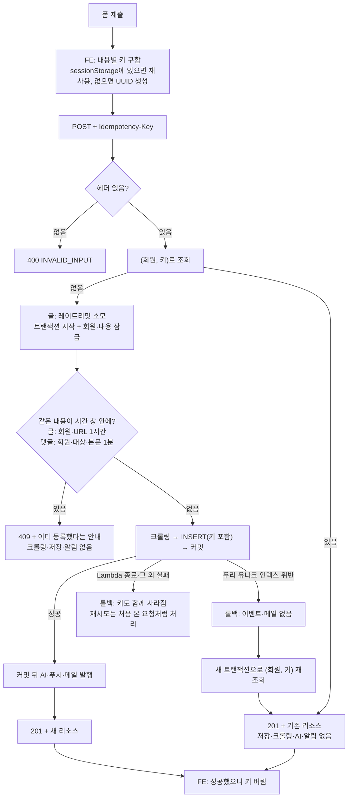
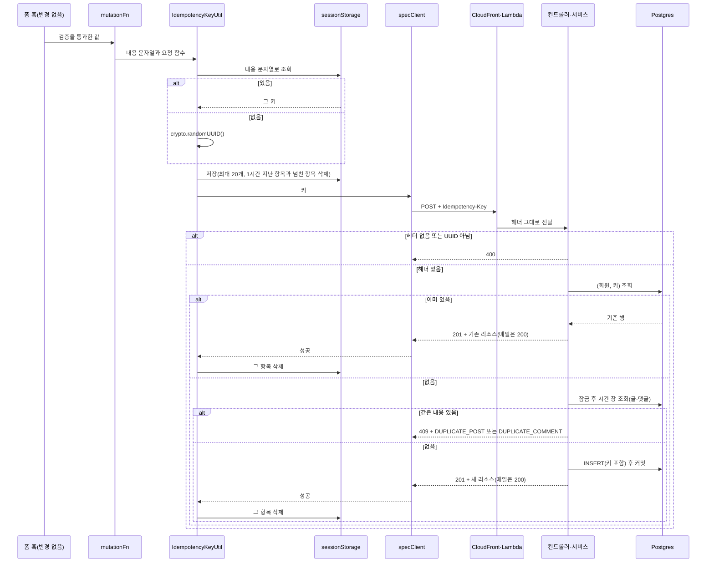
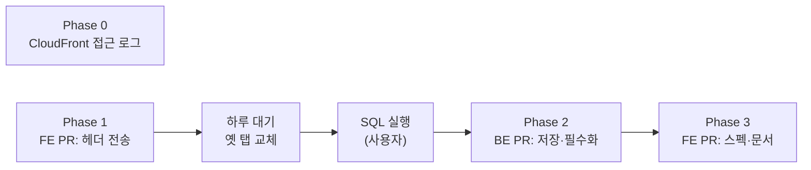

# 글·댓글·메일 요청 중복 방지: `Idempotency-Key` 필수화

<!-- plan-result:start — 이 블록만 병합 뒤에도 고칠 수 있다(CLAUDE.md §11). 아래는 승인된 계획 원문 -->

## 구현 결과

> #535 · 2026-11-04 대조(Phase 1, Phase 0 문서) · 이탈 0 · 미구현 0 — 판정 근거(파일:줄)는 PR 본문 "계획 대비 구현". Phase 2 대조는 BE 계획 파일 블록(#158)에 있다
>
> #546 · 2026-11-05 대조(Phase 3) · 이탈 0 · 미구현 0 — 판정 근거(파일:줄)는 PR 본문 "계획 대비 구현"

- 계획에 없던 변경: 409 `DUPLICATE_COMMENT`면 폼 안내와 입력 복원에 더해 댓글 목록과 댓글 수를 다시 불러온다. 다른 탭·기기에서 쓴 댓글은 목록에 아직 없기 때문이다. 안내 문구도 다시 불러왔다고 알리게 썼다
- 계획에 없던 변경(테스트 보강): 인증 메일 요청의 키 동작 테스트. 검증 목록은 재설정 요청만 적었지만 Phase 1 표가 메일 2개를 함께 약속했다
- 계획에 없던 변경(문서 동기화): `docs/TESTING.md` e2e 표에 새 시나리오 추가, `docs/POST.md`·`docs/AUTH.md` 마지막 검토 날짜 갱신
- 이탈(Phase 0): 접근 로그를 켜지 못했다. 이 배포는 CloudFront Free 플랜이라 2026-11-05 `put-delivery-source`가 거절됐고, 계획 때 요금표를 확인하지 않았다. 사용자 결정으로 무료 기본 지표로 대체했고 결과는 `docs/DEPLOY.md` "CloudFront 5xx 세기와 접근 로그"에 있다. 그래서 "2주 뒤 접근 로그로 504 건수 확인"도 하지 않고 이슈 #534를 닫았다
- Phase 3 계획에 없던 변경(범위): 이 계획의 Phase 3 표는 생성 스펙·주석·호환 기록뿐이지만, 같은 PR에 등록 5개 재전송을 합쳐 냈다. 그 대조와 차이는 `docs/plans/2026-11-05-global-outcome-unknown.md` 블록에 있다
- Phase 3: BE 계획 블록(#158)의 미구현이던 호환 기록을 FE `docs/VERSION-COMPATIBILITY.md`에 넣어 닫았다
- 남은 것의 "재시도가 실패로 보이는 경우"는 뒤 작업으로 대부분 처리했다. 삭제 404는 이미 삭제 안내(#538, 폴더는 #541), 폴더 만들기 409는 이름 대조(#543), 비밀번호 변경은 세션 폐기로 401이 되므로 재전송하지 않고 요청별 안내(#543)다. 메일 요청 429만 남는다. 재전송이 시간당 한도를 1번 더 써서, 한도의 마지막 요청이 끊기면 메일이 갔어도 한도 안내가 뜰 수 있다
- 병합 뒤 운영 확인(2026-11-05): 같은 키로 겹친 댓글 2건을 서로 다른 Lambda 인스턴스로 3회 보내 모두 같은 id·1행이었다. 잠금과 유니크 인덱스 중 어느 쪽이 막았는지는 가리지 못했다. 수치와 재현은 `docs/COMMENT.md` §9

<!-- plan-result:end -->

> 등록 요청마다 브라우저가 만든 키를 받아 저장할 행에 함께 넣는다. 같은 회원이 같은 키로 다시 보내면 새로 만들지 않고 기존 결과를 돌려주고, 키가 없으면 400으로 거절한다. 키가 다른데 같은 URL(1시간)이나 같은 댓글 본문(1분)을 보내면 409로 이미 등록했다고 알린다.

## Context

**문제.** 글·댓글·답글 등록은 서버에 중복 방지가 없어 같은 요청이 두 번 오면 행이 2개 생기고 AI 분석이나 푸시도 2번 나간다. 비밀번호 재설정·이메일 인증 요청은 유효한 링크가 담긴 메일이 2통 간다. FE는 더블클릭을 막지만, 서버가 저장한 뒤 응답이 끊겨 사용자가 다시 누르는 경우는 막지 못한다.

**실제 규모(직접 측정, 2026-11-04, `service=linksphere-ro`).** 예방 작업이다.

- 글 352건 중 같은 회원·같은 URL 중복은 4그룹 초과 8행이다. 간격은 82초·145초·8분·13분·33분·48분이고 나머지 2건은 1일을 넘는다. 실수인지 일부러인지는 데이터로 알 수 없다.
- 댓글 144건 중 같은 회원·같은 글·같은 본문은 3쌍이고, 간격은 5초(두 글자 답글, 2026-02-21)·32분·44분이다.
- 회원당 시간당 최대 등록은 글·댓글 모두 15건이다.

**504 조사 결과(직접 측정, Lambda CloudWatch Logs Insights).** 이번 작업에서 고칠 504 버그는 확인되지 않았다.

- BE 코드에는 504를 돌려주는 곳이 없다. 504는 CloudFront가 만든다. [AWS 문서](https://docs.aws.amazon.com/AmazonCloudFront/latest/DeveloperGuide/http-504-gateway-timeout.html)는 오리진이 504를 줬거나 _"요청이 만료되기 전에 오리진이 응답하지 않은"_ (번역) 경우라고 쓴다.
- 지금 설정: CloudFront `OriginReadTimeout` 60초, Lambda 제한 120초(AWS CLI 확인).
- 2026-03-07 이후 Lambda 실행 94,494건 중 60초 초과 0건, 최대 46.1초, 30초 이상 9건. 시간 초과로 죽은 실행은 2026-03-06의 6건뿐이다.
- 과거 실제 사례는 AI 분석을 요청 안에서 돌릴 때(35.9초, 당시 한도 30초)였고 2026-07-31에 별도 Lambda로 뺐다(BE `docs/AI-ASYNC-PROCESSING.md:21`).
- 글 등록 최악 계산은 약 41초다. 크롤링 6번 × 5초([Jsoup `timeout`](https://jsoup.org/apidocs/org/jsoup/Connection.html)은 요청당 총합, `UrlMetadataExtractor.kt:23,293`), YouTube API 6초(`YoutubeVideoClient.kt:40-41`), oEmbed 5초(`UrlMetadataExtractor.kt:344`)를 더한 값이고 DNS 대기는 뺐다.
- **한계:** CloudFront 접근 로그와 추가 지표가 꺼져 있어 504 건수를 직접 세지 못했다. 그래서 접근 로그를 켠다(Phase 0).

**응답이 끊기는 경로는 504만이 아니다.** 모바일 연결 끊김처럼 504와 무관한 경로가 있어 키는 여전히 필요하다.

**쓰기 API 전체 점검(코드 추적, `@(Post|Put|Patch|Delete)Mapping` 40개 + `GET /post/{id}` + 내부 작업).** 34개는 이미 중복 데이터가 생기지 않는다(PK·`ON CONFLICT`, 유니크 제약, 조건부 UPDATE, 덮어쓰기, 삭제 후 404). 나머지와 처리는 아래 "판단이 필요했던 항목"에 있다.

**전체 흐름**



메일 요청 2개는 항상 200을 돌려준다. 같은 키의 유효한 토큰이 있거나 겹친 요청에 지면 토큰·메일 없이 200으로 끝난다. 시간 창은 메일에 쓰지 않는다.

키가 같으면 같은 시도의 재전송이라 기존 결과를 돌려주고, 키가 다른데 내용이 같으면 다른 시도라 409로 알린다. 제목을 고쳐 올린 경우 기존 글을 돌려주면 고친 내용이 조용히 사라지기 때문이다.

## 키는 어디서 어떻게 만드나

브라우저가 제출 순간에 `crypto.randomUUID()`로 만들고, 서버는 검사하고 행에 저장만 한다. 키는 무작위 값이라 내용·회원 정보가 담기지 않는다. 예: `Idempotency-Key: 36b8f84d-df4e-4d49-b662-bcde71a8764f`



### 구간별 설명

| 구간         | 위치                                                                                                                  | 하는 일                                                                                | 변경      |
| ------------ | --------------------------------------------------------------------------------------------------------------------- | -------------------------------------------------------------------------------------- | --------- |
| ① 제출       | `useCreatePost.ts:166`, `useCreateComment.ts:228`, `useRequestPasswordReset.ts:24`, `useResendEmailVerification.ts:8` | 검증을 통과한 값으로 mutation 호출                                                     | 없음      |
| ② 키 구하기  | `*.queries.ts`의 `mutationFn` → `idempotency-key.util.ts`                                                             | 내용 문자열로 찾아 재사용하거나 새로 만들어 저장                                       | 신규      |
| ③ 헤더 싣기  | `*.api.ts` → `specClient`(`spec-client.ts:16`, `client.ts:358`)                                                       | `headers`로 전송. 토큰 갱신 뒤 재시도도 같은 옵션이라 같은 키(`client.ts:243,288,332`) | 인자 추가 |
| ④ CloudFront | `/api/*`의 `AllViewerExceptHostHeader`(`infra/cloudfront/snapshot.json`)                                              | `host`만 빼고 전부 오리진으로 전달. CORS도 헤더 전체 허용(BE `SecurityConfig.kt:111`)  | 없음      |
| ⑤ Lambda     | BE `LambdaHandler.kt:226-236`                                                                                         | 받은 헤더를 전부 Spring 요청에 복사                                                    | 없음      |
| ⑥ 컨트롤러   | `@RequestHeader("Idempotency-Key") key: UUID`                                                                         | 없거나 UUID가 아니면 400                                                               | 신규      |
| ⑦ 조회       | 저장소의 `(회원, 키)` 조회                                                                                            | 있으면 그 결과로 응답                                                                  | 신규      |
| ⑧ 시간 창    | `PostService`·`CommentService` 트랜잭션 시작 부분                                                                     | 회원·내용 잠금 후 같은 내용을 찾아 있으면 409. 메일과 봇(키 null)은 건너뜀             | 신규      |
| ⑨ 저장       | `posts`·`comments`·`member_action_tokens` 컬럼                                                                        | 행과 키를 한 커밋으로 저장, 겹치면 유니크 위반 뒤 재조회                               | 신규      |
| ⑩ 응답 뒤    | `idempotency-key.util.ts`                                                                                             | 성공이면 항목을 지우고, 실패·끊김이면 남김. 409 안내는 기존 실패 경로로 표시           | 신규      |

### 코드 모양(설명용)

```ts
// src/shared/utils/idempotency-key.util.ts — 모양은 chunk-reload.util.ts, 상한은 virtual-snapshot.ts를 따른다
const MAX_PENDING_KEYS = 20;
const PENDING_KEY_TTL_MS = 60 * 60 * 1000;

interface PendingKey {
  content: string;
  key: string;
  savedAt: number;
}

function readPending(): PendingKey[] {
  const entries = SessionStorageUtil.getItem<PendingKey[]>(STORAGE_KEYS.IDEMPOTENCY.PENDING) ?? [];

  return entries.filter((entry) => dayjs().valueOf() - entry.savedAt < PENDING_KEY_TTL_MS);
}

export class IdempotencyKeyUtil {
  static async send<T>(content: string, request: (key: string) => Promise<T>): Promise<T> {
    const pending = readPending();
    const key = pending.find((entry) => entry.content === content)?.key ?? crypto.randomUUID();
    const others = pending.filter((entry) => entry.content !== content);

    SessionStorageUtil.setItem(
      STORAGE_KEYS.IDEMPOTENCY.PENDING,
      [...others, { content, key, savedAt: dayjs().valueOf() }].slice(-MAX_PENDING_KEYS)
    );

    const result = await request(key);
    const remaining = readPending().filter((entry) => entry.content !== content);

    SessionStorageUtil.setItem(STORAGE_KEYS.IDEMPOTENCY.PENDING, remaining);

    return result;
  }

  static clear(): void {
    SessionStorageUtil.removeItem(STORAGE_KEYS.IDEMPOTENCY.PENDING);
  }
}

// post.queries.ts의 mutationFn
mutationFn: async (payload: CreatePost) => {
  return await IdempotencyKeyUtil.send(`post:${JSON.stringify(payload)}`, (key) =>
    postApi.createPost(payload, key)
  );
},
```

### 내용 문자열

| 요청            | 문자열                                                         |
| --------------- | -------------------------------------------------------------- |
| 글              | `post:` + 최종 payload JSON                                    |
| 댓글            | `comment:{postId}:` + 본문 + 파일 `name`·`size`·`lastModified` |
| 답글            | `reply:{commentId}:` + 댓글과 같은 구성                        |
| 비밀번호 재설정 | `password-reset:{email}`                                       |
| 인증 메일       | `email-verification:{email}`                                   |

이 문자열은 브라우저에서 키를 찾는 데만 쓰고 서버로 보내지 않는다. [Stripe](https://docs.stripe.com/api/idempotent_requests)는 _"이메일 주소나 개인 식별자 같은 민감 정보를 멱등 키로 쓰지 말라"_ (번역)고 하는데, 서버로 가는 키는 무작위 값이라 여기에 걸리지 않는다. 실패한 요청의 내용은 지워지기 전까지 그 탭의 저장소에 평문으로 남는다(사용자 결정).

### 언제 같은 키가 되나

| 상황                                 | 키      | 결과                                                              |
| ------------------------------------ | ------- | ----------------------------------------------------------------- |
| 응답이 끊긴 뒤 다시 누름             | 같음    | 저장됐으면 그 결과를 돌려주고, 아니면 새로 저장                   |
| 떠난 뒤 실패해 [다시 등록하기]       | 같음    | 위와 같음                                                         |
| 등록 중 새로고침 뒤 같은 내용 재입력 | 같음    | 위와 같음                                                         |
| 내용을 고쳐 제출                     | 새 키   | 글: URL이 같으면 1시간 안 409. 댓글: 본문이 다르면 새 댓글        |
| 고쳤다가 처음 내용으로 되돌림        | 처음 키 | 첫 요청이 저장됐으면 그 결과                                      |
| 성공한 뒤 같은 내용을 또 씀          | 새 키   | 글: 1시간 안 409. 댓글: 1분 안 409. 메일: 새 메일                 |
| 탭을 닫은 뒤, 다른 탭·다른 기기      | 새 키   | 글: 1시간 안 409. 댓글: 1분 안 409(이미지 없는 댓글만). 메일: 2통 |
| 저장 뒤 1시간이 지나 다시 제출       | 새 키   | 글·댓글 시간 창도 지났으므로 새로 저장                            |

### 쌓이지 않게 지우는 규칙

| 언제                 | 무엇을                                                                  |
| -------------------- | ----------------------------------------------------------------------- |
| 요청 성공            | 그 항목                                                                 |
| 저장할 때 1시간 경과 | 지난 항목 전부. 읽을 때도 건너뛴다                                      |
| 저장할 때 20개 초과  | 가장 오래된 항목(`virtual-snapshot.ts:65-80` 형태)                      |
| 명시적 로그아웃·탈퇴 | 전부. 로그인 만료(`clearAuth`)는 입력을 남겨 재시도하므로 지우지 않는다 |
| 탭 닫기              | 브라우저가 전부                                                         |

[MDN](https://developer.mozilla.org/en-US/docs/Web/API/Storage_API/Storage_quotas_and_eviction_criteria)에 따르면 `sessionStorage`는 출처당 5MiB이고 넘으면 `QuotaExceededError`가 난다. 이 공간은 청크 복구(`chunk-reload.util.ts:38-40`)·스크롤 스냅샷(`virtual-snapshot.ts:30`)과 함께 쓴다. 20개 × 댓글 최대 약 8KB면 약 160KB로 약 3%다(계산, 줄바꿈 이스케이프 제외). 저장이 실패해도 `SessionStorageUtil`이 오류를 삼켜 요청은 나가고, 그 경우 재시도는 새 키가 되어 글·댓글은 시간 창이 대신 막는다.

## 판단이 필요했던 항목

| 항목                      | 결정                                                                               | 근거·기각한 대안                                                                                                                                                                                                                                                                                                                                                                                                                                                                                                                                                                                                                                                                                                                                                                                                                                                                                                                                                                                                                                                                                                                                                                                               |
| ------------------------- | ---------------------------------------------------------------------------------- | -------------------------------------------------------------------------------------------------------------------------------------------------------------------------------------------------------------------------------------------------------------------------------------------------------------------------------------------------------------------------------------------------------------------------------------------------------------------------------------------------------------------------------------------------------------------------------------------------------------------------------------------------------------------------------------------------------------------------------------------------------------------------------------------------------------------------------------------------------------------------------------------------------------------------------------------------------------------------------------------------------------------------------------------------------------------------------------------------------------------------------------------------------------------------------------------------------------- |
| 키를 만드는 쪽            | 브라우저, UUID v4(Claude 제안)                                                     | 재전송인지 일부러 또 쓴 건지는 보낸 쪽만 안다. [IETF 초안](https://datatracker.ietf.org/doc/draft-ietf-httpapi-idempotency-key-header/) §2는 _"클라이언트가 만든 고유한 값"_ (번역)이라 하고 §2.2는 UUID 같은 무작위 식별자를 권한다. [Stripe](https://docs.stripe.com/api/idempotent_requests)도 _"클라이언트가 멱등 키를 만든다"_ (번역)고 쓰고 V4 UUID를 권한다. 기각: 서버 발급 — 키를 받는 요청이 하나 더 필요하고 그 응답도 끊길 수 있다. 내용 해시를 키로 — 행이 남아 있는 한 같은 댓글을 다시 쓸 수 없다.                                                                                                                                                                                                                                                                                                                                                                                                                                                                                                                                                                                                                                                                                              |
| 키 코드 위치              | `*.queries.ts`의 `mutationFn` + `IdempotencyKeyUtil`(Claude 제안)                  | 폼 훅 4개가 바뀌지 않고 성공 처리가 화면 마운트와 무관하다. 기각: 폼 훅의 `useIdempotencyKey` — 폼을 떠나면 사라져 [다시 등록하기]에 키를 옮겨 실어야 한다.                                                                                                                                                                                                                                                                                                                                                                                                                                                                                                                                                                                                                                                                                                                                                                                                                                                                                                                                                                                                                                                    |
| 브라우저 쪽 보관          | `sessionStorage`, 평문(사용자 결정, 2026-11-04). 상한 20개(값은 Claude 제안)       | 등록은 `keepalive`라 새로고침해도 첫 요청이 끝까지 간다(`post.api.ts:22-24`). [MDN](https://developer.mozilla.org/en-US/docs/Web/API/Window/sessionStorage)은 세션이 _"페이지 새로고침과 복원을 거쳐도 유지된다"_ (번역)고 쓴다. 기각: 메모리 `Map` — 새로고침하면 사라져 글이 2개 생긴다. `localStorage` — 만료 규칙이 필요하고 모든 탭이 공유한다. 해시 — 평문은 남지 않지만 3줄 정도 는다. 상한 20은 측정값이 아니라 판단값이다.                                                                                                                                                                                                                                                                                                                                                                                                                                                                                                                                                                                                                                                                                                                                                                            |
| 브라우저 쪽 키 만료       | 1시간(Claude 제안)                                                                 | 응답을 못 받은 키가 탭이 살아 있는 내내 남으면, 나중에 일부러 쓴 같은 댓글이 첫 댓글로 돌아온다. [Mastodon](https://docs.joinmastodon.org/methods/statuses/)은 글 등록 키를 _"최대 1시간 보관한다"_ (번역)고 쓴다. 글 시간 창과 길이를 맞췄다.                                                                                                                                                                                                                                                                                                                                                                                                                                                                                                                                                                                                                                                                                                                                                                                                                                                                                                                                                                 |
| 키가 다른 같은 글         | 같은 회원·같은 URL 1시간, 409 + URL 칸 아래 안내(사용자 결정, 2026-11-04)          | 탭을 닫은 뒤, 다른 탭·기기, 내용을 고친 재등록을 막는다. 실측 8행 중 6행을 잡는다. 삭제하면 바로 다시 올릴 수 있다. API 래퍼 [PRAW](https://praw.readthedocs.io/en/stable/code_overview/models/subreddit.html)에 따르면 Reddit은 `resubmit=False`면 _"이미 제출된 URL일 때 오류가 난다"_ (번역, 기본값은 허용). X는 같은 내용을 403으로 거절한다는 제3자 기록([Ayrshare](https://www.ayrshare.com/solutions/x-twitter-api-error-403-duplicate-post-how-to-fix-it/))이 있으나 공식 문서로 확인하지 못했고 창 길이도 출처마다 다르다. 표준 값이 없어 1시간은 실측 간격을 보고 정했다. 기각: 기존 글 반환 — 고친 제목·카테고리가 조용히 사라진다.                                                                                                                                                                                                                                                                                                                                                                                                                                                                                                                                                                 |
| 키가 다른 같은 댓글       | 같은 회원·같은 대상·같은 본문 1분, 409 + 입력 복원(사용자 결정, 2026-11-04)        | 실측 3쌍 중 5초 간격 1쌍을 잡고, 32·44분 간격은 일부러 쓴 말일 수 있어 두었다. 이미지가 있으면 URL이 매번 달라 적용하지 않는다. 삭제된 댓글은 비교에서 뺀다. 대가로 1분 안에 일부러 같은 말을 쓰는 것도 막힌다.                                                                                                                                                                                                                                                                                                                                                                                                                                                                                                                                                                                                                                                                                                                                                                                                                                                                                                                                                                                                |
| 시간 창의 겹친 요청       | `pg_advisory_xact_lock`으로 회원·내용 단위 직렬화(Claude 제안)                     | 시간 창은 유니크 인덱스로 표현할 수 없어 BE 선례(`MemberService.kt`의 유니크 위반 처리)에서 벗어난다. [Postgres 문서](https://www.postgresql.org/docs/current/explicit-locking.html)는 트랜잭션 수준 잠금이 _"트랜잭션이 끝나면 자동으로 풀린다"_ (번역)고 쓰고, [Supabase 문서](https://supabase.com/docs/guides/database/connecting-to-postgres)가 트랜잭션 모드에서 안 된다고 꼽는 것은 세션 수준 잠금이다. 대가로 같은 회원·내용의 두 번째 요청이 첫 요청이 끝날 때까지 기다린다.                                                                                                                                                                                                                                                                                                                                                                                                                                                                                                                                                                                                                                                                                                                          |
| 댓글 레이트리밋           | 넣지 않음(사용자 결정, 2026-11-04)                                                 | 제안은 회원당 시간당 60회(실측 최대 15의 4배)였다. 대가로 요청마다 새 키와 다른 본문을 보내는 클라이언트는 막지 못한다.                                                                                                                                                                                                                                                                                                                                                                                                                                                                                                                                                                                                                                                                                                                                                                                                                                                                                                                                                                                                                                                                                        |
| 다른 탭·기기의 메일 요청  | 그대로 둠(사용자 결정, 2026-11-04)                                                 | 2통 모두 유효하고 시간당 3회로 제한된다. 기각: 1분 대기 — [다시 보내기]가 조용히 안 보내질 수 있다.                                                                                                                                                                                                                                                                                                                                                                                                                                                                                                                                                                                                                                                                                                                                                                                                                                                                                                                                                                                                                                                                                                            |
| 옛 브라우저               | 폴백 없음 + 지원 범위 문서화(사용자 결정, 2026-11-04)                              | 라이브러리는 폴백을 넣는다([uuid](https://github.com/uuidjs/uuid/blob/main/src/v4.ts), [AWS SDK](https://github.com/smithy-lang/smithy-typescript/blob/main/packages/core/src/submodules/serde/uuid/v4.ts)). 서비스는 범위를 공개한다([GitHub](https://docs.github.com/en/get-started/using-github/supported-browsers)). 반대편으로 [GOV.UK](https://www.gov.uk/service-manual/technology/designing-for-different-browsers-and-devices)는 _"어떤 브라우저를 쓰든 필요한 정보와 기능을 쓸 수 있어야 한다"_ (번역)고 쓴다. [MDN](https://developer.mozilla.org/en-US/docs/Web/API/Crypto/randomUUID)은 Baseline Widely available(2022년 3월부터), [caniuse](https://caniuse.com/mdn-api_crypto_randomuuid)는 전 세계 97.05%(11-04 조회, 우리 사용자 비율 아님)로 표시한다. [Tailwind](https://tailwindcss.com/docs/compatibility) 4의 요구(Chrome 111·Safari 16.4·Firefox 128)가 이미 더 높고, 댓글(`comment.queries.ts:46`)·로그인 처리(`auth-epoch.util.ts:102`)도 이미 이 함수를 쓴다. 그 아래 브라우저는 글 등록·재설정 요청이 일반 실패 안내로 끝나고 입력은 남는다. 기각: 키 생성만 폴백 — 댓글·로그인은 그대로 실패한다. 세 곳 모두 폴백 — 범위가 로그인까지 넓어지고 화면은 여전히 Tailwind 요구 밖이다. |
| 키 저장 위치              | 글·댓글·토큰 행의 `idempotency_key` 컬럼 + `(회원, 키)` 유니크 인덱스(사용자 승인) | 키가 리소스와 한 커밋이라 Lambda가 죽어도 남는 상태가 없고 만료·정리 작업이 필요 없다. [AWS](https://aws.amazon.com/builders-library/making-retries-safe-with-idempotent-APIs/)의 _"멱등 토큰은 기록했는데 리소스 일부를 못 만드는 상황을 피한다"_ (번역)를 우리 환경에 맞게 옮긴 판단이고, 행에 저장하라고 쓴 문서는 없다. 사전 확인 + 유니크 제약은 `MemberService.kt:56-65`·`BookmarkFolderService.kt:74-85`와 같은 형태다. 기각: 별도 키 테이블([Stripe](https://docs.stripe.com/api/idempotent_requests) 형태) — 키를 먼저 커밋하면 응답이 끊긴 뒤 재시도가 409를 받고 Lambda가 죽으면 만료까지 막힌다. 같은 트랜잭션에 넣으면 보장은 같고 테이블·cron만 는다. 내용 비교만 쓰기 — 같은 페이지의 재시도도 안내로 끝나고 이미지 댓글은 URL이 바뀌어 못 잡는다(그래서 키가 1차, 시간 창이 보조다). `UNIQUE(회원, URL)` — 이미 4그룹 8행이 있어 인덱스 생성이 실패하고 재등록을 영구히 막는다.                                                                                                                                                                                                                                                                                                                |
| 키 전달 방법              | `Idempotency-Key` 헤더, UUID 형식(Claude 제안)                                     | [IETF 초안](https://datatracker.ietf.org/doc/draft-ietf-httpapi-idempotency-key-header/)의 이름을 쓴다(RFC 아님). 기각: 본문 필드 — `CreateCommentRequest`를 댓글 수정 PATCH와 공유하고(`CommentController.kt:101`), WAF 상한 계산이 `{content, images}` 기준이다(`comment.const.ts:27-35`). 대가는 헤더라 스펙 타입으로 강제되지 않는다는 것이고, FE api 함수의 필수 인자로 메운다.                                                                                                                                                                                                                                                                                                                                                                                                                                                                                                                                                                                                                                                                                                                                                                                                                           |
| 키 없는 요청              | 400 거절(사용자 결정)                                                              | 허용하면 FE가 키를 빠뜨려도 조용히 통과해 문제가 남는다. IETF 초안 §2.7은 필수인 API에 헤더가 없으면 400을 권하고, [Square](https://developer.squareup.com/reference/square/payments-api/create-payment)는 결제 생성에서 필수다. 요청마다 새 키를 만드는 클라이언트는 키로 막지 못한다. 같은 내용은 시간 창이, 글·메일의 다른 내용은 레이트리밋이 막는다. 봇은 HTTP를 타지 않아 서비스 호출에서 키가 null이다.                                                                                                                                                                                                                                                                                                                                                                                                                                                                                                                                                                                                                                                                                                                                                                                                 |
| 두 번째 요청의 응답       | 201 + 기존 결과(사용자 승인)                                                       | IETF 초안 §2.6은 _"사용자 의도대로 요청이 완료된 것과 일치하는 응답"_ (번역)을 권하고, [Square](https://developer.squareup.com/docs/build-basics/common-api-patterns/idempotency)는 _"첫 번째 성공 응답과 같은 응답"_ (번역), [Discord](https://docs.discord.com/developers/resources/message)는 _"그 메시지를 돌려주고 새 메시지는 만들지 않는다"_ (번역)고 쓴다. 기각: 409 거절 — 재전송은 대개 첫 응답을 못 받아서 일어나므로 저장됐는데 실패로 보인다.                                                                                                                                                                                                                                                                                                                                                                                                                                                                                                                                                                                                                                                                                                                                                     |
| 처리 중인 요청            | 기다렸다가 같은 결과 반환(Claude 제안)                                             | IETF·Stripe의 409 권고와 다르다. 행에 키를 두면 커밋 전까지 "처리 중"을 알 수 없고, 유니크 인덱스 대기 뒤 이긴 쪽 결과를 주면 사용자도 바로 성공을 받는다. 대가는 진 쪽도 크롤링을 한 번 돈다는 것이다.                                                                                                                                                                                                                                                                                                                                                                                                                                                                                                                                                                                                                                                                                                                                                                                                                                                                                                                                                                                                        |
| 같은 키, 다른 내용        | 서버 비교 없음. FE가 내용이 바뀌면 새 키(Claude 제안)                              | 초안에서 지문은 선택이다. 댓글을 재시도하면 이미지를 다시 올려 URL이 바뀌므로(`comment.api.ts:37`) 비교하면 정상 재시도가 막힌다. 버려진 파일은 GC가 24시간 뒤 지운다(`OrphanImageGcService.kt:40`).                                                                                                                                                                                                                                                                                                                                                                                                                                                                                                                                                                                                                                                                                                                                                                                                                                                                                                                                                                                                           |
| 레이트리밋 순서           | 키 조회 → 없을 때만 소모, 글(Claude 제안)                                          | 응답이 끊긴 재시도가 한도를 깎지 않고, 20번째 글의 재시도가 429로 보이지 않는다. 메일 요청은 회원 조회보다 한도 소모가 먼저인 기존 순서를 유지해 재시도도 1회 소모한다(시간당 3회).                                                                                                                                                                                                                                                                                                                                                                                                                                                                                                                                                                                                                                                                                                                                                                                                                                                                                                                                                                                                                            |
| 메일 요청 2개             | 키 필수에 포함(사용자 승인)                                                        | 메일 2통은 사용자 눈에 바로 보이고 같은 방식으로 풀린다.                                                                                                                                                                                                                                                                                                                                                                                                                                                                                                                                                                                                                                                                                                                                                                                                                                                                                                                                                                                                                                                                                                                                                       |
| 댓글 푸시 중복(내부 작업) | 이번에 안 함(사용자 미선택)                                                        | [AWS](https://docs.aws.amazon.com/lambda/latest/dg/invocation-async-error-handling.html)는 _"오류가 없어도 같은 이벤트를 여러 번 받을 수 있다"_ (번역)고 쓴다. 같은 경로의 AI 작업 197건에서 중복 완료 0건이었다.                                                                                                                                                                                                                                                                                                                                                                                                                                                                                                                                                                                                                                                                                                                                                                                                                                                                                                                                                                                              |
| 조회수 중복 집계          | 이번에 안 함(사용자 미선택)                                                        | 호버 미리 받기가 `GET /post/{id}`를 불러 +1 된다(`PostService.kt:198`, `usePostCard.ts:162`). "조회"의 정의를 먼저 정해야 해서 키로 풀 문제가 아니다.                                                                                                                                                                                                                                                                                                                                                                                                                                                                                                                                                                                                                                                                                                                                                                                                                                                                                                                                                                                                                                                          |
| 로그인 세션 중복          | 막지 않음(사용자 미선택)                                                           | 세션 행이 2개 생기지만 화면 영향이 없다. 토큰을 해시로만 저장해 같은 토큰을 다시 줄 수 없어 키가 도움이 안 된다.                                                                                                                                                                                                                                                                                                                                                                                                                                                                                                                                                                                                                                                                                                                                                                                                                                                                                                                                                                                                                                                                                               |
| 서명 URL                  | 막지 않음(Claude 제안)                                                             | DB 행이 없고, 올린 뒤 안 쓰인 파일은 GC가 지운다.                                                                                                                                                                                                                                                                                                                                                                                                                                                                                                                                                                                                                                                                                                                                                                                                                                                                                                                                                                                                                                                                                                                                                              |
| 504 문구                  | 이번 범위에서 뺌(Claude 제안)                                                      | 고칠 504가 확인되지 않았다. 지금 안내("피드에서 먼저 확인")는 키 도입 뒤에도 틀리지 않는다.                                                                                                                                                                                                                                                                                                                                                                                                                                                                                                                                                                                                                                                                                                                                                                                                                                                                                                                                                                                                                                                                                                                    |
| CloudFront 접근 로그      | v2로 S3에 전달, 필드 최소화, 30일 뒤 삭제(사용자 승인)                             | [AWS 문서](https://docs.aws.amazon.com/AmazonCloudFront/latest/DeveloperGuide/standard-logging.html)상 v2는 필드를 고를 수 있고 S3 전달 추가 요금은 없다(S3 저장 비용만). `cs-uri-query`·`cs(Referer)`를 빼 재설정·인증 링크의 토큰이 로그에 남지 않게 하고, `c-ip`·`cs(Cookie)`·`x-forwarded-for`·`cs(User-Agent)`도 뺀다. 기각: 레거시 로그 — 필드 선택이 없다.                                                                                                                                                                                                                                                                                                                                                                                                                                                                                                                                                                                                                                                                                                                                                                                                                                              |
| 접근 로그의 브라우저 정보 | `cs(User-Agent)` 넣지 않음(사용자 결정, 2026-11-04)                                | 로그 항목을 최소로 유지한다. 대가로 옛 브라우저 비율은 계속 알 수 없다.                                                                                                                                                                                                                                                                                                                                                                                                                                                                                                                                                                                                                                                                                                                                                                                                                                                                                                                                                                                                                                                                                                                                        |

### 뒤집힌 전제

| 발견                                                                                                                                                                   | 그래서 바뀐 것                                   |
| ---------------------------------------------------------------------------------------------------------------------------------------------------------------------- | ------------------------------------------------ |
| "키 없는 요청은 계속 허용"을 추천했으나 사용자가 문제를 해결하지 못한다고 지적                                                                                         | 필수로 변경, 배포를 FE → SQL → BE 순으로         |
| "504 구멍이 실제로 있다"는 구조상 가능성이었고 실측 전이었다. 8개월간 60초 초과 실행 0건                                                                               | 504 수정·문구 변경 제외, 직접 측정할 로그만 켠다 |
| 헤더가 없으면 500이 될 줄 알았으나 `MissingRequestHeaderException`은 `ServletException`이라 `GlobalExceptionHandler.kt:399`가 400 `INVALID_INPUT`으로 처리하게 돼 있다 | 새 핸들러 없음, 테스트로 확인                    |
| 댓글은 응답 끊김 뒤 목록을 다시 불러온 상태에서 재시도하면 `comment.queries.ts:160-163`이 temp를 같은 id로 바꿔 같은 댓글이 둘 보인다                                  | FE 변경에 포함                                   |
| 폼 훅 4곳이 키를 챙기는 초안은 [다시 등록하기]에 키를 옮겨 실어야 했다                                                                                                 | `mutationFn` 한 곳으로 옮겨 폼 훅은 변경 없음    |
| 메모리 `Map`으로 충분하다고 봤으나 새로고침하면 사라진다(사용자 지적)                                                                                                  | `sessionStorage`로 변경                          |
| 성공할 때만 지우면 키가 쌓인다(사용자 지적)                                                                                                                            | 상한 20개, 로그아웃·탈퇴 때 삭제 추가            |
| 키로 못 막는 경우를 "사용자 승인 전제"로 적어 남겼으나 여쭌 적이 없고, 시간 제한 방식도 검토하지 않았다(사용자 지적)                                                   | 서버 시간 창 추가, 남길 항목은 항목별로 결정받음 |
| "댓글 5분 안 0쌍", "글 18쌍"은 재측정과 달랐다. "레이트리밋이 막는다"도 댓글에는 레이트리밋이 없어 틀렸다                                                              | 수치를 3쌍·4그룹 8행으로 정정, 서술 수정         |
| 메일은 키가 같으면 무조건 건너뛰게 했는데, 응답이 끊긴 탭에서 나중에 다시 요청하면 토큰이 만료·사용된 뒤에도 메일이 안 간다                                            | 같은 키의 토큰이 유효할 때만 중복으로 처리       |

### 위험 관리

- SQL 없이 BE가 나가면 posts·comments 조회가 전부 500이다. **SQL 실행 확인 전에는 BE PR을 병합하지 않는다.**
- `ALTER TABLE`이 긴 트랜잭션 뒤에 줄 서면 뒤따르는 조회가 막힌다. `lock_timeout`을 걸고 실패하면 다시 실행한다.
- 필수 헤더 추가는 `api-compat`(oasdiff)가 파괴적 변경으로 막는다. FE가 이미 보내는 걸 확인한 뒤 `breaking-api` 라벨을 붙인다.

## 세부 계획



### Phase 0 — CloudFront 접근 로그(코드 변경과 독립)

| 위치                              | 변경 내용                                                                                                                                                                                                                                                                                                       |
| --------------------------------- | --------------------------------------------------------------------------------------------------------------------------------------------------------------------------------------------------------------------------------------------------------------------------------------------------------------- |
| S3 (신규 버킷)                    | 퍼블릭 차단, 수명 주기 30일 삭제                                                                                                                                                                                                                                                                                |
| CloudWatch Logs `us-east-1`       | v2 delivery source·destination·delivery 생성. 필드: `date`, `time`, `cs-method`, `cs-uri-stem`, `sc-status`, `time-taken`, `time-to-first-byte`, `x-edge-result-type`, `x-edge-detailed-result-type`, `x-edge-request-id`, `cache-behavior-path-pattern`. `link-sphere-user` 권한이 없으면 콘솔 절차를 안내한다 |
| FE `docs/DEPLOY.md` CloudFront 절 | 로그 위치·필드·뺀 이유·504 세는 명령·끄는 법                                                                                                                                                                                                                                                                    |
| GitHub 이슈                       | 2주 뒤 504 건수를 확인하는 약속                                                                                                                                                                                                                                                                                 |

### Phase 1 — FE PR(헤더만 추가, 지금 BE는 무시)

| 위치                                                                                                                                                                                  | 변경 내용                                                                                                                       |
| ------------------------------------------------------------------------------------------------------------------------------------------------------------------------------------- | ------------------------------------------------------------------------------------------------------------------------------- |
| `src/shared/config/api.ts`                                                                                                                                                            | `IDEMPOTENCY_KEY_HEADER` 상수                                                                                                   |
| `src/shared/config/storage-keys.ts`                                                                                                                                                   | `STORAGE_KEYS.IDEMPOTENCY.PENDING`                                                                                              |
| `src/shared/utils/idempotency-key.util.ts`(신규) + 테스트                                                                                                                             | "코드 모양"의 `send`·`clear`. 모양은 `chunk-reload.util.ts`, 상한은 `virtual-snapshot.ts:65-80`을 따른다                        |
| `src/entities/post/api/post.api.ts:21`, `post.queries.ts:84`                                                                                                                          | api에 필수 인자 `idempotencyKey`, `mutationFn`을 `send`로 감쌈. mutation 변수는 그대로                                          |
| `src/entities/comment/api/comment.api.ts:33,44`, `comment.queries.ts:138,185`                                                                                                         | 같은 방식, 내용 문자열을 만드는 지역 함수 추가                                                                                  |
| `src/entities/comment/api/comment.queries.ts:160,221`                                                                                                                                 | 응답 id가 목록에 이미 있으면 temp만 제거                                                                                        |
| `src/entities/auth/api/auth.api.ts:60,87`, `auth.queries.ts:145,230`                                                                                                                  | 메일 요청 2개에 같은 방식. 성공하면 키가 지워져 [다시 보내기]는 새 메일                                                         |
| `src/entities/auth/api/auth.queries.ts:110`, `src/entities/account/api/account.queries.ts:152`                                                                                        | 명시적 로그아웃·탈퇴 때 `IdempotencyKeyUtil.clear()`                                                                            |
| `SERVER_ERROR_CODE`, `src/shared/config/texts.ts`, `src/entities/post/utils/post.util.ts:33`, `src/entities/comment/utils/comment.util.ts:32`                                         | `DUPLICATE_POST`는 URL 칸 아래, `DUPLICATE_COMMENT`는 폼 안내로 표시. 댓글 입력 복원은 기존 경로(`useCreateComment.ts:181-187`) |
| 폼 훅(`useCreatePost.ts`, `useCreateComment.ts`, `useRequestPasswordReset.ts`, `useResendEmailVerification.ts`)                                                                       | 변경 없음                                                                                                                       |
| 테스트                                                                                                                                                                                | 아래 "검증 방법"                                                                                                                |
| `docs/VERSION-COMPATIBILITY.md`                                                                                                                                                       | 지원 브라우저 명시: Tailwind 4 기준 Chrome 111·Safari 16.4·Firefox 128, 그 아래는 보장하지 않음                                 |
| `docs/FE-ARCHITECTURE.md`(패턴 절 신규), `.claude/CLAUDE.md` 패턴 표, `docs/POST.md`, `docs/COMMENT.md`, `docs/AUTH.md`, `CHANGELOG.md`, `docs/plans/2026-11-04-idempotent-create.md` | 패턴·동작 서술, 계획 스냅샷                                                                                                     |

### 사용자가 할 일 — SQL 실행(FE 배포 하루 뒤, BE 병합 전)

`src/main/resources/sql/add_idempotency_keys.sql`(BE 신규)을 세션 풀러 5432로 실행한다. 쓰기라 사용자가 직접 한다. 표 크기가 작아 수 ms로 예상한다(추정, 미측정).

```sql
BEGIN; SET LOCAL lock_timeout = '3s';
ALTER TABLE posts ADD COLUMN idempotency_key uuid;
CREATE UNIQUE INDEX uq_posts_user_idempotency_key ON posts (user_id, idempotency_key);
COMMIT;

BEGIN; SET LOCAL lock_timeout = '3s';
ALTER TABLE comments ADD COLUMN idempotency_key uuid;
CREATE UNIQUE INDEX uq_comments_user_idempotency_key ON comments (user_id, idempotency_key);
COMMIT;

BEGIN; SET LOCAL lock_timeout = '3s';
ALTER TABLE member_action_tokens ADD COLUMN idempotency_key uuid;
CREATE UNIQUE INDEX uq_member_action_tokens_member_idempotency_key ON member_action_tokens (member_id, idempotency_key);
COMMIT;
```

### Phase 2 — BE PR(`breaking-api` 라벨)

| 위치                                                                                                                                                                                                  | 변경 내용                                                                                                                                                                                                                                          |
| ----------------------------------------------------------------------------------------------------------------------------------------------------------------------------------------------------- | -------------------------------------------------------------------------------------------------------------------------------------------------------------------------------------------------------------------------------------------------- |
| `src/main/resources/sql/add_idempotency_keys.sql`(신규), `src/test/resources/db/schema.sql`                                                                                                           | 위 SQL                                                                                                                                                                                                                                             |
| `domain/post/TablePost.kt`, `domain/comment/TableComment.kt`, `domain/auth/TableMemberActionToken.kt`                                                                                                 | `idempotencyKey: UUID? = null`, `updatable = false`                                                                                                                                                                                                |
| `PostRepository`, `CommentRepository`, `MemberActionTokenRepository`                                                                                                                                  | `(회원, 키)` 조회·존재 확인                                                                                                                                                                                                                        |
| `global/common/IdempotentCreate.kt`(신규)                                                                                                                                                             | 사전 조회, 트랜잭션 밖에서 유니크 위반을 인덱스 이름으로 가려 재조회. 다른 위반은 그대로 던진다(`MemberService.kt:59-63` 형태)                                                                                                                     |
| `global/common/` 잠금 헬퍼(신규)                                                                                                                                                                      | 활성 트랜잭션 안에서 `SELECT 1 FROM pg_advisory_xact_lock(hashtextextended(:key, 0))`                                                                                                                                                              |
| `PostService.kt:43`, `CommentService.kt:113,155`, 각 저장소                                                                                                                                           | 키가 있을 때만 잠금 후 시간 창 조회, 있으면 예외. 글은 크롤링 전에 확인한다. 댓글은 이미지가 없을 때만, 삭제되지 않은 행과 비교한다. 추가 인덱스 없음                                                                                              |
| 예외·`GlobalExceptionHandler.kt`                                                                                                                                                                      | `DuplicatePostException`·`DuplicateCommentException` → 409 `DUPLICATE_POST`·`DUPLICATE_COMMENT`(`DuplicateMemberException` 형태)                                                                                                                   |
| `domain/post/PostController.kt:47`, `PostService.kt:43`                                                                                                                                               | 필수 헤더, 조회 → 없으면 `consume` + `createPost(..., idempotencyKey)`. `createPost`의 키는 기본 null(봇 경로 `FeedItemProcessor.kt:42`)                                                                                                           |
| `domain/comment/CommentController.kt:49,67`, `CommentService.kt:113,155`                                                                                                                              | 필수 헤더, 키 저장, 조회 메서드(`toCommentResponse` 재사용)                                                                                                                                                                                        |
| `domain/auth/AuthController.kt:231,258`, `AuthService.kt:83,111`, `PasswordResetService.kt:47`                                                                                                        | 필수 헤더, 회원을 찾은 뒤 같은 키의 토큰이 유효(미사용·미만료)하면 조용히 종료, 아니면 토큰 저장 후 메일. 첫 요청이면 토큰에 키를 저장하고, 같은 키의 토큰이 만료·사용됐으면 새 토큰의 키는 null. 커밋 때 위반이면 200. 가입 경로의 메일은 키 null |
| 컨트롤러 `@Operation`                                                                                                                                                                                 | 헤더 설명, 재전송 시 기존 결과, 400                                                                                                                                                                                                                |
| 테스트                                                                                                                                                                                                | 아래 "검증 방법"                                                                                                                                                                                                                                   |
| `docs/BE-ARCHITECTURE.md` §7 패턴, `docs/AI-ASYNC-PROCESSING.md:10`(지금은 60초라고 보충), `docs/VERSION-COMPATIBILITY.md`, `CHANGELOG.md`(`Migration`), `docs/plans/2026-11-04-idempotent-create.md` | 패턴·배포 순서·현재 값                                                                                                                                                                                                                             |

### Phase 3 — FE PR(BE 배포 뒤)

| 위치                                                                                         | 변경 내용                             |
| -------------------------------------------------------------------------------------------- | ------------------------------------- |
| `src/shared/api/generated/*`                                                                 | `pnpm codegen:fetch && pnpm codegen`  |
| `src/shared/api/spec-types.ts:4-5`                                                           | 헤더 파라미터가 없다는 낡은 주석 수정 |
| `docs/VERSION-COMPATIBILITY.md`, `docs/plans/2026-11-04-idempotent-create.md` 구현 결과 블록 | 호환 기록, 대조 결과                  |

## 영향 범위 (§5)

**CRUD 실패 지점**

| 동작               | 깨질 수 있는 것                                       | 대응                                                                                    |
| ------------------ | ----------------------------------------------------- | --------------------------------------------------------------------------------------- |
| 등록               | 겹친 요청의 패자가 409로 보임, 이벤트·메일 중복       | 트랜잭션 밖에서 잡아 재조회, AFTER_COMMIT은 패자에게 안 돈다(통합 테스트로 확인)        |
| 등록               | 다른 회원의 같은 키로 남의 글이 재생됨                | 조회·유니크 모두 `(회원, 키)`                                                           |
| 등록               | 봇·기존 행의 NULL 충돌                                | Postgres 유니크 인덱스는 NULL끼리 같다고 보지 않는다(통합 테스트)                       |
| 등록               | 1시간 안 같은 URL, 1분 안 같은 댓글이 일부러여도 막힘 | 409 안내로 이유를 보여 주고, 글은 삭제하면 바로 가능, 댓글은 1분 뒤 가능                |
| 등록               | 봇이 시간 창에 걸림                                   | 키가 null이면 잠금·시간 창을 건너뜀(`FeedItemProcessorTest.kt`)                         |
| 등록               | 409도 글 한도 1회를 씀                                | 레이트리밋을 먼저 소모하는 순서라 감수, 재전송(같은 키)은 소모 없음                     |
| 읽기               | SQL 없이 BE 배포 시 조회 전부 500                     | 위험 관리의 순서                                                                        |
| 수정               | 키가 덮어써짐                                         | `updatable = false`                                                                     |
| 삭제               | 지운 글의 재시도는 새 글이 됨                         | 성공 뒤 FE가 키를 버려 FE 경로로는 거의 오지 않는다. 톰스톤 댓글은 삭제된 행을 돌려준다 |
| 회원 퍼지          | FK cascade                                            | 기존과 같음                                                                             |
| count·페이지네이션 | 재시도로 `commentCount`가 틀어짐                      | 새 행이 없어 변화 없음, 목록 무효화는 기존대로                                          |
| 동시 요청          | 진 쪽이 커넥션을 조금 더 잡음                         | 기존에도 크롤링 동안 잡는다                                                             |

**기존 기능 회귀**(`pnpm graph:focus`로 확인)

| 대상                                      | 소유 파일                                                                                          | 확인                                                                                                            |
| ----------------------------------------- | -------------------------------------------------------------------------------------------------- | --------------------------------------------------------------------------------------------------------------- |
| `post.api.ts` 사용처                      | `post.queries.ts` 1곳                                                                              | 타입체크                                                                                                        |
| `comment.api.ts` 사용처                   | `comment.queries.ts` 1곳                                                                           | 타입체크, `comment.api.test.ts`                                                                                 |
| 메일 요청 2개                             | `auth.queries.ts`만 호출(`auth.api.ts`의 나머지 사용처 3곳은 다른 메서드)                          | 타입체크, `auth.queries.test.ts`                                                                                |
| 글 등록 실패 안내·복원                    | `useCreatePost.ts`(변경 없음), `useCreatePost.guard.test.tsx:401`                                  | 되살린 값이 같은 내용 문자열을 만들어 같은 키가 되는지 테스트                                                   |
| `sessionStorage`를 함께 쓰는 기능         | `chunk-reload.util.ts`, `virtual-snapshot.ts`, `useAppVersionCheck.ts`                             | 항목 상한으로 공간을 차지하지 않게 하고, 키 이름이 겹치지 않게 `STORAGE_KEYS`에 추가                            |
| 로그아웃·탈퇴                             | `auth.queries.ts:110`, `account.queries.ts:152`                                                    | `clear()` 추가 후 기존 테스트 통과, 로그인 만료 경로는 지우지 않음                                              |
| 실패 안내 분류                            | `post.util.ts:33`, `comment.util.ts:32`, `texts.test.ts`                                           | 새 코드 매핑 테스트, 새 문구도 해요체                                                                           |
| 같은 내용을 두 번 등록하는 기존 BE 테스트 | `PostServiceTest.kt`, `CommentServiceTest.kt`, 통합 테스트                                         | 키가 다르면 409가 되므로 내용을 다르게 고침                                                                     |
| 커넥션 대기                               | `PostService.kt`의 긴 트랜잭션                                                                     | 같은 회원·내용일 때만 대기, 다른 요청은 영향 없음                                                               |
| API 계약                                  | BE `api-compat`                                                                                    | 409 응답 추가는 코드 문서만 늘어남, 필수 헤더 쪽 `breaking-api` 라벨은 그대로                                   |
| 옛 브라우저                               | `randomUUID`가 없는 브라우저                                                                       | 글 등록·재설정 요청이 일반 실패 안내로 끝남(`post.util.ts:130`, `auth.queries.ts:149`), 입력 유지               |
| 댓글 낙관적 업데이트                      | `comment.queries.ts`, `comment.queries.test.ts:86,203`                                             | 같은 id 두 개가 안 되는 테스트                                                                                  |
| 토큰 갱신 재시도                          | `client.ts:243,288,332`                                                                            | 같은 `options`라 키 유지, `client.test.ts`                                                                      |
| 봇 등록                                   | `FeedItemProcessor.kt:42`, `FeedItemProcessorTest.kt`                                              | 키 null 유지                                                                                                    |
| BE 컨트롤러 테스트                        | `CommentControllerTest.kt:40`, `PostSecurityTest.kt:46`, `AuthControllerTest.kt`                   | 헤더 추가, 400 케이스 추가                                                                                      |
| 서비스 테스트                             | `PostServiceTest.kt`, `CommentServiceTest.kt`, `AuthServiceTest.kt`, `PasswordResetServiceTest.kt` | 새 인자                                                                                                         |
| 응답 규칙                                 | `ControllerSignatureRulesTest.kt:104,118`                                                          | 재전송도 201이라 분기 없음                                                                                      |
| 옛 탭                                     | FE 배포 전 번들                                                                                    | 필수화 뒤 400. 글은 입력 유지, 댓글은 복원. 새로고침으로 회복(`useAppVersionCheck.ts`가 복귀 때 새 배포를 감지) |
| CloudFront 설정 검사                      | `pnpm check:cloudfront`                                                                            | v2 로그가 스냅샷을 바꾸는지 확인, 바꾸면 `--write`                                                              |

**배포 순서와 그 사이**

| 시점              | 상태                                 |
| ----------------- | ------------------------------------ |
| FE 배포 ~ BE 배포 | 키를 보내지만 BE가 무시, 지금과 동일 |
| SQL ~ BE 배포     | 옛 BE는 새 컬럼을 모름, 무해         |
| BE 배포 뒤        | 필수화, FE 배포 전 탭만 400          |

**되돌리기.** BE는 `prod` alias로 되돌린다(FE가 헤더를 계속 보내도 무해). 컬럼은 남겨도 무해하고, 지우려면 인덱스·컬럼 순서로 `DROP`한다. 접근 로그는 delivery를 지우면 끝난다.

## 검증 방법

**BE**(`./gradlew test`, `ktlintCheck`)

- 겹친 글 등록: `UrlMetadataExtractor` mock의 `CyclicBarrier(2)`로 둘 다 사전 조회를 통과시킨다. 같은 id, 1행, `AiJobDispatcher` 1회를 단정하고, `bookmark` true/false로 flush·커밋 양쪽을 본다(`ReactionRepositoryIntegrationTest.kt:58-59`, `FcmServiceIntegrationTest.kt:32-33` 형태).
- 겹친 댓글·답글: 다른 트랜잭션이 같은 키를 INSERT하고 커밋을 늦춘다. 같은 id, `CommentJobDispatcher` 0회.
- 완료 뒤 재전송: 크롤러·디스패처 0회, 레이트리밋 미소모, 201.
- 다른 회원의 같은 키는 별개, 키 null은 여러 행 허용.
- 글 시간 창: 다른 키 + 같은 URL이면 409(크롤러·디스패처 0회), 1시간 지나면 허용(`created_at` 조작), 삭제 뒤 허용, 다른 회원 허용, 봇 미적용. 다른 키로 겹친 요청은 `CyclicBarrier`로 1행 + 409 1개.
- 댓글 시간 창: 같은 대상·본문이면 1분 안 409, 지나면 허용, 다른 대상 허용, 이미지 있으면 미적용, 삭제된 댓글 제외.
- 메일 요청: 겹쳐도 토큰 1행·메일 1통, 200. 같은 키의 토큰이 유효하면 메일 없음, 만료·사용됐으면 새 메일 1통(키 null).
- 헤더 없음 400, UUID 아님 400(`@WebMvcTest`).

**FE**(`pnpm type-check`, `pnpm test`, `pnpm lint`, `pnpm check:deps`, `pnpm check:docs`)

- `IdempotencyKeyUtil`: 같은 내용 같은 키, 다른 내용 새 키, 고쳤다 되돌리면 처음 키, 성공 뒤 새 키, 실패 뒤 유지, 겹친 요청 같은 키.
- `IdempotencyKeyUtil` 저장소: 모듈을 다시 불러와도 같은 키(새로고침 모사), 1시간 지난 항목은 새 키(`vi.setSystemTime`), 21번째 저장 때 가장 오래된 항목 삭제, `clear`, 저장소 오류에도 요청 진행.
- 409 안내: `DUPLICATE_POST`는 URL 칸 아래, `DUPLICATE_COMMENT`는 폼 안내와 입력 복원.
- `useCreatePost`: 실패 뒤 재시도 같은 키, 수정 뒤 새 키, [다시 등록하기] 뒤 같은 키.
- `useCreateComment`: 복원 뒤 같은 키. 답글 포함.
- `comment.queries`: 응답 id가 이미 있으면 중복 없음.
- `client.test.ts`: 토큰 갱신 후 헤더 유지.
- `useRequestPasswordReset`: [다시 보내기]는 새 키.
- 로그아웃·탈퇴 뒤 저장 항목 없음, 로그인 만료 뒤에는 유지.
- e2e 1개: 첫 등록을 네트워크 실패로 끊고 다시 눌렀을 때 헤더가 같은지, 입력을 고치면 달라지는지, 새로고침 뒤 같은 내용이면 같은지(`page.route`).

**운영(배포 뒤)**

- FE 배포 후 브라우저 네트워크 탭에서 헤더 확인.
- BE 배포 후 키 없는 `POST /api/auth/password-reset/request`가 400인지 확인(OAC라 `x-amz-content-sha256` 필요, 요청 수 최소화).
- 트랜잭션 풀러(6543)에서 잠금·시간 창이 동작하는지 운영에서 확인. 통합 테스트는 풀러를 거치지 않아 대신하지 못한다. 쓰기 요청이라 실행 전에 묻는다.
- 실제 등록 뒤 읽기 전용 계정으로 `idempotency_key`가 채워진 행 수 확인. 운영에 테스트 글을 올려야 하면 먼저 묻는다.
- 접근 로그는 설정 후 12시간 안에 적용된다([AWS 문서](https://docs.aws.amazon.com/AmazonCloudFront/latest/DeveloperGuide/standard-logging.html)). 다음 날 파일 생성과 토큰이 담길 필드가 없는지 확인.
- PR 전 `plan-verifier`로 계획 대비 구현 대조, 병합·배포 성공 확인 후 보고.

## 남은 것

- **구조상 못 막는 경우:** 응답이 끊긴 뒤 댓글 본문을 고쳐 등록하면 2개가 된다. 본문이 다르면 새 댓글과 구분할 정보가 없다. 결과를 모를 때 목록을 다시 불러와 첫 댓글은 보인다(`comment.queries.ts:171`). 글은 URL이 문자열로 다르면(추적 파라미터 등) 다른 글로 본다.
- **사용자 결정으로 남긴 경우(2026-11-04):** 다른 탭·기기의 메일 요청은 2통이 간다. 댓글 레이트리밋이 없어 요청마다 새 키와 다른 본문을 보내는 클라이언트는 막지 못한다.
- **시간 창 밖:** 1시간 지난 같은 글, 1분 지난 같은 댓글, 다른 탭·기기의 이미지 댓글은 새로 등록된다.
- **오탐과 키의 부작용:** 재시도와 일부러 쓴 것은 서버도 브라우저도 구분할 수 없다. 1시간 안 같은 URL, 1분 안 같은 댓글은 일부러여도 막히고 이유를 안내한다. 응답을 못 받은 키는 최대 1시간 남아, 그동안 같은 탭에서 같은 내용을 쓰면 한 번은 첫 결과가 돌아온다. 그때 키가 지워져 다음은 시간 창만 본다.
- **옛 브라우저:** 실제 비율은 계속 알 수 없다(사용자 결정으로 User-Agent 미수집). `vite.config.ts:77`의 빌드 타깃은 Vite 6 기본값(`node_modules/vite/dist/node/constants.js:57`)이고 지원 범위 문서보다 낮지만 이번에 바꾸지 않는다.
- **재시도가 실패로 보이는 경우(중복은 없음, 범위 밖):** 폴더 만들기 409, 삭제 404, 비밀번호 변경 401, 메일 요청이 한도를 넘었을 때 429.
- **별도 판단:** 조회수 정의, 댓글 푸시 중복, 로그인 세션.
- **2주 뒤:** 접근 로그로 504 건수 확인. 있으면 경로를 보고 다시 판단하고, 문구도 그때 정한다.
- **선택:** 새 POST가 키 여부를 명시하게 하는 ArchUnit 규칙은 요청받지 않아 넣지 않았다. 재발 방지가 필요해지면 `ControllerSignatureRulesTest.kt`에 더한다.
