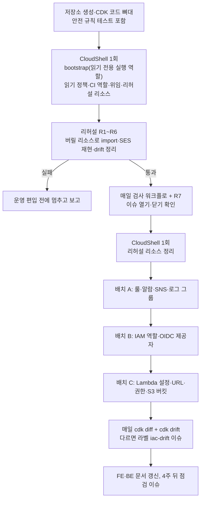
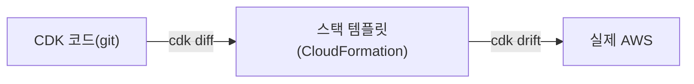

# AWS CDK 도입 1단계 — 기존 AWS 설정을 코드로 기록하고 매일 차이를 감지한다

<!-- plan-result:start — 이 블록만 병합 뒤에도 고칠 수 있다(CLAUDE.md §11). 아래는 승인된 계획 원문 -->

## 구현 결과

> #551 · 2026-11-06 대조 · 이탈 16 · 미구현 3 — 판정 근거(파일:줄)는 PR 본문 "계획 대비 구현"

- 이탈(사용자 결정): 실행 역할에 `ReadOnlyAccess`와 태그 전용 정책을 줌. 읽기 전용만으로는 시스템 태그를 못 붙여 import가 롤백됨. 운영 리소스 10개에 태그 3개씩 붙음
- 이탈(사용자 결정): 알람 처리기가 `PutMetricAlarm`을 호출해 import 동안만 허용하고 회수함. 알람 설정·상태·수정 시각은 그대로임
- 이탈(사용자 결정): 백업 버킷에 문서와 달리 버전 관리·수명 주기가 없어 사용자가 설정을 적용한 뒤 코드에 적음
- 이탈(보고만 함, 승인은 안 받음): R1의 `RevisionId` 불변이 성립하지 않음. 태그 때문에 `$LATEST`의 `RevisionId`·`LastModified`가 바뀌고 코드·환경변수·발행 버전·별칭은 그대로임. 운영 Lambda도 같음
- 이탈(보고만 함, 승인은 안 받음): R5에서 쓰기는 막히고 값은 그대로였지만 스택이 `UPDATE_ROLLBACK_FAILED`에 멈춤. 계획은 실패면 멈추라고 했으나 "일부 통과"로 보고하고 복구 절차와 검사 실패 처리를 더해 진행함
- 이탈(제약): 로컬 키 권한을 인라인 대신 관리형 정책으로 줌. 인라인 합계 2,048자 한도 때문임
- 이탈(제약): CI 역할의 OIDC 조건을 새 저장소용 변경 불가 형식으로 적음
- 이탈(권한 축소): CI 역할은 `link-sphere-iac-read` 대신 CloudFormation 읽기뿐인 `link-sphere-iac-ci`를 씀. CloudFormation이 실행 역할로 읽어 충분하고 Lambda 환경변수를 못 읽음
- 이탈(제약): CloudShell 실행이 2회에서 6회로 늘고 백업 버킷 적용이 따로 있었음. 권한·한도 오류로 스크립트를 고쳐 다시 실행하고, 알람 권한을 열고 닫는 데 썼음
- 이탈(제약): `--record-resource-mapping`은 터미널 입력이 필요해 매핑 파일을 직접 씀
- 이탈(제약): 룰의 한글 Description을 코드에서 뺌. CloudFormation이 비ASCII를 `?`로 돌려주기 때문이고 이 값의 변경은 못 잡음
- 이탈(판단): OIDC 제공자 지문을 코드에서 뺌. 키처럼 보이는 값인데 AWS가 GitHub OIDC 검증에 쓰지 않아 비교할 이유가 작음. 이 값의 변경은 못 잡음
- 이탈(실제에 맞춤): Lambda 호출 권한은 1개가 아니라 실제 리소스 정책대로 6개임. 그래서 리소스는 21개임
- 이탈(순서): 배포 버킷을 알람처럼 막히는지 보려고 배치 A에서 먼저 편입함. 전후 비교 없이 drift 검사로만 확인함
- 이탈(발견): 코드에 없던 속성을 적을 때는 `--revert-drift`가 "변경 없음"으로 실패해, 계획의 폴백인 재import를 씀
- 이탈(제약): 배치 검증을 cdk 직접 실행 대신 `scripts/drift-check.sh`로 함. 차이와 오류를 구분하려는 것이고, 계획이 허용한 미검사 리소스도 실패로 처리함
- 미구현 → 보완함: 리허설 명령·출력과 R7 결과를 병합 뒤 infra PR #5 댓글로 남김
- 미구현 → 보완함: `cdk.out`과 저장소 이력의 비밀값 검색. 환경변수 이름 9개와 값 패턴 모두 0건이고, 이름 금지 목록을 둔 가드 테스트만 일치함
- 미구현 → 보완함: 일반 `cdk deploy` 금지 문구가 README에 없어 infra #12로 추가함
- 계획에 없던 변경(승인 없이 하고 뒤에 보고함): 운영 스택을 편입 중 두 번 지우고 다시 만듦. 한 번은 재시도하려고 실패한 빈 스택을, 한 번은 비ASCII로 import가 멈춘 리소스 4개짜리 스택을 지움. `Retain`을 리허설에서 확인해 리소스는 남음. `cdk destroy`를 금지한 저장소 규칙의 취지와 부딪힘
- 계획에 없던 변경: 리허설용 로컬 키 임시 쓰기 정책을 만들고 정리 때 지움
- 계획에 없던 변경: 차이 검사 스크립트, 합성 옵션 `generateBootstrapVersionRule: false`, 추가 가드 테스트, Dependabot npm 업데이트, 재import·멈춘 스택 복구 절차
- 계획에 없던 변경: 백업 버킷 발견 기록과 안전망 표 행 추가, 문서 동기화(마지막 검토 날짜, 표 폭 정렬)

<!-- plan-result:end -->

> 운영 중인 도쿄 리전 리소스와 IAM을 새 비공개 저장소 `link-sphere-infra`의 CDK 스택으로 편입하고, 코드와 실제가 달라지면 이슈를 연다. 기존 리소스 설정은 바꾸지 않고, 사용자가 체감하는 서비스 변화는 없다. 2·3단계는 이번 범위가 아니다.

## Context

### 왜 하는가

지금 AWS 설정은 콘솔·CLI로만 바꾸고, 기록은 문서에 손으로 남긴다. 그래서 문서와 실제가 어긋나도 알 수 없다.

- **SES 사건:** BE `docs/DEPLOY.md` §9는 "적용 완료"인데 실제 Lambda 역할에 `ses:SendEmail`이 없었다. 2026-11-02에야 발견했고 언제부터인지 지금도 모른다. 그 뒤에 메일 링크 404까지 숨어 있었다.
- **복구 문서 불일치:** BE `docs/DEPLOY.md:232`의 역할은 `lambda-execution-role`인데 실제는 `link-sphere-api-role-qd2sz01l`이고, 문서 이름의 역할은 계정에 없다.
- **검사 공백:** 매일 검사는 CloudFront 설정(`cloudfront-drift-check.yml`)과 Lambda 별칭(`prod-alias-drift-check.yml`)뿐이다. Lambda 메모리·역할, EventBridge, 알람, IAM, S3 설정은 달라져도 모른다.
- **전체 목록 없음:** 멈춘 App Runner `link-sphere-be`, ECR 저장소, Amplify 역할이 남아 있다(사용 여부 미확인).
- **미뤄 온 일:** BE `docs/TRAFFIC-MANAGEMENT.md:565`와 2026-11-02 안전망 계획의 "남은 것"에 IaC화가 적혀 있다.

### 무엇을 기대하지 않는가

- 환경은 1개이고 1인 운영이다. 여러 환경을 찍어내는 IaC의 대표 이점은 지금 필요 없다.
- CloudFront 차이 이슈는 지금까지 0건이다. 스냅샷 커밋은 도입 포함 3회뿐이다.
- 도메인 clientHold, DELETE+본문 OAC 403 같은 사고는 IaC로 못 막는다.
- import는 실제를 그대로 베끼므로 이미 있는 실수까지 복사한다. 그래서 편입할 때 문서와 대조한다. 자동으로 찾아 주는 건 그 뒤의 변화다.
- 이 스택만으로 전체를 재생성할 수는 없다. Lambda 코드와 환경변수, CloudFront 쪽이 빠져 있다.

### 용어

| 용어           | 뜻                                                                                                     |
| -------------- | ------------------------------------------------------------------------------------------------------ |
| CloudFormation | AWS의 IaC 서비스. 템플릿을 받아 리소스를 관리한다                                                      |
| 스택           | CloudFormation이 함께 관리하는 리소스 묶음                                                             |
| bootstrap      | CDK를 쓰기 전 계정·리전마다 한 번 만드는 준비 스택(S3·ECR·IAM 역할 5개·SSM 파라미터)                   |
| import         | 이미 있는 리소스를 다시 만들지 않고 스택에 올리는 일                                                   |
| drift          | 코드나 템플릿과 실제가 어긋난 상태                                                                     |
| L1 / L2        | L1은 CloudFormation과 1:1인 저수준 클래스(`CfnFunction`). L2는 관련 리소스까지 챙겨 주는 간결한 클래스 |

### 전체 흐름



검사가 두 구간으로 나뉜다. 둘 다 차이가 0이어야 "코드 = 실제"다.



## 판단이 필요했던 항목

| 항목                       | 결정                                                                                            | 근거·기각한 대안                                                                                                                                                                                                                                                                                                  |
| -------------------------- | ----------------------------------------------------------------------------------------------- | ----------------------------------------------------------------------------------------------------------------------------------------------------------------------------------------------------------------------------------------------------------------------------------------------------------------- |
| 도구                       | **AWS CDK. 결정(사용자, 11-05)**                                                                | Claude 추천은 OpenTofu였다. 기존 리소스 편입 도구, 일부 속성 제외, 실제와의 비교, 리전 3곳 처리에서 유리해서다. 스크립트 확장(재생성 기반이 안 생김)과 보류도 함께 제시했다                                                                                                                                       |
| 코드 위치                  | **새 비공개 저장소. 결정(사용자, 11-05)**                                                       | FE·BE는 공개라 Actions 로그를 누구나 볼 수 있고, FE 스냅샷은 식별자를 일부러 가린다. 기각: FE `infra/`(한 번 새면 이력에서 못 지움, #301). 대가는 포트폴리오로 바로 안 보이는 점                                                                                                                                  |
| 범위                       | **1단계만. 결정(사용자, 11-05)**                                                                | 2·3단계는 4주 뒤 결과를 보고 다시 정한다                                                                                                                                                                                                                                                                          |
| 실행 주체                  | **로컬 키에 CDK 역할 위임. 결정(사용자, 11-05)**                                                | 사용자 작업은 CloudShell 2회다. 기각: CloudShell 전용(리허설·배치마다 수동 반복). 대가는 로컬 키로 스택 삭제까지 가능해지는 점이라, 2단계 전에 재검토한다                                                                                                                                                         |
| 실행 역할 권한             | `ReadOnlyAccess`. 결정(Claude 제안)                                                             | 기본값은 _"전체 관리자 권한인 AdministratorAccess"_ (번역, [bootstrapping-customizing](https://docs.aws.amazon.com/cdk/v2/guide/bootstrapping-customizing.html))다. 읽기 전용이면 실수로 쓰기가 일어나도 권한 오류로 끝나야 한다. 실제 동작은 R4·R5로 확인한다                                                    |
| CI·로컬 읽기 권한          | 고객 관리형 정책 `link-sphere-iac-read`. 결정(Claude 제안)                                      | drift 검사엔 _"스택 리소스별 읽기 권한"_ (번역, [drift 문서](https://docs.aws.amazon.com/AWSCloudFormation/latest/UserGuide/using-cfn-stack-drift.html))이 필요하다. 버킷 설정만 읽고 객체는 못 읽게 해 DB 백업을 보호한다. 기각: `ReadOnlyAccess`(객체까지 읽힘)                                                 |
| 코드 표현                  | L1만, 리소스 간 참조는 문자열. 결정(Claude 제안)                                                | import는 _"새 리소스 생성, 삭제, 속성 변경을 허용하지 않는다"_ (번역, [import 문서](https://docs.aws.amazon.com/AWSCloudFormation/latest/UserGuide/import-resources-manually.html)). L2가 다른 리소스를 함께 만들면 위반이다. 대가는 코드가 장황한 점                                                             |
| 스택 구성                  | 도쿄 스택 1개 `link-sphere-baseline`. 결정(Claude 제안)                                         | 서울·버지니아를 제외하면 bootstrap도 한 곳이면 된다. 기각: 처음부터 리전별 스택(크로스 리전 참조는 _"현재 실험 기능"_ (번역, [CDK README](https://github.com/aws/aws-cdk/blob/main/packages/aws-cdk-lib/aws-cloudfront/README.md)))                                                                               |
| 의도한 콘솔 변경 처리      | 코드를 실제 값에 맞춘 뒤 `cdk deploy --revert-drift`. 결정(Claude 제안, R4로 확정)              | _"리소스를 수정하지 않고 drift 상태를 초기화한다"_ (번역, [문서](https://docs.aws.amazon.com/AWSCloudFormation/latest/UserGuide/drift-aware-change-sets.html)). 폴백은 `Retain`으로 뺐다가 다시 import([문서](https://docs.aws.amazon.com/AWSCloudFormation/latest/UserGuide/resource-import-resolve-drift.html)) |
| 코드에 안 넣는 Lambda 속성 | 환경변수는 넣지 않고, `Code`는 형식상 값만 둔다. 결정(Claude 제안)                              | drift는 _"명시적으로 설정한 속성"_ (번역)만 보고, Lambda 코드는 비교 대상이 아니라고 문서가 밝힌다. `ssm-secure`는 Lambda에 못 쓴다                                                                                                                                                                               |
| 제외 범위                  | 별칭·버전, SNS 구독, 버킷 정책, CloudFront·WAF·ACM·Route 53·FE 버킷, SES·RUM. 결정(Claude 제안) | 별칭은 배포마다 바뀌어 항상 drift다. SNS 구독·버킷 정책은 [drift 미지원](https://docs.aws.amazon.com/AWSCloudFormation/latest/UserGuide/resource-import-supported-resources.html)이다. CloudFront·WAF는 위험이 커서 3단계로 미룬다. SES·RUM은 편입할 수 있지만 이번엔 뺀다                                        |
| 알림 형태                  | 라벨 이슈 열기·닫기                                                                             | 선례: FE `cloudfront-drift-check.yml`                                                                                                                                                                                                                                                                             |

### 뒤집힌 전제

| 발견                                                                                                                                                                                                                                                                                              | 그래서 바뀐 것                                                                                 |
| ------------------------------------------------------------------------------------------------------------------------------------------------------------------------------------------------------------------------------------------------------------------------------------------------- | ---------------------------------------------------------------------------------------------- |
| OpenTofu와 달리 CDK는 import 때 스택이, 그 전에 bootstrap이 생긴다                                                                                                                                                                                                                                | "AWS 쓰기 없음"을 "기존 리소스 설정은 안 바꿈"으로 고친다. 새 리소스 목록은 영향 범위에 적는다 |
| `AWS::Route53::RecordSet`과 `AWS::CertificateManager::Certificate`가 CloudFormation 지원 표에 없다. 표는 _"없으면 Cloud Control API로 접근할 수 없을 가능성이 높다"_ (번역, [표](https://docs.aws.amazon.com/AWSCloudFormation/latest/UserGuide/resource-import-supported-resources.html))고 쓴다 | 3단계까지 가도 DNS 레코드와 인증서는 수동으로 남을 수 있다                                     |
| _"템플릿에서 바꾸지 않은 리소스도 원하는 상태로 맞춘다"_ (번역, drift-aware 문서)                                                                                                                                                                                                                 | `--revert-drift`가 운영값을 덮어쓸 수 있다. 읽기 전용 실행 역할과 R5로 막는다                  |
| `link-sphere-user`가 CloudFormation·IAM 정책을 읽지 못한다(11-05 `ListStacks`·`ListRolePolicies` AccessDenied)                                                                                                                                                                                    | 읽기 정책을 로컬 키에도 붙인다. "로컬 키는 IAM 조회 불가" 문서를 고친다                        |

### 위험 관리

| 위험                                | 막는 장치                                                                                         | 그래도 일어나면                                        |
| ----------------------------------- | ------------------------------------------------------------------------------------------------- | ------------------------------------------------------ |
| CloudFormation이 운영 설정을 덮어씀 | 읽기 전용 실행 역할, 운영에는 `cdk deploy` 일반 실행 금지(README), R5                             | 권한 오류로 실패·롤백. 실제 값을 스냅샷과 비교         |
| 스택 삭제로 실제 리소스 삭제        | 전 리소스 `Retain`(테스트로 강제), 종료 보호, 실행 역할에 삭제 권한 없음                          | 리소스는 남고 관리만 풀린다. 다시 import               |
| 비밀값이 코드·로그에 남음           | Lambda `Environment` 금지 테스트, 읽기 결과에서 환경변수 제거, 비공개 저장소                      | 값을 교체한다(새 값 반영 → 재배포 → 확인 → 옛 값 삭제) |
| 잘못 옮겨 적은 값을 정상으로 믿음   | _"템플릿이 실제와 일치하는지 확인하지 않는다"_ (번역, import 문서). 배치마다 drift를 0까지 맞춘다 | drift 이슈로 드러난다                                  |
| 오탐으로 이슈가 쌓여 무시하게 됨    | 문서가 밝힌 배열 기본값 오탐은 코드에 명시해 없앤다                                               | 4주 뒤 오탐 건수로 계속 여부를 정한다                  |
| 일반 배포가 drift를 만듦            | 별칭·버전 제외, 코드 비교 제외. R3에서 재현                                                       | 해당 속성을 코드에서 뺀다                              |

## 세부 계획

Phase는 모두 1단계 안의 작업 순서다. `<ACCOUNT>`는 계정 ID 자리표시자이고, 공개 레포에 커밋하는 이 파일엔 실제 값을 쓰지 않는다.

### Phase 0: 저장소와 리허설

| 위치                                                                                                                    | 변경 내용                                                                                                                                                                                                                                                                                                                                                                                                                                 |
| ----------------------------------------------------------------------------------------------------------------------- | ----------------------------------------------------------------------------------------------------------------------------------------------------------------------------------------------------------------------------------------------------------------------------------------------------------------------------------------------------------------------------------------------------------------------------------------- |
| GitHub `BAECHAN/link-sphere-infra` (신규)                                                                               | 비공개 저장소. squash 병합만, `delete_branch_on_merge=true`, 로컬 경로 `~/project/link-sphere/link-sphere-infra`                                                                                                                                                                                                                                                                                                                          |
| `package.json`·`.nvmrc`·`.npmrc`·`tsconfig.json`·`cdk.json` (신규)                                                      | Node 24, pnpm, TypeScript, `aws-cdk-lib`·`aws-cdk` 정확한 버전 고정(구현 시점 최신), `analyticsReporting: false`                                                                                                                                                                                                                                                                                                                          |
| `bin/app.ts`, `lib/rehearsal-stack.ts` (신규)                                                                           | `env` 명시, 종료 보호, `fromLookup` 금지. 리허설 스택은 작업 후 코드 삭제                                                                                                                                                                                                                                                                                                                                                                 |
| `test/guards.test.ts` (신규)                                                                                            | 모든 리소스 `DeletionPolicy: Retain`, Lambda `Environment` 없음, 별칭·버전 없음, `CDKMetadata` 없음                                                                                                                                                                                                                                                                                                                                       |
| `.github/workflows/ci.yml` (신규)                                                                                       | PR에서 타입 검사·테스트·`cdk synth`. 액션 SHA 고정 + Dependabot(FE `docs/DEPLOY.md` "액션 버전 관리" 선례)                                                                                                                                                                                                                                                                                                                                |
| `.claude/CLAUDE.md`·`.claude/repo-policy.json`·`README.md` (신규)                                                       | 워크트리 필수, 운영 변경 절차, 금지 명령, 편입·제외·정리 후보 표                                                                                                                                                                                                                                                                                                                                                                          |
| CloudShell 스크립트 1 (사용자 실행, 여러 번 실행해도 안전, 형태는 FE `docs/plans/2026-10-13-github-oidc-aws.md` 부록 A) | ① `cdk bootstrap aws://<ACCOUNT>/ap-northeast-1 --cloudformation-execution-policies arn:aws:iam::aws:policy/ReadOnlyAccess` ② 정책 `link-sphere-iac-read` ③ OIDC 역할 `link-sphere-infra-drift`(`repo:BAECHAN/link-sphere-infra:ref:refs/heads/main`만) ④ `link-sphere-user`에 위 정책과 `cdk-hnb659fds-*-<ACCOUNT>-ap-northeast-1` 역할 `sts:AssumeRole` ⑤ 리허설 리소스(SNS 토픽, 인라인 정책 달린 IAM 역할, 더미 환경변수 있는 Lambda) |
| `.github/workflows/drift-check.yml` (신규)                                                                              | 매일 + 수동. `cdk diff --fail --method=template` + `cdk drift --fail`. 차이면 라벨 `iac-drift` 이슈를 열고, 없어지면 닫는다. 오류는 워크플로 실패로 알린다. 이슈 쓰기는 AWS 자격증명 job과 분리(FE 선례)                                                                                                                                                                                                                                  |
| CloudShell 스크립트 2 (사용자 실행)                                                                                     | 리허설 스택과 리소스 삭제                                                                                                                                                                                                                                                                                                                                                                                                                 |

**리허설 통과 조건.** 하나라도 실패하면 운영 편입 전에 멈추고 보고한다.

| #   | 시나리오                                                                                                   | 통과 조건                                          | 실패 시                                                                  |
| --- | ---------------------------------------------------------------------------------------------------------- | -------------------------------------------------- | ------------------------------------------------------------------------ |
| R1  | 읽기 전용 실행 역할로 토픽·역할·Lambda를 `cdk import`(새 스택 포함)                                        | import 성공, Lambda `RevisionId`·환경변수 불변     | 멈춤. 실행 역할 권한을 사용자와 다시 정한다                              |
| R2  | 역할의 인라인 정책 삭제(SES 사건 재현)                                                                     | `cdk drift --fail`이 exit 1, 해당 속성 표시        | 멈춤. 핵심 가치가 없으므로 계속 여부를 다시 묻는다                       |
| R3  | Lambda 메모리 변경, 일반 배포 재현(`update-function-code`·`publish-version`·`update-alias`), 환경변수 추가 | 메모리만 drift, 나머지는 drift 아님                | 어긋난 속성을 코드에서 뺀다                                              |
| R4  | 코드를 실제 값에 맞춰 `cdk deploy --revert-drift`                                                          | drift 해소, Lambda 코드·환경변수·`RevisionId` 불변 | R6 폴백으로 전환. Lambda에서 실패하면 함수만 스택에서 제외하고 보고      |
| R5  | 코드를 실제와 다른 값으로 두고 `--revert-drift`                                                            | 권한 오류로 실패·롤백, 실제 값 불변                | 멈춤. 안전장치가 성립하지 않는다                                         |
| R6  | 리소스를 코드에서 빼고 스택 갱신 후 재import, 스택 삭제                                                    | 리소스가 그대로 남음                               | 멈춤                                                                     |
| R7  | GitHub Actions에서 차이 발생 → 이슈 열림 → 해소 → 이슈 닫힘                                                | 이슈 자동 열기·닫기 동작, 읽기 정책 최소 범위 확정 | 정책을 보완한다. `cdk drift`가 역할 문제로 안 되면 AWS CLI 호출로 바꾼다 |

### Phase 1: 운영 리소스 편입

배치마다 PR 1개다. 순서는 ① 실제 값 읽기(환경변수 제외) ② L1 코드 작성 ③ `cdk import --record-resource-mapping`으로 대상 확인 ④ 사용자에게 대상 표시 ⑤ `cdk import --resource-mapping` ⑥ `cdk drift`가 0이 될 때까지 코드 수정 ⑦ 병합. 문서와 다른 값이 나오면 실제를 코드에 적고 차이를 보고한다.

| 위치                                   | 변경 내용                                                                                                                                                                           |
| -------------------------------------- | ----------------------------------------------------------------------------------------------------------------------------------------------------------------------------------- |
| `lib/baseline-stack.ts` (신규), 배치 A | `AWS::Events::Rule` 2개(타겟 4개 포함), `AWS::CloudWatch::Alarm` 3개, `AWS::SNS::Topic` 1개, `AWS::Logs::LogGroup` `/aws/lambda/link-sphere-api`                                    |
| 같은 파일, 배치 B                      | `AWS::IAM::Role` `link-sphere-api-role-qd2sz01l`·`link-sphere-be-deploy`·`link-sphere-fe-deploy`(신뢰 정책·인라인 정책 포함), `AWS::IAM::OIDCProvider`                              |
| 같은 파일, 배치 C                      | `AWS::Lambda::Function` `link-sphere-api`(런타임·핸들러·메모리·타임아웃·아키텍처·역할·SnapStart만), `AWS::Lambda::Url`, `AWS::Lambda::Permission`, `AWS::S3::Bucket` 배포·백업 버킷 |
| `mapping/*.json` (신규)                | 배치별 논리 ID ↔ 실제 리소스                                                                                                                                                        |
| `README.md`                            | 편입·제외(이유)·정리 후보 표를 실제 결과로 갱신. 삭제는 하지 않고 후보만 보고                                                                                                       |
| `drift-check.yml`                      | 대상을 `link-sphere-baseline`으로 고정                                                                                                                                              |

### Phase 2: 점검 약속

| 위치                                   | 변경 내용                                                                                                               |
| -------------------------------------- | ----------------------------------------------------------------------------------------------------------------------- |
| `link-sphere-infra` GitHub 이슈 (신규) | 4주 뒤 점검: drift 건수(진짜·오탐), `--revert-drift` 실행·실패 횟수. 2단계 진행, 유지, 철회 중 하나를 사용자에게 묻는다 |

### Phase 3: 문서

| 위치                                                            | 변경 내용                                                                                      |
| --------------------------------------------------------------- | ---------------------------------------------------------------------------------------------- |
| FE `docs/plans/2026-11-05-aws-cdk-stage1.md` (신규)             | 이 계획 스냅샷과 구현 결과 블록                                                                |
| FE `docs/DECISIONS.md`                                          | 도구 선택 ADR. 비교 표, Claude 추천과 사용자 결정을 함께 기록                                  |
| FE `docs/DEPLOY.md`                                             | 절 추가 "AWS 설정 코드화(CDK)": 범위, 저장소, 의도한 변경 절차. `:308` 로컬 IAM 조회 서술 정정 |
| FE `docs/ONBOARDING.md:40`                                      | "IaC가 없어 레포에 설정값이 없다"를 저장소 안내로 교체                                         |
| FE `docs/SYSTEM-ARCHITECTURE.md`                                | 수동 관리 서술에 편입 범위 반영                                                                |
| BE `docs/DEPLOY.md:232`·`:240`                                  | 실제 역할 이름과 필요 권한으로 정정, `:167` 로컬 IAM 서술 정정, CDK 절 링크                    |
| BE `docs/RSS-FEED-BOT.md:246`, `docs/TRAFFIC-MANAGEMENT.md:565` | "IaC 없음" 서술 갱신                                                                           |

## 영향 범위

**CRUD 실패 지점(대상은 AWS 설정)**

| 동작 | 깨질 수 있는 것                                                                                                                                                                                                                                                              |
| ---- | ---------------------------------------------------------------------------------------------------------------------------------------------------------------------------------------------------------------------------------------------------------------------------- |
| 생성 | bootstrap 스택(S3·ECR·IAM 역할 5개·SSM), `link-sphere-baseline`, 역할 `link-sphere-infra-drift`, 정책 `link-sphere-iac-read`, `link-sphere-user` 인라인 정책이 새로 생긴다. 같은 리소스를 두 스택에 올릴 수 없다는 제약이 있다. 표의 구독·정책 일부는 `NOT_CHECKED`로 남는다 |
| 읽기 | 매일 읽기 호출만 추가된다. 사용자 요청 경로에는 영향이 없다. `plan`과 달리 없는 리소스는 감지하지 않아, 코드 밖에 새로 만든 리소스는 잡지 못한다                                                                                                                             |
| 수정 | 기존 런북(`update-function-configuration`, `put-role-policy`, `put-targets`)은 그대로 동작하지만 drift를 만든다. 의도한 변경이면 코드 갱신과 `--revert-drift`까지 해야 이슈가 닫힌다                                                                                         |
| 삭제 | 코드에서 리소스를 빼면 관리만 풀리고 리소스는 남는다. 콘솔에서 지우면 `DELETED` drift로 잡힌다                                                                                                                                                                               |

**기존 기능 회귀**

| 소유 파일                                                            | 확인할 것                                                                                                       |
| -------------------------------------------------------------------- | --------------------------------------------------------------------------------------------------------------- |
| BE `.github/workflows/deploy.yml`                                    | 코드 갱신·버전 발행·별칭 승격이 그대로 되고 drift가 안 생긴다(R3, 편입 후 첫 실제 배포)                         |
| FE `.github/workflows/deploy.yml`                                    | FE 역할을 import해도 S3 동기화·무효화가 그대로 된다                                                             |
| BE `db-backup.yml`, `prod-alias-drift-check.yml`                     | 역할과 버킷을 import해도 그대로 된다                                                                            |
| FE `cloudfront-drift-check.yml`, `scripts/check-cloudfront-drift.js` | 변경 없음. 계속 CloudFront를 담당한다                                                                           |
| 런북(FE·BE `docs/DEPLOY.md`, OIDC 부록 A)                            | 절차가 "콘솔 변경 후 코드 동기화"로 늘어난다. 문서에 반영한다                                                   |
| 문서 서술                                                            | "IaC 없음", "로컬 IAM 조회 불가" 서술을 Phase 3에서 고친다. `docs/plans/`의 옛 서술은 append-only라 그대로 둔다 |

데이터 계약 변경과 FE·BE 코드 변경은 없다. 앱 코드에서 여러 곳이 import하는 파일도 건드리지 않는다.

## 검증 방법

1. **리허설:** R1~R7 결과를 명령·출력과 함께 infra PR에 남긴다.
2. **배치마다:** 편입 전후로 대상 리소스 설정을 받아 비교해 불변을 확인한다(Lambda `RevisionId`, 룰 상태와 타겟, 알람 설정, 역할 정책). 그리고 아래를 실행한다.
   ```bash
   pnpm cdk diff link-sphere-baseline --fail --method=template   # 차이 없음
   pnpm cdk drift link-sphere-baseline --fail                    # exit 0, 전부 IN_SYNC 또는 NOT_CHECKED
   curl -sS -o /dev/null -w '%{http_code}\n' https://linksphere.click/api/actuator/health   # 200
   ```
3. **비밀값:** `pnpm test`의 가드, `cdk.out` 템플릿과 저장소 이력에서 환경변수 이름과 값 패턴 검색이 0건.
4. **일반 배포:** 편입 뒤 첫 BE·FE 배포 run이 success이고, 그 후 `cdk drift`가 여전히 0.
5. **매일 검사:** `gh workflow run drift-check.yml` 성공 후 이슈 없음. 그 뒤 예약 실행 1회 확인.
6. **문서:** FE `pnpm check:docs`, PR 본문 `pnpm check:pr-body`.
7. **계획 대조:** `plan-verifier`로 infra·FE·BE diff를 이 계획과 대조하고, FE PR 본문 `## 계획 대비 구현`에 남긴다.

## 남은 것

- **사용자가 실행:** CloudShell 스크립트 2회. 로컬 키에 IAM 쓰기 권한이 없어서다.
- **2단계(4주 뒤 판단):** 코드 병합으로 변경하기. 실행 역할 쓰기 권한과 로컬 위임을 다시 검토한다.
- **3단계(미정):** CloudFront·WAF·FE 버킷. Free 요금제와 CloudFormation 함께 쓰기는 AWS 문서에서 설명을 찾지 못했고, WAF는 _"요금제를 쓰는 동안 분리할 수 없다"_ (번역, [요금제 문서](https://docs.aws.amazon.com/AmazonCloudFront/latest/DeveloperGuide/flat-rate-pricing-plan.html)). Route 53 레코드·ACM 인증서는 수동으로 남을 수 있다.
- **잔존 리소스 정리:** 후보 목록만 보고한다. 삭제는 사용자가 결정한다.
- **비용(11-05 가격표 기준 추정, 실측 아님):** 월 청구액은 사실상 $0이다.
  - AWS는 월 1센트 미만이다. CloudFormation은 `AWS::*` 타입에 [추가 요금이 없다](https://aws.amazon.com/cloudformation/pricing/). 도쿄 S3는 AWS 가격 API 기준 저장 $0.025/GB·월, PUT $0.0047/1,000건, GET $0.0037/10,000건이고 템플릿 몇십 KB만 올라간다. ECR은 $0.10/GB·월인데 비어 있다.
  - bootstrap은 `--bootstrap-customer-key`를 쓰지 않는다. 문서가 _"요금이 부과된다"_ (번역, [bootstrap 옵션](https://docs.aws.amazon.com/cdk/v2/guide/ref-cli-cmd-bootstrap.html))고 밝힌 고객 관리형 키 대신, [기본값인 AWS 관리형 키](https://docs.aws.amazon.com/cdk/v2/guide/bootstrapping-customizing.html)를 쓴다.
  - GitHub Actions는 Linux 분당 $0.006이고 Free 요금제에 [월 $12어치가 포함](https://docs.github.com/en/billing/concepts/product-billing/github-actions)된다(약 2,000분). 매일 검사와 CI를 합쳐 월 150분 안팎으로 추정해 약 $0.90어치를 쓴다. 포함량은 비공개 저장소끼리 공유하는데, 다른 비공개 저장소 9개의 사용량은 토큰 권한이 없어 확인하지 못했다.
  - 첫 달 청구서로 검증한다(Phase 2 점검 이슈에 포함).
- **환경변수 코드화:** Secrets Manager 참조로 옮기면 가능하지만 앱 설정 변경이 필요해 이번 범위 밖이다.
