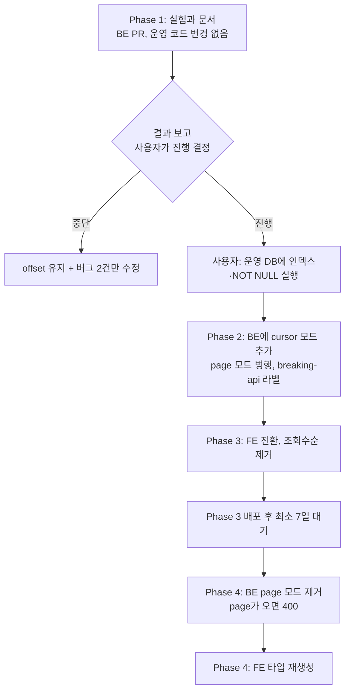
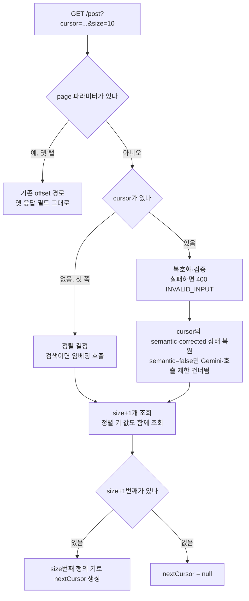

# 목록 페이지네이션을 offset에서 cursor로 전환

<!-- plan-result:start — 이 블록만 병합 뒤에도 고칠 수 있다(CLAUDE.md §11). 아래는 승인된 계획 원문 -->

## 구현 결과

> #549 · 2026-11-05 대조(Phase 3) · 이탈 1 · 미구현 0 — 판정 근거(파일:줄)는 PR 본문 "계획 대비 구현". Phase 1·2는 BE 레포의 같은 파일 블록에 있다

- 이탈(구현 중 판단): `PostListRequest`의 `page`·`size` 좁히기를 둘 다 없애지 않고, `size`는 필수로 남기고 `page`는 타입에서 뺐다. FE가 쪽 크기를 항상 정해서 보내고, 옛 번들용으로 스펙에 남은 `page`를 새 코드가 쓰지 못하게 하려는 것이다.
- 순서 차이: 기능 지도의 `PAGINATION.md` 링크는 피드·검색 행에 FE #545로 먼저 들어갔고, 이 PR은 내 댓글·북마크 행에 더했다.
- 계획에 없던 변경: 계획 표에 없던 테스트 4개의 목 응답을 새 형태로 갱신하고, 코드 주석에서 `totalElements`·조회수순 언급을 뺐다.
- 문서 동기화: `docs/POST.md` 테스트 목록, `docs/BOOKMARK.md` 코드 인용, `docs/OPENAPI-CODEGEN.md` 검토 날짜.
- 검증 범위: 브라우저 녹화에서 피드·검색은 운영 BE로, 글 삭제·북마크·내 댓글은 모킹으로 확인했다. 로그인 파일에 쿠키가 없어 북마크·내 댓글의 운영 쪽 넘김은 배포 뒤 사용자가 자기 계정으로 끝까지 스크롤해 문제없음을 확인했다(2026-11-05, 사용자 보고).

<!-- plan-result:end -->

> 피드·북마크·내 댓글 목록을 불투명 cursor로 바꾼다. 검색도 점수 키로 이어 읽는다. 북마크 조회수순은 제거한다.
> 코드를 바꾸기 전에 대용량 실험으로 이득을 먼저 재고, 결과를 보고 진행 여부를 정한다.

## Context

**왜 하는가.** 사용자 결정(2026-11-05)이다. 학습용 프로젝트이고, 비슷한 제품을 나중에 설계할 때 참고할 수 있어야 한다. 판단 기준은 지금의 체감이 아니라 큰 규모에서 offset의 빈틈이 문제가 되는가다. 지금 규모(공개 글 328개, 활성 회원 12명)에서 성능 이득은 없고, 사용자도 이를 알고 정했다.

**지금 구조.** 세 목록 모두 `page`·`size`를 받아 `offset ? rows fetch first ? rows only`로 읽고, 쪽마다 count 쿼리를 함께 돌린다(`PostRepositoryImpl.kt:53,96-101`). `created_at` 인덱스는 없다.

**이미 확인한 것**

| 항목                              | 결과                                                                                           | 방법                                             |
| --------------------------------- | ---------------------------------------------------------------------------------------------- | ------------------------------------------------ |
| 북마크 조회수순 누락              | 75행을 받았는데 서로 다른 글은 74개                                                            | 운영 읽기 계정, 같은 조건·정렬로 `id`만 1회 조회 |
| 피드에서 내 글 삭제 후 1개 건너뜀 | `bookmark-folder.keys.ts:103-106`이 글 목록을 다시 받지 않음                                   | 코드 추적, 실행 재현 안 함                       |
| 합성 데이터 100만 행              | 인덱스 없음 + offset 1.1~1.7초, 인덱스 + offset 1,000 위치 0.96ms, 인덱스 + keyset 0.09ms 이하 | 직접 측정, 임시 컨테이너, 1회 실행               |
| 의미 점수가 쪽 사이에 바뀔 때     | offset·keyset 모두 누락·중복, 어느 쪽도 일관되게 낫지 않음                                     | 공개 글 328개 시뮬레이션, 키워드 판정 단순화     |
| 운영 검색 로그 30일               | 의미 검색 60회 중 임베딩 실패 0, 5분 내 같은 검색어 16쌍에서 상태 변경 0                       | Logs Insights, 표본 작음                         |

## 판단이 필요했던 항목

| 항목                  | 결정                                                            | 근거·기각한 대안                                                                                                                                                                                                                                                                                                                                                                                                                                                                                                                                 |
| --------------------- | --------------------------------------------------------------- | ------------------------------------------------------------------------------------------------------------------------------------------------------------------------------------------------------------------------------------------------------------------------------------------------------------------------------------------------------------------------------------------------------------------------------------------------------------------------------------------------------------------------------------------------ |
| 검색 방식             | 점수 keyset                                                     | 사용자가 "지금 바꾸는 비용은 문제가 아니고 큰 규모의 빈틈을 보려는 것"이라고 답해 2번으로 해석했다. 다르면 승인 단계에서 정정한다. Slack은 _"데이터에 쓰기가 잦으면 페이지 구간을 믿을 수 없게 되어 결과를 건너뛰거나 중복으로 돌려줄 수 있다"_ (번역, [Slack Engineering](https://slack.engineering/evolving-api-pagination-at-slack/))고 쓴다. 기각: 계약만 cursor로 하고 내부는 offset(앞서 1번). 쪽 사이 삭제·등록의 빈틈이 남는다                                                                                                           |
| 조회수순              | 제거                                                            | 사용자 결정이다. cursor의 필수 조건은 아니고, 바뀌는 정렬 값의 사례는 최근 열람순이 그대로 보여 준다. 옛 `?sort=views`는 `parseSort`가 최신순으로 돌린다(`useBookmarkPage.ts:25-31`)                                                                                                                                                                                                                                                                                                                                                             |
| 실험을 먼저           | Phase 1을 운영 코드 변경 없이 분리                              | 사용자가 보려는 것이 "cursor가 이득인가"다. 계약을 바꾸기 전에 근거를 낸다. 실험은 SQL과 셸 스크립트로 쓴다. 기각: Kotlin 벤치마크 태스크. Phase 4에서 offset 경로가 사라지면 비교 대상을 테스트 전용으로 남겨야 한다                                                                                                                                                                                                                                                                                                                            |
| 응답 형태             | `nextCursor: String?`만 둔다. `null`이면 끝                     | [AIP-158](https://google.aip.dev/158)과 Slack이 빈 토큰으로 끝을 알린다. 기각: `hasNext` 병행(Relay 방식). 대화에서 보여 준 초안에는 있었지만, 두 값이 어긋날 수 있고 FE는 `getNextPageParam`만으로 충분하다(`infiniteQueryBehavior.js:107-109`, query-core 5.90.16)                                                                                                                                                                                                                                                                             |
| cursor 인코딩         | Base64url JSON + 서버 검증, 서명 없음                           | AIP-158은 _"페이지 토큰은 불투명한(URL에는 안전한) 문자열이어야 하고, 사용자가 해석할 수 있어서는 안 된다"_ (번역)고 하며 Base64만으로는 부족하다고 본다. 이 표준과 다른 선택이다. Slack 예시는 Base64이고, 공개 범위 조건을 요청마다 적용해 조작해도 볼 수 없는 글은 나오지 않는다. 기각: 서명·암호화(키 관리만 는다)                                                                                                                                                                                                                           |
| 다른 조건 검증        | cursor의 정렬 값만 대조. 불일치는 400                           | 키 해석이 정렬에 달려 있어 필요하다. 기각: 검색어·필터까지 해시 대조. FE 쿼리 키가 이미 분리하고, 어긋나도 위치만 달라질 뿐 데이터가 새지 않는다                                                                                                                                                                                                                                                                                                                                                                                                 |
| 직접 구현             | 공용 도우미를 직접 쓴다                                         | Spring Data Scroll을 먼저 봤다. _"문자열 기반 쿼리 메서드의 스크롤은 아직 지원되지 않는다"_ (번역, [JPA 문서](https://docs.spring.io/spring-data/jpa/reference/jpa/query-methods.html)), _"정렬에 쓰는 속성은 쿼리 결과로 반환되어야 하고 반환 엔티티에 매핑돼 있어야 한다"_ (번역, [Commons 문서](https://docs.spring.io/spring-data/commons/reference/repositories/scrolling.html)). `bookmarks.created_at`·점수·열람 시각은 `TablePost`에 없어 쓸 수 없다                                                                                     |
| 조건식 형태           | `k1 <= x AND (k1 < x OR (k1 = x AND ...))`                      | Hibernate 6.6.53의 `tuple()`은 `JpaCompoundSelection`을 돌려줘 `lessThan`에 넣을 수 없다(javap 확인). 앞의 상한이 있어야 인덱스 범위 탐색이 가능할 것으로 본다. 추론이므로 Phase 1에서 상한 유무를 비교하고 Phase 2 테스트에서 `Index Cond`를 확인한다                                                                                                                                                                                                                                                                                           |
| 제목 키 길이          | `left(p.title, 200)`을 정렬 키로 쓴다                           | 제목은 BE·FE 모두 길이 제한이 없고, 운영 WAF Common Rule Set에서 `SizeRestrictions_QUERYSTRING`이 켜져 있다(읽기 전용 AWS 조회로 확인). AWS 문서는 이 규칙을 _"2,048바이트를 넘는 URI 쿼리 문자열을 검사한다"_ (번역, [AWS](https://docs.aws.amazon.com/waf/latest/developerguide/aws-managed-rule-groups-baseline.html))고 쓴다. 긴 제목 하나로 그 뒤 쪽이 403이 된다. 200자가 같은 글끼리는 북마크 시각으로 순서가 정해지는 차이만 생긴다. 기각: cursor에 글 id만 담고 제목 조회(그 글이 지워지면 이어 읽을 수 없다), WAF 완화(CLAUDE.md 금지) |
| 의미 점수 상태        | cursor에 `semantic`을 담아 첫 쪽 상태를 유지한다                | 키워드로 시작한 뒤 의미 점수가 켜지면 누락이 가장 컸다(시뮬레이션 67/667). `semantic=false`면 이후 쪽도 키워드 전용으로 고정한다. `semantic=true`인데 임베딩이 실패하거나 호출 제한에 걸리면 그 쪽부터 키워드 전용으로 강등해 고정하고 로그를 남긴다. 기각: 실패를 에러로 돌리기. Gemini 장애로 검색이 실패하지 않게 한 기존 원칙(`PostService.kt:136-138`)과 어긋난다                                                                                                                                                                           |
| 호출 제한 토큰        | `semantic=false` cursor면 소비하지 않는다                       | 지금은 cursor를 읽기 전에 소비한다(`PostController.kt:78-84`). 임베딩을 안 부르는 쪽이 IP당 10분 60회 예산을 쓰면 안 된다                                                                                                                                                                                                                                                                                                                                                                                                                        |
| 자판 보정             | 첫 쪽이 비었을 때만 판정하고, cursor에 `corrected`를 담는다     | 지금은 쪽마다 `totalElements == 0`으로 판정한다. count가 없으면 빈 마지막 쪽을 0건 검색으로 오인한다                                                                                                                                                                                                                                                                                                                                                                                                                                             |
| count 쿼리            | 검색 첫 쪽에만 남긴다                                           | 화면에서 `totalElements`·`totalPages`를 읽는 곳이 없다(grep). `[Search]` 로그의 `total`만 쓰므로 뒤쪽은 `total=-1`로 남긴다                                                                                                                                                                                                                                                                                                                                                                                                                      |
| 생성 뒤 페이지 자르기 | 유지하고 주석만 고친다                                          | 처음엔 offset 밀림이 사라지니 제거하려 했다. 그러면 무효화 때 불러온 쪽을 전부 다시 받아 그동안 다음 쪽을 못 받는다(`usePostList.ts:205`). 자르기는 재조회를 한 쪽으로 줄인다                                                                                                                                                                                                                                                                                                                                                                    |
| FE id 중복 제거       | 유지                                                            | 점수나 제목이 바뀌면 cursor에서도 겹칠 수 있다                                                                                                                                                                                                                                                                                                                                                                                                                                                                                                   |
| 응답 호환             | 옛 필드를 nullable·deprecated로 두고 `breaking-api` 라벨을 쓴다 | 옛 탭은 항상 `page`를 보내 값이 채워진다. 기각: 더미 값으로 필수 유지. 스펙이 사실과 달라진다                                                                                                                                                                                                                                                                                                                                                                                                                                                    |
| 옛 탭 대응            | 병행 최소 7일, 제거 뒤에는 `page`가 오면 400                    | 옛 번들은 `undefined + 1 = NaN`으로 `page=NaN`을 보낸다(`post.queries.ts:169-174`). 파라미터를 그냥 없애면 매번 1쪽이 와서 자동 다음 쪽 요청이 멈추지 않고, WAF 한도까지 갈 수 있다. 400이면 `failureReason`이 걸려 멈추고 재시도 화면이 뜬다                                                                                                                                                                                                                                                                                                    |
| 인덱스 생성           | `CREATE INDEX IF NOT EXISTS`, `CONCURRENTLY` 미사용             | 레포 선례(`sql/add_member_deletion_requested_at.sql`)이고 테이블이 작다. 큰 테이블에서는 `CONCURRENTLY`가 필요하다는 점을 문서에 남긴다                                                                                                                                                                                                                                                                                                                                                                                                          |
| 잘못된 cursor 재시도  | FE 초기화 코드는 넣지 않는다                                    | 400이면 재시도해도 같은 값을 보내지만, 조작이나 형식 변경 때만 생긴다. 형식을 바꾸면 BE가 옛 버전도 읽게 유지하는 규칙을 문서에 남기고, 전체 새로고침으로 복구된다                                                                                                                                                                                                                                                                                                                                                                               |

### 뒤집힌 전제

| 발견                                                                                                                                                    | 그래서 바뀐 것                                                |
| ------------------------------------------------------------------------------------------------------------------------------------------------------- | ------------------------------------------------------------- |
| 점수가 바뀌면 cursor가 더 위험할 거라 봤지만 시뮬레이션에서 offset과 비슷했고, 실제 로그에서 변경은 0건이었다                                           | 검색 keyset을 위험 때문에 기각하지 않는다                     |
| "지금 최대 539바이트라 제목 cursor는 안전하다"고 봤지만 제목 길이 제한이 없다                                                                           | 제목 키를 200자로 제한한다                                    |
| 호버 미리 받기가 옵션을 따로 복제한다(`bookmark-folder.queries.ts:117-136`). 놓치면 `page=0`으로 받은 응답이 목록 키에 들어가 그 폴더가 10개에서 끝난다 | 옵션을 하나로 합친다                                          |
| `.as(Double)`은 SQL cast를 만들지 않는다는 검토 결과를 받았다. `asDouble()`은 `castToBasicType`을 부르는 것을 javap로 확인했다                          | 점수 키는 `asDouble()`을 쓰고, 테스트에서 생성 SQL을 확인한다 |

### 위험 관리

| 위험                                        | 대응                                                                                                                                                          |
| ------------------------------------------- | ------------------------------------------------------------------------------------------------------------------------------------------------------------- |
| FE 전환 뒤 BE만 되돌림                      | 옛 BE는 `cursor`를 무시해 모든 목록이 10개에서 조용히 끝난다. Phase 3 이후 되돌릴 때는 FE를 먼저 되돌린다                                                     |
| cursor SQL 오류가 운영으로 승격             | 지금 스모크는 `page=0&size=5`만 호출한다(`deploy.yml:171`). Phase 2에서 cursor 모드 호출을 추가한다                                                           |
| `breaking-api` 뒤 다른 PR에 경고 반복       | 라벨을 단 PR은 바로 배포한다(`CI-CHECK-GATE.md:302`)                                                                                                          |
| 임베딩 벡터가 호출마다 조금씩 다름(확인 전) | Phase 1에서 같은 검색어로 2회 호출해 비교한다. 다르면 의미 점수를 소수 4자리로 반올림한다                                                                     |
| 시간 왕복 오류                              | `timestamptz`(posts·bookmarks)와 `timestamp`(comments·post_views)가 섞여 있고 `hibernate.jdbc.time_zone`이 없다. 두 형식 모두 마이크로초 왕복 테스트를 넣는다 |

## 세부 계획

**정렬 키** (마지막 키가 동점 해소용 고유 값)

| 목록    | 정렬                       | 키                                                                  |
| ------- | -------------------------- | ------------------------------------------------------------------- |
| 피드    | 최신순                     | `p.created_at DESC, p.id DESC`                                      |
| 피드    | 검색                       | `점수 DESC, p.created_at DESC, p.id DESC`                           |
| 북마크  | 최신순                     | `b.created_at DESC, b.post_id DESC`                                 |
| 북마크  | 오래된순                   | `b.created_at ASC, b.post_id ASC`                                   |
| 북마크  | 제목순                     | `left(p.title,200) ASC, b.created_at DESC, b.post_id DESC`          |
| 북마크  | 최근 열람순                | `coalesce(열람 시각, 1970) DESC, b.created_at DESC, b.post_id DESC` |
| 북마크  | 검색(`sort=latest`일 때만) | `점수 DESC, b.created_at DESC, b.post_id DESC`                      |
| 내 댓글 | 최신순                     | `c.created_at DESC, c.id DESC`                                      |

### Phase 1 — 실험과 문서 (BE PR, 운영 코드 변경 없음)

| 위치                                                   | 변경 내용                                                                                                                                                                                 |
| ------------------------------------------------------ | ----------------------------------------------------------------------------------------------------------------------------------------------------------------------------------------- |
| `scripts/pagination-experiment/run.sh` (신규)          | 임시 `pgvector/pgvector:pg17` 컨테이너 실행 → SQL 실행 → Markdown 표 출력 → 컨테이너 삭제                                                                                                 |
| `scripts/pagination-experiment/performance.sql` (신규) | 1만·10만·100만 행. 최신순: offset, keyset(상한 없음), keyset(상한 있음). 검색: offset, 점수 keyset. 깊이 50·1,000·절반, 각 5회 중앙값, `EXPLAIN (ANALYZE, BUFFERS)`                       |
| `scripts/pagination-experiment/gaps.sql` (신규)        | 10만 행, 50쪽 스크롤. 쪽 사이 쓰기 0·1·10·100건(등록, 삭제, 정렬 값 변경). 정렬: 최신순, 검색, 최근 열람순. 지표: 중복 횟수, 시작 시점 상위 500개 중 끝까지 지워지지 않았는데 못 본 글 수 |
| 임베딩 안정성 1회 확인                                 | 같은 검색어로 2회 호출해 벡터 차이를 기록한다. API 키는 출력하지 않는다                                                                                                                   |
| `docs/PAGINATION.md` (신규, 독립 기능 문서)            | 실험 결과, 재현 명령, 한계. cursor로도 못 막는 빈틈(점수 변경은 스냅샷 필요, 쪽마다 전체 계산은 전용 엔진 필요). 지금 규모에서 체감 이득이 없고 학습 목적으로 골랐다는 점                 |
| `docs/plans/2026-11-05-cursor-pagination.md` (신규)    | 계획 스냅샷                                                                                                                                                                               |

병합 뒤 결과를 사용자에게 보고한다. 사용자가 진행을 정하면 Phase 2로 간다. 결과가 예상과 달라도 그대로 기록한다.

### Phase 2 — DB와 BE cursor 모드 추가 (BE PR, `breaking-api`)

| 위치                                                                                                                                     | 변경 내용                                                                                                                                                              |
| ---------------------------------------------------------------------------------------------------------------------------------------- | ---------------------------------------------------------------------------------------------------------------------------------------------------------------------- |
| `src/main/resources/sql/add_cursor_pagination_indexes.sql` (신규)                                                                        | `posts(created_at DESC, id DESC)`, `bookmarks(user_id, created_at DESC, post_id DESC)`, `comments(user_id, created_at DESC, id DESC)`, `posts.created_at SET NOT NULL` |
| `src/test/resources/db/schema.sql`                                                                                                       | 같은 변경 반영                                                                                                                                                         |
| `global/common/CursorCodec.kt` (신규)                                                                                                    | 인코딩·디코딩, `{v, sort, keys, semantic?, corrected?}`, 실패 시 `InvalidInputException`                                                                               |
| `global/common/SeekPredicate.kt` (신규)                                                                                                  | 키 목록(식, 방향)으로 조건식 생성, 방향 혼합 지원                                                                                                                      |
| `domain/post/PostRepositoryCustom.kt`, `PostRepositoryImpl.kt`                                                                           | `findPostsAfter` 신규. 키 식을 함께 조회. 필터는 `buildPredicates` 재사용                                                                                              |
| `domain/post/PostService.kt`                                                                                                             | cursor 경로 신규. `semantic`·`corrected` 상태, 첫 쪽만 count와 `total` 로그                                                                                            |
| `domain/post/PostController.kt:66-85`                                                                                                    | `cursor` 추가, `page` 선택값으로 변경. `page`가 있으면 옛 경로. 토큰 소비 조건 변경                                                                                    |
| `domain/interaction/BookmarkRepositoryCustom.kt`, `BookmarkRepositoryImpl.kt`, `BookmarkFolderService.kt`, `BookmarkFolderController.kt` | 같은 형태로 cursor 경로 추가                                                                                                                                           |
| `domain/comment/CommentRepository.kt`, `CommentService.kt`, `CommentController.kt`, `CommentDTO.kt:63`                                   | JPQL `JOIN FETCH` + `Limit`로 cursor 경로 추가                                                                                                                         |
| `domain/post/PostDTO.kt:79`                                                                                                              | `nextCursor` 추가, 옛 필드 nullable·deprecated                                                                                                                         |
| `.github/workflows/deploy.yml:171`                                                                                                       | cursor 모드 검증 호출 추가                                                                                                                                             |
| `CursorPaginationIntegrationTest.kt`, `CursorCodecTest.kt` (신규)                                                                        | 검증 방법 절의 항목                                                                                                                                                    |
| `docs/PAGINATION.md`, `docs/BE-ARCHITECTURE.md`, `README.md`, `CHANGELOG.md`(`### Migration`), `docs/VERSION-COMPATIBILITY.md`           | 동작·계약·실행 SQL 반영                                                                                                                                                |

### Phase 3 — FE 전환 (FE PR)

| 위치                                                                                                                                                                                                | 변경 내용                                                                                    |
| --------------------------------------------------------------------------------------------------------------------------------------------------------------------------------------------------- | -------------------------------------------------------------------------------------------- |
| `src/shared/api/generated/openapi.json`, `openapi.gen.ts`                                                                                                                                           | `pnpm codegen:fetch && pnpm codegen`로 재생성                                                |
| `src/shared/types/common.type.ts:9-12`                                                                                                                                                              | `PaginationRequest`를 `cursor`·`size` 형태로 변경                                            |
| `src/entities/post/api/post.api.ts:38-61`                                                                                                                                                           | `cursor` 전달, NProgress 조건을 `!cursor`로 변경                                             |
| `src/entities/post/model/post.dto.ts:18-27`                                                                                                                                                         | `page`·`size` 필수 좁히기 제거                                                               |
| `src/entities/post/api/post.queries.ts:155-175`                                                                                                                                                     | `initialPageParam: null`, `getNextPageParam: (lastPage) => lastPage.nextCursor ?? undefined` |
| `src/entities/post/api/post.queries.ts:55-83`                                                                                                                                                       | 자르기 유지, 주석의 이유 갱신, `totalElements` 쓰기 제거                                     |
| `post.queries.ts:189,324,404`, `bookmark-folder.queries.ts:106,454`, `comment.queries.ts:185`, `interaction.queries.ts:250`                                                                         | `totalElements` 읽기·쓰기 제거                                                               |
| `src/entities/bookmark/folder/api/bookmark-folder.queries.ts:81-136`                                                                                                                                | 목록과 호버 미리 받기가 함께 쓰는 옵션 함수로 합침(`postListInfiniteOptions` 형태)           |
| `bookmark-folder.api.ts:52-61`, `comment.api.ts:29-32`, `comment.queries.ts:169-189`                                                                                                                | 같은 전환                                                                                    |
| `bookmark-folder.schema.ts:10`, `useBookmarkPage.ts:11`, `BookmarkPage.tsx:26`, `texts.ts:409`                                                                                                      | 조회수순 제거                                                                                |
| `usePostList.next-page.test.tsx`, `useBookmarkPostList.test.tsx`, `useMyCommentList.test.tsx`, `post.queries.test.ts`, `interaction.queries.test.ts`, `bookmark-folder.schema.test.ts`              | 새 응답 형태로 갱신, 호버 미리 받기가 목록과 같은 키로 cursor를 쓰는지 테스트 추가           |
| `e2e/mocks/post.mock.ts:76-88`, `e2e/list-fetch-failure.spec.ts:34-57`, 목 응답을 만드는 나머지 e2e 10개, `src/mocks/fixtures`                                                                      | `cursor` 분기와 `nextCursor` 응답으로 변경                                                   |
| `docs/POST.md`, `docs/BOOKMARK.md`, `docs/COMMENT.md`, `docs/TESTING.md`, `docs/DECISIONS.md`, `docs/ONBOARDING.md`, `docs/VERSION-COMPATIBILITY.md`, `docs/OPENAPI-CODEGEN.md:484`, `CHANGELOG.md` | 동작 갱신, 결정 기록, 기능 지도에 `PAGINATION.md` 추가                                       |
| `docs/plans/2026-11-05-cursor-pagination.md` (신규)                                                                                                                                                 | 계획 스냅샷                                                                                  |

Phase 4 일정을 잊지 않도록 병합 뒤 GitHub 이슈를 연다.

### Phase 4 — 옛 경로 제거 (Phase 3 배포 후 최소 7일, BE PR → FE PR)

| 위치                                                                                 | 변경 내용                                             |
| ------------------------------------------------------------------------------------ | ----------------------------------------------------- |
| BE 컨트롤러 3개                                                                      | `page`는 문서에서 숨긴 파라미터로 두고, 값이 오면 400 |
| BE `findPosts`, `findBookmarkedPosts`, `findMyComments`, 옛 서비스 경로, 옛 DTO 필드 | 제거                                                  |
| BE `deploy.yml:171`                                                                  | 옛 호출 제거                                          |
| BE 통합·단위 테스트 8개(`PostSearchIntegrationTest` 등)                              | cursor 경로로 이전                                    |
| BE·FE 문서, `CHANGELOG.md`                                                           | 제거 반영                                             |
| FE `openapi.json`, `openapi.gen.ts`, `spec-client.test.ts:96`                        | 재생성, 옛 필드 참조 제거                             |

## 영향 범위

**CRUD 실패 지점**

| 동작        | 변화                                                                                                                   | 남는 위험                          |
| ----------- | ---------------------------------------------------------------------------------------------------------------------- | ---------------------------------- |
| 등록        | 새 글은 cursor 위쪽이라 밀림이 없다. 낙관적 맨 앞 추가는 그대로다                                                      | 없음                               |
| 읽기        | 공개 범위 조건을 요청마다 적용해 cursor 조작으로 비공개 글을 볼 수 없다. 쪽 사이 비공개 전환은 다음 쪽에서 빠진다      | 없음                               |
| 수정        | 제목 변경이나 열람 기록으로 정렬 값이 바뀌면 아직 안 본 글이 건너뛰어질 수 있다. 내 동작은 무효화로 다시 받아 복구된다 | 다른 사람의 제목 수정(문서에 기록) |
| 삭제        | 키 값 비교라 기준 글이 지워져도 이어 읽는다. 이 때문에 피드 삭제 뒤 건너뜀이 해소된다                                  | 없음                               |
| 건수·동시성 | 쪽별 count가 사라진다. 같은 시각의 글은 고유 키로 갈린다                                                               | 없음                               |

**기존 기능 회귀**

| 동작                     | 소유 파일                                              | 확인                                            |
| ------------------------ | ------------------------------------------------------ | ----------------------------------------------- |
| 자판 보정                | `PostService.kt:147`, `BookmarkFolderService.kt:266`   | 뒤쪽까지 보정 유지 테스트                       |
| 의미 검색 강등·호출 제한 | `PostController.kt:78-84`, `PostSearchQuery.kt:84-103` | 상태 전이 테스트                                |
| 무효화 뒤 재조회         | 쿼리 파일 3개, 설치본 `infiniteQueryBehavior.js:64-72` | 재조회 때 cursor를 앞 쪽 결과로 다시 계산       |
| 첫 로딩 진행 표시        | `post.api.ts:41,57`, 북마크·댓글 api                   | `!cursor` 조건 테스트                           |
| 미리 받기                | `usePostFeedPrefetch.ts:19`, `useFolderTree.ts:30`     | 옵션 공유, 키 일치 테스트                       |
| 스크롤 복원              | `useWindowGridVirtualizer.ts:245`                      | 쪽 번호에 의존하지 않음. e2e로 확인             |
| 실패 쪽 재시도           | `LoadMoreError.tsx`, `list-fetch-failure.spec.ts`      | e2e 갱신                                        |
| OpenAPI 드리프트         | `openapi-drift-check.yml:12`                           | Phase 2 배포 뒤 Phase 3까지 이슈가 열릴 수 있음 |

**사용처(`pnpm graph:focus --text`)**: `post.queries.ts` 9곳, `bookmark-folder.queries.ts` 13곳, `comment.queries.ts` 7곳. `common.type.ts`는 20곳 이상이 import하지만 `PaginationRequest`는 `comment.api.ts`와 쿼리 파일 3개만 쓴다.

**사용자에게 보이는 변화**: 북마크 정렬 메뉴에서 "조회수순"이 사라진다. 그 외 화면 변화는 없다.

**데이터 계약과 배포 순서**: DB → BE(병행) → FE → 최소 7일 → BE(제거) → FE(타입). 구간별로 깨지는 것은 다음과 같다.

| 구간                   | 영향                                                                                               |
| ---------------------- | -------------------------------------------------------------------------------------------------- |
| DB 실행 뒤, BE 배포 전 | 없음                                                                                               |
| BE 배포 뒤, FE 배포 전 | 없음. 옛 FE는 `page` 경로를 쓴다                                                                   |
| FE 배포 뒤             | 옛 탭도 `page` 경로로 계속 동작한다                                                                |
| BE 제거 뒤             | 7일 넘게 안 새로고침한 옛 탭은 다음 쪽에서 재시도 화면이 뜨고, 경로 이동이나 새로고침으로 복구된다 |

## 검증 방법

**Phase 1**

- `scripts/pagination-experiment/run.sh`를 처음부터 다시 돌려 표가 재현되는지 본다.

**Phase 2**

- 레포 규칙의 BE 테스트 명령과 `./gradlew integrationTest`.
- `CursorPaginationIntegrationTest`로 정렬 키 표의 8개 경우를 모두 확인한다.
  - 끝까지 순회한 결과가 전체 정렬과 같다(동점 포함).
  - 쪽 사이에 등록·삭제해도 누락·중복이 없다. 정렬 값이 바뀌는 경우는 현재 동작을 기록한다.
  - `timestamptz`·`timestamp`의 마이크로초 왕복, 같은 시각 동점.
  - 열람 기록 없는 글, 5,000자 제목에서 cursor가 1,200바이트 미만.
  - 점수 동점, `semantic` 유지와 강등, `corrected` 유지.
  - 잘못된 cursor와 정렬 불일치는 400, `page` 모드 응답은 기존과 동일.
  - 최신순 쿼리의 `EXPLAIN`에 `Index Cond`가 있다.
- 배포 후 `gh run list`로 해당 SHA 성공을 확인하고, 읽기 계정 `EXPLAIN`과 비로그인 3쪽 순회로 운영을 확인한다. WAF 한도를 고려해 요청은 최소로 한다.

**Phase 3**

- `pnpm type-check`, `pnpm test`, `pnpm lint`, `pnpm check:deps`, `pnpm check:docs`, `pnpm test:e2e`.
- `browser-verification` skill로 녹화: 피드 스크롤, 글 삭제 뒤 다음 쪽, 북마크 정렬 메뉴, 호버 뒤 폴더 진입, 내 댓글, 검색 스크롤. 네트워크에 `cursor=`가 찍히고 `page=`가 없는지 본다.

**Phase 4**

- 운영에서 `page=0` 요청이 400인지, 새 FE가 정상인지, 스모크가 통과하는지 확인한다.

**모든 PR**

- `plan-verifier`로 계획과 대조한 뒤 PR 본문에 `## 계획 대비 구현`을 남기고, `pnpm check:pr-body`를 통과시키며, 병합·배포 확인 뒤 워크트리를 정리한다.

## 남은 것

- (사용자) Phase 1 결과를 보고 Phase 2 진행 여부 결정 — 사용자가 보려는 판단 자체다.
- (사용자) Phase 2 병합 전에 `add_cursor_pagination_indexes.sql`을 운영 DB에 실행 — 운영 쓰기는 사용자가 직접 한다. 실행 뒤 제가 `psql "service=linksphere-ro" -c "\d posts"`로 확인한다.
- (제가) Phase 4 — Phase 3 배포 후 최소 7일이 필요하다. 이슈로 일정을 남긴다.
- 숨긴 `page` 파라미터를 언제 지울지 — Phase 4에서 운영 로그의 `page=` 요청이 사라지는 것을 보고 정한다.

**범위 밖**(이번에 고치지 않고 문서에 기록): 점수 변경까지 막는 결과 스냅샷, 전용 검색 엔진, 임베딩 캐시, 목록 조회에서 쓰지 않는 `embedding` 컬럼 제외.
