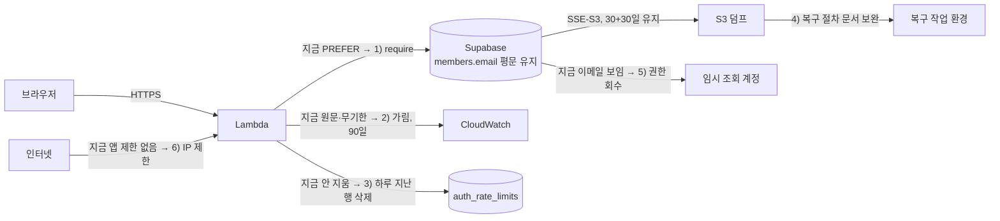
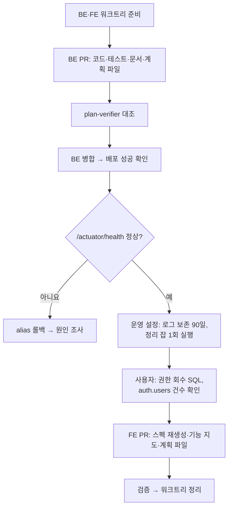

# 이메일 보호 정책 확정과 유출 지점 보완 (2026-11-05)

<!-- plan-result:start — 이 블록만 병합 뒤에도 고칠 수 있다(CLAUDE.md §11). 아래는 승인된 계획 원문 -->

## 구현 결과

> #547 · 2026-11-05 대조 · 이탈 0 · 미구현 0 — 판정 근거(파일:줄)는 PR 본문 "계획 대비 구현"

- 대조 범위: 이 PR은 프론트엔드 표만 담았다. 백엔드·운영 설정 결과는 BE 계획 파일의 같은 블록(BE #161)과 BE `docs/DATA-PROTECTION.md` §9에 있다
- 조건부 항목: `AUTH.md`, `SYSTEM-ARCHITECTURE.md`는 고치지 않았다. 중복 검사 한도와 TLS를 서술하는 곳이 없고, DB 언급(`Supabase pooler` 등)은 변경 뒤에도 맞다
- 문서 동기화: `ONBOARDING.md` 마지막 검토 날짜를 올리고 기능 지도 행만 추가했다고 밝힘

<!-- plan-result:end -->

> 이메일 컬럼은 암호화하지 않기로 정하고, 그 근거를 문서로 남긴다. 대신 이메일이 실제로 새는 지점(로그·레이트리밋·임시 조회·DB 연결·중복 검사 API)을 막는다.

## Context

사용자가 "이메일을 암호화해야 하나, 정책은 어떻게 해야 하나"를 물었다. 코드와 운영 설정을 조사한 결과는 다음과 같다.

- **저장:** 원문은 `members.email` 한 컬럼에 평문으로 있고, 공개 API로 타인의 이메일이 나가는 경로는 없다. 게시글·댓글 소유권은 회원 id로 판정한다.
- **법:** [안전성 확보조치 기준](https://www.law.go.kr/LSW/admRulInfoP.do?admRulSeq=2100000281400)(2026-07-01 시행) 제7조 제2항의 저장 암호화 대상 7종에 이메일은 없다. 제4항(인터넷망 구간 송수신)과 제5항(담당자 PC 저장)은 문언상 이메일에도 걸린다.
- **실측(직접 측정, 2026-11-05):**
  - 계정 14개(봇 제외 13개)
  - CloudWatch 로그 그룹 4개 모두 보존 무기한, `/aws/lambda/link-sphere-api`에 이메일 원문 8건(주소 5개, 7건은 테스트 도메인, 9-28~11-02). 필터 패턴으로 건수만 셌다.
  - `auth_rate_limits`에 이메일 해시 키 17행과 IP 키 9행(세 버킷 합계). 9-28 행이 남아 있어 "창이 지나면 사라진다"는 문서와 어긋난다.
  - Lambda DB URL에 `sslmode` 없음. pgjdbc 42.7.11의 `SslMode.of`(javap로 확인) 기본값은 `PREFER`다. 서버는 6543에서 TLS 1.3 핸드셰이크에 응한다.
  - S3 덤프는 SSE-S3로 암호화돼 있다(`head-object` 확인).
  - `link-sphere-user` 키 하나로 S3 덤프와 Lambda 환경변수를 모두 읽을 수 있다.

**사용자 결정(2026-11-05):** A안(컬럼 평문 유지 + 유출 지점 보완), 중복 검사 API IP 제한 포함. 개인정보처리방침은 처음에 포함으로 골랐다가 이번 범위에서 빼기로 했다.

## 판단이 필요했던 항목

| 항목               | 결정                                         | 근거·기각한 대안                                                                                                                                                                                                                                                                                                                                                              |
| ------------------ | -------------------------------------------- | ----------------------------------------------------------------------------------------------------------------------------------------------------------------------------------------------------------------------------------------------------------------------------------------------------------------------------------------------------------------------------- |
| 이메일 컬럼 암호화 | 하지 않음 (사용자 결정)                      | 제7조 제2항 대상이 아니고 제3조는 _"보유 수, 유형 및 정보주체에게 미치는 영향 등을 고려하여 스스로의 환경에 맞는"_ 조치를 요구한다. 컬럼 암호화(기각)는 Supabase 쪽 유출과 덤프만 유출된 경우를 막지만, 키를 잃으면 전 회원 로그인이 막히고 `link-sphere-user` 키 유출은 막지 못한다. **받아들이는 위험:** Supabase가 뚫리거나 덤프가 새면 이메일과 bcrypt 해시가 함께 나간다 |
| 로그 가림 위치     | 구조화 로그 값 처리기 한 곳                  | Spring Boot `StructuredLoggingJsonMembersCustomizer` + `applyingValueProcessor`(3.5.16 jar로 API 확인). 지점별 수정(기각)은 Hibernate `Detail: Key (lower(email))=...`와 예외 메시지를 못 잡는다                                                                                                                                                                              |
| TLS 강제 위치      | `LambdaHandler` 기동 인자                    | 코드 리뷰와 alias 롤백을 그대로 탄다. 테스트·로컬에는 적용되지 않는다. 콘솔에서 URL 수정(기각)은 비밀값을 다루고 버전 발행도 수동이다                                                                                                                                                                                                                                         |
| 레이트리밋 행 삭제 | 기존 `account-purge` 잡에서 1일 지난 행 삭제 | 가장 긴 창이 1시간이다(코드 전수 확인). 새 잡과 EventBridge 타겟(기각)은 `ACCOUNT-DELETION.md` §10-2의 "배보다 배꼽" 선례와 같다. 행은 최대 약 5일(1일 + 배치 주기 4일) 남는다                                                                                                                                                                                                |
| CloudWatch 보존    | 4개 그룹 모두 90일                           | 사고를 늦게 발견해도 볼 수 있는 기간으로 잡은 내 판단이다. **90일이 지난 로그는 되돌릴 수 없이 지워진다**(2026-03~08 로그 대부분). 기존 이메일 8건은 늦어도 2027-01-31에 사라진다. 고시 제8조의 1년 보관은 _"개인정보처리시스템에 접속한 자(다만, 정보주체는 제외한다)"_ 의 기록이라 앱 로그와는 별개로 읽었다                                                                |
| 임시 조회 계정     | `members.email` SELECT 회수                  | 고시 제12조 제1항 _"용도에 따라 출력 항목을 최소화"_, 조회 결과가 세션 기록에 남는다(`DEPLOY.md:804`). **체감:** 이메일로 회원을 찾으려면 Supabase 콘솔을 써야 한다                                                                                                                                                                                                           |
| 중복 검사 제한     | IP당 1시간 60회                              | 계측값이 아니라 내 판단이다. 링크 미리보기 한도(`PREVIEW_MEMBER_LIMIT = 60`)와 같은 값이고, FE는 500ms 디바운스(`useAvailabilityCheck.ts:29`)로 호출한다. 초과하면 FE는 조용히 확인 전 상태로 돌아가고 제출 때 BE가 409로 막는다(같은 파일 catch). **한계:** IP를 돌리면 우회된다                                                                                             |
| 개인정보처리방침   | 이번 범위에서 제외 (사용자 결정)             | 법 제30조 제1항은 개인정보처리자에게 처리방침을 _"정하여야 한다"_ 고 쓰고, 미이행은 제75조 제4항 제8호의 1천만원 이하 과태료 대상이다. 이 서비스가 제2조 제5호의 _"업무를 목적으로"_ 처리하는 자인지는 판단하지 못했다. "남은 것"에 기록한다                                                                                                                                  |

### 뒤집힌 전제

| 발견                                                                                                                     | 그래서 바뀐 것                         |
| ------------------------------------------------------------------------------------------------------------------------ | -------------------------------------- |
| "창이 지나면 사라지고"(`ACCOUNT-DELETION.md:147`)와 달리 9-28 행이 남아 있다                                             | 정리 배치 추가, 문서 정정              |
| "이 테이블 자체엔 PII가 남지 않는다"(`TableAuthRateLimit.kt:17`, SQL 주석)와 달리 솔트 없는 이메일 해시와 IP 원문이 있다 | 주석 정정, 정책 문서에 파생값으로 기록 |

### 위험 관리

| 위험                                                  | 대응                                                                                                                                                                                                                      |
| ----------------------------------------------------- | ------------------------------------------------------------------------------------------------------------------------------------------------------------------------------------------------------------------------- |
| `sslmode=require` 설정 문제로 전체 API의 DB 연결 실패 | 6543 TLS 응답은 확인했다. TLS 없는 로컬 Postgres로 인자가 실제 적용되는지 반증한다. 배포 직후 `/actuator/health`(DB `SELECT 1`, `DEPLOY.md:447`)를 확인하고, 실패하면 `LAMBDA-CONFIG-ROLLBACK.md` 절차로 alias를 되돌린다 |
| customizer 클래스 문제로 Lambda 기동 실패             | 같은 인자로 로컬 기동을 확인한다. 위와 같은 health 확인과 롤백을 쓴다                                                                                                                                                     |

## 세부 계획

### 백엔드 (`link-sphere_BE_NEW`, PR 1개)

경로는 `src/main/kotlin/com/example/linksphere/` 기준이다.

| 위치                                                                                     | 변경 내용                                                                                                                                                                                          |
| ---------------------------------------------------------------------------------------- | -------------------------------------------------------------------------------------------------------------------------------------------------------------------------------------------------- |
| `global/common/EmailMaskingLogCustomizer.kt` (신규)                                      | 구조화 로그의 모든 문자열 값에서 이메일 형태를 `<email>`로 치환                                                                                                                                    |
| `LambdaHandler.kt:93`                                                                    | 기동 인자 2개 추가: `--logging.structured.json.customizer=<위 클래스>`, `--spring.datasource.hikari.data-source-properties.sslmode=require`                                                        |
| `domain/auth/AuthRateLimitRepository.kt`                                                 | 기준 시각 이전 행을 지우는 쿼리 추가(기존 `idx_auth_rate_limits_window` 사용)                                                                                                                      |
| `global/common/RateLimitService.kt`                                                      | 1일 지난 행 삭제 함수 추가, 17-18행 "정리하지 않는다" 주석 정정                                                                                                                                    |
| `LambdaHandler.kt`의 `handleAccountPurgeJob`                                             | 퍼지 뒤 위 삭제 함수 호출                                                                                                                                                                          |
| `domain/auth/TableAuthRateLimit.kt:15-17`, `resources/sql/create_auth_rate_limits.sql:6` | PII 주석 정정                                                                                                                                                                                      |
| `domain/auth/AuthController.kt:38,44,312`                                                | `RateLimitService` 주입, `email-availability:ip:<ip>` 버킷 1시간 60회, `@Operation` 설명에 429 추가. 형태는 `PostController.kt:94-99`를 따른다                                                     |
| 테스트(신규·수정)                                                                        | `EmailMaskingLogCustomizerTest`(`message`·`stack_trace` 형태), `RateLimitServiceTest`(옛 행만 삭제, 경계 행 유지), `AuthControllerTest`(`:515` 근처에 429와 정상 경로, `RateLimitService` 목 추가) |
| `docs/DATA-PROTECTION.md` (신규)                                                         | 데이터별 저장·전송·보관 정책 표, 유출 경로별 위협 표, 법 근거와 원문 링크, 재검토 조건, 미확인 사항. 형식은 BE `CLAUDE.md` "서사형 작업 문서 형식"                                                 |
| `docs/ACCOUNT-DELETION.md`                                                               | `:147` 정정, 퍼지 뒤 남는 데이터(덤프 최대 약 60일, 로그 90일, 레이트리밋 최대 약 5일), 마지막 검토 날짜                                                                                           |
| `docs/DEPLOY.md`                                                                         | `:257` 부근 TLS 인자 설명, `:804`·`:820-821` 임시 조회 권한, `:986-987` 복구 시 덤프 처리(CloudShell 또는 컨테이너 안, 로컬에 받으면 끝나고 삭제), 로그 보존 기간                                  |
| `docs/TRAFFIC-MANAGEMENT.md`                                                             | 운영 파라미터 표에 새 한도 추가                                                                                                                                                                    |
| `README.md` `## 문서`, `CHANGELOG.md`                                                    | 새 문서 등록, 변경 항목 추가                                                                                                                                                                       |
| `docs/plans/2026-11-05-email-data-protection.md` (신규)                                  | 이 계획                                                                                                                                                                                            |

### 운영 설정 (BE 배포 뒤)

| 대상                     | 변경 내용                                                                                                                                        | 담당                                               |
| ------------------------ | ------------------------------------------------------------------------------------------------------------------------------------------------ | -------------------------------------------------- |
| CloudWatch 로그 그룹 4개 | `aws logs put-retention-policy --retention-in-days 90`                                                                                           | 나. 권한이 없으면 사용자에게 명령을 준다           |
| `account-purge` 잡       | 운영 함수를 1회 호출해 옛 행 삭제(유예가 끝난 계정 퍼지도 예정대로 함께 돈다)                                                                    | 나. 권한이 없으면 다음 정기 실행(최대 4일) 뒤 확인 |
| Supabase                 | `revoke select (email) on public.members from adhoc_readonly;`                                                                                   | 사용자(운영 DB 쓰기)                               |
| Supabase                 | `select count(*) from auth.users;` — 옛 Supabase Auth에 이메일이 남았는지 확인. 임시 조회 계정은 권한이 없다. 행이 있으면 정리를 별도로 제안한다 | 사용자                                             |

### 프론트엔드 (`link-sphere_FE_NEW`, PR 1개)

| 위치                                                    | 변경 내용                                                                     |
| ------------------------------------------------------- | ----------------------------------------------------------------------------- |
| `src/shared/api/generated/*`                            | BE 배포 뒤 `pnpm codegen:fetch && pnpm codegen`(설명 문구가 스펙에 들어 있다) |
| `docs/ONBOARDING.md` 기능 지도                          | `DATA-PROTECTION.md` 행 추가                                                  |
| `docs/AUTH.md`, `docs/SYSTEM-ARCHITECTURE.md`           | 중복 검사 한도나 DB 연결을 서술하는 곳이 있으면 갱신                          |
| `docs/plans/2026-11-05-email-data-protection.md` (신규) | 같은 계획(선례: `2026-11-02-resignup-email-policy.md`)                        |

FE 동작 코드는 바꾸지 않는다.

## 영향 범위

**CRUD (`auth_rate_limits`)**

- 등록: 새 버킷 1종. GET 요청마다 행이 올라가지만 `consume`이 처리하는 기존 방식과 같다.
- 수정: 현재 창만 올린다. 삭제는 1일 지난 창만 대상이라 동시 요청과 겹치지 않는다.
- 읽기: 영향 없음.
- 삭제: 신규. 실패하면 Lambda 오류로 드러나고, 재실행해도 퍼지·삭제 모두 같은 결과다.

**`members.email`:** 값과 조회 쿼리를 바꾸지 않는다. 데이터 계약도 그대로다.

**기존 기능 회귀**

- `LambdaHandler.kt:93`: 인자가 틀리면 기동이나 DB 연결이 전부 실패한다(위험 관리 참고).
- `MemberService.kt:61`: 유니크 위반 판별은 예외 메시지를 직접 읽어 로그 가림의 영향을 받지 않는다.
- `AuthControllerTest`: 컨트롤러 생성자가 바뀌어 목을 추가해야 한다.
- `useAvailabilityCheck.ts`: 429는 기존 catch로 처리한다. 직접 호출이라 전역 토스트도 뜨지 않는다.
- CloudWatch Logs Insights(`DEPLOY.md:1533` 등): 90일 이전 로그는 조회할 수 없다. 로컬 텍스트 로그는 가려지지 않는다.
- 임시 조회: `email`을 쓰는 쿼리가 실패한다. 문서의 절차 중 해당하는 것은 찾지 못했다.

**배포 순서:** BE 먼저. FE 스펙 재생성은 운영 스펙을 받아오므로 BE 배포 뒤에 한다. 그 사이 깨지는 것은 없다(설명 문구와 429 문서화뿐이고 드리프트 검사가 이슈로만 알린다).

## 검증 방법

| 대상            | 방법                                                                          | 기대 결과                              |
| --------------- | ----------------------------------------------------------------------------- | -------------------------------------- |
| BE 전체         | `./gradlew test integrationTest`, ktlint                                      | 통과                                   |
| 로그 가림       | 로컬에서 logstash + customizer 인자로 기동해 이메일이 든 로그와 예외를 남긴다 | `message`·`stack_trace` 모두 `<email>` |
| TLS 인자        | TLS 없는 로컬 Postgres에 인자를 주고 연결, 인자를 빼고 연결                   | 인자가 있으면 실패, 없으면 성공        |
| 운영 기동       | 배포 성공 SHA 확인 뒤 `/api/actuator/health`                                  | `UP`                                   |
| 중복 검사 한도  | 운영에 가짜 주소로 61회 호출(내 IP만 1시간 영향, WAF 한도 안)                 | 61번째 429                             |
| 로그 보존       | `describe-log-groups`                                                         | 4개 모두 `retentionInDays=90`          |
| 새 로그         | 배포 시각 이후 필터 패턴으로 건수만 집계(값 미출력)                           | 이메일 형태 0건                        |
| 레이트리밋 정리 | 잡 실행 뒤 `linksphere-ro`로 `window_start` 최솟값 조회                       | 1일 이내                               |
| 임시 조회 권한  | `has_column_privilege('members','email','SELECT')`                            | `false`                                |
| FE              | `pnpm type-check`, `pnpm test`, `pnpm check:docs`                             | 통과                                   |
| 계획 대조       | `plan-verifier`에 diff와 계획 파일 전달, PR 본문 `## 계획 대비 구현`          | 항목별 판정                            |

병합 뒤 며칠이 지나야 확인되는 항목이 남으면 GitHub 이슈로 열어 PR에 링크한다.

## 남은 것

- **개인정보처리방침:** 사용자 결정으로 제외했다. 페이지가 없는 상태는 그대로이고 `ACCOUNT-DELETION.md:342`와 `DATA-PROTECTION.md`에 기록한다. 재검토 조건: 법무 확인에서 적용 대상이라고 나올 때, 유료 결제·기업 고객이 생길 때.
- **이번에 확인하지 못한 법적 판단:** 이 서비스가 고시·법의 적용 대상인지, FileVault가 제7조 제5항을 충족하는지, 암호화가 유출 신고를 면제하는지. 개인정보위 [2026 작성지침](https://www.privacy.go.kr/front/bbs/bbsView.do?bbsNo=BBSMSTR_000000000049&bbscttNo=20885) PDF도 읽지 못했다(10MB 초과로 도구 실패).
- **`sslmode=verify-full`:** 인증서까지 검증하는 단계는 범위 밖이다. 다른 두 계정과 같은 `require`로 맞춘다.
- **FCM 토큰 평문 저장, 가입 여부 응답 자체:** 이번 범위 밖이고 현행을 유지한다.
- **컬럼 암호화 재검토 조건:** 제7조 제2항 대상 정보를 받게 될 때, 법무 검토에서 요구할 때, 유료 결제·기업 고객이 생길 때.
