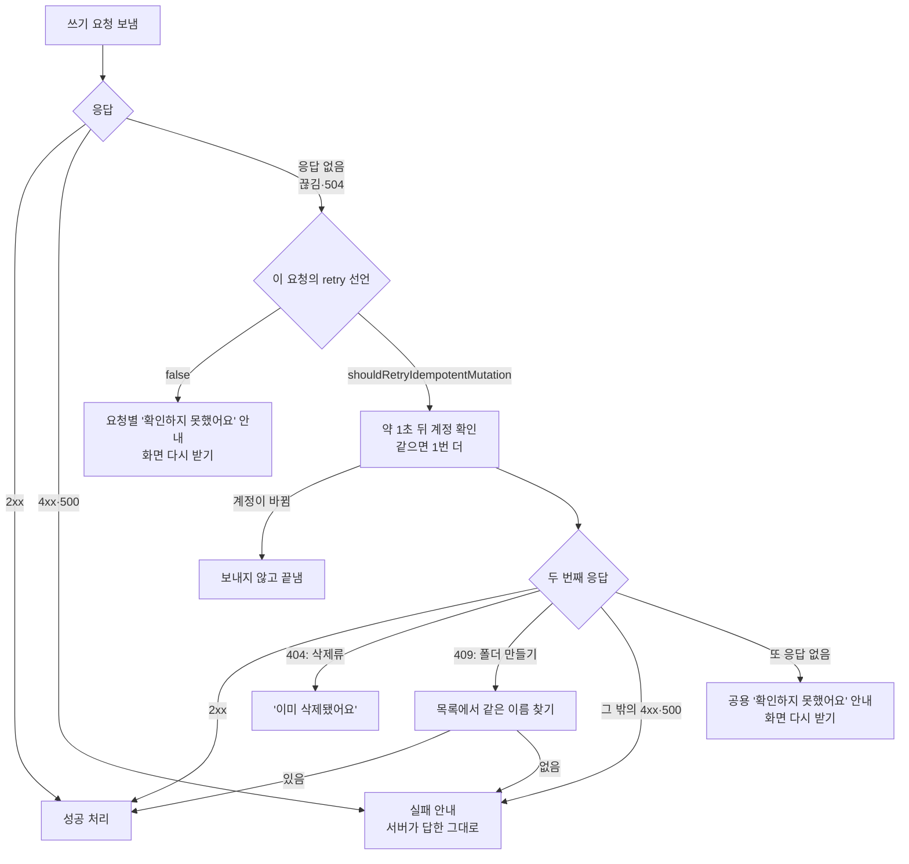
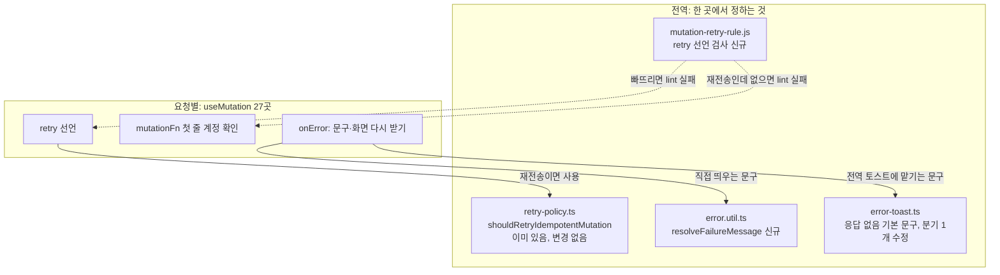
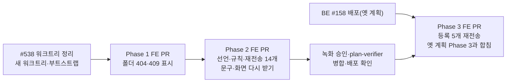

# 응답을 못 받은 쓰기 요청의 전역 처리

<!-- plan-result:start — 이 블록만 병합 뒤에도 고칠 수 있다(CLAUDE.md §11). 아래는 승인된 계획 원문 -->

## 구현 결과

> #541 · 2026-11-05 Phase 1 대조 · 이탈 1 · 미구현 0 — 판정 근거(파일:줄)는 PR 본문 "계획 대비 구현"

- 이탈(세 곳 공용): 409 중복 문구 판정을 폼 훅 3곳에 각각 넣지 않고 `BookmarkFolderUtil.resolveNameSaveErrorMessage` 하나로 모아 세 훅이 부른다. 판정 조건과 문구는 계획과 같다. Phase 2의 `resolveFailureMessage`도 이 유틸 안에서 쓴다
- 계획에 없던 변경: 문서 동기화(`docs/TESTING.md`, `texts-conventions` skill)
- 계획 뒤에 달라진 전제: 이 계획을 세운 뒤 #539가 병합돼 `GET /post/{id}`는 조회수를 올리지 않는다. 영향 범위의 "활성 상세 재조회가 조회수 +1"과 "별도 계획: 조회수 중복"은 더 이상 해당하지 않는다
- 계획 뒤에 달라진 문구: 이미 지워진 글·댓글·폴더의 안내를 사용자 제안으로 "이미 삭제된 폴더라 화면을 갱신했어요."(글·댓글도 같은 형태)로 바꿨다(#542). 계획의 "이미 삭제된 폴더예요."는 당시 문구이고 키 이름은 그대로다
- 아직 대조 전: Phase 2·3(별도 PR)

<!-- plan-result:end -->

> 쓰기 요청의 응답을 못 받으면(연결 끊김·504) 다시 보내도 안전한 요청은 약 1초 뒤 1번 더 보내 실제 결과대로 안내한다. 다시 보내면 안 되는 요청은 "확인하지 못했어요"라고 사실대로 안내한다. 끝내 모르면 화면을 서버 기준으로 다시 받는다. 요청마다 어느 쪽인지 선언하게 하고, 빠뜨리면 lint가 막는다.

## Context

**문제.** 브라우저가 응답을 못 받으면 서버가 처리했는지 알 수 없다. 지금은 글·댓글 삭제(#538)만 한 번 더 확인한다. 나머지 25개 쓰기 요청은 다음과 같다.

- 1번만 보내고 끝난다. `retry`를 지정하지 않아 기본값 0이다(query-core 5.90.16 `build/modern/mutation.js:83`).
- 저장됐을 수 있는데 "~하지 못했어요"라고 안내한다.
- 화면이 옛 값으로 남을 수 있다(계정 캐시 1일, 글 목록 3분). 그래서 사용자가 새로고침으로 확인해야 한다.

**"응답 없음"의 정의.** 이미 있는 `ErrorUtil.isOutcomeUnknown`(`NetworkError` 또는 504)을 그대로 쓴다. 서버가 답한 4xx·500은 실패로 본다.

**전체 흐름**



### 요청 27개의 결정

`useMutation` 전체(account 2, auth 7, folder 7, comment 4, interaction 3, post 4)를 BE 코드까지 추적해 정했다.

| 결정                                    | 요청                                                                                     | 근거(코드 추적)                                                                                                                                                                                                                                                                      |
| --------------------------------------- | ---------------------------------------------------------------------------------------- | ------------------------------------------------------------------------------------------------------------------------------------------------------------------------------------------------------------------------------------------------------------------------------------ |
| 이미 재전송(변경 없음)                  | 글 삭제, 댓글 삭제                                                                       | #538                                                                                                                                                                                                                                                                                 |
| 재전송(`retry`만 추가)                  | 글 좋아요, 글 북마크, 댓글 좋아요, 폴더 고정, 폴더에 담기, 폴더에서 빼기, 폴더 전부 빼기 | 같은 상태로 만드는 요청이다(`InteractionService.setPostLike`:33, `removeBookmarkFolder`:118-133, `setFolderPinned`:133). 세대 확인은 이미 있다                                                                                                                                       |
| 재전송(`context`·세대 확인도 추가)      | 폴더 이름 변경, 글 공개 전환, 글 수정, 댓글 수정, 프로필 수정                            | 같은 값을 다시 쓴다. 폴더 이름은 `newName != folder.name` 가드(`:104`), 닉네임은 자기 값 통과(`MemberService.kt:80`)                                                                                                                                                                 |
| 재전송 + 404 처리                       | 폴더 삭제                                                                                | `deleteFolder`:148-150이 404 `FOLDER_NOT_FOUND`                                                                                                                                                                                                                                      |
| 재전송 + 이름 대조                      | 폴더 만들기                                                                              | `existsByUserIdAndName`:65, 유니크 `uk_bookmark_folders_user_name`, 409 `DUPLICATE_FOLDER_NAME`                                                                                                                                                                                      |
| 지금은 `retry: false`, Phase 3에 재전송 | 글 등록, 댓글 등록, 답글 등록, 재설정 메일 요청, 인증 메일 요청                          | BE #158이 배포돼야 키로 중복을 막는다                                                                                                                                                                                                                                                |
| `retry: false` 유지                     | 로그인, 가입, 재설정 확정, 이메일 인증 확정, 비밀번호 변경, 탈퇴                         | 재전송이 실패로 보인다. 가입은 409, 토큰 확정 2개는 만료(`consumeIfActive`), 비밀번호 변경은 세션 폐기로 실패(`changePassword`:215), 탈퇴는 401(`requestDeletion`:56-72, 코드 구조상 판단이고 실행 확인은 안 함). 로그인은 응답을 못 받으면 이 탭이 로그인되지 않아 다시 누르면 된다 |

### 업계 자료

- [RFC 9110 §9.2.2](https://www.rfc-editor.org/rfc/rfc9110.html#section-9.2.2)는 멱등 메서드를 _"서버 응답을 읽기 전에 통신 장애가 나면 자동으로 반복할 수 있다"_ (번역)고 구분한다. 비멱등 요청은 멱등임을 알거나 적용되지 않았음을 감지할 수단이 없으면 자동 재시도하지 말라고 하고, _"실패한 자동 재시도를 다시 자동으로 재시도하지 말아야 한다"_ (번역)고 쓴다.
- [Stripe 문서](https://docs.stripe.com/error-low-level)는 _"연결이 복구돼도 원래 요청이 성공했는지는 알 수 없다"_ (번역)고 쓴다. [stripe-node](https://github.com/stripe/stripe-node)는 안전한 요청을 기본 1번 재시도한다.
- [AWS 멱등 API 글](https://aws.amazon.com/builders-library/making-retries-safe-with-idempotent-APIs/)은 재조회(reconciliation)를 큰 수고로 보고 _"그래도 불확실성이 남을 수 있다"_ (번역)고 쓴다. [AWS 재시도 글](https://aws.amazon.com/builders-library/timeouts-retries-and-backoff-with-jitter/)은 저비용 작업의 모범 사례로 _"스택의 한 지점에서 재시도하는 것"_ (번역)을 든다.
- [Azure Retry 패턴](https://learn.microsoft.com/en-us/azure/architecture/patterns/retry)은 대화형 웹 앱이라면 _"적은 횟수와 짧은 간격으로 재시도한 뒤 실패하고 사용자에게 알맞은 메시지를 보여 주는 편이 낫다"_ (번역)고 쓴다. [Azure 일시 장애 지침](https://learn.microsoft.com/en-us/azure/architecture/best-practices/transient-faults)은 정책을 한곳에 두라고 한다.
- [Google AIP-194](https://google.aip.dev/194)는 반복해도 의도치 않은 상태 변화가 없는 요청을 자동 재시도 대상으로 둔다. [ky](https://github.com/sindresorhus/ky)·[got](https://github.com/sindresorhus/got/blob/main/documentation/7-retry.md)·[axios-retry](https://github.com/softonic/axios-retry)도 POST를 기본 재시도에서 뺀다.
- [TanStack Query 문서](https://tanstack.com/query/latest/docs/framework/react/guides/optimistic-updates)는 낙관적 업데이트가 실패하면 대개 _"재조회로 실제 서버 상태로 되돌리면 된다"_ (번역)고 쓴다.

**자료의 한계.** 대부분 서버 간 API·SDK 자료이고 브라우저 화면 상황은 아니다. 사용성 연구와 Slack·Discord의 내부 동작은 찾지 못했다. 횟수·문구·화면 처리는 위 자료를 참고한 우리 판단이다.

### 만들 코드

**전역 코드는 판단 한 곳과 검사 한 곳뿐이고, 요청 27개는 각자 어느 쪽인지 선언한다.** `queryClient.ts`의 기본값 한 줄로 전부 켜지 않는 이유는 "판단이 필요했던 항목"의 "구조"에 있다.



**① 판단(이미 있음, 변경 없음)** `src/shared/lib/react-query/config/retry-policy.ts:31`

```ts
export const shouldRetryIdempotentMutation = (failureCount: number, error: unknown): boolean => {
  return failureCount < 1 && ErrorUtil.isOutcomeUnknown(error);
};
```

**② 문구 고르기(신규)** `src/shared/utils/error.util.ts`

```ts
/** 실패 문구를 고른다 - 응답을 못 받았으면 실패라고 단정하지 않는다 */
static resolveFailureMessage(
  error: unknown,
  failedMessage: string,
  unknownMessage: string = TEXTS.messages.error.outcomeUnknown
): string {
  return ErrorUtil.isOutcomeUnknown(error) ? unknownMessage : failedMessage;
}
```

**③ 전역 토스트의 안전망** `src/shared/lib/react-query/config/error-toast.ts:126`

```diff
-  if (meta?.outcomeUnknownMessage && ErrorUtil.isOutcomeUnknown(error)) {
-    return { silent: false, message: meta.outcomeUnknownMessage };
-  }
+  if (policy === MUTATION_ERROR_POLICY && ErrorUtil.isOutcomeUnknown(error)) {
+    return {
+      silent: false,
+      message: meta?.outcomeUnknownMessage ?? TEXTS.messages.error.outcomeUnknown,
+    };
+  }
```

**④ 선언 검사(신규)** `scripts/lib/mutation-retry-rule.js`, 형태는 `scope-mutation-auth-epoch-rule.js`

```js
const POLICY_NAME = 'shouldRetryIdempotentMutation';

export const mutationRetryRule = {
  meta: {
    type: 'problem',
    messages: {
      missingRetry: 'mutation은 retry를 선언해야 합니다 ...',
      invalidRetry: 'retry는 false 또는 shouldRetryIdempotentMutation만 쓸 수 있습니다 ...',
      notInlineFunction: '재전송 mutation의 mutationFn은 인라인 함수로 써 주세요 ...',
      missingCheck: '재전송 mutation은 mutationFn 첫 줄에서 계정을 확인해야 합니다 ...',
    },
  },
  create(context) {
    return {
      ObjectExpression(node) {
        const mutationFn = findProperty(node, 'mutationFn');

        if (!mutationFn) {
          return;
        }

        const retry = findProperty(node, 'retry');

        if (!retry) {
          context.report({ node: mutationFn, messageId: 'missingRetry' });
          return;
        }

        const isOff = retry.value.type === 'Literal' && retry.value.value === false;
        const isResend = retry.value.type === 'Identifier' && retry.value.name === POLICY_NAME;

        if (!isOff && !isResend) {
          context.report({ node: retry, messageId: 'invalidRetry' });
          return;
        }

        if (isOff) {
          return;
        }

        const fn = mutationFn.value;

        if (fn.type !== 'ArrowFunctionExpression' && fn.type !== 'FunctionExpression') {
          context.report({ node: mutationFn, messageId: 'notInlineFunction' });
          return;
        }

        if (!startsWithAuthEpochCheck(fn)) {
          context.report({ node: mutationFn, messageId: 'missingCheck' });
        }
      },
    };
  },
};
```

**⑤ 요청별: 좋아요(`retry` 한 줄만)** `interaction.queries.ts:87`

```diff
   return useMutation({
     mutationKey,
     scope: { id: mutationKey.join(':') },
+    retry: shouldRetryIdempotentMutation,
     mutationFn: (nextLiked: boolean, context) => {
       assertMutationAuthEpochUnchanged(context);
```

**⑥ 요청별: 글 수정(재전송 + 계정 확인 + 화면 다시 받기)** `post.queries.ts:443`

```diff
   return useMutation({
     mutationKey: postMutationKeys.update(postId),
-    mutationFn: async (payload: UpdatePost) => {
+    retry: shouldRetryIdempotentMutation,
+    mutationFn: async (payload: UpdatePost, context) => {
+      assertMutationAuthEpochUnchanged(context);
+
       return await postApi.updatePost(postId, payload);
     },
     onSuccess: (updated) => { /* 그대로 */ },
+    onError: (error) => {
+      if (ErrorUtil.isOutcomeUnknown(error)) {
+        handlePostUpdateSuccess(queryClient, postId);
+        handlePostContentUpdateSuccess(queryClient);
+      }
+    },
   });
```

**⑦ 요청별: 폴더 만들기(다시 보낸 요청의 409만 이름으로 대조)** `bookmark-folder.queries.ts:142`

`context`는 mutation 실행 한 번에 하나만 만들어 재시도마다 같은 객체를 넘긴다(`mutation.js:64-75`). 그래서 `WeakSet` 키로 쓸 수 있고, 선례는 `mutation-auth-epoch.ts`의 `authAtStart`다.

```diff
+const sentOnce = new WeakSet<MutationFunctionContext>();
+
 export const useCreateBookmarkFolderMutation = () => {
   const queryClient = useQueryClient();

   return useMutation({
     mutationKey: bookmarkFolderMutationKeys.create,
-    mutationFn: (payload: CreateBookmarkFolderRequest) =>
-      bookmarkFolderApi.createBookmarkFolder(payload),
+    retry: shouldRetryIdempotentMutation,
+    mutationFn: async (payload: CreateBookmarkFolderRequest, context) => {
+      assertMutationAuthEpochUnchanged(context);
+
+      const isResend = sentOnce.has(context);
+
+      sentOnce.add(context);
+
+      try {
+        return await bookmarkFolderApi.createBookmarkFolder(payload);
+      } catch (error) {
+        if (
+          isResend &&
+          error instanceof ApiError &&
+          error.code === SERVER_ERROR_CODE.DUPLICATE_FOLDER_NAME
+        ) {
+          const { folders } = await bookmarkFolderApi.fetchBookmarkFolderList();
+          const created = folders.find((folder) => folder.name === payload.name);
+
+          if (created) {
+            return created;
+          }
+        }
+
+        throw error;
+      }
+    },
     meta: { manualErrorHandling: true },
     onSuccess: () => {
       handleBookmarkFolderCreateSuccess(queryClient);
     },
+    onError: (error) => {
+      if (ErrorUtil.isOutcomeUnknown(error)) {
+        handleBookmarkFolderCreateSuccess(queryClient);
+      }
+    },
   });
```

**⑧ 요청별: 폴더 삭제(404는 실패가 아님, `useDeleteCommentMutation`과 같은 형태)** `bookmark-folder.queries.ts:190`. Phase 1은 404 처리와 토스트 이동, Phase 2는 `retry`·계정 확인·`onError`를 넣는다.

```diff
   return useMutation({
     mutationKey: bookmarkFolderMutationKeys.delete(folderId),
-    mutationFn: () => bookmarkFolderApi.deleteBookmarkFolder(folderId),
-    meta: { manualErrorHandling: true, successMessage: TEXTS.messages.success.folderDeleted },
-    onSuccess: () => {
+    retry: shouldRetryIdempotentMutation,
+    mutationFn: async (_: void, context) => {
+      assertMutationAuthEpochUnchanged(context);
+
+      try {
+        await bookmarkFolderApi.deleteBookmarkFolder(folderId);
+
+        return { alreadyDeleted: false };
+      } catch (error) {
+        if (error instanceof ApiError && error.code === SERVER_ERROR_CODE.FOLDER_NOT_FOUND) {
+          return { alreadyDeleted: true };
+        }
+
+        throw error;
+      }
+    },
+    meta: { manualErrorHandling: true },
+    onSuccess: ({ alreadyDeleted }) => {
+      if (alreadyDeleted) {
+        toast.info(TEXTS.messages.info.folderAlreadyDeleted);
+      } else {
+        toast.success(TEXTS.messages.success.folderDeleted);
+      }
+
       handleBookmarkFolderDeleteSuccess(queryClient);
     },
+    onError: (error) => {
+      if (ErrorUtil.isOutcomeUnknown(error)) {
+        handleBookmarkFolderDeleteSuccess(queryClient);
+      }
+    },
   });
```

**⑨ 요청별: 탈퇴(재전송 안 함, 문구만)** `account.queries.ts:146`

```diff
   return useMutation({
+    // 처리됐으면 세션이 폐기돼 다시 보낸 요청은 401이다 - 저장됐는데 실패로 보인다
+    retry: false,
     mutationFn: (payload: DeleteAccount) => accountApi.deleteAccount(payload),
     // ...
       } else {
-        toast.error(TEXTS.messages.error.accountDeleteFailed);
+        toast.error(
+          ErrorUtil.resolveFailureMessage(
+            error,
+            TEXTS.messages.error.accountDeleteFailed,
+            TEXTS.messages.error.accountDeleteOutcomeUnknown
+          )
+        );
       }
```

**⑩ 요청별: 글 등록(BE 배포 전까지 막아 둠)** `post.queries.ts:87`

```diff
   return useMutation({
+    // BE #158 배포 전에는 서버가 키를 무시해 다시 보내면 글이 2개 생긴다(Phase 3에서 재전송으로 바꾼다)
+    retry: false,
     mutationFn: async (payload: CreatePost) => {
```

**⑪ 폼 훅: 폴더 이름 변경(폴더 만들기 2곳도 같은 모양)** `useRenameBookmarkFolder.ts:64`. Phase 1은 중복 문구, Phase 2는 `resolveFailureMessage`를 넣는다.

```diff
       if (ErrorUtil.isSessionExpired(error)) {
         return;
       }

-      toast.error(TEXTS.messages.error.folderRenameFailed);
+      const isDuplicate =
+        error instanceof ApiError && error.code === SERVER_ERROR_CODE.DUPLICATE_FOLDER_NAME;
+
+      toast.error(
+        isDuplicate
+          ? TEXTS.messages.error.folderNameDuplicate
+          : ErrorUtil.resolveFailureMessage(error, TEXTS.messages.error.folderRenameFailed)
+      );
       setName(folder.name);
```

위 코드는 구현 모양을 보여 주는 안이다. 구현 때 타입 오류나 lint에 맞춰 세부가 달라지면 `구현 결과` 블록에 적는다.

## 판단이 필요했던 항목

| 항목                        | 결정                                                                    | 근거·기각한 대안                                                                                                                                                                                                                                                                     |
| --------------------------- | ----------------------------------------------------------------------- | ------------------------------------------------------------------------------------------------------------------------------------------------------------------------------------------------------------------------------------------------------------------------------------ |
| 구조                        | 요청별 선언 + 규칙 검사(사용자 결정, 11-05)                             | 정책은 `retry-policy.ts` 한곳에 두고 요청은 어느 쪽인지만 고른다. 기각: 전역 기본값으로 재시도 켜기 — 등록처럼 다시 보내면 안 되는 요청까지 중복된다. 문구만 고치기 — 사용자가 여전히 직접 확인해야 한다                                                                             |
| 폴더 만들기 끊김            | 1번 더 보내고 409면 이름으로 대조(사용자 결정, 11-05)                   | 회원별 이름이 유일해 BE 변경이 필요 없다. 기각: `Idempotency-Key` — 이름이 이미 자연 키라 BE 컬럼이 더 필요 없다. 대가는 "남은 것"의 드문 경우다                                                                                                                                     |
| 폴더 삭제 404·이름 중복 409 | 별도 PR(사용자 결정, 11-05 #538 때)                                     | Phase 1로 분리한다                                                                                                                                                                                                                                                                   |
| 규칙 검사 방법              | ESLint 커스텀 규칙 + RuleTester(Claude 제안)                            | `scope-mutation-auth-epoch-rule`과 같은 형태이고 pre-commit·CI에서 돈다. 기각: 문서 규칙만 — 이 레포에서 문서 규칙만 둔 것이 여러 번 어겨졌다. 런타임 기본값 — 빠뜨려도 조용히 통과한다                                                                                              |
| 선언 방식                   | `retry` 옵션을 그대로 명시(Claude 제안)                                 | TanStack 옵션 이름 그대로라 새 추상화가 없다. 기각: `retryable: true` 같은 래퍼 — 한 번 더 감쌀 이득이 없다                                                                                                                                                                          |
| 횟수·간격                   | 1번, 약 1초. 지터·재시도 예산 없음(#538 그대로, Claude 제안)            | RFC 9110의 재시도의 재시도 금지, stripe-node 기본 1회, Azure의 대화형 기준. 지터·예산은 서버 간 대량 호출 자료라 사용자 한 명이 누른 요청 1번에는 쓰지 않는다                                                                                                                        |
| 재전송 조건                 | 끊김·504만. 500·502·503 제외(Claude 제안)                               | 500은 트랜잭션 롤백이라 실패가 맞다(`PostService.kt:344`, `CommentService.kt:256`). Stripe는 500도 결과 불명으로 보지만 결제 내부 구조의 이야기이고 우리는 코드를 추적한 쪽을 따른다. 502·503은 Lambda 비정상 종료 실측이 거의 없어 이슈 #534의 접근 로그 확인 때 함께 세어 판단한다 |
| 재시도 층                   | mutation 한 층만 추가(Claude 제안)                                      | AWS의 "한 지점" 기준. 토큰 갱신 재요청(`client.ts:243,288,332`)은 401에서 돌고 재전송은 응답 없음에서 돌아 다른 실패다. 이론상 최대 4번 전송된다(코드 구조상 계산: 401·갱신 재요청이 전송마다 겹치는 경우)                                                                           |
| 화면 다시 받기              | mutation별 `.keys.ts` 핸들러(Claude 제안)                               | 기각: 전역 `invalidateQueries()` — 줄 서 있는 뒤 요청의 낙관적 화면이 깜빡이고, 활성 상세 재조회가 조회수를 올리고, 지워진 글 재조회가 404가 난다. `.keys.ts` 선례에서도 벗어난다                                                                                                    |
| 안내 문구                   | 재전송 요청은 공용 문구, 재전송 안 하는 요청은 요청별 문구(Claude 제안) | 재전송 뒤에도 모르면 할 말이 같다. 재전송 안 하는 요청은 다음 행동이 달라(메일함 확인, 새 비밀번호로 로그인) 공용 문구로 안 된다                                                                                                                                                     |
| 전역 기본값                 | `resolveErrorToast`의 mutation 정책에 응답 없음 기본 문구(Claude 제안)  | 지금 닿는 mutation은 없고 앞으로의 안전망이다. 쿼리는 영향 없다                                                                                                                                                                                                                      |
| 재전송의 부작용             | 감수(Claude 제안, 비용만 든다)                                          | 제목을 비운 글 수정은 재수집·AI가 1회 더 돈다(`PostService.kt:266,312`, 결과는 같다). 댓글·프로필 이미지 재업로드의 남는 파일은 GC가 지운다(`CommentService.kt:362-366`). Phase 3의 메일 재전송은 시간당 3회 한도를 1회 더 쓴다                                                      |
| 로그인                      | 재전송 안 함, 문구 유지(Claude 제안)                                    | 응답을 못 받으면 이 탭은 로그인되지 않고 다시 누르면 된다. 서버에 세션 행이 남아도 화면 영향이 없다                                                                                                                                                                                  |

### 사용자가 체감하는 변화

| 상황                                     | 지금              | 바뀐 뒤                                                                                                                |
| ---------------------------------------- | ----------------- | ---------------------------------------------------------------------------------------------------------------------- |
| 끊겼다가 재전송이 성공                   | 실패 안내         | 약 1초 늦게 성공 처리                                                                                                  |
| 재전송도 응답 없음                       | "~하지 못했어요"  | 약 1초 뒤 "처리됐는지 확인하지 못했어요" + 화면 다시 받기                                                              |
| 탭이 숨겨졌거나 브라우저가 오프라인을 앎 | 바로 실패 안내    | 복귀까지 재시도와 안내가 미뤄진다(`retryer.js:41,96`). 그동안 `scope`로 줄 선 다음 요청도 기다린다                     |
| 끝내 응답을 못 받는 동안                 | 옛 화면           | 여전히 확인할 수 없다. 무효화해 둔 쿼리는 복귀·재연결 때 다시 받는다(`queryObserver.js:64-68,448,458`, `query.js:120`) |
| 504 뒤 재전송                            | 60초 뒤 실패 안내 | 최악으로 60초 + 60초(실측 8개월간 60초 초과 실행 0건)                                                                  |

### 뒤집힌 전제

| 발견                                                                                                                                                                       | 그래서 바뀐 것                                                 |
| -------------------------------------------------------------------------------------------------------------------------------------------------------------------------- | -------------------------------------------------------------- |
| "폴더 만들기는 키가 필요하다"고 적었으나 회원별 이름이 유일해 대조할 수 있다                                                                                               | FE만 고친다                                                    |
| "서버 오류가 발생했어요"가 뜬다고 적었으나 응답을 못 받은 경우 지금 어떤 mutation도 그 문구에 닿지 않는다                                                                  | 고칠 곳은 요청별 "~하지 못했어요"이고 전역 기본값은 안전망이다 |
| #538 문서는 "등록·수정에는 쓰지 않는다"고 했으나 수정은 BE 추적 결과 다시 보내도 결과가 같다                                                                               | 수정도 재전송하고 `docs/POST.md`를 고친다                      |
| 비밀번호 변경·탈퇴는 상태를 정하는 요청처럼 보였으나 세션을 폐기해 재전송이 실패로 보인다                                                                                  | 재전송 안 함, 요청별 문구                                      |
| 프로필 재조회가 입력 중 폼을 덮을까 걱정했으나 폼은 `hydratedRef`로 1번만 채운다(`useUpdateAccount.ts:43-52`). 글 수정 폼도 `isDirty`면 덮지 않는다(`useUpdatePost.ts:81`) | 폼 쪽 추가 처리 없음                                           |

### 위험 관리

- **BE #158 배포 전에 등록 5개를 재전송하면 중복이 생긴다.** BE가 아직 키를 무시한다. Phase 2는 `retry: false`와 이유 주석으로 막고, Phase 3은 BE 배포 확인 뒤에만 시작한다.
- 재전송을 켠 요청에서 문제가 나면 그 요청의 `retry`를 `false`로 바꾸면 된다. 데이터 변경이 없어 되돌리기 쉽다.
- BE 변경이 없어 배포 순서 제약은 Phase 3뿐이다.

## 세부 계획



**시작 전.** `ExitWorktree(action: "remove")`로 `delete-already-gone`을 지우고(#538 병합·배포 확인됨), `git log origin/main..main`을 확인한 뒤 새 워크트리를 만들어 `.env` 복사·`pnpm install`을 한다.

### Phase 1 — FE PR: 폴더 삭제 404·이름 중복 409

| 위치                                                                                          | 변경 내용                                                                                                                               |
| --------------------------------------------------------------------------------------------- | --------------------------------------------------------------------------------------------------------------------------------------- |
| `src/shared/config/error-code.ts`                                                             | `DUPLICATE_FOLDER_NAME` 추가                                                                                                            |
| `src/shared/config/texts.ts`                                                                  | `folderAlreadyDeleted` "이미 삭제된 폴더예요.", `folderNameDuplicate` "이미 같은 이름의 폴더가 있어요."                                 |
| `src/entities/bookmark/folder/api/bookmark-folder.queries.ts:190`                             | `FOLDER_NOT_FOUND`면 `{ alreadyDeleted: true }`, 토스트는 `meta.successMessage`에서 `onSuccess`로 이동(`useDeleteCommentMutation` 형태) |
| `useCreateFolderForm.ts:46`, `useNewFolderInput.ts:63`, `useRenameBookmarkFolder.ts:64`       | 409면 `folderNameDuplicate`                                                                                                             |
| 테스트, `docs/BOOKMARK.md`, `CHANGELOG.md`, `docs/plans/2026-11-05-global-outcome-unknown.md` | 동작 고정·서술, 계획 스냅샷                                                                                                             |

### Phase 2 — FE PR: 전역 처리

**정책·규칙**

| 위치                                                 | 변경 내용                                                                                                                                                                                                                                                |
| ---------------------------------------------------- | -------------------------------------------------------------------------------------------------------------------------------------------------------------------------------------------------------------------------------------------------------- |
| `scripts/lib/mutation-retry-rule.js`(신규) + `.d.ts` | `custom-query-rules/mutation-retry-declared`: `mutationFn`을 가진 객체 리터럴은 ① `retry` 필수 ② 값은 `false` 또는 `shouldRetryIdempotentMutation`만 ③ 재전송이면 인라인 `mutationFn`의 첫 문장이 `assertMutationAuthEpochUnchanged(<두 번째 매개변수>)` |
| `eslint.config.js`                                   | 규칙 등록(`src/**`, 테스트·`src/test`·`src/mocks` 제외, `scope-mutation-auth-epoch` 선례 그대로)                                                                                                                                                         |
| `src/test/scripts/mutation-retry-rule.test.ts`(신규) | RuleTester + 실제 queries 파일 6개에서 `retry:` 줄을 지운 사본이 지운 수만큼 실패하는지 확인                                                                                                                                                             |
| `src/shared/lib/react-query/config/error-toast.ts`   | mutation 정책 + `isOutcomeUnknown`이면 `meta.outcomeUnknownMessage ?? TEXTS.messages.error.outcomeUnknown`(`meta.errorMessage`보다 먼저)                                                                                                                 |
| `src/shared/utils/error.util.ts`                     | `resolveFailureMessage(error, failedMessage, unknownMessage = TEXTS.messages.error.outcomeUnknown)`                                                                                                                                                      |

**요청별 선언**

| 위치                                                                                                                                     | 변경 내용                                                                                                        |
| ---------------------------------------------------------------------------------------------------------------------------------------- | ---------------------------------------------------------------------------------------------------------------- |
| `post.queries.ts`, `comment.queries.ts`, `interaction.queries.ts`, `bookmark-folder.queries.ts`, `account.queries.ts`, `auth.queries.ts` | Context의 27개 표대로 `retry` 선언. 재전송은 세대 확인 추가                                                      |
| `bookmark-folder.queries.ts:142`                                                                                                         | 폴더 만들기의 이름 대조(선언 모양 참고)                                                                          |
| `bookmark-folder.queries.ts:190`                                                                                                         | 폴더 삭제에 `retry`, `outcomeUnknownMessage`는 기존 `deleteOutcomeUnknown`(`useFolderActions.ts:83`도 같은 문구) |
| 등록 5개                                                                                                                                 | `retry: false` + "BE #158 배포 전에는 다시 보내면 중복이 생긴다" 주석                                            |

**문구**

| 위치                                                                                                                                                                                         | 변경 전                                                                                | 변경 후(응답 없을 때만)                                                                                                                       |
| -------------------------------------------------------------------------------------------------------------------------------------------------------------------------------------------- | -------------------------------------------------------------------------------------- | --------------------------------------------------------------------------------------------------------------------------------------------- |
| `useRenameBookmarkFolder.ts:64`, `useCreateFolderForm.ts:46`, `useNewFolderInput.ts:63`, `bookmark-folder.queries.ts:301`(고정), `usePostCardBookmarkFolderDialog.ts:76,131,169,171-175,201` | `folderRenameFailed`, `folderCreateFailed`, `folderPinFailed`, `bookmarkSaveFailed` 등 | 공용 `outcomeUnknown` "처리됐는지 확인하지 못했어요. 연결을 확인하고 다시 시도해주세요."                                                      |
| 가입 `auth.util.ts:133`, `useSignUp.ts:39-63,159`                                                                                                                                            | `accountCreateFailed`                                                                  | "가입됐는지 확인하지 못했어요. 메일함을 확인한 뒤 다시 시도해주세요."                                                                         |
| 비밀번호 변경 `auth.queries.ts:224`                                                                                                                                                          | `passwordChangeFailed`                                                                 | "비밀번호가 바뀌었는지 확인하지 못했어요. 로그인이 풀리면 새 비밀번호로 로그인해주세요."                                                      |
| 재설정 확정 `auth.queries.ts:183-186`                                                                                                                                                        | `passwordResetConfirmFailed`                                                           | "비밀번호가 바뀌었는지 확인하지 못했어요. 새 비밀번호로 로그인해 보세요."                                                                     |
| 탈퇴 `account.queries.ts:167`                                                                                                                                                                | `accountDeleteFailed`                                                                  | "탈퇴 신청이 처리됐는지 확인하지 못했어요. 로그인이 풀리면 신청된 거예요."                                                                    |
| 메일 요청 2개 `auth.queries.ts:159,251`                                                                                                                                                      | `passwordResetRequestFailed`, `emailVerificationRequestFailed`                         | "메일을 보냈는지 확인하지 못했어요. 메일함을 먼저 확인해주세요."                                                                              |
| 이메일 인증 `useConfirmEmailVerification.ts`, `VerifyEmailStatus.tsx`                                                                                                                        | "인증에 실패했어요" / "링크가 유효하지 않거나 이미 사용됐어요."                        | 새 상태 `unknown`: "인증됐는지 확인하지 못했어요" / "연결을 확인한 뒤 계정 설정에서 인증 상태를 확인해주세요." 아이콘·버튼은 오류 경로 재사용 |
| 떠난 뒤 토스트 제목 `useCreatePost.ts:190`, `useUpdatePost.ts:219`, `useCreateComment.ts:170`, `useUpdateComment.ts:165`, `useSignUp.ts:49,63`                                               | `leftPageFailure.*` "~하지 못했어요"                                                   | 새 `leftPageFailure.outcomeUnknownTitle` "처리됐는지 확인하지 못했어요"                                                                       |

좋아요·북마크 토글의 조용한 롤백, 로그인 문구, `CommentUtil.resolveSubmitError`의 수정 문구, `postSubmit.network`는 그대로 둔다.

**화면 다시 받기(`onError`의 `if (ErrorUtil.isOutcomeUnknown(error))`)**

| 요청                  | 호출                                                                                                                       |
| --------------------- | -------------------------------------------------------------------------------------------------------------------------- |
| 글 수정, 공개 전환    | `handlePostUpdateSuccess` + `handlePostContentUpdateSuccess`                                                               |
| 글 등록               | `handlePostCreateSuccess`(`post.keys.ts:65`)                                                                               |
| 폴더 만들기·이름·삭제 | `handleBookmarkFolderCreateSuccess`·`UpdateSuccess`·`DeleteSuccess`(`bookmark-folder.keys.ts:64,69,84`)                    |
| 댓글 수정             | `handleCommentUpdateSuccess`(`comment.keys.ts:75`)                                                                         |
| 프로필                | 새 `handleAccountUpdateOutcomeUnknown`(`account.keys.ts`) = `accountInvalidateQueries.root` + `handleAccountUpdateSuccess` |
| 이메일 인증 확정      | `handleEmailVerificationConfirmSuccess`(`auth.keys.ts:34`)                                                                 |

좋아요·북마크·고정·폴더 소속·글·댓글 삭제·댓글 등록은 이미 있어 그대로 둔다. 로그인 만료 경로는 건드리지 않는 기존 순서를 유지한다.

**문서**

| 위치                                                                                                                                                              | 변경 내용                                                                                           |
| ----------------------------------------------------------------------------------------------------------------------------------------------------------------- | --------------------------------------------------------------------------------------------------- |
| `docs/FE-ARCHITECTURE.md`                                                                                                                                         | §28 "응답을 못 받은 쓰기 요청" 패턴 신규(업계 자료 번역 인용 포함), §5·§12·§13의 재시도·`meta` 서술 |
| `.claude/CLAUDE.md` 패턴 표                                                                                                                                       | §28 행 추가                                                                                         |
| `docs/POST.md:589`, `docs/COMMENT.md:352-354`, `docs/BOOKMARK.md`, `docs/AUTH.md`, `docs/TESTING.md`, `.claude/skills/texts-conventions/SKILL.md`, `CHANGELOG.md` | 동작 서술                                                                                           |
| `src/shared/lib/react-query/config/retry-policy.ts:27-30`                                                                                                         | 주석은 Phase 3까지 유지                                                                             |

### Phase 3 — FE PR: 등록 재전송(BE #158 배포 뒤)

| 위치                                                                          | 변경 내용                                                                                                                                                                                                                                         |
| ----------------------------------------------------------------------------- | ------------------------------------------------------------------------------------------------------------------------------------------------------------------------------------------------------------------------------------------------- |
| `post.queries.ts:87`, `comment.queries.ts:194,251`, `auth.queries.ts:147,234` | `retry: shouldRetryIdempotentMutation` + 세대 확인, Phase 2 주석 제거                                                                                                                                                                             |
| `retry-policy.ts:27-30`                                                       | "키가 있는 등록은 다시 보내도 된다"로 주석 수정                                                                                                                                                                                                   |
| 옛 계획 Phase 3 항목                                                          | `pnpm codegen:fetch && pnpm codegen`, `spec-types.ts:4-5`, `comment.util.ts:52`, `post.util.ts:94-95`, `postSubmit.timeout`, FE-ARCHITECTURE §27, POST·COMMENT·AUTH 서술, VERSION-COMPATIBILITY, `2026-11-04-idempotent-create.md` 구현 결과 블록 |

## 영향 범위 (§5)

`pnpm graph:focus`로 확인했다. `error.util.ts`는 23곳이 쓰고, `error-toast.ts`는 `post.queries.ts`·`queryClient.ts` 2곳이 쓴다. 새 헬퍼·기본값은 응답 없음일 때만 값이 달라진다.

**CRUD 실패 지점**

| 동작               | 깨질 수 있는 것                                    | 대응                                                                                                                    |
| ------------------ | -------------------------------------------------- | ----------------------------------------------------------------------------------------------------------------------- |
| 등록(폴더)         | 첫 요청이 저장됐는데 재전송이 409로 보임           | 이름 대조. 대조 조회도 끊기면 "모름"으로 끝나 화면을 다시 받는다                                                        |
| 등록(폴더)         | 처음부터 난 진짜 409까지 대조함                    | `isResend`일 때만 대조. 재전송이 아니면 목록을 조회하지 않고 중복 문구                                                  |
| 등록(글·댓글·메일) | Phase 2에서 실수로 재전송                          | `retry: false` + 주석, Phase 3은 BE 배포 뒤                                                                             |
| 읽기               | 화면 다시 받기가 활성 상세를 재조회해 조회수 +1    | 끊겼을 때만 1회이고 성공 경로와 같은 호출이다. 조회수는 별도 계획(`hover-view-count-followup`)                          |
| 수정               | 재전송이 다른 탭·기기의 1초 사이 수정을 덮음       | BE에 `@Version`이 없어(0곳) 원래 마지막 쓰기가 이긴다. 새 위험은 아니다                                                 |
| 수정               | 입력 중인 폼이 재조회로 덮임                       | 글은 `isDirty`, 프로필은 `hydratedRef`로 막혀 있다                                                                      |
| 삭제               | 폴더 삭제 재전송의 404가 실패로 보임               | `alreadyDeleted`                                                                                                        |
| 삭제               | 지운 폴더의 재조회                                 | `handleBookmarkFolderDeleteSuccess`가 목록을 다시 받아 맞춘다                                                           |
| count·목록         | 끊긴 뒤 `uncategorizedCount`·`commentCount`가 틀림 | 위 핸들러가 함께 무효화한다                                                                                             |
| 동시 요청          | 재전송 중 `scope`의 뒤 요청이 먼저 나감            | `scope`가 줄 세워 약 1초 기다린다. pending은 `isLastPending*`로 유지된다                                                |
| 계정 전환          | 재전송이 그 순간의 계정으로 나감                   | 첫 줄 `assertMutationAuthEpochUnchanged(context)`, 규칙이 강제한다                                                      |
| 이미지             | 재전송마다 재업로드                                | 업로드 단계의 끊김은 `ImageUploadError('network')`라 재시도하지 않는다(`uploadImageAndGetUrl.ts:17-20`). 남는 파일은 GC |

**기존 기능 회귀**

| 대상                        | 소유 파일                                                                                                                                                                                                                          | 확인                                                                                  |
| --------------------------- | ---------------------------------------------------------------------------------------------------------------------------------------------------------------------------------------------------------------------------------- | ------------------------------------------------------------------------------------- |
| 재시도 판정                 | `retry-policy.ts`, `retry-policy.test.ts`                                                                                                                                                                                          | 공용 함수를 바꾸지 않는다                                                             |
| 전역 토스트                 | `error-toast.ts`, `queryClient.ts`                                                                                                                                                                                                 | 쿼리 정책 판정 불변 테스트, `meta.errorMessage`가 있는 mutation의 서버 응답 문구 불변 |
| 글·댓글 삭제                | `e2e/post-delete.spec.ts`, `e2e/comment-delete.spec.ts`                                                                                                                                                                            | 그대로 통과                                                                           |
| 낙관적 토글                 | `interaction.queries.ts`, `bookmark-folder.queries.ts`                                                                                                                                                                             | 재전송 중 롤백이 일찍 돌지 않음, `onError` 1번                                        |
| 글·댓글 등록 실패 복원      | `useCreatePost.ts`, `useCreateComment.ts`, `e2e/post-create.spec.ts`                                                                                                                                                               | `retry: false`라 흐름 그대로, 제목만 바뀜                                             |
| 실패 문구를 단정하는 테스트 | `post.queries.test.ts`, `comment.queries.test.ts`, `auth.queries.test.ts`, `account.queries.test.ts`, `useSignUp.test.tsx`, `useResendEmailVerification.test.tsx`, `useRequestPasswordReset.test.tsx`, `useUpdateAccount.test.tsx` | 끊김 경우의 단정만 새 문구로 갱신                                                     |
| e2e 공통 목                 | `e2e/mocks/catch-all.ts`                                                                                                                                                                                                           | 재전송으로 요청 수가 늘어도 통과                                                      |
| 문구 규칙                   | `texts.test.ts`                                                                                                                                                                                                                    | 새 문구 해요체                                                                        |
| 문서                        | 위 "문서" 표                                                                                                                                                                                                                       | `pnpm check:docs`                                                                     |

**배포 순서.** Phase 1·2는 FE만이고 API 계약 변경이 없다. Phase 3은 BE #158 배포 뒤다. 옛 탭은 지금과 같게 동작할 뿐 깨지지 않는다.

## 검증 방법

- **먼저 실패하는 테스트:** 재전송 동작 테스트를 구현 전에 쓰고 실패를 확인한 뒤 구현한다.
- **유형별 단위 테스트**
  - 재전송: 첫 끊김 + 둘째 성공이면 성공 처리 1번·요청 2번. 둘 다 끊김이면 요청 2번·공용 문구·화면 다시 받기. 500이면 요청 1번·기존 문구. 그사이 계정이 바뀌면 재전송 없음.
  - 폴더 만들기: 끊김 뒤 409 + 목록에 있음이면 성공 결과. 목록에 없으면 중복 문구. 처음부터 409면 목록 조회 없음. 대조 조회가 끊기면 공용 문구.
  - 폴더 삭제: 404는 실패가 아니고 "이미 삭제된 폴더예요." 1개.
  - 재전송 안 하는 요청: 끊김에도 요청 1번, 요청별 문구, 화면 다시 받기. 500이면 기존 문구.
  - `resolveErrorToast`: mutation 기본값 적용, 쿼리 불변, `outcomeUnknownMessage` 우선.
  - 프로필·글 수정: 재조회가 입력 중 폼을 덮지 않음.
- **규칙 테스트:** 위반·통과 사례 + 실제 파일 사본에서 지운 수만큼 실패(헛통과 방지).
- **e2e(`page.route`로 끊김, chromium + mobile-chrome):** 글 수정 끊김 뒤 재전송 성공, 폴더 만들기 대조, 프로필 끊김 안내와 화면 갱신, 재설정 메일 끊김 안내.
- **브라우저 녹화(`browser-verification`):** 폴더 삭제 404, 이름 중복, 폴더 만들기 대조, 글 수정 끊김, 이메일 인증 `unknown` 화면을 사용자가 보고 승인한 뒤 커밋한다.
- **명령:** `pnpm type-check`, `pnpm test`, `pnpm lint`, `pnpm check:deps`, `pnpm check:docs`, `pnpm test:e2e` 해당 스펙.
- **PR 전:** diff를 스크래치패드 파일로 떨궈 `plan-verifier`로 대조하고 `## 계획 대비 구현`과 `구현 결과` 블록을 붙인다. 주간 한도로 쓸 수 없으면 사실대로 알리고 처리를 묻는다.
- **병합 뒤:** 각 PR의 배포 run 성공을 확인하고 보고한다. 운영 끊김은 일부러 만들 수 없어 모킹한 브라우저로만 확인한다고 PR에 밝힌다. 운영 쓰기 테스트는 먼저 묻는다.

## 남은 것

- **토큰 갱신이 끊긴 경우:** 끊겨도 로그인은 유지된다(`client.ts:318`). BE 유예는 10초라(`MemberSessionService.kt:51`) 끊긴 뒤 10초가 지나 같은 쿠키로 갱신하면 재사용 탐지로 로그인이 풀릴 수 있다. 운영 로그(직접 측정, 11-05 Logs Insights, 남아 있는 로그 전체, 첫 줄 2026-10-12)는 유예 안 재사용 14건, 재사용 탐지 0건이라 이번에 고치지 않는다. 재사용 탐지 경고가 로그에 나오면 다시 판단한다.
- **mutation 밖의 다른 쓰기:** `POST /auth/logout`, `/fcm/token`, `/upload/signed-url`, S3 PUT은 규칙 대상이 아니다. 각자 호출하는 코드가 실패를 처리한다.
- **502·503:** 이슈 #534의 접근 로그 확인(11-18 무렵)에서 함께 세어 판단한다.
- **끝내 모르는 경우:** 응답을 계속 못 받는 동안은 누구도 확인할 수 없다([Two Generals](https://en.wikipedia.org/wiki/Two_Generals%27_Problem)). 복귀·재연결 때 화면을 맞추는 것까지만 한다.
- **폴더 이름 대조의 드문 경우:** 첫 요청이 못 갔는데 같은 이름 폴더가 원래 있었으면 기존 폴더를 만든 것처럼 쓴다. 데이터 손실은 없고, 사이드바 생성에는 성공 토스트가 없으며 선택 창은 그 폴더를 고른다.
- **탈퇴의 두 번째 응답:** 재전송하지 않으므로 영향은 없지만 401은 코드 구조상 판단이고 실행 확인은 안 했다.
- **별도 계획:** 조회수 중복(`hover-view-count-followup`).
- **옛 계획의 사용자 몫:** SQL 실행과 CloudFront 접근 로그 delivery는 그대로 남아 있고 Phase 3의 선행 조건이다.
