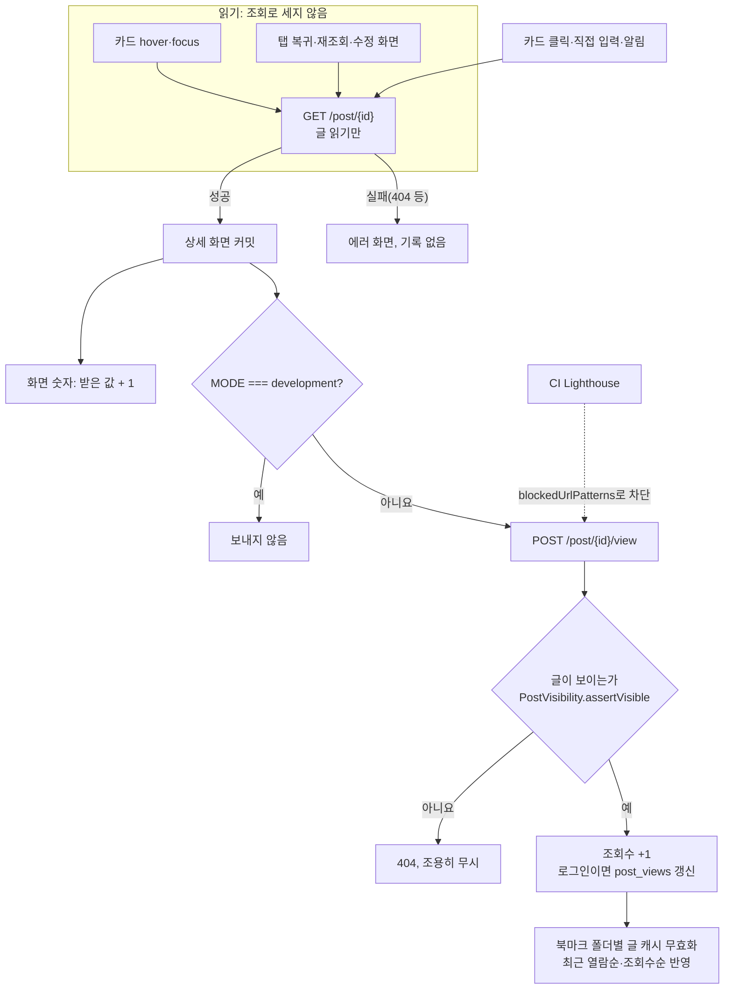
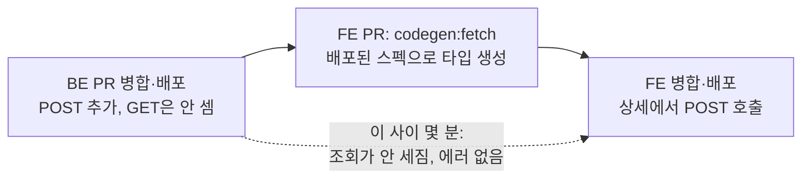

# 조회수와 열람 기록을 상세 진입 때만 남긴다

<!-- plan-result:start — 이 블록만 병합 뒤에도 고칠 수 있다(CLAUDE.md §11). 아래는 승인된 계획 원문 -->

## 구현 결과

> #539 · 2026-11-05 대조 · 이탈 1 · 미구현 0 — FE PR 범위, 판정 근거(파일:줄)는 PR 본문 "계획 대비 구현"

- 이탈(구현 중 판단): 타입 스냅샷을 BE 배포 뒤 운영 스펙에서 `pnpm codegen:fetch`로 받지 않고, BE 병합 전에 BE 워크트리의 `./gradlew openApiSpec` 결과로 만들었다. BE와 FE 배포 사이에 조회가 안 세지는 시간을 줄이려고 FE PR을 미리 준비했기 때문이다. 그래서 스냅샷 단계가 BE 배포를 강제하지 않아 BE 먼저 순서는 병합할 때 직접 지킨다. BE 배포 뒤 운영 스펙으로 다시 받아 차이가 없는지 확인한다.
- 대조 뒤 보완: e2e가 URL로 바로 들어가 조회 기록을 확인해 카드를 눌러 들어가는 경로가 빠져 있었다. 카드 클릭 테스트를 추가했다.
- 계획에 없던 변경(문서 동기화): `docs/VERSION-COMPATIBILITY.md` 머리말의 미릴리즈 목록에 BE #159를 넣고, `docs/POST.md`에 조회수 표시(+1) 항목을 추가하고 열람 기록 반영 항목을 고쳤다. 이번 변경으로 밀렸거나 이미 어긋나 있던 `docs/POST.md`·`docs/POST-DETAIL-BACK-NAVIGATION.md`의 줄 번호 참조도 바로잡았다.

<!-- plan-result:end -->

> `GET /post/{id}`는 글을 읽기만 하고, 상세 화면이 뜰 때 FE가 `POST /post/{id}/view`로 조회를 기록한다. hover·탭 복귀·재조회·수정 화면·CI Lighthouse는 더 이상 조회로 세지 않고, 상세의 숫자는 지금과 똑같이 보인다.

## Context

`GET /post/{id}`가 글을 돌려주면서 조회수를 올리고, 로그인 상태면 `post_views`를 갱신한다(BE `PostService.kt:198-199`). 그래서 요청이 나가는 모든 경로가 곧 조회수가 오르는 경로다.

코드로 추적한 경로(react-query·query-core 5.90.16 설치본 확인):

| 경로                                         | 진짜 조회인가 | 근거                                                                                           |
| -------------------------------------------- | ------------- | ---------------------------------------------------------------------------------------------- |
| 카드 hover·focus(대기 없음)                  | 아니요        | `usePostCard.ts:154-182`                                                                       |
| 내 댓글 카드 hover                           | 아니요        | `useMyCommentCard.ts:14`                                                                       |
| 상세 진입                                    | **예**        | `usePostDetail.ts`                                                                             |
| 3분 지난 뒤 탭 복귀                          | 아니요        | `queryClient.ts:93-97`, query-core `query.js:125-128`                                          |
| 상세에서 댓글 등록·삭제, 폴더 변경 뒤 재조회 | 아니요        | `comment.keys.ts:49`·`:66`, `bookmark-folder.keys.ts:123`, query-core `queryClient.js:149-163` |
| 글 수정 화면 진입                            | 아니요        | `useUpdatePost.ts:52`                                                                          |
| CI Lighthouse                                | 아니요        | `lighthouserc.cjs:41`, `ci.yml:284`                                                            |
| `pnpm dev`(운영 API로 프록시)                | 아니요        | `vite.config.ts:190-196`                                                                       |

반대로 3분 안에 다시 들어오면 캐시로 그려져 요청이 없다. 조회수도 `viewed_at`도 안 바뀌어 "최근 열람순"이 틀릴 수 있다.

운영 수치(직접 조회, 2026-11-05, `linksphere-ro`):

- 글 353개, 조회수 합 6,402, 중앙값 7.
- 1위 `06ec0958`은 1,829회(전체의 28.6%). Lighthouse 측정용 고정 글(#196, 2026-09-26)이고 로그인 열람자 2명, 북마크 0개다. 그 뒤 CI 실행이 513회이고 실행마다 5번 열어 상한 2,565회라 규모가 맞다. CI가 원인이라는 건 추정이다.
- `post_views` 간격 317건 중 1초 미만 85건(27%). hover 흔적으로 추정한다.

사용자가 체감하는 문제: 상세 조회수 부풀림, 북마크 "조회수순" 왜곡, "최근 열람순"이 hover만으로 바뀌거나 재진입에 안 바뀜.

## 판단이 필요했던 항목

| 항목             | 결정                                                       | 근거·기각한 대안                                                                                                                                                                                                                                                                                                                                           |
| ---------------- | ---------------------------------------------------------- | ---------------------------------------------------------------------------------------------------------------------------------------------------------------------------------------------------------------------------------------------------------------------------------------------------------------------------------------------------------- |
| 접근             | 조회 기록 API 분리. 2026-11-05 사용자 결정                 | 상세 진입 외 경로가 모두 사라지는 유일한 안이다. hover 요청에 헤더 표시: 캐시로 클릭하면 GET이 없어 진입 때 또 보내야 하고 재조회는 남는다. hover 요청 제거: 옛 데이터가 먼저 그려지고 삭제 글 안내를 다시 설계해야 하며 재조회는 남는다. hover 100ms 대기: 머문 hover와 재조회가 남는다. BE 중복 제거: 안 본 글도 첫 hover는 센다.                        |
| 조회 1회의 정의  | 상세 진입마다 +1. 2026-11-05 사용자 결정                   | 숫자 뜻이 "열린 횟수" 하나로 단순하다. 로그인 사용자의 짧은 재진입 제외: [Discourse 통계 안내](https://meta.discourse.org/t/understanding-stats-for-topic-views-posts-read-and-reading-time/254542)는 토픽 조회를 사용자당 1회 추적한다고 쓴다(요약). 다만 이 레포는 비로그인을 못 걸러 규칙이 둘로 나뉜다. 필요해지면 FE 변경 없이 BE만으로 넣을 수 있다. |
| 상세의 숫자 표시 | 받은 값 + 1을 화면에 표시. 2026-11-05 사용자 결정          | 지금과 똑같이 보이고 움직임이 없다. 이번 화면은 그대로: 첫 방문자가 0을 본다. 응답 뒤 갱신: 진입마다 숫자가 바뀐다. POST가 실패하면 그 화면만 1 많게 보이고 다음 조회에 맞는다.                                                                                                                                                                            |
| 응답 본문        | `ApiResponse<Unit>`(숫자 없음)                             | 위 표시 결정으로 FE가 숫자를 쓰지 않는다. `PostController.kt:146`의 `Unit` 응답과 같은 형태다.                                                                                                                                                                                                                                                             |
| 호출 위치        | 상세 화면의 effect(`usePostDetail.ts`)                     | [React "Sending analytics"](https://react.dev/learn/synchronizing-with-effects#sending-analytics)는 effect에서 POST로 방문을 기록하는 코드를 _"그대로 두길 권한다"_ (번역)고 쓰고, 개발 중 두 번 호출돼도 막지 말라고 하며 _"운영에서는 중복 방문 기록이 없다"_ (번역)고 쓴다. 클릭 핸들러: 직접 입력·새로고침·알림 진입을 놓친다.                         |
| 개발 서버        | `MODE === 'development'`이면 보내지 않음                   | 같은 React 문서가 개발 머신 기록이 운영 지표를 왜곡하지 않게 개발 때는 아무것도 하지 말라고 쓴다(요약). 이 레포 개발 서버는 운영 API를 본다. `import.meta.env.DEV`: Vitest·e2e(`--mode test`)도 참이라 테스트에서 POST가 안 나간다.                                                                                                                        |
| 구현 형태        | `useMutation`이 아니라 `prefetchPostDetail` 옆의 일반 함수 | `AuthUtil.applySessionExpired`(`auth.util.ts:143-144`)가 `queryClient.isMutating() > 0`이면 "저장 중"으로 보고 로그인 창을 연다. 기록 요청이 mutation이면 글만 보던 사용자가 만료 때 토스트 대신 막는 창을 받는다. predicate로 제외: 이 판단을 auth 쪽에서 계속 기억해야 한다.                                                                             |
| 실패 처리        | 조용히 무시                                                | 조회 기록 실패를 알려도 사용자가 할 일이 없다. 재시도하지 않는다.                                                                                                                                                                                                                                                                                          |
| 멱등 키          | 쓰지 않음                                                  | `IdempotencyKeyUtil`은 행·메일이 둘이 되는 등록용이다. 재전송으로 1 더 세져도 해가 작다.                                                                                                                                                                                                                                                                   |
| CI Lighthouse    | `blockedUrlPatterns`에 기록 경로 추가                      | 차단된 요청의 콘솔 에러는 Best Practices에서 제외된다(`lighthouserc.cjs`의 RUM 선례, lighthouse 12.6.1 확인).                                                                                                                                                                                                                                              |
| 배포 순서        | BE → FE 2단계                                              | 아래 "위험 관리".                                                                                                                                                                                                                                                                                                                                          |
| 기존 값          | 고치지 않음                                                | 과거 부풀림은 개별 조회 로그가 없어 분리할 수 없다. `06ec0958`은 북마크가 0개라 정렬에 영향이 없고 그 글 상세의 숫자만 크다.                                                                                                                                                                                                                               |

### 뒤집힌 전제

| 발견                                                                                                                      | 그래서 바뀐 것                                                       |
| ------------------------------------------------------------------------------------------------------------------------- | -------------------------------------------------------------------- |
| hover만의 문제로 시작했는데 경로가 여덟 곳이었다                                                                          | hover가 아니라 API를 나눈다                                          |
| "3분 안 재진입은 안 센다"는 규칙이 아니라 캐시 부수효과였다                                                               | 진입마다 센다고 명시한다                                             |
| 조회수 1위는 인기 글이 아니라 Lighthouse 측정 글이었다                                                                    | CI 호출을 차단한다                                                   |
| 초안은 `useMutation`이었는데 세션 만료 판단이 `isMutating()`을 본다                                                       | 일반 함수로 바꾼다                                                   |
| [RFC 9110 §9.2.1](https://www.rfc-editor.org/rfc/rfc9110.html#section-9.2.1)은 GET의 서버 부수효과 자체를 금지하지 않는다 | "규격 위반"을 근거로 쓰지 않는다. 이유는 미리 받기와 충돌하는 것이다 |

### 다른 제품의 사례

- David Taylor는 [Discourse Meta 스레드](https://meta.discourse.org/t/topic-views-doesnt-update-on-rest-api-requests/343474)에서 토픽 조회가 브라우저 페이지뷰 기준으로 옮겨져 API·크롤러 요청을 포함하지 않는다고 썼다(요약, 번역).
- Forem [`PageViewsController`](https://raw.githubusercontent.com/forem/forem/main/app/controllers/page_views_controller.rb)는 글 조회와 별도 액션으로 조회를 기록한다. 클라이언트 호출부는 못 읽었다.

### 위험 관리

- **BE가 먼저인 이유**: FE를 먼저 올리면 없는 경로에 보내 `anyRequest().authenticated()`의 401을 받는다. 타입 생성도 배포된 스펙을 읽는다.
- **3단계로 나누지 않는 이유**: POST 추가 → FE → GET 중단은 그 사이에 조회를 두 번 센다. 잠깐 덜 세는 쪽을 고른다.
- **열려 있던 옛 탭**: 새로고침 전까지 기록하지 않는다.
- **되돌릴 때**: FE를 먼저 되돌려 POST를 멈춘 뒤 BE를 되돌린다.
- **조용한 실패**: POST가 실패해도 화면에 안 보인다. 운영 확인에서 200과 값 증가를 직접 본다(OAC 403은 2026-11-02 DELETE+본문 사례가 있었다).

## 세부 계획

작업 준비: `git log origin/main..main`이 비어 있음을 확인했다. BE는 `ExitWorktree(keep)` 뒤 `git -C <BE> worktree add`로 새 워크트리를 만든다(FE 워크트리 재진입 뒤 수동 정리). 계획 파일은 양쪽 PR에 `docs/plans/2026-11-05-post-view-record.md`로 커밋한다.

### 백엔드(PR 1, 먼저 병합)

경로 접두 `src/main/kotlin/com/example/linksphere/`.

| 위치                                                       | 변경 내용                                                                                                                                                                                                                                    |
| ---------------------------------------------------------- | -------------------------------------------------------------------------------------------------------------------------------------------------------------------------------------------------------------------------------------------- |
| `domain/post/PostService.kt:192-205`                       | `getPostById`: 메서드의 `@Transactional`을 빼 클래스의 `readOnly`를 따르고, 증가·upsert·재조회를 지운다. `recordView(id, currentUserId)` 추가: `findById` → `PostVisibility.assertVisible` → `incrementViewCount` → 로그인이면 `upsertView`. |
| `domain/post/PostController.kt`                            | `POST /post/{id}/view` 추가. `ApiResponse<Unit>`, `@SecurityRequirements`, `@Operation`. `@PreAuthorize` 없음(데모 계정 허용). `getPostById` 설명에 조회수를 올리지 않음을 적는다.                                                           |
| `global/config/SecurityConfig.kt:68-75`                    | `HttpMethod.POST, "/post/*/view"`에 GET 공개 조회와 같은 `access` 규칙 추가.                                                                                                                                                                 |
| `domain/post/PostRepository.kt:37`                         | 고아가 되는 `findViewCountById` 제거.                                                                                                                                                                                                        |
| `src/test/.../post/PostServiceTest.kt:112-207`             | `getPostById`가 증가·upsert를 안 함, `recordView` 증가·upsert, 비로그인은 upsert 없음, 남의 비공개 글은 404이고 증가 없음.                                                                                                                   |
| `src/test/.../post/PostRepositoryIntegrationTest.kt:70-74` | `findViewCountById` 대신 엔티티를 다시 읽어 증가를 단정.                                                                                                                                                                                     |
| `src/test/.../post/PostSecurityTest.kt`                    | `POST /post/{id}/view`: 토큰 없음 200, 만료 토큰 401 `TOKEN_EXPIRED`, 유효 토큰 200.                                                                                                                                                         |
| `docs/BE-ARCHITECTURE.md:537`, `CHANGELOG.md`              | 조회 기록 경로·`getPostById` 동작 갱신, `[Unreleased]` 항목.                                                                                                                                                                                 |
| `docs/plans/2026-11-05-post-view-record.md`(신규)          | 이 계획 스냅샷, 대조 뒤 구현 결과 블록.                                                                                                                                                                                                      |

### 프론트엔드(PR 2, BE 배포 뒤)

| 위치                                                                                                                   | 변경 내용                                                                                                                                                                                            |
| ---------------------------------------------------------------------------------------------------------------------- | ---------------------------------------------------------------------------------------------------------------------------------------------------------------------------------------------------- |
| `openapi.json`, `openapi.gen.ts`, `openapi.zod.ts`                                                                     | `pnpm codegen:fetch && pnpm codegen`.                                                                                                                                                                |
| `src/entities/post/api/post.api.ts`                                                                                    | `recordPostView(postId)`: `specClient.post('/post/{id}/view', { path: { id: postId } })`.                                                                                                            |
| `src/entities/bookmark/folder/api/bookmark-folder.keys.ts`, `@x/post.ts`                                               | `handlePostViewRecordedSuccess(queryClient)`: `postsRoot` 무효화. `@x/post.ts`로 공개.                                                                                                               |
| `src/entities/post/api/post.queries.ts:255` 옆                                                                         | `recordPostView(queryClient, postId)`: API 호출 → 성공 핸들러, 실패는 무시.                                                                                                                          |
| `src/pages/post/hooks/usePostDetail.ts`                                                                                | `invalidateViewedSortOnPostView` effect를 `recordPostViewOnEntry`로 교체(`[post.id, queryClient]`, 개발 서버 가드, React 문서 링크 주석). 고아가 되는 `bookmarkFolderInvalidateQueries` import 제거. |
| `src/widgets/post/post-card/ui/PostCard.tsx:399`                                                                       | `isDetail` 블록의 표시값을 `(post.stats.viewCount \|\| 0) + 1`로, 이유 주석.                                                                                                                         |
| `lighthouserc.cjs` `blockedUrlPatterns`                                                                                | `*://linksphere.click/api/post/*/view` 추가, 이유 주석.                                                                                                                                              |
| `src/mocks/handlers/post.handlers.ts`, `e2e/mocks/post.mock.ts`                                                        | 스펙 타입 MSW 핸들러, e2e 목 `mockRecordPostView`.                                                                                                                                                   |
| `src/entities/post/api/post.queries.test.ts`                                                                           | 성공 때 `postsRoot` 무효화, 실패 때 토스트 없이 조용히 끝남, 진행 중 `queryClient.isMutating()`이 0.                                                                                                 |
| `e2e/post-view-record.spec.ts`(신규)                                                                                   | hover만 하면 POST 0회. 클릭하면 POST 1회 이상(StrictMode 개발 서버라 2회일 수 있음). 표시 숫자가 목 값 + 1. POST 500이어도 토스트 없이 화면 유지. 수정 화면 진입에 POST 0회.                         |
| `docs/POST.md:308`, `docs/BOOKMARK.md:117`, `docs/VERSION-COMPATIBILITY.md`, `docs/TESTING.md`(e2e 표), `CHANGELOG.md` | "조회 1회"의 정의와 기록 경로, 호환 행, 새 스펙, `[Unreleased]`. 각 문서의 `마지막 검토` 갱신.                                                                                                       |
| `docs/plans/2026-11-05-post-view-record.md`(신규)                                                                      | 이 계획 스냅샷, 대조 뒤 구현 결과 블록.                                                                                                                                                              |

## 영향 범위

**CRUD 실패 지점(`posts.view_count`, `post_views`)**

- **등록**: 첫 방문의 `post_views` 행은 POST 성공 때 생긴다. 실패하면 그 방문만 빠진다. upsert라 중복 행은 없다.
- **읽기**: GET은 쓰지 않고 `readOnly`가 된다. `stats.viewCount`를 다시 읽던 조회가 없어져 응답 값은 엔티티 그대로다. 상세 표시는 + 1이고 목록 카드는 숫자를 안 그린다.
- **수정**: `incrementViewCount`는 원자적 UPDATE라 동시 요청에 안전하다. `viewed_at`은 진입마다 갱신돼 지금보다 정확해진다.
- **삭제**: 지워진 글은 GET이 먼저 404라 POST가 안 나간다. 화면을 보는 사이 지워지면 404를 조용히 무시한다. cascade는 그대로다.
- **가시성**: `assertVisible`을 재사용해 남의 비공개 글은 404다. 이전 GET과 같은 기준이다.
- **동시 요청**: 오래된 캐시로 진입하면 재조회 GET과 POST가 같이 나간다. GET이 증가 뒤 값을 읽으면 그 화면이 1 많게 보이고 다음 조회에 맞는다.

**기존 기능 회귀(`pnpm graph:focus --text`로 확인)**

- `usePostDetail.ts`는 `PostDetailPage.tsx`만 쓴다.
- `post.queries.ts`는 9개 파일과 라우트가 쓴다. 함수 추가뿐이고 기존 export는 그대로다.
- `PostCard.tsx`는 피드·북마크·상세가 쓴다. 바꾸는 줄은 `isDetail` 안이다. `e2e/post-card-footer-layout.spec.ts`·`bookmark-card-footer-layout.spec.ts`의 `viewCount: 99999`가 +1로 자릿수가 바뀌는지 e2e로 확인한다.
- 세션 만료 안내(`auth.util.ts:143-144`): mutation을 안 써 판단이 그대로다. 위 단위 테스트가 지킨다.
- 북마크 "최근 열람순": 무효화 시점이 렌더 뒤에서 POST 성공 뒤로 옮겨진다. 응답 전에 목록으로 돌아가도 응답 뒤 무효화가 돈다(모듈 함수라 언마운트와 무관).
- 상세 안에서 로그인(창): 같은 `post.id`면 effect가 안 돈다. 화면이 다시 마운트되는 경로가 있으면 1 더 센다. 허용한다.
- e2e: 목이 없는 POST는 `catch-all.ts`가 abort하고 실패가 조용해 기존 스펙은 그대로일 것으로 본다. 전체 실행으로 확인한다.
- `docs/AI-ASYNC-PROCESSING.md:113`(`GET` 재호출로 AI 상태 확인): 영향 없고, 이제 재호출이 조회로 안 세진다.
- 상세 진입당 Lambda 호출이 1회 는다. WAF `RateLimit-PerIP`에 쓰는 요청도 1회 는다.

**데이터 계약**: `POST /post/{id}/view` 추가, `GET /post/{id}`의 부수효과 제거. 응답 형태는 그대로다. 배포 순서는 "위험 관리".

## 검증 방법

1. BE: `./gradlew test`. 회귀 확인으로 `getPostById`에 증가를 되살리면 `PostServiceTest`가, `SecurityConfig` 규칙을 빼면 `PostSecurityTest`가 실패해야 한다.
2. FE: `pnpm type-check`, `pnpm test`, `pnpm lint`, `pnpm check:deps`, `pnpm check:docs`, `pnpm test:e2e` 전체. 기록 함수를 `useMutation`으로 바꾸면 `isMutating` 테스트가 실패해야 한다.
3. BE 배포 성공 확인 뒤 운영: 상세 GET 전후 `view_count`가 같은지 `linksphere-ro`로 본다.
4. FE PR의 CI lighthouse 잡 전후로 `06ec0958`의 `view_count`가 같아야 한다(차단이 실제로 듣는지).
5. FE 배포 성공 확인 뒤 운영, 요소를 지정해 누르고 403이 나오면 멈춘다.
   - 비로그인: hover만 하면 POST 0회, `view_count` 그대로. 클릭하면 POST 1회가 200이고 +1, 화면 숫자는 이전 값 + 1.
   - 데모 계정: 상세 진입 뒤 `post_views.viewed_at`이 갱신되고, 3분 안 재진입에도 다시 갱신된다.
6. PR마다 `plan-verifier`로 계획과 diff를 대조하고 본문에 `## 계획 대비 구현`을 남긴다.

UI 모양과 동작은 바뀌지 않아 녹화는 하지 않는다. 숫자가 같은지는 e2e와 5번으로 본다.

## 남은 것

- **기존 조회수 값**: 고치지 않는다. 나중에 `06ec0958`을 보정하고 싶으면 쓰기는 사용자가 직접 한다.
- **지나가는 카드의 상세 요청**: 조회수에는 영향이 없어지지만 요청 자체는 남는다. 양을 재지 않았고 이 계획 범위가 아니다.
- **JS를 실행하는 크롤러**: effect까지 돌면 조회로 셀 수 있다. 얼마나 되는지 재지 않았다.
