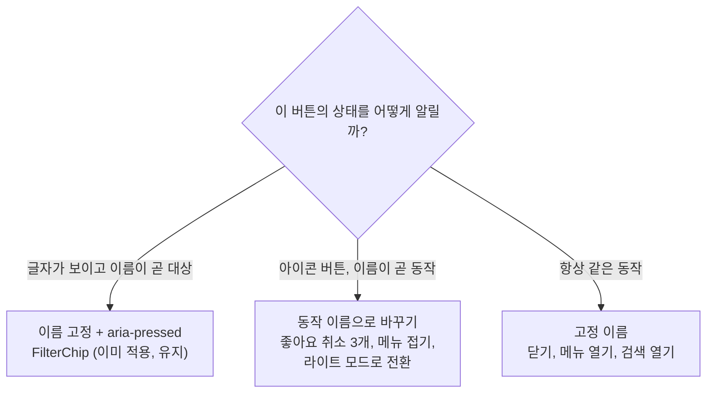
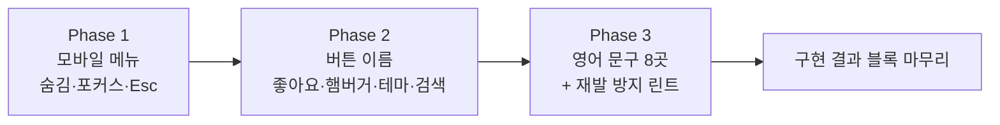

# 접근성 후속 — 화면 읽기 프로그램이 듣는 버튼 이름과 모바일 메뉴를 바로잡기

<!-- plan-result:start — 이 블록만 병합 뒤에도 고칠 수 있다(CLAUDE.md §11). 아래는 승인된 계획 원문 -->

## 구현 결과

> #558·#560·#561 · 2026-11-06 대조(Phase 1~3) · 이탈 1 · 미구현 0 — 판정 근거(파일:줄)는 각 PR 본문 "계획 대비 구현"

- 이탈(구현 중 발견): 메뉴가 닫힐 때 항상 연 버튼으로 되돌리지 않고, 포커스가 `body`나 메뉴 안에 남았을 때만 되돌림. 메뉴 링크로 이동한 화면이 이미 가져간 포커스(등록 화면 URL 칸의 `autoFocus`)를 뺏지 않기 위해서다
- 계획에 없던 변경: 메뉴 X의 `Button` 트랜지션을 `transition-all`에서 실제로 바뀌는 속성으로 좁힘. 메뉴 열림 트랜지션에서 `visibility`를 빼는 것만으로는 X가 물려받은 `visibility`를 자기 트랜지션으로 바꿔 `focus()`가 실패했다
- 계획에 없던 변경: 새 e2e에 표에 없던 테스트를 더함(터치·키보드 포커스 링, X로 닫을 때 복귀, 닫혔을 때 Esc, `autoFocus` 유지, 여는 동안 트랜지션, 동작 줄이기). 동작 줄이기는 이 스펙에서 확인한다(`e2e/reduced-motion.spec.ts`에는 메뉴 검사가 없다)
- 계획에 없던 변경: `motion-ux` skill에 부모 `visibility`와 자식 `transition-all` 함정을 기록
- 계획에 없던 변경(문서 동기화): `docs/POST-DETAIL-BACK-NAVIGATION.md`의 닫힌 드로어 설명 갱신
- 계획에 없던 변경(Phase 2): Phase 1에서 만든 `e2e/sidebar-drawer-focus.mobile.spec.ts`의 버튼 찾기도 새 이름으로 바꿈. Phase 2 표에 빠져 있었지만 옛 키를 지워 함께 고쳐야 했다
- 계획에 없던 변경(Phase 2): `docs/FE-ARCHITECTURE.md` §10-A에 그림에 없던 테스트 요령을 더함. 이름이 바뀌는 버튼은 다시 찾으면 옛 이름으로 못 찾으니 요소를 변수에 잡아 다시 누른다
- 계획에 없던 변경(Phase 3, 문서 동기화): `docs/FE-ARCHITECTURE.md` 린트 규칙 표에 새 규칙 행을 더함
- 검증(Phase 3): 접근성 스냅샷에 영어 이름이 남아 있다. 이번 8곳은 사라졌지만, 화면에 그대로 보이는 글자(메뉴 `Feed`·`Submit`·`Bookmark`, 글 목록 화면의 `Recent Links`·`Submit Link`), 데이터(카테고리 이름), 개발 도구는 이 계획의 범위가 아니었다

<!-- plan-result:end -->

> 상태가 안 들리는 버튼, 영어로 들리는 문구, 닫혀도 남아 있는 모바일 메뉴를 고친다. 화면 모습은 그대로다.
> PR 3개를 차례로 낸다. 이 계획의 승인은 **각 PR을 CI 통과 뒤 병합하고 운영 배포 성공까지 확인하는 것**을 포함한다.

## Context

UI 이름 바꾸기(#552~#557)를 하며 찾은 접근성 문제다. 사용자가 "개명 뒤 계획"을 골랐고, 조사에서 나온 새 발견도
모두 넣기로 했다(2026-11-06 질문 2회).

"지금 이름"은 코드로 계산한 접근 이름(화면 읽기 프로그램이 읽는 버튼 이름)이다. 실제 프로그램으로 듣지는 않았다.

| 묶음 | 자리                                                                                                                                                                         | 지금                        | 문제                                                                                                            |
| ---- | ---------------------------------------------------------------------------------------------------------------------------------------------------------------------------- | --------------------------- | --------------------------------------------------------------------------------------------------------------- |
| 메뉴 | `Sidebar.tsx:167` 닫힌 모바일 메뉴                                                                                                                                           | 화면 밖으로 밀기만 한다     | 안 보이는 링크와 X가 키보드 이동·읽기 순서에 남는다(`e2e/post-detail-back.mobile.spec.ts:30-34`에 옛 실측 기록) |
| 메뉴 | `Sidebar.tsx` 열린 모바일 메뉴                                                                                                                                               | 포커스 이동·Esc 처리가 없다 | 열어도 키보드와 읽기 위치가 뒤쪽 햄버거에 머문다                                                                |
| 이름 | `LikeCommentButton.tsx:38`                                                                                                                                                   | `3`                         | 무슨 버튼인지, 눌렀는지 안 들린다                                                                               |
| 이름 | `LikePostButton.tsx:36`                                                                                                                                                      | `좋아요`·`좋아요 취소`      | 화면의 숫자가 안 들린다                                                                                         |
| 이름 | `Sidebar.tsx:82` 햄버거                                                                                                                                                      | `메뉴 토글`                 | 펼침 상태가 안 들린다                                                                                           |
| 이름 | `Sidebar.tsx:82` 드로어 X, `Navbar.tsx:93`                                                                                                                                   | `메뉴 토글`                 | 항상 닫기, 항상 열기인데 토글이라고 읽는다                                                                      |
| 이름 | `Navbar.tsx:136` 테마                                                                                                                                                        | `테마 토글`                 | 지금 테마가 안 들린다                                                                                           |
| 이름 | `Navbar.tsx:125` 모바일 검색                                                                                                                                                 | `검색 토글`                 | 실제로는 열기만 한다                                                                                            |
| 영어 | `PasswordInput.tsx:22`, `BackToTopButton.tsx:68`, `spinner.tsx:9`, `dialog.tsx:147`, `alert-dialog.tsx:84`, `input.tsx:54`, `PostCard.tsx:379`, `GlobalAlertDialogs.tsx:126` | 영어 8곳                    | 한국어 화면에서 영어로 읽는다                                                                                   |
| 영어 | `BookmarkPostButton.tsx:46`                                                                                                                                                  | `Bookmark`                  | `aria-label`(`:43`)이 우선해 안 읽히는 군더더기다                                                               |

## 판단이 필요했던 항목

| 항목           | 결정                                                                                                                                                                                                                                                                                      | 근거·기각한 대안                                                                                                                                                                                                                                                                                                                                                                                                                                                                                                                                                                                                                                                                            |
| -------------- | ----------------------------------------------------------------------------------------------------------------------------------------------------------------------------------------------------------------------------------------------------------------------------------------- | ------------------------------------------------------------------------------------------------------------------------------------------------------------------------------------------------------------------------------------------------------------------------------------------------------------------------------------------------------------------------------------------------------------------------------------------------------------------------------------------------------------------------------------------------------------------------------------------------------------------------------------------------------------------------------------------- |
| 상태 전달 방식 | **동작 이름으로 바꾸기**(사용자 선택)                                                                                                                                                                                                                                                     | [APG Button](https://www.w3.org/WAI/ARIA/apg/patterns/button/)은 토글이면 _"라벨이 상태에 따라 바뀌지 않는 것이 매우 중요하다"_ (번역)고 하면서, 라벨을 바꾸는 설계라면 _"aria-pressed 속성은 필요 없다"_ (번역)고 한다. 둘 다 허용이라 선례로 정했다: `LikePostButton.tsx:36`, `BookmarkPostButton.tsx:43`. 기각: 이름 고정 + `aria-pressed`·`aria-expanded`. [APG Disclosure](https://www.w3.org/WAI/ARIA/apg/patterns/disclosure/)는 내용을 숨기는 경우이고, 접혀도 아이콘·글자가 남는 우리 사이드바와 정확히 같은 경우는 아니다                                                                                                                                                         |
| `FilterChip`   | `aria-pressed` 유지                                                                                                                                                                                                                                                                       | 글자가 보이는 칩이라 이름이 곧 대상이다(#553)                                                                                                                                                                                                                                                                                                                                                                                                                                                                                                                                                                                                                                               |
| 좋아요 이름    | `좋아요 3개` ↔ `좋아요 취소 3개`(사용자 확인)                                                                                                                                                                                                                                             | 글·댓글 두 버튼을 같은 형태로 맞춘다. 숫자는 화면에 보이는 값을 그대로 쓴다(글은 `NumberUtil.formatCompact`, 예: `1.2천`). 눌림과 무관하게 숫자도 함께 바뀌지만 APG가 직접 다루는 경우는 아니다                                                                                                                                                                                                                                                                                                                                                                                                                                                                                             |
| 글 좋아요 수   | 함께 고침(사용자 선택)                                                                                                                                                                                                                                                                    | 고치면 e2e 5파일의 이름 찾기가 바뀐다                                                                                                                                                                                                                                                                                                                                                                                                                                                                                                                                                                                                                                                       |
| 닫힌 메뉴 숨김 | 닫힘 `invisible` + `transition-[translate,visibility]`, 열림 `visible` + `transition-[translate]`                                                                                                                                                                                         | [MDN](https://developer.mozilla.org/en-US/docs/Web/CSS/visibility)은 `hidden`이면 _"접근성 트리에서 제거"_ (번역)되고 _"포커스를 받을 수 없다"_ (번역)고 한다. 트랜지션 중에는 _"이징 값이 0과 1 사이면 visible"_ (번역)이라 닫힘 애니메이션이 유지된다. 열림에서 `visibility`를 트랜지션에서 빼는 이유는 진행률 0에서 끝점 값이 될 수 있어 바로 부르는 `focus()`가 실패할 수 있어서다(구현 때 e2e로 확인). 선례: `CommentItemSkeleton.tsx:40`. Tailwind v4의 `translate-*`는 개별 속성이라 `transition-[transform,...]`로는 안 움직인다(`motion-ux` skill). 기각: `inert`(설치된 react-dom 18.3.1 `react-dom.development.js`에 처리 없음, grep 0건), 조건부 렌더(닫힘 애니메이션이 사라짐) |
| 메뉴 포커스    | 열면 X로, 닫으면 연 버튼으로, Esc로 닫기(사용자 선택)                                                                                                                                                                                                                                     | 약 15줄. 한계: Tab으로 메뉴 뒤로 나갈 수 있다. 기각: `Dialog` 전환(뒤로가기·애니메이션을 다시 검증해야 한다). `focus`는 `preventScroll`로 배경 스크롤을 지킨다                                                                                                                                                                                                                                                                                                                                                                                                                                                                                                                              |
| 영어 → 한국어  | 재사용: `ariaLabels.close`(`닫기`), `ariaLabels.inputClear`(`입력값 지우기`). 신규: `ariaLabels.showPassword`(`비밀번호 보기`), `hidePassword`(`비밀번호 숨기기`), `backToTop`(`맨 위로`), `loading`(`불러오는 중`), `alertDialogFallbackTitle`(`알림`), `post.card.share`(`게시글 공유`) | `Share`의 `handleCopyLink`(`usePostCard.ts:115`)는 모바일에서 공유 시트, 데스크톱에서 복사라 `공유`가 둘을 아우른다                                                                                                                                                                                                                                                                                                                                                                                                                                                                                                                                                                         |
| 재발 방지      | ESLint `custom-i18n/no-literal-a11y-name`(사용자 선택)                                                                                                                                                                                                                                    | `no-hardcoded-hangul`(`eslint.config.js:1549`)은 한글만 봐서 영어가 통과한다. 글자를 직접 적은 `aria-label`과 `sr-only` 요소 안 문구를 막는다. 선례: `scripts/lib/mutation-retry-rule.js` + `src/test/scripts/mutation-retry-rule.test.ts`                                                                                                                                                                                                                                                                                                                                                                                                                                                  |
| `검색 토글`    | `검색 열기`(사용자 선택)                                                                                                                                                                                                                                                                  | 고른 3곳 밖이지만 같은 부류다                                                                                                                                                                                                                                                                                                                                                                                                                                                                                                                                                                                                                                                               |
| 시안(§9)       | 만들지 않음                                                                                                                                                                                                                                                                               | 화면 모습이 바뀌지 않는다. 메뉴 닫힘 애니메이션만 녹화로 확인한다                                                                                                                                                                                                                                                                                                                                                                                                                                                                                                                                                                                                                           |
| 근거 기록 위치 | `docs/DECISIONS.md`에 새 항목을 안 만듦                                                                                                                                                                                                                                                   | 문구 몇 줄이라 되돌리기 쉽다. 규칙은 `docs/FE-ARCHITECTURE.md` §10-A에 둔다                                                                                                                                                                                                                                                                                                                                                                                                                                                                                                                                                                                                                 |

### 뒤집힌 전제

| 발견                                                                                                                                                                                     | 그래서 바뀐 것                                  |
| ---------------------------------------------------------------------------------------------------------------------------------------------------------------------------------------- | ----------------------------------------------- |
| 영어 문구가 2곳인 줄 알았는데 8곳이었다                                                                                                                                                  | 범위를 넓히고 린트를 더함                       |
| `LikePostButton`은 괜찮은 줄 알았는데 숫자가 안 들렸다                                                                                                                                   | 글 좋아요도 고침                                |
| X 이름을 `닫기`로 바꾸면 닫힌 메뉴의 X가 `getByRole(닫기).first()`(`e2e/mobile-search-scroll-lock.mobile.spec.ts:33`, `e2e/post-detail-search-overlay.mobile.spec.ts:54`)에 걸릴 수 있다 | 메뉴를 먼저 숨기고 이름을 뒤에 고침(Phase 순서) |

### 위험 관리

- **다른 세션**: `feat-sidebar-hover-peek` 워크트리가 잠겨 있고 최신 main에서 갓 갈라졌다(변경은 아직 없음). `Sidebar.tsx`가 겹칠 수 있어 Phase 1·2 시작과 PR 전에 `gh pr list`와 그 브랜치를 확인하고, 먼저 병합된 쪽 위로 rebase한다.
- **React API**: 포커스 `useEffect`를 넣기 전에 react.dev를 조회해 링크를 주석·PR에 남긴다(Critical Rules).
- **줄 번호**: 위 `파일:줄`은 `origin/main`(`f5c88999`) 기준이다. 문서의 `파일:줄` 인용은 손으로 대조한다.

## 세부 계획

**Phase마다 공통으로 하는 일**: `git log origin/main..main` 확인 → `EnterWorktree` → `.env` 복사·`pnpm install` → 구현 →
검증 → plan-verifier 대조 → `pnpm check:pr-body` → PR → CI 통과 → squash 병합 → 배포 SHA 성공 확인 → 워크트리 삭제.
`CHANGELOG.md` `[Unreleased]` Fixed 항목을 각 PR에 넣는다(`changelog-release` skill 먼저), `TEXTS` 키를 더하기 전에 `texts-conventions` skill을 읽는다.

### Phase 1 — `fix(widget)`: 닫힌 모바일 메뉴를 숨기고 열린 메뉴에 포커스·Esc를 넣음

| 위치                                                | 변경 내용                                                                                                                                                                             |
| --------------------------------------------------- | ------------------------------------------------------------------------------------------------------------------------------------------------------------------------------------- |
| `src/widgets/layout/sidebar/ui/Sidebar.tsx:162-168` | 드로어 `aside` 클래스를 위 "닫힌 메뉴 숨김" 결정대로 바꾼다                                                                                                                           |
| `Sidebar.tsx` `SidebarHeader`                       | 드로어 X에 ref를 넘기는 prop 추가                                                                                                                                                     |
| `Sidebar.tsx` `Sidebar`                             | `isMobileOpen`일 때: 지금 포커스 요소를 기억하고 X로 옮기며, 닫히면 되돌린다. Esc면 `close()`                                                                                         |
| `Sidebar.test.tsx`                                  | 닫힘·열림 클래스, 열면 X 포커스, Esc로 닫기                                                                                                                                           |
| `e2e/sidebar-drawer-focus.mobile.spec.ts` (신규)    | 닫힌 메뉴 링크·X가 숨겨짐, Tab으로 못 들어감, 열면 X 포커스, Esc로 닫히고 햄버거로 복귀, 닫는 동안 `translate`·`visibility` 트랜지션(`e2e/bookmark-sheet-motion.mobile.spec.ts` 방식) |
| `e2e/post-detail-back.mobile.spec.ts:30-34`         | 낡은 주석 수정                                                                                                                                                                        |
| `docs/TESTING.md:945` 근처                          | 새 스펙 등록                                                                                                                                                                          |
| `docs/plans/2026-11-06-a11y-button-names.md` (신규) | 이 계획 스냅샷                                                                                                                                                                        |

### Phase 2 — `fix(shared)`: 버튼 이름을 실제 동작으로 바꿈

| 위치                                                                                                                                      | 변경 전                                     | 변경 후                                                                                                                                                                                 |
| ----------------------------------------------------------------------------------------------------------------------------------------- | ------------------------------------------- | --------------------------------------------------------------------------------------------------------------------------------------------------------------------------------------- |
| `src/shared/config/texts.ts` `nav`                                                                                                        | `toggleMenu`, `toggleSearch`, `toggleTheme` | `openMenu`(`메뉴 열기`), `collapseMenu`(`메뉴 접기`), `expandMenu`(`메뉴 펼치기`), `openSearch`(`검색 열기`), `switchToDark`(`다크 모드로 전환`), `switchToLight`(`라이트 모드로 전환`) |
| `texts.ts` `ariaLabels`                                                                                                                   | `postLike`, `postUnlike`                    | `likeWithCount(count)`, `unlikeWithCount(count)`                                                                                                                                        |
| `LikeCommentButton.tsx`                                                                                                                   | 이름 없음                                   | `aria-label`을 상태와 숫자로                                                                                                                                                            |
| `LikePostButton.tsx:36`                                                                                                                   | `postUnlike`·`postLike`                     | `unlikeWithCount`·`likeWithCount`(`formatCompact` 값)                                                                                                                                   |
| `Sidebar.tsx:82`                                                                                                                          | `toggleMenu`                                | 드로어 X는 `ariaLabels.close`, 데스크톱은 `expanded`에 따라 `collapseMenu`·`expandMenu`(지역 함수)                                                                                      |
| `Navbar.tsx:93`, `:125`, `:136`                                                                                                           | `toggleMenu`, `toggleSearch`, `toggleTheme` | `openMenu`, `openSearch`, `resolvedTheme`에 따라 `switchToLight`·`switchToDark`                                                                                                         |
| `Sidebar.test.tsx`, `Navbar.test.tsx`                                                                                                     | 옛 키                                       | 새 키 + 눌렀을 때 이름이 바뀌는 단언. `Sidebar.test.tsx`의 "같은 이름" 주석 수정                                                                                                        |
| `LikeCommentButton.test.tsx`, `LikePostButton.test.tsx` (신규)                                                                            | 없음                                        | 상태·숫자별 이름                                                                                                                                                                        |
| `e2e/{auth-tab-sync,guest-guard,like,post-card-click-area,reduced-motion}.spec.ts`                                                        | `postLike`·`postUnlike`                     | 새 함수, 픽스처 값(`mockPost.likeCount`)                                                                                                                                                |
| `e2e/{font-size-breakpoint,mobile-search-scroll-lock.mobile,post-detail-search-overlay.mobile,scroll-reset-on-navigation.mobile}.spec.ts` | `toggleSearch`                              | `openSearch`                                                                                                                                                                            |
| `e2e/sidebar-drawer-scroll-lock.mobile.spec.ts:21-23`, `e2e/mocks/comment.mock.ts:9`                                                      | 옛 키·낡은 주석                             | 새 키, 주석 수정                                                                                                                                                                        |
| `docs/FE-ARCHITECTURE.md` §10-A                                                                                                           | 상태 전달 규칙 없음                         | 위 그림의 규칙 추가                                                                                                                                                                     |
| `docs/TESTING.md:451`, `docs/DESIGN-SYSTEM.md:313`, `.claude/skills/texts-conventions/SKILL.md:25`                                        | 옛 이름                                     | 새 이름                                                                                                                                                                                 |

`next-themes` 0.4.6(`dist/index.mjs`)은 `useState` 초기값에서 저장된 테마를 읽어 첫 렌더부터 `resolvedTheme`이 있다. 값이 없어도 이름과 클릭 동작이 같은 조건(`resolvedTheme === 'dark'`)을 쓰니 어긋나지 않는다.

### Phase 3 — `fix(shared)`: 영어 접근성 문구를 한국어로 바꾸고 린트로 막음

| 위치                                                                                                                           | 변경 전                         | 변경 후                                        |
| ------------------------------------------------------------------------------------------------------------------------------ | ------------------------------- | ---------------------------------------------- |
| `PasswordInput.tsx:22`                                                                                                         | `Show password`·`Hide password` | `ariaLabels.showPassword`·`hidePassword`       |
| `BackToTopButton.tsx:68`                                                                                                       | `Scroll to top`                 | `ariaLabels.backToTop`                         |
| `spinner.tsx:9`                                                                                                                | `Loading`                       | `ariaLabels.loading`                           |
| `dialog.tsx:147`, `alert-dialog.tsx:84`                                                                                        | `Close`                         | `ariaLabels.close`                             |
| `input.tsx:54`                                                                                                                 | `Clear`                         | `ariaLabels.inputClear`                        |
| `PostCard.tsx:379`                                                                                                             | `Share`                         | `post.card.share`                              |
| `GlobalAlertDialogs.tsx:126`                                                                                                   | `Alert`                         | `ariaLabels.alertDialogFallbackTitle`          |
| `BookmarkPostButton.tsx:46`                                                                                                    | `Bookmark`                      | 줄 삭제                                        |
| `alert-dialog.test.tsx:130`, `FormInput.test.tsx`, `BookmarkSearch.test.tsx`, `BackToTopButton.test.tsx`, `AppLayout.test.tsx` | 영어 이름                       | `TEXTS` 키                                     |
| `e2e/reduced-motion.spec.ts:85`, `e2e/scroll-to-top-detail{,.mobile}.spec.ts`, `e2e/comment-delete.spec.ts:74`                 | 영어 이름·주석                  | `TEXTS` 키, 주석 수정                          |
| `scripts/lib/no-literal-a11y-name-rule.js`, `.d.ts`, `src/test/scripts/no-literal-a11y-name-rule.test.ts` (신규)               | 없음                            | 규칙과 단위 테스트                             |
| `eslint.config.js` `custom-i18n`                                                                                               | `no-hardcoded-hangul`만         | 새 규칙 등록(같은 제외 목록: 테스트·스토리·목) |
| `.claude/skills/texts-conventions/SKILL.md`, `.claude/CLAUDE.md` 인라인 문자열 규칙                                            | 한글만 언급                     | 접근성 문구 규칙 추가                          |
| `docs/plans/2026-11-06-a11y-button-names.md`                                                                                   | 구현 결과 블록                  | Phase 3까지 마무리                             |

## 영향 범위 (§5)

**CRUD 실패 지점**: 없음. DB·API·DTO·저장값을 건드리지 않고 배포 순서 제약도 없다.

| Phase | 깨질 수 있는 기존 동작                                                                                  | 소유 파일                                                    | 막는 방법                                                                                                    |
| ----- | ------------------------------------------------------------------------------------------------------- | ------------------------------------------------------------ | ------------------------------------------------------------------------------------------------------------ |
| 1     | 메뉴 여닫기 애니메이션, 뒤로가기로 닫기, 배경 스크롤 잠금·위치, 메뉴 링크 이동, 로그인 필요 링크        | `Sidebar.tsx`, `useHistoryOverlay.ts`                        | 새 e2e, `sidebar-drawer-scroll-lock`, `reduced-motion`, 녹화                                                 |
| 1     | 닫힌 메뉴 링크에 기대던 모바일 e2e                                                                      | `e2e/*.mobile.spec.ts`                                       | 모바일 e2e 전체                                                                                              |
| 2     | 이름으로 버튼을 찾는 테스트, 눌렀을 때 이름이 바뀌어 잃는 찾기, 더블클릭 가드(요소를 다시 찾으면 안 됨) | `Navbar.test.tsx`, `Sidebar.test.tsx`, e2e 10파일            | 전체 단위·e2e, 키 삭제로 타입 검사가 옛 사용처를 잡음                                                        |
| 3     | 공용 부품 문구를 찾는 테스트, 창의 닫기 버튼 이름 겹침                                                  | `input.tsx`, `dialog.tsx`, `alert-dialog.tsx`, `spinner.tsx` | 자체 X는 `showCloseButton=false`로 겹치지 않음(`SheetDialogContent.tsx:45`, `ImageViewer.tsx:100`), 전체 e2e |
| 3     | 새 린트가 정상 코드를 막음                                                                              | `eslint.config.js`                                           | 규칙 단위 테스트, `pnpm lint`                                                                                |

**공유 코드 사용처**: Phase 3에서 `spinner`·`input`·`dialog`·`alert-dialog`의 `pnpm graph:focus "<경로>" --text`를 뽑아 PR 본문에 요약한다. `graph:focus`가 빼는 `src/app`·테스트·스토리는 grep으로 함께 본다.

## 검증 방법

**모든 Phase**

1. `pnpm type-check` → `pnpm test` → `pnpm lint`·`pnpm check:deps` → `pnpm check:docs` → `pnpm test:storybook`
2. 옛 이름·영어 문구 grep이 0건인지 확인(`docs/plans/*`, `docs/HISTORY.md`, `CHANGELOG.md` 과거 항목 제외)
3. 병합 뒤 `gh run list --branch main --workflow "Frontend Deploy (S3 + CloudFront)"`로 그 SHA의 success 확인

**Phase별 추가**

- **Phase 1**: 새 e2e와 모바일 e2e 전체. 메뉴 여닫기를 `browser-verification` skill대로 녹화해 애니메이션이 그대로인지 보여 드린다. "동작 줄이기"에서도 `e2e/reduced-motion.spec.ts`로 확인한다.
- **Phase 2**: Playwright 접근성 스냅샷으로 세 버튼의 이름이 상태에 따라 바뀌는지 확인한다. `e2e/like.spec.ts` 등 바뀐 e2e.
- **Phase 3**: 접근성 스냅샷에 영어 이름이 없는지 확인한다. 린트는 디스크 파일에 위반을 잠깐 넣어 lint-staged와 같은 명령으로 막히는지 본다(stdin은 AST 규칙이 헛통과한다). 전체 e2e는 CI로 본다.

실제 화면 읽기 프로그램으로는 확인하지 않는다(VoiceOver 확인은 사용자 결정으로 뺐다). 코드·테스트·접근성 스냅샷까지가 근거다.

## 남은 것

- (제가) `feat-sidebar-hover-peek`와 겹치는지 Phase 1·2 시작과 PR 전에 확인한다 — 그 세션이 아직 변경을 올리지 않았다.
- (제가) 범위 밖으로 둔 것을 마지막 보고에 다시 적는다: 메뉴 안 Tab 가두기(`Dialog` 전환이 필요), 쓰이지 않는 `ariaLabels.menuToggle`(원래 있던 죽은 코드라 지우지 않음).
