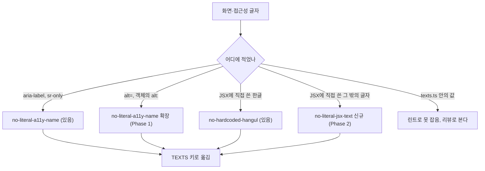
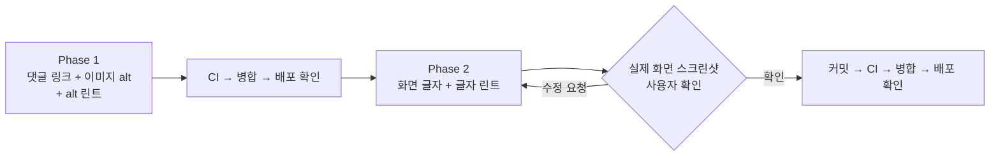

# 접근성 후속 2 — 글 카드 댓글 링크, 이미지 이름, 화면의 영어 글자를 바로잡기

<!-- plan-result:start — 이 블록만 병합 뒤에도 고칠 수 있다(CLAUDE.md §11). 아래는 승인된 계획 원문 -->

## 구현 결과

> #564 · 2026-11-06 대조(Phase 1) · 이탈 0 · 미구현 0 — 판정 근거(파일:줄)는 PR 본문 "계획 대비 구현"

- 계획에 없던 변경: 문서 동기화 — `docs/TESTING.md`의 e2e 표에 댓글 링크 새 단언 설명을 더함

> #566 · 2026-11-06 대조(Phase 2) · 이탈 1 · 미구현 1 — 판정 근거(파일:줄)는 PR 본문 "계획 대비 구현"

- 이탈(인용이 틀린 말이 됨): 코드 주석의 `피드`는 고치지 않기로 했지만 `post.util.ts` 주석 한 줄은 고쳤다. 화면 문구 `피드에서 확인하기`를 그대로 인용해 값이 바뀌면 틀린 말이 되고, "옛 문구 grep 0건"에도 걸린다. 일반 명사로 쓴 다른 주석의 `피드`는 그대로다
- 미구현 → 보완함: "옛 문구 grep 0건" — 대조에서 찾은 옛 메뉴 이름 `Feed`와 옛 안내 문구 인용을 `docs/POST-DETAIL-BACK-NAVIGATION.md`, `docs/POST.md`, `docs/TESTING.md`, e2e 테스트 제목·주석, `PostDetailPage.tsx` 주석에서 고쳤다. 첫 grep이 따옴표로 감싼 형태만 찾아 놓쳤다
- 계획에 없던 변경: 문서 동기화 — `docs/POST-DETAIL-BACK-NAVIGATION.md`의 `마지막 검토` 날짜, `texts-conventions` skill의 TEXTS 트리에 `post.list.*` 줄 추가

<!-- plan-result:end -->

> 숫자로만 읽히는 댓글 링크와 영어 `alt`를 고치고, 화면의 영어 글자를 한국어로 바꾼다. 같은 일이 다시 생기지 않게 린트도 넓힌다.
> PR 2개를 차례로 낸다. 이 계획의 승인은 **각 PR을 CI 통과 뒤 병합하고 운영 배포 성공까지 확인하는 것**을 포함한다. 단, Phase 2는 실제 화면 스크린샷을 사용자가 확인한 뒤에 커밋한다.

## Context

접근성 후속 Phase 3(#561)을 검증하며 찾은 세 가지다. 사용자가 셋 다 고치기로 했다(2026-11-06). 줄 번호는 `origin/main`(`704857f7`) 기준이다.

| 묶음 | 자리                             | 지금                         | 문제                                                                                                                |
| ---- | -------------------------------- | ---------------------------- | ------------------------------------------------------------------------------------------------------------------- |
| ①    | `PostCard.tsx:346-364` 댓글 수   | `<Link>` 안에 `<Button>`     | 접근성 스냅샷에 `link "0"`, `button "0"` 둘 다 나온다. 이름이 숫자뿐이고 Tab이 두 번 멈춘다                         |
| ②    | `MarkdownContent.tsx:55`, `:94`  | `attachment`                 | 코드상 댓글 목록에서는 버튼 이름 `이미지 확대`(`:123`)가 우선하고, 확대 창(`ImageViewer.tsx:111`)에서 영어로 읽힌다 |
| ②    | `ImageAttachmentField.tsx:72`    | `Pasted preview 1`           | 쓰기 칸 미리보기가 영어로 읽힌다                                                                                    |
| ③    | `texts.ts:183-185` 메뉴          | `Feed`·`Submit`·`Bookmark`   | 나머지가 한국어인 화면에서 메뉴만 영어다                                                                            |
| ③    | `src/pages/post/index.tsx:29,35` | `Recent Links`·`Submit Link` | `TEXTS`를 거치지 않은 영어다. 한글만 보는 린트가 통과시켰다                                                         |

영어로 둔 이유는 `docs/DECISIONS.md`를 검색한 범위에서 찾지 못했다. `Recent Links`·`Submit Link`는 2026-01-25 첫 구현(`b6920b2c`)부터 있었다.

실제 화면 읽기 프로그램으로는 듣지 않는다(VoiceOver 확인은 사용자 결정으로 뺐다). 근거는 코드, 테스트, 접근성 스냅샷까지다.

## 판단이 필요했던 항목

| 항목              | 결정                                                               | 근거·기각한 대안                                                                                                                                                                                                                                                                                                                                                                                            |
| ----------------- | ------------------------------------------------------------------ | ----------------------------------------------------------------------------------------------------------------------------------------------------------------------------------------------------------------------------------------------------------------------------------------------------------------------------------------------------------------------------------------------------------- |
| 댓글 링크 구조    | `<Button asChild><Link/></Button>`으로 합침                        | [HTML 표준](https://html.spec.whatwg.org/multipage/text-level-semantics.html#the-a-element)은 `a` 안에 _"상호작용 콘텐츠 자손이 없어야 한다"_ (번역)고 쓴다. 선례: `ErrorLayout.tsx:49`, `VerifyEmailStatus.tsx`. 기각: 바깥 `Link`에 이름만 달기(Tab 두 번과 표준 위반이 남음)                                                                                                                             |
| 댓글 이름         | `댓글 3개`                                                         | `좋아요 3개`와 같은 형태(`docs/FE-ARCHITECTURE.md` §10-A). 숫자는 화면 값 그대로 `NumberUtil.formatCompact`. [WCAG 2.5.3](https://www.w3.org/WAI/WCAG22/Understanding/label-in-name.html)은 _"이름에 화면에 보이는 글자가 들어 있어야 한다"_ (번역)고 쓴다. 숫자를 직접 다루지는 않는다                                                                                                                     |
| 이미지 `alt` 문구 | 댓글 이미지 `첨부 이미지`, 확대 창·쓰기 칸 `첨부 이미지 1`         | 올린 사람이 쓴 설명이 없어 내용을 설명하지 못한다(한계). 순번은 이전·다음으로 넘길 때 구분하기 위해서다. 기각: 버튼 안 이미지 `alt=""`(이미지를 못 불러올 때 대신 보일 글자가 사라짐)                                                                                                                                                                                                                       |
| `alt` 린트        | `no-literal-a11y-name`을 `alt=`와 객체의 `alt:`까지 넓힘           | `:94`가 객체 형태로 생겼다. `title`은 사용자가 고른 범위 밖이라 넣지 않는다                                                                                                                                                                                                                                                                                                                                 |
| 영어를 번역할지   | 한국어로 바꿈(사용자 선택)                                         | [WCAG 3.1.2](https://www.w3.org/WAI/WCAG22/Understanding/language-of-parts.html)는 _"각 구절의 언어를 프로그램으로 알 수 있어야 한다"_ (번역)고만 해 번역 의무는 아니다. 기각: 영어 유지 + `lang="en"`(기준은 충족하지만 화면에 언어가 섞임). [NN/g](https://www.nngroup.com/articles/ten-usability-heuristics/)의 _"사용자의 언어로 말해야 한다"_ (번역)는 일반 원칙이지 메뉴 언어를 직접 다룬 글은 아니다 |
| 글 목록 메뉴 이름 | `홈`으로 통일하고 안내 문구 4곳도 바꿈(사용자 선택)                | 집 아이콘(`nav-items.ts:21`), 오류 화면 `홈으로 이동`(`ErrorLayout.tsx:50`, `routes/index.tsx:114`로 글 목록에 도착)과 같은 말이 된다. 기각: `피드`(안내 문구 4곳은 그대로지만 아이콘·오류 화면과 어긋남)                                                                                                                                                                                                   |
| 등록 입구 이름    | `링크 공유`(사용자 선택)                                           | 작성 폼 제목·제출 버튼이 `링크 공유하기`다(`texts.ts:252,265`). 기각: `링크 등록`(쓰이지 않는 키 `texts.ts:32`에만 있음)                                                                                                                                                                                                                                                                                    |
| 코드 이름         | `nav.feed`, `goToFeed`, `checkFeed`, `backSource: 'feed'`는 그대로 | 화면 글자만 바뀐다. 내부 이름까지 바꾸면 화면과 무관한 변경이 커진다                                                                                                                                                                                                                                                                                                                                        |
| 글자 린트         | `custom-i18n/no-literal-jsx-text` 신규(사용자 선택)                | 한글 말고 다른 글자를 JSX에 직접 적는 것을 막는다. `texts.ts` 안의 값은 못 잡는다. 정상 코드가 5건 넘게 걸리면 빼고 알린다(사용자에게 약속함). 1~5건이면 그 줄에 이유를 단 `eslint-disable-next-line`을 쓴다                                                                                                                                                                                                |
| 근거 기록 위치    | `docs/DECISIONS.md` 새 항목 없음                                   | 문구 값이라 되돌리기 쉽다. 규칙은 `texts-conventions` skill에 두고, 비교는 이 계획에 남긴다                                                                                                                                                                                                                                                                                                                 |

### 시안 후보

사용자가 ASCII 그림으로 `홈 / 링크 공유 / 북마크`, `최근 링크`, `링크 공유`를 골랐다. 대략적인 그림이었으니 §9에 따라 Phase 2에서 실제 화면 전후 스크린샷을 보여 드리고, **확인받기 전에는 커밋하지 않는다.**

다른 서비스(2026-11-06 각 사이트 HTML 기준): Disquiet `홈`·`프로덕트`·`그룹`·`아티클`·`사람들`, 입구 `글쓰기`. GeekNews `최신글`·`예전글`·`Ask`·`Show` 등, 입구 `글등록`. velog `트렌딩`·`추천`·`최신`·`피드`. OKKY `커뮤니티`·`Q&A`·`이벤트`·`Contact`. 한국어 중심이지만 영어를 섞기도 한다.

### 뒤집힌 전제

| 발견                                                                 | 그래서 바뀐 것                                    |
| -------------------------------------------------------------------- | ------------------------------------------------- |
| 댓글 목록에서 `attachment`로 읽히는 줄 알았는데 버튼 이름이 우선한다 | 읽히는 곳인 확대 창에 순번을 넣음                 |
| `피드`는 코드 이름인 줄 알았는데 화면 문구 4곳에 있다                | 사용자에게 다시 물어 `홈`으로 통일하고 4곳도 바꿈 |
| `Visit Website`가 화면에 보이는 줄 알았는데 쓰는 곳이 없다           | 대상에서 뺌(죽은 키라 언급만 함)                  |

### 위험 관리

- **다른 세션**: 지금 열린 PR과 다른 워크트리는 없다. Phase마다 시작과 PR 전에 `gh pr list`로 다시 본다. `texts.ts`가 겹치면 먼저 병합된 쪽 위로 rebase한다.
- **줄 번호**: 메인 체크아웃이 `origin/main`보다 뒤처져 있다. 워크트리는 `origin/main`에서 만들고 줄 번호를 다시 확인한다.

## 세부 계획

**Phase마다 공통으로 하는 일**: `git log origin/main..main` 확인 → `EnterWorktree` → `.env` 복사·`pnpm install` → 구현 → 검증 → plan-verifier 대조 → `pnpm check:pr-body` → PR → CI 통과 → squash 병합 → 배포 SHA 성공 확인 → 워크트리 삭제. `TEXTS` 키를 더하기 전에 `texts-conventions`, CHANGELOG를 쓰기 전에 `changelog-release` skill을 읽는다.

### Phase 1 — `fix(shared)`: 글 카드 댓글 링크와 이미지 이름을 바로잡음

| 위치                                                                                                   | 변경 내용                                                                                                                               |
| ------------------------------------------------------------------------------------------------------ | --------------------------------------------------------------------------------------------------------------------------------------- |
| `src/shared/config/texts.ts` `ariaLabels`                                                              | `commentWithCount(count)`(`댓글 ${count}개`), `attachmentImage`(`첨부 이미지`), `attachmentImageAt(order)`(`첨부 이미지 ${order}`) 추가 |
| `src/widgets/post/post-card/ui/PostCard.tsx:346-364`                                                   | `<Button asChild ...><Link aria-label=... /></Button>`로 합침. 기존 `Link` props와 `Button` 클래스는 유지                               |
| `src/shared/ui/elements/MarkdownContent.tsx:55`                                                        | `alt`를 `attachmentImage`로                                                                                                             |
| `MarkdownContent.tsx:94`                                                                               | 순번을 붙인 `attachmentImageAt(index + 1)`로                                                                                            |
| `src/shared/ui/elements/ImageAttachmentField.tsx:72`                                                   | `attachmentImageAt(index + 1)`로                                                                                                        |
| `MarkdownContent.test.tsx:12,20,22,27,31,40,50,60`                                                     | `attachment`를 `TEXTS` 키로, 확대 창 이미지 순번 단언 추가                                                                              |
| `ImageAttachmentField.test.tsx` (신규)                                                                 | 미리보기 이미지 이름 단언                                                                                                               |
| `e2e/comment-icon-scroll.spec.ts`                                                                      | 링크 이름 `댓글 N개`, 안에 `button` 없음, Tab 멈춤 1번 단언 추가                                                                        |
| `scripts/lib/no-literal-a11y-name-rule.js`(`.d.ts`는 그대로)                                           | `alt` 속성과 객체의 `alt:` 값 검사 추가, 머리 주석 수정                                                                                 |
| `src/test/scripts/no-literal-a11y-name-rule.test.ts:48`                                                | ``를 위반으로 옮기고 `alt=""`, `alt={title}`, `alt: TEXTS.x`는 통과, `alt: 'attachment'`는 위반으로 추가        |
| `docs/FE-ARCHITECTURE.md:109`, `.claude/skills/texts-conventions/SKILL.md:72`, `.claude/CLAUDE.md:421` | 린트 범위 문구에 `alt` 반영                                                                                                             |
| `CHANGELOG.md` `[Unreleased]` Fixed                                                                    | 항목 추가                                                                                                                               |
| `docs/plans/2026-11-06-a11y-card-link-korean-labels.md` (신규)                                         | 이 계획 스냅샷 + 구현 결과 블록                                                                                                         |

### Phase 2 — `fix(shared)`: 화면의 영어 글자를 한국어로 바꾸고 린트로 막음

| 위치                                                                                                           | 변경 전                       | 변경 후                                                       |
| -------------------------------------------------------------------------------------------------------------- | ----------------------------- | ------------------------------------------------------------- |
| `texts.ts:183-185` `nav`                                                                                       | `Feed`, `Submit`, `Bookmark`  | `홈`, `링크 공유`, `북마크`                                   |
| `texts.ts:165` `auth.verifyEmail.goToFeed`                                                                     | `피드로 이동`                 | `홈으로 이동`                                                 |
| `texts.ts:587` `postSubmit.urlDuplicate`                                                                       | `…피드에서 확인해주세요.`     | `…홈에서 확인해주세요.`                                       |
| `texts.ts:594` `postSubmit.timeout`                                                                            | `…피드에서 먼저 확인한 뒤…`   | `…홈에서 먼저 확인한 뒤…`                                     |
| `texts.ts:595` `postSubmit.checkFeed`                                                                          | `피드에서 확인하기`           | `홈에서 확인하기`                                             |
| `texts.ts` `post.list` (신규)                                                                                  | 없음                          | `heading`(`최근 링크`), `submit`(`링크 공유`)                 |
| `src/pages/post/index.tsx:29,35`                                                                               | `Recent Links`, `Submit Link` | `TEXTS.post.list.heading`, `submit`                           |
| `e2e/failed-query-reentry.spec.ts:51,105`                                                                      | `Recent Links`                | `TEXTS.post.list.heading`                                     |
| `e2e/post-detail-back.mobile.spec.ts:31`                                                                       | 주석의 `Feed`                 | `홈`                                                          |
| `scripts/lib/no-literal-jsx-text-rule.js`, `.d.ts`, `src/test/scripts/no-literal-jsx-text-rule.test.ts` (신규) | 없음                          | 규칙과 단위 테스트. 선례: `no-literal-a11y-name-rule.js`      |
| `eslint.config.js:11,1535,1551,1594`                                                                           | 규칙 2개                      | 새 규칙 등록(같은 제외 목록)                                  |
| `.claude/skills/texts-conventions/SKILL.md:25,72`, `.claude/CLAUDE.md:421`, `docs/FE-ARCHITECTURE.md:109`      | 한글·접근성 문구만 언급       | 글자 규칙, 영어로 두는 예외(`LinkSphere`, `URL`, 단축키) 추가 |
| `docs/POST.md:45,158,1013`                                                                                     | `Submit Link`                 | `링크 공유`                                                   |
| `docs/POST-DETAIL-BACK-NAVIGATION.md:163-164`                                                                  | `Feed` 링크                   | 당시 이름임을 덧붙임                                          |
| `CHANGELOG.md` `[Unreleased]` Changed                                                                          | 없음                          | 항목 추가                                                     |
| `docs/plans/2026-11-06-a11y-card-link-korean-labels.md`                                                        | 구현 결과 블록                | Phase 2까지 마무리                                            |

고치지 않는 곳: `docs/DECISIONS.md:2695`(과거 기록), `ActionButton.stories.tsx:36,47`(스토리 예시), 코드 주석의 `피드`.

## 영향 범위 (§5)

**CRUD 실패 지점**: 없음. DB·API·DTO·저장값을 건드리지 않고 배포 순서 제약도 없다.

**공유 코드 사용처**(`git grep`, 구현 때 `pnpm graph:focus "<경로>" --text`로 다시 뽑아 PR 본문에 요약): `PostCard`는 글 목록·글 상세·북마크 화면, 이미지 부품은 `CommentItem`·`CommentForm`·`CommentEditForm`.

| Phase | 깨질 수 있는 기존 동작                                                                                | 소유 파일                                                 | 막는 방법                                                                                                                        |
| ----- | ----------------------------------------------------------------------------------------------------- | --------------------------------------------------------- | -------------------------------------------------------------------------------------------------------------------------------- |
| 1     | 댓글 링크 이동(해시 스크롤, `replace`, `preventScrollReset`, `backSource`), 마우스·포커스로 미리 받기 | `PostCard.tsx`                                            | `e2e/comment-icon-scroll{,.mobile}`, `e2e/post-detail-comment-prefetch`. 이 e2e들은 `a[href]`로 찾아 구조가 바뀌어도 그대로 쓴다 |
| 1     | 푸터 높이·폭. `a`가 flex 항목이 되면서 줄 높이 여백이 사라질 수 있다                                  | `PostCard.tsx`                                            | 변경 전후 측정, `e2e/post-card-footer-layout`, `e2e/bookmark-card-footer-layout`. 달라지면 보고한다                              |
| 1     | 카드 전체 클릭 영역, 포커스 링                                                                        | `PostCard.tsx`                                            | `e2e/post-card-click-area`, 스크린샷                                                                                             |
| 1     | 이미지를 이름으로 찾는 테스트, 확대 창 이동                                                           | `MarkdownContent.tsx`                                     | `MarkdownContent.test.tsx`, 전체 e2e                                                                                             |
| 1·2   | 새 린트가 정상 코드를 막음                                                                            | `eslint.config.js`                                        | 규칙 단위 테스트, `pnpm lint`                                                                                                    |
| 2     | e2e 이름 찾기(부분 일치라 `홈`이 `홈으로 이동`에, `북마크`가 다른 링크에 걸릴 수 있음)                | `e2e/*`(`TEXTS.nav.*` 15줄)                               | 전체 e2e, 걸리는 곳은 `exact: true`                                                                                              |
| 2     | 글자 폭: 하단 탭바, 접힌 사이드바(`Sidebar.tsx:202` `w-20`), 글 목록 머리                             | `BottomTabBar.tsx`, `Sidebar.tsx`, `pages/post/index.tsx` | 스크린샷, `e2e/font-size-breakpoint`                                                                                             |
| 2     | 글 등록 실패 안내, 이메일 인증 화면                                                                   | `post.util.ts`, `VerifyEmailStatus.tsx`, 두 폼            | 키로 찾는 단위 테스트(`post.util.test.ts`, `useCreatePost.test.tsx`, `VerifyEmailStatus.test.tsx`)                               |
| 2     | 옛 이름을 서술하는 문서                                                                               | `docs/POST.md` 등, BE `docs/`                             | FE·BE grep                                                                                                                       |

## 검증 방법

**모든 Phase**

1. `pnpm type-check` → `pnpm test` → `pnpm lint`·`pnpm check:deps` → `pnpm check:docs` → `pnpm test:storybook` → 전체 e2e(로그 파일로 남김)
2. 옛 문구 grep이 0건인지 확인(`docs/plans/*`, `docs/HISTORY.md`, `CHANGELOG.md` 과거 항목, `docs/DECISIONS.md` 제외)
3. 병합 뒤 `gh run list --branch main --workflow "Frontend Deploy (S3 + CloudFront)"`로 그 SHA의 success 확인

**Phase 1 추가**

- 구현 전후로 임시 스펙(`E2E_SERVER_PORT=31155`, 커밋 안 함)을 돌려 댓글 링크와 푸터의 크기를 데스크톱·모바일에서 재어 비교한다.
- 접근성 스냅샷으로 `link "댓글 N개"`가 나오고 `button "N"`이 사라졌는지, 확대 창·쓰기 칸 이미지가 `첨부 이미지 1`인지 확인한다.
- 디스크 파일에 `alt="attachment"`, `alt: 'attachment'`를 잠깐 되돌려 `pnpm exec eslint --max-warnings 0 --no-warn-ignored <파일>`로 막히는지 보고 원복한다.

**Phase 2 추가**

- 커밋 전에 실제 화면 전후 스크린샷을 찍어 사용자에게 보여 드린다: 모바일 320·390px 하단 탭바와 글 목록 머리, 모바일 메뉴, 데스크톱 펼친 사이드바, 접힌 사이드바. 글자가 잘리거나 줄이 바뀌는지 본다.
- `pnpm lint`로 새 글자 규칙에 걸리는 건수를 세고 5건이 넘으면 규칙을 뺀다.
- 디스크 파일에 `Submit Link`를 잠깐 되돌려 막히는지 보고 원복한다.

## 남은 것

- (제가) 마지막 보고에 고치지 않은 발견을 적는다 — 이번 범위 밖이다: 쓰이지 않는 키 `post.card.visitWebsite`·`pages.*`·`ariaLabels.menuToggle`, 브라우저 탭 제목의 `Link Sphere`와 메뉴의 `LinkSphere` 표기 차이, 여러 장이어도 모두 같은 이름인 `이미지 확대`·`이미지 삭제`.
- (제가) `title` 린트를 넣지 않은 이유와 `texts.ts` 안의 영어는 린트로 못 잡는 한계를 PR 본문에 적는다 — 구현 뒤에야 건수를 알 수 있다.
