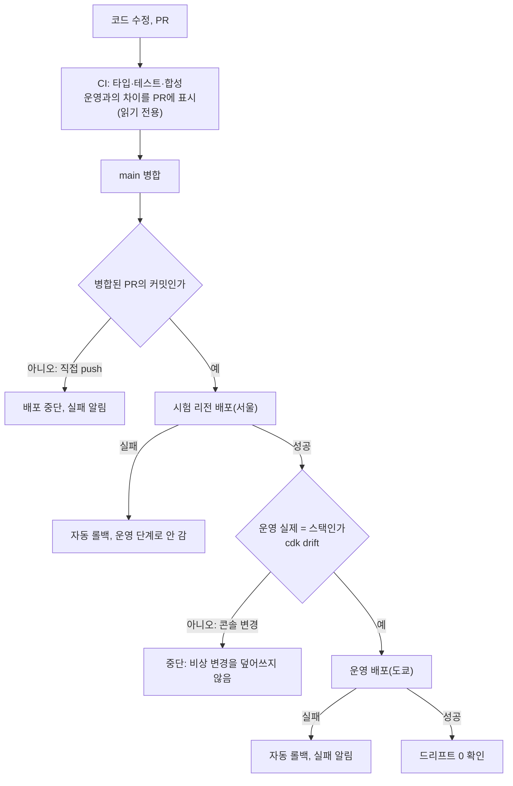
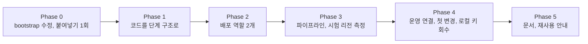

# AWS CDK 2단계 — AWS 설정 변경을 PR로 옮긴다

<!-- plan-result:start — 이 블록만 병합 뒤에도 고칠 수 있다(CLAUDE.md §11). 아래는 승인된 계획 원문 -->

## 구현 결과

> #577 · 2026-11-07 대조 · 이탈 7 · 미구현 2(모두 보완함) — 판정 근거(파일:줄)는 PR 본문 "계획 대비 구현"

- 이탈(시험 결과): Lambda 함수 설정은 PR만으로 바꾸지 못한다. 서울 시험 T5에서 CloudFormation으로 메모리를 바꾸자 `$LATEST` 환경변수가 지워졌다(코드·발행 버전·별칭은 그대로, 갱신은 성공). 그대로면 다음 BE 배포가 환경변수 없는 `$LATEST`로 버전을 발행한다. 그래서 운영 함수 속성을 가드 테스트로 고정하고, CloudShell 변경 → 코드를 같은 값으로 고친 PR → `revert_drift` 수동 실행 → BE 배포 순서로 바꾼다. 이 경로와 환경변수 복구 명령은 운영에서 실행한 적이 없다
- 이탈(실행 중 발견): `--revert-drift`를 평소 절차에서 빼지 않고 `deploy.yml` 수동 입력 `revert_drift`로 남겼다. 로컬 키를 회수하면 비상 변경을 코드에 맞춘 뒤 드리프트 확인을 풀 경로가 없어서다. 켜면 운영 드리프트 확인을 건너뛴다
- 이탈(권한 축소): PR 역할 `link-sphere-infra-preview`는 lookup 역할을 맡지 않고 CloudFormation 읽기만 갖는다. lookup 역할로는 DB 백업 같은 S3 객체까지 읽을 수 있어서다
- 이탈(순서): 운영 스택의 `Stage` 이동과 `generateBootstrapVersionRule:false` 제거를 Phase 1에서 Phase 4-1로 미뤘다. 먼저 옮기면 메타데이터 차이로 운영 배포 전까지 매일 검사가 이슈를 열어서다
- 이탈(설계 단순화): `lib/config.ts`에 경계 적용 여부를 두지 않았다. Phase 4-2 뒤 두 단계가 같아져 항상 적용한다
- 이탈(대상 없음): 버킷 정책은 편입하지 않았다. 두 버킷 모두 정책이 없다(`NoSuchBucketPolicy`). SNS 구독만 편입했다
- 이탈(판단, 묻지 않음): 새로 만든 역할 `link-sphere-infra-deploy`·`-preview`도 L2가 아니라 L1이다. 같은 파일의 편입 역할과 모양을 맞췄다
- 미구현 → 보완함: 배포 실패 알림. `deploy.yml`에 단계가 없어 대조에서 드러났다. FE와 같은 `notify-failure`·`close-resolved-failures`를 넣었고(infra #39), main에 직접 push해 이슈가 열리고 다음 성공 배포로 닫히는 것을 확인했다(infra #40·#41)
- 미구현 → 보완함: BE `docs/RSS-FEED-BOT.md` 실행 주기 행의 옛 `put-rule` 안내(BE #179)
- 계획의 절차를 바꾼 것: Phase 4-6(BE 배포 확인)을 4-5(로컬 키 회수) 앞에서 했다. T2·T3을 한 PR로 쟀고 T4는 임시 `gate-check` 잡을 썼다. `iac-cfn-tag` 삭제에 PR이 2개 들었다(`Retain`을 먼저 풀어야 해서다). #17은 CI가 끝나기 전에 병합했고 결과는 성공이었다
- 실행 중 실패: 운영 첫 변경(#31)이 `WarmupRule` `Internal Failure`로 자동 롤백됐다(run `42213513110`). 서비스 영향은 없었지만 코드에 없던 룰의 한글 설명이 사라졌다. 같은 커밋 재실행(run `42214251314`)이 성공했고 원인은 확인하지 못했다
- 사용자 결정으로 더한 것: 로컬 키 회수 범위를 넓혀 IAM 그룹 탈퇴, `lambda:InvokeFunction`과 Secrets Manager 조회까지 회수했다. 이 컴퓨터의 다른 관리자 키도 사용자가 비활성화했다
- 발견: 로컬 키를 회수하면 기존 리소스 편입(`cdk import`) 경로가 없다. Deploy에 import 단계가 없어서다. 다음 범위를 정할 때 설계한다(infra 이슈 #11)
- 계획에 없던 변경: 시험 단계에 `prod` 별칭(`$LATEST`)과 생성 순서를 더하고 `ApiRole` 관리형 정책을 뺐다. 빈 상태에서 만들려면 별칭이 필요하고, 그 정책은 운영 로그 그룹용이다. 시험 단계에도 preview 역할이 있다
- 계획에 없던 변경: `scripts/drift-check.sh`가 단계 안 스택 선택자와 SNS 구독 예외를 처리하고 `set -u` 오류를 고쳤다. `scripts/bootstrap.sh`는 AWS CLI 페이저를 끈다
- 계획에 없던 변경: T5에 메타데이터만 바뀌는 경우(함수 호출 없음)와 `--revert-drift`(함수 그대로)를 더 쟀다. 임시 코드는 측정 뒤 지웠다
- 계획에 없던 변경: infra README에 `$LATEST` 환경변수 복구 명령을, PLAYBOOK에 "꼭 해야 하나" 절을 더했다
- 문서 동기화: BE `.claude/CLAUDE.md`·`docs/DATA-PROTECTION.md`·`docs/DEPLOY.md`·`docs/TRAFFIC-MANAGEMENT.md` 일부, FE `docs/RUM.md`·`docs/DEPLOY.md` 일부·`docs/DECISIONS.md` 2026-11-05 상태 줄, infra 스크립트 주석과 드리프트 이슈 문구

<!-- plan-result:end -->

> 콘솔·CloudShell로 설정을 바꾸고 코드를 뒤따라 맞추던 1단계를 뒤집는다. 설정은 코드로 바꾸고, 병합하면 GitHub Actions가 같은 계정의 시험 리전을 거쳐 운영에 적용한다. 새 AWS 계정은 만들지 않고 스택도 나누지 않는다. 비용은 월 1센트 미만으로 추정하고, 사용자가 체감하는 서비스 변화는 없다.

## Context

### 왜 하는가

이 작업의 목적은 세 가지다(사용자, 11-06). 사용자는 "이런 아키텍처를 한번 구현해 보려던 것"이라고도 했다.

- 다른 프로젝트에도 쓸 수 있게 배운다.
- 정석대로, 공식 권장대로 한다.
- 콘솔 작업과 명령 붙여넣기를 줄여 변경 기록을 git에 남긴다.

**인프라 코드가 하는 일.** 서비스 사용자에게 가는 프로그램이 아니라 AWS 설정 목록이다. 예를 들어 피드 크롤 주기를 바꾸면, 지금은 사람이 `aws events put-rule`을 실행하고 이유는 어디에도 안 남는다. 새 방식은 코드 한 줄을 고쳐 PR을 병합하면 자동으로 적용되고 누가, 언제, 왜 바꿨는지 git에 남는다.

### 이전 승인안을 고친 이유

| 이전 승인안                              | 발견                                                                                                                                                                                                                                                                           | 이번 계획                              |
| ---------------------------------------- | ------------------------------------------------------------------------------------------------------------------------------------------------------------------------------------------------------------------------------------------------------------------------------ | -------------------------------------- |
| 시험은 별도 계정, Free 플랜이라 0원      | _"기존 AWS 계정이 있거나 있었던 적이 있으면 Free 플랜이나 Free Tier 크레딧을 받을 자격이 없다"_ (번역, [AWS FAQ](https://aws.amazon.com/free/free-tier-faqs/))                                                                                                                 | 새 계정을 만들지 않는다(사용자, 11-06) |
| 같은 계정 다른 리전은 코드가 달라져 기각 | 실제 차이는 전역인 IAM·S3 이름 구분 정도다. CDK 문서도 _"테스트·통합·운영 환경(각각 자체 리전이나 계정으로 격리)에 배포할 수 있다"_ (번역, 일부 생략, [CDK 모범 사례](https://docs.aws.amazon.com/cdk/v2/guide/best-practices.html))고 쓴다. CDK Pipelines를 설명하는 문장이다 | 같은 계정, 서울 리전에서 시험한다      |
| 스택 3개로 나누기                        | 공식 문구가 "고려하라" 수준이고 운영 리소스 6개를 옮겨야 한다                                                                                                                                                                                                                  | 한 스택을 유지한다(사용자, 11-06)      |

### 공식 권장과 지금의 차이

| 주제        | 공식 문서                                                                                                                                                                                                                                          | 1단계                             | 이 계획                        |
| ----------- | -------------------------------------------------------------------------------------------------------------------------------------------------------------------------------------------------------------------------------------------------- | --------------------------------- | ------------------------------ |
| 변경 경로   | _"템플릿을 버전 관리하고 코드 리뷰와 자동 테스트로 변경을 검증하라"_ (번역, [CloudFormation 모범 사례](https://docs.aws.amazon.com/AWSCloudFormation/latest/UserGuide/best-practices.html))                                                        | 콘솔·CLI 먼저, 코드는 뒤따라 맞춤 | 스택의 모든 리소스를 PR로 변경 |
| 사람의 역할 | _"관리자 자격 증명은 bootstrap과 첫 파이프라인 구성에만 쓰고, 그 뒤에는 로컬 컴퓨터가 아니라 파이프라인으로 배포하라"_ (번역, [CDK Pipelines](https://docs.aws.amazon.com/cdk/v2/guide/cdk-pipeline.html))                                         | CloudShell 반복, 로컬 키 위임     | 첫 설정 뒤에는 PR만            |
| 실행 권한   | 잘게 좁히는 방식은 _"복잡한 문제를 일으키고 개발 생산성을 크게 떨어뜨릴 수 있어 권장하지 않는다. 대신 가드레일을 두고 우회를 막기를 권장한다"_ (번역, [CDK 보안 모범 사례](https://docs.aws.amazon.com/cdk/v2/guide/best-practices-security.html)) | 읽기 전용 + 필요한 쓰기만 추가    | 관리자 + 권한 경계             |
| 시험 환경   | _"운영 스택을 만들고 다른 단계마다 별도 스택을 만들어 설정값을 코드에 두라"_ (번역, [CDK 모범 사례](https://docs.aws.amazon.com/cdk/v2/guide/best-practices.html))                                                                                 | 손으로 만든 버릴 리소스           | 같은 코드로 서울 리전에 생성   |

### 용어

| 용어        | 뜻                                                                          |
| ----------- | --------------------------------------------------------------------------- |
| bootstrap   | CDK가 배포에 쓸 역할과 버킷을 계정·리전에 처음 만드는 작업. 사람이 실행한다 |
| 실행 역할   | CloudFormation이 실제 리소스를 바꿀 때 쓰는 권한                            |
| 권한 경계   | 역할이 가질 수 있는 최대치. 권한을 주지는 않고 상한만 정한다                |
| 단계(Stage) | 시험·운영처럼 같은 코드를 배포하는 환경 단위                                |
| 드리프트    | 코드(스택)와 실제 AWS 설정이 어긋난 상태                                    |

### 전체 흐름



작업 순서다. 멈춤 조건에 걸리면 다음 단계로 가지 않고 그 자리에서 사용자에게 묻는다.



## 판단이 필요했던 항목

| 항목           | 결정                                                                                                                          | 근거·기각한 대안                                                                                                                                                                                                                                                                                                                                                                                           |
| -------------- | ----------------------------------------------------------------------------------------------------------------------------- | ---------------------------------------------------------------------------------------------------------------------------------------------------------------------------------------------------------------------------------------------------------------------------------------------------------------------------------------------------------------------------------------------------------- |
| 도구           | AWS CDK 유지. 결정(사용자, 11-05)                                                                                             | 이번 재검토 대상이 아니다                                                                                                                                                                                                                                                                                                                                                                                  |
| 범위           | 스택 나누기와 새 계정을 뺀 2단계를 운영 연결까지 진행. 결정(사용자, 11-06: 3번)                                               | 1단계 유지는 변경 한 건에 `손으로 변경 → 이슈 → 코드 맞추는 PR → --revert-drift`로 일이 늘고, 걷어내면 기록 문제가 그대로다. Claude는 시험 리전에서만 구현하는 안을 추천했고 사용자가 운영 연결까지 골랐다                                                                                                                                                                                                 |
| 배포 경로      | GitHub Actions + `cdk deploy`. 결정(사용자, 11-06)                                                                            | _"`cdk deploy`로 배포를 시작하거나 자동 배포를 구성하기를 권장한다"_ (번역, [deploy](https://docs.aws.amazon.com/cdk/v2/guide/deploy.html)). CDK 가이드에 GitHub Actions 언급은 없어, 문서 그대로는 CDK Pipelines 쪽이 더 가깝다. 기각: CDK Pipelines(결과를 AWS에서 보고 FE·BE와 다름, 소액 비용), [`cdk-pipelines-github`](https://github.com/cdklabs/cdk-pipelines-github)(README: _"실험 단계"_, 번역) |
| 시험 환경      | 같은 계정 다른 리전. 결정(사용자, 11-06: 3번). 리전 `ap-northeast-2`(서울)는 Claude 제안                                      | 위 CDK 문구에 맞는다. SnapStart도 _"뉴질랜드와 타이베이를 뺀 모든 상용 리전에서 쓸 수 있다"_ (번역, [Lambda](https://docs.aws.amazon.com/lambda/latest/dg/snapstart.html)). 기각: 별도 계정(Free 플랜 자격이 없어 Paid 플랜, 가입·카드·루트 보관), 시험 없음(Lambda 위험을 잴 곳이 없음)                                                                                                                   |
| 스택 구조      | `link-sphere-baseline` 하나 유지. 결정(사용자, 11-06: 3번)                                                                    | _"상태가 있는 리소스는 별도 스택에 두는 것을 고려하라"_ (번역, [CDK 모범 사례](https://docs.aws.amazon.com/cdk/v2/guide/best-practices.html)). 기각: 3개 분리(운영 리소스 6개 이전, 나중에도 가능)                                                                                                                                                                                                         |
| 시험 단계 이름 | IAM 역할과 S3 버킷만 `-test`를 붙인다. OIDC 제공자는 시험 단계에 만들지 않고 운영 것을 쓴다. Claude 제안                      | IAM·S3 이름은 리전을 넘어 겹친다. 같은 이름이면 생성이 실패한다(T1에서 확인). OIDC 제공자는 주소별로 계정에 하나뿐이다. 가드 테스트로 강제한다                                                                                                                                                                                                                                                             |
| 저장소         | infra는 별도 비공개, FE·BE는 공개 유지. 결정(사용자, 11-06)                                                                   | FE·BE가 함께 쓰는 인프라다. CDK 기본은 같은 패키지지만 _"코드 수명 주기나 팀 소유권에 따라 저장소를 옮기라"_ (번역)고도 한다. OIDC 신뢰가 저장소 단위라 관리자급 역할을 BE 워크플로와 분리한다                                                                                                                                                                                                             |
| main 보호      | 유료 없음. 배포 잡이 "병합된 PR의 커밋인지" 확인. 결정(사용자 조건 + Claude 제안)                                             | API가 _"Pro로 올리거나 공개로 바꾸라"_ (번역)며 403을 돌려준다(직접 조회, 11-06). 기각: Pro(유료), 공개 전환(되돌릴 수 없음). 대가는 서버가 push 자체는 못 막는 점이다. 표준이 아니라 자체 검사다                                                                                                                                                                                                          |
| 실행 역할      | `AdministratorAccess` + 권한 경계. 결정(사용자, 11-06)                                                                        | 위 공식 권장을 따른다. R5의 `UPDATE_ROLLBACK_FAILED`가 공식이 경고한 _"롤백 권한이 없어 수작업 복구"_ (번역) 사례였다. 대가는 main에 병합된 코드가 계정 대부분을 바꿀 수 있는 점이다                                                                                                                                                                                                                       |
| 권한 경계 내용 | CDK bootstrap 템플릿의 예시를 저장소 파일로 옮겼다(#13): 경계 없는 역할·사용자 생성 금지, 경계 수정·제거 금지                 | [`--example-permissions-boundary`](https://docs.aws.amazon.com/cdk/v2/guide/ref-cli-cmd-bootstrap.html)는 _"예시로 봐야 하고 실제 배포에는 새 정책으로 옮기라"_ (번역, 일부 생략)고 한다. 설치본 2.1147.0과 같은 내용임을 확인했다                                                                                                                                                                         |
| 로컬 키        | 읽기와 lookup 역할만 남기고 deploy 위임과 직접 쓰기를 회수한다. 결정(사용자, 11-06)                                           | 실행 역할이 관리자가 되면 위임받은 로컬 키도 사실상 관리자다. 대가는 스택 복구도 PR이나 CI 수동 실행으로 하는 점이다. 키 자체는 유지한다(10-13 결정)                                                                                                                                                                                                                                                       |
| 사람 승인 단계 | 없음. PR 병합이 승인이다. Claude 제안                                                                                         | 비공개 저장소의 배포 승인은 Free에 없다([요금제](https://docs.github.com/en/get-started/learning-about-github/githubs-plans))                                                                                                                                                                                                                                                                              |
| PR 차이        | `cdk diff --method=template`, lookup 역할만 쓰는 역할. Claude 제안                                                            | [`cdk diff`](https://docs.aws.amazon.com/cdk/v2/guide/ref-cli-cmd-diff.html)의 `change-set`은 더 정확하지만 deploy 역할을 쓴다. PR에 쓰기 경로를 주지 않으려 _"덜 정확한"_ (번역) `template`을 고른다                                                                                                                                                                                                      |
| 적용 전 비교   | 운영 배포 전 `cdk drift --fail`. Claude 제안                                                                                  | _"템플릿 밖에서 바꾼 뒤 스택을 갱신하면 직접 바꾼 내용은 버려진다"_ (번역, [CloudFormation 모범 사례](https://docs.aws.amazon.com/AWSCloudFormation/latest/UserGuide/best-practices.html)). 비상 변경이 조용히 사라지는 것을 막는다                                                                                                                                                                        |
| 비밀값         | 유료인 Secrets Manager는 제외한다. Parameter Store 표준 SecureString + BE 시작 때 읽기가 후보. 이번에는 측정까지. Claude 제안 | [Lambda 문서](https://docs.aws.amazon.com/lambda/latest/dg/configuration-envvars.html)는 Secrets Manager를 권장하고, [Parameter Store](https://aws.amazon.com/systems-manager/pricing/) 표준은 추가 요금이 없다. BE 코드 변경이 필요해 따로 승인받는다                                                                                                                                                     |
| 변경 범위      | 지금 스택 리소스, CI 권한, 버킷 정책, SNS 구독. Claude 제안                                                                   | CloudFront·WAF·ACM·Route 53·FE 버킷·SES·RUM은 다음 계획이다. 최근 90일 설정 변경 92건 중 40건이 여기에 속해 이 계획이 끝나도 손으로 한다(직접 측정: `cloudtrail lookup-events`, 고른 이벤트 종류만)                                                                                                                                                                                                        |

### 공식과 일부러 달라지는 점

| 공식                                                                                                                                                                   | 이 계획                                      | 이유와 대가                                                                                                                                                                                                                                           |
| ---------------------------------------------------------------------------------------------------------------------------------------------------------------------- | -------------------------------------------- | ----------------------------------------------------------------------------------------------------------------------------------------------------------------------------------------------------------------------------------------------------- |
| _"계정 수준 분리를 강하게 권장한다"_ (번역, [Well-Architected](https://docs.aws.amazon.com/wellarchitected/latest/framework/sec_securely_operate_multi_accounts.html)) | 같은 계정 다른 리전                          | 가입·카드 없이 가려는 사용자 결정이다. 대가: 시험과 운영이 IAM을 공유하고, 계정 사이 배포는 해 보지 않는다. PLAYBOOK에 옮기는 순서를 적는다                                                                                                           |
| 상태 있는 리소스 분리 고려                                                                                                                                             | 한 스택 유지                                 | 위 스택 구조 항목                                                                                                                                                                                                                                     |
| 인프라와 앱 코드를 같은 패키지에                                                                                                                                       | 저장소 분리                                  | 위 저장소 항목                                                                                                                                                                                                                                        |
| 코드도 CDK로 배포                                                                                                                                                      | Lambda 코드·버전·별칭은 BE `deploy.yml` 유지 | 스모크 검사와 별칭 전환이 이미 있다. 대가: 설정을 바꿔도 `$LATEST`만 바뀌고 `prod`에는 다음 BE 배포부터 적용된다. 발행 버전은 _"변경 불가능한 스냅샷"_ (번역, [Lambda](https://docs.aws.amazon.com/lambda/latest/dg/configuration-versions.html))이다 |
| L2 구성 요소가 가장 널리 쓰임                                                                                                                                          | 편입한 리소스는 L1 유지, 새 리소스만 L2      | _"import할 때는 리소스마다 L1으로 정의해야 한다"_ (번역, [migrate](https://docs.aws.amazon.com/cdk/v2/guide/migrate.html)). L2로 바꾸라는 권장 문장은 찾지 못했다                                                                                     |
| SCP·가드레일 서비스                                                                                                                                                    | 권한 경계만, 콘솔은 규칙과 매일 검사로       | SCP는 관리 계정에 적용되지 않고 조직도 쓰지 않는다. Config 등은 유료다. 그래서 콘솔 변경을 기술적으로 막지는 못한다                                                                                                                                   |

### 뒤집힌 전제

| 발견                                                                                       | 그래서 바뀐 것                                                                   |
| ------------------------------------------------------------------------------------------ | -------------------------------------------------------------------------------- |
| 기존 계정이 있으면 Free 플랜 자격이 없다                                                   | 시험 계정을 없애고 서울 리전을 쓴다. Free 플랜 위험 항목과 연장 판단 이슈를 뺀다 |
| 좁은 실행 역할은 공식이 권하지 않는다                                                      | 1단계의 "실행 역할을 넓히지 않는다" 규칙을 없앤다                                |
| 사용자 목적은 콘솔·명령 기록을 없애는 것이다                                               | 스택 안 리소스의 콘솔 변경은 비상 때만. README의 "콘솔·CLI로 변경" 절차를 없앤다 |
| 코드로 바꾸면 `--revert-drift`·재import가 필요 없다                                        | 평소 절차에서 빼고, 멈춘 스택 복구만 남긴다                                      |
| 형식 값으로 적은 Lambda 코드 키 `iac-placeholder`가 운영 버킷에 없다(직접 조회 404, 11-06) | CloudFormation이 코드 갱신을 부르면 실패할 수 있다. T5를 운영과 같은 형태로 잰다 |

### 위험 관리

| 위험                                                                                                                                               | 막는 장치                                                                                                                                                                                                                                                       | 그래도 일어나면                                                                                  |
| -------------------------------------------------------------------------------------------------------------------------------------------------- | --------------------------------------------------------------------------------------------------------------------------------------------------------------------------------------------------------------------------------------------------------------- | ------------------------------------------------------------------------------------------------ |
| 값이 틀린 채 배포가 성공함. API는 스택 밖의 `prod` 별칭·발행 버전으로 돌지만, `ApiRole`·Lambda URL·호출 권한은 스택 안이라 틀리면 바로 오류가 난다 | PR 차이, 시험 리전. 이번 계획의 운영 변경은 설명 문구, 권한 경계, 편입뿐이다                                                                                                                                                                                    | 되돌리는 PR을 병합한다(걸린 시간은 T2에서 잰다). 급하면 콘솔로 고치고 코드를 맞춘다              |
| 배포 실패, 스택 멈춤                                                                                                                               | 자동 롤백, 관리자 실행 역할로 롤백 권한 부족을 없앰. 서비스 영향은 없고 설정 변경만 막힌다                                                                                                                                                                      | `continue-update-rollback` 절차를 실행한다                                                       |
| 파이프라인이나 배포 역할 고장                                                                                                                      | 서비스 영향은 없고 변경만 막힌다. 역할 변경도 PR과 시험을 거친다                                                                                                                                                                                                | 사용자가 CloudShell에서 고친다                                                                   |
| 직접 main push                                                                                                                                     | 배포 잡의 PR 확인                                                                                                                                                                                                                                               | 커밋을 되돌린다. 다음 PR 차이에도 드러난다                                                       |
| main·의존성 공격으로 계정 변경                                                                                                                     | OIDC는 main만, 권한 경계, 잠금 파일, 액션 SHA 고정, 운영 리소스 `Retain`과 종료 보호                                                                                                                                                                            | 역할을 회수하고 CloudTrail을 본다. GitHub 계정이 뚫리면 이 장치도 우회될 수 있다                 |
| 시험 단계가 운영 IAM·버킷에 닿음                                                                                                                   | 시험 단계 이름 `-test`를 가드 테스트로 강제, CloudFormation은 스택 밖 리소스를 고치지 않음, 시험 단계에서 CloudFront 호출 권한 제외                                                                                                                             | 드리프트 검사에 드러난다. 되돌리는 PR을 병합한다                                                 |
| Phase 0~4 동안 로컬 키가 사실상 관리자                                                                                                             | 규칙, 변경 세트 선확인, Phase 4에서 회수 확인                                                                                                                                                                                                                   | CloudTrail을 대조한다                                                                            |
| Lambda 갱신이 환경변수를 비우거나 형식 코드 값으로 실패함                                                                                          | T5로 먼저 잰다. _"갱신 때 `UpdateFunctionConfiguration`과 `UpdateFunctionCode`를 호출한다"_ (번역, [CloudFormation](https://docs.aws.amazon.com/AWSCloudFormation/latest/TemplateReference/aws-resource-lambda-function.html))는 문서가 있어 실제 위험으로 본다 | `prod` 별칭은 발행 버전이라 바로 영향이 없다. 위험한 결과면 Lambda 변경을 테스트로 막고 보고한다 |
| 의도한 변경이 드리프트 이슈로 열림                                                                                                                 | `concurrency`로 매일 검사와 겹치지 않게 함                                                                                                                                                                                                                      | 다음 검사에서 닫힌다                                                                             |

## 세부 계획

작업은 모두 워크트리에서 한다(`git -C`). 이 파일은 공개 레포에 커밋되니 계정 ID를 쓰지 않는다. **멈춤 조건에 걸리면 넘어가지 않고 묻는다.** 1단계에서 이를 어겼던 일이 있어 명시한다.

### Phase 0: bootstrap (infra PR, 사람 실행)

| 위치                      | 변경 내용                                                                                                             |
| ------------------------- | --------------------------------------------------------------------------------------------------------------------- |
| `scripts/bootstrap.sh`    | 인자와 `--trust`를 없애고, 운영 계정의 도쿄와 서울을 한 번에 bootstrap한다. 운영 계정 확인과 로컬 키 정책 출력은 유지 |
| `bootstrap/boundary.json` | 변경 없음(#13)                                                                                                        |

**사람 실행:** 운영 계정 CloudShell에 붙여넣기 1회. **멈춤:** 운영 스택이 드리프트 0이 아니게 되거나 CDKToolkit이 `UPDATE_COMPLETE`가 아니면 멈춘다.

### Phase 1: 코드 구조 (infra PR)

| 위치                                            | 변경 내용                                                                                                                                               |
| ----------------------------------------------- | ------------------------------------------------------------------------------------------------------------------------------------------------------- |
| `lib/config.ts` (신규, `constants.ts` 대체)     | 단계별 리전, 이름 접미사, `Retain` 여부, 룰 활성화, 경계 적용 여부                                                                                      |
| `lib/link-sphere-stage.ts` (신규), `lib/app.ts` | `Stage`로 `Test`·`Prod` 구성. 운영 스택 이름 `link-sphere-baseline` 유지, 시험은 `link-sphere-test-baseline`. `generateBootstrapVersionRule:false` 제거 |
| `lib/baseline-stack.ts`                         | 시험 단계는 `Retain` 없음, 룰 비활성, 더미 코드 asset, CloudFront 호출 권한 제외, OIDC 제공자 없음, IAM·버킷 이름 `-test`                               |
| `test/guards.test.ts`                           | 단계별 검사로 변경: 운영만 `Retain`·종료 보호, 시험은 IAM·버킷 이름 `-test`. 비ASCII 금지와 비밀값 금지는 유지                                          |

**멈춤:** 운영 단계 합성 결과에서 리소스의 논리 ID나 속성이 바뀌면 멈춘다.

### Phase 2: 배포 역할 (세션, 로컬 키 위임)

| 순서 | 내용                                                                                                                                        |
| ---- | ------------------------------------------------------------------------------------------------------------------------------------------- |
| 1    | `link-sphere-infra-drift`, `link-sphere-iac-*` 정책, `link-sphere-user`를 운영 스택에 import한다. 지원 여부는 `describe-type`으로 먼저 본다 |
| 2    | `link-sphere-infra-deploy`(main만, CDK 역할 위임), `link-sphere-infra-preview`(PR, lookup 역할만)를 만든다. 변경 세트를 읽고 실행한다       |

**멈춤:** 각 순서 뒤 드리프트 0이 아니거나, FE·BE 배포 역할의 신뢰·권한이 달라지면 멈춘다.

### Phase 3: 파이프라인과 시험 리전 (infra PR)

| 위치                                  | 변경 내용                                                                                                                                                                                              |
| ------------------------------------- | ------------------------------------------------------------------------------------------------------------------------------------------------------------------------------------------------------ |
| `.github/workflows/deploy.yml` (신규) | main push와 수동 실행. 검사(테스트, 합성, PR 확인) → 시험 배포 → 운영 배포(이 Phase에서는 꺼 둠). OIDC 세션 이름은 run ID, 액션은 SHA 고정, `--require-approval never`, 매일 검사와 같은 `concurrency` |
| `.github/workflows/ci.yml`            | PR 차이를 job summary에 적는다                                                                                                                                                                         |

시험은 PR로 하고 결과를 PR 댓글에 남긴다.

| #   | 시험                                                                                                    | 통과 조건                                                                  | 실패 시                             |
| --- | ------------------------------------------------------------------------------------------------------- | -------------------------------------------------------------------------- | ----------------------------------- |
| T1  | 서울 리전에 코드로 전체 생성(OIDC 제공자 제외)                                                          | 시험 스택 성공, 드리프트 0, 운영 스택 변화 없음                            | 멈춤                                |
| T2  | 알람 값 변경과 되돌리기                                                                                 | 실제 반영, 드리프트 0. 되돌리는 PR이 적용될 때까지 걸린 시간 기록          | 멈춤                                |
| T3  | 룰 일정 변경                                                                                            | 타겟·Input 불변                                                            | 멈춤                                |
| T4  | 실패하는 값                                                                                             | 자동 롤백, 운영 단계로 안 감, 값 원복                                      | 멈춤                                |
| T5  | 운영과 같은 형태의 함수(스택 밖에서 코드·환경변수를 넣고, 없는 키의 형식 값으로 import)에서 메모리 변경 | 측정: 환경변수·코드·발행 버전·별칭이 어떻게 되는지, 갱신이 실패하는지 기록 | Phase 4에서 Lambda 변경을 막고 보고 |
| T6  | 직접 main push                                                                                          | 검사에서 배포 중단                                                         | 멈춤                                |

T1~T6 결과를 사용자에게 보고한 뒤 Phase 4로 이어 간다. 멈춤 조건에 걸리면 묻는다.

### Phase 4: 운영 연결 (infra PR 각각)

| 순서 | 내용                                                                                                                   |
| ---- | ---------------------------------------------------------------------------------------------------------------------- |
| 1    | 운영 단계를 켠다. 첫 실행은 실제 리소스 변경이 없어야 한다(변경 세트 내용을 PR에 기록)                                 |
| 2    | 전 역할에 권한 경계 적용(`PermissionsBoundary.of`, 설치본으로 L1 적용 확인)                                            |
| 3    | 첫 변경: 알람 `link-sphere-api-throttles` 영어 설명, 룰 `link-sphere-api-warmup` 영어 설명. 전후 설정·타겟·health 비교 |
| 4    | 버킷 정책, SNS 구독 편입(지원 여부 확인 뒤)                                                                            |
| 5    | 로컬 키 회수: deploy 위임과 직접 쓰기 제거. `link-sphere-iac-cfn-tag`, `cloudshell-setup.sh` 제거                      |
| 6    | BE 배포를 수동 실행해 첫 배포와 드리프트 0을 확인                                                                      |

**멈춤:** 1번에 실제 리소스 변경이 있거나, 앱 health·알람·룰 타겟이 바뀌면 멈춘다. 5번 뒤 로컬 키로 deploy 역할 위임이 거부되는지 확인한다.

### Phase 5: 문서와 재사용

| 위치                                                                          | 변경 내용                                                                                                                                                 |
| ----------------------------------------------------------------------------- | --------------------------------------------------------------------------------------------------------------------------------------------------------- |
| infra `README.md`, `.claude/CLAUDE.md`                                        | 변경은 PR, 비상 절차, 멈춘 스택 복구, 금지 규칙 다시 쓰기                                                                                                 |
| infra `docs/PLAYBOOK.md` (신규)                                               | 다른 프로젝트용 순서. 새 프로젝트와 기존 리소스 편입 두 경로, 사람이 하는 일, 공식 링크, 공식과 다르게 한 점, 시험을 별도 계정으로 옮기는 순서, 겪은 함정 |
| FE `docs/plans/2026-11-06-aws-cdk-stage2.md` (신규)                           | 이 계획과 구현 결과 블록                                                                                                                                  |
| FE `docs/plans/2026-11-05-aws-cdk-stage1.md`                                  | 구현 결과 블록에 `대체됨`                                                                                                                                 |
| FE `docs/DECISIONS.md`                                                        | 2026-11-06 항목: 공식 권장으로 전환, 권한, 배포 경로, 시험 리전, 기각한 대안                                                                              |
| FE `docs/DEPLOY.md`, `docs/SYSTEM-ARCHITECTURE.md`, `docs/ONBOARDING.md`      | "감지 전용" 서술 갱신                                                                                                                                     |
| BE `docs/DEPLOY.md`, `docs/RSS-FEED-BOT.md`, `docs/LAMBDA-CONFIG-ROLLBACK.md` | 룰·Lambda 설정 변경 안내를 infra PR로                                                                                                                     |
| infra 이슈 #11                                                                | 질문을 "다음 범위와 비밀값 방식"으로 교체, T5 결과 추가                                                                                                   |

## 영향 범위

**CRUD 실패 지점(대상은 AWS 설정)**

| 동작 | 깨질 수 있는 것                                                                                                                               |
| ---- | --------------------------------------------------------------------------------------------------------------------------------------------- |
| 생성 | 경계가 없는 새 역할은 거부된다. 시험 리전은 빈 상태에서 만들어 빠진 설정이 드러난다. IAM·버킷 이름이 겹치면 생성이 실패한다                   |
| 읽기 | 매일 검사, PR 차이. 사용자 요청 경로 영향 없음                                                                                                |
| 수정 | 적용은 코드 값으로 덮어쓴다. 콘솔 변경은 적용 전 비교가 막는다. 코드에 없는 값은 측정 전까지 위험으로 본다(warmup 한글 설명, Lambda 환경변수) |
| 삭제 | 운영은 전 리소스 `Retain`과 종료 보호. 코드에서 빼도 실제는 남아 고아가 생길 수 있다                                                          |

**기존 기능 회귀**

| 소유 파일                                                                        | 확인할 것                                                             |
| -------------------------------------------------------------------------------- | --------------------------------------------------------------------- |
| BE `.github/workflows/deploy.yml`, `db-backup.yml`, `prod-alias-drift-check.yml` | 경계 적용 뒤에도 동작한다. Phase 4에서 실제 배포로 확인               |
| FE `.github/workflows/deploy.yml`, `cloudfront-drift-check.yml`                  | 경계 적용 뒤에도 동작한다                                             |
| infra `drift-check.yml`, `scripts/drift-check.sh`                                | 시험 스택이 늘어도 종료 코드가 같다                                   |
| 룰이 부르는 BE 잡(warmup, account-purge, feed-crawl, orphan-image-gc)            | warmup 설명만 바뀐다. 타겟·Input 불변                                 |
| 런북(BE `docs/DEPLOY.md` 8장, `docs/RSS-FEED-BOT.md`)                            | 옛 `put-rule` 안내를 고친다. 안 고치면 콘솔 변경이 되어 배포가 멈춘다 |
| 세션 작업 습관                                                                   | 로컬 키로 직접 바꾸던 일이 거부된다. 앱 운영 조회는 그대로 된다       |

데이터 계약 변경과 FE·BE 코드 변경은 없다. 비밀값을 옮기는 BE 코드 변경은 이 계획 밖이다.

**비용(추정)**

| 항목         | 예상                              | 근거                                                                                                                                                                                                                                                                                                                                                                         |
| ------------ | --------------------------------- | ---------------------------------------------------------------------------------------------------------------------------------------------------------------------------------------------------------------------------------------------------------------------------------------------------------------------------------------------------------------------------- |
| GitHub       | 0                                 | 비공개 [월 2,000분](https://github.com/pricing) 안에서 쓴다(최근 30일 22분 실측)                                                                                                                                                                                                                                                                                             |
| 스택·IAM     | 0                                 | CloudFormation `AWS::*` 타입과 IAM은 추가 요금이 없다                                                                                                                                                                                                                                                                                                                        |
| 시험 리전    | 월 1센트 미만, 운영 청구서에 합산 | 도쿄 자산 버킷 실측 43.6KB. [도쿄 가격표](https://pricing.us-east-1.amazonaws.com/offers/v1.0/aws/AmazonS3/current/ap-northeast-1/index.json) $0.025/GB·월 기준이고 서울 가격은 구현 때 본다. 시험 Lambda는 호출하지 않고 룰은 꺼 둔다. 알람은 운영 3개 + 시험 3개로 [무료 10개](https://aws.amazon.com/cloudwatch/pricing/) 안이다. 빈 로그 그룹 등이 0원이라는 건 추정이다 |
| bootstrap 키 | 0                                 | 운영 CDKToolkit에 KMS 키 리소스가 없고, CLI 2.1147.0 기본값이 AWS 관리형 키다(직접 확인)                                                                                                                                                                                                                                                                                     |

첫 달 청구서로 실제 금액을 확인한다(이슈 #11).

## 검증 방법

1. **코드:** infra `pnpm type-check`, `pnpm test`, `pnpm synth`.
2. **시험:** T1~T6 결과를 PR 댓글에 남긴다.
3. **운영 적용마다:** 전후 설정을 받아 다른 경로만 비교한다.
   ```bash
   scripts/drift-check.sh link-sphere-baseline   # exit 0
   aws cloudwatch describe-alarms --alarm-names link-sphere-api-throttles   # 설명만 바뀌고 상태 유지
   aws events list-targets-by-rule --rule link-sphere-api-warmup            # 타겟·Input 불변
   curl -sS -o /dev/null -w '%{http_code}\n' https://linksphere.click/api/actuator/health   # 200
   ```
4. **FE·BE 배포:** 두 저장소 배포 run이 성공하는지 확인한다.
5. **로컬 키:** `sts assume-role`로 deploy 역할을 맡으면 거부되고, lookup 역할과 조회는 되는지 확인한다.
6. **PR 확인 잡:** 직접 push가 배포 전에 멈추는지 확인한다(T6).
7. **비밀값:** 가드 테스트, 합성 템플릿과 저장소 이력의 값 패턴 검색, job summary에 환경변수 값이 없는지 확인한다.
8. **문서:** FE `pnpm check:docs`, PR 본문 `pnpm check:pr-body`.
9. **계획 대조:** `plan-verifier`로 infra·FE·BE 결과를 이 계획과 대조하고 FE PR `## 계획 대비 구현`에 남긴다.

## 남은 것

- **사용자 실행:** 운영 계정 CloudShell 붙여넣기 1회. 1단계는 2회 예상에 실제 6회였으니 늘 수 있다.
- **계속 손으로 하는 일:** WAF·CloudFront·ACM·Route 53·FE 버킷·SES·RUM 변경과 Lambda 환경변수 값.
- **비밀값 방식:** T5 결과와 BE 변경안을 묶어 따로 승인받는다.
- **다음 계획(필요하면):** 위 서비스 편입, 스택 나누기, 시험의 별도 계정 이전. Free 요금제와 8KB WAF 규칙을 먼저 조사한다.
- **Lambda 설정 적용 시점:** 코드로 바꿔도 다음 BE 배포 뒤에 `prod`에 적용된다. 세션이 BE 배포를 실행한다.
- **나중에 확인(이슈 #11):** 첫 달 청구서, Dependabot npm.
