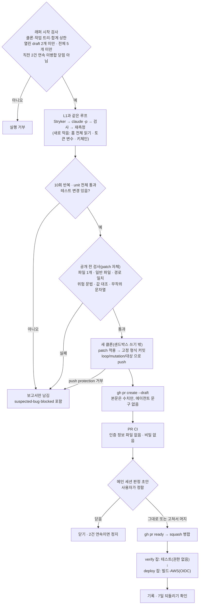

# 뮤테이션 테스트 자동 보강 루프: L2(draft PR까지)

<!-- plan-result:start — 이 블록만 병합 뒤에도 고칠 수 있다(CLAUDE.md §11). 아래는 승인된 계획 원문 -->

## 구현 결과

> #567(Phase 0) · #570(Phase 1) · 2026-11-06 대조 · 이탈 2 · 미구현 0 — 판정 근거(파일:줄)는 각 PR 본문 "계획 대비 구현". 건별 수치와 판정은 claude-base `docs/METRICS.md` "실험: 뮤테이션 보강 루프 L2"

- Phase 3 결과: draft PR 5개 모두 머지했고 닫은 것은 0개다. 고쳐서 머지 3건(#572·#573·#578, 합계 +16/−14줄), 그대로 머지 2건(#575·#576)이다. 사용량은 5건 $3.28, `runs/` 합계 $7.54 / 상한 $15다(목록가 환산이고 청구액이 아니다). 병합마다 돈 배포 5회 모두 성공했다
- 유지 기준: "5개 중 3개 이상 머지"는 넘었고, "7일 안에 되돌리기 0건"은 #579로 2026-11-14 이후에 확인한다. 5개를 채워 새 실행은 시작 검사가 거부한다. 더 돌리려면 상한을 다시 승인받는다
- 관찰(계획이 막으려던 일): #578에서 "현실에 없는 상황" 규칙이 있는데도 운영에 없는 이동으로 뮤턴트를 잡은 테스트가 나와, 사람이 읽고 실제 경로로 고쳤다. 판정 초안은 메인 세션이 써서 독립적이지 않고, L1과 프롬프트·대상이 달라 직접 비교가 어렵다
- 이탈(측정 결과): Claude 샌드박스의 `allowRead`가 클론·도구 경로 외에 자기 세션 임시 폴더도 연다. 임시 루트를 통째로 막으면 Bash에서 node가 종료 코드 134로 죽어, 다른 세션 폴더는 이름 패턴(`-Users-*`·`-private-*`·`bash-edit-diff`)으로 막는다. 최상위 폴더 이름은 보이고, 패턴 밖 이름의 폴더는 막히지 않는다
- 이탈(계획 문구가 실제와 다름): 위험 문법에 걸리면 에이전트에게 돌려주지 않고 다른 사후 검사처럼 실행이 `check-failed`로 끝난다. 에이전트가 미리 아는 것은 프롬프트의 금지 목록뿐이다
- 대조 뒤 보완함: `--no-push`가 시작 검사를 건너뛰던 것을 모든 실행에 걸도록 고쳤다
- 계획에 없던 변경: `verify.sb`가 홈 전체의 메타데이터를 연다(계획이 열어 둔 질문의 답). 내용과 폴더 목록은 막힌다. `/Library/Keychains`와 `/private/tmp/claude-<uid>` 읽기도 막는다
- 계획에 없던 변경: 대상 이름이 브랜치에 쓸 수 없거나 `gh pr list`가 실패하면 시작을 거부한다
- 계획에 없던 변경(Phase 0, 문서 동기화): `docs/BUILD-VERSION.md`·`docs/SYSTEM-ARCHITECTURE.md`의 배포 잡 서술도 `verify`·`deploy` 두 잡에 맞춰 고쳤다
- 구현 중 확인: `sandbox.credentials`는 Claude Code가 넣는 변수에도 먹혔다(대조 실험). `--settings`의 `denyRead`·`allowRead`는 적용되고 `allowRead` 글롭은 듣지 않았다. `run` 스텝의 OIDC 변수는 재지 않았다(결론에 영향 없음)
- 정정: 검사 후보 수치는 재측정 결과 기존 테스트 185개 중 위험 문법 9개, 무작위 문자열 2개다(계획은 178개 중 12개·2개). `deploy-verify`는 "워크플로 단위"가 아니라 잡 목록을 읽되 상태·결론으로 판정한다. "영향 없음" 결론은 같다

<!-- plan-result:end -->

> 루프가 검사를 통과한 테스트를 draft PR로 직접 연다. 머지는 사람이 정한다. 그 전에 에이전트 코드가 닿는
> 곳에서 비밀과 AWS 권한을 치운다.

## Context

### 왜 하나

- 2026-10-31 요청한 AI 루프·멀티에이전트 준비의 Phase 2 다음 단계다(`docs/plans/2026-10-31-ai-loop-graph-readiness.md:164-170`).
  제품에는 필요 없고 학습·포트폴리오용이다.
- L1은 5건 모두 머지 가능으로 판정돼 FE #565로 들어갔다. 다만 5건 중 3건에서 사용상 차이 없는 뮤턴트를 죽이려는 듯한
  단언을 고쳤다. 점수 100%는 품질의 증거가 아니다. 판정도 메인 세션 초안을 사용자가 확정한 것이라 독립적이지 않다.
- L2에서 달라지는 점: L1은 나갈 길이 없었지만 L2는 diff가 공개 저장소로 나가고, 에이전트가 쓴 테스트가 네트워크가 열린
  GitHub 러너에서 돈다.
- 용어: draft PR은 병합할 수 없는 초안 PR이다. OIDC는 비밀 키를 저장하지 않고 잡이 그때그때 AWS 임시 권한을 받는 방식이다.

### 직접 확인한 것(2026-11-06)

| 확인                | 결과                                                                                                                                                                                                                                                                                           |
| ------------------- | ---------------------------------------------------------------------------------------------------------------------------------------------------------------------------------------------------------------------------------------------------------------------------------------------- |
| 배포 잡             | `deploy.yml:23-25`가 워크플로 전체에 `id-token: write`를 주고, 같은 잡의 `:57-60`에서 `pnpm test`를 돌린다. AWS 역할은 `repo:BAECHAN/link-sphere_FE_NEW:ref:refs/heads/main`을 믿는다(`docs/DEPLOY.md:291-292`)                                                                                |
| OIDC 범위           | [GitHub 문서](https://docs.github.com/en/actions/reference/security/oidc)는 _"`id-token: write`가 없으면 OIDC JWT ID 토큰을 요청할 수 없다"_ (번역)고 쓰고, 워크플로나 잡 하나에 줄 수 있다고 쓴다. `run` 스텝에서 받을 수 있는지는 명시하지 않고 `curl` 예시만 있다. 된다고 보고 대비한다     |
| PR CI               | 예전 draft #287·#291에서 `check`·`e2e`·`lighthouse`가 돌았다. `check`·`mutation` 잡은 `pull-requests: write` 토큰을 받는다                                                                                                                                                                     |
| checkout            | 설치 버전 v7.0.1. [README](https://github.com/actions/checkout)는 기본값 true, v6부터 인증 정보를 `$RUNNER_TEMP`의 별도 파일에 둔다고 쓴다. 뒤 스텝이 읽을 수 있는지는 명시하지 않는다                                                                                                         |
| PR 토큰의 한계      | [권한 표](https://docs.github.com/en/rest/authentication/permissions-required-for-github-apps)에서 병합은 `contents: write`다. `can_approve_pull_request_reviews`도 false다. 그래서 피해 상한은 PR 댓글·제목·본문 수정이다                                                                     |
| 잡 분리 비용        | run 42205555428 기준 준비 스텝 합계 18초(잡 준비 2, checkout 1, pnpm 3, Node 8, install 4)                                                                                                                                                                                                     |
| 에이전트 환경 변수  | Claude Code가 `CLAUDE_CODE_MESSAGING_TOKEN`을 에이전트 Bash에 넣는다. [샌드박스 문서](https://code.claude.com/docs/en/sandboxing)는 `sandbox.credentials`의 `deny`가 _"샌드박스 명령이 돌기 전마다 환경 변수를 지운다"_ (번역)고 쓰지만, Claude Code가 직접 넣는 변수에도 되는지는 적지 않았다 |
| 읽기 차단           | 같은 문서에 `denyRead: ["~/"]` + `allowRead` 예시가 있다. 지금은 목록 방식이라 `~/.claude` 대화 기록은 읽을 수 있다                                                                                                                                                                            |
| `.git` 보호         | 같은 문서상 `.git/hooks`·`config`는 기본으로 쓰기가 막히고, 래퍼가 `.git`·`.claude` 전체를 `denyWrite`로 더 막는다(`mutation-loop.mjs:200`)                                                                                                                                                    |
| **키체인(새 발견)** | `verify.sb` 안에서 `security find-generic-password -s gh:github.com`의 메타데이터 조회가 종료 코드 0이었다(값은 안 읽음). 프로필이 `(allow default)`라 키체인 연결을 막지 않는다. L1은 나갈 길이 없어 값이 새지 않았지만 L2 전에 막아야 한다                                                   |
| 저장소 보호         | public, `secret_scanning_push_protection` 켜짐(공급자 패턴만), main 규칙은 `check`·`e2e`·`pr-body` 필수·강제 push 금지                                                                                                                                                                         |
| gh 인증             | 최소 환경(`HOME`·`PATH`)에서 `gh`가 키체인 로그인으로 동작한다. 전역 git에는 credential helper가 없어 push에 `gh auth git-credential`을 직접 지정해야 한다                                                                                                                                     |
| 클론 git 설정       | `core.hooksPath`·`core.fsmonitor` 없음, `.husky/_` 없음. `pre-push`가 돌지 않으니 래퍼가 검사를 책임진다                                                                                                                                                                                       |
| 사용량              | 합계 $4.21, L1 5건 $2.53(건당 약 $0.51). 달러는 청구액이 아니라 목록가 환산이다(구독 로그인)                                                                                                                                                                                                   |
| 검사 후보 보정      | 위험 문법: L1 5건 0건, 기존 테스트 178개 중 12개(주로 `src/test/scripts`). 긴 무작위 문자열(32자 이상, 엔트로피 4.0 이상, 숫자 포함): L1 5건 0건, 기존 178개 중 2개                                                                                                                            |

### 전체 흐름

## 판단이 필요했던 항목

| 항목                      | 결정                                                                                                                                          | 근거·기각한 대안                                                                                                                                                                                                                                                                   |
| ------------------------- | --------------------------------------------------------------------------------------------------------------------------------------------- | ---------------------------------------------------------------------------------------------------------------------------------------------------------------------------------------------------------------------------------------------------------------------------------- |
| 공개 시점                 | 검사를 통과하면 자동으로 draft를 연다                                                                                                         | 사용자 선택(11-06). "읽은 뒤 명령"은 #565와 거의 같아 "명세 승인으로 건별 승인을 대신한다"는 실험이 사라져 기각했다. 읽기 전에 공개되는 단점은 비밀의 출처를 먼저 막아 줄인다                                                                                                      |
| 배포 잡                   | L2 전에 `verify`와 `deploy` 잡으로 나눈다                                                                                                     | 사용자 선택. 머지가 튼튼한 관문이 아니다(L1에서 실제로 읽은 쪽은 메인 세션). "그대로"는 사람 읽기와 위험 문법 검사에만 기대서 기각했다                                                                                                                                             |
| 유출 검사                 | 새 도구 없이: 출처 차단, push protection, 값 대조, 무작위 문자열                                                                              | 사용자 선택. gitleaks는 설치가 필요하고 형식이 알려지지 않은 토큰을 잡는지 확인하지 못했다. 나중에 추가해도 되돌림 비용이 없다                                                                                                                                                     |
| 프롬프트                  | "현실에 없는 상황에서만 드러나는 뮤턴트는 테스트로 잡지 말고 보고한다"를 더한다                                                               | 사용자 선택. L1 3건의 수정 유형이다. 남은 뮤턴트 목록을 건네는 구조가 원인이라는 것은 추정이다. L1과 프롬프트가 달라 직접 비교가 어렵고, 기록에 밝힌다                                                                                                                             |
| push 주체                 | 샌드박스 밖 래퍼만. 에이전트는 git·gh 금지 유지                                                                                               | 에이전트에 인증을 주면 격리의 의미가 없다                                                                                                                                                                                                                                          |
| push 위치                 | `~/project/loop-lab/publish/`의 새 클론                                                                                                       | 에이전트 코드가 돈 클론의 설정·파일을 믿지 않는다. `/private/tmp`는 Seatbelt가 쓸 수 있어 기각했다. 테스트가 띄운 프로세스가 남아 있어도 닿지 못한다                                                                                                                               |
| 검사 대상                 | 실제로 올릴 patch 자체                                                                                                                        | 검사 뒤 남은 프로세스가 파일을 바꿔도 올라가는 내용을 본다. 파일 1개, `new file mode 100644` 또는 일반 수정만 허용한다. 심볼릭 링크·바이너리·이름 변경은 거부한다                                                                                                                  |
| PR 본문                   | 래퍼가 수치로 만들고 에이전트 문구를 넣지 않는다                                                                                              | 멘션과 `Closes #N`이 실제로 작동하는 것을 막는다. 에이전트 요약은 로컬 `report.md`에 남긴다                                                                                                                                                                                        |
| 위험 문법                 | `process.`, `child_process`, node 내장 import, `require(`, `eval(`, `new Function`, `fetch(`, `RUNNER_TEMP`, `ACTIONS_`, `GITHUB_`를 거부한다 | 우회할 수 있는 1차 방어다. 우회 코드는 읽을 때 눈에 띈다. 에이전트에게 바로 실패로 돌려주려고 `runChecks`에도 넣는다                                                                                                                                                               |
| PR CI                     | `check`·`mutation` checkout에 `persist-credentials: false`                                                                                    | 인증 정보 파일을 읽는 가장 쉬운 길을 막는다. 테스트가 뒤 스텝 스크립트를 바꾸는 길은 남지만 피해 상한이 PR 수정이라 잡 분리까지는 과하다고 봤다. 코드상 `git fetch`·`git push`가 없어 동작 변화는 없다                                                                             |
| 테스트만 바뀐 PR의 재배포 | 그대로 둔다                                                                                                                                   | 경로에서 빼도 다음 배포의 `pnpm test`에서 어차피 돌아 보안 효과가 없다                                                                                                                                                                                                             |
| 대상                      | 구현 때 테스트 없는 훅 약 10개를 재서 살아남음+안 닿음이 큰 순으로 5개                                                                        | 후보: `usePostCard`, `usePostCardBookmarkFolderDialog`, `useBookmarkPage`, `usePostCreateBookmarkFolderField`, `useLoginDialog`, `usePostDetail`, `auth.store`, `unsavedChanges.store`, `useBookmarkFolders`, `useBookmarkPostButton`. Plan mode에서는 Stryker를 돌리지 않는다(§4) |
| 상한·모델                 | 합계 $15와 Sonnet 5.5 유지                                                                                                                    | L1 실측으로 5건을 더 돌릴 수 있다. 정지 기준 2배($30)도 10-31 계획대로다                                                                                                                                                                                                           |
| 정지 조건                 | 머지 없이 닫힌 PR 2개 연속이면 래퍼가 거부                                                                                                    | 10-31 기준은 "구현·버그 고정으로 닫힘"이다. 사유를 코드로 가릴 수 없어 넓혔다. 라벨을 새로 만들지 않는다                                                                                                                                                                           |
| 판정                      | 메인 세션이 건별 초안, 사용자가 머지·고쳐서 머지·닫기를 정한다                                                                                | L1과 같다. 머지는 기존처럼 확인 창을 거친다                                                                                                                                                                                                                                        |
| 승인 단위                 | 이 계획 승인이 테스트만 바뀌는 diff의 건별 계획 승인을 대신한다                                                                               | 10-31 계획의 L2 결정. 프롬프트·설정·`verify.sb`·대상 규칙이 바뀌면 다시 승인받는다                                                                                                                                                                                                 |

### 뒤집힌 전제

| 발견                                                                                         | 그래서 바뀐 것                                           |
| -------------------------------------------------------------------------------------------- | -------------------------------------------------------- |
| 10-31 계획의 L2 절은 PR CI와 배포 잡의 권한을 적지 않았고 재배포만 짚었다                    | 배포 잡 분리를 L2 선행 작업으로 넣는다                   |
| L1의 `verify.sb`는 파일과 네트워크만 막아 키체인이 열려 있었다                               | 키체인 차단을 넣고 탐침으로 확인한다                     |
| 조사 초기에 값 대조를 유출 검사 후보로 봤지만, 래퍼는 자식 프로세스의 토큰 값을 모를 수 있다 | 변수 자체를 지우는 쪽을 먼저 쓰고, 값 대조는 보조로 둔다 |

### 위험 관리

| 위험                                                       | 대응                                                                                                                                                                           |
| ---------------------------------------------------------- | ------------------------------------------------------------------------------------------------------------------------------------------------------------------------------ |
| 비밀이 테스트 파일에 섞여 공개                             | 출처 차단이 1차, push protection·값 대조·무작위 문자열이 2차다. 지우기 어려우니 어느 검사든 걸리면 열지 않는다. 우회 플래그를 두지 않는다                                      |
| 토큰 변수를 못 지우거나 Claude 샌드박스의 키체인을 못 막음 | **L2 실행 전에 멈추고 다시 묻는다**(세부 계획 Phase 2)                                                                                                                         |
| 테스트가 문법 검사를 우회해 배포에 닿음                    | 잡 분리로 `verify` 잡에서만 돈다. 남는 길은 `pnpm` 캐시 오염이다. 키가 lockfile 해시라 테스트만 바뀐 PR은 대개 저장하지 않고, 캐시 미스와 읽기 누락이 겹쳐야 하므로 받아들인다 |
| 잡 분리가 배포를 깨뜨림                                    | 병합 run을 확인하고, 실패하면 L2로 넘어가지 않고 revert한다. `verify` 실패 때 실패 이슈가 열리도록 `notify-failure`의 `needs`를 함께 고친다                                    |
| PR·테스트 문구가 메인 세션을 조종(프롬프트 인젝션)         | 테스트 파일은 지시가 아니라 데이터로 읽는다. 머지는 확인 창과 사용자 결정을 거친다                                                                                             |
| 버그·구현 고정 테스트                                      | 프롬프트로 금지하고, 메인 세션이 읽어 초안에 적는다. 2건 연속 닫히면 정지한다                                                                                                  |
| 공개 저장소에 낮은 품질의 PR이 쌓임                        | 전체 5개, 동시 2개 상한을 코드로 강제한다                                                                                                                                      |
| 재배포 5회                                                 | 테스트만 바뀌어도 병합마다 돈다. 3~5분이고 앱 결과물은 같다                                                                                                                    |

## 세부 계획

### Phase 0: CI 권한 분리(FE PR, 먼저 병합)

| 위치                                                                      | 변경 내용                                                                                                                                                                                                                 |
| ------------------------------------------------------------------------- | ------------------------------------------------------------------------------------------------------------------------------------------------------------------------------------------------------------------------- |
| `.github/workflows/deploy.yml`                                            | 워크플로 권한을 `contents: read`로 낮추고, `verify` 잡(checkout `persist-credentials: false`, 설치, `pnpm check`, `pnpm test`)을 새로 둔다. `deploy` 잡은 `needs: verify`, 잡 권한에 `id-token: write`, 두 검사 스텝 제거 |
| `.github/workflows/deploy.yml` `notify-failure`·`close-resolved-failures` | `needs`를 `[verify, deploy]`로 고친다                                                                                                                                                                                     |
| `.github/workflows/ci.yml` `check`·`mutation`                             | checkout에 `persist-credentials: false`                                                                                                                                                                                   |
| `docs/DEPLOY.md`, `docs/CI-CHECK-GATE.md`                                 | 잡 구성 서술을 고친다                                                                                                                                                                                                     |
| `docs/plans/2026-11-06-mutation-loop-l2.md` (신규)                        | 이 계획. 구현 결과 블록은 Phase 1 PR과 기록 단계에서 덧붙인다                                                                                                                                                             |

### Phase 1: 래퍼 L2(FE PR)

| 위치                                                       | 변경 내용                                                                                                                                                                                                                                                                                                                                                                 |
| ---------------------------------------------------------- | ------------------------------------------------------------------------------------------------------------------------------------------------------------------------------------------------------------------------------------------------------------------------------------------------------------------------------------------------------------------------- |
| `.claude/scripts/mutation-loop.mjs`                        | 머리말의 "push하지 않는다"를 고친다. 시작 검사 `decideRunGate`, patch 검사 `validatePatch`·`findForbiddenSyntax`·`findLeakedValues`·`findRandomStrings`, 공개 `publishDraft`, 본문 `renderPrBody`를 더한다. `--no-push`는 커밋까지만 한다. 결과 `published`(PR 번호 또는 막힌 이유)를 `result.json`·`report.md`에 남긴다. 합계 상한은 그대로다                            |
| `.claude/scripts/mutation-loop.mjs` `publishDraft`         | `git clone --depth 1`, `-c core.hooksPath=/dev/null`, `-c credential.helper= -c 'credential.helper=!gh auth git-credential'`, `git apply --index`, 고정 형식 커밋(`test(<scope>): <대상> 뮤테이션 빈틈을 메우는 테스트 추가`, 쓴 모델 표기), refspec은 `HEAD:refs/heads/loop/mutation/<대상>`만, `gh pr create --draft --base main`. 끝나면 새 클론은 다음 실행 때 지운다 |
| `.claude/hooks/mutation-loop.test.mjs`                     | 판정 함수 테스트 추가: 파일 2개·심볼릭 링크·바이너리·이름 변경·경로 불일치 거부, 위험 문법, 값 대조, 무작위 문자열, 게이트(열린 2개·전체 5개·연속 닫힘), 브랜치 이름에 `main` 불가, 본문이 `findPrBodyProblems` 통과                                                                                                                                                      |
| `.claude/loops/mutation/settings.json`                     | `denyRead`를 `["~/"]`로, 클론과 도구 경로만 `allowRead`. `sandbox.credentials.envVars`에 `CLAUDE_CODE_MESSAGING_TOKEN` `deny`                                                                                                                                                                                                                                             |
| `.claude/loops/mutation/verify.sb`                         | 홈 전체 읽기 차단, 클론·도구 경로 허용. `/usr/bin/security` 실행과 키체인 연결 차단                                                                                                                                                                                                                                                                                       |
| `.claude/loops/mutation/prompt.md`                         | 현실에 없는 상황 규칙, 위험 문법 금지 목록                                                                                                                                                                                                                                                                                                                                |
| `docs/TESTING.md` 자동 보강 루프 절                        | PR을 여는 동작, 격리, 정지 조건, 사람이 할 일                                                                                                                                                                                                                                                                                                                             |
| `docs/plans/2026-11-06-mutation-loop-l2.md` 구현 결과 블록 | 대조 결과 요약                                                                                                                                                                                                                                                                                                                                                            |

### Phase 2: 격리 탐침과 건식 실행(커밋 없음, PR 전)

| 위치             | 변경 내용                                                                                                                                                                                                                                          |
| ---------------- | -------------------------------------------------------------------------------------------------------------------------------------------------------------------------------------------------------------------------------------------------- |
| 임시 탐침 테스트 | 에이전트 경로(Claude 샌드박스)와 `verify.sb` 양쪽에서 잰다. 토큰 변수 유무, `~/.claude/settings.json`·`~/.zshrc`·`/private/tmp` 다른 세션 파일 읽기, 키체인 값 읽기, 외부 통신. 결과는 있음·없음과 종료 코드만 파일로 받는다. 값은 출력하지 않는다 |
| 스모크           | Haiku, `logout-grace.util.ts`, `--budget 0.3`, `--no-push`. 새 클론에 커밋까지 만들어지는지, push가 일어나지 않는지 본다                                                                                                                           |
| **멈춤 조건**    | 토큰 변수를 지우지 못하거나 Claude 샌드박스에서 키체인 값이 읽히면 Phase 3로 가지 않고, 측정값과 대안을 보여 드리고 다시 묻는다                                                                                                                    |

### Phase 3: 실행과 판정

| 위치                    | 변경 내용                                                                                                         |
| ----------------------- | ----------------------------------------------------------------------------------------------------------------- |
| `~/project/loop-lab/fe` | `origin/main`에 맞춘 뒤 후보를 재서 5개를 고른다. 한 건씩 돌린다                                                  |
| draft PR 최대 5개       | 동시에 2개 이하. 첫 PR로 draft 상태, 파일 1개, 필수 검사, `closingIssuesReferences` 비어 있음을 확인한다          |
| 대화                    | 건별로 수치, 테스트가 지키는 동작, 의심 줄, 판정 초안을 낸다. 사용자가 정한다. 고칠 때는 amend + force-with-lease |

### Phase 4: 기록

| 위치                                                                                                                             | 변경 내용                                                           |
| -------------------------------------------------------------------------------------------------------------------------------- | ------------------------------------------------------------------- |
| claude-base `docs/METRICS.md`                                                                                                    | 건별 결과, 비용, 판정(그대로·고친 줄 수·닫음), L1과 프롬프트가 다름 |
| claude-base `docs/DECISIONS.md`                                                                                                  | "테스트만 바뀌는 diff는 명세 승인으로 건별 계획 승인을 대신한다"    |
| FE `docs/plans/2026-11-06-mutation-loop-l2.md` 구현 결과 블록, `docs/plans/2026-10-31-ai-loop-graph-readiness.md` 구현 결과 블록 | L2 결과와 정지 기준을 넓힌 사실을 docs PR로 적는다                  |
| GitHub 이슈                                                                                                                      | 마지막 병합 뒤 7일 되돌리기 확인 약속                               |

## 영향 범위 (§5)

- **데이터 CRUD**: 앱 데이터·API·스키마를 건드리지 않는다. 등록·수정·읽기·삭제 모두 해당 없다.
- **Phase 0 회귀**
  - `deploy.yml`: 모든 운영 배포가 지난다. 경로 필터에 자기 파일이 있어 병합하면 운영 배포가 한 번 돈다. 잡 이름 `deploy`와 동시 실행 그룹 `deploy-main`은 유지한다.
  - `notify-failure`·`close-resolved-failures`: `verify` 실패도 실패 이슈로 이어져야 한다. `failure()`는 앞선 잡 실패에도 참이라는 문서를 구현 때 다시 확인한다.
  - `ci.yml`: 필수 검사 이름 `check`·`e2e`·`pr-body`는 그대로다. `persist-credentials: false` 뒤 `git diff`·`dep-graph.js`가 로컬 이력만 쓰는지 이 PR의 CI로 확인한다.
  - claude-base `deploy-verify`: 잡이 아니라 워크플로 단위로 보므로 영향이 없다고 본다. 병합 때 확인한다.
- **Phase 1 회귀**
  - `ci.yml`의 `node --test .claude/hooks/*.test.mjs`에 새 테스트가 포함된다. CI에 claude-base·`gh` 인증이 없어도 돌아야 한다.
  - 읽기 차단을 넓히면 vitest·Stryker·tsc·eslint·`pnpm exec`가 필요한 경로를 못 읽을 수 있다. Phase 2에서 전부 다시 돌린다.
  - L1 기록의 프롬프트와 달라진다.
- **Phase 3 회귀**: 새 테스트 파일만 들어간다. 병합마다 재배포가 돈다. 앱 결과물은 그대로다.
- **외부로 나가는 것**: 테스트 파일, 고정 형식 커밋, 수치 본문이 공개 저장소에 남는다. 닫아도 PR 기록은 남는다.
- **여러 곳에서 import하는 파일**: 고치지 않는다. `src/` 앱 코드 변경이 없다.
- **PR 본문 요약**: 두 PR 모두 CI·루프 도구만 바뀐다고 한두 줄로 적는다.

## 검증 방법

1. `node --test .claude/hooks/mutation-loop.test.mjs`, `pnpm lint`, `pnpm check:docs`, `pnpm check:pr-body`가 통과한다.
2. **Phase 0**: PR CI green. 병합 run에서 `verify` → `deploy` 순서로 성공하고, `deploy` 잡에 테스트 스텝이 없으며 `verify` 잡 권한이 `contents: read`인 것을 `gh run view`로 본다. 운영 `version.json`이 새 SHA다.
3. **격리 탐침**: Phase 2 표의 항목이 모두 막히고, vitest·eslint·tsc·Stryker는 양쪽 샌드박스에서 돈다(L1 대상 1개의 점수가 같은지 비교).
4. **건식 실행**: `--no-push`에서 원격 브랜치가 생기지 않고(`gh api .../matching-refs/heads/loop`가 0), 새 클론의 커밋이 파일 1개다.
5. **거부 경로**: 단위 테스트로 위험 문법·비밀 값·심볼릭 링크·`main` refspec이 push 전에 막히는지 본다.
6. **첫 draft**: `gh pr view`로 `isDraft`, 파일 1개, `closingIssuesReferences` 비어 있음, 필수 검사 통과를 본다.
7. **PR**: 두 PR 모두 `plan-verifier`로 대조해 `## 계획 대비 구현`을 쓴다.
8. **유지 기준(10-31 계획)**: 최대 5개 중 3개 이상 머지, 7일 안에 되돌리기 0건이면 유지한다. 닫힘 2개 연속 또는 합계 $30을 넘으면 멈춘다.

## 남은 것

- **구현하면서 확인할 항목**
  - `sandbox.credentials`가 Claude Code가 넣는 변수에도 먹히는지(안 되면 `CLAUDE_CODE_SUBPROCESS_ENV_SCRUB` 확인 뒤 멈춤 조건)
  - `--settings`로 넘긴 `denyRead`·`allowRead`가 `--setting-sources local`에서 적용되는지
  - 홈 전체 차단에서 Seatbelt가 상위 폴더 메타데이터를 얼마나 열어야 하는지
  - `/private/tmp` 아래 다른 세션 파일을 막을 수 있는지
  - `run` 스텝에서 OIDC 변수가 보이는지(된다고 보고 대비하므로 결론에는 영향 없음)
- **L2 뒤에 정할 것**
  - 유지 기준을 넘으면 대상을 넓힐지, 다른 루프로 갈지
  - 판정 초안을 쓰는 메인 세션이 독립적이지 않은 문제를 어떻게 줄일지
- **따로 진행할 것**
  - Phase 3 공개 문서(`docs/AI-HARNESS.md`)
  - 11-11 turn-status 판정, 11-15 가드 판정, claude-base 5라운드 2단계
- **하지 않는 것**: L3(무인 머지), 원격 러너, 래퍼의 `gh pr merge`, gitleaks 설치
