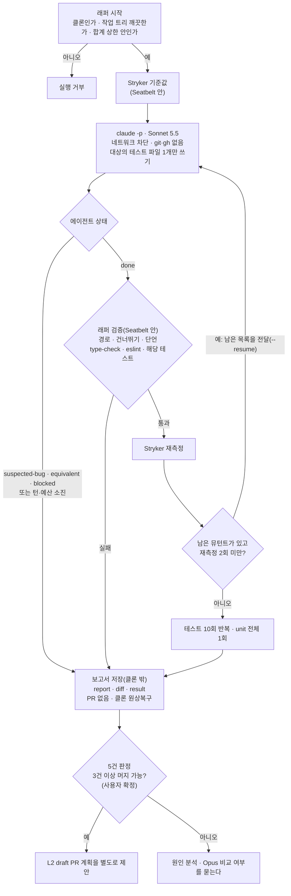

# 뮤테이션 테스트 자동 보강 루프: L1(보고만)

<!-- plan-result:start — 이 블록만 병합 뒤에도 고칠 수 있다(CLAUDE.md §11). 아래는 승인된 계획 원문 -->

## 구현 결과

> #562 · 2026-11-06 대조 · 이탈 3 · 미구현 0 — 판정 근거(파일:줄)는 PR 본문 "계획 대비 구현"

- 이탈(낭비를 줄이려고): 에이전트 Bash 허용을 `pnpm exec vitest run *`에서 `pnpm exec eslint *`·`pnpm type-check`까지 넓혔다. 타입·포맷 오류만으로 실행 전체가 `check-failed`로 끝나는 일을 막는다. 테스트 코드를 실행할 수 있으니 권한이 더 넓어지지는 않고, `eslint --fix`로 다른 파일을 고치면 사후 경로 검사가 잡는다.
- 이탈(검증이 빠지는 것을 막으려고): `equivalent`도 테스트 파일이 있으면 검증·재측정·최종 확인을 거친다. 아무것도 안 썼을 때만 바로 끝난다. 흐름도대로면 앞서 쓴 테스트가 검증 없이 보고된다.
- 이탈(직접 측정): 비용을 호출마다 더하지 않고 `total_cost_usd`를 그대로 쓴다. `--resume`한 세션의 누적값이라 더하면 두 번 센다. 남은 값을 상한으로 넘기는 결정은 그대로다.
- 계획에 없던 변경(격리): `settings.json` 거부 목록에 `Bash(git *)`·`Bash(gh *)`를 넣었다. `dontAsk`에서 `git status` 같은 읽기 명령이 자동 허용됐기 때문이다. 클론의 `.git`·`.claude` 쓰기와 원본 저장소 읽기도 막았다. 래퍼의 git·claude가 샌드박스 밖에서 `.git`·`.claude`를 읽기 때문이다.
- 계획에 없던 변경(운영): `VITE_API_BASE_URL` 고정값(`.env` 없는 클론용), 호출당 30분 제한과 그때 호출 상한을 다 쓴 것으로 치기, 재측정 뒤 예산 소진 종료, 도구 실패 종료 사유, 실행 폴더의 `logs/`·설정·프로필 사본, `docs/TESTING.md`의 `outcome` 표와 측정 메모.
- 발견: Claude Code가 에이전트 Bash에 넣는 `CLAUDE_CODE_MESSAGING_TOKEN`은 `loopEnv`로 뺄 수 없다. 외부 통신이 막힌 L1에서는 나갈 길이 없지만, diff가 GitHub로 나가는 L2 전에 검사를 더해야 한다.
- 발견: 대조 중 Seatbelt의 DNS 소켓이 열려 외부 이름이 풀리는 것을 찾아 닫았다. 계획의 "외부 통신 차단"을 코드가 지키지 못하던 틈이다.

<!-- plan-result:end -->

> AI가 테스트의 빈틈을 찾아 메우고, 메워졌는지 스스로 재는 루프를 별도 클론에 만든다.
> PR을 열지 않고 보고서만 남겨 5건을 사용자가 판정한다. 앱 코드와 운영은 바뀌지 않는다.

## Context

### 왜 하나

- 2026-10-31 요청한 AI 루프·멀티에이전트 준비의 Phase 2다(`docs/plans/2026-10-31-ai-loop-graph-readiness.md`).
  제품에는 필요 없고 학습·포트폴리오용이다.
- 10-31 계획은 이 단계를 11-11 이후로 잡았다. 2026-11-06 사용자가 기다릴 이유를 물었고, 추천대로 지금 시작하기로 했다.
- 용어: 뮤턴트는 코드 한 곳을 일부러 망가뜨린 사본이다. "살아남음"은 테스트가 그 망가짐을 못 잡았다는 뜻이고,
  "안 닿음"은 그 줄을 지나는 테스트가 없다는 뜻이다.

### 직접 확인한 것(2026-11-06)

| 확인                     | 결과                                                                                                                                    |
| ------------------------ | --------------------------------------------------------------------------------------------------------------------------------------- |
| 로그인                   | `claude auth status`가 `claude.ai`·`max`, `ANTHROPIC_API_KEY` 없음. 이 계획의 달러 값은 청구액이 아니라 사용량을 목록가로 환산한 값이다 |
| 지침 격리                | `--setting-sources local`로 프로젝트·전역 지침을 안 읽었다. 시작 컨텍스트가 약 88K에서 약 22K로 줄었다                                  |
| Claude 샌드박스          | `claude -p`에서 외부 통신과 클론 밖 쓰기가 막혔다. 폴더 안 쓰기는 허용된다                                                              |
| 파일 쓰기 권한           | `--permission-mode dontAsk`에서 허용한 경로의 Write만 통과하고 나머지는 거부됐다                                                        |
| 예산 상한                | 상한 $0.0001에서 `error_max_budget_usd`로 멈췄다. 실제 $0.0001285로, 응답 하나만큼 넘을 수 있다                                         |
| Seatbelt(`sandbox-exec`) | 안에서 vitest가 통과했고 `curl`·`~/.ssh` 읽기·폴더 밖 쓰기가 막혔다. `man sandbox-exec`는 `DEPRECATED`로 표시한다                       |
| Seatbelt 안 Stryker      | `useUnsavedChanges.ts`가 1분 7초에 돌았고, 점수 78.57%는 밖에서 잰 값과 같다                                                            |

참고 문서: [sandboxing](https://code.claude.com/docs/en/sandboxing), [permissions](https://code.claude.com/docs/en/permissions).

### 대상 후보 실측(`pnpm test:mutation --mutate …`, 8개 4분 41초)

| 파일                                                            | 살아남음 | 안 닿음 | 점수  | L1     |
| --------------------------------------------------------------- | -------- | ------- | ----- | ------ |
| `src/shared/hooks/useKeydown.ts`                                | 63       | 9       | 0.0%  | 대상   |
| `src/widgets/post/post-list/hooks/usePostListFilter.ts`         | 23       | 2       | 68.5% | 대상   |
| `src/features/bookmark/select/hooks/useBookmarkFolderSelect.ts` | 16       | 2       | 68.6% | 대상   |
| `src/features/auth/signup/hooks/useAvailabilityCheck.ts`        | 13       | 11      | 78.3% | 대상   |
| `src/features/auth/login/hooks/useLogin.ts`                     | 0        | 42      | -     | 대상   |
| `src/shared/store/unsavedChanges.store.ts`                      | 8        | 2       | 81.0% |        |
| `src/shared/hooks/useUnsavedChanges.ts`                         | 3        | 0       | 78.6% |        |
| `src/shared/utils/logout-grace.util.ts`                         | 1        | 0       | 93.3% | 스모크 |

대상 5개 모두 같은 이름의 테스트 파일이 없다.

### 전체 흐름



## 판단이 필요했던 항목

| 항목           | 결정                                                                                   | 근거·기각한 대안                                                                                                                                                           |
| -------------- | -------------------------------------------------------------------------------------- | -------------------------------------------------------------------------------------------------------------------------------------------------------------------------- |
| 모델           | Sonnet 5.5                                                                             | 사용자 선택(11-06). 목록가가 Opus 5.5의 절반이고(claude-base `scripts/token-metrics.mjs:28-34`) 품질은 래퍼 검증과 판정으로 잰다. Opus는 3/5 미달일 때 따로 묻는다         |
| 사용량 상한    | 실행당 $3, 합계 $15(스모크 포함)                                                       | 사용자 선택. 주간 1% 안팎으로 추정한다(11-02~04 사용량으로 계산, 공식 수치 아님). 넘으면 래퍼가 새 실행을 거부한다                                                         |
| L1 판정 담당   | 메인 세션이 초안, 사용자가 확정                                                        | 사용자 선택. L2에서 실제로 머지할지를 미리 재는 값이라 에이전트만의 판정은 기각했다                                                                                        |
| L1 대상        | 위 표의 5개                                                                            | 사용자 선택. 빈틈이 크고 키보드·URL 상태·폴더 선택·중복 확인·로그인으로 종류가 섞여 있다                                                                                   |
| 이번 범위      | L1까지                                                                                 | L2(draft PR)는 사람의 머지 판단이 걸린 별도 결정이라 L1 결과를 본 뒤 계획한다. L3(무인 머지)는 10-31 계획대로 하지 않는다                                                  |
| 시작 시점      | 11-11을 기다리지 않음                                                                  | M14는 11-06에 닫혔다. 루프 세션은 `~/project/loop-lab` 경로라 `rule-metrics`·`token-metrics` 기본 집계에 안 잡혀 11-11 turn-status 판정을 흐리지 않는다                    |
| 실행 환경      | 별도 클론 + `claude -p`, 메인 세션이 한 건씩 실행                                      | 10-31 계획 유지. `/loop`는 세션에 묶이고, 원격 러너는 가드가 없고 키가 필요하다                                                                                            |
| 에이전트 지침  | CLAUDE.md를 읽히지 않고 규칙을 프롬프트 파일에 담는다                                  | 시작 컨텍스트가 약 66K 줄어든다. claude-base 공통 규칙 "규칙을 지켜야 하는 일은 지침을 읽는 에이전트에"와 어긋나지만, 테스트에 필요한 규칙은 짧고 나머지는 eslint가 잡는다 |
| 검증 실행 격리 | 모든 Stryker·vitest·tsc·eslint를 `sandbox-exec` 안에서 돌린다                          | 래퍼가 에이전트의 테스트를 그냥 돌리면 샌드박스 밖에서 임의 코드가 실행된다. Docker는 새 의존성이라 기각했다. 샌드박스 없이 돌리는 분기는 두지 않는다                      |
| 에이전트 Bash  | `pnpm exec vitest run *`만 허용(`autoAllowBashIfSandboxed: false`)                     | 샌드박스만 믿으면 Bash로 클론 안 어디든 쓸 수 있다(`src/` 포함). 사후 경로 검사와 이중으로 둔다                                                                            |
| 환경 변수      | 래퍼가 최소 목록만 자식 프로세스에 넘긴다                                              | 샌드박스가 환경 변수를 지우는지 확인하지 않았고, 터미널에 `PGPASSWORD` 같은 값이 있을 수 있다. 클론에 `.env`도 두지 않는다                                                 |
| 경로 검사      | 대상 옆 `<이름>.test.ts(x)` 하나만 허용                                                | claude-base `TEST_PATH`는 `e2e/`·`.stories.`까지 통과시켜 넓다. `lib/test-patterns.mjs`에서는 `ASSERTION_LINE`·`SKIP_LINE`·`countLines`만 쓴다                             |
| 종료 조건      | 점수 목표를 두지 않는다. 남은 뮤턴트 0, 에이전트 보고, 재측정 2회 소진 중 먼저 오는 것 | 점수를 목표로 두면 구현을 베낀 테스트로 점수를 올릴 유인이 생긴다(우리 판단). 품질은 사용자 판정으로 본다                                                                  |
| 예산 합산      | `--resume`으로 잇되 비용은 래퍼가 직접 더해 남은 값을 상한으로 넘긴다                  | 재개한 세션의 합계가 상한에 들어가는지에 기대지 않는다                                                                                                                     |
| 판정 함수      | 패턴을 인자로 받고, `main()`에서만 claude-base를 동적 import                           | claude-base는 원격이 없어 CI에 없다. 선례 `.claude/scripts/plan-eval-cases.mjs`(순수 함수 export + 진입점 확인)                                                            |
| 문서 위치      | 실행법은 `docs/TESTING.md` 뮤테이션 절                                                 | 절차 문서라 그곳에 둔다. 서사와 결과는 Phase 3 `docs/AI-HARNESS.md` 몫이다                                                                                                 |
| 프롬프트 수정  | 고치면 그 전 실행은 판정에서 빼고 다시 돌린다                                          | 프롬프트가 다른 실행을 섞으면 3/5 기준의 의미가 흐려진다. 합계 상한은 그대로다                                                                                             |

### 뒤집힌 전제

| 발견                                                                               | 그래서 바뀐 것                                      |
| ---------------------------------------------------------------------------------- | --------------------------------------------------- |
| 10-31 계획은 에이전트 격리만 적었지만, 래퍼의 검증도 에이전트가 쓴 코드를 실행한다 | 검증 전체를 Seatbelt 안으로 넣는다                  |
| 10-31 계획은 `TEST_PATH` 재사용을 적었지만 stories·e2e도 통과한다                  | 경로 검사를 대상의 테스트 파일 하나로 좁힌다        |
| `--bare`는 OAuth를 읽지 않아 구독 로그인에서 못 쓴다                               | `--setting-sources local` + `--settings`로 격리한다 |
| 11-11 대기의 이유였던 측정 오염은 경로 분리로 이미 피한다                          | 오늘 시작한다                                       |

### 위험 관리

| 위험                                              | 대응                                                                                                  |
| ------------------------------------------------- | ----------------------------------------------------------------------------------------------------- |
| 테스트가 지금 동작의 버그를 고정                  | 프롬프트로 금지하고, 의심되면 `suspected-bug`로 멈춰 그 자리에서 보고한다                             |
| 구현을 베낀 테스트                                | 프롬프트에서 금지하고, 사용자 판정 때 "동작을 보는가"를 초안에 적는다                                 |
| 흔들리는 테스트                                   | 10회 반복과 unit 전체 1회로 거른다                                                                    |
| 사용량 초과                                       | 합계 상한을 코드로 강제한다. 응답 하나만큼 넘을 수 있어 정지 기준은 10-31 계획의 2배($30) 그대로 둔다 |
| `sandbox-exec` 제거                               | 검증이 실패해 멈춘다. 그때 대체 수단을 계획한다                                                       |
| gitignore된 파일은 경로 검사에 안 잡힘            | 실행은 Seatbelt 안이라 네트워크와 폴더 밖으로 못 나간다. L1은 PR이 없어 밖으로 나갈 경로도 없다       |
| Stryker가 프로세스 11개를 띄워 다른 세션이 느려짐 | 한 번에 한 건만 돌린다                                                                                |

## 세부 계획

### Phase 0: 선행 정리(claude-base)

| 위치               | 변경 내용                                               |
| ------------------ | ------------------------------------------------------- |
| claude-base `main` | `m14-verdict`를 ff 병합한다. 워크트리와 브랜치를 지운다 |

### Phase 1: 래퍼(FE PR)

| 위치                                               | 변경 내용                                                                                                                                                                                                                                                                                  |
| -------------------------------------------------- | ------------------------------------------------------------------------------------------------------------------------------------------------------------------------------------------------------------------------------------------------------------------------------------------ |
| `.claude/scripts/mutation-loop.mjs` (신규)         | CLI `<대상 파일> [--model sonnet] [--budget 3]`. 흐름도의 순서를 실행한다. 판정 함수를 export하고 진입점에서만 `main()`을 돈다. 턴 상한 호출당 30, 합계 상한 $15                                                                                                                           |
| `.claude/hooks/mutation-loop.test.mjs` (신규)      | 판정 함수 테스트: 뮤턴트 요약, 경로 검사, 건너뛰기·단언 검사, 남은 예산, 합계 상한, 클론 판별, 종료 사유                                                                                                                                                                                   |
| `.claude/loops/mutation/prompt.md` (신규)          | 쓸 수 있는 파일, 테스트 실행 명령, 동작을 테스트하는 규칙, 버그 고정 금지, 테스트 환경(`src/test/utils.tsx`·MSW), 코드 스타일, 출력 상태 4종                                                                                                                                               |
| `.claude/loops/mutation/settings.json` (신규)      | `disableAllHooks`, 샌드박스(`failIfUnavailable`, `allowUnsandboxedCommands: false`, `autoAllowBashIfSandboxed: false`, 네트워크 도메인 없음, 비밀 폴더 `denyRead`), `Bash(pnpm exec vitest run *)` 허용, `WebFetch`·`WebSearch`·`Agent` 거부. 대상별 `Edit` 허용은 래퍼가 실행 때 덧붙인다 |
| `.claude/loops/mutation/verify.sb` (신규)          | Seatbelt 프로필. 외부 통신 차단, 비밀 폴더 읽기 차단, 쓰기는 클론과 임시 폴더만. 경로는 `-D` 인자로 받는다                                                                                                                                                                                 |
| `docs/TESTING.md` 뮤테이션 절                      | "자동 보강 루프" 소절: 클론 준비, 실행 명령, 격리, 상한, 결과 위치                                                                                                                                                                                                                         |
| `docs/plans/2026-11-06-mutation-loop.md` (신규)    | 이 계획 + 구현 결과 블록                                                                                                                                                                                                                                                                   |
| `docs/plans/2026-10-31-ai-loop-graph-readiness.md` | H1 아래에 구현 결과 블록을 새로 만들고 `대체됨` 줄로 Phase 2 시작 조건과 계획 위치가 바뀐 것을 적는다                                                                                                                                                                                      |

실행 명령 형태:

```
claude -p <프롬프트> --model sonnet --setting-sources local --settings <실행별 설정>
  --tools "Bash,Read,Write,Edit,Glob,Grep" --permission-mode dontAsk
  --max-turns 30 --max-budget-usd <남은 값> --output-format json --json-schema <상태 스키마>
```

### Phase 2: 실행(커밋 없음)

| 위치                                     | 변경 내용                                                                                                                                                |
| ---------------------------------------- | -------------------------------------------------------------------------------------------------------------------------------------------------------- |
| `~/project/loop-lab/fe` (신규 클론)      | `git clone` + `pnpm install --frozen-lockfile`. `.env`를 두지 않는다                                                                                     |
| 스모크(PR 전)                            | 워크트리 브랜치를 클론으로 fetch해 Haiku, `logout-grace.util.ts`, `--budget 0.3`으로 전체 경로를 한 번 돌린다                                            |
| L1(PR 병합 뒤)                           | 클론을 `origin/main`에 맞추고 `useKeydown` → `usePostListFilter` → `useBookmarkFolderSelect` → `useAvailabilityCheck` → `useLogin` 순으로 한 건씩 돌린다 |
| `~/project/loop-lab/runs/<시각>-<대상>/` | `report.md`, `diff.patch`, `result.json`(비용, 턴, 기준값·재측정, 검증 결과, 기준 커밋)                                                                  |

### Phase 3: 판정과 기록

| 위치                                                       | 변경 내용                                                                                |
| ---------------------------------------------------------- | ---------------------------------------------------------------------------------------- |
| 대화                                                       | 건별로 전후 수치, 테스트가 무엇을 보는지, 의심 항목, 판정 초안을 낸다. 사용자가 확정한다 |
| claude-base `docs/METRICS.md`                              | 5건의 결과, 비용, 실행일, 판정을 적는다                                                  |
| claude-base `docs/DECISIONS.md`                            | 에이전트 지침 격리와 검증 격리 결정을 적는다                                             |
| FE `docs/plans/2026-11-06-mutation-loop.md` 구현 결과 블록 | L1 결과 한 줄을 docs PR로 덧붙인다                                                       |

## 영향 범위 (§5)

- **데이터 CRUD**: 앱 데이터·API·스키마를 건드리지 않는다. 등록·수정·읽기·삭제 모두 해당 없다.
- **배포**: 바뀌는 곳이 `.claude/`와 `docs/`뿐이고 `deploy.yml:6-20` 경로 필터에 없어 운영 배포가 돌지 않는다.
- **기존 기능 회귀**
  - `ci.yml:104`의 `node --test .claude/hooks/*.test.mjs`에 새 테스트가 자동 포함된다. claude-base가 없는 CI에서도 돌아야 한다.
  - `docs/plans` 불변성 CI: 10-31 계획은 구현 결과 블록만 더한다.
  - `pnpm check:docs`: `docs/TESTING.md`를 고치므로 돌린다.
  - `rule-metrics`·`token-metrics` 기본 집계에 루프 세션이 안 잡힌다. 의도한 것이고 비용은 `result.json`에 남긴다. 주간 사용량에는 잡힌다.
  - 가드 훅은 루프 세션에서 돌지 않는다. 대신 허용 목록·샌드박스·사후 검사가 막는다.
  - 대화 세션의 설정과 가드는 그대로다.
- **여러 곳에서 import하는 파일**: 고치지 않는다. 새 스크립트는 CLI 단독이다.
- **Stryker**: `reports/`·`.stryker-tmp/`는 `.gitignore`에 있어 경로 검사에 걸리지 않는다.

## 검증 방법

1. `node --test .claude/hooks/mutation-loop.test.mjs`가 통과하고, `pnpm lint`·`pnpm check:docs`가 통과한다.
2. **격리 확인**(Haiku, 상한 $0.05, `settings.json`과 최소 환경 변수 그대로)
   - `vitest run`은 실행되고 `curl`·`git status`는 거부된다.
   - Read가 클론 안에서 동작하고, 대상 테스트 파일만 쓸 수 있다.
   - 최소 환경 변수에서 구독 로그인이 유지되고, 자식 프로세스에 `PGPASSWORD` 같은 변수가 없다(이름만 확인, 값은 출력하지 않는다).
3. **Seatbelt 확인**: `fetch`·`~/.ssh` 읽기·밖에 쓰기를 시도하는 임시 테스트를 `verify.sb` 안에서 돌려 모두 막히는지 본다(`-D` 인자 포함).
4. **스모크**: 전체 경로가 돌아 보고서 3종이 나오고, 클론이 원상복구되고, `result.json`의 모델이 Haiku다.
5. **PR**: `plan-verifier`로 대조해 `## 계획 대비 구현`을 쓰고, `pnpm check:pr-body`, CI green을 확인한다.
6. **L1 완료 기준**: 5건 모두 `result.json`이 있고(멈춘 건은 사유와 함께), 합계가 $15 안이며, `result.json`의 모델이 Sonnet 5.5이고, 사용자 판정이 기록돼 있다.
7. **승격 기준(우리가 정한 값, 10-31 계획 유지)**: 5건 중 3건 이상이 "그대로 또는 20% 이하 수정으로 머지 가능"이면 L2 계획을 제안한다.

## 남은 것

- **구현하면서 확인할 항목**
  - Claude 샌드박스 안에서 vitest가 도는지(세션 안 Bash 경로는 아직 못 봄)
  - `dontAsk`에서 Read·Glob·Grep이 허용 규칙 없이 동작하는지
  - 최소 환경 변수에서 키체인 로그인이 유지되는지
  - `--model sonnet`이 Sonnet 5.5로 해석되는지
  - `~/.ssh`에 대한 Claude 샌드박스 `denyRead`(카나리 결과가 모호했다)
- **L1 뒤에 정할 것**
  - 머지 가능으로 판정된 diff를 PR로 옮길지
  - L2 계획과 DECISIONS 기록("테스트만 바뀌는 diff는 명세 승인으로 작업별 계획 승인을 대신한다")
  - 3/5 미달이면 Opus 비교를 할지
- **따로 진행할 것**
  - Phase 3 공개 문서(`docs/AI-HARNESS.md`)
  - 11-11 turn-status 판정, 11-15 가드 판정, claude-base 5라운드 2단계
- **하지 않는 것**: L3(무인 머지), 원격 러너
