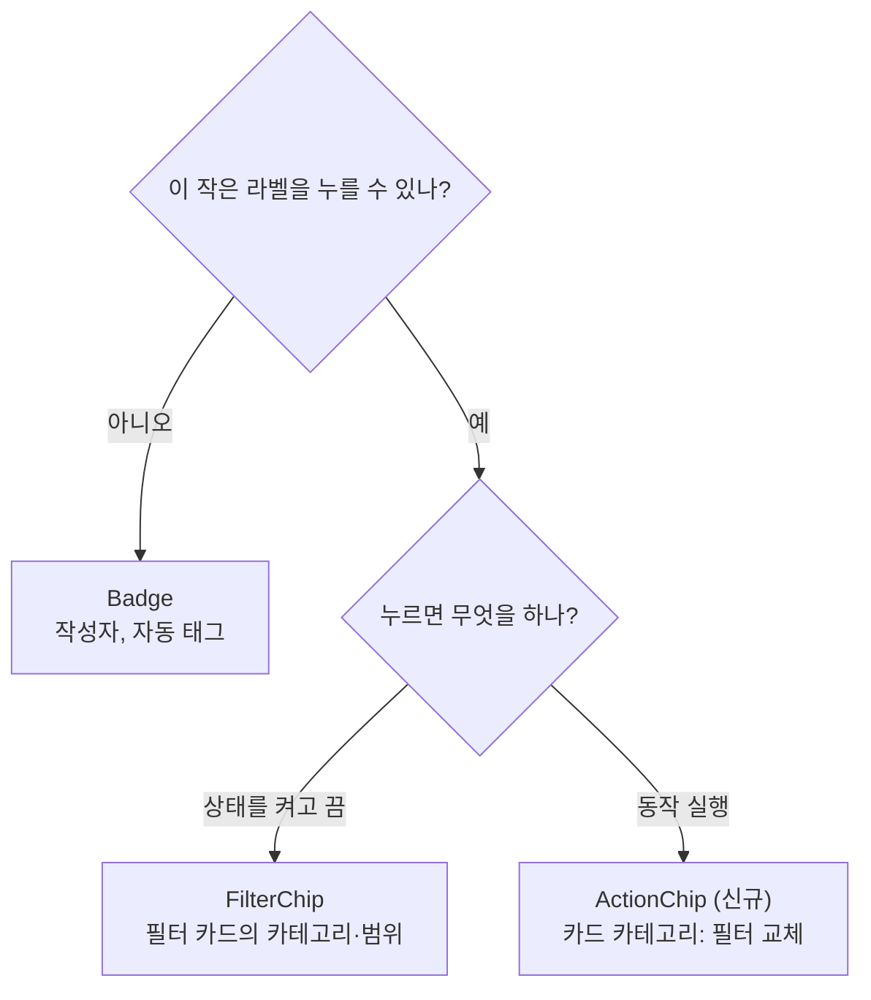
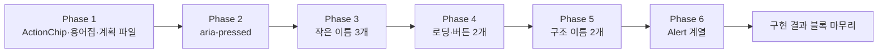

# UI 컴포넌트 이름을 업계 용어에 맞추기 — Badge·Chip 구분과 어긋난 이름 8묶음 개명

<!-- plan-result:start — 이 블록만 병합 뒤에도 고칠 수 있다(CLAUDE.md §11). 아래는 승인된 계획 원문 -->

## 구현 결과

> #552 · 2026-11-06 대조(Phase 1) · 이탈 2 · 미구현 4 — 판정 근거(파일:줄)는 PR 본문 "계획 대비 구현"

- 이탈(화면 차이 없음 확인): `ActionChip` 안쪽 `span`에 카드 카테고리가 받던 클래스 중 9개를 옮기지 않았다. 자식 `svg`·포커스·`aria-invalid`·`<a>` 호버용이라 이 `span`에는 걸리지 않고, 변경 전후 계산된 스타일 5,824개 값 비교에서 차이가 0건이었다
- 이탈 → 보완함: 용어집의 Input·Suggestion 칩이 Chip 행에 이름만 있어 행을 따로 두었다
- 미구현 → 보완함: 용어집 항목 Lozenge, Scrim, List, Search. Lozenge는 Atlassian 본문을 읽지 못해 뜻을 옮기지 않고 component.gallery 사례로만 적었다
- 계획에 없던 변경: `Badge`에 누를 수 없는 라벨용이라는 JSDoc 추가(동작 변경 없음)
- 계획에 없던 변경(문서 동기화): `SEARCH.md`의 칩 크기 측정값 정정(20·24px → 22·26px)과 의미 검색 안내의 "배지 문구" → "안내 문구" 정정, 코드 지도에 `ActionChip.tsx` 링크 추가, 수식어 없던 필터 카드 칩을 "필터 카드 카테고리 칩"으로 구분, `TESTING.md`의 "카드 배지" → "카드 카테고리 칩", `design-tokens` skill의 "정보 배지" → "정보 칩", 고친 문서 3개의 마지막 검토 날짜 갱신

> #553 · 2026-11-06 대조(Phase 2) · 이탈 0 · 미구현 0 — 판정 근거(파일:줄)는 PR 본문 "계획 대비 구현"

- 이탈·미구현·계획에 없던 변경 없음
- 확인만 함: 나머지 `ToggleButton` 6곳 중 `LikeCommentButton`·`Sidebar` 햄버거·`Navbar` 테마 버튼은 상태를 보조 기술에 전달하지 않는다. 승인 범위가 `FilterChip`뿐이라 고치지 않았다

<!-- plan-result:end -->

> "누를 수 있으면 Chip, 못 누르면 Badge"를 규칙으로 정하고, 업계 뜻과 실제 동작이 다른 이름을 바꾼다.
> 화면과 동작은 그대로다. 예외는 `FilterChip`에 켜짐 상태(`aria-pressed`)를 넣는 PR 하나다.
> PR 6개를 차례로 낸다. 이 계획의 승인은 **각 PR을 CI 통과 뒤 병합하고 운영 배포 성공까지 확인하는 것**을 포함한다.

## Context

사용자가 "`Badge`는 업계에서 chip이라고 부른다는데 전체를 바꿀 수 있나"를 물었다. 함께 업계 표준을 확인하고,
비슷하게 바꿀 UI 용어를 검토해 달라고 요청했다. 비용보다 오해가 없는 것을 우선한다는 조건이다.

확인한 결과 "전부 Chip"은 업계 표준이 아니다.

- **이름 분포**: [component.gallery](https://component.gallery/components/badge/) 사례 123개 중 원문으로 센 103개가
  Badge 36 · Tag 26 · Chip 7 · Pill 5 · Label 5 · Status 2 · Lozenge 1 · 기타 21이다. 사례 단위라 한 시스템이 두 번 잡히기도 한다.
- **우리 `Badge`의 출처**: `components.json`이 shadcn/ui new-york이고 variant 이름도 원본과 같다. shadcn 어휘로는 틀린 이름이 아니다.
- **Material 계열에서 Badge는 더 좁다**: Google [Compose 문서](https://developer.android.com/develop/ui/compose/components/badges)는
  _"다른 컴포저블 위에 상태나 숫자 값을 표시하는 작은 시각 요소"_ (번역)로, [Chip](https://developer.android.com/develop/ui/compose/components/chip)은
  _"작고 상호작용하는 UI 요소"_ (번역)로 쓴다. 그래서 "badge가 아니라 chip"은 Material 기준으로는 맞는 말이다.
- **나누는 기준**: [Polaris](https://shopify.dev/docs/api/app-home/web-components/feedback-and-status-indicators/badge)는 Badge를
  _"시스템이 생성한 분류"_ (번역)에 쓰고 _"사용자가 만든 라벨·카테고리·태그에는 대신 칩을 쓴다"_ (번역)고 한다.
  [Fluent 2](https://fluent2.microsoft.design/components/web/react/core/tag/usage)는 _"사람이 바꿀 수 없는 시스템 생성 데이터를 보여주려면 배지를 쓴다"_ (번역)고 한다.
  [Smart Interface Design Patterns](https://smart-interface-design-patterns.com/articles/badges-chips-tags-pills/)는
  _"배지는 항상 정적 컴포넌트다"_ (번역), _"칩과 필은 인터랙티브 태그의 시각적 스타일 관습일 뿐이다"_ (번역)라고 쓴다.
- **확인 못 한 출처**: m3.material.io와 Atlassian은 스크립트 렌더링이라 본문을 읽지 못했다. Material은 Google의 Android·Flutter 문서로 대신 확인했다.

우리 코드에 적용한 결과:

| 자리          | 코드                                       | 실제 동작                                                                                  | 판정               |
| ------------- | ------------------------------------------ | ------------------------------------------------------------------------------------------ | ------------------ |
| 카드 카테고리 | `PostCard.tsx:319` 버튼 안 `badgeVariants` | 누르면 피드 필터 교체                                                                      | Chip이 맞음 → 개명 |
| 카드 태그     | `PostCard.tsx:334` `<Badge>`               | 안 눌림. URL 메타데이터·AI가 생성(BE `UrlMetadataExtractor.kt:151`, `PostAIService.kt:96`) | Badge 유지         |
| 댓글 작성자   | `CommentItem.tsx:67` `<Badge>`             | 안 눌림. 시스템 표시                                                                       | Badge 유지         |
| 필터 카드     | `FilterChip`                               | 눌러서 켜고 끔                                                                             | 이미 맞음          |

## 판단이 필요했던 항목

| 항목                     | 결정                                                                                              | 근거·기각한 대안                                                                                                                                                                                                                                                                                                                                                                                                                                            |
| ------------------------ | ------------------------------------------------------------------------------------------------- | ----------------------------------------------------------------------------------------------------------------------------------------------------------------------------------------------------------------------------------------------------------------------------------------------------------------------------------------------------------------------------------------------------------------------------------------------------------- |
| Badge 처리               | **눌림 기준으로 나눔**(사용자 선택)                                                               | 전부 `Chip`은 작성자·자동 태그까지 "눌리나?" 오해를 만들고 Android·Polaris·Fluent 정의와 어긋난다. MUI 정의(_"입력·속성·동작을 나타내는 작은 요소"_ (번역, [문서](https://mui.com/material-ui/react-chip/)))에만 맞는다. 문서만 고치면 눌리는 요소를 배지로 부르는 오해가 남는다                                                                                                                                                                            |
| `Tag` 컴포넌트 신설      | 만들지 않음                                                                                       | Badge와 모양·동작이 같아 이름만 늘어난다. `tag`는 데이터 이름(`post.tags`)으로만 쓴다                                                                                                                                                                                                                                                                                                                                                                       |
| 카드 카테고리 이름       | `ActionChip`                                                                                      | 토글이 아니라 교체라 `FilterChip`이 아니다(2026-09-30 사용자 결정, `docs/SEARCH.md`). Flutter [ActionChip](https://api.flutter.dev/flutter/material/Chip-class.html)은 _"주요 콘텐츠와 관련된 동작을 나타낸다"_ (번역)                                                                                                                                                                                                                                      |
| `IconBadge` 새 이름      | `FeaturedIcon`                                                                                    | 표준 이름은 없다. [Mantine](https://mantine.dev/core/theme-icon/)은 `ThemeIcon`, [Untitled UI](https://www.untitledui.com/react/components/featured-icons)는 Featured icon이라 부른다. 역할을 더 잘 설명하는 쪽을 골랐다                                                                                                                                                                                                                                    |
| `HoverKebabMenu` 새 이름 | `KebabMenu`                                                                                       | 호버로 나타나는 곳은 3곳 중 1곳이다. `hoverReveal` prop은 유지한다. "kebab"의 외부 출처는 못 찾았고 코드에서 쓰던 말을 유지한다                                                                                                                                                                                                                                                                                                                             |
| `SpinnerOverlay` 새 이름 | `CenteredSpinner`                                                                                 | 실제로는 덮지 않는다. [Mantine](https://mantine.dev/core/loading-overlay/)의 오버레이는 _"부모 요소 위에"_ (번역) 그린다                                                                                                                                                                                                                                                                                                                                    |
| `ScrollToTop` 새 이름    | `BackToTopButton`                                                                                 | 떠 있는 버튼인데 스크롤 초기화 기능처럼 읽힌다. 실제 초기화는 `RootLayout`의 `ScrollRestoration`이 맡는다. 외부 근거는 [Ant Design BackTop](https://ant.design/components/float-button) 하나다                                                                                                                                                                                                                                                              |
| `PostListSearch` 새 이름 | `PostListFilter`                                                                                  | 입력칸 없이 칩·스위치로 거른다. [NN/g](https://www.nngroup.com/articles/filters-vs-facets/)는 필터를 _"콘텐츠 집합을 분석해 일부 항목을 제외하는 모든 것"_ (번역)으로 정의한다. 내부 `handleClearSearch` 등은 실제로 검색어(`q`)를 다루므로 유지한다                                                                                                                                                                                                        |
| `FolderTree` 새 이름     | `FolderSidebar`, 슬라이스는 `folder-nav`                                                          | 부모·자식이 없고 `role="tree"`도 없다. [W3C APG](https://www.w3.org/WAI/ARIA/apg/patterns/treeview/)의 트리는 _"계층 목록"_ (번역)이다. 슬라이스에 모바일 격자(`MobileFolderList`)도 있어 `folder-sidebar`는 맞지 않고, `<entity>-<role>` 규칙에 맞춰 `folder-nav`로 한다                                                                                                                                                                                   |
| `Alert` 계열             | `AlertDialog` 계열로 개명, `openAlert`·`openConfirm`·`OpenAlertOptions`는 유지                    | **2026-09-30 명칭 통일에서 일부러 둔 이름을 뒤집는다.** §18 각주의 근거는 APG의 Alert Dialog 정의이지만, [APG Alert](https://www.w3.org/WAI/ARIA/apg/patterns/alert/)는 _"작업을 끊지 않고 주의를 끄는"_ (번역) 별도 패턴이고 [MUI](https://mui.com/material-ui/react-alert/)도 둘을 혼동하지 말라고 안내한다. 우리 `FormAlert`(`role="alert"`)가 진짜 Alert다. `openAlert`·`openConfirm`은 창 종류(`type: 'alert' \| 'confirm'`)를 여는 동작 이름이라 맞다 |
| 그대로 두는 이름         | `ToggleButton`, `Navbar`, `RecentSearchDropdown`·`RecentSearchPanel`, `*BookmarkFolderDialog` 2개 | `ToggleButton`은 이름보다 상태 전달이 문제다. `Navbar`는 [Bootstrap](https://getbootstrap.com/docs/5.3/components/navbar/)도 브랜드·폼을 담는다. 나머지는 기기별 모양 차이와 Dialog 연결 역할이라 오해가 작다                                                                                                                                                                                                                                               |
| 근거 기록 위치           | `docs/DECISIONS.md`에 새 항목을 안 만듦                                                           | 선례(Dialog 명칭 통일 #269)처럼 §18 각주와 계획 파일에 둔다. 개명은 되돌릴 수 있어 DECISIONS 기준을 채우지 않는다                                                                                                                                                                                                                                                                                                                                           |
| 시안(§9)                 | 만들지 않음                                                                                       | 시각 변경이 없다. 대신 변경 전후 계산된 스타일과 스크린샷을 비교한다                                                                                                                                                                                                                                                                                                                                                                                        |
| PR 분할                  | 6개를 차례로                                                                                      | 문제가 생긴 묶음만 되돌리기 위해서다. `aria-pressed`는 동작 변경이라 개명과 섞지 않는다                                                                                                                                                                                                                                                                                                                                                                     |

### 뒤집힌 전제

| 발견                                                                                     | 그래서 바뀐 것                                          |
| ---------------------------------------------------------------------------------------- | ------------------------------------------------------- |
| "Badge가 아니라 Chip"이 업계 표준이라는 전제가 분포·정의와 맞지 않음                     | 전체 치환 대신 눌림 기준으로 나눔                       |
| Polaris 기준이면 사용자가 만든 태그는 Chip인데, 우리 태그는 자동 생성임을 BE 코드로 확인 | 태그는 Badge 유지                                       |
| `aria-pressed`가 소스 전체에 0건                                                         | 이름과 별개의 접근성 문제로 Phase 2에 추가(사용자 선택) |

### 위험 관리

- `vi.mock('경로')`는 문자열이라 타입 검사가 잡지 못한다. 각 Phase에서 옛 경로를 grep해 0건을 확인한다.
- `check:docs`는 줄 번호가 파일 범위 안인지만 본다. 바뀐 파일의 `파일:줄` 인용은 손으로 대조한다.

## 세부 계획

**Phase마다 공통으로 하는 일**: `git log origin/main..main` 확인 → `EnterWorktree` → `.env` 복사·`pnpm install` → 구현 →
검증 → plan-verifier 대조 → `pnpm check:pr-body` → PR → CI 통과 → squash 병합 → 배포 SHA 성공 확인 → `ExitWorktree(remove)`.

**옛 기록은 고치지 않는다**: `docs/plans/*`, `docs/DECISIONS.md`, `docs/HISTORY.md`, `CHANGELOG.md`의 과거 항목.

### Phase 1 — `refactor(shared)`: 누르는 카테고리를 `ActionChip`으로, 용어집 추가

선례: `shared/ui/elements/FilterChip.tsx`.

| 위치                                                                                                                                                                                     | 변경 내용                                                                                                                                                                                                                 |
| ---------------------------------------------------------------------------------------------------------------------------------------------------------------------------------------- | ------------------------------------------------------------------------------------------------------------------------------------------------------------------------------------------------------------------------- |
| `src/shared/ui/elements/ActionChip.tsx` (신규)                                                                                                                                           | `Button variant="none"` + 안쪽 `span`. props는 `label`, `onClick`, `aria-label`, `className`(버튼), `labelClassName`(색). 클래스는 지금 카드 카테고리가 받는 값을 옮긴다. 터치 영역 `py-0.5 -my-0.5`와 이유 주석도 옮긴다 |
| `src/shared/ui/elements/ActionChip.stories.tsx` (신규)                                                                                                                                   | 기본·카테고리 색 스토리                                                                                                                                                                                                   |
| `src/widgets/post/post-card/ui/PostCard.tsx:302-329`                                                                                                                                     | 인라인 버튼을 `ActionChip`으로 교체, `badgeVariants` import 제거                                                                                                                                                          |
| `src/shared/ui/atoms/badge.tsx`                                                                                                                                                          | `badgeVariants` export 제거(사용처가 없어짐)                                                                                                                                                                              |
| `src/entities/category/config/category.const.ts`, `e2e/post-card-click-area.spec.ts`, `docs/SEARCH.md`, `docs/POST.md`, `docs/DESIGN-SYSTEM.md`, `.claude/skills/design-tokens/SKILL.md` | "카테고리 배지" → "카테고리 칩". `SEARCH.md`는 "필터 칩"과 구분되게 쓴다                                                                                                                                                  |
| `PostCard.tsx`를 줄 번호로 인용하는 문서(`POST.md`, `SEARCH.md`, `COMMENT.md`, `POST-DETAIL-BACK-NAVIGATION.md`)                                                                         | 줄 번호 갱신                                                                                                                                                                                                              |
| `docs/DESIGN-SYSTEM.md` §12                                                                                                                                                              | 아래 용어집 표 추가                                                                                                                                                                                                       |
| `docs/FE-ARCHITECTURE.md` §18                                                                                                                                                            | "작은 라벨 식별자" 행과 각주 추가, 그 절의 근거 링크                                                                                                                                                                      |
| `docs/plans/2026-11-06-ui-term-renames.md` (신규)                                                                                                                                        | 이 계획 스냅샷                                                                                                                                                                                                            |

용어집에 넣을 항목: Badge, Chip(Filter·Action·Input·Suggestion), Tag, Pill·Lozenge, Alert와 Alert Dialog, Overlay와 Scrim, Tree와 List, Filter와 Search,
Kebab menu, Featured icon, Back to top. 항목마다 한 줄 뜻, 우리 코드 이름, 출처 링크를 둔다.

### Phase 2 — `fix(shared)`: `FilterChip` 켜짐 상태 전달

| 위치                                                    | 변경 내용                                                |
| ------------------------------------------------------- | -------------------------------------------------------- |
| `src/shared/ui/elements/FilterChip.tsx`                 | `aria-pressed={isActive}` 추가                           |
| `src/widgets/post/post-list/ui/PostListSearch.test.tsx` | 켜고 끌 때 `getByRole('button', { name, pressed })` 단언 |
| `src/shared/ui/elements/FilterChip.stories.tsx`         | 켜짐 상태 확인                                           |
| `CHANGELOG.md`                                          | `[Unreleased]` Fixed 항목                                |

근거: [APG Button](https://www.w3.org/WAI/ARIA/apg/patterns/button/)은 _"버튼이 토글 버튼임을 보조 기술에 알리려면 aria-pressed 값을 지정한다"_ (번역)고 안내한다.

### Phase 3 — `refactor`: 작은 이름 3개

| 위치                                                                                                                                                                | 기존                                                    | 신규                                                                                        |
| ------------------------------------------------------------------------------------------------------------------------------------------------------------------- | ------------------------------------------------------- | ------------------------------------------------------------------------------------------- |
| `src/shared/ui/atoms/icon-badge{,.stories}.tsx`                                                                                                                     | `IconBadge`, `iconBadgeVariants`, `IconBadgeProps`      | `featured-icon{,.stories}.tsx`, `FeaturedIcon`, `featuredIconVariants`, `FeaturedIconProps` |
| 인증 폼 4곳, `docs/DESIGN-SYSTEM.md`                                                                                                                                | import·사용                                             | 위와 같음                                                                                   |
| `src/shared/ui/elements/HoverKebabMenu{,.stories}.tsx`                                                                                                              | `HoverKebabMenu`, `HoverKebabMenuProps`                 | `KebabMenu{,.stories}.tsx`, `KebabMenu`, `KebabMenuProps`                                   |
| `PostCard`, `MobileFolderList`, `FolderTree`, `e2e/bookmark-folder-hover-menu.spec.ts`, `docs/BOOKMARK.md`, `docs/POST.md`, `.claude/skills/responsive-ux/SKILL.md` | 사용·언급                                               | 위와 같음                                                                                   |
| `src/app/ui/PostMutationLoadingToast.tsx`                                                                                                                           | `PostMutationLoadingToast`, id `post-mutation-progress` | `AccountUpdateLoadingToast.tsx`, `AccountUpdateLoadingToast`, id `account-update-progress`  |
| `src/app/App.tsx`, `docs/FE-ARCHITECTURE.md`, `docs/POST.md`                                                                                                        | 사용·언급                                               | 위와 같음                                                                                   |

### Phase 4 — `refactor`: 로딩·버튼 2개

| 위치                                                                                                                                                            | 기존                                                     | 신규                                                                                   |
| --------------------------------------------------------------------------------------------------------------------------------------------------------------- | -------------------------------------------------------- | -------------------------------------------------------------------------------------- |
| `src/shared/ui/elements/SpinnerOverlay{,.stories}.tsx`                                                                                                          | `SpinnerOverlay`, `SpinnerOverlayProps`, 주석 "오버레이" | `CenteredSpinner{,.stories}.tsx`, `CenteredSpinner`, `CenteredSpinnerProps`, 주석 수정 |
| 사용 8곳 + `ProtectedRoute.test.tsx`, `CommentItemSkeleton.tsx`, `docs/{AUTH,COMMENT,FE-ARCHITECTURE,FCM-PUSH-NOTIFICATION,NEW-VERSION-RELOAD,POST,TESTING}.md` | 사용·언급                                                | 위와 같음                                                                              |
| `src/shared/ui/elements/ScrollToTop{,.stories,.test}.tsx`                                                                                                       | `ScrollToTop`                                            | `BackToTopButton{,.stories,.test}.tsx`, `BackToTopButton`                              |
| `AppLayout{,.test}.tsx`, `globals.css`, `docs/{COMMENT,DESIGN-SYSTEM,SEARCH}.md`, `.claude/skills/{responsive-ux,motion-ux}/SKILL.md`                           | 사용·언급                                                | 위와 같음                                                                              |

### Phase 5 — `refactor`: 구조 이름 2개

| 위치                                                                                                                                                                   | 기존                                                      | 신규                                                                          |
| ---------------------------------------------------------------------------------------------------------------------------------------------------------------------- | --------------------------------------------------------- | ----------------------------------------------------------------------------- |
| `src/widgets/post/post-list/ui/PostListSearch{,.test}.tsx`                                                                                                             | `PostListSearch`                                          | `PostListFilter{,.test}.tsx`, `PostListFilter`                                |
| `src/widgets/post/post-list/hooks/usePostListSearch.ts`                                                                                                                | `usePostListSearch`                                       | `usePostListFilter.ts`, `usePostListFilter`                                   |
| `pages/post/index.tsx`, 테스트 3곳, `e2e/post-list-filters.spec.ts`, `docs/{DESIGN-SYSTEM,FE-ARCHITECTURE,POST,SEARCH}.md`, `design-tokens` skill, `.claude/CLAUDE.md` | 사용·언급·`파일:줄`                                       | 위와 같음                                                                     |
| `src/widgets/bookmark/folder-tree/`                                                                                                                                    | 슬라이스 경로                                             | `src/widgets/bookmark/folder-nav/`                                            |
| `folder-nav/ui/FolderTree{,.test}.tsx`                                                                                                                                 | `FolderTree`, `FolderTreeProps`, 주석 "사이드바 트리"     | `FolderSidebar{,.test}.tsx`, `FolderSidebar`, `FolderSidebarProps`, 주석 수정 |
| `folder-nav/hooks/useFolderTree{,.test}.ts`                                                                                                                            | `useFolderTree` (`useFolderItem` 등 나머지 export는 유지) | `useFolderSidebar{,.test}.ts`, `useFolderSidebar`                             |
| `BookmarkPage.tsx`, `globals.css`, 폴더 관련 주석, e2e 주석, `docs/{BOOKMARK,DESIGN-SYSTEM,FE-ARCHITECTURE,TESTING}.md`, skill 2개, `.claude/CLAUDE.md:814`            | 사용·언급·`파일:줄`                                       | 위와 같음                                                                     |

### Phase 6 — `refactor`: `Alert` 계열을 `AlertDialog`로

| 위치                                                                                                                                                                                                     | 기존                                                                                                                  | 신규                                                                                                                                                                                              |
| -------------------------------------------------------------------------------------------------------------------------------------------------------------------------------------------------------- | --------------------------------------------------------------------------------------------------------------------- | ------------------------------------------------------------------------------------------------------------------------------------------------------------------------------------------------- |
| `src/shared/ui/elements/dialog/alert/`                                                                                                                                                                   | 경로                                                                                                                  | `dialog/alert-dialog/`                                                                                                                                                                            |
| `Alert{,.stories}.tsx`                                                                                                                                                                                   | `GlobalAlerts`, 내부 `Alert`                                                                                          | `GlobalAlertDialogs{,.stories}.tsx`, `GlobalAlertDialogs`, 내부 `AlertDialogItem`                                                                                                                 |
| `alert.store{,.test}.ts`                                                                                                                                                                                 | `useAlert`, `useAlertStore`, `AlertData`, `AlertStore`, `alerts`, `cancelAlert`, `getOpenAlertId`, 이름 `alert-store` | `alertDialog.store{,.test}.ts`, `useAlertDialog`, `useAlertDialogStore`, `AlertDialogData`, `AlertDialogStore`, `dialogs`, `cancelAlertDialog`, `getOpenAlertDialogId`, 이름 `alert-dialog-store` |
| 호출 훅 6곳 + `useUnsavedChangesGuard.ts`, `RootLayout.tsx`, 테스트, `alert-dialog.test.tsx`, `eslint.config.js:1010` 주석                                                                               | 사용·`vi.mock` 경로·언급                                                                                              | 위와 같음                                                                                                                                                                                         |
| `docs/FE-ARCHITECTURE.md` §10·§18, `docs/{FCM-PUSH-NOTIFICATION,POST,UNSAVED-CHANGES-GUARD}.md`, `motion-ux` skill, `.claude/commands/{fix-bug,new-feature,code-review}.md`, `.claude/CLAUDE.md:415·672` | 규칙·언급                                                                                                             | `useAlertDialog` + `openConfirm`                                                                                                                                                                  |
| `docs/FE-ARCHITECTURE.md` §18 행·각주                                                                                                                                                                    | `alert/confirm 전용은 Alert`                                                                                          | `AlertDialog`로 정정, 끊지 않는 안내가 `Alert`(`FormAlert`)임을 명시                                                                                                                              |
| `docs/plans/2026-09-30-dialog-naming-unification.md`                                                                                                                                                     | 구현 결과 블록 없음                                                                                                   | 블록을 만들어 `대체됨: 이 계획(#PR) — Alert 계열 이름` 기록                                                                                                                                       |
| `~/project/claude-base/docs/MAPPING.md:164`                                                                                                                                                              | `useAlert`+`openConfirm`                                                                                              | `useAlertDialog`+`openConfirm` (그 저장소 워크트리에서 별도 커밋)                                                                                                                                 |

## 영향 범위 (§5)

**CRUD 실패 지점**: 없음. DB·API·DTO·영속 저장값을 건드리지 않는다. 메모리 안의 값(토스트 id, zustand 개발자도구 이름)만 바뀐다. 배포 순서 제약도 없다.

| Phase | 깨질 수 있는 기존 동작                                                                              | 소유 파일                                              | 막는 방법                                                                    |
| ----- | --------------------------------------------------------------------------------------------------- | ------------------------------------------------------ | ---------------------------------------------------------------------------- |
| 1     | 카드 전체 링크 위로 카테고리가 올라오는 동작, 24px 터치 영역, 호버 밑줄(`group`), 색 덮어쓰기(`cn`) | `PostCard.tsx`(피드·상세·북마크 공용)                  | `post-card-click-area`, `touch-targets` e2e + 계산된 스타일 비교             |
| 2     | 역할·이름으로 칩을 찾는 테스트                                                                      | `PostListSearch.test.tsx`, `post-list-filters.spec.ts` | `pressed` 단언 추가, 전체 테스트                                             |
| 3     | `vi.mock` 경로, 스토리 제목 규칙                                                                    | 인증 폼, `PostCard`, `FolderTree`                      | ESLint `title-matches-path`, 옛 이름 grep                                    |
| 4     | 라우트 Suspense 대기 화면, 전역 맨 위로 버튼                                                        | `RouterProvider`, `ProtectedRoute`, `AppLayout`        | `ProtectedRoute.test`, `AppLayout.test`, `ScrollToTop.test` 이름만 바꿔 유지 |
| 5     | 슬라이스 경로 이동으로 인한 import·의존성 검사, 북마크 화면                                         | `BookmarkPage.tsx`, `folder-nav/**`                    | `check:deps`, 북마크 e2e                                                     |
| 6     | 전 화면의 확인창, 작성 중 이탈 확인, 라우터 blocker                                                 | `useUnsavedChangesGuard.ts`, 호출 훅 6곳               | `*.guard.test`, `alert-dialog.test`, 확인창 e2e                              |

**공유 코드 사용처**: Phase마다 `pnpm graph:focus "<경로>" --text`로 뽑아 PR 본문에 요약한다. `Badge`는 `CommentItem`·`PostCard` 2곳임을 이미 확인했다.
**이전 계약을 담은 문서**: §18, `.claude/CLAUDE.md:415`, 슬래시 커맨드 3개는 Phase 6에서 함께 고친다. 이미 떠 있는 다른 세션은 시작 시점의 CLAUDE.md를 보므로 옛 이름을 쓸 수 있지만, 타입 검사에서 걸린다.

## 검증 방법

**모든 Phase**

1. `pnpm type-check` → `pnpm test` → `pnpm lint`·`pnpm check:deps` → `pnpm check:docs` → `pnpm test:storybook`
2. 옛 이름 grep이 0건인지 확인(옛 기록 4종과 `ActionChip`·`Alert` 표에서 유지한다고 적은 이름 제외)
3. 바뀐 파일을 가리키는 `파일:줄` 인용을 실제 줄과 대조
4. 병합 뒤 `gh run list --branch main --workflow "Frontend Deploy (S3 + CloudFront)"`로 그 SHA의 success 확인

**Phase별 추가**

- **Phase 1**: 변경 전후 카드 카테고리의 `getComputedStyle`과 크기를 라이트·다크에서 비교하고 스크린샷으로 보여 준다. `e2e/post-card-click-area.spec.ts`, `e2e/touch-targets*.spec.ts`.
- **Phase 2**: Playwright 접근성 스냅샷에서 켠 칩에 `[pressed]`가 보이는지 확인한다. `e2e/post-list-filters.spec.ts`. 실제 화면 읽기 프로그램으로는 돌리지 않는다.
- **Phase 3~4**: 관련 e2e(`bookmark-folder-hover-menu`, 인증 흐름)와 Storybook 스토리 렌더.
- **Phase 5**: 북마크·피드 필터 e2e 전체. 데스크톱 사이드바와 모바일 격자 둘 다.
- **Phase 6**: 삭제·로그아웃·작성 중 이탈 확인창을 e2e로 확인. `getByRole('alertdialog')`가 그대로 잡혀야 한다.

## 남은 것

- (제가) 나머지 `ToggleButton` 사용처의 상태 전달을 Phase 2에서 확인해 결과를 보고한다 — 승인 범위는 `FilterChip`뿐이라 다른 곳은 고치지 않는다. `LikePostButton`은 `aria-label`을 바꿔 전달하고 있다.
- (제가) `MobileFolderList`처럼 이름과 모양이 조금 다른 것(실제로는 격자), 파일명과 export가 다른 스켈레톤 3개는 이번 범위 밖이라 Phase 5 보고에 다시 적는다 — 사용자가 고른 묶음에 없다.
- (사용자) VoiceOver로 필터 칩 켜짐 상태를 들어 보기 — 제 환경에서는 화면 읽기 프로그램을 돌릴 수 없다. Mac에서 `Cmd+F5`로 켜고 피드의 "북마크한" 칩을 눌러 "선택됨"류 안내가 나오는지 들으면 된다. 결과를 알려 주시면 Phase 2 PR 본문에 남긴다.
