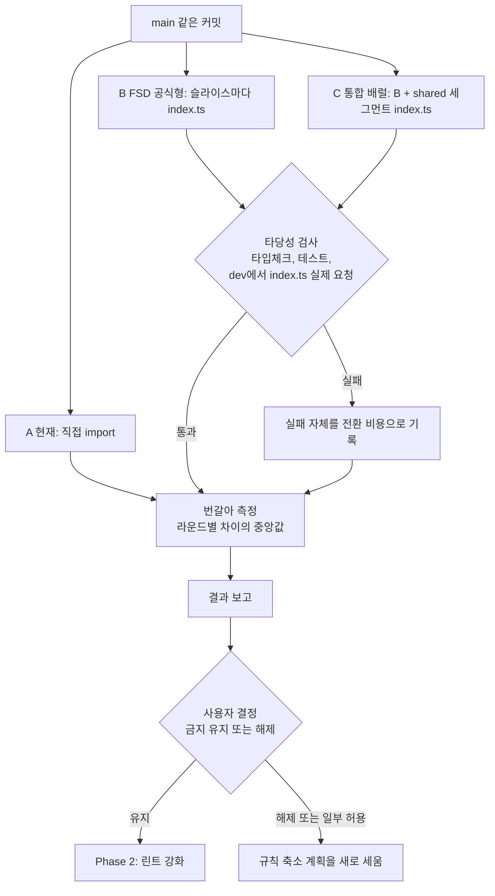

# 배럴 파일 비용을 이 레포에서 직접 재고, 그 결과로 금지 규칙을 정하기

<!-- plan-result:start — 이 블록만 병합 뒤에도 고칠 수 있다(CLAUDE.md §11). 아래는 승인된 계획 원문 -->

## 구현 결과

> #586 · 2026-11-07 대조 · 이탈 3 · 미구현 1 · 보완 1 — 판정 근거(파일:줄)는 PR 본문 "계획 대비 구현"

- 분기 결과: 사용자가 측정 결과를 보고 금지 유지를 골라 "유지로 정해지면" 표까지 적용함
- 이탈(측정 조건): C의 빌드·타입체크·테스트는 코드모드 결과 그대로가 아니라 `src/test/setup.ts`에서 닿는 11개 파일을 A 내용으로 되돌린 상태로 쟀다. 그대로는 단위 테스트 138개가 실패해 시간을 비교할 수 없었다. 첫 도구 측정과 첫 LCP 측정은 기기 잠듦으로 오염돼 버리고 `caffeinate -i`로 다시 쟀다. 둘 다 버린 기록을 결과 폴더에 남겼다
- 이탈(기준 맞춤): 번들 크기를 gzip 대신 brotli로 재고, 첫 로딩은 HTML의 진입 스크립트와 modulepreload 합으로 보고했다. 기존 "첫 로딩 JS"와 같은 기준에 맞췄다
- 이탈(검증 명령): e2e 확인은 계획의 `pnpm exec playwright test`로 1개가 실패해 빈 포트를 고르는 `pnpm test:e2e`로 2개 통과를 확인했다. 계획 명령의 실패 원인은 확인하지 못했다(다른 세션 서버를 재사용한 것으로 추정)
- 미구현 → 보완함: 겹친 라운드 표시. `report.mjs --max-load`로 부하가 높은 라운드를 빼고 다시 계산할 수 있게 하고, 코어 수를 넘은 라운드 수와 판정이 같다는 결과를 문서에 적었다
- 미구현: `infra/cloudfront-functions/spa-fallback.js` 주석의 옛 라우터 경로를 고치지 않았다. 매일 도는 차이 검사(`scripts/check-cloudfront-drift.js`)가 운영 Function과 바이트 단위로 비교해 주석만 고쳐도 이슈를 연다. 다음에 Function을 실제로 고칠 때 함께 갱신한다
- 계획에 없던 변경: 결과 요약(`report.mjs`), 순환 집계 설정(`circular.depcruise.cjs`), `setup.ts` 모듈 추적과 되돌리기(`setup-graph.mjs`), `moduleSideEffects` 기본값 보조 측정과 결과 파일, 문서 값의 원본 결과 파일(순환, 코드모드 집계, 모듈 추적, 테스트 실패 목록), 캐시 있는 부팅·캐시 없는 서버 직후 첫 화면·`/post` 실제 스크립트 합 지표, 실험 워크트리의 `tsconfig.e2e.json` 수정
- 문서 동기화: `docs/FE-ARCHITECTURE.md` "정식 FSD로 맞추려면" 문구를 측정 결과에 맞췄다

<!-- plan-result:end -->

> 같은 코드에 배럴을 입혀 현재 구조와 비교한다. 결과를 보고 금지를 유지할지 사용자가 정한 뒤에 린트를 바꾼다.

## Context

사용자가 `src/mocks/handlers/index.ts`를 보고 린트로 막자고 요청했다가, 조사 결과를 보고 이렇게 지적했다.

> 배럴파일을 도입안하는건 우리가 확인한부분이아닌데 배럴파일로했을때 수치를 확인할수있나? 그래야 근거라는게 생기잖아 외부 이야기만 듣고서는할수있는부분은 아니니까

### 지금 근거의 상태

- 금지는 2026-03-01 커밋 `8030e07b`에서 시작됐고, 이유는 성능이다. 대안 비교와 이 레포 측정 기록은 없다.
- 규칙 주석의 수치는 [Vercel 글](https://vercel.com/blog/how-we-optimized-package-imports-in-next-js)(Shu Ding, 2023-10-13)의 값이다.
  - 로컬 개발 부팅 _"15%~70%"_ (번역): 유명 아이콘·컴포넌트 라이브러리를 M2 MacBook Air에서 잰 값
  - `next build` _"약 28%"_ (번역): `lucide-react`와 `@headlessui/react`를 쓴 Next.js 페이지 기준
  - 콜드 스타트 _"최대 40%"_ (번역): 서버리스 환경, Next.js 13.5의 다른 개선과 합친 값
- [Vite 공식 문서](https://vite.dev/guide/performance.html#avoid-barrel-files)는 _"API 하나만 import해도 배럴 안의 파일을 전부 가져와 변환해야 한다"_ (번역)며 피하라고 권한다. 이 문장은 v8.3.6 문서에서 읽었고, 설치본(6.4.1)과 같은 메이저인 [v6 문서](https://v6.vite.dev/guide/performance.html)에도 같은 절이 있다.
- [FSD Public API 문서](https://feature-sliced.design/docs/reference/public-api)는 _"많은 index 파일이 개발 서버를 느리게 할 수 있다"_ (번역)고 쓰지만 수치는 없다.
- 셋 다 외부 이야기이고, 이 레포 코드에서 확인한 값은 없다. 그래서 측정이 먼저다.

### 함께 확인한 사실

- 이 레포의 `index` 파일 3개(`mocks/handlers`, `app/routes`, `pages/post`)는 모두 re-export를 하지 않는다. 지금 진짜 배럴은 0개다.
- 지금 규칙은 import 문자열이 `/index`로 끝날 때만 잡아서 `@/mocks/handlers`는 통과한다. 2026-09-09 감사(B2)에서 이 구멍을 찾았지만 "위반 아님"으로 판단해 그대로 뒀다.
- `src/mocks/handlers/index.ts`는 테스트 전용이고 쓰는 곳이 핸들러 6개를 전부 쓴다. 코드 추적상 이 파일을 고쳐도 속도와 무관하다.

### 전체 흐름

## 판단이 필요했던 항목

| 항목              | 결정                                                                                                     | 근거·기각한 대안                                                                                                                                                                              |
| ----------------- | -------------------------------------------------------------------------------------------------------- | --------------------------------------------------------------------------------------------------------------------------------------------------------------------------------------------- |
| 순서              | 측정 먼저, 린트는 그 뒤(사용자 지적, 2026-11-07)                                                         | 기각: 린트를 먼저 넣고 측정은 나중에. 근거 없는 규칙을 더 강하게 만들게 된다                                                                                                                  |
| 비교 대상         | A 현재, B FSD 공식형, C 통합 배럴                                                                        | 규칙이 거부한 대안은 B다(`docs/FE-ARCHITECTURE.md:46`). C는 외부 수치가 다루는 형태에 더 가깝다. 기각: C만 재기. 나쁜 경우만 보고 B까지 판단하게 된다                                         |
| B의 형태          | 슬라이스마다 named re-export, shared는 그대로                                                            | FSD 문서가 와일드카드에 _"슬라이스의 인터페이스를 쉽게 알 수 없다"_ (번역)고 반대하고, `shared/ui`·`shared/lib`는 번들이 커지면 _"컴포넌트나 라이브러리마다 별도 index"_ (번역)를 두라고 한다 |
| pages             | 배럴을 만들지 않음                                                                                       | `pages/post`에 lazy 페이지 4개가 있어 하나로 묶으면 코드 분할 자체가 깨진다. FSD와 다른 점으로 결과에 밝힌다                                                                                  |
| 배럴 생성 방법    | 코드모드로 자동 생성                                                                                     | 621개 파일과 layer import 2,060줄(`entities`·`features`·`widgets` 598, `shared` 1,462)을 손으로 바꿀 수 없다. 사람이 고른 배럴과 다를 수 있어 한계로 밝힌다                                   |
| API               | Playwright `page.route`로 전부 모킹                                                                      | 운영 API를 때리지 않고(WAF 한도), 네트워크 노이즈를 뺀다                                                                                                                                      |
| 콜드 스타트       | 재지 않음                                                                                                | FE는 S3 정적 파일이라 서버 콜드 스타트가 없다. 이 수치는 이 레포에 해당하지 않는다                                                                                                            |
| 차이 판정 기준    | 라운드별 차이의 중앙값이 `max(100ms, A의 5%)`를 넘고, 10라운드 중 8번 이상(5라운드면 4번 이상) 같은 방향 | 앞의 임계값은 `docs/PERFORMANCE.md:190-191`의 선례를 따른다. 방향 조건은 이번에 추가한다. 번들 크기는 결정적 값이라 변화량을 그대로 보고한다                                                  |
| `index` 금지 범위 | 측정 뒤 유지로 정해지면 3개 모두 예외 없이 정리(사용자 결정, 2026-11-07)                                 | 기각: 이 파일만 정리. 같은 형태와 린트 예외가 남는다                                                                                                                                          |
| re-export 검사    | 측정 뒤 유지로 정해지면 함께 넣음(사용자 결정, 2026-11-07)                                               | `index` 금지만 있으면 `all.ts`로 이름만 바꿔 통과한다                                                                                                                                         |

## 세부 계획

### Phase 1: 측정

main에 아무것도 넣지 않는다. dev 서버는 한 번에 하나만 띄운다.

| 위치                                                | 변경 내용                                                                                                                                                                                                                                                                                                                                                                                                                                          |
| --------------------------------------------------- | -------------------------------------------------------------------------------------------------------------------------------------------------------------------------------------------------------------------------------------------------------------------------------------------------------------------------------------------------------------------------------------------------------------------------------------------------- |
| 실험 워크트리 3개(같은 커밋 고정)                   | A는 그대로, B와 C는 코드모드 적용. 커밋하지 않는다                                                                                                                                                                                                                                                                                                                                                                                                 |
| `scripts/barrel-experiment/apply-barrels.mjs`(신규) | TypeScript 컴파일러 API로 변환. B: `entities`·`features`·`widgets` 슬라이스 밖에서 쓰는 이름만 `index.ts`에 named re-export하고 외부 정적·동적 import를 배럴 경유로 변경. C: B에 더해 `shared/ui/atoms`, `shared/ui/elements`, `shared/ui/layouts`, `shared/utils`, `shared/config`, `shared/hooks`, `shared/lib`에 `export *` 배럴을 만들고 import를 변경. 슬라이스 안쪽 import, `@x`, `vi.mock` 경로는 그대로. 이름이 겹쳐 묶지 못한 건수를 기록 |
| `scripts/barrel-experiment/measure.mjs`(신규)       | 아래 지표를 순서를 돌려 가며 측정하고 JSON으로 저장. 라운드마다 부하(`uptime`)를 함께 기록                                                                                                                                                                                                                                                                                                                                                         |

**타당성 검사(측정 전)**

| 확인               | 기준                                                                                                                                 |
| ------------------ | ------------------------------------------------------------------------------------------------------------------------------------ |
| 타입체크           | B·C에서 `pnpm type-check` 통과                                                                                                       |
| 테스트             | A와 통과·실패 수 비교. 새 실패는 원인과 함께 전환 비용으로 기록                                                                      |
| 진짜 배럴을 재는가 | dev 요청 목록에 B·C는 `/src/entities/post/index.ts`가 있고 A는 없음. 포트는 `--strictPort`로 고정해 다른 세션 서버를 재사용하지 않음 |
| 외부 요청 없음     | localhost 밖 요청을 모두 막고, 모킹되지 않은 `/api` 요청 수를 기록                                                                   |
| 순환 의존          | dependency-cruiser로 A·B·C의 순환 수 비교. 런타임 오류가 나면 기록                                                                   |

**지표**

| 지표          | 재는 법                                                                      | 횟수 | 대응하는 외부 주장                         |
| ------------- | ---------------------------------------------------------------------------- | ---- | ------------------------------------------ |
| dev 서버 부팅 | `node_modules/.vite`를 비우고 ready까지                                      | 10   | Vercel "부팅 15%~70%"                      |
| dev 첫 화면   | 새 컨텍스트로 `/post`와 상세 열기. `load`까지 시간, `/src/` 모듈 요청 수     | 10   | Vite "전부 가져와 변환"                    |
| dev 새 탭     | 같은 서버에서 다시 열기                                                      | 10   | 위와 같음                                  |
| HMR           | 자주 고치는 파일을 저장하고 `[vite] hot updated` 로그까지 시간, 갱신 모듈 수 | 10   | Vercel "HMR에도 영향"                      |
| 빌드          | `vite build` 벽시계 시간                                                     | 5    | Vercel "빌드 약 28%"                       |
| 타입체크      | `tsc -b --force --noEmit`                                                    | 5    | 외부 주장 없음                             |
| 테스트        | `pnpm test` 전체 시간                                                        | 5    | 외부 주장 없음                             |
| 운영 번들     | 전체 JS, `/post` 첫 로딩 JS(gzip), 청크 수                                   | 1    | Next.js 글의 tree-shaking, FSD "번들 증가" |
| 운영 LCP      | `vite preview`, CPU 4배 감속, 모킹 API                                       | 10   | 외부 주장 없음                             |

**결과 보고:** 지표마다 A·B·C 중앙값, 라운드별 차이 중앙값, 같은 방향 횟수, A의 변동 폭을 표로 보고한다. 이 단계에서 결론을 내 코드에 반영하지 않는다.

### Phase 2: 결정 뒤 적용

결과와 함께 사용자에게 금지 유지·일부 허용·해제를 묻는다. 측정 기록은 결정과 상관없이 남긴다.

| 위치                                                                                | 변경 내용                                                     |
| ----------------------------------------------------------------------------------- | ------------------------------------------------------------- |
| `docs/PERFORMANCE.md`                                                               | "배럴 비교 (직접 측정)" 절 추가: 방법, 결과, 한계             |
| `docs/FE-ARCHITECTURE.md:46`, `eslint.config.js:1482-1487`, `.claude/CLAUDE.md:203` | "출처 미상"을 외부 출처와 직접 측정값으로 교체                |
| `scripts/barrel-experiment/`                                                        | 재현용 스크립트와 결과 JSON 커밋                              |
| `docs/plans/2026-11-07-barrel-measurement.md`(신규)                                 | 이 계획의 스냅샷. plan-verifier 대조 뒤 구현 결과 블록을 붙임 |

**유지로 정해지면 추가로 적용한다.** 해제나 일부 허용이면 아래를 적용하지 않고 계획을 새로 세운다.

| 위치                                                                                                                                                                                                              | 변경 내용                                                                                                                                                                                                                          |
| ----------------------------------------------------------------------------------------------------------------------------------------------------------------------------------------------------------------- | ---------------------------------------------------------------------------------------------------------------------------------------------------------------------------------------------------------------------------------- |
| `scripts/lib/no-barrel-rules.js`(신규), `.d.ts`(신규)                                                                                                                                                             | `noIndexFileRule`: 파일 이름이 `index.ts`·`index.tsx`면 보고. `noValueReExportRule`: `export * from`과 `export { a } from` 중 타입 전용이 아닌 것을 보고                                                                           |
| `src/test/scripts/no-barrel-rules.test.ts`(신규)                                                                                                                                                                  | RuleTester. 잡음: `index.ts`, `index.tsx`, `export * from`, `export { a } from`, `export { a, type B } from`. 통과: 일반 파일, `export type {} from`, `export { type A } from`, `export type * from`, `source` 없는 `export { a }` |
| `eslint.config.js:1489-1529`                                                                                                                                                                                      | `no-barrel-import`를 두 규칙으로 교체. `no-value-reexport`는 `src/entities/**/@x/**`와 `src/test/utils.tsx`를 제외                                                                                                                 |
| `eslint.config.js:739,933,1113,1127,1158,1189,1215,1223-1232`                                                                                                                                                     | `index` 전용 예외 제거                                                                                                                                                                                                             |
| `src/mocks/handlers/index.ts`, `src/mocks/server.ts`                                                                                                                                                              | 파일을 지우고 핸들러 6개를 기존 순서대로 `server.ts`에 펼침                                                                                                                                                                        |
| `src/app/routes/index.tsx` → `AppRoutes.tsx`                                                                                                                                                                      | 개명. `:4`를 `@/app/routes/layouts/ProtectedLayout`으로, `:32`와 `:238`을 `PostFeedPage`로 변경                                                                                                                                    |
| `src/pages/post/index.tsx` → `PostFeedPage.tsx`                                                                                                                                                                   | 개명. export 이름도 `PostFeedPage`로 변경                                                                                                                                                                                          |
| `RouterProvider.tsx:3`, `cloudfront-functions.test.ts:5`, `e2e/post-route-prefetch.spec.ts:72`                                                                                                                    | 새 경로로 변경                                                                                                                                                                                                                     |
| 주석 5곳, 문서 경로 언급, `docs/FE-ARCHITECTURE.md:20-24,100`, `docs/OPENAPI-CODEGEN.md:230-232`, `docs/TESTING.md:522-535`, `.claude/commands/new-domain.md:270`, `.claude/skills/design-tokens/SKILL.md:90,115` | 새 경로와 새 규칙으로 변경. 줄 번호는 심볼을 다시 찾아 적는다. `docs/plans`, `CHANGELOG.md`, `docs/DECISIONS.md`, `docs/HISTORY.md`는 그대로 둔다                                                                                  |

## 영향 범위

**데이터(CRUD):** 해당 없음.

**Phase 1:** main과 운영에 영향이 없다. 실험 워크트리만 바뀐다. 측정 중 CPU를 많이 쓰므로 다른 세션 작업과 겹치면 결과가 흔들린다. 부하를 라운드마다 기록하고, 겹친 라운드는 표시한다.

**Phase 2(유지로 정해졌을 때)**

| 동작                            | 소유 파일                                              | 위험과 확인                                                      |
| ------------------------------- | ------------------------------------------------------ | ---------------------------------------------------------------- |
| 테스트 기본 응답                | `src/mocks/server.ts`                                  | MSW는 먼저 맞는 핸들러를 쓴다. 기존 순서 유지, `pnpm test`       |
| 라우터 시작, 라우트 대조 테스트 | `RouterProvider.tsx`, `cloudfront-functions.test.ts`   | import 경로 변경. `pnpm type-check`, `pnpm test`                 |
| 피드 lazy 로딩과 미리 받기      | `AppRoutes.tsx`, `e2e/post-route-prefetch.spec.ts`     | e2e가 모듈 경로를 붙잡는다. 해당 스펙 실행                       |
| 피드 청크 이름                  | `vite.config.ts:90`                                    | `index-*`에서 `PostFeedPage-*`로 바뀔 것이다. 빌드로 확인        |
| 배포·버전 확인                  | `deploy.yml:171,205,213`, `useAppVersionCheck`         | HTML의 진입점 `index-*`만 읽는다. 진입점 이름 유지를 빌드로 확인 |
| 과거 판단과의 일관성            | `docs/DECISIONS.md:1063`, `docs/FE-ARCHITECTURE.md:84` | 배럴 금지를 전제로 한 판단이다. 해제로 정해지면 다시 검토한다    |

- **import 사용처:** `pnpm graph:focus`는 `src/app`, `src/mocks`를 제외하고 동적 import도 잡지 못해 `git grep`으로 직접 확인했다.
- **동시 작업:** 열린 PR #583이 `docs/DEPLOY.md`를 고친다. 충돌이 나면 rebase로 푼다.

## 검증 방법

**Phase 1**

1. 위 타당성 검사를 모두 기록한다.
2. A의 라운드 간 변동 폭을 함께 내서 차이가 노이즈보다 큰지 본다.
3. 코드모드를 다시 돌려 같은 결과가 나오는지 확인한다(재현성).

**Phase 2**

1. `pnpm test src/test/scripts/no-barrel-rules.test.ts` 통과.
2. 규칙만 연결한 상태의 `pnpm lint`에서 `no-index-file` 정확히 3건, `no-value-reexport` 0건을 확인하고, 파일 정리 뒤 0건을 확인한다.
3. 기존 파일에 값 re-export 한 줄을 임시로 넣어 디스크 파일로 잡히는지 보고 되돌린다.
4. `pnpm type-check`, `pnpm test`, `pnpm lint`, `pnpm check:deps`, `pnpm format:check`, `pnpm check:docs` 통과.
5. `pnpm exec playwright test e2e/post-route-prefetch.spec.ts` 통과, `pnpm build` 뒤 청크 이름 확인.
6. 병합 뒤 `Frontend Deploy (S3 + CloudFront)`가 success인지 확인하고, 운영 `/post`의 피드 청크가 200인지 본다.

## 남은 것

- **측정의 한계:** 이 기기(Apple M4 Pro) 한 대, 지금 코드 규모(`src` 621개 파일)의 값이다. 코드모드로 만든 배럴은 사람이 고른 형태와 다를 수 있다.
- **실험 정리:** 측정이 끝나면 실험 워크트리 3개를 지운다. 미커밋 변경은 코드모드로 다시 만들 수 있다.
- **유지로 정해져도 못 막는 형태:** `import { a } from 'x'; export { a };`로 다시 내보내기, 이름이 `index`가 아닌 집계 파일.
- **범위 밖:** `lucide-react` 루트 import 63곳은 이번에 재지 않는다. 외부 대형 라이브러리 배럴이라 이 실험과 성격이 다르다.
