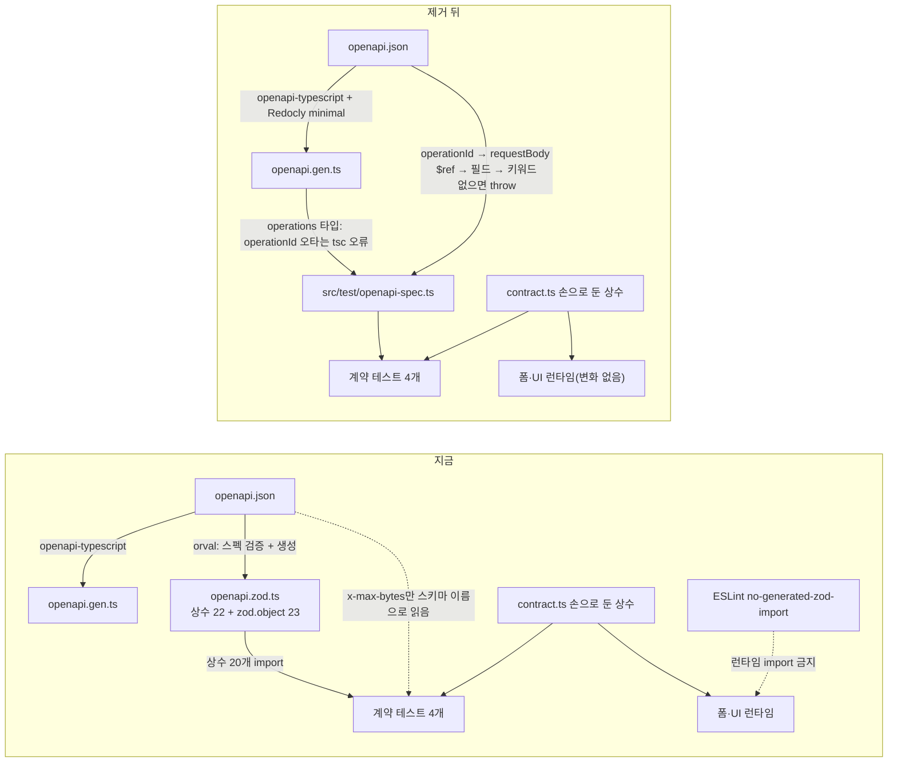
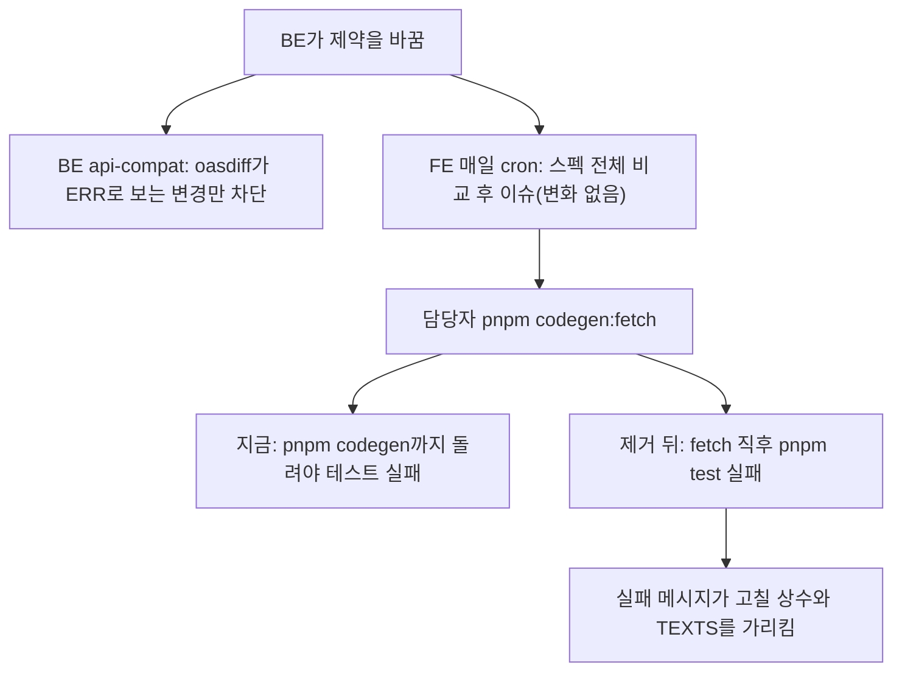

# orval 제거: 계약 테스트가 openapi.json을 직접 읽는다

<!-- plan-result:start — 이 블록만 병합 뒤에도 고칠 수 있다(CLAUDE.md §11). 아래는 승인된 계획 원문 -->

## 구현 결과

> #584 · 2026-11-07 대조 · 이탈 0 · 미구현 0 — 판정 근거(파일:줄)는 PR 본문 "계획 대비 구현"

- 계획에 없던 변경: 댓글 계약 테스트의 세 요청 표는 두 `it.each`가 함께 쓰는 상수로 묶었다(행과 테스트 수는 계획과 같다)
- 계획에 없던 변경(문서 동기화): `docs/OPENAPI-CODEGEN.md`의 §3 헬퍼 항목, §5-6 "BE 값이 바뀌면" 문단, §10 lock 차이 소절, §11 항목 2개, §12 용어 1개
- 계획 전제 정정: 중복 operationId와 컴포넌트 키 위반이 Redocly 경고로 남는다고 봤지만, 실측에서는 경고 없이 생성까지 끝났다. HTTP 스킴 `name`과 잘못된 `type`도 같았고, 없는 파일을 가리키는 외부 `$ref`만 실패했다. 그래서 스펙 구조 검증은 "부분 대체"보다 약하다(`docs/OPENAPI-CODEGEN.md` §9·§11)

<!-- plan-result:end -->

> devDependency `orval`, 생성 파일 `openapi.zod.ts`, ESLint 규칙 `no-generated-zod-import`를 없앤다. 계약 테스트 4개는 커밋된 `openapi.json`을 operationId 기준으로 읽는다. 앱 코드는 주석만 바뀌므로 번들은 같아야 한다. PR은 FE 1개, BE 1개다.

## Context

**왜.** 사용자가 생성 도구를 하나로 합칠 수 있는지 물었고, orval이 실제로 하는 일을 재 보니 범위가 좁았다.

- `openapi.zod.ts`의 export는 45개다(상수 22, `zod.object` 23).
- 쓰이는 것은 계약 테스트 4개가 import하는 상수 20개뿐이고, 스키마 import는 0건이다.
- 앱 코드에서 이 파일을 import하는 곳은 0개다(`pnpm graph:focus --text` 2026-11-07).
- 그 값은 커밋된 `openapi.json`에 이미 있다. 이를 위해 lock 스냅샷 63개(전체 1,338개 중, lock 파싱 계산)와 ESLint 규칙 하나를 유지하고 있다.

`openapi-typescript`만으로는 대체되지 않는다. 설치본 7.13.0은 타입만 내고 값을 내지 않는다(생성 파일에 제약 키워드 0건, `--array-length`는 튜플 타입만 만든다). 그래서 대체 수단은 "테스트가 스펙을 직접 읽기"이고, `openapi-typescript`는 operationId 이름 검사를 맡는다.

### 직접 측정한 것 (2026-11-07, 1회용 스크립트, 저장소 변경 없음)

| 확인                                   | 결과                                               |
| -------------------------------------- | -------------------------------------------------- |
| 상수 20개: 생성 값과 스펙 직접 읽기    | 20개 모두 같음                                     |
| 정규식 판정 55건 비교                  | 차이 0건                                           |
| 값 변경(15→20)                         | 감지                                               |
| 제약 삭제, 필드 개명, operationId 변경 | throw                                              |
| 도우미 없이 패턴 삭제를 읽으면         | `/(?:)/`, 무엇이든 통과                            |
| DTO 교체                               | 스키마 이름 읽기는 옛 값 15, operationId 읽기는 30 |

### orval이 오늘 하는 일과 제거 뒤

| 하는 일                               | 제거 뒤                                                       | 판정                                                     |
| ------------------------------------- | ------------------------------------------------------------- | -------------------------------------------------------- |
| 제약 상수 20개 제공                   | 헬퍼가 스펙에서 읽음                                          | 대체                                                     |
| 값 변경 감지                          | 같은 테스트(`ci.yml:99-100`)                                  | 대체                                                     |
| operationId 개명을 tsc로 잡기         | `keyof operations` 인자                                       | 대체(컴파일은 구현 때 확인)                              |
| 필드 개명, 키워드 제거를 tsc로 잡기   | 테스트 실행 시 throw                                          | 시점만 늦어짐(pre-commit → pre-push). 병합은 여전히 막힘 |
| codegen 빠뜨린 PR 차단                | 낡을 생성물이 없어짐                                          | 개선                                                     |
| `\p{...}`에 `u` 플래그 부착           | 없음. 오늘 해당 패턴 0개. 오면 차등 테스트가 거짓 경보로 실패 | 미대체, 조용한 통과 아님                                 |
| 필드 `$ref` 인라인                    | 헬퍼 throw. 오늘 0건                                          | 미대체, 거짓 경보 가능                                   |
| `pnpm codegen` 안의 OAS 3.1 스펙 검증 | Redocly minimal만 남음                                        | 부분 대체(아래)                                          |

**제거로 좋아지는 것** (소스를 읽은 추론, 실행은 구현 때 일부 확인)

- `x-max-bytes`는 지금 스키마 이름으로 읽어 DTO 교체를 놓친다. operationId 읽기로 잡힌다.
- orval은 `maximum ?? maxLength ?? maxItems`를 한 상수로 합쳐, 키워드가 바뀌어도 값이 같으면 통과한다(`@orval/zod` 8.46.0 `dist/index.mjs:861`). 키워드를 지정해 읽으면 throw한다.
- `minLength`가 1이 되면 orval은 상수를 만들지 않는다(`:1249`). 직접 읽기는 값을 정상 비교한다.
- `pnpm codegen:fetch` 직후 테스트가 실패한다. 지금은 `pnpm codegen`까지 돌려야 한다.

**대체되지 않는 것**

- 생성 `zod.object` 23개와 이를 쓸 MSW 요청 본문 검사(`docs/OPENAPI-CODEGEN.md:657`, 아직 시작 안 함), orval의 react-query·MSW 생성 경로(`:655-656`). 다시 쓰려면 재설치한다.
- 스펙 검증 일부. operationId 중복과 컴포넌트 키 위반은 Redocly에서 경고로만 남고, 외부 `$ref` 자동 거부가 없어진다. 오늘 위반 0건이고 스펙은 springdoc 자동 생성물이다. #480에서 orval 검증이 BE의 HTTP 스킴 `name` 오류를 잡은 적이 있다.
- 유일하게 새로 조용히 통과하는 경우: BE가 요청 필드를 `readOnly`로 바꾸는 것. 오늘 스펙 0건, BE `accessMode` 0건. 코드를 더하지 않고 문서 표에 적는다.
- 다른 미디어 타입의 제약: JSON이 함께 있으면 orval도 헬퍼도 JSON만 읽는다. 회귀는 아니다.

**비용**: 직접 유지하는 코드 약 60줄이 생긴다. 2026-11-02 자체 스크립트를 기각한 이유 "직접 만든 코드 유지"는 헬퍼에도 해당한다. 다른 점은 파일을 생성하지 않아 낡을 산출물과 번들 가드가 필요 없다는 것이다.

### 흐름 전후





## 판단이 필요했던 항목

| 항목                           | 결정                                | 근거·기각한 대안                                                                                                                                                                                                       |
| ------------------------------ | ----------------------------------- | ---------------------------------------------------------------------------------------------------------------------------------------------------------------------------------------------------------------------- |
| orval 제거                     | 제거(2026-11-07 사용자 결정)        | 2026-11-02 사용자 결정(`OPENAPI-CODEGEN.md:204`)을 뒤집는다. 값 20개를 대조하려고 패키지 63개와 ESLint 규칙을 유지하는 것이 과하다는 판단이다. 기각: 지금 구성 유지. MSW 요청 본문 검사를 곧 할 계획이면 유지가 나았다 |
| BE 주석 수정 시점              | 이번에 함께(2026-11-07 사용자 결정) | Kotlin 주석만 고쳐도 `src/**` 필터로 Lambda가 한 번 재배포된다(BE `deploy.yml:7`). 동작 변화는 없다. 기각: 문서만 먼저. 재배포는 없지만 다음 BE 코드 PR까지 주석이 틀린 채 남는다                                      |
| 전부 orval로 전환              | 기각                                | 2026-11-07 실제 생성: 쿼리 키가 URL 문자열이라 묶음 무효화가 깨지고, `paths`가 없어 `specClient` 70곳과 MSW `http` 61곳을 옮겨야 한다                                                                                  |
| 읽는 기준                      | operationId → requestBody `$ref`    | 스키마 이름으로 읽으면 DTO 교체를 놓친다(측정)                                                                                                                                                                         |
| 없을 때                        | 항상 throw                          | `/(?:)/`는 그 패턴으로 판정하는 코드를 무력화하고, 세 요청 패턴 비교는 `(?:)`끼리 같아진다. 차등 테스트가 실패해도 원인이 안 보여 throw로 바로 알린다                                                                  |
| 헬퍼 모양                      | 함수 2개, 약 60줄                   | 필드까지 tsc로 잡는 제네릭 안은 약 117줄이다. 같은 오타가 같은 게이트(pre-push·CI)의 첫 테스트에서 throw로 잡히므로 §2에 따라 줄였다                                                                                   |
| 헬퍼 테스트                    | 실제 스펙으로 음성 테스트           | fixture용 `spec` 인자를 두지 않는다. DTO 교체는 구현 때 뮤테이션으로 한 번 확인하고, 상시 회귀 방지는 포기한다                                                                                                         |
| `\p{...}`, 필드 `$ref`         | 처리 코드를 넣지 않음               | 오늘 0건이고 조용히 통과하지 않는다(§2)                                                                                                                                                                                |
| 위치                           | `src/test/openapi-spec.ts`          | `src/entities`에서 `@/test/` import 18건. `not-to-dev-dep` 제외(`.dependency-cruiser.cjs:65`)                                                                                                                          |
| 함수 형태                      | `export function`                   | `src/test/utils.tsx` 선례. `*.util.ts` 클래스 규칙은 `shared/utils` 대상이다                                                                                                                                           |
| 스펙 읽기                      | `readFileSync` + `process.cwd()`    | `comment.contract.test.ts:26`, `storage-keys.test.ts:9-10` 선례                                                                                                                                                        |
| ESLint                         | 대체 없이 삭제                      | 막을 대상 파일이 사라진다                                                                                                                                                                                              |
| 런타임 상수를 손으로 두는 이유 | 번들 수치 없이 사실만 쓴다          | 값을 런타임에 얻으려면 스펙(91,907바이트)을 번들에 넣어야 한다. 청크 영향은 재지 않았다고 명시한다                                                                                                                     |
| CHANGELOG                      | 항목 없음                           | 사용자 영향 없음. #480·#483 선례                                                                                                                                                                                       |
| §5-6 번호                      | 유지                                | contract.ts 4개, `FE-ARCHITECTURE`, `BOOKMARK`, `COMMENT`, `AUTH`, `CI-CHECK-GATE`, `VERSION-COMPATIBILITY`, `add-schema`, BE 문서가 가리킨다. 번호 검사 장치는 없다                                                   |

**뒤집힌 전제**

| 발견                                                                                                                       | 그래서 바뀐 것                                                 |
| -------------------------------------------------------------------------------------------------------------------------- | -------------------------------------------------------------- |
| 인자 하나에 유니온 Op를 넘기면 `keyof`가 공통 키만 남아 비밀번호 표가 `never`가 된다                                       | 필드 인자를 `string`으로 두고 `it.each` 표를 `as const`로 쓴다 |
| "패턴이 없으면 차등 테스트가 전부 통과한다"는 초안 근거는 틀렸다. FE 스키마가 특수문자 없는 표본을 거부해 그 행은 실패한다 | 헬퍼 주석과 문서의 근거 문장을 고쳤다                          |
| `vite.config.ts:33`의 커밋 SHA가 번들에 박힌다                                                                             | 번들 비교는 `GITHUB_SHA`를 고정한다                            |
| zsh는 `$VAR`를 단어로 나누지 않고, Bash 호출 사이에 변수가 유지되지 않는다                                                 | vitest 필터를 `.contract.test`로 쓰고 호출마다 변수를 정의한다 |
| `git diff`·`git status`는 커밋 전후로 뜻이 달라진다                                                                        | 커밋 1·2 뒤에 검증하고, 문서는 측정 뒤에 쓴다(아래 순서)       |

**위험 관리.** 번들 sha 비교가 비어 있지 않으면 멈추고 원인을 찾는다. 뮤테이션의 "실패해야 함"이 통과하면 헬퍼를 고치기 전에는 PR을 열지 않는다.

## 세부 계획

**순서**: Phase 0 → 1 → 2 → 3 → 커밋 1·2 → 검증 1~4 → Phase 4 문서 → 커밋 3 → 검증 5 → Phase 5 PR → Phase 6 BE.

### Phase 0: 준비

1. `git log origin/main..main`으로 미푸시 커밋을 확인한다.
2. `EnterWorktree`(이름 `remove-orval`), `node -v`가 v24인지 확인, `cp ../../../.env . && pnpm install`.
3. 편집 전 번들 기준선을 만든다. `SCRATCH`는 구현 세션의 스크래치패드 절대경로다.

```bash
CI=1 GITHUB_SHA=bundle-compare GITHUB_REF_NAME=local pnpm build
(cd dist && find . -type f ! -name version.json -print0 | sort -z | xargs -0 shasum -a 256) > "$SCRATCH/dist-before.sha256"
```

### Phase 1: 헬퍼

`src/test/openapi-spec.ts` (신규)

```ts
import { readFileSync } from 'node:fs';
import { join } from 'node:path';
import type { operations } from '@/shared/api/generated/openapi.gen';

// 계약 테스트가 손으로 둔 상수와 대조할 값을 커밋된 openapi.json에서 읽는다(docs/OPENAPI-CODEGEN.md §5-6).
// operationId에서 출발한다 - 스키마 이름으로 읽으면 BE가 그 요청의 DTO를 바꿔도 옛 값을 읽어 통과한다.
// 못 찾으면 throw한다 - new RegExp(undefined)는 무엇이든 통과시키는 /(?:)/가 되어 원인을 가린다.
// 지금 스펙에 없는 모양(필드의 $ref·anyOf 등)은 풀지 않고 throw한다. 그런 스펙이 오면 그때 넓힌다.

type FieldSchema = Record<string, unknown>;

interface OpenApiSpec {
  paths: Record<
    string,
    Record<
      string,
      {
        operationId?: string;
        requestBody?: { content?: Record<string, { schema?: { $ref?: string } }> };
      }
    >
  >;
  components: { schemas: Record<string, { properties?: Record<string, FieldSchema> }> };
}

// vitest는 레포(워크트리) 루트를 process.cwd()로 실행한다(storage-keys.test.ts와 같은 방식)
const spec = JSON.parse(
  readFileSync(join(process.cwd(), 'src/shared/api/generated/openapi.json'), 'utf-8')
) as OpenApiSpec;

function findField(operationId: keyof operations, field: string): FieldSchema {
  const matches = Object.values(spec.paths)
    .flatMap((pathItem) => Object.values(pathItem))
    .filter((operation) => operation.operationId === operationId);
  const ref = matches[0]?.requestBody?.content?.['application/json']?.schema?.$ref ?? '';
  const schemaName = ref.replace('#/components/schemas/', '');
  const schema = spec.components.schemas[schemaName]?.properties?.[field];

  if (matches.length !== 1 || !schema) {
    throw new Error(`openapi.json: ${operationId} 요청 본문에서 ${field}를 찾지 못했다`);
  }

  return schema;
}

export function specNumber(
  operationId: keyof operations,
  field: string,
  keyword: 'minLength' | 'maxLength' | 'maxItems' | 'x-max-bytes'
): number {
  const value = findField(operationId, field)[keyword];

  if (typeof value !== 'number') {
    throw new Error(`openapi.json: ${operationId} > ${field}에 ${keyword} 숫자가 없다`);
  }

  return value;
}

export function specPattern(operationId: keyof operations, field: string): RegExp {
  const source = findField(operationId, field).pattern;

  if (typeof source !== 'string' || source === '') {
    throw new Error(`openapi.json: ${operationId} > ${field}에 pattern이 없다`);
  }

  return new RegExp(source);
}
```

`src/test/openapi-spec.test.ts` (신규): 실제 스펙으로 throw를 고정한다.

| 호출                                                                     | 고정하는 것                                |
| ------------------------------------------------------------------------ | ------------------------------------------ |
| `specNumber('signup', 'password', 'maxItems')`                           | 키워드 없음                                |
| `specPattern('createComment', 'images')`                                 | 패턴 없음                                  |
| `specNumber('signup', 'passwrd', 'minLength')`                           | 필드 없음                                  |
| `specNumber('getAllPosts', 'page', 'minLength')`                         | 본문 없는 요청                             |
| `// @ts-expect-error` + `specNumber('signupp', 'password', 'minLength')` | operationId 오타가 타입·실행 양쪽에서 막힘 |

### Phase 2: 계약 테스트 재작성

나머지 줄(TEXTS 대조, "FE codegen PR" 주석, 표본 생성)은 그대로 둔다.

**상한만** (`bookmark-folder.contract.test.ts:3-15`). 이미지 표(`comment.contract.test.ts:6-21`)도 같은 모양이다.

```ts
it.each([
  ['만들기', 'createFolder'],
  ['이름 바꾸기', 'updateFolder'],
] as const)('%s 요청과 같은 상한이다', (_, operationId) => {
  expect(BOOKMARK_FOLDER_NAME_MAX_LENGTH).toBe(specNumber(operationId, 'name', 'maxLength'));
});
```

**패턴 + 최소 + 최대** (`account.contract.test.ts:7-31`). `auth.contract.test.ts:19-38`도 같은 모양이고, 행은 `signup`·`password`, `changePassword`·`newPassword`, `confirmPasswordReset`·`newPassword`이며 패턴은 `specPattern('signup', 'password').source`와 비교한다.

```ts
it.each([
  ['가입', 'signup'],
  ['계정 수정', 'updateAccount'],
] as const)('%s 요청과 같은 규칙이다', (_, operationId) => {
  expect(NICKNAME_MIN_LENGTH).toBe(specNumber(operationId, 'nickname', 'minLength'));
  expect(NICKNAME_MAX_LENGTH).toBe(specNumber(operationId, 'nickname', 'maxLength'));
  expect(NICKNAME_PATTERN.source).toBe(specPattern(operationId, 'nickname').source);
});
```

**차등 테스트** (`auth.contract.test.ts:70-73`). 키워드가 없으면 수집 단계에서 파일이 실패한다.

```ts
const minLength = specNumber('signup', 'password', 'minLength');
const maxLength = specNumber('signup', 'password', 'maxLength');
const pattern = specPattern('signup', 'password');

const passesSpec = (value: string) =>
  value.length >= minLength && value.length <= maxLength && pattern.test(value);
```

**x-max-bytes** (`comment.contract.test.ts:1-2`, `:23-36`). `node:fs`·`node:path` import를 지운다. 테스트 수는 댓글에서 2개 늘고(1행 → 3행) 나머지는 같다.

```ts
// 바이트 상한은 JSON Schema 키워드가 없어 BE가 x-max-bytes 확장으로 싣는다
it.each([
  ['등록', 'createComment'],
  ['답글', 'createReply'],
  ['수정', 'updateComment'],
] as const)('%s 요청과 같은 본문 바이트 상한이다', (_, operationId) => {
  expect(MAX_COMMENT_CONTENT_BYTES).toBe(specNumber(operationId, 'content', 'x-max-bytes'));
});
```

### Phase 3: FE 제거와 주석

| 위치                                                         | 변경                                                                                                                                                                            |
| ------------------------------------------------------------ | ------------------------------------------------------------------------------------------------------------------------------------------------------------------------------- |
| `package.json:126`, `pnpm-lock.yaml`                         | `pnpm remove orval`. lock은 손으로 고치지 않는다                                                                                                                                |
| `package.json:32`                                            | #480 이전 값: `openapi-typescript src/shared/api/generated/openapi.json -o src/shared/api/generated/openapi.gen.ts && prettier --write src/shared/api/generated/openapi.gen.ts` |
| `orval.config.ts`, `src/shared/api/generated/openapi.zod.ts` | `git rm`. `ci.yml:90`은 파일을 안 지워도 통과하므로 빠뜨리지 않는다                                                                                                             |
| `tsconfig.node.json:30-31`                                   | `:31`과 `:30` 끝 쉼표 삭제                                                                                                                                                      |
| `eslint.config.js:281-342`, `:1379-1396`                     | 규칙 정의와 적용 블록을 같은 커밋에서 삭제. `isTypeOnlyImport`와 플러그인은 유지                                                                                                |
| `eslint.config.js:605-606`                                   | `openapi.gen.ts`만 적는다. `:607` glob은 유지                                                                                                                                   |
| `.github/workflows/ci.yml:84`, `:159`                        | `openapi.zod.ts` 언급만 삭제. 줄 수 유지                                                                                                                                        |
| `auth`·`account`·`comment.contract.ts:2-3`                   | `<파일>.contract.test.ts가 스펙(openapi.json)의 값과 대조한다 - 런타임은 스펙을 싣지 않고 이 상수만 쓴다(docs/OPENAPI-CODEGEN.md §5-6).` 줄 수 유지                             |
| `bookmark-folder.contract.ts:2-4`                            | 같은 문구에 뒷문장 유지. 줄 수 유지(`BOOKMARK.md:1188`이 `:9`를 인용)                                                                                                           |
| `comment.const.ts:12`                                        | 괄호 `(orval이 읽지 않아 생성 상수가 없다)`만 삭제. 줄 수 유지                                                                                                                  |

**커밋 1·2** (`git add -A` 금지, `.gitmessage` 형식, attribution 줄 포함)

```bash
git add -- src/test/openapi-spec.ts src/test/openapi-spec.test.ts
git commit -m "test(api): 계약 테스트가 openapi.json을 operationId로 읽게 함" -m "<본문>" -- src/test/openapi-spec.ts src/test/openapi-spec.test.ts <계약 테스트 4개>
git commit -m "build(api): orval과 생성 파일, ESLint 규칙을 제거함" -m "<본문>" -- orval.config.ts src/shared/api/generated/openapi.zod.ts package.json pnpm-lock.yaml tsconfig.node.json eslint.config.js .github/workflows/ci.yml <contract.ts 4개> src/entities/comment/config/comment.const.ts
```

### Phase 4: 측정 뒤 문서 수정 (검증 1~4를 끝낸 뒤)

| 문서                                                     | 변경                                                                                                                                                                                                                                                                                                               |
| -------------------------------------------------------- | ------------------------------------------------------------------------------------------------------------------------------------------------------------------------------------------------------------------------------------------------------------------------------------------------------------------ |
| `docs/OPENAPI-CODEGEN.md` §1·§5-6 Mermaid                | `ZOD` 노드·간선 삭제. `JSON -->\|"operationId로 직접 읽음"\| 계약 테스트`                                                                                                                                                                                                                                          |
| 같은 문서 §3, §7, §8                                     | orval 항목·행 삭제, 코드 지도에 `src/test/openapi-spec.ts` 추가, `pnpm codegen` 설명에서 `openapi.zod.ts` 삭제                                                                                                                                                                                                     |
| 같은 문서 §5-2                                           | 2026-11-02 문단을 과거형으로, "2026-11-07 변경 — orval 제거" 문단 추가. 판정표 `:204`는 `채택(2026-11-02) → 제거(2026-11-07 사용자 결정)`, `:205`에 재설치 필요 덧붙임, `:208` 행은 유지하고 새 행 "테스트 헬퍼로 openapi.json 직접 읽기 = 채택"에 공통점(직접 유지하는 코드)과 차이(파일 생성 없음)를 함께 적는다 |
| 같은 문서 §5-3                                           | 트리에서 `openapi.zod.ts` 삭제, "뿐이다" 목록에 `src/test/openapi-spec.ts`(타입 import) 추가                                                                                                                                                                                                                       |
| 같은 문서 §5-6                                           | 대조 표 열을 `대조하는 스펙 위치(operationId·필드·키워드)`로. "왜 런타임 상수를 손으로 두나"와 헬퍼 규칙으로 교체. 번들 측정(`:351-356`)은 §10으로 옮기고 `:616` 참조를 고친다                                                                                                                                     |
| 같은 문서 §5-6 "잡는 것과 못 잡는 것"                    | 뮤테이션 결과로 행 추가(키워드 제거, 개명, DTO 교체, anyOf, 필드 `$ref` 거짓 경보, multipart, `readOnly` 못 잡음). 다시 재지 않은 행은 `2026-11-02 측정`으로 행마다 구분한다                                                                                                                                       |
| 같은 문서 §8 레시피                                      | operationId 확인 → 상수 작성 → `specNumber`·`specPattern`으로 `toBe` 대조                                                                                                                                                                                                                                          |
| 같은 문서 §9, §10, §11, §12, `:12`                       | 2026-11-07 검증 결과 추가, 제거 기록, `:655`·`:657`·`:658`·`:659` 문구, `:684` 정의, 마지막 검토 날짜                                                                                                                                                                                                              |
| `docs/FE-ARCHITECTURE.md`                                | `:105` 행 삭제, `:302`·`:337`·`:738`·`:742-745`·`:1567` 수정, `:10` 날짜. `:738`을 안 고치면 `check:docs`가 실패한다                                                                                                                                                                                               |
| `docs/CI-CHECK-GATE.md`                                  | `:133`에서 `openapi.zod.ts` 삭제, "제약 값만 바뀐 스펙은 이 검사를 통과하고 계약 테스트가 잡는다" 추가, `:10` 날짜                                                                                                                                                                                                 |
| `docs/VERSION-COMPATIBILITY.md:54`                       | `FE는 손으로 둔 상수를 스펙 값과 계약 테스트로 대조한다`                                                                                                                                                                                                                                                           |
| `docs/AUTH.md`                                           | `:1172` `FE pnpm codegen:fetch 뒤`, `:6` 날짜                                                                                                                                                                                                                                                                      |
| `README.md:207`                                          | `FE 응답 타입을 생성하고 입력 제약 값을 스펙과 대조`                                                                                                                                                                                                                                                               |
| `.claude/commands/add-schema.md:103-104`                 | `specNumber`·`specPattern(<operationId>, <필드>)`로 대조한다고 바꾼다                                                                                                                                                                                                                                              |
| `docs/plans/2026-11-07-remove-orval.md` (신규)           | 이 계획 사본                                                                                                                                                                                                                                                                                                       |
| `docs/plans/2026-11-02-orval-zod-constraints.md` H1 아래 | 구현 결과 블록 신설: `이탈`(생성 상수를 폼에서 쓰지 않고 테스트 대조에만 씀), `대체됨(일부): docs/plans/2026-11-07-remove-orval.md(#PR)`                                                                                                                                                                           |

**커밋 3**: `git add -- docs/plans/2026-11-07-remove-orval.md` 후 `git commit -m "docs(api): orval 제거를 문서와 계획에 반영함" -m "<본문>" -- <문서 경로들>`.

### Phase 5: FE PR

1. `git diff origin/main...HEAD`를 스크래치패드 파일로 떨군다.
2. `plan-verifier`에 계획 파일과 diff 경로를 넘긴다.
3. PR 본문: 요약, 영향 범위, `## 계획 대비 구현`, 검증. `pnpm check:pr-body <파일>`.
4. `git push -u origin HEAD`, `gh pr create --body-file <파일>`. 제목 `build(api): orval을 제거하고 계약 테스트가 스펙을 직접 읽게 함`.
5. PR 번호와 verifier 초안을 새 계획과 옛 계획의 블록에 채워 같은 PR에 커밋하고 `git push`.
6. CI 통과 뒤 `gh pr merge <번호> --squash`.
7. `gh run list --branch main --workflow "Frontend Deploy (S3 + CloudFront)"`로 해당 SHA의 success를 확인한 뒤에만 배포됐다고 보고한다.
8. 최종 보고에 FE 문서 갱신 목록을 별도 항목으로 적고, `ExitWorktree(action: "remove")`.

### Phase 6: BE PR (FE 병합 뒤, BE 워크트리)

스펙 바이트가 바뀌지 않으므로 배포 순서 제약은 없다. FE 뒤로 두는 이유는 주석이 FE 상태를 서술하고 블록에 FE PR 번호가 들어가기 때문이다.

| 위치                                                     | 변경(줄 수 유지)                                                                                                                                                   |
| -------------------------------------------------------- | ------------------------------------------------------------------------------------------------------------------------------------------------------------------ |
| `docs/BE-ARCHITECTURE.md:639-640`                        | `스펙 값과 계약 테스트로 대조한다`, `BE 값이 바뀌면 FE가 스펙을 갱신(codegen:fetch)할 때 그 테스트가 실패해`. "스펙에도 싣는다" 규칙은 약화하지 않는다. `:10` 날짜 |
| `CommentLimits.kt:5`, `BookmarkFolderLimits.kt:5`        | `스펙 값과 테스트로 대조한다`                                                                                                                                      |
| `PasswordPattern.kt:13-14`                               | `FE가 스펙의 pattern으로 자기 비밀번호 검증과 …`                                                                                                                   |
| `SwaggerConfig.kt:40-41`                                 | `… OpenAPI 3.1 스키마 검증에서 거부된다(2026-11-02 당시 FE가 쓰던 orval이 이 오류로 생성을 멈춰 알았다).`                                                          |
| `docs/plans/2026-11-07-remove-orval.md` (신규)           | FE 구현 결과 블록을 뺀 승인 원문 사본                                                                                                                              |
| `docs/plans/2026-11-02-orval-zod-constraints.md` H1 아래 | `대체됨(일부): … (FE #PR)` 블록                                                                                                                                    |

절차: BE diff를 fresh subagent로 대조하고, PR 본문에 `## 계획 대비 구현`을 적고, BE용 결과 블록을 붙인다. `./gradlew ktlintCheck`, PR의 api-compat에서 스펙 차이 없음 확인, 병합 전 BE 이슈 #167(11-08 무렵 판정) 본문의 버전 기준 확인, 병합 뒤 deploy run 성공 확인. 최종 보고에 BE 문서 갱신 목록을 적는다.

### 유지하는 것

| 유지                                                                                                   | 이유                                                               |
| ------------------------------------------------------------------------------------------------------ | ------------------------------------------------------------------ |
| `zod`, `zod-vendor` 청크(`package.json:80`, `vite.config.ts:123-124`)                                  | 런타임 폼 스키마가 쓴다. `src`에서 import하는 파일 11개            |
| CI "진입 청크에 zod 없음 확인"(`ci.yml:155-165`)                                                       | 2026-10-28 첫 로딩 JS 회귀 방지가 목적이다                         |
| `openapi-typescript`, `openapi-msw`                                                                    | 타입과 MSW 핸들러 검사                                             |
| 최신성 게이트(`ci.yml:88-94`), 드리프트 cron                                                           | `openapi.gen.ts`와 예상 밖 파일을 잡고, cron은 orval을 쓰지 않는다 |
| BE 스펙 제약(`CommentDTO.kt`, `BookmarkFolderDTO.kt`, `MemberDTO.kt`, `AuthDTO.kt`)                    | 헬퍼가 읽는 원본이다                                               |
| 폴더 단위 제외(`vitest.config.ts:55`, `mutation-report.js:18`, `eslint.config.js:607`)                 | `openapi.gen.ts`에 계속 필요하다                                   |
| 과거 기록(`OPENAPI-CODEGEN.md:153-157`, §10, `HISTORY.md`, 옛 계획 원문, BE `CHANGELOG.md:111`·`:117`) | 당시 사실이다                                                      |

## 영향 범위 (§5)

**CRUD 실패 지점.** DB·API 데이터는 건드리지 않는다. 대상은 "스펙이 싣는 제약 값"이다. 스펙 바이트가 바뀌지 않으므로 배포 순서도 없다.

| 단계                        | 깨질 수 있는 것                                         | 막는 곳                       |
| --------------------------- | ------------------------------------------------------- | ----------------------------- |
| 등록(새 제약)               | BE가 스펙에 안 싣고 서비스에서만 검사, 테스트 행 누락   | 못 잡는다(기존 한계)          |
| 읽기                        | 잘못된 cwd, 중복 operationId, 비 JSON 본문, 필드 `$ref` | throw                         |
| 수정(값 변경, DTO 교체)     | 상수 불일치, 옛 스키마 읽기                             | `toBe` 실패, operationId 경로 |
| 삭제(키워드·필드·요청 제거) | 조용한 통과                                             | throw                         |

**여러 곳에서 import하는 파일** (`pnpm graph:focus --text`, 2026-11-07). 주석만 바꾸며 번들 sha로 증명한다.

- `auth.contract.ts`: `auth.schema.ts`, `auth.util.ts`
- `account.contract.ts`: `account.schema.ts`
- `comment.contract.ts`: 댓글 등록·수정 훅과 폼 4개
- `bookmark-folder.contract.ts`: 폴더 사이드바·모바일 목록·제목·선택 창·`bookmark-folder.util.ts`
- `comment.const.ts`: 9개(`CommentList`, `PostCard`, 댓글 훅·폼, `comment.queries.ts`, `comment.schema.ts`, `comment.util.ts`)

**회귀 목록**

| 깨질 수 있는 동작                                                   | 소유 파일                                                                          | 확인                                             |
| ------------------------------------------------------------------- | ---------------------------------------------------------------------------------- | ------------------------------------------------ |
| `tsc -b`가 없는 파일을 가리킴                                       | `tsconfig.node.json:31`                                                            | `pnpm type-check`                                |
| `pnpm codegen` 실패                                                 | `package.json:32`, `ci.yml:89`                                                     | `pnpm codegen`                                   |
| frozen-lockfile 실패                                                | `pnpm-lock.yaml`, `ci.yml:81`                                                      | `pnpm install --frozen-lockfile`                 |
| ESLint 정의되지 않은 규칙                                           | `eslint.config.js`                                                                 | `pnpm lint`                                      |
| orval 트리의 hoist에 우연히 기대는 코드(`.npmrc:1`, grep으로는 0건) | 전체                                                                               | `pnpm check:deps`, 빌드, CI 새 설치              |
| 헬퍼의 조용한 통과                                                  | `src/test/openapi-spec.ts`                                                         | 음성 테스트, 뮤테이션                            |
| 번들 또는 zod-vendor 경로 변화                                      | `vite.config.ts`, contract.ts 4개, `comment.const.ts`                              | sha 비교, `ci.yml:155-165`                       |
| 줄 인용 어긋남                                                      | `BOOKMARK.md:1188`, `COMMENT.md:212`·`:709`·`:711-714`, `CI-CHECK-GATE.md:128-129` | 대상 파일 줄 수 유지. `check:docs`는 범위만 본다 |
| 낡은 문서가 조용히 남음                                             | 맨 이름 `openapi.zod.ts`는 `check:docs` 대상이 아니다                              | 마지막 grep                                      |
| BE 스펙 제약이 지워져도 BE CI 초록                                  | BE `BE-ARCHITECTURE.md:639`                                                        | 규칙 문장 유지. FE 동기화 때 throw로 드러남      |

## 검증 방법

호출마다 `SPEC`, `GEN`, `SCRATCH`를 다시 정의한다.

### 1. 필수 명령 (커밋 1·2 뒤)

```bash
pnpm install --frozen-lockfile
pnpm type-check && pnpm test && pnpm lint && pnpm format:check && pnpm check:deps
pnpm codegen && git status --porcelain -- src/shared/api/generated/   # 출력 없어야 함
git diff origin/main...HEAD -- pnpm-lock.yaml | grep '^+'             # orval 밖의 버전 변경이 있으면 멈춤
git grep -c orval -- pnpm-lock.yaml                                   # 0건
ls node_modules/orval                                                 # 없어야 함
```

### 2. 앱 사용자 동작과 번들이 같은지

```bash
CI=1 GITHUB_SHA=bundle-compare GITHUB_REF_NAME=local pnpm build
(cd dist && find . -type f ! -name version.json -print0 | sort -z | xargs -0 shasum -a 256) > "$SCRATCH/dist-after.sha256"
diff "$SCRATCH/dist-before.sha256" "$SCRATCH/dist-after.sha256"   # 출력 없어야 함
grep -c zod-vendor dist/index.html                                 # 0이어야 함
git diff -U0 origin/main...HEAD -- src ':!src/**/*.test.*' ':!src/test/**' ':!src/shared/api/generated/**' | grep -E '^[-+]' | grep -vE '^(\+\+\+|---)|^[-+]\s*(//|\*)'   # 출력 없어야 함
```

비어 있지 않으면 기준 커밋을 같은 명령으로 두 번 빌드해 빌드 자체의 비결정성인지 가른다. 번들이 같으면 UI 변경이 없으므로 `browser-verification`은 대상이 아니다.

### 3. 뮤테이션 확인

**워크트리의 사본만 잠깐 고치고 사례마다 되돌린다. 커밋하지 않는다. 메인 체크아웃은 건드리지 않는다.**

```bash
SPEC=src/shared/api/generated/openapi.json
GEN=src/shared/api/generated/openapi.gen.ts
jq '<필터>' "$SPEC" > "$SCRATCH/m.json" && cp "$SCRATCH/m.json" "$SPEC"
pnpm exec vitest run --project=unit .contract.test
git restore -- "$SPEC" "$GEN"
git status --porcelain -- src/shared/api/generated/   # 비어 있어야 다음 사례로
```

`$S`는 `.components.schemas`의 약어다.

| #   | 변경             | jq 필터                                                                                                                                                                                                                                         | 실패해야 함                                                      | 통과해야 함           |
| --- | ---------------- | ----------------------------------------------------------------------------------------------------------------------------------------------------------------------------------------------------------------------------------------------- | ---------------------------------------------------------------- | --------------------- |
| V1  | 값               | `$S.CreateFolderRequest.properties.name.maxLength = 30`                                                                                                                                                                                         | 폴더 "만들기"                                                    | "이름 바꾸기"         |
| V2  | 값               | `$S.CreateCommentRequest.properties.content["x-max-bytes"] = 7000`                                                                                                                                                                              | 본문 3행                                                         | 이미지 3행            |
| V3  | 값               | `$S.SignupRequest.properties.password.minLength = 10`                                                                                                                                                                                           | "가입" 행, 차등 길이 8·9 표본                                    | 변경·재설정 행        |
| V4  | 값               | `$S.SignupRequest.properties.password.pattern = "^[\\x20-\\x7E]*$"`                                                                                                                                                                             | 차등, 변경·재설정 행                                             | 닉네임                |
| V5  | 값               | `$S.UpdateAccountRequest.properties.nickname.pattern = "^[a-z]*$"`                                                                                                                                                                              | "계정 수정"                                                      | "가입"                |
| K1  | 키워드 제거      | `del($S.UpdateFolderRequest.properties.name.maxLength)`                                                                                                                                                                                         | "이름 바꾸기"                                                    | "만들기"              |
| K2  | 키워드 제거      | `del($S.SignupRequest.properties.password.pattern)`                                                                                                                                                                                             | auth 파일 전체. 통과로 보고되면 안 된다                          | 다른 파일             |
| K3  | 키워드 제거      | `del($S.CreateCommentRequest.properties.content["x-max-bytes"])`                                                                                                                                                                                | 본문 3행                                                         | 이미지 3행            |
| F1  | 필드 개명        | `$S.CreateFolderRequest.properties \|= with_entries(if .key == "name" then .key = "title" else . end)`                                                                                                                                          | "만들기"                                                         | "이름 바꾸기"         |
| O1  | operationId 개명 | `.paths["/bookmark/folders"].post.operationId = "createBookmarkFolder"`                                                                                                                                                                         | "만들기". 이어서 `pnpm codegen && pnpm type-check`에서 타입 오류 | "이름 바꾸기"(테스트) |
| D1  | DTO 교체         | `$S.RenameFolderRequest = ($S.UpdateFolderRequest \| .properties.name.maxLength = 30) \| .paths["/bookmark/folders/{folderId}"].patch.requestBody.content["application/json"].schema["$ref"] = "#/components/schemas/RenameFolderRequest"`      | "이름 바꾸기"                                                    | "만들기"              |
| D2  | DTO 교체         | `$S.UpdateCommentRequest = ($S.CreateCommentRequest \| .properties.content["x-max-bytes"] = 7000) \| .paths["/comment/{commentId}"].patch.requestBody.content["application/json"].schema["$ref"] = "#/components/schemas/UpdateCommentRequest"` | 본문 "수정" 행                                                   | 등록·답글             |
| A1  | 필드 anyOf       | `$S.CreateFolderRequest.properties.name = {"anyOf":[{"type":"string","maxLength":15},{"type":"null"}]}`                                                                                                                                         | "만들기"                                                         | 나머지                |
| R1  | 필드 `$ref`      | `$S.FolderName = {"type":"string","maxLength":15} \| $S.CreateFolderRequest.properties.name = {"$ref":"#/components/schemas/FolderName"}`                                                                                                       | "만들기"(값이 같은 거짓 경보)                                    | 나머지                |
| M1  | multipart만      | `.paths["/bookmark/folders"].post.requestBody.content \|= {"multipart/form-data": .["application/json"]}`                                                                                                                                       | "만들기"                                                         | 나머지                |
| M2  | JSON + multipart | `$S.CreateFolderForm = ($S.CreateFolderRequest \| .properties.name.maxLength = 30) \| .paths["/bookmark/folders"].post.requestBody.content["multipart/form-data"] = {"schema":{"$ref":"#/components/schemas/CreateFolderForm"}}`                | 없음(알려진 한계로 기록)                                         | 전부                  |
| N1  | 본문 nullable    | `.paths["/bookmark/folders"].post.requestBody.content["application/json"].schema \|= {"anyOf":[., {"type":"null"}]}`                                                                                                                            | "만들기"                                                         | 나머지                |
| P1  | `\p` 패턴        | `$S.SignupRequest.properties.password.pattern = "^[\\p{L}]*$"`                                                                                                                                                                                  | 차등(거짓 경보로 소리 남)                                        | 닉네임                |
| RO  | `readOnly`       | `$S.CreateFolderRequest.properties.name.readOnly = true`                                                                                                                                                                                        | 없음(못 잡는 경우로 기록)                                        | 전부                  |

**헬퍼 뮤테이션**: `src/test/openapi-spec.ts`를 같은 방식으로 고치고 `git restore`. 숫자 가드 제거, 패턴 가드 제거 → 음성 테스트 실패. `!== 1` → `=== 0`은 실제 스펙으로 못 잡을 수 있으니 결과를 그대로 기록한다.

**마무리**: `git diff --quiet origin/main -- "$SPEC" "$GEN"` 성공, `pnpm test` 전부 통과.

### 4. 남는 스펙 검증 실측

조사에서 남은 모순을 확인한다. 소스상 Redocly가 `name`을 거부해야 하는데, `name`이 있는 3.1.0 스펙이 커밋돼 있던 기간에도 CI가 통과한 것으로 보였다. 스크래치 파일만 쓴다.

```bash
SPEC=src/shared/api/generated/openapi.json
jq '.components.securitySchemes.bearerAuth.name = "Authorization"' "$SPEC" > "$SCRATCH/name.json"
pnpm exec openapi-typescript "$SCRATCH/name.json" -o "$SCRATCH/name.gen.ts"; echo "exit=$?"
```

결과를 `OPENAPI-CODEGEN.md` §9에 적는다.

### 5. 문서와 잔여 참조 (커밋 3 뒤)

```bash
pnpm check:docs
git grep -nIE 'orval|openapi\.zod|no-generated-zod-import|생성 상수|생성한 상수|생성한 패턴|상수를 생성' -- . ':!docs/plans' ':!docs/HISTORY.md'
```

남아도 되는 곳은 `OPENAPI-CODEGEN.md`의 §5-2 기록, §9, §10, §11뿐이다. BE에도 같은 grep을 돌리고, 남아도 되는 곳은 `CHANGELOG.md:111`·`:117`, `SwaggerConfig.kt`의 과거 서술뿐이다.

## 되돌리기

- **병합 전**: PR을 닫는다. 앱과 운영에 영향이 없다.
- **FE 병합 뒤**: `git revert <squash SHA>`를 새 PR로 올린다. orval, lock, 생성 파일, ESLint 규칙, 문서가 복원된다. 그동안 `openapi.json`이 바뀌었으면 `pnpm codegen`을 다시 돌려 커밋한다. revert는 새 계획 파일과 옛 계획 블록도 지우므로, 그 PR에서 둘을 복원하고 되돌림 사실을 적는다(CI는 삭제를 막지 않는다).
- **BE 병합 뒤**: BE PR을 revert한다. 재배포가 한 번 더 돈다.
- **MSW 경로만 필요해지면**: 전체 revert 대신 `pnpm add -D orval@8.46.0`과 설정 파일을 새 PR로 들이고, 헬퍼와 계약 테스트는 그대로 둔다.

## 남은 것

- oasdiff가 제약 완화·제거·`x-max-bytes` 변경을 ERR로 보는지 확인하지 않았다. ERR이 아니면 BE 병합 전에는 못 잡고 FE 동기화 때 드러난다.
- BE에 "제약이 스펙에 남아 있는지" 고정하는 테스트가 없다. 이번 범위 밖이다.
- MSW 요청 본문 검사와 orval react-query·MSW 생성은 재설치 조건으로 남는다.
- 범위 밖의 낡은 인용이라 언급만 한다: `docs/E2E-FLAKY.md:131-134`, `:142`의 `ci.yml` 줄 인용.
- **구현 전에 확인하지 못한 것**: 헬퍼의 실제 컴파일, 재생성된 lock의 내용, 빌드 해시의 실제 동일 여부, Redocly의 `name` 처리, jq 필터 일부와 기대 결과. 전부 위 검증 단계에서 확정한다.
