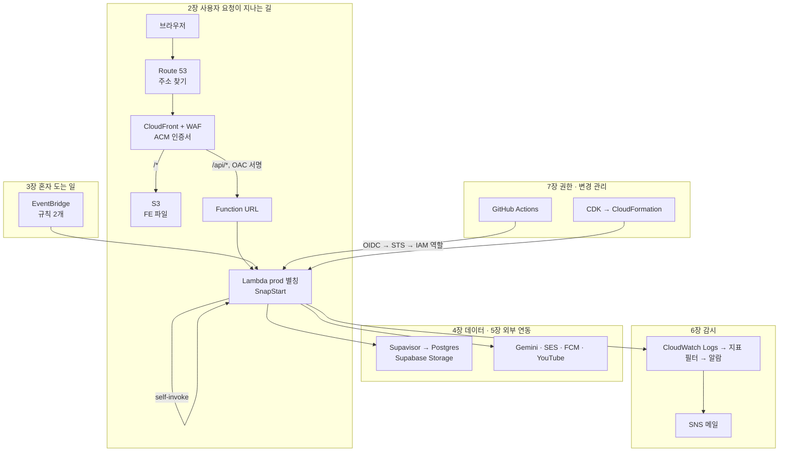

# 서비스 용어 사전 문서 만들기

<!-- plan-result:start — 이 블록만 병합 뒤에도 고칠 수 있다(CLAUDE.md §11). 아래는 승인된 계획 원문 -->

## 구현 결과

> #581 · 2026-11-07 대조 · 이탈 3 · 미구현 0 — 판정 근거(파일:줄)는 PR 본문 "계획 대비 구현"

- 이탈(사실에 맞춤): 8장 제목을 "문서에 나오지만 안 쓰는 것"에서 "안 쓰는 것"으로 바꿈. API Gateway·DynamoDB·Sentry는 FE·BE·infra 문서에 나오지 않아 원래 제목이 사실과 달랐다
- 이탈(구현 중 판단): 큰 항목의 고정 항목에 "알아 둘 것"을 더함. "다른 선택지"는 계획 예시의 EventBridge·Function URL과 BE 문서에 후보가 있는 self-invoke 3개 항목에만 둠. 다른 후보 기록이 있는 항목(업타임 점검의 UptimeRobot, SnapStart·워밍 핑의 프로비저닝 동시성)에는 두지 않음. 워밍 핑·백업·업타임 점검은 "무엇인가" 없이 "우리는"부터 쓰고, 리전·잡·이슈 알림·GitHub 부가 기능은 표로만 씀
- 이탈(공개 범위 규칙에 맞춤): 승인 원문 판단 표의 권한 경계 정책 이름을 스냅샷에서 지움. 공개 문서에 없는 이름이라 이 PR에서 처음 공개될 뻔했다(push 전에 고침)
- 계획에 없던 변경: 계획에 없던 사실을 해당 항목에 적음. FCM `getToken` deprecated 표시와 설치된 firebase 타입에 대체 API가 없다는 점, Gemini `generateContent` 레거시 표시, App Runner 신규 고객 종료, Supabase 이미지 변환·PgBouncer의 요금제 조건, Lambda "Event Function"·Web ACL "보호 팩"이라는 새 이름, 예약 규칙 페이지에 지원 종료 일정이 없다는 점
- 계획에 없던 변경: 장 표에 없던 딸린 용어 26개를 더함(호스팅 존, `$LATEST`, `BUFFERED`, RPO, Easy DKIM, 누락 데이터 처리, 템플릿 등). 제목 단위로는 약 50개, 표 행까지 세면 약 110개다
- 계획에 없던 변경: "읽는 법" 안내, OIDC 흐름 ASCII 그림, 9장의 BE `TRAFFIC-MANAGEMENT` 링크를 더함
- 계획에 없던 변경: 스냅샷의 `ONBOARDING.md` 링크 경로를 `docs/plans/` 위치에 맞게 고침

<!-- plan-result:end -->

> EventBridge, Function URL처럼 이 프로젝트가 실제로 쓰는 서비스 용어를 한곳에서 찾아보는 문서 `docs/SERVICE-GLOSSARY.md`를 만든다.

## Context

**왜 필요한가**: 운영 문서에 서비스 이름이 계속 나오는데 뜻을 모아 둔 곳이 없다. 사용자가 "백과사전 같은 문서"를 요청했다. 사용자는 아키텍처를 익히는 중이라, 처음 보는 사람 기준의 설명이 필요하다.

**지금 상황**(2026-11-07 확인):

- FE·BE `docs/`와 `link-sphere-infra`에 전용 용어집이 없다.
- 가장 가까운 [`ONBOARDING.md` §7 공통 용어](../ONBOARDING.md)는 코드 용어 위주이고, 인프라 용어는 OAC·SnapStart 둘뿐이다.
- 기능 문서마다 끝에 "용어 사전"이 있지만 그 기능 안의 말만 다룬다.
- 저장소 공개 범위: FE·BE는 공개, `link-sphere-infra`는 비공개(`gh repo view`).

### 조사 중 발견

고치는 일은 이 계획에 넣지 않고, 용어집에는 사실대로만 적는다(→ 판단 표 "발견한 문제").

| 발견                                                                               | 확인 근거                                                                                                                                                                                                                                                                | 왜 중요한가                                                                                                                                  |
| ---------------------------------------------------------------------------------- | ------------------------------------------------------------------------------------------------------------------------------------------------------------------------------------------------------------------------------------------------------------------------ | -------------------------------------------------------------------------------------------------------------------------------------------- |
| 알람 `link-sphere-api-app-5xx`의 데이터 출처인 지표 필터 `app-5xx`가 CDK 밖에 있다 | 운영에는 있음(`aws logs describe-metric-filters`), infra `lib/`에는 없음. BE `TRAFFIC-MANAGEMENT.md:383`의 CLI로 만들었다                                                                                                                                                | 필터가 지워지면 500이 나도 지표가 안 쌓여 알람이 못 울린다. drift 검사도 스택 안만 비교하므로 못 잡는다(README 설명으로 한 추론, 실험 안 함) |
| 우리가 쓰는 예약 규칙을 AWS가 레거시로 부른다                                      | [AWS 문서](https://docs.aws.amazon.com/eventbridge/latest/userguide/eb-create-rule-schedule.html)는 _"예약 규칙은 EventBridge의 레거시 기능이다"_ (번역)라고 쓰고 EventBridge Scheduler를 권장한다. 우리는 `CfnRule` + `scheduleExpression`(`baseline-stack.ts:125-146`) | 지금은 동작한다. 레포 문서에 이 언급이 없다                                                                                                  |
| `@supabase/supabase-js`가 선언만 돼 있다                                           | `package.json:62`에 있고 `src`·`scripts`·`e2e`·`vite.config.ts` import 0건. `SYSTEM-ARCHITECTURE.md:243`은 "Supabase client"라고 적음. 실제 업로드는 `fetch`                                                                                                             | 문서가 사실과 다르다                                                                                                                         |
| Secrets Manager 요금의 출처를 모른다                                               | 앱은 안 쓴다. BE `PERFORMANCE.md:500`에 7월 요금 기록이 있다. 로컬 키는 `ListSecrets`가 거부돼 확인 못 함                                                                                                                                                                | 용어집에 "미확인"으로 적는다                                                                                                                 |
| BE `DEPLOY.md:1472`만 PgBouncer라고 적음                                           | 다른 곳은 전부 Supavisor                                                                                                                                                                                                                                                 | 용어집에는 Supavisor로 쓴다                                                                                                                  |

## 판단이 필요했던 항목

| 항목                               | 결정                                                                                                                                           | 근거·기각한 대안                                                                                                                                                                                                                  |
| ---------------------------------- | ---------------------------------------------------------------------------------------------------------------------------------------------- | --------------------------------------------------------------------------------------------------------------------------------------------------------------------------------------------------------------------------------- |
| 어디에 두나                        | FE `docs/SERVICE-GLOSSARY.md`, 문서 종류는 레퍼런스                                                                                            | 프로젝트 공통 문서(`ONBOARDING`, `SYSTEM-ARCHITECTURE`)가 이미 FE에 있다. 기각: `ONBOARDING` §7 확장(길잡이는 사실을 새로 담지 않는다), Artifact·Claude Docs(레포와 따로 놀아 낡는다), infra 저장소(비공개라 다른 사람이 못 본다) |
| 범위                               | 실제 쓰는 클라우드·외부 서비스와 거기 딸린 개념, 그리고 문서에 나오지만 안 쓰는 것 표 하나                                                     | 사용자 요청이 "사용하고 있는 서비스 용어"다. 안 쓰는 것도 넣는 이유는 SQS·API Gateway가 문서에 나와 찾아보게 되기 때문이다. 기각: 코드 용어(FSD 등, §7에 유지), 개발 라이브러리(Testcontainers 등)                                |
| 항목 형식                          | 큰 서비스는 `###` 제목에 한 줄 비유 + 고정 항목(세부 계획 예시), 작은 개념은 표 한 행                                                          | 그 단어만 찾아 읽어도 이해되게 한다. 긴 산문으로 쓰지 않는다                                                                                                                                                                      |
| 값을 어디까지 적나                 | 리소스 이름과 이해에 필요한 주기까지 적고, 메모리·요금·모델 버전 등 자주 바뀌는 값은 정본 링크만                                               | SSOT. 값을 복제하면 원본이 바뀔 때 문서가 틀려진다                                                                                                                                                                                |
| 공개 레포에 적지 않을 것           | 계정 ID·ARN·배포 ID·존 ID·App Monitor ID·Supabase 프로젝트 ref·알림 메일·CloudFront 기본 도메인. 리소스 이름도 이미 공개 문서에 있는 것만 쓴다 | FE는 공개 레포이고 이력에서 못 지운다(#301). 예: 권한 경계 정책의 실제 이름은 공개 문서에 0건이라 이름 없이 "권한 경계"로 설명한다. infra 파일은 링크 대신 파일 경로를 글자로 적는다(비공개라 링크가 404)                         |
| 공식 정의                          | 실제로 연 공식 문서만 인용하고, 번역 표기와 링크를 단다                                                                                        | CLAUDE.md §10                                                                                                                                                                                                                     |
| `ONBOARDING` §7의 OAC·SnapStart 행 | 두 행을 빼고 용어집을 가리키는 한 줄을 넣는다                                                                                                  | 같은 표의 SSOT 행이 말하는 대로 정의를 한곳에 둔다                                                                                                                                                                                |
| 발견한 문제                        | 이 PR은 문서만 다루고 고치지 않는다                                                                                                            | CLAUDE.md §3. 이어서 할 일은 "남은 것"                                                                                                                                                                                            |

## 세부 계획

### 문서 구조

`docs/SERVICE-GLOSSARY.md`의 §1에 들어갈 지도다. 각 묶음이 아래 장과 대응한다.

| 장                            | 다루는 용어                                                                                                                                                                                 |
| ----------------------------- | ------------------------------------------------------------------------------------------------------------------------------------------------------------------------------------------- |
| 머리말                        | 문서 성격·대상 독자·읽고 나면·마지막 검토                                                                                                                                                   |
| 1. 지도와 찾아보기            | 위 그림, 분류별 용어 링크, 리전(도쿄·서울·us-east-1을 왜 나눠 쓰는가)                                                                                                                       |
| 2. 요청이 지나는 길           | Route 53, ACM, CloudFront(배포·오리진·동작·무효화), CloudFront Functions, OAC, WAF(Web ACL·관리형 규칙·속도 제한), S3, Lambda(콜드스타트), SnapStart, 버전·별칭, Function URL               |
| 3. 혼자 도는 일               | EventBridge(규칙·타깃·`rate`·`cron`), 워밍 핑, self-invoke, 잡                                                                                                                              |
| 4. 데이터                     | Supabase, Postgres, pgvector, Supavisor(6543·5432), RLS, Supabase Storage(서명 URL), 백업                                                                                                   |
| 5. 외부 연동                  | Gemini(요약·임베딩), FCM, VAPID, SES(DKIM), YouTube Data API                                                                                                                                |
| 6. 감시                       | CloudWatch(Logs·Logs Insights·지표·지표 필터·알람), SNS, CloudWatch RUM, 업타임 점검, 이슈 알림, drift, CloudTrail, Cost Explorer                                                           |
| 7. 권한·변경 관리             | IAM(사용자·역할·정책·권한 경계), STS, OIDC, CDK, CloudFormation(스택·Retain), CloudShell, GitHub Actions, 룰셋, GitHub App, Dependabot, GitHub Pages                                        |
| 8. 문서에 나오지만 안 쓰는 것 | API Gateway, SQS·DLQ, DynamoDB, Secrets Manager, Parameter Store, 예약·프로비저닝 동시성, App Runner, Lambda Web Adapter, Sentry, Budgets, Cognito, VPC·NAT. 각각 안 쓰는 이유나 상태 한 줄 |
| 9. 관련 문서                  | `ONBOARDING`, `SYSTEM-ARCHITECTURE`, FE·BE `DEPLOY`, 용어가 많은 기능 문서                                                                                                                  |

### 항목 형식 예시

요청에 나온 두 용어로 쓴 예시다. 나머지도 이 모양을 따른다.

> **EventBridge**: 정해진 시각이 되면 다른 서비스를 대신 불러 주는 AWS 알람 시계.
>
> - **무엇인가**: [AWS 문서](https://docs.aws.amazon.com/eventbridge/latest/userguide/eb-rules.html)는 _"규칙은 처리를 위해 어떤 이벤트를 어떤 타깃으로 보낼지 지정한다"_ (번역)고 쓴다. 규칙이 "언제"를, 타깃이 "누구를"을 정한다.
> - **우리는**: 규칙 2개가 `prod` Lambda를 부른다. `link-sphere-api-warmup`은 5분마다 워밍 핑을, `link-sphere-feed-crawl`은 약 4일마다 탈퇴 만료 정리·RSS 수집·고아 이미지 정리를 부른다. 뒤쪽 셋은 규칙을 공유해서 주기를 따로 못 바꾼다.
> - **없으면**: 콜드스타트가 늘고 RSS 수집과 정리 작업이 멈춘다.
> - **다른 선택지**: EventBridge Scheduler. AWS는 우리가 쓰는 예약 규칙을 레거시로 부르고 이쪽을 권장한다.
> - **정본**: BE `DEPLOY.md`, infra `lib/baseline-stack.ts`

> **Function URL**: Lambda 함수에 붙이는 전용 HTTP 주소.
>
> - **무엇인가**: [AWS 문서](https://docs.aws.amazon.com/lambda/latest/dg/urls-configuration.html)는 _"함수 URL은 Lambda 이벤트 함수 전용 HTTP(S) 엔드포인트다"_ (번역)라고 쓴다. 별칭이나 `$LATEST`에만 붙일 수 있다.
> - **우리는**: `link-sphere-api`의 `prod` 별칭에 붙어 있고 인증 방식은 `AWS_IAM`이다. CloudFront가 OAC로 서명한 요청만 통과하고, 직접 부르면 403이다.
> - **없으면**: CloudFront가 BE로 요청을 넘길 입구가 없다.
> - **다른 선택지**: API Gateway(우리는 안 쓴다).
> - **정본**: BE `DEPLOY.md`, FE `DEPLOY.md`

### 변경 파일

| 위치                                               | 변경 내용                                                                                        |
| -------------------------------------------------- | ------------------------------------------------------------------------------------------------ |
| `docs/SERVICE-GLOSSARY.md` (신규)                  | 위 구조대로 작성. 약 50개 용어                                                                   |
| `README.md` `## 문서` 레퍼런스 목록                | 새 문서 한 줄 추가                                                                               |
| `docs/ONBOARDING.md` §7                            | OAC·SnapStart 행 삭제, 인프라·외부 서비스 용어는 새 문서를 보라는 한 줄 추가, 마지막 검토일 갱신 |
| `docs/ONBOARDING.md` §9                            | 관련 문서에 새 문서 추가                                                                         |
| `docs/plans/2026-11-07-service-glossary.md` (신규) | 이 계획 스냅샷 + 구현 결과 블록(§11)                                                             |

### 작업 순서

1. `EnterWorktree` 후 `.env` 복사와 `pnpm install`. 미푸시 커밋은 0건으로 확인했다.
2. 서비스별 공식 문서를 읽어 정의를 확인한다(`web-fetch` 서브에이전트). Function URL의 호출 모드 등 아직 안 읽은 페이지가 포함된다.
3. 문서를 쓰고, `README.md`와 `ONBOARDING.md`를 연결한다.
4. 아래 검증을 돌리고 틀린 곳을 고친다.
5. 계획 스냅샷을 커밋하고 `plan-verifier`로 대조한 뒤, `## 계획 대비 구현`을 넣어 PR을 연다.
6. CI 확인 → squash 병합 → 워크트리 정리. `docs/`·`README.md`만 바뀌면 배포가 도는지 `deploy.yml` 경로 필터로 확인하고, 안 돌면 병합 확인까지로 끝낸다.

## 영향 범위

- **코드·데이터 계약**: 변경 없음. CRUD 영향 없음.
- **기존 문서**: `ONBOARDING` §7에서 두 행이 빠진다. 다른 기능 문서의 "용어 사전"은 건드리지 않는다.
- **공개 노출**: FE 공개 레포에 올라가므로 위 "공개 레포에 적지 않을 것"을 검증에서 grep으로 확인한다.
- **낡을 위험**: BE·infra 링크는 `pnpm check:docs`가 검사하지 못한다. 값 대신 링크를 두는 것으로 줄이고, 문서 감사 때 `docs/*.md`에 함께 들어간다.

## 검증 방법

1. `pnpm check:docs` 통과.
2. 사실 대조: 새 서브에이전트가 "우리는" 줄을 전부 코드·공개 문서와 대조하고, 공식 문서 링크가 인용과 맞는지 확인한다. 틀린 곳을 고친다.
3. 독자 점검: 정의 없이 쓰인 용어가 있는지, 찾아보기의 앵커가 실제 제목과 맞는지 확인한다.
4. 금지 값 grep: 12자리 계정 ID, `arn:aws`, 알림 메일, Supabase ref, `cloudfront.net` 도메인이 0건인지 확인한다.
5. PR 브랜치 파일을 GitHub에서 열어 Mermaid가 도형으로 그려지는지 확인한다.

## 남은 것

- (제가) `app-5xx` 지표 필터를 CDK로 옮기는 계획 — 저장소와 작업이 달라 이 PR과 분리해 따로 승인받는다.
- (제가) `@supabase/supabase-js` 제거와 `SYSTEM-ARCHITECTURE.md:243` 정정 제안 — 문서 요청과 무관한 변경이라 분리한다.
- (제가) 예약 규칙을 EventBridge Scheduler로 옮길지 비교 자료를 정리해 제안 — 지금은 동작해서 급하지 않고, 옮기면 권한 구성이 달라질 수 있어 조사가 먼저다.
- Secrets Manager 요금 출처는 로컬 키로 확인하지 못해 용어집에 "미확인"으로 남긴다.
