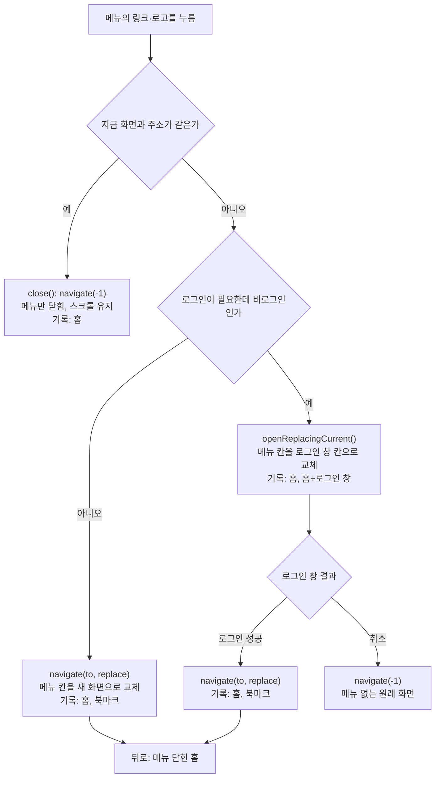

# 모바일 메뉴에서 이동한 뒤 뒤로 오면 메뉴가 다시 열리는 문제

<!-- plan-result:start — 이 블록만 병합 뒤에도 고칠 수 있다(CLAUDE.md §11). 아래는 승인된 계획 원문 -->

## 구현 결과

> #585 · 2026-11-07 대조 · 이탈 1 · 미구현 0 — 판정 근거(파일:줄)는 PR 본문 "계획 대비 구현"

- 이탈(테스트 구성): `openReplacingCurrent`의 "뒤로가면 그 아래 엔트리로 간다" 확인을 계획한 `useHistoryOverlay.test.tsx`가 아니라 `useProtectedNavigate.test.tsx`에 넣음. 앞 파일은 `useNavigate`를 spy로 바꿔 둬 실제 뒤로가기를 돌릴 수 없어 교체 호출 옵션만 확인한다
- 미구현·계획에 없던 변경 없음

<!-- plan-result:end -->

> 모바일 메뉴(사이드바 드로어)의 링크가 "메뉴 열림" 히스토리 엔트리를 남기지 않게 해, 뒤로 오면 메뉴가 닫힌 원래 화면이 보이게 한다. 메뉴를 연 채 뒤로가기를 누르면 메뉴만 닫히는 동작은 유지한다.

## Context

**요청(2026-11-07)**: 모바일 홈에서 메뉴를 열어 북마크로 간 뒤 뒤로가기를 누르면 홈으로는 잘 돌아오지만 메뉴가 다시 열려 불편하다. 왜 달라졌는지, 되돌릴 수 없는지 확인해 달라.

### 가설

- 11-06 #558(메뉴 숨김·포커스·Esc)이 원인이다 → **기각.** `NavItem` 클릭 코드가 `7bb1f897`부터 `origin/main`까지 같다(커밋별 대조). #558은 여닫는 경로를 바꾸지 않았다.
- 메뉴 열림 상태를 히스토리에 둔 2026-08-07 설계에서 메뉴 링크만 엔트리를 정리하지 않았다 → **채택.**

### 근본 원인

- `7bb1f897`(2026-08-07)가 메뉴 열림 상태를 zustand 값에서 `location.state.sidebarOpen`으로 옮겼다. 메뉴를 연 채 뒤로가기를 누르면 페이지가 바뀌던 문제를 고치기 위해서다(`docs/DECISIONS.md` 2026-08-07 "뒤로가기 정책").
- 같은 커밋에서 메뉴 링크의 `close()` 호출을 뺐다. `navigate(-1)`과 다음 이동이 겹치는 레이스 때문이다. 그래서 링크를 누르면 메뉴 엔트리가 기록에 그대로 남는다: `[홈, 홈+메뉴, 북마크]`.
- 뒤로가기는 `홈+메뉴`로 돌아가고 `useHistoryOverlay.ts:17`이 `isOpen=true`로 읽어 메뉴가 다시 열린다.
- 같은 문제를 다른 두 곳은 이미 `replace`로 막았고 메뉴만 빠져 있다: `useMobileSearchPanel.ts:45-46`, `useProtectedNavigate.ts:25-26`.

위 원인은 코드 추적으로 확정했고 브라우저 재현은 아직 하지 않았다(Plan 모드). 검증 방법 1·2에서 현재 코드와 #558 직전 커밋의 동작을 재현한다.

### 재현 절차

1. 모바일 폭, 로그인 상태로 `/post`에서 햄버거를 눌러 메뉴를 연다.
2. 메뉴의 "북마크"를 누른다.
3. 뒤로가기를 누른다 → `/post`로 오지만 메뉴가 열려 있다.

비로그인도 같은 증상이 난다. 메뉴에서 "북마크"를 누르면 로그인 창이 메뉴 엔트리 위에 쌓이므로 로그인 후 뒤로 와도, 창을 취소해도 메뉴가 다시 열린다.

### 고친 뒤 흐름

## 판단이 필요했던 항목

| 항목                                   | 결정                                                                                                | 근거·기각한 대안                                                                                                                                                                                                                                                                              |
| -------------------------------------- | --------------------------------------------------------------------------------------------------- | --------------------------------------------------------------------------------------------------------------------------------------------------------------------------------------------------------------------------------------------------------------------------------------------- |
| 고치는 방식                            | 메뉴 링크만 `replace`로 이동(사용자 선택, 11-07)                                                    | 레포 선례 두 곳과 같은 방식이고, 이 흐름의 기록이 8월 이전과 같아진다. 기각: 8월 커밋 통째 되돌리기(메뉴를 연 채 뒤로가기를 누르면 페이지가 바뀌는 문제 재발). 기각: 그대로 두기. 기각: 떠나기 전에 메뉴 엔트리의 state만 지우기(`[홈, 홈, 북마크]`가 되어 뒤로가기 한 번이 화면을 안 바꾼다) |
| 비로그인 경로                          | 같이 고침. 로그인 창이 메뉴 엔트리를 대체(사용자 선택, 11-07)                                       | 취소하면 메뉴로 돌아오지 않는다. 8월 이전 동작과 같다(`7bb1f897~1`은 메뉴를 닫고 창을 열었다). 메뉴 엔트리를 유지한 채 로그인 성공 때만 지우는 방법은 `navigate(-1)`과 `navigate`가 겹치는 레이스라 쓰지 않는다(`docs/DECISIONS.md` 2026-08-07)                                               |
| 지금 화면을 가리키는 항목              | 메뉴만 닫음(사용자 선택, 11-07)                                                                     | 지금은 `[홈, 홈]`이 남아 다음 뒤로가기 한 번이 화면을 안 바꾼다(react-router-dom 6.30.3 `dist/index.js:1012`가 같은 주소를 교체로 처리). 대가: 메뉴의 "홈"을 눌러도 맨 위로 올라가지 않는다. 사용자가 이 대가를 알고 선택했다. 하단 탭바의 "홈"은 그대로 맨 위로 간다                         |
| 드로어 로고 링크                       | 메뉴 링크와 같이 처리                                                                               | 같은 드로어 안의 `/post` 링크라 같은 증상이 난다                                                                                                                                                                                                                                              |
| `open` 대신 새 함수 추가               | `useHistoryOverlay`에 `openReplacingCurrent`를 더함                                                 | `Navbar.tsx:90`이 `onClick={openSidebar}`로 넘겨 `open`에 인자를 받으면 이벤트가 들어간다                                                                                                                                                                                                     |
| `useProtectedNavigate` 인자            | 반환 함수에 선택 인자 `options?: { replace?: boolean }` 추가. 이 계획 승인이 시그니처 변경 승인이다 | 기존 호출 3곳(`BottomTabBar`·`pages/post/index.tsx`·`Sidebar`)은 인자 없이 그대로 동작한다. 기각: `NavItem`에 로그인 분기를 복사(가드 로직 중복)                                                                                                                                              |
| 로그인이 풀린 채 그 화면에 머무는 경우 | 지금 화면 항목을 누르면 메뉴만 닫는다(로그인 창을 띄우지 않음)                                      | 같은 화면으로 가는 이동이고, 헤더의 로그인 버튼은 그대로 있다. 조건을 더 넣을 만한 경로가 아니다                                                                                                                                                                                              |

외부 근거: [Material 3 내비게이션 드로어 지침](https://m3.material.io/components/navigation-drawer/guidelines)은 항목을 고르면 드로어를 닫는 방식을 말하지만 뒤로가기는 다루지 않는다. 원문 페이지가 읽히지 않아 검색 결과 요약으로만 확인했다. 이번 판단의 근거는 레포 선례다.

## 세부 계획

| 위치                                                    | 변경 내용                                                                                                                                                                                                                                                                                                                                            |
| ------------------------------------------------------- | ---------------------------------------------------------------------------------------------------------------------------------------------------------------------------------------------------------------------------------------------------------------------------------------------------------------------------------------------------- |
| `src/shared/hooks/useHistoryOverlay.ts`                 | 지금 엔트리를 오버레이 엔트리로 교체하며 여는 `openReplacingCurrent` 추가(`replace: true`, `preventScrollReset: true`). `open`·`close` 동작은 그대로 두고 JSDoc에 "오버레이에서 다른 화면으로 떠날 때는 엔트리를 교체한다"를 적는다                                                                                                                  |
| `src/entities/auth/hooks/useProtectedNavigate.ts`       | 반환 함수에 `options?: { replace?: boolean }`. 로그인 상태면 `navigate(to, options)`. 비로그인이고 `replace`면 `openReplacingCurrent()`, 아니면 기존 `open()`                                                                                                                                                                                        |
| `src/widgets/layout/sidebar/ui/Sidebar.tsx`             | `NavItem`에 `inDrawer` prop 추가, 드로어 인스턴스(`:240`)에만 넘긴다. 같은 파일 지역 훅으로 `replace` 값과 "지금 화면이면 `close()`" 처리를 모아 `NavItem`과 `SidebarHeader` 로고(`:112`)가 함께 쓴다. `replace`는 드로어일 때만 `true`, 아니면 `undefined`(`false`를 넘기면 라이브러리의 같은 주소 교체가 꺼진다). `:29-32` 주석을 새 동작에 맞춘다 |
| `src/shared/hooks/useHistoryOverlay.test.tsx`           | 새 함수: 엔트리를 교체하고, 뒤로가면 그 아래 엔트리로 간다                                                                                                                                                                                                                                                                                           |
| `src/entities/auth/hooks/useProtectedNavigate.test.tsx` | `replace` 옵션: 로그인 상태 이동, 비로그인 창 열기·취소·성공 뒤 뒤로가기                                                                                                                                                                                                                                                                             |
| `src/widgets/layout/sidebar/ui/Sidebar.test.tsx`        | 드로어 링크: 다른 화면은 교체, 지금 화면은 메뉴만 닫기. 데스크톱 인스턴스는 기존 push 유지                                                                                                                                                                                                                                                           |
| `e2e/sidebar-drawer-back.mobile.spec.ts` (신규)         | 메뉴 → 북마크 → 뒤로(메뉴 닫힘, 스크롤 유지) / 메뉴 연 채 뒤로(메뉴만 닫힘) / 메뉴의 "홈"(메뉴만 닫힘, 스크롤 유지, 다음 뒤로가기가 이전 화면) / 드로어 로고 / 비로그인 취소·로그인 성공 뒤 뒤로 / 작성 중 이탈 확인창을 거친 뒤 뒤로                                                                                                                |
| `docs/FE-ARCHITECTURE.md` §25                           | 오버레이 안 링크는 엔트리를 교체한다는 규칙 한 줄                                                                                                                                                                                                                                                                                                    |
| `docs/AUTH.md` `:607-614`                               | `useProtectedNavigate` 요지 코드와 줄 번호를 새 분기에 맞춘다                                                                                                                                                                                                                                                                                        |
| `docs/TESTING.md` `:1075` 아래                          | 새 e2e 행                                                                                                                                                                                                                                                                                                                                            |
| `e2e/protected-nav.spec.ts` 주석                        | `useProtectedNavigate.ts`를 가리키는 줄 번호가 바뀌면 맞춘다                                                                                                                                                                                                                                                                                         |
| `CHANGELOG.md` `[Unreleased]`                           | `changelog-release` skill 형식으로 수정 항목 추가                                                                                                                                                                                                                                                                                                    |
| `docs/plans/2026-11-07-sidebar-back-reopen.md` (신규)   | 이 계획 스냅샷, H1 아래 `구현 결과` 블록                                                                                                                                                                                                                                                                                                             |

작업 순서: 워크트리 생성·부트스트랩 → 실패하는 e2e 작성·재현 → 구현 → 검증 → plan-verifier 대조 → PR → CI 확인 → squash 병합 → 배포 성공 확인 → 워크트리 정리.

## 영향 범위

**CRUD**: 서버 데이터와 API는 바뀌지 않는다. 브라우저 히스토리 스택 모양만 바뀐다.

**기존 기능 회귀** (`pnpm graph:focus --text`로 사용처 확인):

| 동작                                         | 소유 파일                                                     | 위험과 확인                                                                                                                                                                                                                                                        |
| -------------------------------------------- | ------------------------------------------------------------- | ------------------------------------------------------------------------------------------------------------------------------------------------------------------------------------------------------------------------------------------------------------------ |
| 메뉴를 연 채 뒤로가기·X·Esc·딤 탭            | `Sidebar.tsx`, `useHistoryOverlay.ts`                         | `close`를 안 건드린다. `sidebar-drawer-focus`·새 e2e                                                                                                                                                                                                               |
| 메뉴에서 이동한 화면의 포커스(#558)          | `Sidebar.tsx:163-182`                                         | 메뉴가 닫히는 시점은 같다. 기존 e2e "URL 칸의 포커스를 뺏지 않는다"                                                                                                                                                                                                |
| 뒤로 왔을 때 피드 스크롤 복원                | `RootLayout.tsx`, `@remix-run/router` 1.23.2 `router.js:1937` | 돌아오는 칸이 `홈+메뉴`에서 `홈`으로 바뀐다. `홈` 칸의 위치는 메뉴를 열 때 저장된다. `post-list-scroll-restore.mobile`·새 e2e                                                                                                                                      |
| 다른 오버레이의 `open`·`close` (사용처 10곳) | `useHistoryOverlay.ts`                                        | 함수 추가뿐이다. 사용처: `useLoginDialog`, `Navbar`, `Sidebar`, `MobileCommentBar`, `CreatePostForm`, `useAuthGuard`, `useProtectedNavigate`, `useBackClosableOverlay`, `imageViewer.store`, `ImageViewer`. `useHistoryOverlay.test`·`useBackClosableOverlay.test` |
| 하단 탭바·피드 등록 버튼의 이동              | `BottomTabBar.tsx`, `pages/post/index.tsx`                    | 인자 없이 호출해 그대로다. `protected-nav`, `useProtectedNavigate.test`                                                                                                                                                                                            |
| 로그인 창 성공·취소·회원가입 이동            | `useLoginDialog.ts`                                           | 아래 칸이 `홈+메뉴`에서 `홈`으로 바뀌는 것 말고는 같다. `protected-nav`, 새 e2e                                                                                                                                                                                    |
| 작성 중 이탈 확인                            | `useUnsavedChangesGuard.ts`                                   | 막힌 이동은 같은 옵션으로 다시 보낸다(`router.js:1870`). `unsaved-changes`, 새 e2e                                                                                                                                                                                 |
| 앱 새 버전 감지 뒤 이동 시 새로고침          | `useNewVersionReload.ts`, `router-events.ts`                  | 뒤로가기(POP)가 아니면 교체도 이동으로 본다(`router-events.ts:57`). 코드 경로 변경 없음                                                                                                                                                                            |
| 메뉴의 "홈"을 눌러 맨 위로                   | `Sidebar.tsx`                                                 | **의도한 변경.** 메뉴만 닫히고 스크롤은 그대로다. 하단 탭바는 그대로 맨 위로 간다                                                                                                                                                                                  |

이전 동작을 단정하는 문서: `Sidebar.tsx:29-32` 주석, `docs/AUTH.md` 요지 코드. `docs/DECISIONS.md`는 append-only라 고치지 않는다.

## 검증 방법

1. **수정 전 재현**: 새 e2e를 먼저 쓰고 `pnpm test:e2e e2e/sidebar-drawer-back.mobile.spec.ts --project=mobile-chrome`이 현재 코드에서 실패하는지 확인한다. 메뉴를 연 채 뒤로가기 케이스는 수정 전에도 통과해야 한다.
2. **#558과 무관한지 확인**: #558 직전 커밋(`936d0d54~1`)을 임시 워크트리로 받아 같은 시나리오를 1회 돌린다. 당시 문구 키에 맞춰 일회용 스크립트로 돌리고, 끝나면 임시 워크트리를 지운다. 사용자에게 결과를 알린다.
3. **수정 후**: 위 e2e 전부 통과.
4. **회귀 e2e**: `e2e/sidebar-drawer-focus`, `e2e/sidebar-drawer-scroll-lock`, `e2e/protected-nav`, `e2e/post-list-scroll-restore`, `e2e/unsaved-changes`, `e2e/bookmark.mobile`.
5. **정적 검사·단위 테스트**: `pnpm type-check`, `pnpm test`, `pnpm lint`, `pnpm check:deps`, `pnpm check:docs`.
6. **브라우저 녹화**: `browser-verification` skill로 모바일 폭에서 메뉴 → 북마크 → 뒤로, 메뉴의 "홈"을 녹화해 커밋 전에 보여 준다.
7. **계획 대조**: `plan-verifier`에 스냅샷과 `git diff origin/main...HEAD`를 주고 대조한다. 결과를 PR 본문 `## 계획 대비 구현`과 스냅샷의 `구현 결과` 블록에 남긴다. `pnpm check:pr-body`로 본문을 확인한다.
8. **배포**: 병합한 SHA의 `Frontend Deploy (S3 + CloudFront)`가 success인지 확인한 뒤 보고하고 워크트리를 지운다.
